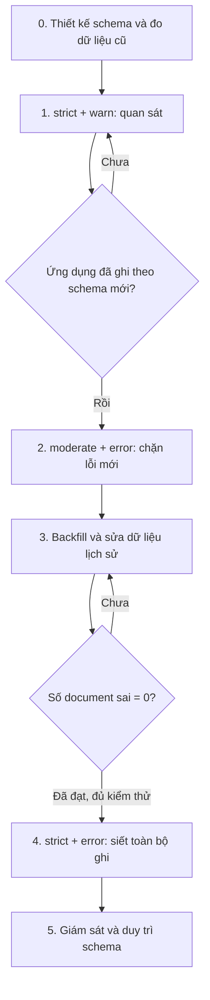

# Triển khai schema validation theo giai đoạn

## Mục tiêu và bối cảnh

Trong **Spring Data MongoDB**, entity Java, `MongoTemplate` và repository giúp ứng dụng đọc/ghi document, nhưng một collection MongoDB vẫn có thể chứa nhiều dạng tài liệu khác nhau: dữ liệu từ bản ứng dụng cũ, import thủ công, batch ETL hoặc dịch vụ khác. Khi đổi cấu trúc document, chỉ thay đổi class Java có thể khiến dữ liệu lịch sử không còn khớp với mô hình mới.

**Schema validation** ở phía MongoDB đặt quy tắc trực tiếp trên collection bằng `validator` (thường sử dụng `$jsonSchema`). Mọi client viết vào collection đều chịu ảnh hưởng, bao gồm repository, `MongoTemplate`, MongoDB Java Driver, `mongosh` và các pipeline ghi dữ liệu. Vì vậy thay đổi validator là một phần của **migration dữ liệu**, cần triển khai theo giai đoạn để tránh chặn ứng dụng đang chạy.

Sau bài học, bạn có thể:

- Phân biệt `validationLevel` với `validationAction` và chọn tổ hợp phù hợp ở mỗi giai đoạn.
- Viết schema BSON hợp lệ, kiểm tra document hiện có trước khi siết quy tắc.
- Bật/cập nhật validator bằng `collMod` hoặc `MongoTemplate.executeCommand(...)`.
- Di chuyển từ quan sát vi phạm sang chặn vi phạm mới, làm sạch dữ liệu cũ rồi áp dụng quy tắc chặt.
- Kiểm thử, giám sát và có phương án xử lý khi một thay đổi làm phát sinh lỗi ghi.

> Phạm vi bài học: schema validation của **MongoDB collection**, không phải xác thực request HTTP hay Bean Validation ở tầng Java. Các ví dụ dùng `mongosh` và Spring Data MongoDB; hãy chạy trên collection thử nghiệm trước khi áp dụng lên dữ liệu thật.

## 1. Vì sao không bật `strict + error` ngay?

Giả sử collection `orders` có ba kiểu document:

```javascript
// Dữ liệu thử nghiệm trong database riêng, không chạy nguyên khối trên production.
db.orders.insertMany([
  {
    _id: "ord-101",
    customerId: "c-101",
    totalCents: NumberLong("12500"),
    status: "NEW"
  },
  {
    _id: "ord-102",
    // Document cũ chưa có customerId.
    totalCents: NumberLong("8500"),
    status: "NEW"
  },
  {
    _id: "ord-103",
    customerId: "c-103",
    // Bản cũ lưu số tiền ở dạng chuỗi.
    totalCents: "4900",
    status: "NEW"
  }
]);
```

Phiên bản ứng dụng mới muốn mọi đơn hàng có `customerId` là chuỗi, `totalCents` là BSON `long` không âm, và `status` thuộc `NEW`, `PAID` hoặc `CANCELLED`. Khi đặt `validationLevel: "strict"` và `validationAction: "error"`, MongoDB sẽ từ chối ghi nếu document sau ghi không đạt điều kiện. Điều này bảo vệ cấu trúc dữ liệu mới, nhưng một cập nhật nhỏ lên document cũ thiếu `customerId` cũng có thể thất bại.

Điểm cần hiểu: **bật `strict` không tự sửa hoặc kiểm tra ngược toàn bộ dữ liệu cũ**. Các document không hợp lệ có thể tiếp tục nằm trong collection cho tới khi chúng được cập nhật. Do đó kế hoạch an toàn là quan sát, sửa dữ liệu và kiểm chứng trước khi chặn toàn bộ.

## 2. Hiểu hai nút điều khiển của validator

MongoDB quản lý validation bằng các thành phần:

| Thành phần | Giá trị thường dùng | Tác dụng |
| --- | --- | --- |
| `validator` | `{ $jsonSchema: { ... } }` | Xác định cấu trúc document hợp lệ |
| `validationLevel` | `off` | Không áp dụng validator khi insert/update |
| `validationLevel` | `moderate` | Kiểm tra insert mới và update document **đang hợp lệ**; update document **đã không hợp lệ** có thể được phép |
| `validationLevel` | `strict` | Kiểm tra mọi insert và update; không tự quét dữ liệu có sẵn |
| `validationAction` | `warn` | Cho phép thao tác ghi dù vi phạm; ghi cảnh báo vào log MongoDB khi quy tắc được áp dụng |
| `validationAction` | `error` | Từ chối thao tác ghi vi phạm khi quy tắc được áp dụng |

`validationLevel` trả lời **“kiểm tra những thao tác nào?”**; `validationAction` trả lời **“xử lý thế nào nếu không đạt?”**. Ví dụ `moderate + warn` không thể phát hiện mọi cập nhật trên document vốn đã sai, bởi `moderate` miễn kiểm tra nhóm đó. Giai đoạn đo lường ban đầu thường dùng `strict + warn` để quan sát tất cả thao tác ghi được thực hiện.

Một số phiên bản MongoDB có thêm lựa chọn:

- `validationAction: "errorAndLog"` được bổ sung trong MongoDB **8.1**: từ chối ghi vi phạm và ghi log.
- `validationLevel: "constraint"` được bổ sung trong MongoDB **9.0**: dùng mức kiểm tra mạnh hơn, yêu cầu toàn bộ collection đạt schema khi chuyển lên mức này, có quy trình chuẩn bị riêng và chỉ đi cùng `error`/`errorAndLog`.

Quy trình chính của bài dùng `warn`, `error`, `moderate` và `strict` để phù hợp với các deployment MongoDB hỗ trợ chúng. Luôn đối chiếu phiên bản MongoDB Server trước khi chọn tính năng mới.

## 3. Lộ trình triển khai theo giai đoạn



| Giai đoạn | Cấu hình | Mục đích | Điều kiện để tiếp tục |
| --- | --- | --- | --- |
| 0. Khảo sát | Chưa đổi cấu hình | Biết dữ liệu sai, API ghi, phạm vi ảnh hưởng | Đã phân loại vi phạm và thống nhất schema |
| 1. Quan sát | `strict + warn` | Ghi nhận những thao tác vi phạm, vẫn cho ghi | Log vi phạm và ứng dụng đã được xử lý |
| 2. Bảo vệ dữ liệu mới | `moderate + error` | Chặn insert sai và update phá document hợp lệ | Không còn luồng ghi mới bị chặn ngoài dự kiến |
| 3. Backfill | Giữ `moderate + error` | Sửa document lịch sử sai schema | Số bản ghi vi phạm về 0, dữ liệu được kiểm chứng |
| 4. Thắt chặt | `strict + error` | Mọi ghi phải đạt schema | Kiểm thử tương thích và theo dõi lỗi thành công |

Đây là các **cổng quyết định vận hành**, không phải lịch trình cố định theo ngày. Hệ thống nhiều writer, dữ liệu lớn hoặc có ETL chạy ban đêm có thể cần thời gian quan sát và backfill lâu hơn.

## 4. Giai đoạn 0 — Viết schema đích và kiểm kê dữ liệu

### 4.1. Định nghĩa `$jsonSchema`

Mở `mongosh` tại database thử nghiệm có collection `orders`. Schema đích minh họa:

```javascript
const targetSchema = {
  bsonType: "object",
  required: ["customerId", "totalCents", "status"],
  properties: {
    customerId: {
      bsonType: "string",
      minLength: 1,
      description: "customerId phải là chuỗi không rỗng"
    },
    totalCents: {
      bsonType: "long",
      minimum: 0,
      description: "totalCents phải là BSON long không âm"
    },
    status: {
      enum: ["NEW", "PAID", "CANCELLED"],
      description: "status phải thuộc tập trạng thái được hỗ trợ"
    }
  }
};
```

Lưu ý:

- `required` phân biệt trường **không tồn tại** với trường có giá trị. Quy tắc của một field vẫn cần kiểm tra cả kiểu và giá trị để loại `null` khi không được phép.
- BSON `int`, `long`, `double` và `decimal` là các kiểu khác nhau. Đặt `bsonType: "long"` chỉ khi các writer thực sự lưu giá trị dưới dạng BSON 64-bit integer. Nếu dữ liệu có chủ đích dùng nhiều kiểu số, cân nhắc danh sách `bsonType` và kiểm chứng quy tắc nghiệp vụ.
- `additionalProperties` mặc định cho phép field ngoài schema. Việc đặt `additionalProperties: false` có thể chặn `_id`, `_class` của Spring Data hoặc field mở rộng nếu quên liệt kê chúng; chỉ siết khi thật sự cần và đã kiểm tra dữ liệu.
- MongoDB triển khai một **tập con JSON Schema draft 4** với từ khóa bổ sung `bsonType`; không dùng các keyword không được hỗ trợ như `default` để kỳ vọng MongoDB tự điền giá trị.
- Validator kiểm tra hình dạng document, không bảo đảm khóa ngoại tồn tại hay giá trị là duy nhất. Nhu cầu unique phải dùng unique index; nghiệp vụ chéo collection cần cơ chế khác.

### 4.2. Đếm và lấy mẫu những document không đạt schema

Có thể dùng cùng schema ở trên như điều kiện tìm kiếm. Toán tử `$nor` đảo kết quả của `$jsonSchema`:

```javascript
const invalidFilter = {
  $nor: [{ $jsonSchema: targetSchema }]
};

const total = db.orders.countDocuments({});
const invalidCount = db.orders.countDocuments(invalidFilter);
printjson({ total, invalidCount, validCount: total - invalidCount });

db.orders.find(
  invalidFilter,
  { _id: 1, customerId: 1, totalCents: 1, status: 1 }
).limit(20).forEach(printjson);
```

Đối với dữ liệu mẫu, `ord-102` thiếu `customerId` và `ord-103` có `totalCents` sai kiểu; vì vậy có hai document không đạt schema. Trong thực tế nên chia số vi phạm theo loại (thiếu field, sai BSON type, giá trị ngoài enum), nguồn dữ liệu và thời điểm ghi để quyết định cách sửa.

Truy vấn `$jsonSchema` có thể tốn tài nguyên khi duyệt collection lớn; chạy ở thời điểm phù hợp, giám sát tải hệ thống và phân nhỏ công việc nếu cần. **Log `warn` không phải thống kê đầy đủ dữ liệu cũ**: document cũ chưa được ghi lại sẽ không tự tạo cảnh báo. Cần phép đo độc lập bằng query như trên.

### 4.3. Kiểm kê các writer

Trước khi áp dụng validator, xác định rõ ai có thể ghi `orders`: Spring Data repository, `MongoTemplate`, bulk import, background job, shell vận hành và dịch vụ tích hợp. Cập nhật đường ghi để có đủ trường bắt buộc và loại BSON thích hợp. Nếu chỉ nâng cấp một dịch vụ nhưng giữ một ETL cũ, giai đoạn `error` có thể làm ETL thất bại.

## 5. Giai đoạn 1 — `strict + warn` để quan sát

Thêm validator vào collection **đã tồn tại** bằng `collMod`:

```javascript
db.runCommand({
  collMod: "orders",
  validator: { $jsonSchema: targetSchema },
  validationLevel: "strict",
  validationAction: "warn"
});
```

MongoDB vẫn cho ghi document vi phạm, đồng thời tạo log cảnh báo cho thao tác thuộc phạm vi validator. Ví dụ trong môi trường thử nghiệm:

```javascript
// Ghi vẫn có thể thành công nhưng bị ghi cảnh báo tại MongoDB Server.
db.orders.insertOne({
  _id: "ord-invalid-demo",
  totalCents: "1200",
  status: "UNKNOWN"
});
```

Sau khi quan sát, xóa dữ liệu demo theo `_id` ở môi trường thử nghiệm để không gây nhiễu chỉ số backfill. Trên production, theo dõi log MongoDB/Atlas và dashboard ứng dụng theo nguồn ghi; giới hạn quyền xem log nếu chi tiết vi phạm có chứa dữ liệu nhạy cảm.

**Tiêu chí qua giai đoạn:** các phiên bản ứng dụng và job đã sẵn sàng ghi document hợp lệ; cảnh báo mới có nguyên nhân đã được xử lý hoặc có kế hoạch tương thích rõ ràng. Không chuyển sang `error` chỉ vì số lượng warning giảm trong vài phút: một writer ít chạy có thể chưa được quan sát.

## 6. Giai đoạn 2 — `moderate + error` để chặn lỗi mới

Khi writer chính đã phù hợp schema, cập nhật **chỉ** hai tùy chọn:

```javascript
db.runCommand({
  collMod: "orders",
  validationLevel: "moderate",
  validationAction: "error"
});
```

Nếu không truyền `validator` mới, collection tiếp tục dùng quy tắc đã lưu. Đây là bước chuyển quan trọng:

1. **Insert document mới không hợp lệ:** bị từ chối.
2. **Update document trước đó đã hợp lệ nhưng khiến nó sai:** bị từ chối.
3. **Update document lịch sử đang không hợp lệ:** không buộc phải đạt validator ở mức `moderate`; nhờ đó có thể tiếp tục sửa dần mà không chặn toàn bộ luồng xử lý cũ.

Ví dụ kiểm chứng trong môi trường test:

```javascript
// Lỗi: insert không có customerId.
db.orders.insertOne({
  _id: "ord-invalid-new",
  totalCents: NumberLong("1000"),
  status: "NEW"
});

// Lỗi: biến document đã hợp lệ thành sai.
db.orders.updateOne(
  { _id: "ord-101" },
  { $set: { totalCents: "1200" } }
);

// Với ord-102 vẫn thiếu customerId, cập nhật một field
// không liên quan có thể được phép trong chế độ moderate.
db.orders.updateOne(
  { _id: "ord-102" },
  { $set: { migrationNote: "legacy" } }
);
```

Hai thao tác đầu dự kiến nhận lỗi **Document failed validation** khi chạy tách riêng. Thao tác cuối minh họa giới hạn của `moderate`: nó **không bảo đảm** mọi document trong collection đã hợp lệ. Đừng dùng `moderate` như giải pháp cuối cùng nếu yêu cầu dữ liệu lịch sử phải thống nhất.

Ở tầng Spring Data, thao tác vi phạm từ `MongoTemplate.save(...)`, `insert(...)`, `updateFirst(...)`, repository `save(...)` hoặc bulk write sẽ phát sinh lỗi ghi từ MongoDB (thường được chuyển thành exception trong hệ phân cấp truy cập dữ liệu Spring). Cần xử lý ở tầng ứng dụng, ghi metric và phản hồi phù hợp; đừng âm thầm bỏ qua lỗi.

## 7. Giai đoạn 3 — Backfill và sửa dữ liệu lịch sử

Backfill nhằm làm cho **mọi document hiện có** đạt `targetSchema`. Trước khi cập nhật, phân loại nguyên nhân và xác định nguồn dữ liệu tin cậy. Không tự gán `customerId` giả chỉ để làm validator xanh; làm vậy khiến dữ liệu hợp lệ về cấu trúc nhưng sai về nghiệp vụ.

Trong dữ liệu thử nghiệm, giả sử đã đối chiếu được `ord-102` thuộc khách hàng `c-102` và `ord-103` chứa số tiền đúng ở đơn vị cent:

```javascript
db.orders.updateOne(
  { _id: "ord-102", customerId: { $exists: false } },
  { $set: { customerId: "c-102" } }
);

db.orders.updateOne(
  { _id: "ord-103", totalCents: "4900" },
  { $set: { totalCents: NumberLong("4900") } }
);
```

Điều kiện lọc theo trạng thái cũ giúp hạn chế ghi đè nếu có một writer khác đã sửa trước. Với dữ liệu thật, phải làm rõ đơn vị tiền, độ chính xác, quy tắc làm tròn và khả năng overflow trước khi chuyển string/double sang BSON `long`. Dữ liệu không thể xác định cần đưa vào quy trình đối soát hoặc xử lý ngoại lệ có ghi nhận, không tự chế giá trị.

Đối với collection lớn:

- Chia batch theo `_id`/thời gian hoặc partition nghiệp vụ, đặt checkpoint để chạy tiếp an toàn.
- Dùng cập nhật **idempotent** (lặp lại không gây tác động sai) với bộ lọc điều kiện; cân nhắc `bulkWrite` phù hợp tải hệ thống.
- Ghi tiến độ: đã quét, đã sửa, còn lỗi, lỗi theo kiểu vi phạm và số retry.
- Chạy trong khi theo dõi latency, write concern, replica lag và nguồn tài nguyên MongoDB.
- Giữ bản sao/phương án phục hồi dữ liệu cần thiết và audit log cho phép đối chiếu các thay đổi có ý nghĩa nghiệp vụ.

Sau mỗi batch, đo lại:

```javascript
const remaining = db.orders.countDocuments({
  $nor: [{ $jsonSchema: targetSchema }]
});
print("remaining invalid:", remaining);
```

Khi `remaining === 0`, kiểm chứng thêm các giá trị nghiệp vụ (đặc biệt tiền tệ và định danh), chạy thử luồng đọc/ghi mới và rà soát writer ít hoạt động. Điều kiện `0` cần được đo **sát thời điểm** chuyển chế độ chặt, vì cập nhật lên document cũ đang sai vẫn có thể qua ở mức `moderate`.

## 8. Giai đoạn 4 — Chuyển sang `strict + error`

Sau khi backfill, thử nghiệm và xác nhận không còn dữ liệu vi phạm:

```javascript
db.runCommand({
  collMod: "orders",
  validationLevel: "strict",
  validationAction: "error"
});
```

Từ thời điểm này, MongoDB kiểm tra tất cả insert/update và từ chối document không đạt schema. **Lưu ý:** chuyển sang `strict` không tự quét để phát hiện document sai đã tồn tại; đó là lý do cần truy vấn kiểm kê ở giai đoạn trước. Nếu ứng dụng vẫn có writer cũ tạo dữ liệu bất hợp lệ trong thời gian chuyển đổi, cần điều phối việc nâng cấp hoặc tạm dừng writer đó trong cửa sổ chuyển.

Kiểm tra trạng thái lưu trên collection:

```javascript
const info = db.getCollectionInfos({ name: "orders" })[0];
printjson(info.options);

// Sau khi bật strict + error, đo lại dữ liệu cũ.
printjson({
  invalidCount: db.orders.countDocuments({
    $nor: [{ $jsonSchema: targetSchema }]
  })
});
```

`db.getCollectionInfos()` có thể không hiển thị những tùy chọn dùng giá trị mặc định nếu chưa từng lưu chúng tường minh. Đối chiếu cả `validator` và các option đã cấu hình, thay vì chỉ tìm một trường và kết luận thiếu validator.

Nếu đang dùng MongoDB **9.0+** và cần ràng buộc mạnh rằng toàn bộ collection hiện có đều đạt schema tại thời điểm nâng cấp, có thể nghiên cứu `validationLevel: "constraint"`. Nó yêu cầu bước `prepareConstraintValidationLevel`, kiểm tra dữ liệu hiện hữu và có giới hạn thay đổi schema/bypass riêng; **không** thay thế trực tiếp các lệnh `strict` trên phiên bản cũ.

## 9. Thực hiện `collMod` từ Spring Data MongoDB

Khi tổ chức quản lý thay đổi database bằng migration job của Java/Spring Boot, có thể gọi database command qua `MongoTemplate.executeCommand(Document)`. Ví dụ Java 17+:

```java
import org.bson.Document;
import org.springframework.data.mongodb.core.MongoTemplate;

public final class OrderValidationMigration {

    private final MongoTemplate mongoTemplate;

    public OrderValidationMigration(MongoTemplate mongoTemplate) {
        this.mongoTemplate = mongoTemplate;
    }

    public void installWarningSchema() {
        Document schema = Document.parse("""
            {
              "bsonType": "object",
              "required": ["customerId", "totalCents", "status"],
              "properties": {
                "customerId": {
                  "bsonType": "string",
                  "minLength": 1
                },
                "totalCents": {
                  "bsonType": "long",
                  "minimum": 0
                },
                "status": {
                  "enum": ["NEW", "PAID", "CANCELLED"]
                }
              }
            }
            """);

        Document command = new Document("collMod", "orders")
                .append("validator", new Document("$jsonSchema", schema))
                .append("validationLevel", "strict")
                .append("validationAction", "warn");

        mongoTemplate.executeCommand(command);
    }

    public void setEnforcement(String level, String action) {
        if (!("strict".equals(level) || "moderate".equals(level))) {
            throw new IllegalArgumentException("Unsupported validation level");
        }
        if (!("warn".equals(action) || "error".equals(action))) {
            throw new IllegalArgumentException("Unsupported validation action");
        }

        Document command = new Document("collMod", "orders")
                .append("validationLevel", level)
                .append("validationAction", action);

        mongoTemplate.executeCommand(command);
    }
}
```

Các bước chạy do migration runner hoặc công cụ triển khai điều phối:

```java
// Bước 1: chạy một lần sau khi khảo sát dữ liệu.
migration.installWarningSchema();

// Bước 2: sau khi xác minh writer đã sẵn sàng.
migration.setEnforcement("moderate", "error");

// Bước 4: sau backfill, kiểm kê không còn dữ liệu sai.
migration.setEnforcement("strict", "error");
```

Đây là các lệnh cho **những lần triển khai khác nhau**, không gọi liền nhau trong một lần khởi động. Tổ chức nên lưu version migration, người thực thi, thời điểm, kết quả kiểm tra và tránh để mọi replica ứng dụng đồng thời chạy `collMod`. Cần quyền quản trị phù hợp để sửa collection; user ứng dụng thông thường không nhất thiết được cấp quyền đó.

### Liên hệ với entity và repository

```java
import org.springframework.data.annotation.Id;
import org.springframework.data.mongodb.core.mapping.Document;

@Document("orders")
public class OrderDocument {
    @Id
    private String id;
    private String customerId;
    private Long totalCents;
    private String status;
    // Constructor, getters/setters theo quy ước dự án.
}
```

Với mapping thông thường, `Long` trong Java được mã hóa thành BSON `long`; nhưng document cũ có thể thiếu trường hoặc lưu kiểu khác nên việc đọc dữ liệu cũ phải được kiểm tra trên code ứng dụng thật. `@Document` chỉ định collection; nó **không tự bật** JSON Schema validator ở MongoDB. Nếu dùng custom converter, `@Field` hoặc cấu hình type mapping, phải so sánh schema với BSON thực tế (kể cả trường `_class` nếu có).

Spring Data còn có `MongoJsonSchema` và `CollectionOptions.schema(...)` để hỗ trợ tạo collection với validator. Trong bài toán **thay đổi collection đã tồn tại**, `collMod` vẫn là thao tác phù hợp và dễ kiểm soát thứ tự rollout.

## 10. Kiểm thử theo ma trận tình huống

Một bộ kiểm thử nên chạy trên database hoặc collection test độc lập, có dữ liệu hợp lệ và không hợp lệ đã biết trước:

| Tình huống | `strict + warn` | `moderate + error` | `strict + error` |
| --- | --- | --- | --- |
| Insert document đầy đủ | Thành công | Thành công | Thành công |
| Insert thiếu `customerId` | Thành công, log cảnh báo | Bị từ chối | Bị từ chối |
| Update document hợp lệ thành sai | Thành công, log cảnh báo | Bị từ chối | Bị từ chối |
| Update document cũ đang sai, vẫn sai | Thành công, log cảnh báo | Có thể thành công | Bị từ chối |
| Update document cũ từ sai thành hợp lệ | Thành công | Thành công | Thành công |
| Đọc document cũ không hợp lệ | Vẫn có thể đọc | Vẫn có thể đọc | Vẫn có thể đọc |

Lệnh kiểm thử lỗi có thể chạy riêng trong `mongosh` và bắt exception:

```javascript
try {
  db.orders.insertOne({
    _id: "ord-test-invalid",
    totalCents: NumberLong("100"),
    status: "NEW"
  });
  print("write accepted");
} catch (e) {
  print("write rejected: " + e.message);
}
```

Ở `warn`, insert trên có thể thành công; nếu chạy lại cùng `_id` sau đó sẽ gặp lỗi **duplicate key**, không phải lỗi validator. Hãy dùng collection test được khởi tạo lại hoặc ID mới cho từng ca kiểm thử.

Khi kiểm thử Spring Data, quan sát lỗi ở repository/`MongoTemplate` và kiểm tra rằng ứng dụng không retry vô hạn một thao tác luôn vi phạm schema. Ngoài unit test cho DTO/entity, cần integration test với MongoDB thật hoặc test container phù hợp, vì validator nằm ở database và chỉ thể hiện đầy đủ khi thực hiện lệnh ghi.

## 11. Giám sát, rollback và quản lý phiên bản schema

Theo dõi tối thiểu các tín hiệu: số lượng document sai theo lần quét, số vi phạm ghi từ log MongoDB, tỷ lệ ghi thất bại ở ứng dụng, retry/bulk-write error, độ trễ ghi, throughput của job backfill và ảnh hưởng tới các dịch vụ khác. So sánh chỉ số trước và sau mỗi bước chuyển; kiểm tra kỹ những batch hoặc API ít được gọi.

Nếu sau khi chuyển sang `error` xuất hiện lỗi bất ngờ, trước tiên xác định writer nào gửi document sai và liệu lỗi do mapping BSON, field mới hay dữ liệu lịch sử. Có thể **tạm thời** nới chế độ về cảnh báo trong quy trình xử lý sự cố có kiểm soát:

```javascript
// Ví dụ phương án giảm mức chặn ghi khi được phép vận hành.
db.runCommand({
  collMod: "orders",
  validationLevel: "strict",
  validationAction: "warn"
});
```

Đổi sang `warn` cho phép phát sinh thêm dữ liệu không hợp lệ; đây là quyết định tác động đến chất lượng dữ liệu. Theo dõi số vi phạm, sửa writer, backfill những document mới phát sinh và triển khai lại `error` sau khi kiểm chứng. Đổi validator hoặc chế độ chỉ ảnh hưởng hành vi kiểm tra ghi; **không tự phục hồi hay chuyển đổi dữ liệu** đã ghi.

Nên đưa schema và các lần `collMod` vào lịch sử migration có version. Khi thay đổi field bắt buộc hoặc enum:

1. Thiết kế luật mới, đánh giá tương thích với cả dữ liệu cũ và các writer.
2. Nếu cần, triển khai trước code có thể đọc cả bản cũ lẫn bản mới; sau đó triển khai code ghi định dạng mới.
3. Quan sát và sửa dữ liệu theo các giai đoạn ở trên.
4. Chỉ loại bỏ hỗ trợ định dạng cũ sau khi kiểm chứng tất cả writer và dữ liệu lịch sử đã phù hợp.

Không giả định một thay đổi validator thay thế được hợp đồng API, optimistic locking, transaction, unique index hoặc kiểm thử nghiệp vụ.

## 12. Những lỗi thường gặp

| Hiện tượng | Nguyên nhân hay gặp | Cách xử lý |
| --- | --- | --- |
| `Document failed validation` ngay sau triển khai | Bật `error` khi writer vẫn ghi schema cũ | Kiểm tra log/exception, xác định trường và sửa writer |
| Update document cũ bị lỗi dù chỉ sửa một field | `strict` kiểm tra toàn bộ document sau cập nhật | Backfill trước; dùng `moderate` có kiểm soát trong thời gian chuyển |
| Không thấy cảnh báo nào nhưng collection vẫn có dữ liệu sai | `warn` chỉ log khi có thao tác ghi phù hợp phạm vi kiểm tra | Quét riêng bằng `$nor` + `$jsonSchema` |
| Validator yêu cầu `long` nhưng ứng dụng ghi `int` hoặc `double` | Kiểu BSON thực tế khác giả định Java/JSON | Kiểm tra BSON thực tế, đồng bộ converter/schema |
| Đưa `additionalProperties: false` rồi ghi bị chặn | Thiếu `_id`, `_class` hoặc field hợp lệ trong schema | Bổ sung đúng field hoặc bỏ giới hạn ngoài ý muốn |
| Backfill chạy nhiều lần gây sai dữ liệu | Update không idempotent hoặc chuyển đổi số không có điều kiện | Lọc theo trạng thái cũ, checkpoint và kiểm chứng đơn vị |
| Test chạy `warn` rồi chạy `error` báo duplicate key | Tái sử dụng cùng một `_id` | Tạo dữ liệu test riêng cho từng trường hợp |
| Tưởng `moderate + error` bảo đảm dữ liệu sạch | Existing invalid document được miễn kiểm tra khi update | Đếm lỗi, backfill rồi mới bật `strict + error` |

## 13. Bài thực hành

**Bài 1 — Tạo schema.** Thiết kế validator cho `products` có `sku` không rỗng, `priceCents` BSON `long` không âm, `state` thuộc `ACTIVE`/`INACTIVE`. Dùng `$jsonSchema` và giải thích vì sao validator không thay thế unique index trên `sku`.

**Bài 2 — Rollout.** Chuẩn bị ba document: một hợp lệ, một thiếu `sku` và một có `priceCents` dạng chuỗi. Triển khai lần lượt `strict + warn`, `moderate + error`, backfill rồi `strict + error`. Ở mỗi bước, thử insert sai, update document hợp lệ thành sai và update document lịch sử đang sai. Ghi lại kết quả và đối chiếu với bảng ở mục 10.

**Bài 3 — Tích hợp Spring Data.** Tạo migration job gọi `MongoTemplate.executeCommand(...)`, lưu version lần chạy và viết integration test đảm bảo một repository `save(...)` với document không hợp lệ bị từ chối khi ở `strict + error`. Kiểm chứng job không chạy đồng thời trên nhiều instance.

**Bài 4 — Xử lý sự cố.** Giả lập một writer cũ gửi `priceCents` dạng string sau khi bật `moderate + error`. Xác định lỗi, đề xuất cách sửa code ghi, phép đo để kiểm chứng và điều kiện được phép áp dụng lại chế độ chặt nếu từng phải hạ về `warn`.

## Tóm tắt các nguyên tắc cần nhớ

- `$jsonSchema` xác định document hợp lệ; `validationLevel` chọn phạm vi kiểm tra; `validationAction` quyết định cảnh báo hay chặn.
- Với dữ liệu lịch sử không đồng nhất, lộ trình thực dụng là **khảo sát → `strict + warn` → `moderate + error` → backfill → `strict + error`**.
- `strict` không tự dọn document cũ; `moderate` cũng không chứng minh toàn bộ collection đã đạt schema.
- Sử dụng cùng một schema để đo số document sai bằng `$nor`/`$jsonSchema`, đồng thời kiểm tra chất lượng nghiệp vụ trước khi siết quy tắc.
- Quản lý `collMod` như migration có version, có điều kiện chuyển giai đoạn, kiểm thử trên database thật và có kế hoạch ứng phó khi ghi bị từ chối.

## Tài liệu tham khảo

- [MongoDB — Schema Validation](https://www.mongodb.com/docs/manual/core/schema-validation/)
- [MongoDB — Specify Validation Level for Existing Documents](https://www.mongodb.com/docs/manual/core/schema-validation/specify-validation-level/)
- [MongoDB — Choose How to Handle Invalid Documents](https://www.mongodb.com/docs/manual/core/schema-validation/handle-invalid-documents/)
- [MongoDB — Query for Valid or Invalid Documents](https://www.mongodb.com/docs/manual/core/schema-validation/use-json-schema-query-conditions/)
- [MongoDB — Modify Schema Validation](https://www.mongodb.com/docs/manual/core/schema-validation/update-schema-validation/)
- [MongoDB — collMod Command](https://www.mongodb.com/docs/manual/reference/command/collmod/)
- [MongoDB — $jsonSchema Query Operator](https://www.mongodb.com/docs/manual/reference/operator/query/jsonschema/)
- [Spring Data MongoDB — MongoTemplate API](https://docs.spring.io/spring-data/mongodb/docs/current/api/org/springframework/data/mongodb/core/MongoTemplate.html)
- [Spring Data MongoDB — CollectionOptions API](https://docs.spring.io/spring-data/mongodb/docs/current/api/org/springframework/data/mongodb/core/CollectionOptions.html)
