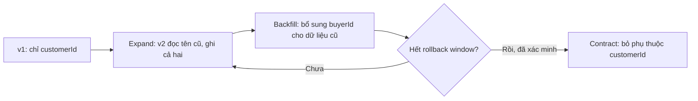
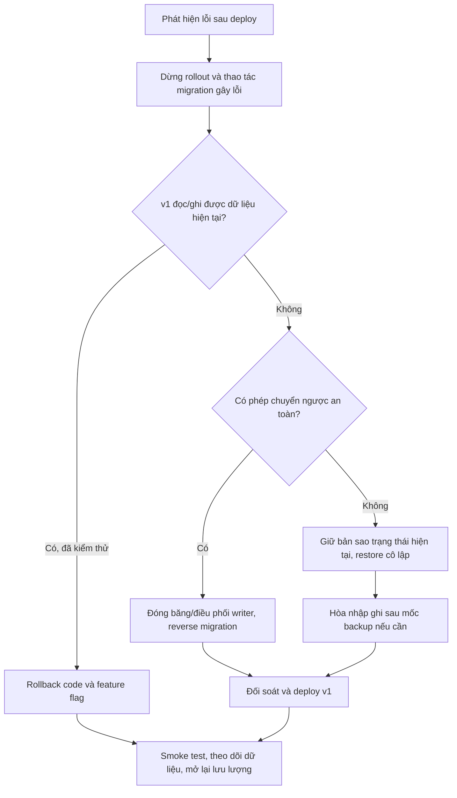

# Sao lưu, khôi phục và điều kiện quay lại phiên bản ứng dụng cũ

## Mục tiêu bài học

Trong chương **Migration dữ liệu** của **SPRING_DATA_MONGODB**, bạn sẽ học cách chuẩn bị đường quay lại an toàn khi thay đổi ứng dụng hoặc cấu trúc document. Spring Data MongoDB cho phép truy cập MongoDB qua `MongoTemplate` và repository, nhưng khả năng rollback còn phụ thuộc **dữ liệu đã được ghi**, cách triển khai migration, và bản sao lưu thực sự có thể phục hồi.

Sau bài học, bạn có thể:

- Phân biệt **rollback phiên bản ứng dụng**, **reverse migration dữ liệu** và **restore backup**.
- Chọn phương án sao lưu phù hợp cho MongoDB Atlas, replica set tự quản hoặc môi trường thử nghiệm.
- Đọc được ý nghĩa của **RPO** (mức mất dữ liệu chấp nhận) và **RTO** (thời gian phục hồi mục tiêu).
- Thiết kế migration **expand → migrate → contract** để phiên bản ứng dụng cũ còn có thể hoạt động trong thời gian rollback.
- Lập runbook dự phòng, thực hành khôi phục ở môi trường biệt lập, kiểm tra dữ liệu và quyết định khi nào **không thể** rollback trực tiếp.

> **Nguyên tắc:** Backup chỉ trở thành phương án phục hồi đáng tin cậy sau khi đã kiểm tra khả năng restore. Và **quay lại code cũ không đồng nghĩa với quay lại dữ liệu cũ**.

## 1. Ba thao tác thường bị nhầm lẫn

Giả sử ứng dụng quản lý đơn hàng có phiên bản `v1` lưu `customerId`. Phiên bản `v2` muốn chuyển sang `buyerId` và thay đổi cách đọc dữ liệu.

| Thao tác | Đối tượng bị thay đổi | Điều gì xảy ra với dữ liệu mới phát sinh? | Khi nào áp dụng |
| --- | --- | --- | --- |
| **Rollback ứng dụng** | Bản triển khai, cấu hình, feature flag | Vẫn giữ nguyên dữ liệu hiện tại | Schema hiện tại vẫn tương thích với bản ứng dụng cũ |
| **Reverse/compensating migration** | Các document/index đã thay đổi | Phải tự thiết kế quy tắc chuyển ngược và bảo vệ các ghi mới | Có thể đảo ngược phép biến đổi một cách tin cậy |
| **Restore backup / point-in-time** | Toàn bộ hoặc một phần trạng thái database | Những thay đổi sau mốc phục hồi **có nguy cơ mất hoặc phải tái hòa nhập** | Dữ liệu hỏng, migration không thể đảo, sự cố nghiêm trọng |

Một hệ thống có thể rollback `v2 → v1` trong vài phút nếu mọi document mới vẫn chứa `customerId`. Ngược lại, nếu `v2` xóa hẳn `customerId` rồi ghi nhiều đơn hàng mới chỉ với `buyerId`, triển khai lại `v1` **không đủ**: `v1` không đọc được những document đó.

Phân biệt thêm:

- **Backup** là một bản sao để phục hồi khi cần; backup không tự làm dữ liệu hiện hành quay về.
- **Restore** là thao tác đưa dữ liệu từ bản sao về một đích cụ thể; có thể làm mất/ghi đè dữ liệu có sẵn ở đích.
- **PITR (Point-in-Time Recovery)** là khả năng khôi phục đến một mốc nằm trong cửa sổ phục hồi, nếu hạ tầng backup có hỗ trợ. Có file `mongodump` kèm oplog **không có nghĩa** bạn có PITR liên tục đến bất kỳ thời điểm nào.

## 2. Xác định RPO, RTO trước khi chọn công cụ

Ví dụ nghiệp vụ yêu cầu phục hồi một sự cố migration trong tối đa 30 phút và chỉ chấp nhận mất nhiều nhất 5 phút dữ liệu:

| Chỉ số | Ví dụ | Ý nghĩa với kế hoạch |
| --- | --- | --- |
| **RPO = 5 phút** | Có thể mất tối đa 5 phút ghi dữ liệu | Snapshot mỗi ngày không đáp ứng; cần một cơ chế sao lưu liên tục hoặc bù dữ liệu thích hợp |
| **RTO = 30 phút** | Dịch vụ phải phục hồi trong tối đa 30 phút | Phải đo thực tế thời gian restore, chuyển cấu hình kết nối và xác minh |
| **Rollback window = 24 giờ** | Cho phép quay lại `v1` trong 24 giờ sau deploy | `v2` phải duy trì dữ liệu tương thích với `v1` ít nhất trong cửa sổ này |

Đây là **giả định của ví dụ**, không phải các giá trị mặc định của MongoDB. Đặt giá trị theo nghiệp vụ, kích thước dữ liệu, độ trễ backup, số lượng service và năng lực vận hành.

RPO của một lần rollback ứng dụng đơn thuần có thể bằng 0 **đối với dữ liệu đã được ghi bền vững**, nếu không cần khôi phục database và ứng dụng cũ vẫn đọc/ghi đúng. RTO của full restore có thể lớn hơn nhiều so với rollback ứng dụng vì phải xử lý dữ liệu, index, cache và chuyển hướng kết nối.

## 3. Chọn phương án backup cho MongoDB

| Phương án | Khả năng chính | Điều kiện / giới hạn cần hiểu |
| --- | --- | --- |
| **MongoDB Atlas Cloud Backup** | Snapshot được quản lý, lịch giữ bản sao và quy trình restore | Cần kiểm tra tier, chính sách backup, quyền truy cập, thời gian restore; không mặc nhiên có PITR |
| **Atlas Continuous Cloud Backup** | Snapshot + lịch sử oplog cho phép restore theo điểm thời gian trong restore window | Phải bật tính năng và đảm bảo mốc yêu cầu còn trong cửa sổ; restore có thể tạm ngừng ghi ở đích |
| **Snapshot lưu trữ nhất quán** (self-managed) | Sao lưu vật lý nhanh với dữ liệu lớn | Cần bảo đảm snapshot nhất quán, phối hợp replica set và filesystem; không sao chép tùy tiện `dbPath` khi `mongod` đang ghi |
| **`mongodump` / `mongorestore`** | Sao lưu/khôi phục logic BSON, phù hợp cho tập dữ liệu nhỏ hoặc tác vụ có giới hạn | Restore cần thời gian; nếu có ghi đồng thời, dump thông thường không nhất quán theo một thời điểm |
| **`mongodump --oplog`** | Dump đầy đủ một **replica set member** cùng thao tác ghi phát sinh trong quá trình dump | Phải khôi phục với `--oplogReplay`; không dùng cho dump giới hạn `--db`/`--collection` hoặc full backup qua `mongos` của sharded cluster |

Với Atlas, ưu tiên chính sách backup do Atlas quản lý và **thử restore vào cluster đích thử nghiệm**. Với hệ thống tự quản, chọn snapshot nhất quán hoặc công cụ backup được hỗ trợ theo mô hình triển khai; kế hoạch cho sharded cluster phải xét tính nhất quán giữa các shard.

**Không nhầm `--oplogReplay` với PITR liên tục.** Tùy chọn này tái phát các oplog entry được ghi trong **lần dump đó**, giúp dump nhất quán ở một thời điểm. Muốn phục hồi đến một thời điểm nhiều giờ sau khi dump, cần giải pháp PITR có lịch sử thay đổi tương ứng.

### Một số dữ liệu cần bảo vệ ngoài document

Trong phạm vi ứng dụng Spring Data MongoDB, dữ liệu khôi phục còn phụ thuộc:

- Index (kể cả unique, TTL, partial), collection options, validator và collation.
- Người dùng, quyền truy cập, phiên bản server/Database Tools, khóa mã hóa, mật khẩu và cơ chế truy cập mạng.
- Trạng thái message broker, job scheduler, search index ngoài MongoDB, cache, file trong object storage và giao dịch với hệ thống ngoài.
- Cấu hình Spring Boot, migration version, feature flag, đường dẫn kết nối `spring.data.mongodb.uri`, các service đọc cùng database.

Một backup MongoDB **không tự sao lưu** toàn bộ hệ thống ngoài database. Sau restore, phải đối soát các tác động đã gửi đi (email, thanh toán, event...) trước khi phát lại job.

## 4. Thiết kế để phiên bản ứng dụng cũ còn đọc được dữ liệu

### Trường hợp thực tế: đổi `customerId` thành `buyerId`

Giả sử `v1` đọc `customerId`; `v2` muốn đổi tên trường. Thay đổi trực tiếp:

```javascript
// Không chạy ngay trong production nếu vẫn cần rollback v1!
db.orders.updateMany(
  { customerId: { $exists: true } },
  { $rename: { customerId: "buyerId" } }
);
```

Lệnh trên chuyển tên trường, làm bản `v1` thiếu `customerId`. Nếu `v2` tiếp tục ghi các document chỉ chứa `buyerId`, việc quay lại `v1` càng khó hơn. Phương án an toàn hơn là **expand → migrate → contract**.



Các giai đoạn:

1. **Expand:** Cho phép document chứa cả hai trường. Deploy bản mới chấp nhận dữ liệu cũ, ghi `customerId` và `buyerId` trong cùng thao tác cập nhật document.
2. **Migrate/backfill:** Bổ sung `buyerId` cho document cũ chưa có trường này. Chạy theo batch, có checkpoint, ghi log, tránh ghi đè các thay đổi vừa phát sinh.
3. **Quan sát:** Kiểm tra tỷ lệ document không tương thích, lỗi serialize/deserialize, API, index và các tác vụ nền. Trong giai đoạn này, `customerId` tiếp tục được duy trì để `v1` đọc được.
4. **Contract:** Chỉ xóa trường cũ hoặc bỏ code tương thích **sau khi** chắc chắn không còn consumer cũ, cửa sổ rollback đã kết thúc và backup phục hồi được kiểm tra.

### Cách viết tương thích với `MongoTemplate`

Giả sử entity Java ánh xạ document đang trong giai đoạn mở rộng:

```java
import org.springframework.data.annotation.Id;
import org.springframework.data.mongodb.core.mapping.Document;

@Document("orders")
public class OrderDocument {
    @Id
    private String id;

    // Trường v1 vẫn cần trong thời gian rollback.
    private String customerId;

    // Trường v2 mới thêm.
    private String buyerId;

    public String getId() { return id; }
    public String getCustomerId() { return customerId; }
    public String getBuyerId() { return buyerId; }

    // Trong lúc v1 vẫn có thể ghi, coi trường cũ là nguồn ưu tiên.
    public String customerIdForBusiness() {
        return customerId != null ? customerId : buyerId;
    }
}
```

Khi `v2` đổi khách hàng của đơn hàng, ghi **cả hai trường cùng một thao tác cập nhật document**:

```java
import org.springframework.data.mongodb.core.MongoTemplate;
import org.springframework.data.mongodb.core.query.Criteria;
import org.springframework.data.mongodb.core.query.Query;
import org.springframework.data.mongodb.core.query.Update;

// Giả sử template, orderId, newCustomerId đã được cấp đúng.
Query query = Query.query(Criteria.where("_id").is(orderId));

Update update = new Update()
    .set("customerId", newCustomerId)
    .set("buyerId", newCustomerId);

template.updateFirst(query, update, OrderDocument.class);
```

Một cập nhật trên **một document** là atomic trong MongoDB: người đọc không thấy nửa thay đổi của chính thao tác đó. Nhưng `v1` có thể vẫn ghi **chỉ** `customerId`; vì vậy `v2` ưu tiên giá trị cũ khi có cả hai trường trong giai đoạn chạy song song. Sau khi mọi writer cũ rút khỏi hệ thống, thực hiện backfill lần cuối rồi mới cân nhắc chuyển sang ưu tiên `buyerId`.

**Lưu ý repository:** `save(entity)` thường ghi đè/replace cả document. Một tiến trình `v1` không biết `buyerId` có thể vô tình loại bỏ trường mới khi save. Khi có các phiên bản chạy đồng thời, kiểm tra hành vi repository và ưu tiên cập nhật có mục tiêu bằng `MongoTemplate.updateFirst` hoặc cơ chế versioning/optimistic locking nếu phù hợp.

### Backfill có điều kiện để tránh ghi đè dữ liệu mới

Ví dụ **một batch** 500 document. Điều kiện ở lúc update phải kiểm tra lại rằng bản ghi chưa có `buyerId` và `customerId` vẫn bằng giá trị vừa đọc:

```java
import java.util.List;
import org.springframework.data.mongodb.core.MongoTemplate;
import org.springframework.data.mongodb.core.query.Criteria;
import org.springframework.data.mongodb.core.query.Query;
import org.springframework.data.mongodb.core.query.Update;

Query batchQuery = Query.query(
    Criteria.where("customerId").exists(true)
        .and("buyerId").exists(false)
).limit(500);

List<OrderDocument> batch =
    template.find(batchQuery, OrderDocument.class);

for (OrderDocument order : batch) {
    Query guarded = Query.query(
        Criteria.where("_id").is(order.getId())
            .and("customerId").is(order.getCustomerId())
            .and("buyerId").exists(false)
    );

    template.updateFirst(
        guarded,
        new Update().set("buyerId", order.getCustomerId()),
        OrderDocument.class
    );
}
```

Đây là đoạn minh họa **một vòng batch**, không phải toàn bộ migration runner. Khi chạy trên dữ liệu lớn, cần thêm vòng lặp có kiểm soát, phân trang/cursor ổn định, retry, checkpoint, giới hạn tải và thống kê số record đã cập nhật. Nếu tài liệu có `customerId: null`, trường rỗng, giá trị không hợp lệ hoặc `buyerId` đã tồn tại nhưng khác nhau, cần quy tắc xử lý riêng; đừng tự động ghi đè.

Đặc biệt, chỉ coi backfill là thành công khi đối soát được **giá trị**, không dừng ở việc trường mới đã tồn tại.

## 5. Sao lưu logic bằng MongoDB Database Tools

Các lệnh bên dưới dùng **shell kiểu Bash/Linux** và ví dụ **replica set tự quản**. `mongodump` và `mongorestore` là công cụ MongoDB Database Tools riêng; không phải phương thức của `MongoTemplate`. Nên lấy URI từ secret manager và bảo vệ file dump theo chính sách backup.

### Bước 1: tạo bản sao toàn bộ replica set trước migration

```bash
# SOURCE_URI trỏ vào một replica set, đã có quyền đọc phù hợp.
# Thư mục backup phải tồn tại và có dung lượng trống.
mongodump \
  --uri="$SOURCE_URI" \
  --archive="/secure/backups/pre-v2.archive.gz" \
  --gzip \
  --oplog
```

Giải thích:

- `--archive`: gộp dữ liệu BSON và metadata vào một archive.
- `--gzip`: nén file backup; khi restore phải thêm `--gzip`.
- `--oplog`: lấy các thao tác ghi trong thời gian dump để hỗ trợ restore nhất quán khi replay.

`--oplog` yêu cầu dump đầy đủ một thành viên replica set; **không kết hợp** cùng `--db`, `--collection` hoặc `--query`. Nó không phải cách backup toàn bộ sharded cluster qua `mongos`. Thay đổi metadata như rename collection trong lúc dump có thể làm dump thất bại; kiểm tra mã thoát, log và metadata backup trước khi xem backup là hợp lệ.

### Bước 2: thử phục hồi vào môi trường biệt lập

Tạo một database/cluster **thử nghiệm rỗng**, tách khỏi đường ghi production, với phiên bản và quyền truy cập tương thích:

```bash
# STAGING_URI phải trỏ tới môi trường phục hồi riêng, không phải production.
mongorestore \
  --uri="$STAGING_URI" \
  --archive="/secure/backups/pre-v2.archive.gz" \
  --gzip \
  --oplogReplay
```

`--oplogReplay` phát lại các bản ghi oplog thu được trong khi dump. Với `--oplogReplay`, cần restore **full dump** đã tạo bằng `--oplog`; không thu hẹp namespace một cách tùy ý. Lệnh trên giả định đích rỗng. Nếu có collection cùng tên, restore có thể báo trùng key/không nhập được như mong đợi.

Có thể dùng `mongorestore --dryRun` để xem trước công việc, nhưng **dry run không thay thế phép thử restore thật**. Tùy chọn `--drop` khi restore sẽ xóa collection trùng tên ở đích trước khi khôi phục; tuyệt đối chỉ dùng sau khi đã xác nhận đích, phạm vi backup và tác động đến dữ liệu đang có. Nếu dump bao gồm `admin`, khôi phục người dùng/quyền cũng cần kế hoạch đặc biệt để tránh mất quyền truy cập.

### Bước 3: xác minh bản khôi phục

Dùng `mongosh` kết nối **đúng database thử nghiệm**:

```javascript
// Kiểm tra số lượng và dữ liệu tiêu biểu.
db.orders.countDocuments({});
db.orders.find(
  {},
  { _id: 1, customerId: 1, buyerId: 1 }
).sort({ _id: 1 }).limit(5);

// Kiểm tra index, collection options/validator.
db.orders.getIndexes();
db.getCollectionInfos({ name: "orders" });
```

Đối chiếu count theo tập khóa/nhóm nghiệp vụ, mẫu `_id`, tổng giá trị đơn hàng, index, uniqueness, TTL, validator và phản hồi API. Chỉ so tổng số document là **chưa đủ** để chứng minh dữ liệu chính xác. Kiểm tra riêng backup của tài khoản, quyền và các collection hệ thống nếu chúng thuộc phạm vi phục hồi.

Ghi kết quả rehearsal: dung lượng backup, thời điểm bắt đầu/kết thúc, mã thoát, lỗi phát hiện, thời gian restore thực tế, độ trễ tạo index và số liệu đối soát. Đây là cơ sở đánh giá RTO/RPO.

## 6. Khi sử dụng MongoDB Atlas: snapshot và point-in-time

Với Atlas, xác nhận trước khi migration:

1. Cluster đang có **Cloud Backup** và lịch giữ snapshot phù hợp.
2. Nếu cần phục hồi đến thời điểm ngay trước khi migration gây lỗi, tính năng **Continuous Cloud Backup/PITR** có được bật trên tier hỗ trợ và mốc phục hồi vẫn nằm trong **restore window** hay không.
3. Tài khoản vận hành có quyền khởi tạo restore; đã chạy thử restore vào **cluster đích an toàn**.
4. Hệ thống có thể chuyển `spring.data.mongodb.uri`/secret đến cluster được phục hồi, cập nhật allowlist, xác nhận topology/read-write concern và định tuyến ứng dụng hay không.

Restore theo điểm thời gian thường chọn **mốc ngay trước thao tác gây hỏng**, sau đó Atlas áp dụng lịch sử oplog đến mốc chọn trong cửa sổ cho phép. Nếu restore cluster-level vào một cluster đang có dữ liệu, Atlas có thể xóa dữ liệu hiện hữu ở **cluster đích**; quá trình restore làm đích không phục vụ bình thường. Lựa chọn cluster mới/biệt lập trước sẽ giảm rủi ro ghi đè dữ liệu đang hoạt động.

Ngay cả khi có PITR, việc chọn lại mốc `T0` vẫn **bỏ qua các thay đổi sau `T0`** trừ khi đã lưu và tái hòa nhập chúng bằng cơ chế riêng. Với hệ thống giao dịch, phải tính cả đơn hàng, thanh toán và message phát sinh trong khoảng thời gian đó.

## 7. Điều kiện cụ thể để rollback ứng dụng từ v2 về v1

Dưới đây là **bảng quyết định** cho người trực ca khi phát hiện lỗi sau migration:

| Điều kiện kiểm tra | Có thể quay về v1 trực tiếp? | Hành động |
| --- | --- | --- |
| Tất cả document v2 vẫn giữ `customerId` hợp lệ; mọi writer tương thích; v1 hỗ trợ collection/index/validator hiện tại | **Có**, nếu kiểm thử xác nhận | Dừng rollout v2, deploy v1, kiểm tra read/write và giám sát |
| Document có cả hai trường nhưng giá trị mâu thuẫn | **Chưa** | Xác định trường nguồn đúng, hòa giải và kiểm chứng trước khi rollback |
| Có document chỉ chứa `buyerId` hoặc v2 đổi kiểu BSON mà v1 không đọc được | **Không trực tiếp** | Reverse migration có kiểm soát hoặc restore/hòa nhập dữ liệu |
| v2 tạo unique index, validator, collection option khiến thao tác ghi của v1 bị từ chối | **Chưa** | Kiểm tra cách sửa schema/index hợp lệ, chạy thử với v1 và đo tác động |
| v2 đã xóa dữ liệu/trường với thông tin không thể suy lại | **Không trực tiếp** | Dùng backup hoặc nguồn dữ liệu khác; lượng ghi mới sau mốc restore phải được tính toán |
| Event/message/API từ v2 đã có schema không được consumer cũ hiểu | **Chưa** | Bổ sung compatibility adapter, ngừng phát event mới, xử lý queue/side effects |
| Backup có nhưng chưa restore thử, RTO không đo được | **Không thể coi là phương án phục hồi chắc chắn** | Restore rehearsal, ghi nhận thời gian và kết quả đối soát |

Một bảng tương thích có thể được duy trì trong ticket migration:

| Dữ liệu đang tồn tại | v1 đọc được? | v2 đọc được? | Rollback code an toàn? |
| --- | --- | --- | --- |
| `{ customerId: "C1" }` | Có | Có, nếu có fallback | Có |
| `{ customerId: "C1", buyerId: "C1" }` | Có | Có | Có |
| `{ buyerId: "C1" }` | Không | Có | Không |
| `{ customerId: "C1", buyerId: "C2" }` | Có nhưng có thể sai nghiệp vụ | Có nhưng mơ hồ | Chưa, cần hòa giải |

**Tại thời điểm quyết định rollback**, kiểm tra dữ liệu **đang tồn tại** và toàn bộ nguồn ghi, không chỉ xét code vừa được build. Cũng cần xác nhận ứng dụng cũ có thể chạy với database server, mapping, transaction, aggregation và index mới. Nếu chính ứng dụng thay đổi pipeline aggregation hoặc cách giải mã BSON, lỗi có thể chỉ xuất hiện khi tải production cao hoặc xử lý document hiếm.

## 8. Runbook triển khai và xử lý sự cố

### Trước khi phát hành

1. **Khoanh phạm vi:** Liệt kê collection, field, index, schema validation, aggregation, repository và dịch vụ dùng dữ liệu bị ảnh hưởng. Chốt kiểu thay đổi: thêm field, đổi tên, đổi kiểu, xóa field hay tách/gộp collection.
2. **Định nghĩa ngưỡng:** Đặt RPO/RTO, thời gian giữ tương thích với v1, các số liệu đo thành công (lỗi API, mismatch, lag, throughput, timeout), người phụ trách quyết định rollback.
3. **Xác minh backup:** Chạy backup trước thay đổi, lưu nhãn release và timestamp UTC, bảo vệ backup bằng quyền tối thiểu/mã hóa, có bản sao ở nơi độc lập; kiểm tra quá trình restore và khả năng đọc dữ liệu.
4. **Phát hành mở rộng:** Deploy code chấp nhận schema cũ và mới; khi cần, thêm field/index trước bằng thao tác có kiểm soát. Chỉ chuyển write path khi đã chắc chắn mọi reader hiểu định dạng.
5. **Chạy backfill:** Chia batch, idempotent, có checkpoint và giám sát tác động đến CPU/IO/replication lag; đối soát theo nghiệp vụ thay vì chỉ đếm document.
6. **Canary và quan sát:** Phát hành một phần lưu lượng, so sánh kết quả hai phiên bản và giữ feature flag để ngừng logic mới nếu xuất hiện lỗi.

### Khi phát hiện lỗi



Chi tiết thao tác điều phối:

1. **Ghi lại mốc sự cố:** Thời điểm triển khai, phiên bản ứng dụng, migration id, log, trạng thái queue và timestamp UTC của backup. Ngưng job/backfill đang làm hỏng dữ liệu; tránh để các instance khác tiếp tục ghi sai.
2. **Kiểm tra tương thích:** Chạy truy vấn đếm document có schema mới/thiếu field cũ, lấy mẫu các record lỗi, xác nhận v1 có khả năng ghi với index và validator hiện hành.
3. **Nếu rollback code an toàn:** Chuyển traffic về v1 qua quy trình deploy có sẵn; không restore database. Quan sát thao tác đọc, tạo/sửa đơn hàng, job nền và index scan.
4. **Nếu cần sửa dữ liệu:** Giữ một bản sao của **trạng thái hiện tại trước khi can thiệp**, chuẩn bị kế hoạch reverse migration hoặc restore trên đích độc lập; ghi lại mọi write phát sinh từ `T0`.
5. **Kiểm tra rồi chuyển tuyến:** Chạy smoke test, so sánh count và business invariants, kiểm tra reconnect `MongoClient`, xác nhận job/consumer xử lý đúng trước khi mở lại ghi.
6. **Theo dõi hậu sự cố:** Kiểm tra lỗi mapping, độ trễ query/aggregation, số document không hợp lệ, replication lag, message bị lặp hoặc thiếu và sự chênh lệch dữ liệu trong một khoảng thời gian đã định.

**Điểm ra quyết định:** Nếu chưa thể chứng minh dữ liệu hiện tại tương thích với v1 hoặc chưa có kế hoạch bảo toàn ghi mới, hãy giữ nguyên trạng thái có thể điều tra và ưu tiên sửa tiến (`roll forward`) hoặc bù dữ liệu có kiểm soát. Việc rollback vội có thể biến một lỗi triển khai thành mất dữ liệu.

## 9. Các kiểm tra trước khi kết thúc rollback

Các lệnh sau dùng trên database đang được đánh giá, sau khi đã xác nhận môi trường:

```javascript
// Bao nhiêu document không còn customerId cho ứng dụng v1?
db.orders.countDocuments({ customerId: { $exists: false } });

// Bao nhiêu document có buyerId nhưng thiếu customerId?
db.orders.countDocuments({
  buyerId: { $exists: true },
  customerId: { $exists: false }
});

// Bao nhiêu document có cả hai field nhưng lệch giá trị?
db.orders.countDocuments({
  customerId: { $exists: true },
  buyerId: { $exists: true },
  $expr: { $ne: ["$customerId", "$buyerId"] }
});

// Cấu trúc và index có ảnh hưởng tới bản v1 không?
db.orders.getIndexes();
db.getCollectionInfos({ name: "orders" });
```

Các truy vấn dùng `$exists` trên dữ liệu lớn có thể tốn tài nguyên; cần chạy có kiểm soát, tối ưu index và quy mô đo lường. **Thiếu field** khác với field tồn tại nhưng mang `null`; kiểm tra cả giá trị bất thường, kiểu BSON và giá trị rỗng theo quy tắc nghiệp vụ.

Trong Spring Data MongoDB, có thể đưa các phép đếm quan trọng vào health check hoặc công cụ giám sát khi triển khai migration:

```java
import org.springframework.data.mongodb.core.MongoTemplate;
import org.springframework.data.mongodb.core.query.Criteria;
import org.springframework.data.mongodb.core.query.Query;

// Ví dụ trên collection orders, trước khi cho phép rollback v1:
long incompatible = template.count(
    Query.query(Criteria.where("customerId").exists(false)),
    OrderDocument.class
);

if (incompatible > 0) {
    throw new IllegalStateException(
        "Chưa thể rollback v1: còn " + incompatible
            + " document thiếu customerId"
    );
}
```

Đây chỉ là **một điều kiện kiểm tra**, không phải chứng nhận tương thích đầy đủ. Ngoài số lượng, vẫn cần kiểm tra nội dung field, phiên bản document, luồng ghi, hợp đồng API, các collection liên quan và hành vi thực tế của ứng dụng cũ.

## 10. Bài thực hành: khôi phục được và rollback được

Dựng môi trường thử nghiệm có Spring Boot + Spring Data MongoDB, ít nhất hai bản ứng dụng mô phỏng `v1` và `v2`, cùng MongoDB replica set thử nghiệm hoặc cluster Atlas đã bật backup phù hợp.

1. Tạo dữ liệu `orders` chỉ có `customerId`; ghi nhận số document và một số giá trị nghiệp vụ quan trọng.
2. Thực hiện bản backup theo chiến lược đã chọn. Với self-managed replica set nhỏ, thử `mongodump --oplog` như mục 5.
3. Triển khai `v2` đọc được `customerId` và `buyerId`, ghi cả hai. Chạy backfill có điều kiện cho dữ liệu cũ.
4. Cho `v2` tạo thêm 10 đơn hàng. Xác nhận các document mới vẫn chứa `customerId`, rồi triển khai lại `v1` mà không restore. Đọc/ghi thử bằng `v1`.
5. Ở môi trường **khác**, mô phỏng migration không tương thích bằng cách xóa `customerId` khỏi một số document; chạy các kiểm tra mục 9 và chứng minh rollback v1 bị chặn.
6. Restore bản backup vào một môi trường mới, kiểm tra dữ liệu và đo thời gian. So sánh số lượng đơn trước backup với 10 đơn hàng tạo sau backup; giải thích rủi ro mất dữ liệu nếu chọn restore về mốc cũ.
7. Viết runbook một trang gồm: mốc backup, RPO/RTO mục tiêu, ngưỡng rollback, lệnh kiểm tra, nơi lưu bản sao, cách hòa nhập ghi sau restore và người phê duyệt chuyển tuyến.

**Tiêu chí đạt:** Bạn phân biệt được rollback code với restore dữ liệu, giải thích chính xác giới hạn của `--oplogReplay`, nhận ra schema nào khiến `v1` không thể chạy, đồng thời chứng minh backup có thể khôi phục bằng một lần thực hành thật.

## Tài liệu tham khảo

- [MongoDB — Backup Methods for a Self-Managed Deployment](https://www.mongodb.com/docs/manual/core/backups/)
- [MongoDB Database Tools — mongodump](https://www.mongodb.com/docs/database-tools/mongodump/)
- [MongoDB Database Tools — mongorestore](https://www.mongodb.com/docs/database-tools/mongorestore/)
- [MongoDB — Back Up and Restore with MongoDB Tools](https://www.mongodb.com/docs/manual/tutorial/backup-and-restore-tools/)
- [MongoDB Atlas — Restore from Continuous Cloud Backup](https://www.mongodb.com/docs/atlas/backup/cloud-backup/restore-from-continuous/)
- [MongoDB Atlas — Recover a Point In Time](https://www.mongodb.com/docs/atlas/recover-pit-continuous-cloud-backup/)
- [MongoDB Atlas — Manage Backup Policies](https://www.mongodb.com/docs/atlas/backup/cloud-backup/configure-backup-policy/)
- [Spring Data MongoDB — `MongoTemplate` Operations](https://docs.spring.io/spring-data/mongodb/reference/mongodb/template-crud-operations.html)
