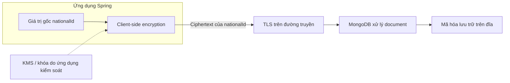
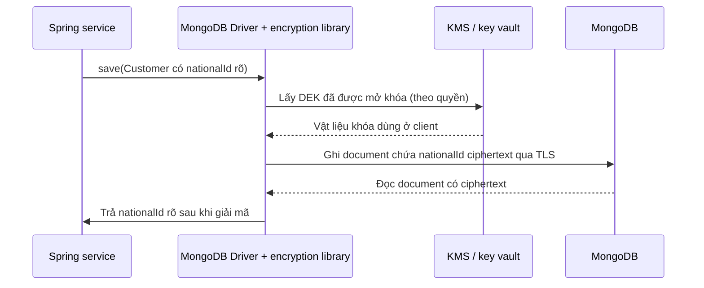

# Phân biệt TLS, mã hóa lưu trữ và mã hóa ở phía client

## 1. Vì sao ứng dụng Spring Data MongoDB cần nhiều lớp mã hóa?

Một dịch vụ Spring Data MongoDB có thể đọc và ghi hồ sơ khách hàng bằng `MongoTemplate`, `MongoRepository` hoặc `ReactiveMongoTemplate`. Hồ sơ chứa tên, địa chỉ, mã định danh, thông tin liên hệ; ứng dụng phải bảo vệ chúng trong **ba trạng thái khác nhau**:

1. **Đang truyền** giữa ứng dụng, MongoDB và các thành phần mạng: dùng **TLS** (*Transport Layer Security*).
2. **Đang lưu** trên đĩa của cơ sở dữ liệu: dùng **mã hóa dữ liệu lưu trữ** (*encryption at rest*).
3. **Đang được xử lý ở phía máy chủ MongoDB**, nhưng một số giá trị vẫn không được phép lộ cho người quản trị cơ sở dữ liệu: dùng **mã hóa trường ở phía client** (*client-side encryption*), gồm Client-Side Field Level Encryption (CSFLE) và Queryable Encryption (QE).

Ba cơ chế này không thay thế nhau. TLS bảo vệ luồng dữ liệu nhưng MongoDB vẫn nhận plaintext sau khi giải mã kết nối. Mã hóa lưu trữ bảo vệ file trên đĩa nhưng MongoDB có thể giải mã khi xử lý truy vấn. Mã hóa phía client biến **trường nhạy cảm** thành ciphertext **trước khi** dữ liệu tới MongoDB, nên server không nắm giá trị gốc của trường đó.

Ví dụ xuyên suốt: dịch vụ Spring có collection `customers`, mỗi document chứa `name`, `email`, `nationalId` và `createdAt`. Doanh nghiệp cần tìm kiếm theo tên, nhưng chỉ các tiến trình được cấp khóa mới được đọc `nationalId`.

### 1.1. Sơ đồ đường đi của dữ liệu



Sơ đồ minh họa trường `nationalId` **có bật mã hóa phía client**. Trường `name` không được mã hóa phía client vẫn là plaintext bên trong tiến trình MongoDB sau khi kết nối TLS kết thúc; nếu bật mã hóa lưu trữ, toàn bộ dữ liệu trên đĩa mới được bảo vệ ở lớp storage.

### 1.2. Bảng so sánh nhanh

| Tiêu chí | TLS (in transit) | Mã hóa lưu trữ (at rest) | Mã hóa phía client (CSFLE/QE) |
| --- | --- | --- | --- |
| Bảo vệ ở đâu? | Kênh giao tiếp ứng dụng ↔ MongoDB, và các liên kết khác nếu được cấu hình TLS. | File dữ liệu, file journal và phạm vi storage được cơ chế triển khai hỗ trợ. | Giá trị của các trường được chỉ định trước khi rời ứng dụng. |
| Ai giải mã? | Hai đầu kết nối TLS. | Storage engine/hệ thống lưu trữ khi MongoDB đọc dữ liệu. | Ứng dụng/driver được cấp quyền sử dụng khóa dữ liệu. |
| Đọc trực tiếp từ MongoDB bằng tài khoản có quyền đọc? | Có thể thấy plaintext. | Có thể thấy plaintext. | Chỉ thấy ciphertext của trường đã mã hóa nếu không có khóa client. |
| Ngăn nghe lén đường truyền? | Có, khi xác thực chứng chỉ đúng. | Không. | Giữ bí mật các trường đã mã hóa, nhưng không thay thế bảo vệ kết nối. |
| Ngăn đọc file đĩa đánh cắp khi máy tắt? | Không. | Có, nếu quản lý khóa đúng. | Có cho các trường được mã hóa; trường khác vẫn cần bảo vệ. |
| Query/aggregation với giá trị gốc | Hoạt động như bình thường. | Hoạt động như bình thường. | Bị giới hạn theo thuật toán, kiểu trường và phiên bản server/driver. |
| Quản lý khóa chính | Chứng chỉ, CA và khóa TLS. | Khóa mã hóa storage, khóa master hoặc KMS. | Data Encryption Key (DEK), Customer Master Key (CMK) và quyền KMS. |

**Một hệ thống xử lý dữ liệu nhạy cảm thường cần kết hợp cả ba**, cùng xác thực, phân quyền, bảo vệ backup và quản lý bí mật. Không nên coi “đã mã hóa” là đủ để bỏ qua kiểm soát truy cập.

## 2. TLS: bảo vệ dữ liệu khi truyền

### 2.1. TLS làm gì?

Trong một kết nối TLS, server MongoDB đưa ra chứng chỉ; client xác thực chuỗi tin cậy từ CA (*Certificate Authority*) và tên máy chủ. Sau quá trình bắt tay, hai phía dùng khóa phiên để mã hóa dữ liệu đi trên mạng. TLS giúp chống nghe lén và sửa nội dung trên đường truyền khi được cấu hình và xác thực đúng.

TLS **không mã hóa trường theo nghĩa dữ liệu nằm trong document**: driver có thể gửi `nationalId` dưới dạng plaintext *bên trong* kênh TLS, rồi MongoDB giải mã kênh để xử lý. Trên disk hoặc trong tiến trình MongoDB, trường này có thể vẫn lộ nếu không có lớp bảo vệ khác.

### 2.2. Cấu hình ứng dụng Spring kết nối bằng TLS

Trong dự án Spring Boot dùng cấu hình URI cho MongoDB, có thể đặt URI ở biến môi trường:

```yaml
# application.yml (ví dụ Spring Boot 3.x)
spring:
  data:
    mongodb:
      uri: ${MONGODB_URI}
```

```text
# Giá trị ví dụ của biến môi trường; thay host và phương thức xác thực phù hợp.
MONGODB_URI=mongodb://db.example.internal:27017/customer_db?tls=true
```

`tls=true` yêu cầu Java MongoDB Driver sử dụng TLS. URI `mongodb+srv://...` mặc định bật TLS trong driver trừ khi cấu hình ghi đè; tuy nhiên vẫn nên xác nhận cấu hình thực tế. MongoDB phía server cũng phải được cấu hình chấp nhận/yêu cầu TLS; thêm `tls=true` ở client không tự bật TLS trên một server chưa hỗ trợ.

Nếu cần cấu hình driver trực tiếp, ví dụ tối giản:

```java
import com.mongodb.ConnectionString;
import com.mongodb.MongoClientSettings;
import com.mongodb.client.MongoClient;
import com.mongodb.client.MongoClients;

public class TlsMongoConnection {
    public static MongoClient create() {
        MongoClientSettings settings = MongoClientSettings.builder()
            .applyConnectionString(new ConnectionString(
                "mongodb://db.example.internal:27017/customer_db"
            ))
            .applyToSslSettings(ssl -> ssl.enabled(true))
            .build();
        return MongoClients.create(settings);
    }
}
```

Ví dụ trên chỉ minh họa bước bật TLS, chưa chứa cấu hình xác thực và certificate trust cho một môi trường cụ thể. Trong ứng dụng Spring Boot đã quản lý `MongoClient`, nên cấu hình qua URI hoặc `MongoClientSettingsBuilderCustomizer` của phiên bản Boot đang dùng để tránh tạo thêm một client không được Spring quản lý.

### 2.3. Xác thực chứng chỉ đúng cách

- **Truststore** chứa CA đáng tin cậy để ứng dụng xác minh chứng chỉ server. Với CA công khai đã được JDK tin cậy, thường không cần truststore riêng; với CA nội bộ có thể đặt `javax.net.ssl.trustStore` và cấu hình tương ứng.
- **Keystore** phía client chứa khóa/chứng chỉ của ứng dụng, chỉ cần khi triển khai xác thực chứng chỉ client (*mutual TLS/mTLS* hoặc X.509).
- Tránh `tlsInsecure=true`, `tlsAllowInvalidCertificates=true` hoặc tắt xác thực hostname trong môi trường thực. Chúng làm suy yếu khả năng phát hiện server giả mạo.
- TLS bảo vệ **từng liên kết được cấu hình**. Nếu có proxy, gateway hoặc các member trong cluster, cần xác định rõ điểm kết thúc TLS và bảo vệ từng chặng liên quan.

**Phân biệt xác thực:** Chứng chỉ TLS xác minh đầu bên kia của kết nối; tài khoản MongoDB, cơ chế xác thực (SCRAM, X.509, v.v.) và phân quyền RBAC quyết định *ai được truy cập dữ liệu*. Có TLS không đồng nghĩa mọi người dùng đều đã được cấp quyền an toàn.

## 3. Mã hóa dữ liệu lưu trữ: bảo vệ file trên đĩa

### 3.1. Lớp lưu trữ giải mã khi MongoDB làm việc

Encryption at rest bảo vệ nội dung vật lý trong file dữ liệu. Khi MongoDB được vận hành hợp lệ và có khóa lưu trữ, hệ thống giải mã các khối cần thiết để truy vấn, cập nhật và tạo kết quả. Vì vậy:

- Người lấy được một ổ đĩa hay file dữ liệu đã mã hóa **nhưng không có khóa** khó đọc được dữ liệu.
- Người quản trị MongoDB được cấp quyền đọc collection vẫn có thể `find()` và lấy plaintext từ server; mã hóa lưu trữ không ngăn truy cập này.
- Kẻ xâm nhập chiếm được tiến trình đang chạy hoặc khóa storage có thể vượt qua ranh giới bảo vệ của mã hóa lưu trữ.

### 3.2. Lựa chọn theo môi trường triển khai

| Nơi chạy MongoDB | Cách mã hóa lưu trữ thường gặp | Lưu ý |
| --- | --- | --- |
| **MongoDB Atlas** | Atlas mã hóa dữ liệu lưu trữ theo mặc định; có tùy chọn quản lý khóa của khách hàng tùy dịch vụ/gói. | Xác minh phạm vi, chính sách khóa và backup trong cấu hình Atlas cụ thể. |
| **MongoDB Enterprise, tự quản lý** | Encrypted Storage Engine của WiredTiger, tích hợp cơ chế quản lý master key như KMIP hoặc lựa chọn được phiên bản hỗ trợ. | Phải bật và vận hành khóa theo hướng dẫn của server; đây là tính năng Enterprise. |
| **MongoDB Community, tự quản lý** | Có thể dùng mã hóa ổ đĩa/volume do hệ điều hành hoặc hạ tầng cung cấp. | Đừng nhầm mã hóa volume với tính năng native encrypted storage engine của Enterprise. |

Phạm vi mã hóa **backup, snapshot, export, log, file tạm, dump và lưu trữ ngoài** phải được kiểm tra riêng. Chẳng hạn, một file JSON xuất từ `mongoexport` có thể chứa plaintext dù file dữ liệu MongoDB trên đĩa đã được mã hóa. Mã hóa volume cũng cần cơ chế bảo vệ backup và kho lưu trữ khóa ngoài volume đó.

### 3.3. Vì sao quản lý khóa quan trọng?

Mã hóa file chỉ có ý nghĩa khi khóa giải mã được giữ tách biệt và kiểm soát chặt. Nếu kẻ tấn công lấy được cả bản sao dữ liệu lẫn khóa cần để giải mã, lợi ích bảo vệ giảm đáng kể. Khi thiết kế hệ thống, xác định người quản lý khóa, quyền truy cập KMS, xoay vòng khóa, backup khóa, kế hoạch khôi phục và tác động khi mất khóa.

Ví dụ, một snapshot đã mã hóa nhưng được export ra kho object storage khác cần được bảo vệ theo chính sách của kho đó. Không nên suy luận rằng chỉ vì collection nằm trên disk mã hóa thì mọi dữ liệu sao chép từ nó cũng tự động được mã hóa.

## 4. Mã hóa phía client: server chỉ nhận ciphertext của trường được chọn

### 4.1. Luồng mã hóa và giải mã

Khi dùng client-side encryption, Java MongoDB Driver (hoặc thành phần encryption trong ứng dụng) chuyển giá trị nhạy cảm thành ciphertext **trước khi** gọi MongoDB. Server lưu ciphertext, còn giá trị rõ chỉ được giải mã ở client phù hợp có quyền dùng khóa. Các trường **không được chỉ định** vẫn có thể được MongoDB xử lý bình thường.



Các thành phần quản lý khóa gồm:

- **DEK (Data Encryption Key):** khóa dùng để mã hóa/giải mã giá trị trường.
- **CMK (Customer Master Key):** khóa cấp trên dùng để bảo vệ (*wrap*) DEK; thường đặt ở KMS/HSM do doanh nghiệp kiểm soát.
- **Key vault collection:** nơi lưu tài liệu DEK ở dạng đã được bảo vệ bằng CMK. Việc lưu DEK đã wrap trong MongoDB không đồng nghĩa server có thể tự giải mã nó.
- **KMS provider:** có thể là AWS KMS, Azure Key Vault, Google Cloud KMS, KMIP hoặc local provider cho mục đích thử nghiệm. Không đưa CMK, credential KMS hay key material vào mã nguồn hoặc Git.

Mã hóa phía client **không chống được việc chính ứng dụng bị chiếm quyền** khi ứng dụng có khả năng đọc plaintext và gọi KMS. Thông tin nhạy cảm vẫn có thể xuất hiện trong bộ nhớ ứng dụng, log, exception, trace, cache hoặc response API nếu xử lý bất cẩn.

### 4.2. CSFLE và Queryable Encryption là hai hướng khác nhau

MongoDB hỗ trợ hai cách mã hóa *in-use*:

| Cơ chế | Thuật toán/kiểu tìm kiếm | Phù hợp khi |
| --- | --- | --- |
| **CSFLE ngẫu nhiên** (*randomized*) | Cùng plaintext có thể thành ciphertext khác nhau. Không query trực tiếp theo giá trị đã mã hóa. | Trường cực nhạy cảm chủ yếu được đọc theo `_id` hoặc trường khác. |
| **CSFLE xác định** (*deterministic*) | Cùng plaintext và cùng khóa cho ciphertext giống nhau; có thể tìm bằng so sánh bằng khi cấu hình đúng. | Cần tra cứu chính xác, chấp nhận rò rỉ thông tin về tần suất các giá trị trùng nhau. |
| **Queryable Encryption (QE)** | Mã hóa ngẫu nhiên với cấu trúc hỗ trợ một số truy vấn được khai báo trước, như equality/range theo phiên bản. | Cần truy vấn trường nhạy cảm nhưng muốn tránh lộ mối liên hệ trùng ciphertext như deterministic CSFLE. |

Không dùng **CSFLE và QE trong cùng một collection**. Cả hai đều giới hạn toán tử, kiểu dữ liệu, cấu hình schema và hiệu năng. Đặc biệt, tìm kiếm theo regex, sort, aggregate, tạo index hoặc cập nhật trên trường mã hóa có thể không hoạt động như trên trường plaintext. Phải tra chính xác tập thao tác được hỗ trợ theo **cơ chế + phiên bản** đã chọn.

Về phiên bản MongoDB Server:

- **4.2 trở lên:** CSFLE được giới thiệu; explicit encryption khả dụng trên Community và Enterprise, còn automatic encryption phụ thuộc tính năng/query-analysis Enterprise hoặc Atlas và driver tương ứng.
- **7.0 trở lên:** Queryable Encryption với truy vấn **equality** đạt mức GA. Không áp dụng các hướng dẫn public preview của MongoDB 6.x cho deployment mới.
- **8.0 trở lên:** Queryable Encryption hỗ trợ **range query**; cấu hình cần mô tả miền giá trị và dữ liệu phù hợp.
- **9.0 trở lên:** Queryable Encryption mở rộng sang **prefix, suffix, substring** cho các trường chuỗi được hỗ trợ; yêu cầu phiên bản driver tương thích và cấu hình đúng.

**Phân biệt `automatic` và `explicit`:**

- *Automatic encryption* dùng schema/metadata và query-analysis để driver tự mã hóa khi gửi, giải mã khi nhận; với Java driver thường cấu hình `AutoEncryptionSettings`, key vault, KMS và thư viện phân tích truy vấn phù hợp.
- *Explicit encryption* yêu cầu ứng dụng hoặc converter gọi cơ chế mã hóa/giải mã chủ động; kiểm soát cao hơn nhưng có rủi ro bỏ sót nhánh ghi dữ liệu. Đặc biệt trên Community, cần cân nhắc giới hạn của automatic encryption.

### 4.3. Spring Data MongoDB không tự bật mã hóa chỉ vì có annotation

Spring Data MongoDB tích hợp các công cụ tạo JSON Schema và annotation như `@Encrypted` cho CSFLE, cùng các API/tính năng cho QE trong những phiên bản hỗ trợ. Đoạn Java dưới đây **chỉ là khai báo metadata**, giả sử đã có DEK tương ứng (không phải ví dụ chạy độc lập):

```java
import org.springframework.data.annotation.Id;
import org.springframework.data.mongodb.core.mapping.Document;
import org.springframework.data.mongodb.core.mapping.Encrypted;

@Document("customers")
@Encrypted(keyId = "REPLACE_WITH_BASE64_ENCODED_DEK_UUID")
public class Customer {
    @Id
    private String id;
    private String name;
    private String email;

    @Encrypted(algorithm = "AEAD_AES_256_CBC_HMAC_SHA_512-Random")
    private String nationalId;

    // Constructor, getter và setter theo quy ước dự án.
}
```

Trong thực tế, `keyId` phải là giá trị DEK đúng định dạng và tồn tại trong key vault; hãy quản lý/khởi tạo khóa qua quy trình bảo mật, không ghi khóa thật vào source. Annotation `@Encrypted` cung cấp thông tin cho quá trình **tạo schema mã hóa**, còn muốn dữ liệu thật được mã hóa tự động phải cấu hình driver đúng cách.

Ví dụ **khung cấu hình** cho cách tiếp cận automatic CSFLE trong Spring Data MongoDB (các biến phải được khởi tạo và kiểm soát ở phần triển khai):

```java
// Minh họa ý tưởng từ tài liệu Spring Data MongoDB; chưa thể chạy độc lập.
// mappingContext: MappingContext đã khai báo cho domain model.
// kmsProviders: cấu hình KMS an toàn, KHÔNG hard-code key thật.
// extraOptions: cấu hình thư viện query analysis tương thích.

MongoJsonSchema schema = MongoJsonSchemaCreator.create(mappingContext)
    .filter(MongoJsonSchemaCreator.encryptedOnly())
    .createSchemaFor(Customer.class);

AutoEncryptionSettings encryptionSettings = AutoEncryptionSettings.builder()
    .keyVaultNamespace("security.__keyVault")
    .kmsProviders(kmsProviders)
    .extraOptions(extraOptions)
    .schemaMap(Map.of(
        "customer_db.customers", schema.schemaDocument().toBsonDocument()
    ))
    .build();

// Truyền encryptionSettings cho MongoClientSettings.builder()
// qua autoEncryptionSettings(encryptionSettings).
```

Những thành phần cần có để hoàn thiện ví dụ:

1. Chọn KMS, tạo CMK và DEK; phân quyền cho ứng dụng sử dụng khóa.
2. Khai báo key vault namespace và tạo index/thiết lập cần thiết cho key vault theo hướng dẫn driver.
3. Tạo `MongoJsonSchema`/`schemaMap` (CSFLE) hoặc `encryptedFields` (QE) đúng với namespace collection và kiểu trường.
4. Bật `AutoEncryptionSettings` trên **MongoClient thực sự được `MongoTemplate`, repository hoặc reactive stack sử dụng**. Với automatic encryption, phải có thư viện phân tích truy vấn và quyền/tính năng tương ứng.
5. Tạo collection và cấu hình mã hóa **trước khi** dữ liệu thật được ghi, rồi kiểm tra ciphertext từ một client **không có khóa**.

`@ExplicitEncrypted` là lựa chọn của Spring Data để kết hợp annotation với property converter trong mô hình explicit CSFLE, nhưng cần cấu hình `MongoEncryptionConverter` và cơ chế cấp khóa. Không xem `@ExplicitEncrypted`, `@Encrypted`, `@Queryable` hay `@RangeEncrypted` là những annotation có thể tự hoạt động mà không có driver, key vault, KMS và thiết lập collection tương thích.

### 4.4. Hệ quả đối với thiết kế truy vấn và mô hình dữ liệu

Giả sử service cần tìm một khách hàng bằng `nationalId`:

- Nếu dùng **CSFLE randomized**, không thể viết `repository.findByNationalId(value)` rồi kỳ vọng server so sánh được với ciphertext. Có thể truy vấn bằng trường khác và giải mã ở client với phạm vi dữ liệu được phép, hoặc thiết kế lại yêu cầu.
- Nếu dùng **CSFLE deterministic**, equality có thể thực hiện qua client đã cấu hình mã hóa; song các giá trị trùng nhau tạo ciphertext giống nhau, làm lộ mô hình tần suất.
- Nếu dùng **QE**, phải khai báo trường được phép equality/range khi tạo encrypted collection. Truy vấn được driver xử lý theo cơ chế tương ứng và có giới hạn về operator, index, hiệu năng và định dạng dữ liệu.

Đặc biệt, Queryable Encryption có thể tạo các collection metadata và index bổ sung. Các truy vấn/ghi vào trường mã hóa có chi phí xử lý và storage khác so với dữ liệu không mã hóa. Trước khi chuyển đổi collection lớn, đo latency của repository, `MongoTemplate` query, aggregation và đường đọc reactive thực tế; không giả định chúng có cùng khả năng như trên document plaintext.

## 5. Lựa chọn lớp mã hóa theo tình huống thực tế

| Tình huống | Những lớp cần xem xét | Giải thích |
| --- | --- | --- |
| Kẻ tấn công bắt gói tin giữa service và MongoDB | **TLS** | Bảo vệ dữ liệu khi truyền và xác minh server. |
| Một ổ đĩa hoặc bản sao volume MongoDB bị đánh cắp | **At rest**; thêm client encryption nếu có trường đặc biệt nhạy cảm | Kẻ tấn công không dễ đọc file nếu không có storage key. |
| Nhân sự có quyền đọc database nhưng không được xem mã định danh cá nhân | **Client-side encryption** cho trường nhạy cảm, kết hợp RBAC | TLS và at rest đều giải mã trước khi người dùng database đọc kết quả. |
| Dịch vụ phải tìm theo số định danh, nhưng DBA không được xem plaintext | **CSFLE deterministic** hoặc **QE equality**, tùy mô hình rủi ro | Phải chấp nhận hạn chế truy vấn và cân nhắc rò rỉ tần suất với deterministic. |
| Dịch vụ cần tìm khoản tiền nằm trong một khoảng trên trường mã hóa | **QE range** trên phiên bản hỗ trợ | Truy vấn range không được CSFLE deterministic hỗ trợ tương đương. |
| Có yêu cầu mã hóa cả backup và export | **Bảo vệ backup/export riêng** | Mã hóa đĩa nguồn không bảo đảm file xuất khỏi DB vẫn được mã hóa. |

### 5.1. Nguy cơ vẫn còn dù đã bật đủ ba lớp

Mã hóa không giải quyết mọi dạng lộ dữ liệu:

- **Ứng dụng bị xâm nhập:** nếu kẻ tấn công chạy mã trong service có quyền gọi KMS, họ có thể đọc plaintext như service hợp lệ.
- **Log và observability:** request body, exception, debug logging, trace và APM có thể giữ bản rõ trước hoặc sau khi client mã hóa.
- **Dữ liệu không được chọn để mã hóa:** `name`, `email`, `_id`, tên trường, metadata và các mẫu truy vấn vẫn có thể lộ tùy thiết kế.
- **Quyền quá rộng:** tài khoản database hoặc KMS không tuân theo nguyên tắc ít quyền nhất mở rộng phạm vi sự cố.
- **Mất khóa:** mất khả năng dùng CMK/DEK có thể khiến ciphertext không thể giải mã; thay đổi hoặc xóa khóa cần kế hoạch khôi phục và kiểm tra trước.

Với CSFLE, cấu hình schema tự động nên được ràng buộc **ở client** bằng `schemaMap` khi phù hợp. Nếu chỉ tin schema do server trả về, một server bị xâm nhập có thể thay đổi quy tắc yêu cầu mã hóa và gây rủi ro gửi plaintext. Với QE, phải kiểm soát `encryptedFields`/schema và quyền tạo collection theo mô hình tương ứng.

## 6. Kiểm thử đúng ranh giới bảo vệ

### 6.1. Kiểm chứng TLS

Thiết lập một môi trường thử nghiệm yêu cầu TLS trên MongoDB. Dùng ứng dụng Java với `tls=true` và CA hợp lệ để thực hiện `ping`, `find`, `save`; sau đó thử kết nối với CA không được tin cậy hoặc hostname không khớp, kỳ vọng bắt tay TLS bị từ chối. Không “sửa” lỗi bằng cách tắt xác minh chứng chỉ.

### 6.2. Kiểm chứng at rest

Xác minh tùy chọn encryption của cluster/storage đang chạy, vị trí quản lý master key, chính sách backup và khôi phục. Khi kiểm thử snapshot/export, phân biệt file đã được mã hóa ở cấp storage với file xuất có thể ở dạng plaintext. Không cần và không nên thử bằng cách xóa khóa thật hoặc lấy bản sao dữ liệu nhạy cảm ra ngoài môi trường bảo vệ.

### 6.3. Kiểm chứng client-side encryption

Một kịch bản kiểm thử có ý nghĩa:

1. Dùng client Spring Data **đã cấu hình mã hóa** ghi document có `nationalId` thử nghiệm.
2. Dùng client MongoDB riêng **không có cấu hình giải mã/KMS** đọc document; kiểm tra trường nhạy cảm được lưu ở dạng BSON ciphertext thay vì plaintext, còn `name` vẫn được lưu bình thường nếu không mã hóa.
3. Dùng client đúng cấu hình và có quyền với khóa đọc lại document; kiểm tra nhận được `nationalId` gốc.
4. Thu hồi **quyền truy cập KMS ở môi trường thử nghiệm** hoặc chạy một client không có khóa để kiểm tra việc giải mã thất bại; bảo đảm ứng dụng không tự ghi lại plaintext vào trường khác.
5. Kiểm thử `findByNationalId`, truy vấn theo khoảng và aggregation phù hợp loại mã hóa đã chọn; đo thời gian truy vấn và kích thước metadata/index.

Không coi một lần `save()` trả về thành công là bằng chứng dữ liệu đã được mã hóa: nếu `AutoEncryptionSettings` chưa gắn vào client mà repository sử dụng, document có thể vẫn được gửi dưới dạng plaintext. Hãy đọc trực tiếp từ một client không có khóa và so sánh kết quả.

## 7. Lỗi thường gặp và cách nhận diện

| Hiện tượng | Nguyên nhân có thể | Hướng xử lý |
| --- | --- | --- |
| Bật `tls=true` nhưng không kết nối được | Server chưa cấu hình TLS, CA không tin cậy hoặc hostname sai. | Kiểm tra server TLS, chứng chỉ, CA và tên host; không bỏ kiểm tra chứng chỉ. |
| `find()` trả về thông tin nhạy cảm rõ dù đã bật TLS | TLS chỉ che dữ liệu trên mạng. | Xác định có cần mã hóa trường phía client và hạn chế quyền đọc. |
| Có encrypted disk nhưng tài khoản DBA vẫn đọc được dữ liệu | Storage engine giải mã trước khi thực thi truy vấn. | Dùng CSFLE/QE cho trường mà DBA không được thấy bản rõ. |
| Đã đặt `@Encrypted` nhưng MongoDB lưu plaintext | Chưa cấu hình schema và `AutoEncryptionSettings` cho client được sử dụng. | Kiểm tra key vault/KMS, schema map, driver và client wiring. |
| Repository không tìm được giá trị trên trường randomized | Randomized CSFLE không hỗ trợ equality trực tiếp. | Chọn chiến lược tìm kiếm từ đầu; cân nhắc deterministic CSFLE hoặc QE. |
| QE thất bại với range query | Server/driver hoặc schema không hỗ trợ loại query đó. | Kiểm tra phiên bản hỗ trợ, `encryptedFields` và miền giá trị của field. |
| Mất quyền KMS khiến đọc dữ liệu lỗi | Driver không mở khóa được DEK. | Sửa quyền/chứng thực KMS, kiểm tra kế hoạch phục hồi; không bỏ qua lỗi để trả ciphertext như plaintext. |
| Backup plaintext dù MongoDB bật at-rest encryption | Export/backup không nằm trong phạm vi mã hóa nguồn. | Thiết lập chính sách mã hóa backup riêng, giới hạn quyền và vòng đời lưu trữ. |

## 8. Bài tập vận dụng

Một ứng dụng Spring Data MongoDB có collection `payments` gồm `paymentId`, `customerEmail`, `cardToken`, `amount`, `createdAt`. Dữ liệu được đồng bộ giữa ứng dụng và MongoDB qua mạng riêng; nhân viên vận hành có quyền backup và người phân tích chỉ được xem tổng tiền.

1. Nếu có nguy cơ nghe lén mạng, cần bật cơ chế nào và xác minh chứng chỉ ở phía nào? Mạng riêng có loại bỏ nhu cầu TLS hay không?
2. Nếu kẻ tấn công đánh cắp snapshot ổ đĩa MongoDB, TLS có bảo vệ file đó không? Nêu giải pháp phù hợp và cách kiểm tra các file export/backup.
3. Nếu người quản trị cơ sở dữ liệu không được xem `cardToken`, mã hóa lưu trữ có đủ không? Lớp nào cần bổ sung và khóa phải nằm ở đâu?
4. Nếu nghiệp vụ chỉ đọc `cardToken` theo `paymentId`, nên cân nhắc CSFLE randomized hay deterministic? Nếu cần tìm chính xác theo `cardToken` thì lựa chọn thay đổi thế nào?
5. Nếu cần query `amount` theo khoảng trong khi vẫn muốn che dữ liệu khỏi database, hãy nêu một phương án QE, điều kiện phiên bản, giới hạn operator và tác động hiệu năng.
6. Viết kế hoạch kiểm thử chứng minh rằng repository Spring đang dùng **đúng MongoClient đã cấu hình mã hóa**, thay vì chỉ kiểm tra annotation.

**Gợi ý đánh giá:** TLS bảo vệ đường truyền; at-rest bảo vệ file; client-side encryption che trường nhạy cảm khỏi server. Việc chọn CSFLE/QE phụ thuộc yêu cầu truy vấn và quyền sử dụng khóa. Bài làm tốt phải giải thích rõ điểm dữ liệu chuyển giữa plaintext và ciphertext, ai có thể giải mã và cách xác minh trong thực tế.

## Tài liệu tham khảo

- [MongoDB Manual — Encryption](https://www.mongodb.com/docs/manual/core/security-data-encryption/)
- [MongoDB Manual — Encryption at Rest](https://www.mongodb.com/docs/manual/core/security-encryption-at-rest/)
- [MongoDB Java Driver — Enable TLS/SSL on a Connection](https://www.mongodb.com/docs/drivers/java/sync/current/security/tls/)
- [MongoDB Manual — Choosing an In-Use Encryption Approach](https://www.mongodb.com/docs/manual/core/queryable-encryption/about-qe-csfle/)
- [MongoDB Manual — Client-Side Field Level Encryption](https://www.mongodb.com/docs/manual/core/csfle/)
- [MongoDB Manual — Queryable Encryption](https://www.mongodb.com/docs/manual/core/queryable-encryption/)
- [MongoDB Manual — Encryption Keys and Key Vaults](https://www.mongodb.com/docs/manual/core/queryable-encryption/fundamentals/keys-key-vaults/)
- [Spring Data MongoDB — Encryption](https://docs.spring.io/spring-data/mongodb/reference/mongodb/mongo-encryption.html)
- [Spring Data MongoDB — JSON Schema](https://docs.spring.io/spring-data/mongodb/reference/mongodb/mapping/mapping-schema.html)
