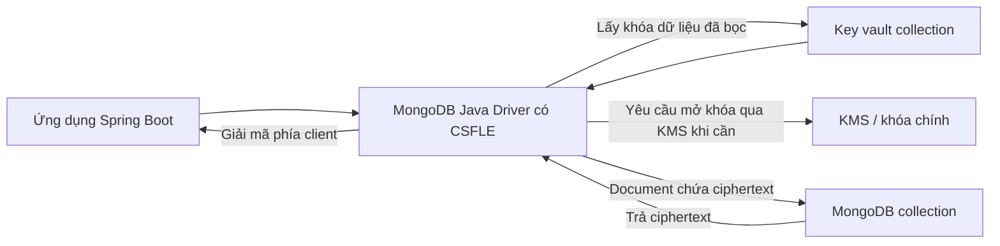

# Client-Side Field Level Encryption (CSFLE) và điều kiện triển khai

## 1. CSFLE giải quyết vấn đề gì?

Trong ứng dụng **Spring Data MongoDB**, developer thường dùng `MongoTemplate` hoặc repository để ghi và đọc document từ MongoDB. Ngoài việc bảo vệ kết nối bằng TLS và bảo vệ đĩa lưu trữ, hệ thống còn có thể cần giữ một số trường bí mật **ngay cả đối với người chỉ có quyền đọc dữ liệu trong MongoDB**: email cá nhân, mã định danh, thông tin y tế hoặc mã tài khoản.

**Client-Side Field Level Encryption (CSFLE)** mã hóa giá trị của trường ở phía MongoDB driver, **trước khi** document được gửi qua mạng tới MongoDB. Máy chủ lưu giá trị đã mã hóa; khi một client có quyền sử dụng khóa đọc lại document, driver giải mã để ứng dụng nhìn thấy giá trị ban đầu.

Ví dụ document logic mà ứng dụng sử dụng:

```javascript
{
  _id: "customer-102",
  tenantId: "tenant-a",
  fullName: "Nguyễn An",
  email: "an@example.com",
  riskLevel: "LOW"
}
```

Nếu chỉ `email` được mã hóa, trên MongoDB giá trị đó là **BSON Binary subtype 6**, không còn là chuỗi email dễ đọc. Các trường `tenantId`, `fullName` và `riskLevel` vẫn ở dạng rõ nếu cấu hình không mã hóa chúng.



Điểm quan trọng của mô hình đe dọa:

- Người đọc bản sao collection, bản backup hoặc dữ liệu bị lộ từ MongoDB **không thể lấy plaintext từ trường mã hóa chỉ bằng dữ liệu trong collection** nếu không có các khóa cần thiết.
- CSFLE **không che giấu các trường không mã hóa**, tên collection, một phần metadata, số lượng document hay toàn bộ mẫu hình truy cập.
- Nếu kẻ tấn công kiểm soát ứng dụng, tài khoản có quyền giải mã, hoặc có cả khóa và ciphertext, CSFLE không còn bảo vệ các dữ liệu mà client đó có thể giải mã.
- TLS, xác thực MongoDB, phân quyền, mã hóa lưu trữ và kiểm soát log vẫn cần thiết. CSFLE bổ sung một ranh giới bảo mật ở cấp trường.

## 2. Phân biệt CSFLE với các lớp bảo vệ khác

| Cơ chế | Vị trí bảo vệ | MongoDB có thể đọc giá trị ứng dụng không? | Khi nào dùng |
|---|---|---|---|
| TLS | Trên đường truyền giữa ứng dụng và server | Có, sau khi nhận dữ liệu | Mọi kết nối production |
| Encryption at rest | Tệp dữ liệu/ổ đĩa hoặc dịch vụ lưu trữ | Có, khi server xử lý dữ liệu | Bảo vệ phương tiện lưu trữ và bản sao đĩa |
| **CSFLE** | Một số trường được driver mã hóa phía client | Không có plaintext của trường mã hóa trong dữ liệu server nhận | PII, tài chính, thông tin nhạy cảm |
| Queryable Encryption | Mã hóa phía client với cơ chế truy vấn được thiết kế riêng | Không cần plaintext để chạy các kiểu truy vấn được hỗ trợ | Khi cần khả năng truy vấn mã hóa rộng hơn CSFLE truyền thống |

**CSFLE truyền thống khác Queryable Encryption (QE).** Với CSFLE, mã hóa xác định hỗ trợ chủ yếu truy vấn **bằng nhau (equality)**; mã hóa ngẫu nhiên không cho phép so khớp plaintext bằng truy vấn equality như thông thường. QE là tính năng khác, sử dụng cơ chế cấu hình, index và giới hạn riêng. Không dùng cấu hình CSFLE như thể nó tự động hỗ trợ range, prefix hoặc tìm kiếm văn bản trên ciphertext.

### Hai thuật toán mã hóa trường trong CSFLE

| Thuộc tính | Deterministic | Randomized |
|---|---|---|
| Cùng plaintext + cùng khóa | Thường sinh cùng ciphertext | Có thể sinh ciphertext khác nhau mỗi lần |
| Equality query phía server | Có thể thực hiện theo điều kiện hỗ trợ của CSFLE | Không truy vấn equality thông thường bằng plaintext |
| Rò rỉ mẫu hình | Có thể lộ việc các giá trị bằng nhau và tần suất xuất hiện | Giảm lộ quan hệ bằng nhau |
| Trường điển hình | Giá trị cần đối chiếu chính xác, có độ phân biệt đủ cao | Trường chỉ lưu và đọc lại, không cần tìm kiếm theo giá trị |
| Thuật toán khai báo | `AEAD_AES_256_CBC_HMAC_SHA_512-Deterministic` | `AEAD_AES_256_CBC_HMAC_SHA_512-Random` |

Ví dụ, nếu mã hóa xác định trường `gender` hay trạng thái chỉ có vài giá trị, người có dữ liệu ciphertext có thể quan sát tần suất và suy đoán phân bố. Vì thế **không chọn deterministic chỉ để tiện truy vấn**; hãy cân nhắc độ nhạy, số lượng giá trị khác nhau và khả năng suy luận từ tần suất.

## 3. Những điều kiện phải có trước khi triển khai

CSFLE liên quan trực tiếp đến **MongoDB server, driver, thư viện mã hóa, key vault và hệ thống quản lý khóa**. Cần kiểm tra từng lớp trước khi viết repository hoặc `MongoTemplate`.

| Điều kiện | Nội dung kiểm tra | Hệ quả nếu thiếu |
|---|---|---|
| MongoDB tương thích | CSFLE được hỗ trợ từ MongoDB **4.2**; đối chiếu phiên bản server/driver thực tế | Không thể dùng đúng tính năng hoặc gặp giới hạn không tương thích |
| Java driver hỗ trợ CSFLE | Phiên bản MongoDB Java Driver mà Spring Data đang dùng hỗ trợ `ClientEncryption` và cấu hình tự động | Không thể mã hóa/giải mã bằng API đã chọn |
| Thư viện mã hóa | `libmongocrypt` qua dependency/binary thích hợp, thường là `mongodb-crypt` trong hệ sinh thái Java driver | Lỗi khởi tạo hoặc gọi chức năng mã hóa |
| Thành phần phân tích cho auto encryption | Cấu hình thư viện `crypt_shared` hoặc `mongocryptd` phù hợp phiên bản, nền tảng và hướng dẫn driver | Gặp lỗi khi tự động nhận diện trường phải mã hóa |
| Khả năng hỗ trợ của bản phân phối | Xác minh điều kiện sử dụng **automatic encryption** trên MongoDB Atlas/Enterprise Advanced; **explicit encryption** có thể dùng trên Community | Chọn sai phương thức so với môi trường |
| Key vault | Namespace MongoDB lưu các data encryption key (DEK) đã được bọc, ví dụ `encryption.__keyVault` | Client không tìm được DEK để mã hóa/giải mã |
| KMS / master key | Dịch vụ hoặc khóa để bọc/mở bọc DEK; chọn AWS KMS, Azure Key Vault, GCP KMS, KMIP hoặc local cho mục đích phù hợp | Không mở được khóa khi cần |
| Phân quyền và mạng | Client cần quyền thích hợp với key vault và collection dữ liệu, quyền dùng KMS, DNS/TLS/egress | Lỗi truy cập khóa hoặc lỗi giao dịch |
| Mô hình truy vấn | Xác định trường nào mã hóa, thuật toán, kiểu BSON và thao tác cần hỗ trợ | Chọn thuật toán khiến query hiện tại không chạy được |

**Về phiên bản và giấy phép:** các phương thức cung cấp `crypt_shared`, `mongocryptd`, dependency và phạm vi hỗ trợ auto encryption thay đổi theo phiên bản MongoDB và Java driver. Cần đối chiếu đúng **ma trận tương thích tại thời điểm triển khai**, kể cả Atlas tier, hệ điều hành và kiến trúc CPU. Không giả định chỉ cần thêm annotation Spring Data là CSFLE tự hoạt động.

## 4. Key vault, DEK và KMS hoạt động thế nào?

CSFLE sử dụng mô hình phân cấp khóa:

1. Ứng dụng có một **KMS provider** và cấu hình cho phép dùng master key hoặc key-encryption key (KEK).
2. Client tạo **data encryption key (DEK)**; DEK được bọc bằng master key và lưu dưới dạng document trong **key vault collection**.
3. Khi mã hóa trường, driver lấy DEK phù hợp từ key vault, nhờ KMS mở bọc nếu cần, rồi mã hóa giá trị tại phía client.
4. Khi đọc, driver dùng cùng hệ thống khóa để giải mã và trả plaintext cho ứng dụng.

Khóa KMS/KEK và DEK khác vai trò nhau. **Key vault chứa DEK đã được bọc**, không phải là nơi lưu bản rõ của master key; cũng không nên ghi master key vào source code, file config commit lên Git hoặc log. Nếu phải phục hồi hệ thống, cần cả backup dữ liệu, key vault và khả năng truy cập KMS/KEK tương ứng.

Ví dụ một cấu trúc key vault thường gặp:

```text
MongoDB:
  app.customers                 <- các document chứa ciphertext
  encryption.__keyVault        <- các DEK được bọc, keyAltNames, metadata KMS

Ngoài MongoDB:
  KMS / HSM / khóa chính        <- quyền bọc/mở bọc khóa
Ứng dụng:
  MongoClient có CSFLE          <- mã hóa/giải mã trường
```

Nên tạo index phục vụ tra cứu `keyAltNames` và ngăn đặt trùng tên khóa, theo yêu cầu của cơ chế lưu khóa trong driver:

```javascript
db.getSiblingDB("encryption").__keyVault.createIndex(
  { keyAltNames: 1 },
  {
    unique: true,
    partialFilterExpression: { keyAltNames: { $exists: true } }
  }
);
```

Một DEK có thể tham chiếu bằng `_id` kiểu UUID/BSON Binary hoặc bằng `keyAltName` trong những API hỗ trợ. Không tạo DEK mới ở mỗi yêu cầu HTTP hoặc mỗi lần ghi document: tạo khóa theo quy trình provisioning, quản lý vòng đời khóa và lưu tham chiếu ổn định.

### Local KMS chỉ dành cho môi trường phù hợp

Provider `local` thường tiện cho việc học, test và môi trường được kiểm soát. Nó yêu cầu **local master key 96 byte**, có thể lấy từ biến môi trường hoặc secret manager, thay vì ghi trực tiếp trong mã nguồn. Đoạn sau chỉ thể hiện việc đọc khóa đã được cấp phát sẵn:

```java
import java.util.Base64;
import java.util.Map;

byte[] localMasterKey = Base64.getDecoder().decode(
    System.getenv("MONGO_LOCAL_MASTER_KEY_B64")
);
if (localMasterKey.length != 96) {
    throw new IllegalStateException("Local master key phải có đúng 96 byte");
}
Map<String, Object> localProvider = Map.of("key", localMasterKey);
Map<String, Map<String, Object>> kmsProviders =
    Map.of("local", localProvider);
```

Trong production, ưu tiên hệ thống KMS/HSM và secret management phù hợp chính sách tổ chức. Phân tách quyền database với quyền sử dụng khóa; bổ sung audit, rotation và quy trình khôi phục. Nếu mất master key và không thể mở bọc DEK, ciphertext có thể **không còn khả năng giải mã**, dù bản sao MongoDB vẫn còn nguyên.

## 5. Explicit encryption: mã hóa chủ động trong service

**Explicit encryption** nghĩa là service gọi API mã hóa/giải mã cụ thể cho giá trị cần bảo vệ. Phương thức này linh hoạt và có thể dùng với MongoDB Community, nhưng bắt buộc toàn bộ đường đi ghi/đọc của trường phải thực hiện đúng quy tắc.

Trong Java driver, nhóm API quan trọng gồm:

- `ClientEncryptionSettings`: khai báo kết nối tới key vault, namespace và KMS providers.
- `ClientEncryptions.create(...)`: tạo `ClientEncryption`.
- `createDataKey(...)`: tạo DEK **một lần trong giai đoạn provisioning**.
- `encrypt(BsonValue, EncryptOptions)`: trả BSON ciphertext.
- `decrypt(BsonBinary)`: trả giá trị BSON ở dạng rõ.

Ví dụ khởi tạo client mã hóa trong Java (giả sử `kmsProviders` đã được tạo từ secret an toàn và URI có quyền phù hợp):

```java
import com.mongodb.ConnectionString;
import com.mongodb.MongoClientSettings;
import com.mongodb.client.vault.ClientEncryption;
import com.mongodb.client.vault.ClientEncryptions;
import com.mongodb.ClientEncryptionSettings;

String mongoUri = System.getenv("MONGO_URI");

MongoClientSettings vaultConnection = MongoClientSettings.builder()
    .applyConnectionString(new ConnectionString(mongoUri))
    .build();

ClientEncryptionSettings encryptionSettings = ClientEncryptionSettings.builder()
    .keyVaultMongoClientSettings(vaultConnection)
    .keyVaultNamespace("encryption.__keyVault")
    .kmsProviders(kmsProviders)
    .build();

ClientEncryption clientEncryption = ClientEncryptions.create(encryptionSettings);
// Quản lý vòng đời clientEncryption (close) cùng ứng dụng.
```

Tạo DEK trong một job provisioning riêng:

```java
import com.mongodb.client.model.vault.DataKeyOptions;
import org.bson.BsonBinary;
import java.util.List;

BsonBinary dataKeyId = clientEncryption.createDataKey(
    "local",
    new DataKeyOptions().keyAltNames(List.of("customer-email-v1"))
);
// Lưu ID DEK trong cấu hình bảo vệ; không tạo lại ở từng request.
```

Mã hóa rồi ghi document bằng connection gốc của `MongoTemplate`:

```java
import com.mongodb.client.model.Filters;
import com.mongodb.client.model.vault.EncryptOptions;
import org.bson.BsonBinary;
import org.bson.BsonString;
import org.bson.Document;

String algorithm = "AEAD_AES_256_CBC_HMAC_SHA_512-Deterministic";
BsonBinary encryptedEmail = clientEncryption.encrypt(
    new BsonString("an@example.com"),
    new EncryptOptions(algorithm).keyId(dataKeyId)
);

Document customer = new Document("_id", "customer-102")
    .append("tenantId", "tenant-a")
    .append("email", encryptedEmail);

mongoTemplate.getCollection("customers").insertOne(customer);

// Tra cứu equality bằng cách mã hóa cùng plaintext, thuật toán và DEK.
BsonBinary encryptedLookup = clientEncryption.encrypt(
    new BsonString("an@example.com"),
    new EncryptOptions(algorithm).keyId(dataKeyId)
);
Document stored = mongoTemplate.getCollection("customers")
    .find(Filters.eq("email", encryptedLookup))
    .first();

if (stored != null) {
    BsonBinary ciphertext = stored.get("email", BsonBinary.class);
    String email = clientEncryption.decrypt(ciphertext).asString().getValue();
    // Chỉ dùng email tại nơi thực sự cần plaintext.
}
```

Đoạn ví dụ sử dụng `MongoTemplate.getCollection(...)` để làm rõ BSON Binary. Ở ứng dụng thực tế, service nên đóng gói thao tác mã hóa/giải mã, kiểm tra dữ liệu đầu vào và giữ API truy cập nhất quán. Với `Random`, mỗi lần mã hóa có thể cho ciphertext khác nhau nên ví dụ equality lookup trên **không còn phù hợp**.

Nếu dùng Spring Data repository mà trường `email` vẫn được ánh xạ `String`, cần thiết kế converter/service sao cho dữ liệu thực sự ghi ra là `BsonBinary` và luôn giải mã trên đường đọc. Không suy đoán rằng repository tự mã hóa chỉ nhờ tên field nhạy cảm.

## 6. Automatic encryption: cấu hình ở MongoClient

**Automatic encryption** giao cho MongoDB driver việc xác định trường cần mã hóa dựa trên **schema mã hóa**. Với client đã cấu hình đúng, ứng dụng có thể tiếp tục lưu/đọc Java object qua `MongoTemplate` hoặc repository; driver xử lý trước khi gửi lệnh và sau khi nhận kết quả.

Giả sử namespace dữ liệu là `app.customers`, trường `email` có BSON type `string` và dùng DEK đã tạo. Ví dụ Java dưới đây minh họa **cấu hình lõi của Java driver**; các biến `kmsProviders`, `mongoUri` và `dataKeyId` đến từ cấu hình/provisioning của ứng dụng, và phải có dependency cùng thư viện mã hóa phù hợp:

```java
import com.mongodb.ConnectionString;
import com.mongodb.MongoClientSettings;
import com.mongodb.AutoEncryptionSettings;
import com.mongodb.client.MongoClient;
import com.mongodb.client.MongoClients;
import org.bson.BsonArray;
import org.bson.BsonBinary;
import org.bson.BsonDocument;
import org.bson.BsonString;
import java.util.List;
import java.util.Map;

BsonDocument emailRule = new BsonDocument("encrypt",
    new BsonDocument("bsonType", new BsonString("string"))
        .append("algorithm", new BsonString(
            "AEAD_AES_256_CBC_HMAC_SHA_512-Deterministic"))
        .append("keyId", new BsonArray(List.of(dataKeyId))));

BsonDocument schema = new BsonDocument("bsonType", new BsonString("object"))
    .append("properties", new BsonDocument("email", emailRule));

AutoEncryptionSettings auto = AutoEncryptionSettings.builder()
    .keyVaultNamespace("encryption.__keyVault")
    .kmsProviders(kmsProviders)
    .schemaMap(Map.of("app.customers", schema))
    .build();

MongoClientSettings settings = MongoClientSettings.builder()
    .applyConnectionString(new ConnectionString(mongoUri))
    .autoEncryptionSettings(auto)
    .build();

MongoClient encryptedClient = MongoClients.create(settings);
// Đăng ký bean MongoClient/MongoTemplate dùng cùng client này trong Spring.
```

Lưu ý khi mang cấu hình này vào Spring Boot:

1. Dùng một bean `MongoClient` có `AutoEncryptionSettings` hoặc cơ chế `MongoClientSettingsBuilderCustomizer` tương ứng với phiên bản Spring Boot. Đảm bảo `MongoTemplate` và repository thực sự dùng **client đã bật CSFLE**.
2. `schemaMap` cần trỏ **đúng tên database.collection**. Quy tắc `bsonType` phải khớp kiểu dữ liệu Java/BSON khi ghi.
3. `dataKeyId` ở đây là `BsonBinary` tham chiếu DEK đã được cấp phát; không nhập một UUID ngẫu nhiên chưa tồn tại trong key vault.
4. Automatic encryption cần cơ chế phân tích/đánh dấu trường phù hợp; tùy phiên bản môi trường có thể phải cung cấp thư viện `crypt_shared` hoặc `mongocryptd`. Việc cấu hình `schemaMap` **không tự cung cấp** binary/thư viện mã hóa.
5. Không khai báo đồng thời nhiều cấu hình MongoClient lệch nhau rồi chỉ test qua connection không bật CSFLE; cần kiểm tra kết quả BSON ở server.

Khi driver tự giải mã, service với `@Document` và repository có thể nhận lại `String email` bình thường. Tuy nhiên, **client không bật CSFLE có thể nhìn thấy ciphertext** và trong những cấu hình không có kiểm tra phía server thích hợp có thể ghi plaintext. Do đó cần kiểm soát tất cả luồng ghi, kể cả batch import, script bảo trì, ETL và các dịch vụ sử dụng driver khác.

## 7. Giới hạn truy vấn, index và dữ liệu nghiệp vụ

Trước khi lựa chọn trường mã hóa, kiểm tra **thao tác nghiệp vụ hiện tại**:

| Nhu cầu | CSFLE truyền thống | Gợi ý thiết kế |
|---|---|---|
| Lưu và đọc lại trường bí mật | Phù hợp với deterministic hoặc randomized | Dùng randomized khi không cần tìm kiếm theo giá trị |
| `email = ?` | Có thể với deterministic cùng DEK | Kiểm tra độ phân biệt của dữ liệu và điều kiện index |
| `email LIKE '%abc%'` hoặc full-text | Không truy vấn trực tiếp ciphertext CSFLE theo cách này | Tách yêu cầu tìm kiếm, xét index token riêng và rủi ro rò rỉ |
| `amount >= 1000`, `date BETWEEN ...` trên trường mã hóa | Không được CSFLE truyền thống hỗ trợ như range plaintext | Xem Queryable Encryption với phiên bản/giới hạn thích hợp, hoặc đổi thiết kế |
| `$group` / `$sum` trên trường mã hóa | Server không có plaintext để tính như dữ liệu thường | Tổng hợp tại client sau khi giải mã, hoặc duy trì số liệu đã được phê duyệt |
| Unique constraint của dữ liệu nhạy cảm | Không thể mặc định hành vi như index trên plaintext | Xác minh phiên bản, thuật toán và phương án đảm bảo duy nhất |
| Sort theo giá trị nhạy cảm | Không cho kết quả tương đương sort plaintext | Điều chỉnh yêu cầu truy vấn hoặc mô hình dữ liệu |

**Index trên ciphertext không biến mọi thao tác thành truy vấn plaintext.** Với deterministic, equality query có thể được tối ưu bằng thiết kế phù hợp, nhưng các ràng buộc index và cách lập kế hoạch thực thi phải kiểm tra trên phiên bản triển khai. Không đặt mật khẩu, mã PIN hoặc trường có ít giá trị vào deterministic chỉ để hỗ trợ lọc.

Đối với hệ thống nhiều tenant, ràng buộc `tenantId` vào các truy vấn nghiệp vụ, xác định DEK dùng chung hay riêng theo tenant và giới hạn ai có quyền truy cập mỗi DEK. Mã hóa trường **không thay thế phân quyền tenant**; một ứng dụng có quyền giải mã của nhiều tenant vẫn phải kiểm tra authorization trước khi trả dữ liệu.

## 8. Những vấn đề vận hành thường bị bỏ sót

### 8.1 Tính nhất quán khi cập nhật và migration

Nếu đang có dữ liệu plaintext trong collection:

1. Xác định bản ghi nào chứa plaintext và schema dự kiến.
2. Cấp DEK và triển khai client đã cấu hình CSFLE cho một phạm vi thử nghiệm.
3. Thiết kế migration đọc plaintext, mã hóa và ghi lại theo đợt; sử dụng check-point, retry có kiểm soát, đối soát số lượng và dữ liệu.
4. Ngăn luồng ghi cũ tiếp tục tạo plaintext trong thời gian chuyển đổi.
5. Kiểm tra trực tiếp bản lưu trên server bằng client **không tự giải mã**; sau đó mới chuyển luồng đọc chính.

Không chỉ bật automatic encryption rồi cho rằng các document cũ sẽ được mã hóa ngược lại. Phân biệt thao tác cập nhật field mã hóa với thao tác trên field rõ, và chạy kiểm thử thực tế cho `update`, `findAndModify`, `bulkWrite`, transaction và aggregation ở phiên bản đang sử dụng.

### 8.2 Rotation và phục hồi khóa

Có ít nhất hai nhu cầu khác nhau: thay master key/KEK dùng để **bọc DEK**, và thay **DEK dùng mã hóa nội dung**. Rewrap DEK bằng KEK mới **không tự động mã hóa lại toàn bộ dữ liệu bằng DEK mới**. Quy trình thay DEK có thể yêu cầu giải mã và mã hóa lại các trường cùng sửa dữ liệu một cách an toàn.

Phải lưu trữ được lịch sử khóa cần giải mã dữ liệu cũ, có quy trình thu hồi theo phạm vi sử dụng và kiểm thử restore trên môi trường cô lập. Việc xóa nhầm key vault hoặc thu hồi KMS key trước khi hoàn thành migration có thể khiến dữ liệu vĩnh viễn không đọc được.

### 8.3 Quan sát và xử lý sự cố

Tránh log plaintext, master key, credential KMS, token hoặc toàn bộ document sau giải mã. Log nên tập trung vào mã lỗi, namespace, thao tác, latency và correlation ID không chứa PII. Các lỗi phổ biến:

- **Không tìm thấy DEK**: sai `keyVaultNamespace`, `dataKeyId` hoặc không đủ quyền đọc key vault.
- **Không liên lạc được với KMS**: thiếu quyền IAM, lỗi DNS/TLS, hạn chế egress, credential hết hạn.
- **Không tải được thư viện mã hóa**: dependency `mongodb-crypt`, binary `crypt_shared` hoặc cấu hình nền tảng không khớp.
- **Không mã hóa/giải mã được trường**: `bsonType` không khớp, cấu hình thuật toán sai, payload không phải ciphertext hợp lệ hoặc dùng sai khóa.
- **Dữ liệu rò rỉ dạng rõ**: một service/script dùng MongoClient không bật CSFLE hoặc bỏ qua explicit encryption.

Theo dõi tỉ lệ lỗi mã hóa, tốc độ truy cập key vault/KMS, latency của lệnh MongoDB, khối lượng ciphertext, và lỗi khi KMS không sẵn sàng. Các cuộc thử khôi phục cần bao gồm trường hợp mất quyền KMS, mất một bản key vault hoặc service restart khi khóa chưa được cache.

## 9. Kiểm thử chức năng, bảo mật và hiệu năng

Để nghiệm thu một luồng bảo vệ `email`, có thể chạy theo thứ tự:

| Phép thử | Kết quả mong đợi |
|---|---|
| Ghi `email = "an@example.com"` qua client đã cấu hình | Lệnh ghi thành công |
| Đọc bản ghi bằng MongoClient thông thường không bật CSFLE | `email` là BSON Binary ciphertext, không phải email |
| Đọc bằng client đã cấu hình và có quyền khóa | Nhận lại đúng plaintext |
| Truy vấn equality với deterministic | Tìm đúng bản ghi bằng cách mã hóa tham số truy vấn |
| Dùng randomized cho field chỉ đọc lại | Dữ liệu giải mã được, nhưng không dùng equality query như deterministic |
| Truy cập khi thiếu quyền key vault/KMS | Giải mã thất bại rõ ràng, không trả dữ liệu nhạy cảm giả |
| Tạo document với kiểu BSON khác schema | Có lỗi được xử lý; không âm thầm ghi sai schema |
| Retry, concurrent writes và bulk operations | Không xuất hiện plaintext do đường ghi phụ |
| Khôi phục từ backup với key vault/KMS sẵn sàng | Các bản ghi cũ giải mã thành công |
| So benchmark trước và sau bật CSFLE | Biết thêm CPU client, latency, số call KMS và ảnh hưởng query |

Một ví dụ kiểm tra dữ liệu thực tế bằng `mongosh` hoặc driver **không bật auto-decryption** (chạy với quyền được cấp):

```javascript
const doc = db.getSiblingDB("app").customers.findOne(
  { _id: "customer-102" }
);
printjson(doc.email);
// Kỳ vọng: BSON Binary subtype 6, không chứa email rõ.
```

Bản ghi JSON ở collection không phải bằng chứng duy nhất: còn phải kiểm tra log, audit trail, cache, event stream, dữ liệu export, backup và các trường mới xuất hiện trong pipeline. Hãy so chi phí thực tế của explicit/automatic encryption, thời gian fetch DEK, cache và thông lượng của thao tác MongoDB.

## 10. Checklist quyết định và triển khai

1. **Chỉ ra trường nhạy cảm** và lý do phải mã hóa ở phía client; phân biệt với dữ liệu vẫn cần truy vấn/sắp xếp/tổng hợp ở server.
2. **Chọn thuật toán theo truy vấn**: randomized cho trường không cần equality; deterministic chỉ khi thật sự cần đối chiếu chính xác và đã đánh giá rò rỉ tần suất.
3. **Chọn explicit hay automatic** dựa trên bản phân phối MongoDB, mức độ kiểm soát trong service và hỗ trợ driver.
4. **Chuẩn hóa KMS và key vault**: phân quyền, quản lý secret, lập DEK, index `keyAltNames`, backup, rotation và restore.
5. **Tạo cấu hình MongoClient đúng đường đi**: Spring Data repository, `MongoTemplate`, script/ETL và batch jobs phải tuân thủ cùng chính sách.
6. **Đảm bảo thư viện mã hóa hoạt động**: `mongodb-crypt`/`libmongocrypt` và `crypt_shared`/`mongocryptd` nếu cần; đối chiếu ma trận tương thích theo phiên bản.
7. **Di trú dữ liệu cũ** có kiểm chứng ciphertext, không chỉ mã hóa các document được ghi sau khi triển khai.
8. **Kiểm thử với quyền tối thiểu** và giả lập lỗi KMS, key vault, mất khóa, restart, query equality và cập nhật đồng thời.
9. **Đo chi phí vận hành**: latency, CPU phía client, key cache, giới hạn truy vấn, chỉ số truy vấn và dung lượng.
10. **Định nghĩa quy trình xử lý sự cố**: xác định phạm vi rò rỉ, khôi phục khóa, rollback/migration và kiểm tra log không chứa plaintext.

Với **SPRING_DATA_MONGODB**, CSFLE là trách nhiệm ở ranh giới giữa driver và MongoDB: Spring Data giúp ánh xạ document và tổ chức repository, còn **MongoDB Java Driver cùng hệ thống khóa quyết định việc mã hóa/giải mã**. Một triển khai đạt yêu cầu phải chứng minh ba điều độc lập: trường nhạy cảm thực sự là ciphertext trên server; client được cấp quyền vẫn đọc và truy vấn đúng phạm vi hỗ trợ; và dữ liệu còn khôi phục được sau các tình huống lỗi hoặc thay khóa.
