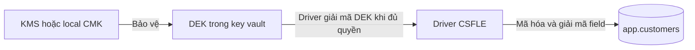

# `@Encrypted`, JSON Schema và `AutoEncryptionSettings` trong Spring Data MongoDB

## Mục tiêu bài học

Khi ứng dụng lưu số định danh, thông tin liên hệ nhạy cảm hoặc ghi chú y tế vào MongoDB, chỉ giới hạn quyền truy cập theo collection có thể chưa đủ. **Client-Side Field Level Encryption (CSFLE)** cho phép mã hóa một số trường **trên client** trước khi gửi dữ liệu đến MongoDB và giải mã khi ứng dụng đọc bằng client có cấu hình phù hợp.

Trong Spring Data MongoDB, ba thành phần thường xuất hiện cùng nhau:

- **`@Encrypted`**: khai báo metadata mã hóa ngay trên property của document Java.
- **JSON Schema**: biểu diễn các quy tắc trường nào được mã hóa, kiểu dữ liệu trước mã hóa, thuật toán và khóa.
- **`AutoEncryptionSettings`**: cấu hình **MongoDB Java Driver** để thực sự mã hóa/giải mã tự động khi đi qua `MongoClient` đã được cấu hình.

Sau bài này, bạn có thể thiết kế cấu hình CSFLE dạng *schema-based*, thao tác dữ liệu qua `MongoTemplate` hoặc repository, đánh giá hạn chế truy vấn, kiểm thử dữ liệu lưu thực tế và xử lý lỗi cấu hình.

> **Phạm vi:** Ví dụ tập trung vào cơ chế CSFLE theo JSON Schema (thường gọi là FLE 1) với hai thuật toán `AEAD_AES_256_CBC_HMAC_SHA_512-Deterministic` và `AEAD_AES_256_CBC_HMAC_SHA_512-Random`. **Queryable Encryption (FLE 2)** dùng mô hình cấu hình và tập khả năng truy vấn khác; không nên coi những ví dụ này là cấu hình thay thế trực tiếp cho `encryptedFieldsMap` của Queryable Encryption.

## 1. Vị trí của ba thành phần trong đường đi dữ liệu

Ứng dụng có thể tạo một entity Java `Customer` chứa `identityNumber` ở dạng `String`. Lớp repository hoặc `MongoTemplate` chuyển entity thành BSON thông qua `MappingMongoConverter`. **Driver** kiểm tra JSON Schema đã được gắn với namespace `database.collection`, mã hóa trường thuộc phạm vi quy tắc rồi gửi ciphertext lên MongoDB.

```mermaid
flowchart TD
  A[Entity Java với giá trị gốc] --> B[Spring Data MongoDB mapping]
  B --> C[MongoDB Java Driver có AutoEncryptionSettings]
  D[@Encrypted trên model] --> E[MongoJsonSchemaCreator]
  E --> F[JSON Schema theo namespace]
  F --> C
  G[Data Encryption Key trong key vault] -. Tra khóa .-> C
  H[KMS / Customer Master Key] -. Bảo vệ DEK .-> G
  C -->|Mã hóa trước khi ghi| I[(MongoDB: ciphertext, BSON Binary subtype 6)]
  I -->|Đọc qua client có giải mã| C
  C --> B
  B --> A
```

Điểm cần nhớ: annotation và schema **không tự mã hóa**. Nếu chỉ đánh dấu `@Encrypted` nhưng sử dụng một `MongoClient` không bật CSFLE, driver không có lý do để mã hóa trường. Ngược lại, nếu client đã được cấu hình đúng, `MongoTemplate` và repository có thể làm việc với kiểu Java bình thường trong những thao tác được CSFLE hỗ trợ.

Phân biệt ba khái niệm bảo vệ dữ liệu:

| Cơ chế | Thực hiện ở đâu | Giải quyết vấn đề gì? |
| --- | --- | --- |
| TLS khi truyền | Kết nối mạng | Ngăn nghe lén dữ liệu trên đường truyền |
| Mã hóa at-rest phía máy chủ | Tầng lưu trữ của MongoDB | Bảo vệ dữ liệu lưu trên thiết bị/volume |
| CSFLE | MongoDB Driver của ứng dụng | Giữ một số trường ở dạng ciphertext trước khi đến máy chủ |

CSFLE không thay thế cho TLS, phân quyền database, kiểm toán truy cập hay quản lý khóa.

## 2. Khai báo trường mã hóa bằng `@Encrypted`

Ví dụ collection `customers` có hai trường nhạy cảm: số định danh cần tra cứu chính xác và ghi chú riêng tư không cần tìm kiếm.

```java
import org.springframework.data.annotation.Id;
import org.springframework.data.mongodb.core.mapping.Document;
import org.springframework.data.mongodb.core.mapping.Encrypted;
import org.springframework.data.mongodb.core.mapping.Field;

@Document("customers")
public class Customer {

    @Id
    private String id;

    private String displayName;

    @Field("identity_number")
    @Encrypted(algorithm = "AEAD_AES_256_CBC_HMAC_SHA_512-Deterministic")
    private String identityNumber;

    @Encrypted(algorithm = "AEAD_AES_256_CBC_HMAC_SHA_512-Random")
    private String privateNote;

    // Constructor, getter/setter lược bỏ để tập trung vào cấu hình.
}
```

`@Field("identity_number")` yêu cầu Spring Data lưu property `identityNumber` dưới tên BSON `identity_number`. JSON Schema phải tham chiếu **tên BSON thực tế**, không đơn thuần tên property Java.

### Chọn thuật toán phù hợp

| Thuật toán | Cùng plaintext, cùng khóa và cấu hình | Hành vi truy vấn điển hình |
| --- | --- | --- |
| `...-Deterministic` | Sinh cùng ciphertext | Có thể hỗ trợ so sánh bằng (`equals`) với điều kiện truy vấn CSFLE phù hợp |
| `...-Random` | Mỗi lần mã hóa có thể tạo ciphertext khác | Không dùng để so khớp giá trị bằng theo cơ chế deterministic |

Với trường `identityNumber` cần tìm kiếm chính xác, deterministic là một lựa chọn có điều kiện. Với `privateNote` chỉ lưu/đọc, random là lựa chọn thích hợp hơn.

**Đánh đổi bảo mật:** mã hóa deterministic để lộ mẫu lặp của giá trị. Các giá trị có miền nhỏ, như giới tính, trạng thái bật/tắt hoặc mã có ít khả năng, có thể bị phân tích tần suất. Không chọn deterministic chỉ vì muốn tìm kiếm thuận tiện; đánh giá tính nhạy cảm, miền giá trị và mô hình tấn công trước.

Lưu ý rằng “hỗ trợ so sánh bằng” không có nghĩa là có thể dùng mọi toán tử MongoDB với trường đã mã hóa. Các truy vấn khoảng (`$gt`/`$lt`), regex, sắp xếp và các phép biến đổi chuỗi trên ciphertext không tự hoạt động như trên plaintext.

## 3. JSON Schema mô tả quy tắc mã hóa

`MongoJsonSchemaCreator` có thể đọc metadata mapping của Spring Data MongoDB để sinh JSON Schema cho kiểu entity. Về ý tưởng, quy tắc mã hóa của ví dụ có cấu trúc tương tự:

```json
{
  "bsonType": "object",
  "encryptMetadata": {
    "keyId": [
      {
        "$binary": {
          "base64": "<BASE64_CUA_UUID_DATA_KEY>",
          "subType": "04"
        }
      }
    ]
  },
  "properties": {
    "identity_number": {
      "encrypt": {
        "bsonType": "string",
        "algorithm": "AEAD_AES_256_CBC_HMAC_SHA_512-Deterministic"
      }
    },
    "privateNote": {
      "encrypt": {
        "bsonType": "string",
        "algorithm": "AEAD_AES_256_CBC_HMAC_SHA_512-Random"
      }
    }
  }
}
```

Đây là **mẫu cấu trúc**; `<BASE64_CUA_UUID_DATA_KEY>` là ký hiệu thay thế, không phải khóa dùng được. Khi thực thi, dùng **BSON binary UUID subtype 4** trả về từ thao tác tạo Data Encryption Key (DEK), không chuyển UUID thành chuỗi thường rồi giả định driver sẽ tự nhận ra.

Các thành phần chính:

- `properties.<field>.encrypt`: quy định trường cần mã hóa.
- `bsonType` bên trong `encrypt`: kiểu BSON của **plaintext** mà client nhận trước khi mã hóa (ví dụ `string`).
- `algorithm`: thuật toán được dùng cho trường đó.
- `encryptMetadata.keyId`: danh sách ID của DEK mặc định áp dụng cho những trường mã hóa không tự khai báo khóa riêng. Có thể chỉ định khóa theo từng trường nếu chính sách yêu cầu.

Trường được mã hóa trong dữ liệu lưu thực tế có biểu diễn ciphertext `BinData` (BSON binary subtype 6), khác `bsonType` của plaintext trong quy tắc `encrypt`. JSON Schema dành cho CSFLE không nên bị nhầm với một validator thông thường chỉ đặt `required` hay `bsonType` cho field không mã hóa.

### Sinh schema từ Spring Data mapping

Ví dụ bên dưới minh họa phần lõi cấu hình khi đã có `MongoMappingContext` và `BsonBinary dataKeyId` hợp lệ:

```java
MongoJsonSchemaCreator creator =
        MongoJsonSchemaCreator.create(mongoMappingContext);

MongoJsonSchema generated =
        creator.createSchemaFor(Customer.class);

// Chuyển schema sinh từ mapping thành BSON schema dùng cho driver.
BsonDocument encryptionSchema =
        BsonDocument.parse(generated.toDocument().toJson());

// Áp dụng cùng một DEK mặc định cho hai field trong ví dụ.
encryptionSchema.put(
        "encryptMetadata",
        new BsonDocument("keyId",
                new BsonArray(List.of(dataKeyId)))
);
```

`MongoJsonSchemaCreator` thuộc Spring Data MongoDB, còn `BsonDocument`/`BsonBinary` thuộc MongoDB Java Driver. Đối tượng `dataKeyId` phải là ID khóa đã có trong **key vault**; bước tạo khóa sẽ được trình bày ở phần sau.

Cần **kiểm tra kết quả `generated.toDocument()`** trước khi áp dụng: schema phải có hai phần `encrypt`, tên field `identity_number` đúng mapping và thuật toán đúng thiết kế. Việc sinh schema theo model chỉ bảo đảm cách biểu diễn metadata được hỗ trợ trong phiên bản Spring Data đang dùng; nó không chứng minh rằng key vault, driver và KMS đã cấu hình thành công.

### JSON Schema lưu ở đâu?

Có hai phương án đáng phân biệt:

1. **Client-side `schemaMap`:** driver nhận schema từ ứng dụng và áp dụng cho namespace `database.collection`. Đây là cách triển khai chính trong ví dụ, giúp ứng dụng kiểm soát quy tắc mã hóa mà không phụ thuộc vào việc nhận schema do máy chủ cung cấp.
2. **Schema phía collection:** MongoDB có thể lưu quy tắc validator trong thông tin collection và client hỗ trợ CSFLE có thể dùng schema phù hợp để tự mã hóa. Tuy vậy, bản thân server **không thực thi thuật toán mã hóa cho client** chỉ vì schema có `encrypt`.

Hai cách có quy tắc ưu tiên và vận hành khác nhau. Khi sử dụng `schemaMap`, cần đảm bảo tên namespace, bản schema và cách triển khai được quản lý nhất quán giữa các instance của ứng dụng.

## 4. Cơ chế khóa: CMK, DEK và key vault

CSFLE có hai lớp khóa:

- **Customer Master Key (CMK)** được quản lý bởi hệ thống KMS hoặc một local key trong môi trường phát triển; dùng để bảo vệ khóa dữ liệu.
- **Data Encryption Key (DEK)** được dùng để mã hóa dữ liệu của các field. Bản DEK được bảo vệ và lưu trong **key vault collection** (ví dụ namespace `encryption.__keyVault`).

Sơ đồ quản lý khóa:



Tên `encryption.__keyVault` là ví dụ namespace dành cho tài liệu khóa; nó không phải collection dữ liệu khách hàng. Ứng dụng cần có quyền cần thiết để truy cập key vault và collection nghiệp vụ, còn quyền quản trị khóa, key rotation, giám sát KMS cần được giới hạn theo vai trò.

### Ví dụ tạo một DEK cho môi trường thực hành

Đoạn code sau dùng provider `local` để minh họa luồng API. Khóa master 96 byte, được mã hóa Base64 và lấy từ biến môi trường; **không dùng giá trị mẫu và không ghi khóa vào Git hoặc log**.

```java
String mongoUri = System.getenv("MONGODB_URI");
String masterKeyBase64 = System.getenv("LOCAL_MASTER_KEY_B64");

// Biến môi trường phải chứa khóa local đúng định dạng, đủ 96 byte
// sau khi giải mã Base64.
Map<String, Map<String, Object>> kmsProviders = Map.of(
        "local", Map.of("key", masterKeyBase64)
);

String keyVaultNamespace = "encryption.__keyVault";

MongoClientSettings vaultClientSettings = MongoClientSettings.builder()
        .applyConnectionString(new ConnectionString(mongoUri))
        .build();

ClientEncryptionSettings keySettings = ClientEncryptionSettings.builder()
        .keyVaultMongoClientSettings(vaultClientSettings)
        .keyVaultNamespace(keyVaultNamespace)
        .kmsProviders(kmsProviders)
        .build();

BsonBinary dataKeyId;

try (ClientEncryption clientEncryption =
             ClientEncryptions.create(keySettings)) {
    // Chạy một lần khi khởi tạo khóa; tái sử dụng DEK đã tồn tại
    // ở những lần khởi động ứng dụng sau.
    dataKeyId = clientEncryption.createDataKey(
            "local", new DataKeyOptions());
}
```

**Không tạo DEK mới mỗi lần ứng dụng khởi động.** Nếu schema chuyển sang ID khóa mới mà dữ liệu cũ chưa được xử lý tương ứng, ứng dụng có thể gặp lỗi giải mã hoặc truy vấn không khớp. Trong hệ thống thật, lưu và quản lý ID khóa theo quy trình, kiểm soát vòng đời khóa, lập kế hoạch rotation/rewrap và kiểm thử phục hồi dữ liệu.

Khi chạy production, nên dùng provider KMS phù hợp (chẳng hạn AWS KMS, Azure Key Vault hoặc Google Cloud KMS) theo chính sách hệ thống. Cấu hình `kmsProviders` và các thông số xác thực sẽ khác provider `local`; không chuyển thẳng ví dụ local vào production.

## 5. Kích hoạt CSFLE bằng `AutoEncryptionSettings`

Sau khi đã có `encryptionSchema` và DEK, ánh xạ schema đến **đúng namespace**. Với entity `@Document("customers")` nằm trong database `app`, khóa map phải là `app.customers`.

```java
String namespace = "app.customers";

Map<String, BsonDocument> schemaMap =
        Map.of(namespace, encryptionSchema);

AutoEncryptionSettings autoEncryption = AutoEncryptionSettings.builder()
        .keyVaultNamespace("encryption.__keyVault")
        .kmsProviders(kmsProviders)
        .schemaMap(schemaMap)
        .build();

MongoClientSettings encryptedClientSettings = MongoClientSettings.builder()
        .applyConnectionString(new ConnectionString(mongoUri))
        .autoEncryptionSettings(autoEncryption)
        .build();

com.mongodb.client.MongoClient encryptedClient =
        MongoClients.create(encryptedClientSettings);

// Sử dụng client đã bật auto-encryption cho tầng Spring Data.
MongoDatabaseFactory factory =
        new SimpleMongoClientDatabaseFactory(encryptedClient, "app");

MongoTemplate mongoTemplate =
        new MongoTemplate(factory, mappingMongoConverter);
```

Đây là các đoạn mã minh họa thành phần cấu hình, không phải một class Java độc lập đầy đủ import/bean wiring. Các đối tượng `mongoUri`, `kmsProviders`, `encryptionSchema`, `mappingMongoConverter` và khóa đã được chuẩn bị ở những bước trước.

Ý nghĩa các trường cấu hình:

| Thuộc tính | Vai trò | Lỗi thường gặp |
| --- | --- | --- |
| `keyVaultNamespace` | Nơi tìm DEK | Khác namespace đã dùng khi tạo khóa |
| `kmsProviders` | Cách truy cập/giải mã DEK | Thiếu credential, local key khác lúc tạo DEK |
| `schemaMap` | Quy tắc mã hóa theo namespace | Khóa map viết `customers` thay vì `app.customers` |
| `autoEncryptionSettings(...)` trong `MongoClientSettings` | Bật cơ chế tự mã hóa/giải mã của driver | Dùng nhầm client chưa được cấu hình |
| `SimpleMongoClientDatabaseFactory(..., "app")` | Chọn database nghiệp vụ của template | Database không khớp `schemaMap` |

**Ranh giới quan trọng:** CSFLE là cấu hình ở **MongoClient/driver**, không phải chỉ ở class `MongoTemplate`. Nếu ứng dụng tạo một client khác cho một repository, job hay môi trường reactive, cần xét cấu hình mã hóa của **client đó**. Thay đổi `@Encrypted` hoặc Java model sau khi client đã được tạo không tự cập nhật `schemaMap` đang được client giữ.

### Điều kiện runtime

Auto-encryption cần các thành phần native liên quan đến **libmongocrypt** và cơ chế hỗ trợ phân tích truy vấn tương ứng với phiên bản driver/triển khai, chẳng hạn **crypt_shared library** hoặc `mongocryptd`. Cần kiểm tra phiên bản MongoDB Java Driver, môi trường chạy, thư viện hỗ trợ và quyền truy cập KMS/key vault trước khi khởi động. Lỗi thiếu thư viện, không tải được DEK hoặc không kết nối KMS có thể xuất hiện ngay khi tạo client hoặc ở lần truy vấn đầu.

Tham số `bypassAutoEncryption` nếu được bật sẽ làm thay đổi hành vi mã hóa tự động; không sử dụng nó để “né lỗi” mà vẫn coi dữ liệu đang được bảo vệ. Cần kiểm tra chính xác kết quả trên dữ liệu lưu thực tế sau mọi thay đổi cấu hình.

## 6. Ghi và truy vấn bằng `MongoTemplate` hoặc repository

Khi `MongoTemplate` được tạo từ client CSFLE đúng namespace, phần lớn code nghiệp vụ tiếp tục làm việc với các property Java ở dạng rõ:

```java
Customer customer = new Customer();
// Gán id, displayName, identityNumber và privateNote.
mongoTemplate.save(customer);

Query query = Query.query(
        Criteria.where("identityNumber").is("0123456789"));

Customer found = mongoTemplate.findOne(query, Customer.class);
```

Trong ví dụ, Spring Data ánh xạ property `identityNumber` thành field BSON `identity_number`. Với schema deterministic, driver có thể mã hóa giá trị trong bộ lọc bằng cùng cơ chế trước khi gửi truy vấn equality. Chỉ một số kiểu query/aggregation được CSFLE hỗ trợ: không suy ra rằng mọi toán tử truy vấn đều có thể áp dụng cho field mã hóa.

Ví dụ với repository:

```java
interface CustomerRepository
        extends MongoRepository<Customer, String> {
    Optional<Customer> findByIdentityNumber(String identityNumber);
}
```

Repository này **chỉ** dùng CSFLE nếu MongoDB infrastructure tạo repository có tham chiếu đến client/template đã được cấu hình mã hóa. Annotation trên entity hay chữ ký method `findByIdentityNumber` không tự bảo đảm điều đó.

### Điều gì xảy ra ở database?

Nếu ghi dữ liệu đúng, MongoDB lưu `identity_number` và `privateNote` dưới dạng ciphertext kiểu BSON Binary subtype **6**. Khi đọc qua client có khả năng giải mã và được phép truy cập DEK, ứng dụng nhận lại giá trị `String` tương ứng. Đọc bằng client quan sát **không bật giải mã tự động** sẽ thấy ciphertext, không thấy plaintext (trừ những trường không mã hóa như `displayName`).

Không nên sử dụng `privateNote` với truy vấn equality thông thường, vì trường random không có tính chất mã hóa cùng giá trị ra cùng ciphertext. Ngoài ra, thao tác `$regex`, `$range`, sort, group hoặc tìm kiếm toàn văn trên ciphertext không cung cấp cùng ngữ nghĩa như trên plaintext. Nếu nghiệp vụ cần khả năng truy vấn khác equality, phải thiết kế chiến lược phù hợp và đánh giá lựa chọn Queryable Encryption riêng.

## 7. Kiểm thử hành vi thực tế, không chỉ kiểm tra annotation

Một hệ thống có thể khởi động và đọc/ghi thành công nhưng vẫn lưu plaintext nếu `schemaMap` sai namespace hoặc đang dùng client thường. Nên kết hợp ba lớp kiểm thử:

1. **Mapping/schema test:** sinh JSON Schema từ `Customer` và xác nhận có hai quy tắc `encrypt`, đúng tên BSON, đúng thuật toán và đúng keyId.
2. **Integration test bằng client có CSFLE:** ghi `Customer`, đọc lại và kiểm tra plaintext trong domain object, equality query trên `identityNumber` cho kết quả mong đợi.
3. **Quan sát storage bằng client riêng không có automatic decryption:** kiểm tra các field phải mã hóa thực sự là BSON Binary subtype 6 và không chứa chuỗi plaintext; kiểm tra field thường vẫn đọc được.

Ví dụ tình huống kiểm thử:

| Tình huống | Kỳ vọng |
| --- | --- |
| Ghi customer qua client CSFLE | Các trường được cấu hình đều được mã hóa trên đường ghi |
| Đọc bằng cùng client có quyền truy cập DEK | Nhận entity với các giá trị Java đã được giải mã |
| Đọc bằng client quan sát không tự giải mã | Nhận ciphertext subtype 6 |
| Tìm bằng equality trên field deterministic | Có thể trả về document đúng nếu query và schema được hỗ trợ |
| Tìm equality trên field random | Không kỳ vọng hoạt động như deterministic |
| Sai `keyVaultNamespace` / thiếu KMS credentials | Thất bại rõ ràng khi driver cần khóa |
| Namespace `schemaMap` viết sai | Có nguy cơ dữ liệu không được mã hóa; test phải phát hiện |
| Hai instance dùng schema/DEK khác nhau | Kết quả truy vấn/giải mã có thể không nhất quán hoặc lỗi |

Việc quan sát bằng client thường phải được giới hạn trong môi trường kiểm thử/kiểm toán với quyền thích hợp. Không lưu giá trị nhạy cảm hoặc tài liệu ciphertext nguyên vẹn vào log kiểm thử công khai.

### Quy trình thực hành tối thiểu

1. Chuẩn bị MongoDB và bộ thư viện CSFLE tương thích; cấu hình key vault và KMS để tạo một DEK.
2. Định nghĩa `Customer`, sinh JSON Schema, bổ sung `encryptMetadata.keyId` và xác minh tên collection/field.
3. Tạo `MongoClient` dùng `AutoEncryptionSettings` với `schemaMap` gắn đúng `app.customers`.
4. Dùng `MongoTemplate` lưu document có số định danh và ghi chú riêng.
5. Dùng client mã hóa đọc lại để xác nhận dữ liệu nghiệp vụ; dùng client quan sát kiểm tra subtype 6.
6. Thử equality query trên `identityNumber`; sau đó thử đổi `schemaMap` sai để thấy bộ kiểm thử phát hiện lỗi.
7. Thực hiện test khi key vault/KMS không khả dụng và kiểm tra thông báo lỗi, khả năng khôi phục, không rơi về lưu plaintext.

## 8. Lỗi thường gặp và cách chẩn đoán

### 8.1. Có `@Encrypted` nhưng dữ liệu vẫn rõ

Nguyên nhân thường là thiếu cấu hình `AutoEncryptionSettings` ở MongoClient thực sự đang chạy, thiếu namespace trong `schemaMap` hoặc dùng repository từ template khác. Hãy lần theo chain từ repository/`MongoTemplate` đến `MongoDatabaseFactory` và đúng instance `MongoClient`, sau đó kiểm tra dữ liệu lưu bằng client quan sát.

### 8.2. Không mã hóa được khi tạo client hoặc lần ghi đầu

Xem việc nạp thư viện `libmongocrypt` / thành phần hỗ trợ query, driver version, cấu hình KMS, key vault namespace và quyền kết nối. Phân biệt lỗi **không tải được thư viện**, **không tìm thấy DEK**, **không giải mã được DEK** và **không hỗ trợ thao tác truy vấn** vì cách khắc phục khác nhau.

### 8.3. Query trả về rỗng dù document tồn tại

Kiểm tra field được tìm có phải là deterministic hay không, đường đi query có sử dụng client/schema đúng, tên BSON đã map đúng chưa, keyId có khớp với dữ liệu được mã hóa không và document cũ có thể được lưu trước khi bật CSFLE hay không. Không mặc định xem “không tìm thấy” là bằng chứng document không tồn tại.

### 8.4. Schema thay đổi giữa các phiên bản triển khai

Khi đổi tên field, đổi thuật toán, thay DEK hay đổi mapping, dữ liệu đã lưu **không tự đổi mã hóa**. Cần lập kế hoạch migrate/giải mã rồi mã hóa lại khi cần; triển khai schema đồng nhất và có kiểm thử tương thích giữa các phiên bản. Rotation của CMK (bảo vệ DEK) khác với re-encryption toàn bộ document bằng DEK mới.

### 8.5. Tương tác với aggregation, index và transaction

Trường deterministic có thể hỗ trợ equality query hoặc indexing trong giới hạn của CSFLE, còn trường random không hỗ trợ cùng kiểu truy vấn. Không giả định pipeline aggregation, update, sort hoặc range query nào cũng hoạt động với field mã hóa. Trong transaction, driver vẫn phải tìm được DEK và áp dụng quy tắc mã hóa cho namespace; cần kiểm thử với cấu hình transaction manager, phiên bản MongoDB và driver thực tế.

Nếu một dịch vụ có nhiều database hoặc nhiều tenant, `schemaMap` phải có **namespace chính xác của từng collection cần mã hóa**; data key và quyền truy cập phải được quản lý theo chính sách tenant. Chỉ dùng một schema cho `app.customers` không tự áp dụng cho `tenant_b.customers`.

## 9. Lưu ý bảo mật và vận hành

- **Mã hóa tối thiểu cần thiết:** mã hóa field có thông tin nhạy cảm; tránh mã hóa vô tội vạ tất cả field rồi mất khả năng query/index mà ứng dụng cần.
- **Quản lý khóa:** không commit local master key, ID khóa kèm thông tin truy cập KMS hoặc mật khẩu vào repository; dùng secret manager và chính sách quyền tối thiểu.
- **Phân tách quyền:** ứng dụng cần quyền phù hợp với key vault và dữ liệu nghiệp vụ; công cụ báo cáo, backup và người vận hành có thể cần các quyền khác nhau.
- **Ghi log an toàn:** không ghi plaintext trước mã hóa, giá trị sau giải mã, khóa, thông tin KMS hoặc token vào log và exception message.
- **Theo dõi lỗi:** quan sát lỗi KMS/key vault, độ trễ mã hóa/giải mã, thay đổi schema và lỗi unsupported operation; thêm integration test vào quy trình release.
- **Chống ghi plaintext:** có thể bổ sung kiểm soát phía collection/schema validator trong thiết kế thích hợp và kiểm tra trực tiếp dữ liệu lưu; không dựa duy nhất vào annotation trong code.
- **Reactive access:** nếu dùng `ReactiveMongoTemplate` hoặc reactive repository, phải kiểm tra cấu hình mã hóa của **reactive MongoClient** tương ứng và khả năng hỗ trợ của bản driver; cấu hình trên một blocking client khác không tự lan sang reactive client.
- **Dữ liệu lịch sử:** bật mã hóa cho field mới không tự mã hóa lại document đã lưu từ trước. Lập kế hoạch backfill/migration và kiểm chứng dữ liệu cuối cùng.
- **Giới hạn bảo vệ:** CSFLE không che giấu toàn bộ metadata truy cập, tên collection, số lượng document hay mọi mẫu truy vấn. Đảm bảo thêm phân quyền, TLS và chính sách dữ liệu.

## 10. Tổng hợp lựa chọn và câu hỏi tự kiểm tra

| Nhu cầu | Lựa chọn/hành động |
| --- | --- |
| Khai báo field nhạy cảm ngay trên model | Dùng `@Encrypted` với thuật toán thích hợp |
| Sinh quy tắc từ mapping của Spring Data | Dùng `MongoJsonSchemaCreator` và xác minh tài liệu schema tạo ra |
| Chỉ định khóa mặc định cho các trường trong schema | Dùng `encryptMetadata.keyId` với BSON UUID của DEK |
| Thực thi mã hóa/giải mã tự động | Cấu hình `AutoEncryptionSettings` trên đúng `MongoClient` |
| Tìm kiếm exact match trên một trường đã mã hóa | Cân nhắc deterministic và đánh giá nguy cơ lộ mẫu lặp |
| Chỉ cần lưu/đọc một trường nhạy cảm | Ưu tiên randomized nếu phù hợp |
| Kiểm chứng hệ thống thật sự mã hóa | Đọc storage qua client quan sát để thấy BSON Binary subtype 6 |
| Thay schema hoặc khóa | Có kế hoạch migration/rotation và kiểm thử dữ liệu cũ |

**Tự kiểm tra:**

1. Vì sao chỉ thêm `@Encrypted` lên property mà không cấu hình MongoClient là chưa đủ?
2. Trong `schemaMap`, điểm khác biệt giữa khóa `customers` và `app.customers` là gì?
3. Vì sao `identityNumber` có thể được chọn deterministic, nhưng `privateNote` nên chọn random?
4. Một bài test chỉ gọi `mongoTemplate.findById(...)` rồi thấy plaintext có đủ chứng minh dữ liệu MongoDB đã được mã hóa không?
5. Khi đổi DEK hoặc tên field được map bằng `@Field`, cần xem xét điều gì với dữ liệu đã lưu?

Điểm cốt lõi của bài **Mã hóa dữ liệu** là giữ ba lớp này thống nhất: `@Encrypted` phản ánh ý định của domain model; JSON Schema mô tả quy tắc mã hóa và khóa theo field/collection; `AutoEncryptionSettings` khiến driver thực hiện quy tắc đó trên **đúng MongoClient**. Hiệu quả bảo vệ phải được xác nhận qua dữ liệu lưu thực tế và kiểm thử theo vận hành của ứng dụng Spring Data MongoDB.
