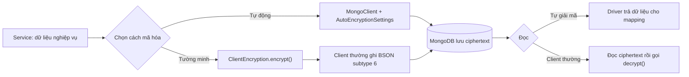

# Mã hóa tự động hoặc tường minh theo nhu cầu ứng dụng

Trong ứng dụng SaaS lưu hồ sơ khách hàng, mỗi document MongoDB có thể chứa tên, số định danh, mã số thuế, thông tin thanh toán hoặc dữ liệu nghiệp vụ nhạy cảm. **Spring Data MongoDB** hỗ trợ ánh xạ document và thao tác qua `MongoTemplate` hoặc repository, nhưng bản thân repository **không tự bật mã hóa trường dữ liệu**. Để bảo vệ một số field trước khi dữ liệu tới MongoDB, ứng dụng cần cấu hình mã hóa phía client ở MongoDB Java Driver hoặc gọi API mã hóa tường minh.

Bài học thuộc chương **Mã hóa dữ liệu**, tập trung vào lựa chọn **mã hóa tự động hay mã hóa tường minh** theo nhu cầu ứng dụng, cùng ảnh hưởng tới truy vấn, aggregation, index, transaction, reactive access, kiểm thử và chẩn đoán hiệu năng.

## 1. Phân biệt các lớp bảo vệ dữ liệu

| Cơ chế | Bảo vệ ở đâu? | Giới hạn |
| --- | --- | --- |
| TLS | Dữ liệu trên đường truyền client–server | Không bảo vệ plaintext sau khi tới server |
| Encryption at rest | Dữ liệu trên thiết bị lưu trữ hoặc backup theo cấu hình deployment | Không đồng nghĩa mã hóa trường trước khi tới MongoDB |
| **Client-Side Field Level Encryption (CSFLE)** | Java Driver mã hóa các field ở phía client | Loại truy vấn trên ciphertext bị giới hạn |
| **Queryable Encryption (QE)** | Mã hóa phía client với cơ chế hỗ trợ một số kiểu truy vấn trên field mã hóa | Cần phiên bản và cấu hình chuyên biệt; khác CSFLE deterministic |

Ví dụ document nghiệp vụ:

```json
{
  "_id": "customer-101",
  "displayName": "Khách hàng A",
  "taxId": "0123456789",
  "tier": "GOLD"
}
```

Nếu chỉ `taxId` nhạy cảm, có thể mã hóa riêng trường đó; `displayName` và `tier` vẫn ở dạng thông thường. Khi xem bằng client **không bật tự giải mã**, trường mã hóa bởi cơ chế MongoDB client-side encryption được lưu dưới dạng **BSON binary subtype 6**. Máy chủ vẫn nhìn thấy cấu trúc document, tên field và metadata liên quan; mã hóa trường không che giấu mọi thông tin.

Trong bài này, **tự động** nghĩa là driver xác định field cần mã hóa dựa vào schema/cấu hình và tự mã hóa khi ghi, giải mã khi đọc. **Tường minh** nghĩa là code gọi `ClientEncryption.encrypt(...)`/`decrypt(...)` tại thời điểm được chọn. Tự viết AES-GCM trong Java cũng là mã hóa ở ứng dụng nhưng là một thiết kế khác, không tự thừa hưởng tính năng CSFLE, DEK, key vault hay cơ chế query của MongoDB.

## 2. Khi nào dùng tự động hoặc tường minh?

| Tiêu chí | Mã hóa tự động | Mã hóa tường minh |
| --- | --- | --- |
| Điểm tích hợp | `AutoEncryptionSettings` trên `MongoClient`, kèm schema phù hợp | `ClientEncryption` do ứng dụng gọi |
| Ghi document | `MongoTemplate.save(...)` / repository `save(...)` với giá trị nghiệp vụ bình thường; driver mã hóa trước khi gửi nếu schema khớp | Chọn field, thuật toán, khóa rồi tạo ciphertext trước khi ghi |
| Đọc document | Driver có thể giải mã trước khi trả cho mapper | Code chủ động giải mã nếu dùng client không tự giải mã |
| Mức kiểm soát | Chính sách tập trung theo namespace và field | Linh hoạt theo đường nghiệp vụ hoặc từng thao tác |
| Rủi ro cấu hình | Schema sai tên, repository dùng sai client/template, runtime thiếu thành phần crypto | Quên mã hóa ở một đường ghi; quên giải mã hoặc double encryption |
| Phù hợp | CRUD phổ biến với chính sách nhất quán | Luồng xuất/nhập tích hợp, field ít dùng, yêu cầu mã hóa có điều kiện |



Cả hai mô hình vẫn cần phân quyền ở lớp nghiệp vụ. Có key để giải mã không có nghĩa mọi người dùng đều được xem thông tin nhạy cảm.

## 3. Chuẩn bị khóa và thành phần mã hóa

MongoDB client-side encryption thường cần các thành phần sau:

1. **Data Encryption Key (DEK):** khóa mã hóa field; tài liệu chứa DEK được lưu trong **key vault collection** dưới dạng đã được bảo vệ bởi master key.
2. **Key vault namespace:** ví dụ `encryption.__keyVault`, cần kiểm soát truy cập và backup phù hợp.
3. **KMS provider/master key:** có thể dùng AWS KMS, Azure Key Vault, GCP KMS, KMIP hoặc provider `local` phù hợp để thử nghiệm. Với `local`, master key là một khóa **96 byte** phải giữ bí mật, không ghi vào source code, Git hoặc log.
4. **Java Driver cùng thành phần crypto:** tính năng mã hóa phía client cần thư viện hỗ trợ `libmongocrypt`; tự động mã hóa có thể yêu cầu cấu hình `crypt_shared` hoặc `mongocryptd` tùy phiên bản và môi trường.
5. **Cấu hình namespace và kiểu BSON:** schema phải khớp chính xác database, collection, tên field lưu xuống MongoDB và kiểu BSON đầu vào.

Một quy trình triển khai hợp lý:

- Provision KMS, key vault và quyền truy cập.
- Tạo DEK trong bước khởi tạo tenant hoặc chính sách bảo mật; lưu ID/key alternate name của DEK vào cấu hình tin cậy.
- Cấu hình driver cho tự động mã hóa hoặc cung cấp `ClientEncryption` cho service.
- Kiểm thử bằng client không có automatic decryption để xác minh ciphertext thực sự nằm trong database.

Ví dụ tạo DEK ở bước **provisioning** với provider `local` cho môi trường thử nghiệm:

```java
import com.mongodb.ClientEncryptionSettings;
import com.mongodb.ConnectionString;
import com.mongodb.MongoClientSettings;
import com.mongodb.client.model.vault.DataKeyOptions;
import com.mongodb.client.vault.ClientEncryption;
import com.mongodb.client.vault.ClientEncryptions;
import org.bson.BsonBinary;

// uri: connection string, kmsProviders: cấu hình provider lấy từ secrets.
// Với provider "local", giá trị kmsProviders["local"]["key"]
// là master key dạng byte[96], chỉ dùng khi quản lý an toàn.
MongoClientSettings vaultConnection = MongoClientSettings.builder()
        .applyConnectionString(new ConnectionString(uri))
        .build();

ClientEncryptionSettings encryptionSettings =
        ClientEncryptionSettings.builder()
                .keyVaultMongoClientSettings(vaultConnection)
                .keyVaultNamespace("encryption.__keyVault")
                .kmsProviders(kmsProviders)
                .build();

try (ClientEncryption encryption =
             ClientEncryptions.create(encryptionSettings)) {
    BsonBinary dataKeyId =
            encryption.createDataKey("local", new DataKeyOptions());
    // Lưu dataKeyId tại metadata an toàn, rồi tái sử dụng cho các lệnh mã hóa.
}
```

Tạo DEK **một lần cho chính sách/vòng đời khóa**; không gọi `createDataKey` mỗi request. Khi dùng dịch vụ KMS thực tế, cách khai báo master key và xác thực provider sẽ khác, cần quyền IAM/KMS thích hợp. Nếu mất key vault hoặc quyền giải mã master key, dữ liệu MongoDB có thể còn nguyên mà không giải mã được.

## 4. CSFLE tự động với MongoTemplate và repository

### 4.1. Tạo MongoClient có AutoEncryptionSettings

Giả sử collection `app.customers` cần mã hóa `taxId` kiểu `string` và ứng dụng đã provision một `BsonBinary keyId`. Ví dụ sử dụng **CSFLE deterministic** để minh họa cả truy vấn equality.

```java
import com.mongodb.AutoEncryptionSettings;
import com.mongodb.ConnectionString;
import com.mongodb.MongoClientSettings;
import com.mongodb.client.MongoClient;
import com.mongodb.client.MongoClients;
import org.bson.BsonArray;
import org.bson.BsonBinary;
import org.bson.BsonDocument;
import org.bson.BsonString;
import org.springframework.data.mongodb.core.MongoTemplate;

import java.util.List;
import java.util.Map;

// keyId: ID DEK dạng BsonBinary đã provision.
// kmsProviders: cấu hình KMS được lấy từ nguồn secret an toàn.
BsonDocument rule = new BsonDocument()
        .append("bsonType", new BsonString("string"))
        .append("algorithm", new BsonString(
                "AEAD_AES_256_CBC_HMAC_SHA_512-Deterministic"))
        .append("keyId", new BsonArray(List.of(keyId)));

BsonDocument schema = new BsonDocument()
        .append("bsonType", new BsonString("object"))
        .append("properties", new BsonDocument(
                "taxId", new BsonDocument("encrypt", rule)));

AutoEncryptionSettings autoEncryption =
        AutoEncryptionSettings.builder()
                .keyVaultNamespace("encryption.__keyVault")
                .kmsProviders(kmsProviders)
                .schemaMap(Map.of("app.customers", schema))
                .build();

MongoClientSettings settings = MongoClientSettings.builder()
        .applyConnectionString(new ConnectionString(uri))
        .autoEncryptionSettings(autoEncryption)
        .build();

MongoClient encryptedClient = MongoClients.create(settings);
MongoTemplate template = new MongoTemplate(encryptedClient, "app");
```

Đây là đoạn cấu hình chính: trong ứng dụng Spring Boot, nên khai báo `MongoClient`/`MongoTemplate` dưới dạng bean, quản lý vòng đời kết nối và đảm bảo repository được gắn **đúng template có encryption**. Bản thân repository không có nút bật/tắt mã hóa riêng.

**Chú ý:** `schemaMap` dùng tên namespace đầy đủ `database.collection`. Nếu code ghi vào collection khác, driver có thể không áp dụng schema dự kiến. Đường truy cập sử dụng một `MongoClient` khác hoặc cấu hình `bypassAutoEncryption` có thể không tự mã hóa khi ghi. Thiết lập `bypassAutoEncryption` chỉ ảnh hưởng bước tự mã hóa; không mặc nhiên tắt toàn bộ khả năng tự giải mã trên client có cấu hình encryption.

### 4.2. Thao tác như một document bình thường

```java
import org.springframework.data.annotation.Id;
import org.springframework.data.mongodb.core.mapping.Document;

@Document(collection = "customers")
public record Customer(
        @Id String id,
        String displayName,
        String taxId,
        String tier
) {}
```

```java
Customer input = new Customer(
        "customer-101", "Khách hàng A", "0123456789", "GOLD");

template.save(input);

Customer restored =
        template.findById("customer-101", Customer.class);
// Với driver mã hóa/giải mã đúng, taxId được khôi phục thành String.
```

Annotation `@Document` chỉ mô tả collection/mapping, không tự mã hóa. Nếu repository `MongoRepository<Customer, String>` được cấu hình qua template trên, các lệnh CRUD đi qua driver có auto-encryption. Nếu ứng dụng có nhiều template, phải xác minh repository và code truy vấn đều sử dụng template mong muốn.

### 4.3. Deterministic và randomized trong CSFLE

| Thuật toán | Đặc tính | Tìm kiếm |
| --- | --- | --- |
| `AEAD_AES_256_CBC_HMAC_SHA_512-Deterministic` | Cùng plaintext, cùng DEK và kiểu BSON cho cùng ciphertext; bộc lộ mẫu lặp | Có thể hỗ trợ equality trên field mã hóa |
| `AEAD_AES_256_CBC_HMAC_SHA_512-Random` | Cùng plaintext vẫn có thể tạo ciphertext khác nhau, giảm lộ mẫu lặp | Không dùng để equality query trên ciphertext |

Với schema deterministic, truy vấn equality từ `MongoTemplate` có thể được driver mã hóa giá trị tìm kiếm:

```java
import org.springframework.data.mongodb.core.query.Criteria;
import org.springframework.data.mongodb.core.query.Query;

Query query = Query.query(
        Criteria.where("taxId").is("0123456789"));
Customer found = template.findOne(query, Customer.class);
```

Không suy rộng việc equality hoạt động thành mọi thao tác trên field mã hóa đều được hỗ trợ. Các lệnh range, regex, sort, group, biểu thức aggregation, xử lý chuỗi hoặc tính toán trên ciphertext bị giới hạn. Với dữ liệu có ít giá trị lặp lại (chẳng hạn giới tính, hạng thành viên), deterministic có rủi ro lộ phân bố giá trị; cần cân nhắc threat model trước khi chọn.

## 5. Mã hóa tường minh bằng ClientEncryption

Khi chỉ một vài luồng cần mã hóa, service có thể tự gọi `ClientEncryption.encrypt(...)`. Ví dụ: một service lưu mã số thuế dưới dạng **randomized ciphertext** và chỉ giải mã khi người gọi được cấp quyền.

Giả sử đã cấu hình một bean `ClientEncryption encryption`, một `MongoTemplate rawTemplate` **không bật automatic encryption/decryption**, và `BsonBinary keyId` là DEK đã provision:

```java
import com.mongodb.client.model.vault.EncryptOptions;
import com.mongodb.client.vault.ClientEncryption;
import org.bson.BsonBinary;
import org.bson.BsonDocument;
import org.bson.BsonString;
import org.springframework.data.mongodb.core.MongoTemplate;

public class ExplicitCustomerStore {
    private final MongoTemplate rawTemplate;
    private final ClientEncryption encryption;
    private final BsonBinary keyId;

    public ExplicitCustomerStore(
            MongoTemplate rawTemplate,
            ClientEncryption encryption,
            BsonBinary keyId) {
        this.rawTemplate = rawTemplate;
        this.encryption = encryption;
        this.keyId = keyId;
    }

    public void save(String customerId, String taxId) {
        BsonBinary ciphertext = encryption.encrypt(
                new BsonString(taxId),
                new EncryptOptions(
                        "AEAD_AES_256_CBC_HMAC_SHA_512-Random"
                ).keyId(keyId));

        BsonDocument document = new BsonDocument(
                "_id", new BsonString(customerId))
                .append("taxId", ciphertext);

        rawTemplate.getCollection("customers")
                .withDocumentClass(BsonDocument.class)
                .insertOne(document);
    }

    public String findTaxId(String customerId) {
        BsonDocument stored = rawTemplate.getCollection("customers")
                .withDocumentClass(BsonDocument.class)
                .find(new BsonDocument(
                        "_id", new BsonString(customerId)))
                .first();

        if (stored == null) {
            return null;
        }
        return encryption.decrypt(stored.getBinary("taxId"))
                .asString().getValue();
    }
}
```

Ví dụ sử dụng API driver thông qua `MongoTemplate.getCollection(...)` để giữ nguyên **BSON ciphertext**. Nếu dùng `MongoTemplate.save(new Customer(...))` với client thường, trường `String taxId` sẽ **không tự được mã hóa**. Muốn dùng POJO trong chế độ tường minh, cần converter/representation phù hợp hoặc chủ động tạo document BSON; phải kiểm tra dữ liệu ghi thực tế.

`ClientEncryption` được tạo bằng `ClientEncryptions.create(encryptionSettings)` như trong ví dụ provisioning, nhưng trong ứng dụng Spring nên quản lý vòng đời như một bean và đóng tài nguyên khi dừng. Không tạo/đóng đối tượng crypto tùy ý mỗi lần gọi nghiệp vụ.

Nếu chọn **CSFLE deterministic** trong luồng tường minh và cần equality query, ứng dụng phải mã hóa **chính xác giá trị cần tìm** bằng cùng thuật toán, cùng DEK và cùng kiểu BSON rồi so khớp ciphertext. Randomized không cho phép so sánh ciphertext của các lần mã hóa cùng plaintext. Với client có tính năng auto-decryption, kết quả đọc có thể đã được giải mã; tránh gọi `decrypt` lần hai trên plaintext.

## 6. Queryable Encryption: lựa chọn riêng cho yêu cầu tìm kiếm

**Queryable Encryption (QE)** là cơ chế khác với CSFLE deterministic; nó nhằm hỗ trợ các mẫu truy vấn được thiết kế riêng trên field được mã hóa mà không dựa đơn giản vào việc cùng plaintext luôn cho cùng ciphertext.

- CSFLE tự động thường cấu hình rule dạng `encrypt` trong `schemaMap`; CSFLE deterministic hỗ trợ equality trong phạm vi cho phép nhưng để lộ mẫu lặp.
- QE dùng thông tin **`encryptedFields`/`encryptedFieldsMap`**, khóa và metadata chuyên dụng. Các thuật toán QE như `Indexed`, `Unindexed` hoặc `Range` (khi phiên bản hỗ trợ) **không phải** tên khác của thuật toán deterministic/randomized CSFLE.
- Tập truy vấn QE, điều kiện index và phiên bản server/driver có yêu cầu riêng. Equality là trường hợp phổ biến; khả năng range phụ thuộc phiên bản và kiểu dữ liệu được hỗ trợ. Không mặc nhiên hỗ trợ sort, regex hoặc aggregation bất kỳ trên ciphertext.
- QE có thể sinh các collection metadata và index nội bộ, nên không tự ý sửa/xóa chúng hoặc áp dụng quy tắc index plaintext như thông thường.

Khi ứng dụng cần tìm kiếm trên dữ liệu nhạy cảm, hãy cân nhắc QE sau khi xác định rõ **toán tử cần dùng, phiên bản MongoDB/driver và threat model**. Khi chỉ cần lưu và hiển thị lại một giá trị bí mật, CSFLE randomized thường có mô hình đơn giản hơn.

## 7. Các điểm cần lưu ý khi tích hợp Spring Data MongoDB

### Mapping và tên field BSON

Spring Data MongoDB dùng `MappingMongoConverter` và có thể đổi tên field:

```java
import org.springframework.data.mongodb.core.mapping.Field;

@Document("customers")
public record CustomerDocument(
        @Id String id,
        @Field("tax_id") String taxId
) {}
```

Ở ví dụ này field BSON tên là `tax_id`, nên nếu schema auto-encryption vẫn quy định `taxId` thì có nguy cơ **không mã hóa đúng field được ghi**. Phải kiểm tra path của nested field, array, kiểu BSON, converters và tên collection thực tế.

### Index, aggregation và transaction

Index trên ciphertext không biến ciphertext thành dữ liệu plaintext để tính toán. Chỉ dùng những operator và dạng index được cơ chế mã hóa/phiên bản hỗ trợ. Nếu cần aggregation phức tạp, nên xử lý các field không mã hóa hoặc dữ liệu dẫn xuất được thiết kế an toàn; việc giải mã hàng loạt về ứng dụng để xử lý cần đánh giá chi phí bộ nhớ, mạng và quyền truy cập.

`MongoTransactionManager` quản lý session/transaction MongoDB theo factory được cấu hình. Transaction không tự bảo vệ field nhạy cảm và không giải quyết quyền KMS. Nên provision DEK trước khi chạy nghiệp vụ; kiểm thử giao dịch trên MongoDB deployment hỗ trợ transaction và client đã cấu hình encryption thực tế.

### Reactive access

Với `ReactiveMongoTemplate`/reactive repository, phải dùng **reactive MongoDB driver** với khả năng mã hóa tương ứng và kiểm tra tương thích phiên bản. Cấu hình trên `com.mongodb.client.MongoClient` đồng bộ **không tự áp dụng** cho `com.mongodb.reactivestreams.client.MongoClient`. Khi nghiệp vụ cần kiểm soát quyền giải mã trong WebFlux, truyền người dùng/tenant qua tham số hoặc Reactor `Context` thay vì phụ thuộc vào `ThreadLocal`.

## 8. Kiểm thử để chứng minh field đã được mã hóa

Nếu chỉ gọi `save` rồi `findById` và thấy giá trị giống nhau, bài test có thể **vẫn PASS khi dữ liệu không hề được mã hóa**. Cần một client kiểm tra **không bật auto-encryption/auto-decryption** để xem BSON thực tế.

Ví dụ kiểm tra ciphertext trên MongoDB bằng raw client:

```java
import org.bson.BsonBinarySubType;
import org.bson.BsonDocument;
import org.bson.BsonString;

// rawClient: MongoClient thường KHÔNG dùng AutoEncryptionSettings.
BsonDocument stored = rawClient.getDatabase("app")
        .getCollection("customers", BsonDocument.class)
        .find(new BsonDocument(
                "_id", new BsonString("customer-101")))
        .first();

if (stored == null || !stored.get("taxId").isBinary()) {
    throw new AssertionError("taxId chưa được lưu dạng BSON binary");
}

if (stored.getBinary("taxId").getType()
        != BsonBinarySubType.ENCRYPTED.getValue()) {
    throw new AssertionError("taxId không phải encrypted binary subtype 6");
}
```

Các kịch bản kiểm thử tích hợp nên có:

| Trường hợp | Kỳ vọng |
| --- | --- |
| Ghi qua `MongoTemplate` tự động | Raw client đọc được BSON subtype 6, không phải plaintext |
| Đọc qua template có auto-decryption | Giá trị được giải mã và mapping về `String` phù hợp |
| Field đổi tên bằng `@Field("tax_id")` | Rule khớp field BSON thật; không vô tình lưu rõ |
| CSFLE deterministic equality | Truy vấn equality hợp lệ lấy đúng document |
| CSFLE randomized | Không giả định query equality hoạt động như deterministic |
| Mã hóa tường minh | Service chỉ lưu ciphertext ở đường ghi được thiết kế |
| Mất quyền key vault/KMS | Thao tác thất bại rõ ràng; không fallback ghi plaintext |
| Luồng cập nhật, upsert, bulk write và repository khác | Không có đường ghi bỏ qua cấu hình encryption |
| Backup/restore và key rotation | Khôi phục được dữ liệu và khóa đúng theo kế hoạch |

Kiểm thử với dữ liệu giả; không cần dữ liệu cá nhân thật. Đừng vô tình ghi plaintext vào log để chứng minh quá trình mã hóa.

## 9. Chẩn đoán lỗi và vận hành

| Hiện tượng | Khả năng nguyên nhân | Hướng kiểm tra |
| --- | --- | --- |
| Document lưu plaintext | Sai `schemaMap`, tên field BSON, namespace, repository dùng nhầm client, `bypassAutoEncryption` | Xem raw BSON và wiring của template/repository |
| Lỗi khởi tạo auto encryption | Thiếu thư viện native, lỗi `crypt_shared`/`mongocryptd` hoặc mismatch phiên bản | Kiểm tra dependency, cấu hình runtime, log khởi tạo driver |
| Không giải mã được | Key ID sai, key vault hoặc KMS không truy cập được | Kiểm tra quyền/metadata khóa, không log secret |
| Không tìm ra dữ liệu | Dùng randomized cho equality hoặc khác key/kiểu BSON | Xác minh thuật toán và query operator được hỗ trợ |
| Độ trễ cao | Crypto overhead, gọi KMS/key vault, ciphertext lớn hơn plaintext | Đo tải và độ trễ thực tế, xem số field mã hóa, caching, network |
| Sort, range, aggregation thất bại | Giới hạn operator trên ciphertext | Đối chiếu khả năng CSFLE/QE và phiên bản đã cài |

Cần backup cả dữ liệu và key vault, đồng thời bảo đảm khả năng truy cập master key sau khôi phục. **Đổi wrapping key** và **mã hóa lại document bằng DEK mới** là các thao tác khác nhau: xây dựng kế hoạch rotation/migration phù hợp thay vì giả định mọi dữ liệu tự được mã hóa lại.

Giữ TLS, phân quyền MongoDB, quản lý secret và giới hạn log nhạy cảm ngay cả khi đã bật CSFLE/QE. Mã hóa phía client không bảo vệ plaintext sau khi ứng dụng giải mã để xử lý hoặc hiển thị.

## 10. Quy tắc lựa chọn cho ứng dụng

1. **Tự động:** phù hợp khi nhiều đường CRUD với `MongoTemplate` và repository cần chung chính sách mã hóa theo schema. Đảm bảo mọi code path cùng dùng đúng `MongoClient` đã bật encryption.
2. **Tường minh:** phù hợp khi nghiệp vụ chủ động quyết định lúc mã hóa, field cần bảo vệ hoặc tích hợp với hệ thống khác. Đóng gói việc chọn key, mã hóa và giải mã trong service tập trung.
3. **Truy vấn:** ưu tiên CSFLE randomized khi chỉ lưu/đọc lại; cân nhắc CSFLE deterministic khi chấp nhận rò mẫu trùng lặp để tìm equality; đánh giá QE riêng khi cần mẫu truy vấn được hỗ trợ với yêu cầu bảo mật cao hơn.
4. **Xác minh:** luôn kiểm tra raw BSON, bảo vệ DEK/key vault/KMS, kiểm tra phân quyền giải mã, index, transaction, reactive access và hành vi lỗi trước khi đưa dữ liệu nhạy cảm vào production.

Trong Spring Data MongoDB, **driver thực hiện mã hóa phía client**, còn `MongoTemplate`/repository đảm nhiệm mapping, truy vấn và thao tác document qua driver đó. Chọn cơ chế mã hóa dựa trên nhu cầu truy vấn và phân quyền, rồi chứng minh bằng kiểm thử rằng **giá trị thực sự được mã hóa trước khi ghi vào MongoDB**.
