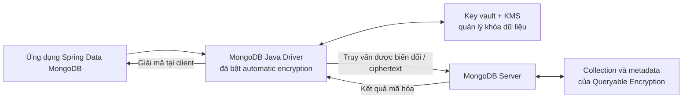

# Queryable Encryption và giới hạn toán tử/kiểu dữ liệu

Trong hệ thống sử dụng **Spring Data MongoDB**, một số trường dữ liệu cần được mã hóa ngay từ ứng dụng trước khi gửi đến MongoDB: số định danh cá nhân, thông tin tài chính, mã khách hàng, dữ liệu y tế hoặc thông tin nhạy cảm khác. Nếu chỉ lưu ciphertext thông thường, ứng dụng thường phải lấy dữ liệu về, giải mã rồi mới tìm kiếm được theo nội dung. Cách làm này vừa tốn chi phí, vừa khó mở rộng khi số document tăng.

**Queryable Encryption (QE)** là cơ chế mã hóa phía client của MongoDB cho phép thực hiện *một số loại truy vấn được hỗ trợ* trên các trường đã mã hóa mà máy chủ không cần nắm khóa giải mã nội dung gốc. Tuy nhiên, QE **không biến trường mã hóa thành trường có thể truy vấn tùy ý**: kiểu BSON, toán tử, cấu hình chỉ mục mã hóa, phiên bản MongoDB, driver và cơ chế phân phối khóa đều ảnh hưởng đến truy vấn được phép chạy.

Bài học tập trung vào cách chọn trường được bảo vệ, phân biệt **equality** và **range query**, đọc ma trận giới hạn toán tử/kiểu dữ liệu, tích hợp với `MongoTemplate`/repository, rồi kiểm thử và chẩn đoán các tình huống truy vấn không được hỗ trợ.

## 1. Phân biệt Queryable Encryption với các kiểu mã hóa khác

| Cơ chế | Dữ liệu được bảo vệ ở đâu? | Có thể tìm kiếm theo nội dung đã mã hóa? |
| --- | --- | --- |
| TLS giữa ứng dụng và MongoDB | Dữ liệu trong đường truyền | Không tạo khả năng truy vấn mới |
| Encryption at rest của hệ thống lưu trữ | Dữ liệu trên ổ đĩa | Server vẫn xử lý các trường dữ liệu theo cách thông thường |
| Client-Side Field Level Encryption (CSFLE) dạng randomized | Giá trị trường được mã hóa ở client | Không thể lọc theo giá trị plaintext bằng equality thông thường |
| CSFLE dạng deterministic | Giá trị trường được mã hóa ở client | Hỗ trợ mô hình đối sánh bằng nhau, với giới hạn và đặc tính rò rỉ riêng |
| **Queryable Encryption** | Giá trị trường và cấu trúc hỗ trợ tìm kiếm được xử lý qua client/driver và metadata mã hóa | Hỗ trợ các kiểu truy vấn được cấu hình, tiêu biểu là **equality** và **range** trên các phiên bản tương thích |

Điểm khác biệt quan trọng: **QE không đơn giản là dùng cùng ciphertext cho cùng plaintext** như mô hình deterministic encryption. Nó sử dụng cơ chế và metadata tìm kiếm riêng của MongoDB để server có thể xử lý truy vấn được hỗ trợ. Vì vậy không nên suy diễn khả năng, độ an toàn hoặc giới hạn của QE từ CSFLE deterministic.

Mã hóa trường ở client còn khác **băm dữ liệu**. Hash có thể giúp đối chiếu trong một số thiết kế riêng, nhưng không cung cấp giải mã, không tự hỗ trợ range và không thay thế cơ chế quản lý khóa, đánh giá rò rỉ thông tin của QE.

## 2. QE hoạt động như thế nào?

Ở mức khái niệm, luồng dữ liệu diễn ra như sau:



Các thành phần chính:

1. **Ứng dụng và `MongoTemplate`/repository:** tạo truy vấn trên property Java như bình thường, nhưng chỉ với các biểu thức QE hỗ trợ.
2. **MongoDB Java Driver có cấu hình automatic encryption:** sử dụng cấu hình trường mã hóa để mã hóa giá trị khi ghi, biến đổi các điều kiện truy vấn tương thích và giải mã kết quả khi đọc.
3. **Data Encryption Key (DEK):** khóa thực tế bảo vệ trường dữ liệu. DEK được lưu có bảo vệ trong **key vault collection**; một khóa quản lý từ KMS dùng để bảo vệ DEK.
4. **Cấu hình encrypted fields:** định nghĩa đường dẫn trường, kiểu BSON, `keyId` và hình thức truy vấn được phép. Đây là hợp đồng dữ liệu giữa ứng dụng, driver và collection.
5. **MongoDB Server:** xử lý ciphertext và metadata/index nội bộ của QE mà không cần có plaintext hoặc DEK để thực hiện những truy vấn đã thiết kế.

Máy chủ vẫn có thể biết một số thông tin vận hành như số lượng document, thời điểm và mẫu truy cập, kích thước dữ liệu hay đặc điểm truy vấn tùy cách triển khai. **Queryable** không đồng nghĩa với việc mọi thông tin về dữ liệu và truy vấn đều được che giấu.

### Key vault và KMS không phải cùng một thứ

- **Key vault** là nơi lưu bản ghi DEK đã được bảo vệ và các metadata liên quan; đây không phải nơi ứng dụng lưu plaintext.
- **KMS** (dịch vụ quản lý khóa, ví dụ một dịch vụ KMS được môi trường MongoDB/driver hỗ trợ) bảo vệ khóa dùng để bao bọc DEK. Tùy môi trường, tổ chức có thể dùng KMS ngoài hoặc local KMS cho thử nghiệm.
- Quyền truy cập key vault, quyền sử dụng KMS, kết nối mạng và xác thực client đều ảnh hưởng đến khả năng mã hóa/giải mã. Nếu client không có quyền sử dụng khóa cần thiết, truy vấn hoặc quá trình giải mã có thể thất bại dù người dùng database có quyền đọc collection.

Không ghi khóa, master key hay credentials vào file học, source code, log hoặc test fixture được commit. Ví dụ dưới đây chỉ biểu diễn cấu trúc; các khóa phải được tạo, quản lý và cung cấp từ môi trường thích hợp.

## 3. Hai nhóm truy vấn cốt lõi: equality và range

### 3.1. Equality query

Mục tiêu là tìm document có trường nhạy cảm **bằng một giá trị xác định**, chẳng hạn tìm hồ sơ theo số định danh:

```javascript
// Minh họa truy vấn được gửi bởi client đã cấu hình QE.
// Điều kiện được driver xử lý theo encryptedFields tương ứng.
db.employees.find({ citizenId: "012345678901" });
```

Điều kiện này chỉ có ý nghĩa là truy vấn QE khi `citizenId` đã được khai báo **encrypted + queryable equality**, client kết nối qua driver/cấu hình phù hợp và truy vấn đi qua đường xử lý mã hóa. Một phiên `mongosh` hoặc client không bật automatic encryption **không tự động hiểu** plaintext trong filter thành giá trị tra cứu mã hóa.

Equality thường phù hợp với các giá trị dùng để tra cứu chính xác: mã định danh, mã giao dịch bí mật, khóa tham chiếu, thông tin định danh cần so trùng. Nó không tự mang lại tính năng tìm kiếm chứa chuỗi, tìm kiếm mờ, tiền tố hoặc so sánh lớn/nhỏ.

### 3.2. Range query

Range query lọc theo khoảng, ví dụ mức lương từ 5.000 đến dưới 10.000:

```javascript
// Minh họa về mặt truy vấn. Chỉ chạy khi trường, kiểu BSON,
// phiên bản MongoDB/driver và cấu hình range đều tương thích.
db.employees.find({
  salary: {
    $gte: NumberDecimal("5000.00"),
    $lt: NumberDecimal("10000.00")
  }
});
```

Range trên encrypted field là năng lực **phụ thuộc phiên bản và cấu hình**. Equality đã được hỗ trợ ổn định trong các thế hệ QE hiện đại; hỗ trợ range được bổ sung và hoàn thiện ở các phiên bản sau. Khi thiết kế hệ thống, cần kiểm tra **đúng phiên bản server, Java Driver, thư viện mã hóa và trạng thái phát hành của tính năng** thay vì giả định một ví dụ range sẽ hoạt động trong mọi MongoDB.

Với range, ngoài `queryType: "range"`, việc chọn **kiểu BSON, miền giá trị `min`/`max`, độ chính xác `precision` (nếu áp dụng), tham số ảnh hưởng hiệu năng/kích thước metadata** có thể là yêu cầu bắt buộc theo phiên bản. Miền càng rộng hoặc độ chính xác càng cao có thể làm tăng chi phí tìm kiếm/lưu trữ. Vì vậy range cần được thiết kế trên yêu cầu nghiệp vụ cụ thể.

## 4. Ma trận toán tử: dùng được đến đâu?

Không có một danh sách toán tử cố định đúng cho mọi bản MongoDB. Bảng dưới đây là **quy tắc thiết kế an toàn** cho các truy vấn QE phổ biến:

| Nhu cầu | Toán tử hoặc cách viết | Đánh giá trên trường QE |
| --- | --- | --- |
| Bằng một giá trị | `{ field: value }` / `$eq` | **Có**, khi trường được khai báo equality query và môi trường tương thích |
| Lớn hơn, lớn hơn hoặc bằng, nhỏ hơn, nhỏ hơn hoặc bằng | `$gt`, `$gte`, `$lt`, `$lte` | **Có điều kiện**, khi trường được khai báo range và đúng phiên bản/kiểu BSON |
| Tập giá trị, khác hoặc loại trừ | `$in`, `$ne`, `$nin` | **Không mặc định suy ra từ equality**; cần tra ma trận hỗ trợ và kiểm thử trên phiên bản đang chạy |
| Phân biệt chữ hoa/thường hoặc so khớp văn bản theo quy tắc collation | Collation, tìm kiếm không phân biệt dấu | Không thể giả định hoạt động giống truy vấn plaintext |
| Khớp tiền tố, hậu tố, chứa chuỗi, regex | `$regex`, biểu thức chuỗi | **Không thuộc bộ equality/range cơ bản**; nếu phiên bản có tính năng tìm kiếm chuỗi riêng, phải xem điều kiện và trạng thái hỗ trợ của chính tính năng đó |
| Full-text, geospatial, vector | `$text`, `$geoWithin`, tìm kiếm vector | Không phải truy vấn mặc định được QE equality/range hỗ trợ trên ciphertext |
| Sắp xếp theo giá trị nhạy cảm | `sort({ field: 1 })` | **Không coi ciphertext là khóa sắp xếp plaintext** |
| Tính tổng, trung bình, nhóm trực tiếp theo plaintext | `$sum`, `$avg`, `$group` trên trường mã hóa | Không được suy ra từ khả năng lọc equality/range; server không có plaintext để tính như bình thường |
| Join, lookup, biểu thức phức tạp trên trường mã hóa | `$lookup`, `$expr`, pipeline tùy ý | Có nhiều giới hạn theo phiên bản, hình dạng pipeline và kiểu trường; cần thiết kế riêng |
| Lọc, sort trên trường **không** mã hóa | Điều kiện MongoDB thông thường trên trường rõ | Có thể dùng theo quyền và năng lực truy vấn của collection; không cần QE cho chính những trường đó |

**Quy tắc cốt lõi:** cấp quyền dùng một **loại truy vấn trên một trường** không đồng nghĩa tất cả các toán tử cùng nhóm logic đều được hỗ trợ. Chẳng hạn, tra cứu bằng nhau không chứng minh `$in` hay `$ne` hoạt động; hỗ trợ range không chứng minh server có thể `$sort` hoặc `$avg` trên plaintext.

Để xây dựng truy vấn kết hợp, cần kiểm tra thêm khả năng ghép `$and`, `$or`, nhiều điều kiện trên cùng trường và thao tác cập nhật/xóa theo filter mã hóa của đúng phiên bản. Truy vấn thường trực trên trường không mã hóa có thể tiếp tục phục vụ phân trang hoặc sắp xếp nếu được chọn làm khóa và có chỉ mục phù hợp.

## 5. Giới hạn kiểu dữ liệu BSON

Lựa chọn kiểu BSON phải được thực hiện **trước khi định nghĩa encrypted field**, không chỉ dựa trên type Java.

| Kiểu giá trị thực tế | Cân nhắc khi dùng QE |
| --- | --- |
| `String` | Lựa chọn thường gặp cho equality của mã định danh. Không tự có contains, substring hay collation trên plaintext |
| `Int32` / `Int64` | Có thể là ứng viên cho range nếu phiên bản hỗ trợ và chọn đúng miền; `int` và `long` là hai kiểu BSON khác nhau |
| `Decimal128` | Phù hợp cho số thập phân chính xác; range cần kiểm tra cấu hình miền và độ chính xác. Java `BigDecimal` cần mapping ra đúng BSON Decimal128 |
| `Double` | Phải cân nhắc sai số số thực và quy tắc `precision`/miền được hỗ trợ; không dùng tùy tiện cho tiền |
| `Date` | Ứng viên cho range thời gian; cần chuẩn hóa thời điểm và múi giờ trước khi lưu |
| `Boolean` / `ObjectId` / một số scalar BSON khác | Khả năng equality phụ thuộc danh sách kiểu dữ liệu được QE hỗ trợ trong phiên bản sử dụng; không suy ra khả năng range |
| `null`, trường thiếu, `Array`, `Document` lồng nhau, BSON đặc biệt | **Không giả định** có thể khai báo hoặc truy vấn như scalar được QE bảo vệ; kiểm tra giới hạn cấu trúc, đường dẫn, kiểu và chính sách giá trị null |

Một số lỗi thiết kế khó phát hiện:

- Property Java `Integer` được query bằng giá trị `Long` hoặc `String`: driver có thể tạo biểu thức không khớp hợp đồng BSON của trường mã hóa.
- Trường tiền tệ trong Java dùng `BigDecimal` nhưng lại được lưu dưới BSON String do converter; range cần BSON Decimal128 sẽ không vận hành như dự kiến.
- Dữ liệu trộn `int`, `long`, `double`, `decimal` trong cùng trường; việc mã hóa không tự chuẩn hóa dữ liệu cũ.
- Dùng `String` để lưu ngày tháng hoặc số, sau đó mong muốn so sánh khoảng như thời gian/số thực.
- Lưu nhiều phần tử nhạy cảm trong mảng rồi kỳ vọng `$elemMatch` hoặc các toán tử mảng thông thường vẫn tìm kiếm được plaintext.

Danh sách kiểu được hỗ trợ thay đổi theo *query type* và theo phiên bản. Khi cần kết luận chính xác cho một BSON type hiếm gặp như `BinData`, `Timestamp`, `Regex` hoặc kiểu phức hợp, phải kiểm tra bảng hỗ trợ chính thức tương ứng với MongoDB và Java Driver đang triển khai.

### Chuẩn hóa miền giá trị của range

Giả sử `salary` dùng `Decimal128` với hai chữ số thập phân và tiền lương không âm. Trước khi chấp nhận cấu hình range, hãy trả lời:

1. Giá trị nhỏ nhất/lớn nhất hợp lệ theo nghiệp vụ là bao nhiêu? Nếu số thực tế nằm ngoài miền khai báo, việc ghi hoặc truy vấn có thể thất bại.
2. Có cần chính xác tới xu, đồng, ngày, giây hay mili giây không? `precision` cần phù hợp với nghiệp vụ và giới hạn driver.
3. Nếu schema thay đổi để tăng miền hoặc đổi kiểu, có cần tạo field/collection mới rồi migration dữ liệu không?
4. Truy vấn tìm một khoảng rộng hay nhiều khoảng rất hẹp? Điều này ảnh hưởng chi phí QE, khả năng lộ thông tin và cách chọn cấu hình.

Ví dụ, nếu hệ thống thực sự chỉ cần tra cứu theo **nhóm hạn mức**, lưu trường phân loại không nhạy cảm (ví dụ `salaryBand`) có thể phù hợp hơn việc bật range QE trên giá trị số chính xác. Tuy nhiên nhóm dữ liệu cũng có thể tiết lộ thông tin: cần đánh giá rủi ro trên dữ liệu nghiệp vụ trước khi quyết định.

## 6. Định nghĩa trường có thể truy vấn

Giả sử collection `employees` có `citizenId` cần tìm chính xác và `salary` cần lọc theo khoảng. Một thiết kế ở mức schema có thể mô tả như sau:

```javascript
// MẪU MINH HỌA SCHEMA, không phải lệnh triển khai trực tiếp:
// các UUID phải trỏ đến DEK có thật và được quản lý bởi key vault/KMS.
const encryptedFields = {
  fields: [
    {
      path: "citizenId",
      bsonType: "string",
      keyId: /* UUID DEK cho citizenId */ null,
      queries: { queryType: "equality" }
    },
    {
      path: "salary",
      bsonType: "decimal",
      keyId: /* UUID DEK cho salary */ null,
      queries: {
        queryType: "range",
        min: NumberDecimal("0.00"),
        max: NumberDecimal("1000000.00"),
        precision: 2
        // Các tham số bổ sung phụ thuộc phiên bản.
      }
    }
  ]
};
```

Lưu ý:

- `path` là **tên trường BSON**, có thể khác tên property Java do `@Field`.
- `bsonType` phải đúng với giá trị đã serialize; `"decimal"` là BSON Decimal128, khác `"double"` và `"string"`.
- `keyId` là định danh DEK **thực**. Giá trị `null` trong mẫu chỉ là chỗ giữ chỗ minh họa và cần được thay theo quy trình tạo encrypted collection/DEK của phiên bản đang dùng.
- `queries` xác định khả năng tìm kiếm. **Mã hóa mà không khai báo kiểu query** khác với mã hóa có hỗ trợ equality/range.
- Cấu hình collection, `encryptedFieldsMap` của client (nếu dùng) và schema đã triển khai phải nhất quán. Không thay đổi tùy ý `queryType`, kiểu BSON hoặc miền range của một trường đang có dữ liệu mà không lập kế hoạch migration.

Trong thực tế, nên tạo collection và metadata QE bằng **API tạo encrypted collection của driver tương thích**, cấp DEK qua KMS/key vault đã cấu hình, rồi dùng cấu hình tạo được để mở client. Ví dụ schema trên chỉ giúp nhìn rõ mối liên hệ giữa field, BSON type và query type; nó không thay thế quy trình tạo khóa hay các tham số hợp lệ của bản MongoDB cụ thể.

Không tự tạo/chỉnh sửa các collection metadata nội bộ do QE quản lý để “sửa index”. Các collection này và metadata gắn với chúng là một phần của cơ chế mã hóa và tìm kiếm.

## 7. Kết nối Spring Data MongoDB với client bật QE

`MongoTemplate` và repository dựa vào **MongoDB Java Driver**. Spring Data ánh xạ entity và xây dựng truy vấn; việc mã hóa/giải mã tự động do driver thực hiện khi client được cấu hình đúng.

### 7.1. Cấu hình MongoClient

Ví dụ khung khởi tạo client:

```java
import com.mongodb.ConnectionString;
import com.mongodb.MongoClientSettings;
import com.mongodb.AutoEncryptionSettings;
import com.mongodb.client.MongoClient;
import com.mongodb.client.MongoClients;
import org.bson.BsonDocument;
import org.springframework.data.mongodb.core.MongoTemplate;

import java.util.Map;

// Những giá trị dưới đây được nạp từ cấu hình bảo mật thực tế:
String mongoUri = /* URI kết nối */ null;
String keyVaultNamespace = "encryption.__keyVault";
Map<String, Map<String, Object>> kmsProviders =
    /* cấu hình KMS, không hardcode secrets */ null;
BsonDocument encryptedFields =
    /* schema QE đã được tạo/cấp khóa hợp lệ */ null;

AutoEncryptionSettings encryptionSettings =
    AutoEncryptionSettings.builder()
        .keyVaultNamespace(keyVaultNamespace)
        .kmsProviders(kmsProviders)
        .encryptedFieldsMap(Map.of("appdb.employees", encryptedFields))
        .build();

MongoClientSettings settings = MongoClientSettings.builder()
    .applyConnectionString(new ConnectionString(mongoUri))
    .autoEncryptionSettings(encryptionSettings)
    .build();

MongoClient encryptedClient = MongoClients.create(settings);
MongoTemplate mongoTemplate = new MongoTemplate(encryptedClient, "appdb");
```

**Đây là khung tích hợp, chưa phải chương trình chạy độc lập:** cần tạo DEK hợp lệ, thay các placeholder bằng cấu hình thật, khai báo phụ thuộc driver/crypt shared library phù hợp và thiết lập quyền KMS/key vault. Tên và dạng một số tùy chọn có thể khác nhau theo phiên bản MongoDB Java Driver; hãy đối chiếu API của phiên bản dự án.

Nếu ứng dụng Spring Boot đã tự tạo `MongoClient`/`MongoTemplate`, phải bảo đảm các repository và template dùng **chính client có cấu hình automatic encryption**. Một bean `MongoTemplate` trỏ sang client mặc định không có QE sẽ không tự mã hóa filter chỉ vì entity có trường nhạy cảm.

Không nên giữ hai client truy cập cùng collection mà một client âm thầm bỏ qua mã hóa. Một client chỉ có quyền đọc database nhưng không có khóa cũng không phải phương án truy vấn plaintext thay thế cho QE.

### 7.2. Ánh xạ entity và equality query

```java
import java.math.BigDecimal;
import org.springframework.data.annotation.Id;
import org.springframework.data.mongodb.core.mapping.Document;
import org.springframework.data.mongodb.core.mapping.Field;
import org.springframework.data.mongodb.core.mapping.FieldType;

@Document("employees")
public class Employee {
    @Id
    private String id;

    private String fullName;   // Không mã hóa trong ví dụ
    private String citizenId;  // QE equality

    @Field(targetType = FieldType.DECIMAL128)
    private BigDecimal salary; // QE range khi môi trường hỗ trợ

    // Constructor/getter/setter được lược bớt.
}
```

Tra cứu bằng `MongoTemplate`:

```java
Query query = Query.query(
    Criteria.where("citizenId").is("012345678901")
);
Employee employee = mongoTemplate.findOne(query, Employee.class);
```

Các import chính:

```java
import org.springframework.data.mongodb.core.query.Criteria;
import org.springframework.data.mongodb.core.query.Query;
```

Ứng dụng tạo `Query` theo kiểu dữ liệu Java thông thường. Khi `MongoTemplate` dùng client đã bật QE và schema nhất quán, driver xử lý encryption cho điều kiện tương thích và decrypt kết quả. Dù vậy **không nên ghi log plaintext** như `citizenId` trong phần đo hiệu năng, câu lệnh debug hay exception handler.

Ví dụ với Spring Data repository:

```java
import java.util.Optional;
import org.springframework.data.mongodb.repository.MongoRepository;

public interface EmployeeRepository
        extends MongoRepository<Employee, String> {
    Optional<Employee> findByCitizenId(String citizenId);
}
```

Derived query ở đây thường diễn đạt equality đơn giản, nhưng việc có thực thi được trên ciphertext hay không vẫn do **cấu hình encrypted field, driver và hình dạng truy vấn MongoDB được tạo ra** quyết định. Không áp dụng suy luận này cho mọi phương thức `findBy...Containing`, `IgnoreCase`, `Between` hoặc những derived query phức tạp.

### 7.3. Ví dụ range query

Khi `salary` đã được khai báo range trên BSON Decimal128 và môi trường hỗ trợ:

```java
import java.math.BigDecimal;
import java.util.List;

Query query = Query.query(
    Criteria.where("salary")
        .gte(new BigDecimal("5000.00"))
        .lt(new BigDecimal("10000.00"))
);

List<Employee> employees = mongoTemplate.find(
    query, Employee.class
);
```

Annotation `@Field(targetType = FieldType.DECIMAL128)` giúp thể hiện ý định ánh xạ `BigDecimal` thành kiểu BSON Decimal128 trong Spring Data MongoDB. Tuy nhiên chỉ riêng annotation **không tạo QE, không tạo DEK hoặc index QE**, và không bảo đảm một câu lệnh range đã được driver hỗ trợ. Hãy kiểm thử cả giá trị ở biên `min/max`, giá trị âm/ngoài miền và các phép so sánh có cận bằng/không bằng.

## 8. Giới hạn với aggregation, sort và index

Một câu query lọc equality có thể được QE hỗ trợ nhưng pipeline sau đó lại yêu cầu xử lý plaintext trên server. Ví dụ:

```javascript
// Không nên kỳ vọng server tính được thống kê plaintext
// trực tiếp trên trường salary được mã hóa bằng QE.
db.employees.aggregate([
  {
    $group: {
      _id: null,
      totalSalary: { $sum: "$salary" }
    }
  }
]);
```

Mã hóa QE không cấp quyền cho server giải mã để `$sum`, `$avg`, `$min`, `$max`, `$sort`, `$regex` hay `$lookup` hoạt động như với dữ liệu rõ. Một số thao tác còn bị hạn chế ngay cả khi pipeline chỉ lọc encrypted field. Cần tra tài liệu tương thích với server/driver và thử trên collection mã hóa thực để biết pipeline cụ thể có được chấp nhận hay không.

Trường **không mã hóa** như `departmentId`, `createdAt` hoặc `isActive` có thể tiếp tục phục vụ nhiều nhu cầu lọc, sort, phân trang, thống kê và indexing thông thường. Đây là một lý do nên mã hóa **đúng trường thực sự nhạy cảm**, thay vì mã hóa toàn bộ document bất kể cách truy vấn.

Chỉ mục QE có cơ chế riêng. Lệnh:

```javascript
db.employees.createIndex({ citizenId: 1 });
```

**Không phải** cách để bật equality query trên `citizenId` đã mã hóa. Tính năng tra cứu QE phải được khai báo trong cấu hình trường và thiết lập qua quy trình của Queryable Encryption. Chỉ mục B-tree thông thường vẫn hữu ích cho những trường không mã hóa và những truy vấn nằm ngoài phạm vi ciphertext.

Với pagination, nên ưu tiên khóa sắp xếp không nhạy cảm, ổn định và phù hợp chỉ mục. Việc lọc được bằng QE không đồng nghĩa có thể phân trang theo thứ tự plaintext của một trường đã mã hóa.

## 9. Mô hình đe dọa và rò rỉ thông tin

Queryable Encryption bảo vệ **giá trị nhạy cảm** trước các thành phần không nắm khóa phù hợp, nhưng không phải công cụ che giấu toàn bộ hành vi ứng dụng. Khi đánh giá cần xét:

- **Ai giữ khóa?** DEK, KMS, key vault, quyền và nhật ký truy cập KMS phải được quản lý độc lập với quyền database.
- **Thông tin nào vẫn quan sát được?** Tần suất truy vấn, số kết quả trả về, kích thước document, thời gian truy cập, sự tồn tại của trường và metadata có thể tiết lộ một phần cấu trúc hoặc hành vi.
- **Miền giá trị rộng hay hẹp?** Một trường chỉ nhận vài trạng thái như `true/false` hoặc một danh mục rất nhỏ cần đánh giá kỹ về tần suất và khả năng suy diễn; không phải mọi trường đều nên được QE hóa.
- **Range có làm tăng thông tin lộ ra không?** Việc hỗ trợ so sánh khoảng cần metadata và có đặc tính rò rỉ/chi phí khác so với equality; chỉ bật khi thật sự cần.
- **Ứng dụng có làm lộ plaintext ở chỗ khác?** HTTP logs, tracing, error messages, backups từ phía client, hệ thống tìm kiếm phụ trợ và file xuất dữ liệu có thể chứa nội dung đã giải mã.

Không xem QE là cơ chế xác thực hoặc phân quyền. Người dùng ứng dụng chỉ được truy vấn thông tin phù hợp quyền nghiệp vụ của họ; phân quyền trong Spring Security, xác thực database và quản lý khóa vẫn cần được triển khai đồng thời.

## 10. Kiểm thử và chẩn đoán truy vấn

Lập bộ kiểm thử tích hợp **trên MongoDB/driver và thư viện mã hóa đúng phiên bản triển khai**. Dùng các DEK thử nghiệm tách biệt với production. Một số ca kiểm thử:

| Tình huống | Kết quả cần kiểm chứng |
| --- | --- |
| Ghi document với `citizenId` được mã hóa equality | Database lưu ciphertext, client có khóa đọc lại đúng plaintext |
| Tìm bằng `citizenId` khớp chính xác | Trả đúng document qua client bật QE |
| Tìm `citizenId` không tồn tại | Không trả document, không làm lộ thông tin thừa |
| `findByCitizenId` qua repository | Hành vi khớp truy vấn `MongoTemplate` trên cùng encrypted client |
| `salary` là `BigDecimal`/Decimal128 trong miền | Nếu range được hỗ trợ, lọc đúng biên khoảng |
| `salary` dùng String/Double sai kiểu | Bị chặn hoặc lỗi theo quy tắc BSON/config; không âm thầm coi là cùng kiểu |
| `salary` ngoài miền range | Hệ thống báo lỗi phù hợp; dữ liệu không bị ghi sai |
| `$regex` hoặc `Containing` trên `citizenId` | Không kỳ vọng trả kết quả như plaintext; phát hiện hạn chế ngay tại test |
| Client không có quyền KMS/key vault | Truy vấn mã hóa/giải mã không thành công theo cấu hình quyền |
| Truy vấn trên `departmentId` không mã hóa | Hoạt động như truy vấn MongoDB thông thường |

Khi gặp lỗi, kiểm tra theo trình tự:

1. **Schema:** `path`, `bsonType`, `queries.queryType`, `keyId` và miền range có khớp collection không?
2. **Serialization:** giá trị từ Java có thật sự được serialize thành BSON đúng như khai báo không?
3. **Client:** `MongoTemplate`/repository có đang dùng `MongoClient` bật automatic encryption không? Phiên bản driver, thư viện mã hóa và MongoDB Server có hỗ trợ query type đó không?
4. **Key management:** client có liên hệ được key vault/KMS, có quyền sử dụng DEK và master key cần thiết không?
5. **Toán tử:** truy vấn do Spring Data sinh ra sử dụng đúng toán tử và hình dạng được phép chưa? `findBy...IgnoreCase` chẳng hạn có thể tạo truy vấn không tương thích.
6. **Tài nguyên:** chi phí mã hóa phía client, latency KMS, metadata, dung lượng và khối lượng truy vấn thực tế có nằm trong ngân sách hiệu năng không?

Trong môi trường test, có thể kiểm tra BSON lưu trên server bằng một client **không có quyền giải mã**, chỉ đủ quyền quan sát collection dành cho thử nghiệm. Đừng dựa vào output của client có QE rồi kết luận database lưu plaintext: driver đã tự động giải mã trước khi trả kết quả cho ứng dụng.

Nếu cần phân tích chi phí, đo riêng độ trễ query, thời gian truy cập key service, CPU client, kích thước document/metadata, throughput và độ trễ p95/p99. Không coi khả năng xem `explain` hay nội dung log từ server giống hệt truy vấn plaintext; một số thao tác quan sát và công cụ có giới hạn với QE.

## 11. Migration và vận hành

Không thể biến một collection có dữ liệu rõ thành collection QE hoàn chỉnh chỉ bằng cách thêm `@Field` vào entity. Một quy trình chuyển đổi điển hình:

1. **Phân loại trường cần mã hóa** và định nghĩa chức năng truy vấn thực tế: chính xác, khoảng hay không cần tìm theo giá trị.
2. **Chốt kiểu BSON** và kiểm tra dữ liệu cũ có đồng nhất không; chuyển đổi kiểu trước khi mã hóa nếu cần.
3. **Kiểm tra phiên bản hỗ trợ**, chọn KMS, tạo/provision DEK và schema encrypted fields bằng API tương thích.
4. **Tạo collection đích hỗ trợ QE** và các cấu trúc metadata cần thiết theo quy trình của MongoDB/driver.
5. **Migration dữ liệu qua client đã bật mã hóa** theo đợt có kiểm soát; đối soát số document, dữ liệu giải mã, quyền truy vấn và thời gian phản hồi.
6. **Chuyển đường ghi/đọc** của ứng dụng sang collection và client mới, bảo đảm không có instance cũ tiếp tục ghi dữ liệu rõ.
7. **Theo dõi vận hành**: lỗi KMS, tốc độ query, dung lượng metadata, tính toàn vẹn khi backup/restore và kế hoạch xoay vòng khóa.

Khi backup hoặc khôi phục collection QE, cần đồng bộ các thành phần ciphertext, metadata và quản lý khóa theo quy trình của sản phẩm. Khôi phục riêng document mã hóa mà thiếu key vault/metadata cần thiết có thể làm dữ liệu không truy vấn hoặc không giải mã được.

Đối với ứng dụng phân tán, tránh để các instance sử dụng các bản `encryptedFieldsMap` khác nhau. Truy vấn có thể thất bại hoặc dữ liệu được ghi theo cấu hình không nhất quán nếu một service chưa chuyển phiên bản.

## 12. Bài tập thực hành

**Bài toán:** ứng dụng Spring Data MongoDB quản lý nhân viên với `citizenId`, `salary`, `departmentId`, `createdAt`. Yêu cầu bảo vệ `citizenId` và `salary`, tìm theo số định danh, lọc lương theo khoảng, sắp xếp nhân viên theo ngày tạo.

Thực hiện:

1. Phân loại trường cần QE equality, QE range và trường không mã hóa; giải thích vì sao `createdAt` vẫn có thể là khóa sort.
2. Thiết kế schema encrypted fields ở mức khái niệm, xác định `bsonType` và miền giá trị của `salary`.
3. Viết entity `Employee`, một `MongoTemplate` query equality, một query range có điều kiện và một derived repository method equality.
4. Thử truy vấn `Containing` hoặc `regex` trên `citizenId`; ghi rõ giới hạn được quan sát thay vì tìm cách “ép” driver xử lý.
5. Tạo ca kiểm thử xác nhận client có khóa thấy plaintext, dữ liệu lưu trên server ở dạng mã hóa, còn client không có cấu hình giải mã không thể đọc cùng plaintext đó.
6. Đo latency và so sánh với truy vấn trên `departmentId` không mã hóa; phân tích chi phí và lựa chọn kiến trúc cho một báo cáo cần tính tổng lương.

**Tiêu chí hoàn thành:** biết phân biệt quyền *đọc được plaintext* với khả năng *query trên ciphertext*; chọn được equality/range đúng trường và đúng kiểu BSON; chỉ dùng toán tử thực sự được hỗ trợ; giải thích được vai trò của automatic encryption và cách kiểm chứng trên hệ thống thật.

## 13. Những điểm cần ghi nhớ

- **Queryable Encryption là truy vấn có kiểm soát trên trường mã hóa**, chứ không phải thay thế hoàn toàn truy vấn MongoDB truyền thống.
- **Equality** dành cho đối sánh chính xác; **range** chỉ sử dụng khi phiên bản, kiểu BSON và cấu hình miền cho phép.
- Kiểu BSON thật của dữ liệu quan trọng hơn kiểu khai báo Java; với tiền tệ cần chú ý `BigDecimal` ↔ `Decimal128`.
- `$regex`, sort, aggregation tính toán, join, text/geo search và các toán tử phức tạp **không tự động hoạt động** trên trường mã hóa chỉ vì equality/range hoạt động.
- `MongoTemplate` và repository phải sử dụng driver có cấu hình QE, DEK, KMS và schema nhất quán; annotation Java không tự bật mã hóa.
- Thiết kế QE phải tính đến **phiên bản tương thích, rò rỉ metadata, hiệu năng, phân quyền, migration và khả năng khôi phục dữ liệu**.

> **Lưu ý về phiên bản:** hỗ trợ Queryable Encryption, đặc biệt range và các dạng tìm kiếm chuỗi nâng cao, thay đổi theo vòng đời MongoDB Server/Atlas, Java Driver và thư viện mã hóa. Các ví dụ trong bài thể hiện nguyên tắc và cú pháp thông dụng; trước khi đưa vào production, đối chiếu ma trận hỗ trợ và cấu hình hợp lệ của đúng phiên bản đang chạy.
