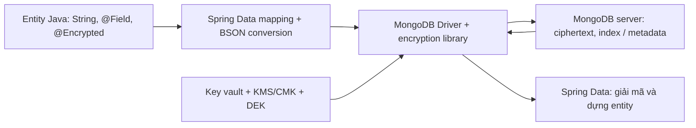

# Ảnh hưởng của mã hóa đến index, tìm kiếm và mapping

> **Chương:** Mã hóa dữ liệu  
> **Phạm vi:** Spring Data MongoDB — ánh xạ document, truy vấn bằng `MongoTemplate` và repository, thiết kế index, kiểm thử và chẩn đoán hiệu năng khi dữ liệu được mã hóa.

## 1. Vì sao mã hóa có thể làm thay đổi cách truy vấn?

Giả sử ứng dụng quản lý hồ sơ bệnh nhân có các trường:

```json
{
  "_id": "p-1001",
  "tenant_id": "clinic-a",
  "email": "an@example.com",
  "medical_note": "Tiền sử điều trị...",
  "age": 32
}
```

Nếu `email` và `medical_note` được **mã hóa ở phía client**, MongoDB chỉ lưu giá trị ciphertext dưới dạng BSON Binary; server không biết chuỗi gốc là gì. Điều này giúp bảo vệ dữ liệu, nhưng đồng thời thay đổi khả năng so khớp, tạo index, sắp xếp, tìm kiếm và xử lý aggregation. Spring Data vẫn có thể ánh xạ entity Java dạng `String` khi client giải mã thành công, nhưng không thể làm cho server tự hiểu plaintext.

Trước khi thiết kế index hoặc repository query, phải phân biệt **ba lớp bảo vệ**:

- **TLS khi truyền:** mã hóa kênh mạng; dữ liệu vẫn được MongoDB xử lý bình thường sau khi nhận. Thông thường không đổi ý nghĩa query/index.
- **Encryption at rest (mã hóa lưu trữ):** mã hóa file/đĩa lưu trữ; MongoDB vẫn có thể xử lý giá trị và B-tree index thông thường. Đây không phải cơ chế ẩn plaintext khỏi MongoDB server.
- **Client-side encryption (CSFLE hoặc Queryable Encryption):** driver/thư viện mã hóa trước khi gửi tới MongoDB và giải mã trên client có quyền truy cập khóa. Đây là trường hợp chính làm thay đổi các thao tác trên field mã hóa.

Không được coi `@Encrypted` là một cách để biến mọi kiểu index và query thông thường thành truy vấn chạy được trên dữ liệu bí mật. **Mức hỗ trợ phụ thuộc cơ chế mã hóa, thuật toán, cấu hình truy vấn và phiên bản MongoDB/driver.**

## 2. Bản đồ tác động đến index và tìm kiếm

| Cách bảo vệ field | Dữ liệu server thấy | Tìm theo giá trị gốc | Range/sort theo plaintext | Cách lập index phù hợp |
| --- | --- | --- | --- | --- |
| Chỉ TLS / encryption at rest | Giá trị BSON gốc khi xử lý | Như MongoDB thông thường | Như MongoDB thông thường | Index chuẩn của MongoDB |
| **CSFLE deterministic** | Ciphertext có thể lặp với cùng giá trị, khóa và kiểu BSON | Có, với phép so khớp được hỗ trợ qua client có cấu hình mã hóa | Không có thứ tự plaintext để dùng `$gt`, `$lt` hoặc `sort` đúng nghĩa | Có thể đánh index trên ciphertext để hỗ trợ trường hợp equality thích hợp; phải đo và kiểm tra ràng buộc |
| **CSFLE randomized** | Ciphertext thay đổi mỗi lần mã hóa | Không thể tìm trực tiếp theo giá trị gốc | Không | Không thể lấy index trên ciphertext để tạo khả năng tìm plaintext |
| **Queryable Encryption (QE), field không queryable** | Ciphertext ngẫu nhiên và metadata liên quan | Không, phải truy vấn bằng trường khác | Không | Không thêm index thường lên field mã hóa để tìm plaintext |
| **QE, field queryable** | Ciphertext ngẫu nhiên cùng metadata hỗ trợ truy vấn | Equality; range hoặc truy vấn chuỗi chuyên biệt khi được bật và được phiên bản hỗ trợ | Chỉ những query type được cấu hình; không suy ra hỗ trợ `sort` tổng quát | Cơ chế encrypted index/metadata riêng của QE; không dùng index thường trên ciphertext làm giải pháp |

### 2.1. CSFLE deterministic: cùng plaintext có thể cho cùng ciphertext

Với cùng Data Encryption Key (DEK), thuật toán, giá trị và kiểu BSON:

```text
encrypt("an@example.com", key-A) -> cipher-X
encrypt("an@example.com", key-A) -> cipher-X
encrypt("binh@example.com", key-A) -> cipher-Y
```

Vì hai giá trị bằng nhau có ciphertext giống nhau, driver tự mã hóa tham số truy vấn equality và MongoDB có thể so sánh ciphertext. Nhóm toán tử được hỗ trợ khi dùng **automatic CSFLE** bao gồm `$eq`, `$ne`, `$in`, `$nin` và các phép kết hợp logic tương ứng; cần kiểm tra giới hạn theo loại BSON. Chẳng hạn, so sánh với `null` hoặc regex trên field mã hóa bị hạn chế hoặc báo lỗi. Truy vấn theo ciphertext có thể tận dụng index phù hợp, nhưng index đó lưu **giá trị đã mã hóa**, không khôi phục khả năng sắp xếp theo plaintext.

Điểm đánh đổi bảo mật: vì ciphertext lặp, người quan sát có thể suy luận **tần suất xuất hiện**. Mã hóa deterministic không thích hợp nếu muốn che giấu mẫu lặp ở những trường ít giá trị khác nhau, như giới tính, cờ `yes/no` hoặc nhóm máu; cân nhắc randomized encryption hoặc cơ chế khác sau khi đánh giá yêu cầu tìm kiếm.

### 2.2. CSFLE randomized: bảo mật mẫu lặp tốt hơn, không equality search

```text
encrypt("an@example.com", key-A) -> cipher-R1
encrypt("an@example.com", key-A) -> cipher-R2
```

Cùng plaintext cho hai ciphertext khác nhau, vì vậy:

- `findByMedicalNote("...")` không thể thực hiện tìm equality theo ý nghĩa plaintext trên field đã mã hóa ngẫu nhiên.
- `db.collection.createIndex({ medical_note: 1 })` không làm cho MongoDB hiểu hay tìm được nội dung ghi chú.
- Có thể tìm hồ sơ qua `_id`, `tenant_id` hoặc field truy vấn hợp lệ khác rồi giải mã `medical_note` ở client.

Mã hóa randomized thường phù hợp cho **dữ liệu chỉ cần đọc sau khi đã tìm document bằng khóa khác**.

### 2.3. Queryable Encryption (QE): queryable không đồng nghĩa plaintext index

QE có thiết kế khác CSFLE deterministic: ciphertext vẫn được ngẫu nhiên hóa, còn MongoDB dùng metadata/index chuyên dụng cho các loại truy vấn đã cấu hình. Theo các phiên bản MongoDB hỗ trợ tương ứng, QE có thể khai báo:

- `equality` cho tìm kiếm so khớp;
- `range` cho trường BSON kiểu số/ngày được hỗ trợ;
- `prefix`, `suffix`, `substring` cho chuỗi trên các phiên bản hỗ trợ truy vấn chuỗi.

Không có nghĩa mọi toán tử SQL/MongoDB đều khả dụng. Chẳng hạn, **regex tùy ý, full-text search, sort theo plaintext hay aggregation bất kỳ** không tự hoạt động nhờ QE. Khi tạo collection, mỗi field phải được khai báo đúng `bsonType` và `queryType` cùng các tham số đặc thù (như contention, giới hạn min/max hoặc cấu hình truy vấn chuỗi). Việc hỗ trợ chính xác còn phụ thuộc **MongoDB Server, driver, encryption library và tính khả dụng của tính năng ở bản phát hành đang chạy**.

Không nên tạo index B-tree thông thường trực tiếp trên field đang được mã hóa bằng QE: index đó không biến ciphertext thành plaintext có thể truy vấn và có thể gây giảm hiệu năng. QE sử dụng các collection metadata bổ sung cùng dữ liệu hỗ trợ truy vấn, chẳng hạn field `__safeContent__`; quản lý index theo khuyến nghị của phiên bản MongoDB và cấu hình QE thực tế.

## 3. Index và uniqueness: những chỗ dễ sai

### 3.1. Index không thể biến ciphertext thành một chuỗi có thể tìm kiếm

Ví dụ khi email dùng CSFLE deterministic, ứng dụng thường tìm bằng tenant và email:

```javascript
// Chỉ là ví dụ index cho một collection dùng CSFLE deterministic:
db.patient_records.createIndex({ tenant_id: 1, email_cipher: 1 })
```

Index có thể phục vụ điều kiện `tenant_id` và ciphertext email sau khi driver mã hóa giá trị query đúng cách. Tuy nhiên, khi email dùng **randomized encryption**, cách tạo index tương tự không giúp tìm theo email gốc. Khi chuyển sang QE, phải thiết kế lại theo cơ chế encrypted field/index của QE thay vì giữ nguyên giả định về chỉ mục CSFLE.

Mặt khác, `@Indexed` và `@CompoundIndex` của Spring Data chỉ mô tả index MongoDB thông thường. Chúng **không kích hoạt CSFLE/QE**, không tạo Data Encryption Key, cũng không tự giải quyết giới hạn tìm kiếm trên field đã mã hóa. Việc index có thật hay không còn tùy cấu hình tự tạo index và quy trình migration.

### 3.2. Unique index trên ciphertext không luôn bằng unique theo nghiệp vụ

Với **CSFLE randomized** và **QE**, cùng plaintext có thể có ciphertext khác nhau; unique index trực tiếp trên ciphertext **không đảm bảo** không có hai bản ghi mang cùng plaintext. Ngay cả với deterministic encryption, kết quả phụ thuộc DEK, kiểu BSON, chuẩn hóa chuỗi và quy tắc tenant. Nếu mỗi tenant mã hóa cùng email bằng khóa riêng, không thể coi ciphertext giống nhau giữa mọi tenant.

Nếu ứng dụng buộc email duy nhất trong từng tenant, cần thiết kế một cơ chế ràng buộc nhất quán, ví dụ khóa tra cứu phụ trợ được chuẩn hóa và bảo vệ phù hợp, hoặc một quy trình kiểm tra ghi có kiểm soát cạnh tranh. Một token HMAC có khóa riêng dùng cho tra cứu cũng có rủi ro lộ mẫu lặp; cần mô hình hóa rủi ro và bảo vệ khóa. **Không thay yêu cầu uniqueness bằng việc thêm `unique = true` vào field ciphertext rồi mặc định đã đúng.**

### 3.3. Collation, sắp xếp và phân tích dữ liệu

Ciphertext không giữ thứ tự từ điển hay thứ tự số của plaintext. Index trên ciphertext không bảo đảm `sort` theo tên/email, tìm `age > 30`, tìm không phân biệt hoa thường, hoặc regex `^an`. Collation của MongoDB áp dụng lên dữ liệu server thấy, không thể biến ciphertext thành chuỗi gốc. Một số dạng `$group` trên CSFLE deterministic có hỗ trợ trong điều kiện giới hạn, nhưng các phép tính số học trên field mã hóa không tự có ý nghĩa.

Nếu cần tổng hợp, tìm toàn văn hoặc báo cáo BI, hãy quyết định rõ field nào phải mã hóa, field nào có thể giữ plaintext/được biến đổi an toàn để lập chỉ mục và field nào được xử lý tại ứng dụng sau khi giải mã. Các trường phụ trợ có thể làm lộ thông tin, nên phải được xem xét như một phần của thiết kế dữ liệu nhạy cảm.

## 4. Spring Data mapping: annotation, JSON Schema và encryption driver

Với Spring Data MongoDB, cần phân biệt **mapping Java ↔ BSON**, **schema quy định mã hóa**, và **driver/encryption library thực hiện mã hóa**.

### 4.1. Entity được ánh xạ vẫn dùng kiểu Java thông thường

Ví dụ CSFLE tự động với hai thuộc tính:

```java
import org.springframework.data.annotation.Id;
import org.springframework.data.mongodb.core.mapping.Document;
import org.springframework.data.mongodb.core.mapping.Encrypted;
import org.springframework.data.mongodb.core.mapping.Field;

@Document("patient_records")
@Encrypted(
    // Placeholder: thay bằng ID thực của DEK dưới dạng Base64 hợp lệ.
    keyId = "REPLACE_WITH_BASE64_DEK_UUID",
    algorithm = "AEAD_AES_256_CBC_HMAC_SHA_512-Random"
)
class PatientRecord {
    @Id
    String id;

    @Field("tenant_id")
    String tenantId;              // Không mã hóa; dùng để giới hạn phạm vi truy vấn.

    @Field("email_cipher")
    @Encrypted(algorithm = "AEAD_AES_256_CBC_HMAC_SHA_512-Deterministic")
    String email;                 // Equality search theo cấu hình CSFLE.

    @Field("note_cipher")
    @Encrypted
    String medicalNote;           // Thừa hưởng thuật toán Random.
}
```

Đây là **mẫu minh họa mapping**, chưa phải cấu hình chạy độc lập. Trước khi chạy cần tạo DEK thực trong key vault, khai báo KMS/CMK, key vault namespace và kết nối driver có bật encryption. Giá trị `keyId` chỉ là placeholder và không dùng cho môi trường thật.

Trong entity, `email` vẫn là `String`. Khi client có quyền giải mã, Spring Data có thể đọc email thành `String` như bình thường. Trên server, field BSON có tên **`email_cipher`** theo `@Field` và giá trị là ciphertext `BinData`, không phải một chuỗi email plaintext.

### 4.2. `@Encrypted` không tự thay cấu hình driver

Spring Data có thể sinh `MongoJsonSchema` dựa trên annotation `@Encrypted`:

```java
MongoJsonSchema schema = MongoJsonSchemaCreator.create(mappingContext)
    .filter(MongoJsonSchemaCreator.encryptedOnly())
    .createSchemaFor(PatientRecord.class);

AutoEncryptionSettings settings = AutoEncryptionSettings.builder()
    .keyVaultNamespace("security.__keyVault")
    .kmsProviders(kmsProviders)
    .schemaMap(Map.of(
        "health.patient_records",
        schema.schemaDocument().toBsonDocument()
    ))
    .build();

// Đưa settings vào MongoClientSettings builder, ví dụ trong
// MongoClientSettingsBuilderCustomizer của ứng dụng Spring Boot.
```

Các biến `mappingContext` và `kmsProviders` phải được khởi tạo trong cấu hình của ứng dụng. `schemaMap` dùng namespace **database.collection** thực tế; sai namespace, tên field BSON hoặc `bsonType` có thể làm việc mã hóa/giải mã hoặc truy vấn thất bại. Client cần thiết lập crypt library (hoặc shared library phù hợp), key vault và quyền truy cập khóa theo tài liệu phiên bản đang dùng.

Điểm quan trọng: **`@Encrypted` cung cấp metadata để sinh schema, không tự cung cấp khóa hoặc tự bật automatic encryption**. Khi dựa vào schema tải từ server, phải cân nhắc rủi ro schema bị thay đổi; kiểm soát schema đáng tin cậy ở phía client và quy trình migration.

### 4.3. Mapping query trong `MongoTemplate` và repository

Với client đã bật **automatic CSFLE**, truy vấn equality dưới đây có ý nghĩa vì `email` là field deterministic:

```java
import org.springframework.data.mongodb.core.MongoTemplate;
import org.springframework.data.mongodb.core.query.Criteria;
import org.springframework.data.mongodb.core.query.Query;

class PatientService {
    PatientRecord findByEmail(MongoTemplate template,
                              String tenantId, String email) {
        Query query = Query.query(
            Criteria.where("tenantId").is(tenantId)
                    .and("email").is(email)
        );
        return template.findOne(query, PatientRecord.class);
    }
}
```

`MongoTemplate` ánh xạ property `email` thành `email_cipher`, còn **encryption driver** mã hóa tham số email trước khi gửi query theo đúng schema, thuật toán và DEK. Repository method `findByEmail(String email)` cũng cần dùng **cùng MongoClient có encryption**; tên method hay `@Query` không tự cấu hình mã hóa.

Hai dạng truy vấn sau không thay thế được equality nói trên khi dùng CSFLE:

```java
// Không được giả định chạy trên field CSFLE deterministic:
Query prefixQuery = Query.query(Criteria.where("email").regex("^an"));
// Query hợp lệ về cú pháp Spring Data, nhưng truy vấn regex trên field
// CSFLE deterministic không nằm trong nhóm toán tử được hỗ trợ.
// Criteria.where("age").gt(30) trên field deterministic cũng không
// trở thành range query theo plaintext.
```

Đoạn trên là **ví dụ về một query không được hỗ trợ đối với CSFLE deterministic**: cú pháp Spring Data hợp lệ nhưng driver automatic CSFLE sẽ không biến biểu thức regex thành tìm kiếm prefix hợp lệ. Nếu nhu cầu là tìm tiền tố/hậu tố/chuỗi con, phải xem khả năng Queryable Encryption của phiên bản phù hợp hoặc thiết kế trường tìm kiếm phụ trợ với đánh giá bảo mật.

### 4.4. Explicit encryption là một đường đi khác

Spring Data cung cấp `@ExplicitEncrypted` dựa trên property converter và MongoDB encryption engine. Khi dùng đường này, lập trình viên cần cấu hình `ClientEncryption`, `MongoEncryptionConverter` và cách giải quyết DEK. Dữ liệu lưu trong document có thể được mã hóa/giải mã bởi converter của một property, nhưng **không nên mặc định bộ lọc query tùy ý cũng được tự mã hóa đúng cách** như automatic encryption.

Nếu đánh dấu cả một `Address`, `List` hoặc `Map` bằng `@ExplicitEncrypted`, converter có thể mã hóa **toàn bộ giá trị**, chứ không lập index riêng trên từng thuộc tính bên trong. Nếu cần truy vấn từng trường nested, phải thiết kế encryption ở đúng cấp field và xem các giới hạn theo loại BSON.

## 5. Queryable Encryption và metadata collection

Không nên dùng lại cùng một collection cho CSFLE và QE: hai cơ chế có cấu hình khác nhau. Với QE, lập trình viên/đội vận hành khai báo `encryptedFields` khi tạo collection. Ví dụ ý tưởng:

```javascript
// Trong mongosh, cần thay UUID minh họa bằng UUID thực của DEK
// và chuẩn bị client có Queryable Encryption đầy đủ.
use health
db.createCollection("patients_qe", {
  encryptedFields: {
    fields: [
      {
        path: "email",
        bsonType: "string",
        keyId: UUID("11111111-1111-4111-8111-111111111111"),
        queries: { queryType: "equality" }
      }
    ]
  }
})
```

Đây là ví dụ cấu hình **một field equality**; không đủ để tạo luồng end-to-end nếu chưa có DEK thực, cấu hình `AutoEncryptionSettings` hoặc `encryptedFieldsMap` và driver phù hợp. Tùy phiên bản, Spring Data hỗ trợ tạo cấu hình QE từ `CollectionOptions.encryptedCollection(...)`, `@Encrypted` kết hợp `@Queryable` hoặc `@RangeEncrypted`. Phải kiểm tra tương thích của phiên bản Spring Data đang chạy trước khi dùng các annotation này.

Về vận hành, collection QE cần metadata liên quan (ví dụ các collection lưu trạng thái mã hóa) và có thể sinh field `__safeContent__` trong document. Những thành phần này làm tăng chi phí lưu trữ/ghi và cần được tính vào backup, migration, giám sát và tối ưu hiệu năng. Không tùy tiện xóa hoặc sửa metadata collection. Đổi một field từ `none` sang `equality` hay `range` thường đòi hỏi quy trình thay đổi schema/collection và dữ liệu đã mã hóa, không đơn giản là thêm `@Indexed`.

**Giới hạn quan trọng:** QE hỗ trợ các *query type đã khai báo*, không tương đương Elasticsearch/MongoDB Search trên plaintext. Đặc biệt, full-text search, phân tích ngôn ngữ, regex tùy ý và sort tổng quát vẫn cần giải pháp khác và đánh giá rủi ro riêng.

## 6. Thiết kế truy vấn trong ứng dụng có dữ liệu được mã hóa

Ví dụ một hệ thống cần vừa bảo vệ ghi chú bệnh án, vừa tra cứu hồ sơ nhanh:

| Yêu cầu | Thiết kế khả thi | Lưu ý bảo mật và hiệu năng |
| --- | --- | --- |
| Đọc ghi chú theo `patientId` | `_id`/`tenant_id` giữ ở dạng đủ để truy vấn; `medical_note` mã hóa randomized | Cần phân quyền tenant và bảo vệ metadata định danh |
| Tìm chính xác email | CSFLE deterministic hoặc QE equality; schema và keys đồng bộ | CSFLE deterministic lộ tần suất; QE dùng chi phí metadata riêng |
| Tìm tuổi trong khoảng 30–40 | QE range nếu phiên bản, BSON type và cấu hình đáp ứng | Không thay bằng CSFLE deterministic + `$gte` |
| Tìm email bắt đầu bằng chuỗi | QE string query nếu được phiên bản hỗ trợ; hoặc thay đổi thiết kế tìm kiếm | Không mặc định regex trên ciphertext có thể chạy |
| Sắp xếp theo tên, tìm toàn văn bệnh án | Cân nhắc đổi chức năng, chọn field phụ trợ hoặc xử lý ở client sau khi lọc hẹp | Không tạo bản sao plaintext chỉ để có index khi chưa đánh giá rò rỉ |
| Kiểm tra trùng email theo tenant | Thiết kế ràng buộc nghiệp vụ cùng cơ chế đồng bộ ghi | Unique ciphertext index có thể không biểu diễn đúng uniqueness plaintext |

### Trường hợp query fan-out và chi phí tính toán

Khi một field không queryable, ứng dụng có thể phải lấy nhiều document qua các điều kiện khác rồi giải mã và lọc ở client. Đây không phải cách thay thế tốt nếu điều kiện khác không đủ chọn lọc: tăng lưu lượng mạng, CPU giải mã, memory, latency và khả năng lộ dữ liệu đã giải mã. Hãy **ưu tiên truy vấn thu hẹp bằng các trường hợp lệ** (ví dụ tenant và ID), rồi chỉ giải mã tài liệu cần dùng.

Ngược lại, với QE, phép tìm kiếm được hỗ trợ sử dụng metadata riêng; cũng cần đo thời gian thực thi, bộ nhớ, số vòng trao đổi và chi phí cập nhật, thay vì chỉ nhìn vào số lượng index MongoDB thông thường. Tốc độ có thể khác rõ so với truy vấn plaintext tương đương.

## 7. Hệ quả đối với update, aggregation và conversion

1. **Update:** Với CSFLE tự động, một số update như `$set`, `$unset` và `$rename` được hỗ trợ theo các điều kiện cụ thể; các update expression và thao tác trên kiểu dữ liệu không hỗ trợ có thể bị từ chối. `MongoTemplate.updateFirst(...)` không làm biến mất giới hạn này. Tránh suy rằng `$inc` trên số đã mã hóa hoặc pipeline update sẽ hoạt động như trên plaintext.
2. **Aggregation:** `Aggregation.match(...)` dùng điều kiện trên field mã hóa phải thuộc các query type/operator hợp lệ. Tính `avg`, `sum` hay sort theo giá trị ciphertext không phải tính toán trên plaintext. Một số trường hợp grouping CSFLE deterministic được hỗ trợ có điều kiện; phải đối chiếu tài liệu MongoDB thực tế.
3. **BSON type và custom conversion:** `String`/`Integer`/`Date`/`Decimal128` có giới hạn mã hóa và truy vấn khác nhau. Nếu một converter biến `BigDecimal` thành `String` thì schema `bsonType` cũng phải khớp. Thay converter, đổi định dạng ngày hay chuẩn hóa chuỗi có thể làm equality khác đi.
4. **Nested fields/arrays:** CSFLE deterministic không mã hóa nguyên object hoặc array theo cùng cách như scalar. Explicit converter có thể mã hóa cả object/collection như một khối, làm mất khả năng query từng phần bên trong. QE có giới hạn riêng với object/array; không giả định có thể truy vấn mọi phần tử sau mã hóa.
5. **Projection/DTO và auditing:** Client có khóa có thể giải mã kết quả được phép đọc, nhưng DTO/projection không bảo vệ bí mật nếu log hoặc trả API thiếu phân quyền. Cân nhắc không ghi plaintext, DEK, chuỗi kết nối KMS hay giá trị bí mật vào `toString()`, tracing hoặc exception.

## 8. Kiểm thử và chẩn đoán trước khi đưa vào production

Nên kiểm tra tối thiểu các tình huống sau trong môi trường có **MongoDB và driver hỗ trợ đúng chế độ mã hóa**:

1. **Xác nhận dữ liệu lưu:** ghi một document bằng client có encryption, đọc lại từ client không cấu hình giải mã để xác nhận field nhạy cảm được lưu dạng `BinData` (không đưa plaintext bí mật vào log), rồi đọc bằng client có khóa để xác nhận mapping giải mã thành kiểu Java mong muốn.
2. **Kiểm tra equality:** lưu hai document có cùng email theo cơ chế deterministic hoặc QE equality; thử query qua `MongoTemplate` và repository, xác minh kết quả và cấu hình index/metadata phù hợp.
3. **Kiểm tra query không hỗ trợ:** thử regex, range hoặc sort trên field không được hỗ trợ trong môi trường test; ghi nhận lỗi hoặc hành vi thay vì ngầm tin rằng kết quả tương đương plaintext.
4. **Kiểm tra tên BSON:** đặt `@Field("email_cipher")`; đối chiếu field này với JSON Schema/encryptedFields và index tạo ở MongoDB. Một field viết sai tên có thể không được mã hóa như mong muốn.
5. **Kiểm tra sai khóa:** mô phỏng thiếu quyền KMS/key vault hoặc sai DEK; ứng dụng phải báo lỗi rõ, không được âm thầm lưu lại plaintext như đường dự phòng.
6. **Đo hiệu năng:** so sánh thời gian insert/update/find, độ lớn document, index và metadata, CPU client, cache DEK, độ trễ KMS, số document giải mã và số bản ghi phải lọc ở client. Dùng `explain("executionStats")` trên phần query được server thực thi; không suy từ explain rằng MongoDB đã thấy plaintext.
7. **Kiểm tra vòng đời dữ liệu:** nâng cấp schema/driver, rotate key, backup-restore, dữ liệu cũ chưa mã hóa và kế hoạch migration. Thực nghiệm những lần thay đổi trước khi chạy trên collection thật.

### Một sơ đồ tư duy để debug



Khi query sai kết quả, kiểm tra theo thứ tự: **mapping property sang BSON** → **schema/encryptedFields khớp namespace** → **thuật toán và DEK** → **toán tử được hỗ trợ** → **index/metadata và explain**. Cách này giúp tách lỗi ánh xạ của Spring Data khỏi lỗi cấu hình bảo mật hoặc khả năng truy vấn của MongoDB.

## 9. Ghi nhớ

- **Encryption at rest và TLS** thông thường không làm thay đổi ngữ nghĩa index; **client-side field encryption** mới thay đổi cách server xử lý field.
- **CSFLE deterministic** có thể tìm equality nhưng lộ mẫu lặp, không giữ thứ tự plaintext; **CSFLE randomized** bảo vệ mẫu lặp tốt hơn và không truy vấn trực tiếp theo nội dung gốc.
- **Queryable Encryption** hỗ trợ những loại truy vấn được cấu hình bằng cơ chế encrypted index riêng; tránh tạo index thường trên ciphertext và không mặc định mọi kiểu tìm kiếm đều khả dụng.
- **Spring Data mapping và encryption driver là hai khâu khác nhau**: `@Encrypted`, `@Field`, `@Queryable` và các converter phải nhất quán với BSON schema, DEK và cấu hình MongoDB; repository/MongoTemplate chỉ hoạt động đúng khi client và query type tương thích.
- Thiết kế index, uniqueness và hiệu năng phải dựa trên **mô hình bảo mật, phiên bản MongoDB và các truy vấn thật sự cần hỗ trợ**, rồi được xác minh bằng test.

## Tài liệu tham khảo

- [Spring Data MongoDB — Encryption](https://docs.spring.io/spring-data/mongodb/reference/mongodb/mongo-encryption.html): CSFLE automatic/explicit, `@Encrypted`, `@ExplicitEncrypted`, QE và cấu hình converter.
- [Spring Data MongoDB — JSON Schema](https://docs.spring.io/spring-data/mongodb/reference/mongodb/mapping/mapping-schema.html): sinh encryption schema từ annotation và mapping.
- [MongoDB — Choosing an In-Use Encryption Approach](https://www.mongodb.com/docs/manual/core/queryable-encryption/about-qe-csfle/): phân biệt CSFLE và QE.
- [MongoDB — CSFLE Encryption Algorithms](https://www.mongodb.com/docs/manual/core/csfle/fundamentals/encryption-algorithms/): deterministic, randomized và đánh đổi bảo mật.
- [MongoDB — Supported Operations for Automatic CSFLE](https://www.mongodb.com/docs/manual/core/csfle/reference/supported-operations/): giới hạn toán tử, update, aggregation và BSON types.
- [MongoDB — Queryable Encryption Supported Operations](https://www.mongodb.com/docs/manual/core/queryable-encryption/reference/supported-operations/): query type, toán tử và loại dữ liệu được hỗ trợ.
- [MongoDB — Queryable Encryption Limitations](https://www.mongodb.com/docs/manual/core/queryable-encryption/reference/limitations/): index, uniqueness, collation và giới hạn vận hành.
- [MongoDB — Create an Encrypted Collection](https://www.mongodb.com/docs/manual/core/queryable-encryption/qe-create-encrypted-collection/): khai báo `encryptedFields` và metadata.
