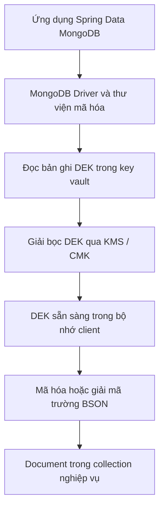
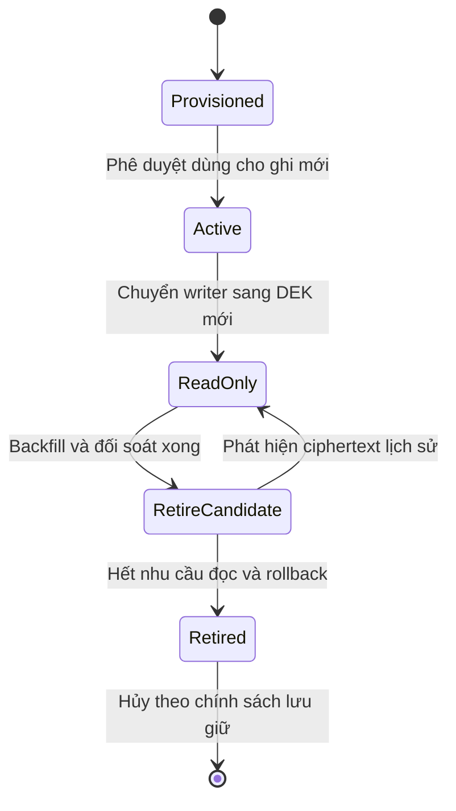
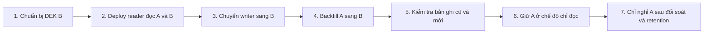

# Quản lý vòng đời khóa và kiểm thử khả năng giải mã dữ liệu cũ

## 1. Bài toán: dữ liệu mã hóa phải đọc được qua nhiều lần triển khai

Trong một ứng dụng **Spring Data MongoDB**, ta có thể đọc và ghi document bằng `MongoTemplate` hoặc repository, kết hợp các tính năng mã hóa phía client của MongoDB để bảo vệ trường nhạy cảm. Ứng dụng có thể chạy ổn trong ngày đầu triển khai, nhưng vài tháng sau cần xoay khóa, thay tài khoản KMS, nâng MongoDB Driver, đổi định dạng document, phục hồi từ backup hoặc chuyển môi trường. Nếu chỉ kiểm thử dữ liệu vừa mã hóa bằng khóa hiện tại, hệ thống có thể phát sinh lỗi nghiêm trọng: **document cũ vẫn tồn tại nhưng không còn giải mã được**.

Ví dụ collection `customerSecrets` lưu một trường bí mật dưới dạng BSON binary đã mã hóa:

```javascript
{
  _id: "customer-101",
  keyEpoch: 1,
  secretCiphertext: BinData(6, "..."),
  updatedAt: ISODate("2026-01-20T00:00:00Z")
}
```

`BinData(6, "...")` ở đây chỉ là **ký hiệu minh họa** cho BSON binary subtype 6 của MongoDB client-side field-level encryption (CSFLE), không phải một chuỗi ciphertext dùng được. Trường `keyEpoch` là metadata riêng do ứng dụng quy định để theo dõi đợt sử dụng khóa; nó không thay thế thông tin khóa được lưu trong payload mã hóa.

Mục tiêu của quản lý vòng đời khóa là đồng thời bảo đảm:

- **Bảo mật:** chỉ tiến trình được cấp quyền mới có thể giải mã; khóa thô không nằm trong mã nguồn, log hoặc tài liệu backup thiếu kiểm soát.
- **Khả dụng:** dữ liệu do phiên bản ứng dụng trước ghi vẫn giải mã được sau deploy, rollback, xoay khóa và phục hồi.
- **Toàn vẹn vận hành:** tiến trình chuyển khóa có thể tiếp tục khi bị ngắt, không làm mất cập nhật đồng thời, có chỉ số đối soát.
- **Kiểm chứng được:** có bộ dữ liệu mã hóa cũ và bài kiểm thử thực sự giải mã bằng cấu hình mới, thay vì chỉ thử encrypt → decrypt trong cùng một phiên chạy.

Mã hóa trường của MongoDB khác với TLS bảo vệ đường truyền và cơ chế mã hóa ổ đĩa hoặc storage at rest. Ba lớp có thể dùng cùng nhau nhưng không thay thế vai trò của nhau. Bài này tập trung vào **khóa dùng cho mã hóa phía client**, đặc biệt là cách kết nối quy trình đó với Spring Data MongoDB.

## 2. Phân biệt CMK, DEK, KMS và key vault

Trong mô hình *envelope encryption*, dữ liệu được mã hóa bằng một **data encryption key (DEK)**; bản thân DEK được bảo vệ bằng một **customer master key (CMK)** hoặc khóa bao trong KMS. Thuật ngữ cụ thể có thể khác nhau theo nhà cung cấp KMS.

| Thành phần | Vai trò | Điều cần duy trì |
| --- | --- | --- |
| **DEK** | Khóa thực tế được dùng để mã hóa/giải mã giá trị trường; có ID định danh | Bản ghi DEK và khả năng mở khóa DEK cũ còn tồn tại |
| **CMK / KMS key** | Khóa cấp cao bảo vệ DEK; thường được quản lý bởi AWS KMS, Azure Key Vault, Google Cloud KMS hoặc cơ chế phù hợp | Key version, quyền truy cập, chính sách phục hồi và trạng thái khóa |
| **Key vault collection** | Collection MongoDB chứa metadata và `keyMaterial` của DEK ở dạng đã được bảo vệ | Backup/restore nhất quán; phân quyền; index cần thiết |
| **KMS credentials** | Danh tính và quyền cho phép client truy cập khóa cấp cao | Cấp quyền tối thiểu, thay credential an toàn, tránh ghi log |
| **MongoDB client/driver** | Thực hiện mã hóa/giải mã và truy cập key vault/KMS | Cấu hình tương thích, thư viện mã hóa được hỗ trợ, khả năng đọc ciphertext cũ |



Khi dùng CSFLE, ciphertext có metadata để driver xác định khóa cần giải mã. Vì vậy, **khóa dùng cho lần ghi mới không nhất thiết là khóa giải mã dữ liệu cũ**. Ứng dụng có thể đổi DEK đang hoạt động mà vẫn giữ các DEK lịch sử ở trạng thái chỉ đọc. Nhưng nếu xóa bản ghi DEK cũ, hủy khóa KMS dùng để mở nó hoặc làm mất quyền truy cập, các document được mã hóa bằng DEK đó có thể không còn giải mã được.

`keyAltNames` có thể là bí danh thân thiện để tìm một DEK; không được giả định rằng đổi bí danh sẽ tự chuyển toàn bộ ciphertext sang khóa mới. ID của DEK và phiên bản schema nghiệp vụ cũng là hai khái niệm khác nhau:

| Trường/khái niệm | Câu hỏi cần trả lời |
| --- | --- |
| `schemaVersion` | Document có cấu trúc nghiệp vụ nào? |
| `keyEpoch` do ứng dụng quản lý | Document đã được xử lý trong đợt chuyển khóa nào? |
| ID DEK nằm trong payload mã hóa | Cần DEK cụ thể nào để giải mã ciphertext? |
| Phiên bản CMK tại KMS | KMS cần phiên bản khóa nào để mở bản ghi DEK? |

Không suy ra ID DEK chỉ bằng `keyEpoch`. Metadata do ứng dụng ghi có thể bị sai hoặc chưa được cập nhật; tính đúng đắn của việc giải mã phải được xác thực trên ciphertext thật.

## 3. Quy định vòng đời khóa ngay từ thiết kế

Một chính sách khóa có thể quy định các trạng thái sau. Đây là **mô hình vận hành do dự án lựa chọn**, không phải các trạng thái tự động được MongoDB quản lý:



| Trạng thái quản trị | Ghi mới | Giải mã dữ liệu cũ | Điều kiện chuyển tiếp |
| --- | --- | --- | --- |
| Provisioned | Chưa | Chỉ trong thử nghiệm/kiểm chứng | DEK đã tạo và cấu hình quyền được xác minh |
| Active | Có | Có | Ứng dụng đang dùng DEK làm khóa ghi |
| ReadOnly | Không | **Có** | Đã chuyển mọi writer sang khóa mới |
| RetireCandidate | Không | Có trong thời gian chờ | Đối soát không còn dữ liệu tham chiếu, hết cửa sổ rollback |
| Retired | Không | Không còn bảo đảm | Chỉ cho phép sau kiểm kê, lưu giữ và phê duyệt thích hợp |

Với mỗi DEK hoặc CMK cần quản lý thông tin sở hữu, phạm vi dữ liệu, thời điểm tạo, ngày bắt đầu dùng, phiên bản ứng dụng tương thích, vị trí backup, lịch sử xoay, thời hạn giữ khóa và đầu mối xử lý sự cố. Metadata vận hành như `keyEpoch` có thể được lưu cùng document; các bí mật như raw DEK, raw CMK hoặc credential **không** được lưu tại đó.

Một số nguyên tắc thực tế:

1. Tách quyền **ghi/đọc document**, quyền truy cập **key vault** và quyền **sử dụng KMS**; cấp từng quyền theo nhu cầu.
2. Không tạo khóa mới trong mỗi lần khởi động ứng dụng. Tạo khóa qua quy trình provisioning có kiểm soát, lưu ID và kiểm tra sự tồn tại trước khi dùng.
3. Không hủy khóa cũ chỉ vì mọi bản ghi trên collection đang chạy đã được nâng cấp: backup, event archive, snapshot và dữ liệu đang chờ xử lý có thể vẫn phụ thuộc khóa đó.
4. Định nghĩa thời gian giữ khóa phù hợp chính sách dữ liệu, kể cả thời gian phục hồi và rollback.
5. Theo dõi sự kiện thao tác khóa, nhưng không ghi raw key, plaintext hoặc nội dung ciphertext nhạy cảm vào log nghiệp vụ.

## 4. Hai loại xoay khóa có tác động rất khác nhau

| Thao tác | Nội dung thay đổi | Có phải mã hóa lại document? | Rủi ro chính |
| --- | --- | --- | --- |
| **Xoay CMK bên KMS** theo cơ chế hỗ trợ của nhà cung cấp | KMS thay đổi vật liệu hoặc phiên bản bảo vệ, thường giữ danh tính khóa theo chính sách nhà cung cấp | Thường **không**, nếu KMS tiếp tục giải bọc được các DEK hiện có | Vô hiệu hóa nhầm phiên bản CMK, quyền KMS hoặc chính sách phục hồi |
| **Rewrap DEK** sang CMK khác | Thay cách bảo vệ `keyMaterial` trong key vault; DEK và ID DEK có thể được giữ nguyên | **Không cần**, nếu chỉ rewrap và giữ nguyên DEK | Thiếu quyền với CMK cũ/mới, lỗi cập nhật key vault, mất đường khôi phục |
| **Xoay DEK** sang DEK mới | Writer mới mã hóa bằng DEK mới | Document cũ **cần mã hóa lại** nếu mục tiêu là ngừng phụ thuộc DEK cũ | Đứt tương thích, lỗi batch, tranh chấp ghi, bỏ sót snapshot/backup |
| **Hủy khóa cũ** | Không còn đường dùng khóa | Không thể sửa hậu quả bằng cách chỉ đổi cấu hình | Mất khả năng giải mã lâu dài nếu còn dữ liệu phụ thuộc |

Tính năng *rewrap data key* được một số phiên bản driver và cấu hình CSFLE hỗ trợ, nhưng chi tiết API, KMS provider và quyền cần thiết phụ thuộc bộ phiên bản đang triển khai. Phải kiểm tra tài liệu driver và thử nghiệm với provider tương ứng trước khi dùng trong production.

Với **Queryable Encryption**, khóa và metadata truy vấn còn liên quan đến cấu trúc và token phục vụ truy vấn. Không mặc định lấy quy trình xoay DEK của CSFLE explicit encryption rồi áp dụng nguyên xi cho collection Queryable Encryption. Việc đổi cấu hình trường mã hóa, khóa hoặc thuật toán có thể cần quy trình di chuyển collection và index riêng theo đúng phiên bản MongoDB/driver.

## 5. Chuẩn bị một môi trường thử nghiệm có thể giải mã lại sau restart

Để thử nghiệm rõ ràng, có thể dùng API **explicit encryption** của MongoDB Java Driver cùng `MongoTemplate`. Ví dụ dưới đây dùng KMS provider `local` **chỉ cho môi trường phát triển/kiểm thử**. Production thường tích hợp KMS chuyên dụng; credential và quyền truy cập phải do hạ tầng cấp phát, không ghi cứng trong mã nguồn.

Trong bài này, key vault là `encryption.__keyVault`. Cần lưu trữ và khôi phục chính xác key vault và cùng bộ vật liệu KMS; riêng việc giữ ciphertext không đủ để giải mã dữ liệu lịch sử.

```java
import com.mongodb.ConnectionString;
import com.mongodb.MongoClientSettings;
import com.mongodb.ClientEncryptionSettings;
import com.mongodb.client.vault.ClientEncryption;
import com.mongodb.client.vault.ClientEncryptions;

import java.util.Base64;
import java.util.Map;

public final class TestEncryptionFactory {
    private TestEncryptionFactory() {}

    public static ClientEncryption create(String mongoUri, String keyBase64) {
        byte[] localMasterKey = Base64.getDecoder().decode(keyBase64);
        if (localMasterKey.length != 96) {
            throw new IllegalArgumentException("Local KMS key cần đúng 96 bytes");
        }

        Map<String, Map<String, Object>> kmsProviders = Map.of(
            "local", Map.of("key", localMasterKey)
        );

        MongoClientSettings keyVaultClient = MongoClientSettings.builder()
            .applyConnectionString(new ConnectionString(mongoUri))
            .build();

        ClientEncryptionSettings settings = ClientEncryptionSettings.builder()
            .keyVaultMongoClientSettings(keyVaultClient)
            .keyVaultNamespace("encryption.__keyVault")
            .kmsProviders(kmsProviders)
            .build();

        return ClientEncryptions.create(settings);
    }
}
```

Ví dụ yêu cầu dependency mã hóa tương thích với phiên bản MongoDB Java Driver đã chọn và cấu hình thư viện `libmongocrypt`/cryptography theo tài liệu của phiên bản đó. Nếu dùng `ClientEncryption` như một Spring bean, bảo đảm bean được đóng khi ứng dụng dừng. Với provider `local`, thay ngẫu nhiên `keyBase64` ở lần khởi động sau **sẽ làm dữ liệu mã hóa trước đó không thể giải mã**. Trong test, lưu material thử nghiệm một cách kiểm soát và khôi phục chính xác; tuyệt đối không chuyển khóa thử nghiệm này sang production.

Trước khi tạo DEK, nên tạo unique partial index trên `keyAltNames` trong key vault theo hướng dẫn MongoDB:

```javascript
db.getSiblingDB("encryption").__keyVault.createIndex(
  { keyAltNames: 1 },
  {
    unique: true,
    partialFilterExpression: { keyAltNames: { $exists: true } }
  }
);
```

Tạo khóa **một lần trong bước provisioning**, giữ lại ID và cấu hình khóa đang dùng cho writer:

```java
import com.mongodb.client.model.vault.DataKeyOptions;
import com.mongodb.client.vault.ClientEncryption;
import org.bson.BsonBinary;

import java.util.List;

public class ProvisionEncryptionKeys {
    public static BsonBinary createOldKey(ClientEncryption encryption) {
        return encryption.createDataKey(
            "local",
            new DataKeyOptions().keyAltNames(List.of("customer-secrets-v1"))
        );
    }

    public static BsonBinary createNewKey(ClientEncryption encryption) {
        return encryption.createDataKey(
            "local",
            new DataKeyOptions().keyAltNames(List.of("customer-secrets-v2"))
        );
    }
}
```

Không gọi `createOldKey()`/`createNewKey()` trên mọi request hoặc lần khởi động. Trong hệ thống thật, ứng dụng cần tải ID DEK đã provision từ cấu hình tin cậy hoặc key vault, xác minh quyền và kiểm soát tình trạng thiếu khóa. Cùng một `keyAltNames` được quản lý nhất quán để tránh alias trùng hoặc trỏ sai thời kỳ khóa.

## 6. Ghi và đọc document mã hóa với `MongoTemplate`

Đoạn mã sau minh họa trường hợp **explicit CSFLE**: ứng dụng tự mã hóa thành `BsonBinary`, lưu bằng native collection mà `MongoTemplate` cung cấp, sau đó chủ động gọi `decrypt`. Đây không phải mẫu auto-encryption dùng schema map. Nếu ứng dụng đã cấu hình automatic encryption cho cùng một trường, cần thiết kế tránh mã hóa hai lần.

```java
import com.mongodb.client.model.Filters;
import com.mongodb.client.model.UpdateOptions;
import com.mongodb.client.model.Updates;
import com.mongodb.client.vault.ClientEncryption;
import com.mongodb.client.model.vault.EncryptOptions;
import org.bson.BsonBinary;
import org.bson.BsonString;
import org.bson.BsonValue;
import org.bson.Document;
import org.springframework.data.mongodb.core.MongoTemplate;

import java.util.NoSuchElementException;

public final class CustomerSecretStore {
    private static final String ALGORITHM =
        "AEAD_AES_256_CBC_HMAC_SHA_512-Random";

    private final MongoTemplate template;
    private final ClientEncryption encryption;
    private final BsonBinary activeDekId;
    private final int activeKeyEpoch;

    public CustomerSecretStore(
            MongoTemplate template,
            ClientEncryption encryption,
            BsonBinary activeDekId,
            int activeKeyEpoch) {
        this.template = template;
        this.encryption = encryption;
        this.activeDekId = activeDekId;
        this.activeKeyEpoch = activeKeyEpoch;
    }

    public void save(String customerId, String plainSecret) {
        BsonBinary ciphertext = encryption.encrypt(
            new BsonString(plainSecret),
            new EncryptOptions(ALGORITHM).keyId(activeDekId)
        );

        template.getCollection("customerSecrets").updateOne(
            Filters.eq("_id", customerId),
            Updates.combine(
                Updates.set("secretCiphertext", ciphertext),
                Updates.set("keyEpoch", activeKeyEpoch)
            ),
            new UpdateOptions().upsert(true)
        );
    }

    public String load(String customerId) {
        Document row = template.getCollection("customerSecrets")
            .find(Filters.eq("_id", customerId))
            .first();
        if (row == null) {
            throw new NoSuchElementException("Không tìm thấy customerId");
        }

        BsonBinary ciphertext = row.get("secretCiphertext", BsonBinary.class);
        if (ciphertext == null) {
            throw new IllegalStateException("Thiếu secretCiphertext");
        }
        BsonValue plaintext = encryption.decrypt(ciphertext);
        if (!(plaintext instanceof BsonString value)) {
            throw new IllegalStateException("Giá trị giải mã không phải BSON string");
        }
        return value.getValue();
    }
}
```

Đối với `-Random`, hai lần mã hóa cùng một plaintext có thể cho ciphertext khác nhau; không thể tìm kiếm giá trị bằng cách mã hóa plaintext một lần rồi so sánh trực tiếp các byte. Nếu cần truy vấn bằng trường đã mã hóa, phải chọn cơ chế hỗ trợ truy vấn đúng yêu cầu bảo mật và giới hạn của MongoDB (ví dụ deterministic CSFLE cho trường hợp được hỗ trợ hoặc Queryable Encryption), đồng thời đánh giá rò rỉ thông tin và quy trình rotation phù hợp.

**Hợp đồng quan trọng của `load()`:** nó chỉ phụ thuộc vào DEK được định danh trong ciphertext và khả năng dùng key vault/KMS, không phụ thuộc `activeDekId` của writer. Khi writer được chuyển sang khóa mới, các bản ghi cũ vẫn có thể được đọc nếu DEK cũ còn truy cập được.

## 7. Quy trình xoay DEK mà vẫn giải mã được dữ liệu cũ

Giả sử trạng thái ban đầu: DEK **A** là khóa ghi, document có `keyEpoch: 1`. Mục tiêu là dùng DEK **B** để ghi mới và về sau giảm phụ thuộc vào A.



### Bước 1: provision và kiểm thử DEK B

Tạo B tại key vault, kiểm tra mã hóa/giải mã một giá trị thử với B; xác nhận đúng môi trường, chính sách KMS và quyền của các instance ứng dụng. Đồng thời kiểm tra một ciphertext lịch sử đã được mã hóa bằng A **vẫn giải mã được** với cấu hình chuẩn bị triển khai.

### Bước 2: mở khả năng đọc A và B trước khi đổi writer

Nâng ứng dụng và các background worker để có thể giải mã cả hai loại ciphertext. Đối với explicit CSFLE, khả năng đọc thường đến từ việc giữ bản ghi DEK cũ cùng quyền KMS phù hợp. Kiểm thử rolling deployment vì một instance cũ không thể tự nhiên xử lý mọi thay đổi mã hóa, định dạng hoặc validation mà ứng dụng mới tạo ra.

### Bước 3: chuyển toàn bộ luồng ghi mới sang B

Cập nhật cấu hình `activeDekId = B`, `activeKeyEpoch = 2`, sau đó xác minh tất cả writer đang hoạt động thực sự đã sử dụng B. Chú ý API service, job theo lịch, consumer, script import, chức năng sửa document và công cụ quản trị. **Không** hủy A tại thời điểm này: data cũ vẫn cần A.

### Bước 4: re-encrypt dữ liệu cũ bằng B theo batch

Ví dụ sau minh họa thao tác backfill trong một collection dùng `secretCiphertext` và `keyEpoch` theo hợp đồng ở trên:

```java
import com.mongodb.client.MongoCollection;
import com.mongodb.client.model.Filters;
import com.mongodb.client.model.Updates;
import com.mongodb.client.result.UpdateResult;
import com.mongodb.client.vault.ClientEncryption;
import com.mongodb.client.model.vault.EncryptOptions;
import org.bson.BsonBinary;
import org.bson.BsonValue;
import org.bson.Document;
import org.bson.conversions.Bson;
import org.springframework.data.mongodb.core.MongoTemplate;

public final class CustomerSecretRekey {
    private static final String ALGORITHM =
        "AEAD_AES_256_CBC_HMAC_SHA_512-Random";

    private final MongoCollection<Document> collection;
    private final ClientEncryption encryption;
    private final BsonBinary newDekId;

    public CustomerSecretRekey(
            MongoTemplate template, ClientEncryption encryption, BsonBinary newDekId) {
        this.collection = template.getCollection("customerSecrets");
        this.encryption = encryption;
        this.newDekId = newDekId;
    }

    public long migrateOneBatch(int batchSize) {
        Bson oldEpoch = Filters.or(
            Filters.exists("keyEpoch", false),
            Filters.eq("keyEpoch", 1)
        );

        long updated = 0;
        for (Document row : collection.find(oldEpoch).limit(batchSize)) {
            BsonBinary oldCiphertext = row.get("secretCiphertext", BsonBinary.class);
            if (oldCiphertext == null) {
                // Ghi ID và nguyên nhân vào kênh xử lý lỗi; không nâng epoch.
                continue;
            }

            BsonValue value = encryption.decrypt(oldCiphertext);
            BsonBinary newCiphertext = encryption.encrypt(
                value, new EncryptOptions(ALGORITHM).keyId(newDekId)
            );

            UpdateResult result = collection.updateOne(
                Filters.and(
                    Filters.eq("_id", row.get("_id")),
                    Filters.eq("secretCiphertext", oldCiphertext),
                    oldEpoch
                ),
                Updates.combine(
                    Updates.set("secretCiphertext", newCiphertext),
                    Updates.set("keyEpoch", 2)
                )
            );
            updated += result.getModifiedCount();
        }
        return updated;
    }
}
```

**Giới hạn của ví dụ:** đây là một batch minh họa, không phải job production hoàn chỉnh. Nó giả định mọi document epoch 1 đều dùng dạng explicit CSFLE có thể giải mã và `keyEpoch` luôn được writer cập nhật đúng. Giá trị lỗi phải được thống kê, cách ly và xử lý; một document thiếu ciphertext không thể tự coi là đã di chuyển thành công.

Điều kiện cập nhật gồm `_id`, **ciphertext quan sát được ban đầu** và epoch cũ. Nếu ứng dụng khác đã thay ciphertext trước khi job ghi kết quả, `modifiedCount == 0` và job không ghi đè dữ liệu mới. Cần ghi nhận trường hợp này để quét lại. Với dữ liệu lớn, chia phạm vi `_id` hoặc cursor có checkpoint, giới hạn thông lượng, kiểm tra tải KMS/CPU/replication lag và thiết kế cách kết thúc khi còn lỗi kéo dài. Tránh vòng lặp vô hạn khi một document luôn giải mã lỗi; đưa document đó vào danh sách ngoại lệ, sau đó tiếp tục các batch còn lại.

Với `keyEpoch`, bản ghi đã chuyển lên `2` sẽ không còn được lựa chọn cho batch `1`, nên job có thể chạy lại. Tuy nhiên không thể dựa **chỉ** vào số lượng `keyEpoch: 2` để khẳng định khóa B đã thực sự được sử dụng: cần đối chiếu chính sách writer, thực hiện decrypt thử và xác nhận dữ liệu không bị rỗng hoặc biến dạng. Nếu dữ liệu từng được ghi bởi các writer thiếu nhất quán, phải kiểm kê ID DEK sử dụng trên ciphertext bằng cơ chế hoặc công cụ được hỗ trợ trước khi retire A.

### Bước 5: đối soát, giữ A và quyết định retire

Sau khi re-encrypt xong, kiểm tra kết quả về số lượng, khả năng giải mã và nghĩa nghiệp vụ. Giữ A có thể giải mã trong khoảng thời gian đủ để rollback, khôi phục snapshot, xử lý hàng đợi cũ và truy xuất dữ liệu lưu trữ lâu dài. Chỉ retire/hủy A khi đã chứng minh **không còn ciphertext cần A** trong toàn bộ phạm vi lưu trữ và có phương án đáp ứng retention, kiểm toán, quy trình phê duyệt.

## 8. Kiểm thử tương thích giải mã phải sử dụng ciphertext lịch sử thật

Một bài test kiểu `decrypt(encrypt(value, activeKey)) == value` chỉ cho biết khóa hiện tại hoạt động trong cùng môi trường. Nó **không** chứng minh có thể đọc tài liệu cũ sau deploy hoặc sau rotation. Cần giữ bộ fixture mã hóa bằng **DEK cũ** cùng môi trường key vault/KMS thử nghiệm có thể khôi phục, hoặc tạo fixture cũ trước khi thay khóa rồi lưu lại qua lần restart và thay đổi cấu hình.

Thiết kế bộ fixture gồm:

| Fixture | Bối cảnh | Kiểm tra bắt buộc |
| --- | --- | --- |
| A-01 | Ciphertext được tạo bằng DEK A từ phiên bản ứng dụng trước | Ứng dụng mới giải mã ra cùng nội dung gốc |
| A-02 | Document có cấu trúc schema cũ và ciphertext A | Cả bước ánh xạ document lẫn decrypt vẫn đúng |
| B-01 | Ciphertext mới được ghi bằng DEK B | Instance sử dụng cấu hình mới đọc và ghi đúng |
| MIX-01 | Collection đồng thời có A và B | Truy vấn/aggregation không bỏ sót document do thay đổi schema |
| FAIL-01 | Credential KMS không có quyền hoặc bản ghi DEK bị thiếu | Đọc trả lỗi có thể chẩn đoán; **không** trả plaintext mặc định |
| RESTORE-01 | Restore collection nghiệp vụ và key vault tương ứng | Giải mã lại bản ghi A-01 và B-01 với KMS còn truy cập được |
| RESTART-01 | Tắt/mở lại ứng dụng và tạo lại client | Vẫn đọc được ciphertext đã tạo trước restart |
| BACKFILL-01 | Dừng job giữa chừng rồi chạy lại | Dữ liệu không mất, document mới không bị ghi đè |

### Ví dụ kiểm thử về ý tưởng bằng JUnit

Ví dụ dưới đây cố ý tập trung vào invariant của rotation; `oldClient`, `newClient`, `oldDekId`, `newDekId` phải được fixture tích hợp thiết lập từ key vault/KMS đã cấu hình, dùng cùng kho khóa qua hai phiên:

```java
import static org.junit.jupiter.api.Assertions.assertEquals;

import com.mongodb.client.model.vault.EncryptOptions;
import com.mongodb.client.vault.ClientEncryption;
import org.bson.BsonBinary;
import org.bson.BsonString;
import org.junit.jupiter.api.Test;

class HistoricalDecryptTest {
    private static final String ALGORITHM =
        "AEAD_AES_256_CBC_HMAC_SHA_512-Random";

    // Được cấp bởi fixture tích hợp; không tự tạo khóa mới trong mỗi test.
    ClientEncryption oldClient;
    ClientEncryption newClient;
    BsonBinary oldDekId;
    BsonBinary newDekId;

    @Test
    void oldCiphertextMustRemainReadableAfterActiveKeyChanges() {
        BsonBinary oldCiphertext = oldClient.encrypt(
            new BsonString("test-payload-2025"),
            new EncryptOptions(ALGORITHM).keyId(oldDekId)
        );

        BsonBinary newCiphertext = newClient.encrypt(
            new BsonString("test-payload-2026"),
            new EncryptOptions(ALGORITHM).keyId(newDekId)
        );

        assertEquals(
            "test-payload-2025",
            newClient.decrypt(oldCiphertext).asString().getValue()
        );
        assertEquals(
            "test-payload-2026",
            newClient.decrypt(newCiphertext).asString().getValue()
        );
    }
}
```

Đây là **mẫu cấu trúc test**: các trường fixture phải được khởi tạo trước khi chạy, và test production-grade cần dùng ciphertext cũ đã lưu bền vững qua deploy/restart, không chỉ giá trị tạo trong cùng phương thức như ví dụ. Có thể dùng Testcontainers cho MongoDB và một KMS giả lập hoặc môi trường KMS thử nghiệm được kiểm soát; với test về quyền, policy và rotation của cloud KMS thật, phải có một bộ kiểm thử tích hợp riêng trên provider mục tiêu.

### Chứng minh đúng nội dung, không chỉ chứng minh không lỗi

Giải mã thành công chưa đủ: kết quả phải đúng kiểu BSON, đúng giá trị, encoding, chiều dài và cấu trúc mà phiên bản nghiệp vụ yêu cầu. Dùng expected value hoặc checksum/HMAC của dữ liệu fixture thử nghiệm để đối chiếu, **không** ghi plaintext nhạy cảm của production vào test report. Nếu đồng thời thực hiện data migration đổi schema, hãy kiểm thử cả schema cũ → DTO hiện tại và các truy vấn tương ứng.

## 9. Kiểm thử các lỗi không thể giải mã và khả năng phục hồi

Các trường hợp lỗi đáng đưa vào kịch bản kiểm thử tích hợp:

1. **Khóa KMS bị vô hiệu hóa hoặc bị thiếu quyền:** request không đọc được plaintext, lỗi được phân loại thành vấn đề quyền/KMS, không âm thầm thay bằng chuỗi rỗng.
2. **Thiếu bản ghi DEK trong key vault:** ứng dụng phát hiện không thể lấy khóa, alert chỉ chứa metadata cần thiết; khôi phục bản ghi key vault đúng bản gốc rồi thử lại.
3. **Dùng sai local master key trong test:** giải mã thất bại; đưa lại đúng 96 byte khóa cũ và xác nhận decrypt phục hồi. Không tạo DEK mới rồi mong đọc được ciphertext cũ.
4. **Khôi phục chỉ dữ liệu nghiệp vụ mà không khôi phục key vault:** bộ dữ liệu không đầy đủ; phải restore đủ các thành phần và kiểm tra quyền với KMS lịch sử.
5. **Ứng dụng bị rollback:** bản build được dùng để rollback phải có khả năng đọc dữ liệu A và B; nếu không, rollback code đơn thuần có thể gây lỗi đọc.
6. **Batch re-encryption dừng giữa chừng hoặc xung đột ghi:** chạy lại phần chưa xong mà không mã hóa lại document mới hoặc làm mất cập nhật gần nhất.

Thử nghiệm *disable* hoặc *revoke* khóa phải nằm trong môi trường thử nghiệm tách biệt. Không dùng khóa production làm đối tượng mô phỏng lỗi. Phục hồi phải được chứng minh bằng phép **decrypt tài liệu lịch sử** sau khi mở lại quyền hoặc restore, thay vì chỉ xác nhận API quản trị KMS trả về thành công.

## 10. Giám sát tiến độ chuyển khóa và chẩn đoán hiệu năng

Với trường `keyEpoch` được duy trì theo quy ước ở trên, có thể thống kê tiến độ ở mức ứng dụng:

```javascript
db.customerSecrets.aggregate([
  {
    $group: {
      _id: { $ifNull: ["$keyEpoch", 1] },
      documents: { $sum: 1 }
    }
  },
  { $sort: { _id: 1 } }
]);
```

Phép đếm này **không thể thay thế kiểm tra khóa mã hóa thật**; dữ liệu thiếu `keyEpoch` được gộp vào epoch 1 theo giả định của ví dụ. Cần kiểm tra riêng document thiếu/khác kiểu/trùng epoch, document chưa decrypt thử, các giá trị lỗi và trạng thái các writer.

| Chỉ số | Ý nghĩa khi vận hành |
| --- | --- |
| Tỷ lệ decrypt lỗi theo loại lỗi | Phân biệt vấn đề dữ liệu, key vault, KMS và cấu hình driver |
| Số document mỗi `keyEpoch` | Ước lượng tiến độ xử lý, phát hiện writer cũ vẫn hoạt động |
| Số document được đổi khóa, bỏ qua, lỗi, xung đột | Theo dõi trạng thái batch và chạy lại |
| p95/p99 thời gian encrypt/decrypt | Phát hiện độ trễ do thao tác mã hóa/KMS hoặc truy vấn dữ liệu |
| KMS throttling và lỗi quyền | Kiểm soát thông lượng chuyển khóa và phân quyền |
| Tốc độ đọc key vault và cache hit | Chẩn đoán truy cập kho khóa hoặc client cache |
| Lag của replica, tải CPU/IO, độ trễ query | Tránh để job backfill làm suy giảm ứng dụng |

Với collection lớn, chọn batch có giới hạn, checkpoint theo khóa định danh ổn định (ví dụ `_id`), theo dõi hệ thống qua `explain()` và metric thực tế. Không tự tạo index trên `keyEpoch` khi chưa đo lợi ích: index có thể tăng chi phí ghi khi mã hóa lại hàng loạt. Việc sử dụng transaction chỉ hợp lý khi cần bất biến nhiều document và hạ tầng hỗ trợ; một thao tác cập nhật trên từng document đã có tính nguyên tử cấp document, nhưng toàn bộ batch **không** là một transaction mặc định.

## 11. Checklist trước, trong và sau khi thay khóa

**Trước khi chuyển khóa:**

- Kiểm kê collection, trường mã hóa, schema version, ciphertext lịch sử, backup và những nơi còn lưu dữ liệu phụ thuộc khóa cũ.
- Xác nhận DEK cũ, KMS/CMK, key vault và quyền truy cập còn có thể khôi phục.
- Tạo DEK mới, thử decrypt fixture cũ và mới, kiểm tra rollback build tương thích.
- Quyết định kế hoạch triển khai reader/writer, tốc độ backfill, cách checkpoint và xử lý ngoại lệ.

**Trong khi chuyển khóa:**

- Triển khai đường đọc tương thích trước, sau đó mới đổi mọi writer sang khóa mới.
- Theo dõi lỗi giải mã, KMS throttling, tải database và sự xuất hiện của document thuộc epoch cũ.
- Chạy batch có điều kiện theo giá trị hiện tại, log kết quả đối soát, không ghi đè thay đổi đồng thời.
- Duy trì quyền giải mã DEK cũ trong suốt thời gian có dữ liệu phụ thuộc vào nó.

**Sau khi chuyển khóa:**

- Đối chiếu số lượng, lỗi còn tồn đọng, khả năng giải mã và giá trị nghiệp vụ thực tế.
- Thử restore dữ liệu cùng key vault và khả năng truy cập KMS tương ứng.
- Xác minh các nguồn ghi cũ đã dừng và mọi bản build cần rollback có thể đọc dữ liệu mới.
- Giữ DEK cũ ở trạng thái chỉ đọc cho đến khi hết nhu cầu truy xuất dữ liệu lịch sử và thời gian lưu giữ.

## 12. Bài thực hành tổng hợp

Thiết lập một MongoDB thử nghiệm, một key vault thử nghiệm và hai DEK **A**, **B**. Dùng `CustomerSecretStore` mã hóa một số bản ghi bằng A ở `keyEpoch: 1`, giữ lại một bộ ciphertext qua lần restart. Sau đó chuyển writer sang B và thực hiện `CustomerSecretRekey` trên từng batch.

**Yêu cầu đầu ra:**

1. Có bằng chứng ứng dụng mới giải mã được ciphertext A đã lưu trước restart, đồng thời giải mã được ciphertext B mới tạo.
2. Dừng backfill giữa chừng, chạy lại rồi xác nhận dữ liệu còn nguyên, không ghi đè cập nhật đồng thời và không vô tình nâng epoch của document lỗi.
3. Thử tạm thiếu quyền KMS hoặc mất bản ghi DEK **trong môi trường test**, xác nhận lỗi được báo rõ; khôi phục đủ thành phần và đọc lại chính document cũ.
4. Thống kê document theo epoch, đối chiếu một tập dữ liệu mẫu với expected value, ghi lại số bản ghi lỗi và xung đột.
5. Trả lời được câu hỏi quan trọng trước khi retire A: **còn ciphertext nào trong dữ liệu online, backup hoặc lưu trữ lịch sử cần A để giải mã hay không?**

Khi hoàn thành, ứng dụng có thể thay khóa ghi mới mà không đánh mất khả năng đọc dữ liệu lịch sử. Việc hủy khóa cũ chỉ diễn ra sau khi chứng minh không còn dữ liệu phụ thuộc và đáp ứng đầy đủ yêu cầu phục hồi, lưu giữ và bảo mật.
