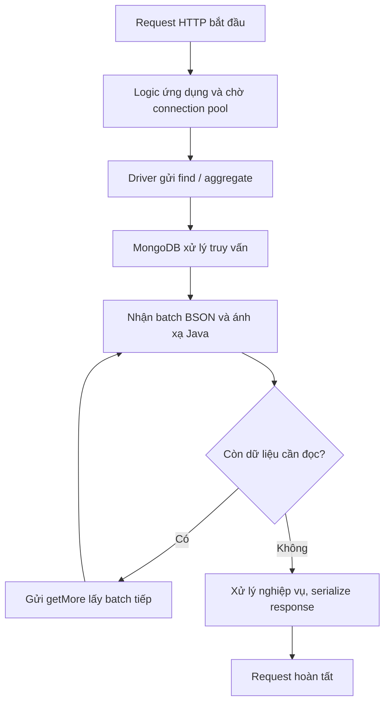

# Đo thời gian, số lệnh, số document và dung lượng truyền

Một API dùng **Spring Data MongoDB** có thể chậm dù truy vấn trông đơn giản: một lần `find()` có thể quét hàng trăm nghìn document, một request có thể phát hàng chục command, hoặc truy vấn chạy nhanh nhưng phải tải về các document rất lớn. Muốn tìm đúng nút thắt, cần đo bốn nhóm tín hiệu: **thời gian**, **số lệnh**, **số document được xử lý** và **dung lượng dữ liệu truyền**.

Bài học thuộc chương **Hiệu năng**, áp dụng cho kết nối và ánh xạ document qua `MongoTemplate`, repository, aggregation hay reactive access. Ví dụ dùng Java 17+, Spring Boot 3.x, Spring Data MongoDB, Micrometer và `mongosh`. Giá trị và tên metric trong ví dụ chỉ mang tính minh họa; benchmark thực tế cần chạy trên tập dữ liệu và mức tải đại diện.

## 1. Phân biệt bốn nhóm phép đo

| Nhóm đo | Câu hỏi | Tín hiệu cần xem | Nguồn |
| --- | --- | --- | --- |
| Thời gian | Người dùng phải chờ bao lâu? | Request `p50/p95/p99`, thời gian use case, thời gian command | HTTP metrics, timer, driver monitoring |
| Số lệnh | Một use case gửi bao nhiêu lần yêu cầu tới MongoDB? | `find`, `aggregate`, `getMore`, `update`, `count`… | MongoDB Java Driver `CommandListener` / tracing |
| Số document | MongoDB phải xét bao nhiêu bản ghi để trả kết quả? | `totalDocsExamined`, `totalKeysExamined`, `nReturned` | `explain("executionStats")` |
| Dung lượng truyền | Dữ liệu đi qua kết nối nhiều tới đâu? | Tổng BSON trả về; byte mạng nhận/gửi | Kích thước BSON, network metrics |

Các chỉ số này không thể hoán đổi. Truy vấn trả 20 document nhưng có thể đã kiểm tra 20.000 document; một lần gọi `MongoTemplate.find(...)` có thể tạo nhiều command vì cursor cần lấy các batch tiếp theo; 20 document lớn có thể tốn đường truyền hơn 2.000 document nhỏ.

### 1.1. Mỗi tầng có một phạm vi thời gian



- **HTTP latency** đo trọn thời gian từ request đến response; có thể bao gồm nhiều lần gọi MongoDB, cache và các dịch vụ khác.
- **Service latency** đo một ca sử dụng cụ thể; phù hợp để biết tối ưu MongoDB ảnh hưởng nghiệp vụ ra sao.
- **Driver command duration** đo thời gian của từng command theo driver; không bao trùm toàn bộ thời gian chờ connection pool và xử lý kết quả trong ứng dụng.
- **`executionTimeMillis` trong explain** phản ánh thời gian thực thi được MongoDB báo cho phép giải thích truy vấn; không phải latency của HTTP hoặc toàn bộ lượt đọc trong Java.

Muốn so sánh các phép đo, phải ghi rõ phạm vi, đơn vị, tập dữ liệu, số lần chạy, mức tải và trạng thái cache.

## 2. Ví dụ xuyên suốt: API lấy 50 đơn hàng

Giả sử API `GET /customers/c-001/orders?limit=50` truy vấn collection `orders`. Document có một số trường lớn không cần đưa vào danh sách:

```javascript
{
  _id: "o-1001",
  customerId: "c-001",
  createdAt: ISODate("2026-11-01T10:00:00Z"),
  status: "PAID",
  total: NumberDecimal("350000"),
  items: [ /* nhiều dòng hàng */ ],
  audit: { /* thông tin ghi nhận nội bộ */ }
}
```

Yêu cầu chỉ cần `_id`, `createdAt`, `status` và `total`. Truy vấn MongoDB:

```javascript
db.orders.find(
  { customerId: "c-001" },
  { _id: 1, createdAt: 1, status: 1, total: 1 }
).sort({ createdAt: -1 }).limit(50)
```

Tương đương với `MongoTemplate`:

```java
import java.util.List;
import org.bson.Document;
import org.springframework.data.domain.Sort;
import org.springframework.data.mongodb.core.MongoTemplate;
import org.springframework.data.mongodb.core.query.Criteria;
import org.springframework.data.mongodb.core.query.Query;

Query query = Query.query(Criteria.where("customerId").is("c-001"))
        .with(Sort.by(Sort.Direction.DESC, "createdAt"))
        .limit(50);
query.fields()
        .include("_id")
        .include("createdAt")
        .include("status")
        .include("total");

List<Document> result = mongoTemplate.find(query, Document.class, "orders");
```

`limit(50)` giới hạn số bản ghi trả ra; projection giới hạn field. Cả hai ảnh hưởng tới dung lượng truyền, còn mức quét phía server phụ thuộc filter, sort và index. Khi đo trước/sau, cần giữ giống nhau về filter, sort, limit, projection và collation để so sánh công bằng.

## 3. Đo thời gian ở tầng Spring Data MongoDB

### 3.1. Dùng Micrometer để đo một ca sử dụng

Với `MongoTemplate.find(...)` trả về `List`, có thể đo thời gian của lời gọi từ khi bắt đầu đến khi đã tạo danh sách Java:

```java
package example.orders;

import io.micrometer.core.instrument.MeterRegistry;
import io.micrometer.core.instrument.Timer;
import org.bson.Document;
import org.springframework.data.domain.Sort;
import org.springframework.data.mongodb.core.MongoTemplate;
import org.springframework.data.mongodb.core.query.Criteria;
import org.springframework.data.mongodb.core.query.Query;
import org.springframework.stereotype.Service;
import java.util.List;

@Service
public class OrderQueryService {
    private final MongoTemplate mongoTemplate;
    private final MeterRegistry registry;

    public OrderQueryService(
            MongoTemplate mongoTemplate, MeterRegistry registry) {
        this.mongoTemplate = mongoTemplate;
        this.registry = registry;
    }

    public List<Document> recentOrders(String customerId) {
        Query query = Query.query(Criteria.where("customerId").is(customerId))
                .with(Sort.by(Sort.Direction.DESC, "createdAt"))
                .limit(50);
        query.fields()
                .include("_id")
                .include("createdAt")
                .include("status")
                .include("total");

        Timer.Sample sample = Timer.start(registry);
        try {
            return mongoTemplate.find(query, Document.class, "orders");
        } finally {
            sample.stop(registry.timer(
                    "app.mongo.order_list.duration",
                    "operation", "recent_orders"));
        }
    }
}
```

Metric được ghi ngay cả khi thao tác ném exception. Khi cần phân biệt lỗi và thành công, bổ sung tag `outcome` có số giá trị nhỏ. Không dùng `customerId`, ID document, chuỗi truy vấn hoặc nội dung BSON làm tag vì sẽ làm tăng cardinality rất lớn.

Những mốc thời gian nên theo dõi cùng nhau:

1. **HTTP request**: histogram latency theo route mẫu (ví dụ `/customers/{id}/orders`), status và `p50/p95/p99`.
2. **Use case**: thời gian gọi database cộng việc xử lý nghiệp vụ trong service.
3. **Driver command**: thời gian của `find`, `getMore`, `aggregate` và các command khác.
4. **Connection pool**: độ trễ chờ kết nối, số kết nối đang sử dụng, lỗi timeout.
5. **Sau khi đọc**: map DTO, chuyển mã/giải nén, serialize response nếu nghi ngờ CPU hoặc bộ nhớ.

Không kết luận chỉ từ giá trị trung bình: latency trung bình 20 ms có thể đi kèm `p99` trên 400 ms. Để xem phân vị đáng tin cậy, phải cấu hình histogram/distribution phù hợp; timer không được cấu hình phân bố sẽ không tự cung cấp mọi phân vị.

### 3.2. Cẩn thận với cursor, stream và reactive

Phép đo quanh lời gọi tạo `Stream<T>`, `CloseableIterator<T>` hoặc `Flux<T>` có thể kết thúc **trước khi toàn bộ dữ liệu được lấy về**. Trong các trường hợp này cần đo từ lúc bắt đầu tiêu thụ tới khi hoàn tất, lỗi hoặc hủy, đồng thời đóng cursor đúng cách. Với reactive access, đặt phép đo trong lifecycle của publisher, không gọi `block()` chỉ để tính thời gian trong request reactive.

Với Spring Data repository, một lời gọi trả `Page<T>` có thể thực hiện thêm truy vấn đếm tổng; điều này phải được xác nhận qua số command. Nếu giao diện chỉ cần biết còn trang tiếp hay không, cân nhắc `Slice<T>` hoặc phân trang theo mốc có điều kiện sắp xếp ổn định.

## 4. Đếm số command MongoDB thật sự gửi

### 4.1. Lời gọi Java và command trên wire không luôn là một

Giả sử query trả 50 document. MongoDB có thể gửi batch đầu ở command `find` rồi driver lấy tiếp:

```text
find       -> 1 command, mở cursor và nhận batch đầu
getMore    -> có thể 0, 1, 2, ... command để lấy các batch còn lại
killCursors -> có thể phát sinh khi đóng cursor chưa tiêu thụ hết
```

Số `getMore` phụ thuộc `batchSize`, độ lớn document, giới hạn batch của MongoDB và cách ứng dụng tiêu thụ cursor. Một service gọi `findById` cho từng đơn trong vòng lặp còn có thể tạo hàng chục lượt `find`: biểu hiện điển hình của N+1.

### 4.2. Instrument bằng `CommandListener`

MongoDB Java Driver phát sự kiện command thành công hoặc thất bại. Ví dụ Spring Boot 3.x đăng ký listener qua `MongoClientSettingsBuilderCustomizer`; với các phiên bản Spring Boot khác hãy kiểm tra import/customizer tương ứng:

```java
package example.monitoring;

import com.mongodb.event.CommandFailedEvent;
import com.mongodb.event.CommandListener;
import com.mongodb.event.CommandSucceededEvent;
import io.micrometer.core.instrument.MeterRegistry;
import org.springframework.boot.autoconfigure.mongo.MongoClientSettingsBuilderCustomizer;
import org.springframework.context.annotation.Bean;
import org.springframework.context.annotation.Configuration;
import java.util.Set;
import java.util.concurrent.TimeUnit;

@Configuration
public class MongoCommandMetricsConfig {
    private static final Set<String> TRACKED = Set.of(
            "find", "getMore", "aggregate", "count",
            "distinct", "insert", "update", "delete");

    @Bean
    MongoClientSettingsBuilderCustomizer commandMetrics(MeterRegistry registry) {
        return builder -> builder.addCommandListener(new CommandListener() {
            @Override
            public void commandSucceeded(CommandSucceededEvent event) {
                record(event.getCommandName(), "success",
                        event.getElapsedTime(TimeUnit.NANOSECONDS));
            }

            @Override
            public void commandFailed(CommandFailedEvent event) {
                record(event.getCommandName(), "failure",
                        event.getElapsedTime(TimeUnit.NANOSECONDS));
            }

            private void record(
                    String command, String outcome, long durationNanos) {
                if (!TRACKED.contains(command)) {
                    return;
                }
                registry.counter(
                        "mongodb.driver.command.count",
                        "command", command, "outcome", outcome).increment();
                registry.timer(
                        "mongodb.driver.command.duration",
                        "command", command, "outcome", outcome)
                        .record(durationNanos, TimeUnit.NANOSECONDS);
            }
        });
    }
}
```

`CommandListener` đếm **lượt command đã kết thúc**, không đếm nghiệp vụ logic hoặc HTTP request. Nếu driver thử lại một thao tác, listener có thể ghi nhiều command. `getMore` được đếm riêng. Nếu dự án đã bật telemetry/observation từ driver hoặc Spring Boot, cần kiểm tra việc ghi trùng metric trước khi thêm listener.

Để tính **command trên từng request**, hãy liên kết command spans với trace của HTTP request bằng bộ tracing/observability có hỗ trợ driver, hoặc đo một kịch bản được cô lập. Không lấy tổng command toàn hệ thống chia cho request của riêng một API khi còn các API khác, job nền, kết nối và retry. Không dựa vào `ThreadLocal` đơn giản để gán command cho request trong reactive/async.

Không log toàn bộ command BSON vì filter, document và token có thể chứa dữ liệu nhạy cảm; log tên command, thời gian, outcome và trace ID là đủ cho phần lớn điều tra.

## 5. Đo số document mà MongoDB phải kiểm tra

### 5.1. Phân tích với `explain("executionStats")`

Chạy trên `mongosh` với filter, projection, sort và limit giống trong ứng dụng:

```javascript
db.orders.find(
  { customerId: "c-001" },
  { _id: 1, createdAt: 1, status: 1, total: 1 }
).sort({ createdAt: -1 })
 .limit(50)
 .explain("executionStats")
```

Một số trường quan trọng:

| Trường | Ý nghĩa | Cách đọc |
| --- | --- | --- |
| `nReturned` | Số kết quả truy vấn giải thích trả ra | Không phải số document phải kiểm tra |
| `totalDocsExamined` | Số lượt xem xét document phía server | Cao so với kết quả có thể là tín hiệu quét không hiệu quả |
| `totalKeysExamined` | Số entry index được xem xét | Giúp thấy lượng công việc tại index |
| `executionTimeMillis` | Thời gian thực thi được server báo | Không tương đương thời gian ứng dụng hoặc HTTP |
| `winningPlan` | Kế hoạch được chọn | Xem `COLLSCAN`, `IXSCAN`, `FETCH`, `SORT`… |

Ví dụ **minh họa** cho cùng 50 kết quả:

| Kế hoạch | `nReturned` | `totalDocsExamined` | `totalKeysExamined` |
| --- | ---: | ---: | ---: |
| Collection scan | 50 | 120.000 | 0 |
| Index phù hợp | 50 | 50 | 50 |

Có thể thử index hỗ trợ điều kiện và sắp xếp:

```javascript
db.orders.createIndex({ customerId: 1, createdAt: -1 })
```

Đây không phải lời khuyên tạo index trong mọi trường hợp; cần cân nhắc độ chọn lọc, index đã có, collation, kích thước index và chi phí mỗi lần ghi. Dùng `explain` trên dữ liệu đại diện để kiểm tra hiệu quả.

Một tỷ số thăm dò:

```text
scanAmplification = totalDocsExamined / max(nReturned, 1)
```

Nếu 10.000 document được kiểm tra để trả 10 document thì tỷ số là 1.000. Với `nReturned = 0`, tỷ số chỉ còn là quy ước; phải nhìn trực tiếp số đã quét. Truy vấn được bao phủ hoàn toàn bằng index (covered query) có thể có `totalDocsExamined = 0` nhưng vẫn trả kết quả, nên con số này không có nghĩa là server không phải làm việc.

### 5.2. Aggregation và truy vấn phân tán

Với `$match`, `$lookup`, `$sort`, `$group` hoặc `$facet`, thống kê có thể nằm ở từng stage và truy vấn có thể tạo rất nhiều kết quả trung gian trước khi trả vài document cuối. Trong cluster sharded, số liệu cũng có thể xuất hiện theo từng shard. Không cộng hoặc so sánh các trường khác phạm vi một cách máy móc; hãy xem đúng stage và shard đang gây tốn CPU, bộ nhớ, quét hoặc đĩa.

### 5.3. Document được trả cho ứng dụng là đại lượng khác

Với `List<Document>`, `result.size()` đếm document mà lời gọi Java thực nhận. Với cursor hoặc `Flux`, cần đếm phần **đã tiêu thụ hoặc emit**. Số này không phải `totalDocsExamined`; cũng không nhất thiết trùng `nReturned` trong một lần `explain` khi dữ liệu hoặc thời điểm chạy thay đổi. Thao tác `countDocuments()` bản thân cũng có chi phí và có thể tạo thêm command.

## 6. Đo dung lượng BSON và byte mạng

### 6.1. Ước lượng dữ liệu nhận bằng BSON

Trong `mongosh` có thể cộng kích thước BSON của từng document nhận:

```javascript
let count = 0;
let bsonBytes = 0;

const cursor = db.orders.find(
  { customerId: "c-001" },
  { _id: 1, createdAt: 1, status: 1, total: 1 }
).sort({ createdAt: -1 }).limit(50);

while (cursor.hasNext()) {
  const doc = cursor.next();
  count++;
  bsonBytes += Object.bsonsize(doc);
}

printjson({ documentCount: count, estimatedBsonBytes: bsonBytes });
```

`Object.bsonsize(doc)` cho biết kích thước biểu diễn BSON của một document. Tổng BSON **không phải** số byte thực đi qua mạng: ngoài BSON còn có envelope/protocol, metadata cursor, command phía client, và tác động của nén, TLS, batching. Kích thước JSON trả về qua HTTP cũng khác BSON.

So sánh cùng filter và `limit` trước/sau khi chỉ chọn các field cần dùng. Nếu document có `items` và `audit` rất lớn, projection có thể giảm đáng kể số byte cần nhận và chi phí giải mã. Để kết luận giảm được bao nhiêu byte mạng thực, cần đo ở tầng network.

### 6.2. Đo byte mạng đúng phạm vi

| Nguồn | Giá trị hữu ích | Giới hạn |
| --- | --- | --- |
| Tổng `Object.bsonsize()` | Ước lượng kích thước dữ liệu BSON trả về | Chưa có protocol và nén |
| `db.serverStatus().network.bytesIn/bytesOut` | Bộ đếm byte tích lũy cấp tiến trình MongoDB | Bao gồm nhiều client và hoạt động khác |
| Metrics hạ tầng / hệ điều hành / exporter | Byte của interface, kết nối hoặc instance | Phải xác định chính xác hướng và phạm vi |
| Proxy hoặc packet capture được phép sử dụng | Byte thực trên kết nối | TLS/nén làm khó phân tích nội dung và có overhead |
| HTTP response metrics | Byte từ ứng dụng đến người dùng | Không phải byte giữa Java driver và MongoDB |

Từ **góc nhìn MongoDB server**, `bytesIn` là byte server nhận, `bytesOut` là byte server gửi. Lấy hiệu hai mẫu `serverStatus()` chỉ đáng tin nếu hiểu lưu lượng nền và các client khác. Không lấy chênh lệch `bytesOut` của cả cluster rồi gán cho một request của riêng API.

Muốn đánh giá ảnh hưởng của projection, ghi riêng **số document nhận**, **tổng BSON của document trả** và **byte mạng đo được**. Ba phép đo giúp xác định rõ việc giảm payload có chuyển thành giảm lưu lượng thực tế hay không.

## 7. Đọc bốn nhóm số liệu để chẩn đoán

Ví dụ endpoint lấy 50 đơn hàng và thông tin khách hàng liên quan. Trước cải tiến, mỗi đơn hàng gọi thêm một `findById`; sau cải tiến, service gom truy vấn liên quan và dùng projection/index. Bảng sau **hoàn toàn giả định**, nhằm minh họa cách giải thích:

| Chỉ số | Trước | Sau | Ý nghĩa |
| --- | ---: | ---: | --- |
| HTTP `p95` | 420 ms | 110 ms | Người dùng chờ ít hơn |
| MongoDB command / request | 51 | 2 | Giảm truy vấn lặp kiểu N+1 |
| Tổng `docsExamined` trong các phép đo | 18.000 | 60 | Query/index hiệu quả hơn |
| Document ứng dụng nhận | 60 | 60 | Số bản ghi nghiệp vụ tương đương |
| Tổng BSON document trả | 380 KB | 45 KB | Projection bỏ field lớn không cần thiết |

Không dùng số minh họa này như mục tiêu tuyệt đối cho các hệ thống khác. Giảm command bằng `$lookup` hoặc `$in` có thể đổi lấy truy vấn phức tạp hơn hay lượng BSON trung gian lớn hơn; phải đo tác động tổng thể.

### Các mẫu thường gặp

1. **Command nhiều, latency tăng theo số bản ghi:** nghi ngờ N+1, vòng lặp gọi repository hoặc `getMore` dày đặc vì batch size quá nhỏ.
2. **Ít command nhưng `docsExamined` rất cao:** kiểm tra `COLLSCAN`, thứ tự index, điều kiện lọc, sort và aggregation.
3. **`docsExamined` nhỏ nhưng BSON lớn:** dùng projection, giới hạn số bản ghi, phân trang và tránh tải field không cần thiết.
4. **Command nhanh nhưng HTTP chậm:** xem chờ connection pool, giải mã/ánh xạ Java, DTO, serialize JSON, CPU và các dependency khác.
5. **Truy vấn nhanh khi ít tải nhưng chậm lúc đồng thời cao:** kiểm tra throughput, pool, CPU, I/O, page faults, hàng đợi và tài nguyên cluster.

`batchSize` lớn có thể giảm số lần `getMore` nhưng tăng kích thước mỗi batch và áp lực bộ nhớ; `batchSize` nhỏ có thể tăng round trip. Cần kiểm thử trên cùng bộ dữ liệu. `skip` sâu có thể làm server phải đi qua nhiều kết quả; với index và khóa sắp xếp ổn định, cân nhắc phân trang theo mốc (keyset/range) kèm khóa phụ duy nhất khi có giá trị `createdAt` trùng nhau.

## 8. Thực hiện benchmark có thể lặp lại

Một phép thử phải ghi lại:

| Thành phần | Thông số cần ghi |
| --- | --- |
| Dữ liệu | Số document, cỡ document, độ chọn lọc, tỷ lệ field lớn |
| Truy vấn | Filter, sort, projection, collation, limit, batch size, read preference |
| Hạ tầng | Phiên bản MongoDB, driver, Spring Data; topology, index và cấu hình kết nối |
| Tải | Requests/second, concurrency, warm-up, thời gian đo, số mẫu |
| Trạng thái | Connection pool, cache ấm/lạnh, có hay không workload ghi |
| Kết quả | HTTP `p50/p95/p99`, command, `docsExamined`, `nReturned`, BSON và network bytes |

**Quy trình đo:**

1. Chọn một use case có độ trễ hoặc tải dữ liệu gây vấn đề; xác định đầu ra nghiệp vụ cần giữ nguyên.
2. Đo baseline: timer phía ứng dụng, command metrics, `explain("executionStats")` và dung lượng BSON trên kịch bản giống nhau.
3. Đổi một nhóm nguyên nhân mỗi lần (ví dụ index, N+1 hoặc projection), ghi rõ thay đổi.
4. Chạy lại sau warm-up với cùng mức tải, độ dài thử, tập dữ liệu và điều kiện pool/cache; so sánh phân vị, command, công việc server và byte.
5. Kiểm tra tác dụng phụ: CPU, heap, I/O, throughput ghi và chi phí bảo trì index.

Ví dụ mẫu ghi kết quả:

```text
case: recent_orders_50
dataset: 1_200_000 orders
filter: customerId = c-001
sort: createdAt descending
projection: _id, createdAt, status, total
load: 100 requests/second; concurrency 20
samples: 10_000 measured requests after warm-up
http_p95_ms: <đo thực tế>
command_per_request_p95: <đo thực tế>
find_getMore_counts: <đo thực tế>
explain_docs_examined: <đo thực tế>
explain_keys_examined: <đo thực tế>
explain_n_returned: <đo thực tế>
estimated_bson_bytes: <đo thực tế>
network_bytes: <đo thực tế và ghi rõ phạm vi>
```

Lệnh `explain` không thay thế phép đo request. Không lấy `executionTimeMillis` của một truy vấn chạy khi ít tải rồi tuyên bố đó là tỷ trọng chính xác trong HTTP latency khi ứng dụng chịu tải cao.

### Profiler, slow query và quan sát sản xuất

MongoDB profiler, slow query log hoặc APM có thể cung cấp những field như `millis`, `docsExamined`, `keysExamined`, `nreturned` cho những operation được ghi nhận. Các field thay đổi theo loại operation, phiên bản server và cấu hình. Profiling chi tiết có chi phí; chỉ bật theo ngưỡng/lấy mẫu phù hợp và tránh lưu tham số truy vấn chứa thông tin nhạy cảm không cần thiết.

## 9. Những kết luận sai thường gặp

| Cách đo sai | Hậu quả | Cách khắc phục |
| --- | --- | --- |
| Chỉ đo trung bình | Che giấu request chậm ở đuôi phân bố | Dùng histogram và `p95/p99` |
| Coi một `find()` Java là một command | Bỏ sót `getMore` và retry | Đếm sự kiện driver |
| Coi `nReturned` là `docsExamined` | Đánh giá sai mức độ quét | Đọc cả hai từ `executionStats` |
| Coi `executionTimeMillis` là HTTP latency | Bỏ sót pool, network và logic Java | Đo riêng từng phạm vi |
| Gọi `countDocuments()` chỉ để đo số kết quả | Tạo thêm workload và command | Phân biệt count với stats của truy vấn cần tối ưu |
| Coi kích thước JSON là byte MongoDB | Nhầm BSON với JSON/protocol | Đo BSON và byte mạng |
| Dùng `serverStatus().network` cho một request | Bộ đếm dùng chung cho mọi client | Cô lập kịch bản hoặc đo theo kết nối |
| Dừng timer ngay khi tạo stream/Flux | Chưa có thời gian tiêu thụ dữ liệu | Đo tới complete/error/cancel |
| So baseline cache lạnh với bản mới cache ấm | Kết luận thiên lệch | Warm-up và ghi trạng thái cache |
| Log toàn bộ command để đo | Tăng I/O và rủi ro lộ dữ liệu | Log tên command, outcome, duration, trace ID |

## 10. Bài tập thực hành

**Bài 1 — Giảm document scan.** Tạo 100.000 đơn hàng giả lập, trong đó 1.000 đơn cùng một khách hàng. Chạy truy vấn lấy 50 đơn mới nhất trước/sau khi thêm index theo filter/sort. Ghi `totalDocsExamined`, `totalKeysExamined`, `nReturned`, winning plan và `p95` trong cùng điều kiện.

**Bài 2 — Truy vấn N+1.** Viết service đọc danh sách đơn rồi tra cứu từng thông tin liên quan bằng repository. Đếm số command trong kịch bản cô lập, chuyển sang query `$in` hoặc aggregation phù hợp và so sánh số command, latency, BSON.

**Bài 3 — Dung lượng dữ liệu.** Đo tổng `Object.bsonsize()` của 50 đơn hàng với đầy đủ field và projection bốn field. Giải thích vì sao mức giảm BSON không nhất thiết bằng mức giảm byte thực trên mạng hoặc JSON của response.

**Bài 4 — Reactive streaming.** Với `Flux` trả hàng nghìn document, đo thời gian từ subscribe tới complete/error/cancel và đếm số document đã emit. Thử các batch size khác nhau; so sánh số `getMore`, thời gian hoàn tất và áp lực bộ nhớ/backpressure.

**Tiêu chí hoàn thành:** Người học đặt được điểm đo ở ứng dụng, driver và server; phân biệt số command, số document quét, số document trả và byte truyền; giải thích được một truy vấn bằng `explain`; và đánh giá một phương án tối ưu trên kịch bản có thể lặp lại.
