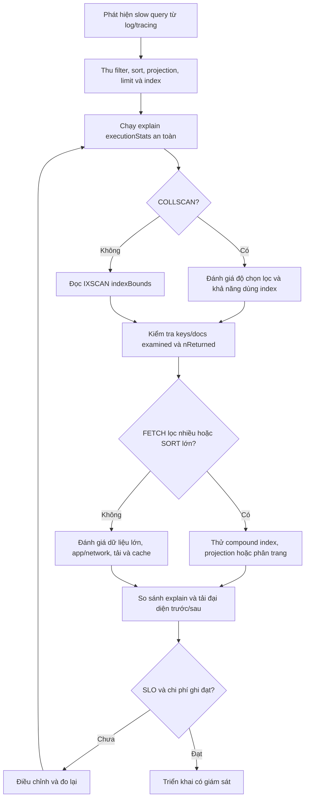

# Đọc COLLSCAN, IXSCAN, FETCH, SORT và số document/index key đã xét

> **Chương:** Hiệu năng · **Module:** `SPRING_DATA_MONGODB`. Khi dùng Spring Data MongoDB để truy vấn qua repository, `MongoTemplate` hoặc reactive access, việc có chỉ mục chưa đủ chứng minh truy vấn chạy nhanh. MongoDB có thể quét toàn collection, duyệt nhiều index key, đọc thêm document hoặc sắp xếp trong bộ nhớ. Bài này hướng dẫn đọc `explain()` để tìm nguyên nhân, lượng hóa công việc thực hiện và kiểm chứng một thay đổi truy vấn/chỉ mục.

## 1. Bài toán: cùng 20 kết quả nhưng chi phí rất khác nhau

Một API trả 20 đơn hàng đã thanh toán của một tenant, mới nhất trước:

```javascript
db.orders.find({
  tenantId: "t-3",
  status: "PAID"
}).sort({ createdAt: -1 }).limit(20);
```

Hai lần thực hiện đều trả **20 document**, nhưng có thể xảy ra:

| Kế hoạch | Khóa chỉ mục đã xét | Document đã xét | Kết quả | Ý nghĩa |
|---|---:|---:|---:|---|
| `COLLSCAN`, lọc rồi sort | 0 | 500.000 | 20 | Phải kiểm tra khối lượng lớn document |
| `IXSCAN → FETCH`, lọc `status` ở FETCH | 6.000 | 6.000 | 20 | Dùng chỉ mục nhưng vẫn đọc nhiều document không phù hợp |
| `IXSCAN → FETCH`, index khớp filter/sort | 20 | 20 | 20 | Tìm đúng vùng index, lấy đủ 20 document |
| `IXSCAN`, projection được index bao phủ | 20 | 0 | 20 | Không cần đọc document từ collection |

Các số trên **chỉ là tình huống minh họa**, không phải kết quả đo của một database cụ thể. Điểm quan trọng là nhìn đồng thời **kế hoạch**, **số thao tác đọc** và **số kết quả**. Không thể kết luận truy vấn tốt chỉ vì có `IXSCAN`.

### Ba câu hỏi trước khi tối ưu

1. Query có tìm đúng vùng index, hay phải duyệt nhiều document/khóa không?
2. MongoDB có phải **FETCH** document để kiểm tra điều kiện hoặc trả projection không?
3. Kết quả có phải đi qua **SORT** cần thu thập/sắp xếp dữ liệu, hay có thể theo thứ tự index?

Kết quả của `explain` giúp trả lời, nhưng phải kết hợp độ trễ thực tế của ứng dụng, phân bố dữ liệu và tải máy chủ.

## 2. Dùng `explain()` đúng cách

Cú pháp trong `mongosh`:

```javascript
db.orders.find({
  tenantId: "t-3",
  status: "PAID"
}).sort({ createdAt: -1 }).limit(20)
  .explain("executionStats");
```

MongoDB có ba verbosity phổ biến:

| Chế độ | Có gì | Khi dùng |
|---|---|---|
| `"queryPlanner"` | Cấu trúc plan thắng, index, bounds và một số plan bị loại | Xem planner dự định thực hiện truy vấn thế nào |
| `"executionStats"` | Thông tin plan + số liệu khi thực thi plan thắng | Chẩn đoán bao nhiêu index key/document đã xét |
| `"allPlansExecution"` | Bổ sung thống kê giai đoạn thử các plan ứng viên | Điều tra vì sao planner chọn plan; tốn thêm tài nguyên để phân tích |

**`executionStats`** là điểm khởi đầu hữu ích nhất cho bài này. Nó cho thấy kết quả đo thực thi, nhưng `explain()` không hoàn toàn tương đương truy vấn ứng dụng chạy thường xuyên: việc giải thích plan bỏ qua cơ chế chọn lại từ plan cache và không tạo mục cache như đường chạy thông thường. Trên hệ thống đang có tải, chỉ thực hiện những truy vấn chẩn đoán đã cân nhắc phạm vi/chi phí.

### 2.1. Các vùng quan trọng trong JSON

Một kết quả `explain("executionStats")` thường có dạng tổng quát:

```javascript
{
  queryPlanner: {
    namespace: "shop.orders",
    parsedQuery: { /* filter đã phân tích */ },
    winningPlan: { /* cây các stage được chọn */ },
    rejectedPlans: [ /* các ứng viên khác, nếu có */ ]
  },
  executionStats: {
    executionSuccess: true,
    nReturned: 20,
    executionTimeMillis: 3,
    totalKeysExamined: 59,
    totalDocsExamined: 59,
    executionStages: { /* cây thực thi và thống kê từng stage */ }
  }
}
```

Giá trị ví dụ không hàm ý mọi truy vấn đều nhanh 3 ms. Tùy phiên bản, query engine và topology, kế hoạch có thể nằm ở các đường dẫn và cách đặt tên khác nhau:

- **Classic engine:** thường thấy `winningPlan.stage` và các `inputStage`/`inputStages` lồng nhau.
- **Slot-Based Execution (SBE):** có thể thấy `winningPlan.queryPlan` và `slotBasedPlan`; `executionStages` có các stage, tên và số liệu khác classic. Một số stage hiển thị như `scan`, `ixseek`, `seek`, `filter` hoặc `sort`.
- **Sharded cluster:** có thêm `SHARD_MERGE`, `SHARDING_FILTER`, các kế hoạch và thống kê riêng của từng shard.

Vì vậy hãy **đọc cây thực thi**, không viết script phân tích chỉ dựa vào chuỗi `winningPlan.stage === "IXSCAN"` ở một vị trí cố định.

### 2.2. Trích những số chính để xem nhanh

```javascript
const report = db.orders.find({
  tenantId: "t-3",
  status: "PAID"
}).sort({ createdAt: -1 }).limit(20)
  .explain("executionStats");

printjson({
  nReturned: report.executionStats?.nReturned,
  totalKeysExamined: report.executionStats?.totalKeysExamined,
  totalDocsExamined: report.executionStats?.totalDocsExamined,
  executionTimeMillis: report.executionStats?.executionTimeMillis,
  winningPlan: report.queryPlanner?.winningPlan
});
```

Trên một số kế hoạch aggregation hoặc sharded execution, vị trí thống kê chi tiết khác đi. Nếu số top-level không có, kiểm tra các vùng `stages`, `$cursor.executionStats` hoặc báo cáo của từng shard.

## 3. Hiểu `COLLSCAN`: duyệt document trong collection

`COLLSCAN` (*collection scan*) là thao tác duyệt document trong collection để tìm các bản ghi thỏa truy vấn. Vì không đọc chỉ mục để định vị kết quả, một kế hoạch chỉ quét collection thường có:

- `totalKeysExamined = 0`;
- `totalDocsExamined` lớn nếu phải xem xét nhiều document;
- `nReturned` có thể rất nhỏ hoặc bằng 0 nếu filter chọn lọc.

Sơ đồ:

```text
COLLSCAN (duyệt document) → FILTER điều kiện → LIMIT / SORT / kết quả
```

Ví dụ tìm một mã khách hàng không có index:

```javascript
db.orders.find({ customerCode: "C-0042" })
  .explain("executionStats");
```

Nếu collection có 600.000 document và chỉ 100 document khớp, engine có thể phải đọc gần hết collection. Tuy vậy **`COLLSCAN` không luôn là lỗi**:

- Collection rất nhỏ: một lượt scan có thể rẻ hơn việc duyệt index rồi đọc từng document.
- Truy vấn phải trả phần lớn collection: index không nhất thiết có lợi.
- Batch/report chủ ý đọc toàn bộ dữ liệu: scan tuần tự có thể phù hợp.
- Query không có filter hoặc limit đủ nhỏ: kế hoạch scan có thể có chi phí hợp lý.

Đặt câu hỏi đúng: **có đang scan quá nhiều so với số kết quả và mức tải yêu cầu không?** Nếu có, cần tìm index phù hợp với filter, sort và projection, không đơn giản chỉ tạo index cho field xuất hiện trong query.

## 4. Hiểu `IXSCAN`: duyệt khóa trong chỉ mục

`IXSCAN` (*index scan*) duyệt các **index key** theo một khoảng hoặc nhiều khoảng điều kiện. Với B-tree index, MongoDB có thể nhảy đến vùng khóa phù hợp và quét tiến hoặc lùi. Các trường thường hữu ích:

- `indexName`: tên index được dùng.
- `keyPattern`: thứ tự các field và chiều sort của index.
- `indexBounds`: khoảng giá trị engine sẽ duyệt trên từng field index.
- `direction`: quét tiến hoặc lùi theo thứ tự khóa index, nếu được hiển thị.
- `keysExamined`: số index key stage này đã xem xét.

Ví dụ index:

```javascript
db.orders.createIndex(
  { tenantId: 1, status: 1, createdAt: -1 },
  { name: "idx_tenant_status_created" }
);
```

Với query:

```javascript
db.orders.find({
  tenantId: "t-3",
  status: "PAID"
}).sort({ createdAt: -1 }).limit(20)
  .explain("executionStats");
```

Khoảng `indexBounds` minh họa có thể tương đương:

```javascript
{
  tenantId: ["[\"t-3\", \"t-3\"]"],
  status: ["[\"PAID\", \"PAID\"]"],
  createdAt: ["[MaxKey, MinKey]"]
}
```

Đây là **minh họa tư duy về bounds**, không phải chuỗi JSON chính xác cho mọi phiên bản/direction. Hai field đầu được giới hạn bằng equality, còn `createdAt` được quét theo thứ tự index; có thể lấy các đơn hàng mới nhất mà không cần `SORT` riêng.

Ngược lại, index `{tenantId:1,createdAt:-1}` không chứa `status`; nó có thể duyệt mọi trạng thái của tenant và để `FETCH` lọc `status`. Sự hiện diện của `IXSCAN` lúc này chưa giải quyết triệt để vấn đề.

### 4.1. `IXSCAN` có thể vẫn rất đắt

Dấu hiệu:

- `totalKeysExamined` lớn hơn nhiều so với `nReturned`: scan quá nhiều khóa trước khi có kết quả.
- `indexBounds` quá rộng, xuất hiện `MinKey`/`MaxKey` trên field quan trọng mà query không tận dụng được.
- Điều kiện hiệu quả nằm ở field không được index hoặc đứng sau một vùng range khiến prefix không đủ chọn lọc.
- Index **multikey** trên mảng có thể tạo nhiều index key cho cùng một document; vì vậy tổng số key được xét có thể lớn hơn số document được xem xét.
- Dùng `skip(N)` sâu để phân trang có thể phải duyệt qua nhiều key trước khi trả vài kết quả.

Không nên mặc định `totalKeysExamined` bằng số **document duy nhất**. Đây là số key được kiểm tra trong quá trình thực thi, và các stage có thể phải xử lý trùng lặp trong những tình huống như multikey.

## 5. Hiểu `FETCH`: cần đọc document thật

`FETCH` thường xuất hiện **phía trên `IXSCAN`** khi MongoDB phải lấy document từ collection để:

1. Kiểm tra filter mà index chưa thể quyết định hết; hoặc
2. Trả về field được yêu cầu nhưng không có trong index.

Ví dụ:

```text
LIMIT
  └── FETCH                // lọc status hoặc lấy field của Order
        └── IXSCAN         // tenantId + createdAt
```

Với index `{tenantId:1,createdAt:-1}` và filter `{tenantId:"t-3",status:"PAID"}`, engine biết tenant từ index nhưng không biết `status` từ index key; việc đọc document và kiểm tra `status` thường diễn ra ở `FETCH`.

Một cây `executionStages` rút gọn, chỉ mang tính minh họa:

```javascript
{
  stage: "LIMIT",
  nReturned: 20,
  inputStage: {
    stage: "FETCH",
    nReturned: 20,
    docsExamined: 58,
    filter: { status: { $eq: "PAID" } },
    inputStage: {
      stage: "IXSCAN",
      indexName: "idx_tenant_created",
      keysExamined: 58
    }
  }
}
```

Ở đây, `FETCH` phải xem 58 document để trả 20 document. Không có nghĩa 38 document bị lỗi; chúng đơn giản không đáp ứng filter ở bước sau.

### 5.1. `FETCH` không luôn xấu

Nếu API cần toàn bộ document đơn hàng để trả JSON, fetch một số document gần bằng `nReturned` là bình thường. Trường hợp cần chú ý là **rất nhiều lần fetch để thu được rất ít kết quả**, vì fetch ngẫu nhiên có thể tăng I/O và cache miss.

Một index bao gồm tất cả field phục vụ filter, sort và projection có thể tạo **covered query**, nơi dữ liệu được lấy chỉ từ index:

```javascript
db.orders.find(
  { tenantId: "t-3", status: "PAID" },
  { _id: 0, tenantId: 1, status: 1, createdAt: 1 }
).sort({ createdAt: -1 }).limit(20)
  .explain("executionStats");
```

Nếu index `{tenantId:1,status:1,createdAt:-1}` đáp ứng đầy đủ và không vướng giới hạn multikey/collation/filter, `totalDocsExamined` có thể bằng **0**. Trong classic explain đôi khi sẽ thấy `PROJECTION_COVERED` và `IXSCAN`, không có `FETCH`; SBE có hình dạng stage khác. Projection có `_id: 0` là chi tiết quan trọng vì mặc định MongoDB có thể trả `_id`, trong khi index ghép ví dụ không chứa nó.

**Đừng tạo một index cực rộng chỉ để mọi truy vấn đều covered:** index lớn tăng dung lượng và chi phí ghi. Ưu tiên phù hợp query shape quan trọng rồi đo tổng chi phí.

## 6. Hiểu `SORT`: kết quả phải được sắp xếp

Khi index không cung cấp thứ tự mà query yêu cầu, MongoDB có thể dùng stage `SORT` để sắp xếp các kết quả trung gian. Khác với đọc lần lượt một index đã đúng thứ tự, sắp xếp không theo index thường phải thu thập các bản ghi/khóa sắp xếp trước khi phát kết quả đầu tiên.

Ví dụ:

```javascript
db.orders.find({
  tenantId: "t-3",
  status: "PAID"
}).sort({ amountCents: -1 }).limit(20)
  .explain("executionStats");
```

Nếu chỉ có index `{tenantId:1,status:1,createdAt:-1}` thì index đó không hỗ trợ sort theo `amountCents`. Plan có thể là `IXSCAN → FETCH → SORT`, hoặc planner cân nhắc `COLLSCAN → SORT`. Dạng hiển thị, thứ tự thực thi và các stage phụ tùy query engine.

### 6.1. Khi nào không cần `SORT`?

Giả sử index:

```javascript
{ tenantId: 1, status: 1, createdAt: -1 }
```

Query:

```javascript
db.orders.find({
  tenantId: "t-3",
  status: "PAID"
}).sort({ createdAt: -1 }).limit(20);
```

Vì các field trước `createdAt` được ràng buộc bằng equality, MongoDB có thể duyệt index theo thứ tự mong muốn, tránh một stage `SORT` riêng. Nếu đổi sort sang `amountCents`, hoặc cấu trúc filter khiến thứ tự index không phù hợp, thì có thể phải sort.

**Không thấy `SORT` không đủ kết luận truy vấn nhanh.** Ví dụ, một index có thứ tự tốt nhưng lọc kém vẫn có thể đọc hàng trăm nghìn key trước khi tìm đủ 20 kết quả.

### 6.2. `SORT` có phải lúc nào cũng tốn bộ nhớ khổng lồ?

Không. MongoDB có thể tối ưu tổ hợp **sort + limit** thành kiểu top-k để chỉ giữ một số ứng viên cần thiết. Tuy nhiên vẫn có thể phải **đọc rất nhiều đầu vào** để biết 20 phần tử tốt nhất; `totalDocsExamined`/`totalKeysExamined` mới cho thấy phần công việc này. Các giới hạn bộ nhớ và điều kiện spill-to-disk thay đổi theo phiên bản MongoDB và loại truy vấn; theo dõi chỉ số sort và log, tránh suy đoán từ một con số cấu hình mặc định.

Nếu `SORT` xảy ra với tập dữ liệu lớn và truy vấn thường xuyên, xem xét:

- Thiết kế compound index hỗ trợ **equality rồi sort**, có tính tới các trường range.
- Chuyển sort sang field phù hợp với truy vấn và nhu cầu nghiệp vụ.
- Đổi phân trang `skip` lớn sang keyset/cursor pagination khi phù hợp.
- Giảm dữ liệu trung gian bằng filter đúng ngay từ đầu.

## 7. Đọc ba con số: `nReturned`, `totalKeysExamined`, `totalDocsExamined`

Ba số này thường nằm trong `executionStats`:

| Trường | Diễn giải | Lưu ý |
|---|---|---|
| `nReturned` | Số kết quả mà plan đã trả ở cấp được thống kê | Với `limit(20)` thường là tối đa 20, không phải tổng số document có thể match |
| `totalKeysExamined` | Tổng số index key đã được kiểm tra | Có thể bằng 0 với `COLLSCAN`; cao khi bounds rộng/multikey |
| `totalDocsExamined` | Tổng số lượt document đã được kiểm tra/đọc để thực thi | Không nhất thiết bằng số document **khác nhau**; có thể 0 khi covered |
| `executionTimeMillis` | Thời gian thực thi báo cáo trong `explain` | Không bằng độ trễ HTTP; phụ thuộc cache, tải, phiên bản và cách đo |

### 7.1. Tỷ lệ scan so với số kết quả

Khi `nReturned > 0`, có thể tính:

```text
keysPerResult = totalKeysExamined / nReturned
docsPerResult = totalDocsExamined / nReturned
```

Ví dụ với hai plan cùng trả 20 kết quả:

| Plan | `nReturned` | `totalKeysExamined` | `totalDocsExamined` | Key/kết quả | Doc/kết quả |
|---|---:|---:|---:|---:|---:|
| A: IXSCAN + FETCH lọc muộn | 20 | 8.000 | 8.000 | 400 | 400 |
| B: IXSCAN + FETCH chọn lọc | 20 | 22 | 22 | 1,1 | 1,1 |
| C: Covered query | 20 | 20 | 0 | 1 | 0 |
| D: COLLSCAN | 20 | 0 | 500.000 | 0 | 25.000 |

Các tỷ lệ giúp tìm **read amplification**; không có ngưỡng tuyệt đối như “lớn hơn 10 thì luôn lỗi”. Cần xét query có trả rất ít kết quả, tập dữ liệu nhỏ, loại truy vấn, projection, phân bố tenant và yêu cầu thời gian phản hồi. Khi `nReturned = 0`, **không chia cho 0**: hãy xem trực tiếp tổng số key/doc đã đọc để chứng minh không có kết quả.

### 7.2. Diễn giải đúng những tổ hợp thường gặp

- **`keys = 0`, `docs rất lớn`, `nReturned nhỏ`:** khả năng cao plan dùng `COLLSCAN`; xem filter và index khả thi.
- **`keys rất lớn`, `docs rất lớn`, `nReturned nhỏ`:** `IXSCAN` quét rộng và có `FETCH` nhiều; đọc `indexBounds` và `FETCH.filter`.
- **`keys lớn`, `docs = 0`:** truy vấn có thể được cover nhưng bounds còn rộng; index-only không tự bảo đảm hiệu quả.
- **`keys gần nReturned`, `docs gần nReturned`:** có thể là plan tốt nếu fetch document là cần thiết; kiểm tra có `SORT` hoặc thao tác khác đáng kể không.
- **`keys gần nReturned`, `docs = 0`:** thường là covered query rất phù hợp; vẫn cần kiểm tra tài nguyên và độ trễ thực.
- **`nReturned = 0`, `docs = 0`:** có thể index xác định không có match nhanh; xem bounds và kế hoạch trước khi kết luận.
- **`docs lớn dù nReturned lớn`:** có thể bình thường với batch chủ đích đọc nhiều document; tối ưu theo ngân sách tài nguyên của tác vụ.

### 7.3. Stage-level và top-level khác nhau thế nào?

Trong `executionStages`, mỗi stage có thể có `nReturned` riêng. `IXSCAN` có thể phát nhiều index entries, `FETCH` loại bớt, `SORT` chuyển tiếp một phần và `LIMIT` chặn ở 20. Đừng cộng `nReturned` ở tất cả các stage: chúng là **cùng dòng dữ liệu đi qua nhiều bước**, không phải số document khác nhau. Với sharded cluster, kiểm tra plan/stats của từng shard trước khi suy luận từ tổng hợp.

Nếu output có `works`, `advanced`, `needTime`, `seeks` hoặc `saveState`, đó là số liệu bổ sung phụ thuộc engine. Để so sánh ban đầu giữa phiên bản, nên ưu tiên các trường top-level ổn định hơn, rồi đi sâu vào chỉ số stage khi cần.

## 8. Thực hành có thể chạy trong `mongosh`

Phần thực hành dùng database **`explain_lab`** và collection **`ordersExplainLab`** riêng, không dành cho production. Các thao tác tạo index được thực hiện sau khi tạo dữ liệu để quan sát khác biệt. Chạy khối seed **một lần trên collection rỗng**; chạy lại với cùng `_id` sẽ gặp lỗi duplicate key.

### 8.1. Tạo 6.000 document có phân bố đa dạng

```javascript
use explain_lab

db.ordersExplainLab.insertMany(
  Array.from({ length: 6000 }, (_, i) => ({
    _id: i,
    tenantId: "t-" + (i % 12),
    status: ["NEW", "PAID", "CANCELLED"][Math.floor(i / 12) % 3],
    createdAt: new Date(Date.UTC(2026, 0, 1) + i * 60_000),
    amountCents: 1000 + ((i * 37) % 50000),
    customerCode: "C-" + String(i % 300).padStart(4, "0")
  }))
);

db.ordersExplainLab.countDocuments({});
```

Vì `status` được thay đổi theo nhóm 12 document, mỗi tenant sẽ có cả ba trạng thái. Ví dụ `tenantId = "t-3"` có khoảng 500 document, trong đó một phần ba mang `status = "PAID"`.

### 8.2. Ca A — `COLLSCAN` khi field chưa có index

```javascript
const a = db.ordersExplainLab
  .find({ customerCode: "C-0042" })
  .explain("executionStats");

printjson({
  plan: a.queryPlanner.winningPlan,
  n: a.executionStats.nReturned,
  keys: a.executionStats.totalKeysExamined,
  docs: a.executionStats.totalDocsExamined
});
```

Chưa tạo index trên `customerCode`, nên với một collection đơn giản, dự kiến thấy `COLLSCAN`, `keys = 0` và số document được xét lớn. Hãy kiểm tra output thực tế, vì hình dạng plan có thể có các wrapper/stage bổ sung.

### 8.3. Ca B — `IXSCAN + FETCH`, lọc status sau khi quét index

```javascript
db.ordersExplainLab.createIndex(
  { tenantId: 1, createdAt: -1 },
  { name: "idx_tenant_created" }
);

const b = db.ordersExplainLab.find({
  tenantId: "t-3",
  status: "PAID"
}).sort({ createdAt: -1 })
  .limit(20)
  .hint("idx_tenant_created")
  .explain("executionStats");

printjson({
  plan: b.queryPlanner.winningPlan,
  n: b.executionStats.nReturned,
  keys: b.executionStats.totalKeysExamined,
  docs: b.executionStats.totalDocsExamined
});
```

Ở đây `hint` được dùng **chỉ để cô lập lựa chọn index khi học**. Vì `status` không có trong index v1, nếu cần tìm 20 document `PAID`, engine có thể phải đọc nhiều document có trạng thái khác. Dự kiến số key và doc lớn hơn `nReturned`; con số cụ thể phụ thuộc thứ tự dữ liệu.

### 8.4. Ca C — index ghép phù hợp filter và sort

```javascript
db.ordersExplainLab.createIndex(
  { tenantId: 1, status: 1, createdAt: -1 },
  { name: "idx_tenant_status_created" }
);

const c = db.ordersExplainLab.find({
  tenantId: "t-3",
  status: "PAID"
}).sort({ createdAt: -1 })
  .limit(20)
  .hint("idx_tenant_status_created")
  .explain("executionStats");

printjson({
  plan: c.queryPlanner.winningPlan,
  n: c.executionStats.nReturned,
  keys: c.executionStats.totalKeysExamined,
  docs: c.executionStats.totalDocsExamined
});
```

Vì filter equality dùng hai field đầu, rồi sort bằng field thứ ba, dự kiến index mới có thể lấy gần đúng 20 document cần trả mà không phải quét trạng thái khác; không cần một `SORT` riêng. So sánh `b.executionStats` và `c.executionStats`, đặc biệt `totalKeysExamined`/`totalDocsExamined`.

### 8.5. Ca D — covered query, `totalDocsExamined = 0`

```javascript
const d = db.ordersExplainLab.find(
  { tenantId: "t-3", status: "PAID" },
  { _id: 0, tenantId: 1, status: 1, createdAt: 1 }
).sort({ createdAt: -1 })
  .limit(20)
  .hint("idx_tenant_status_created")
  .explain("executionStats");

printjson({
  plan: d.queryPlanner.winningPlan,
  n: d.executionStats.nReturned,
  keys: d.executionStats.totalKeysExamined,
  docs: d.executionStats.totalDocsExamined
});
```

Nếu chỉ trả field nằm trong index và không có điều kiện làm mất khả năng cover, `docs` dự kiến bằng **0**. Nếu đổi projection thành `{_id:0,tenantId:1,status:1,amountCents:1}`, index không chứa `amountCents` và cần `FETCH` để lấy field đó.

### 8.6. Ca E — `SORT` ngoài index

```javascript
const e = db.ordersExplainLab.find({
  tenantId: "t-3",
  status: "PAID"
}).sort({ amountCents: -1 })
  .limit(20)
  .hint("idx_tenant_status_created")
  .explain("executionStats");

printjson({
  plan: e.queryPlanner.winningPlan,
  n: e.executionStats.nReturned,
  keys: e.executionStats.totalKeysExamined,
  docs: e.executionStats.totalDocsExamined
});
```

Vì index không chứa `amountCents`, MongoDB phải sắp xếp dữ liệu theo trường đó và có thể thấy `SORT`/`sort` trong cây. Việc có `limit(20)` không đảm bảo chỉ xét 20 document: cần tìm 20 giá trị `amountCents` lớn nhất trong **toàn bộ tập đã lọc**.

### 8.7. So sánh tóm tắt một cách nhất quán

```javascript
for (const [name, x] of [
  ["A_COLLSCAN", a],
  ["B_FETCH_LATE_FILTER", b],
  ["C_GOOD_COMPOUND", c],
  ["D_COVERED", d],
  ["E_SORT", e]
]) {
  const s = x.executionStats;
  printjson({
    case: name,
    returned: s.nReturned,
    keysExamined: s.totalKeysExamined,
    docsExamined: s.totalDocsExamined,
    ms: s.executionTimeMillis,
    keysPerResult: s.nReturned ? s.totalKeysExamined / s.nReturned : null,
    docsPerResult: s.nReturned ? s.totalDocsExamined / s.nReturned : null
  });
}
```

Kết luận phải dựa vào **output thật** và nhiều lần đo đại diện. Với 6.000 document, chênh lệch latency có thể rất nhỏ vì mọi thứ nằm trong RAM; khác biệt về lượng đọc cho thấy xu hướng cần kiểm tra trên tập dữ liệu lớn hơn.

## 9. Liên hệ Spring Data MongoDB: repository, `MongoTemplate` và reactive

Spring Data ánh xạ tên property Java sang tên field BSON qua metadata, tự dựng filter/sort từ repository và `Query`. Để đọc đúng kế hoạch, phải kiểm tra **truy vấn thực sự gửi tới MongoDB**, không chỉ tên method repository.

### 9.1. Query tương đương trong `MongoTemplate`

```java
import java.util.List;

import org.springframework.data.domain.Sort;
import org.springframework.data.mongodb.core.MongoTemplate;
import org.springframework.data.mongodb.core.query.Criteria;
import org.springframework.data.mongodb.core.query.Query;

public List<Order> newestPaidOrders(MongoTemplate mongoTemplate, String tenantId) {
    Query query = new Query(
        Criteria.where("tenantId").is(tenantId)
                .and("status").is("PAID")
    );
    query.with(Sort.by(Sort.Direction.DESC, "createdAt")).limit(20);
    return mongoTemplate.find(query, Order.class);
}
```

Ví dụ giả định `Order` là entity được `@Document("orders")` ánh xạ. Với repository, một method dẫn xuất tương tự có thể là:

```java
import java.util.List;
import org.springframework.data.mongodb.repository.MongoRepository;

public interface OrderRepository extends MongoRepository<Order, String> {
    List<Order> findTop20ByTenantIdAndStatusOrderByCreatedAtDesc(
        String tenantId, String status
    );
}
```

Hình dạng BSON thực tế phụ thuộc `@Field`, collation, projection, query options và mapping. Với `@Field("tenant_id")`, MongoDB index và `explain` cần dùng tên lưu trữ `tenant_id`, dù Java gọi property là `tenantId`.

### 9.2. Lấy explain qua MongoDB Java Driver từ `MongoTemplate`

Để chẩn đoán tường minh ở collection `orders`, dùng callback nhận `MongoCollection`:

```java
import com.mongodb.ExplainVerbosity;
import com.mongodb.client.model.Filters;
import com.mongodb.client.model.Sorts;
import org.bson.Document;
import org.springframework.data.mongodb.core.MongoTemplate;

public final class OrderExplainDiagnostics {

    private final MongoTemplate template;

    public OrderExplainDiagnostics(MongoTemplate template) {
        this.template = template;
    }

    public Document explainNewestPaidOrders(String tenantId) {
        return template.execute("orders", collection ->
            collection.find(
                    Filters.and(
                        Filters.eq("tenantId", tenantId),
                        Filters.eq("status", "PAID")
                    )
                )
                .sort(Sorts.descending("createdAt"))
                .limit(20)
                .explain(ExplainVerbosity.EXECUTION_STATS)
        );
    }
}
```

Đoạn code trên dùng **MongoDB sync driver** bên trong `MongoTemplate`. Nó tạo báo cáo explain, **không trả danh sách Order**; tách khỏi đường xử lý API bình thường. Với ứng dụng chỉ dùng `ReactiveMongoTemplate`, cần bảo đảm giải pháp chẩn đoán không chặn event-loop; chạy tác vụ debug riêng hoặc sử dụng API reactive driver tương thích.

Đọc số liệu an toàn, kể cả khi driver trả các giá trị số ở dạng khác nhau:

```java
Document report = diagnostics.explainNewestPaidOrders("t-3");
Document execution = report.get("executionStats", Document.class);

System.out.println("nReturned = " + execution.get("nReturned"));
System.out.println("keysExamined = " + execution.get("totalKeysExamined"));
System.out.println("docsExamined = " + execution.get("totalDocsExamined"));
System.out.println("winningPlan = "
    + report.get("queryPlanner", Document.class).get("winningPlan"));
```

Nếu trường output không nằm tại path này trong phiên bản/topology cụ thể, cần kiểm tra JSON đầy đủ. Không đẩy JSON explain của dữ liệu nhạy cảm lên log công khai; filter và namespace có thể chứa giá trị nghiệp vụ.

### 9.3. Chẩn đoán cần phân biệt truy vấn ứng dụng và truy vấn thử nghiệm

Spring Data có thể bổ sung collation, projection hoặc các điều kiện tenant/soft-delete. Một index dùng tốt cho query `tenantId + status` chưa chắc dùng tốt nếu app còn `sort` khác. Vì vậy:

1. Xác nhận **BSON filter, sort, projection, collation, limit** mà ứng dụng thực sự gửi.
2. Chạy explain trong database có index và dữ liệu đủ đại diện.
3. Ghi `indexName`, bounds, filter tại FETCH và các số examined/returned.
4. Nếu chỉnh index, thử lại cùng query shape và so sánh trước/sau.
5. Đo lại latency ở mức ứng dụng, bao gồm serialization, network, kết nối và tải song song.

Không nên gọi `explain("executionStats")` trên mọi request production; nó tạo thêm công việc và không phản ánh chính xác mọi khía cạnh của đường chạy thông thường.

## 10. Đọc cây plan theo triệu chứng

### Trường hợp A. `COLLSCAN` và `docsExamined` rất cao

**Dấu hiệu:** `COLLSCAN`, `totalKeysExamined = 0`, `totalDocsExamined` gần bằng kích thước collection, `nReturned` thấp.

**Cách xem:** điều kiện filter có đủ chọn lọc và có index tương ứng không? Phải xét sort và projection. Với truy vấn chỉ đọc một phần lớn collection, hãy cân nhắc rằng COLLSCAN có thể đúng.

**Hành động:** thử index theo query shape thực tế trên môi trường kiểm thử, đo số examined/returned, overhead ghi và disk, tránh tạo hàng loạt single-field index không dùng.

### Trường hợp B. `IXSCAN` nhưng `keysExamined` rất cao

**Dấu hiệu:** `IXSCAN` tồn tại nhưng `totalKeysExamined / nReturned` lớn.

**Cách xem:** `indexBounds` có bị mở rộng ở field quan trọng không? Có phải đang dùng index có trường đầu không khớp filter? Có range/multikey hoặc skip lớn không?

**Hành động:** xem lại thứ tự field compound index theo equality, sort, range; thử query/index tương ứng, kiểm tra tính chọn lọc và phân trang.

### Trường hợp C. `FETCH` lọc nhiều document

**Dấu hiệu:** cây có `FETCH.filter` trên field không nằm trong index, `docsExamined` cao hơn nhiều `nReturned`.

**Cách xem:** filter bị đẩy về FETCH vì index thiếu field hay vì điều kiện/biểu thức không tận dụng index? Có collation hoặc cấu trúc dữ liệu khiến field không lập index hiệu quả được không?

**Hành động:** cân nhắc compound index đưa điều kiện chọn lọc vào vùng index, giảm field cần trả bằng projection hợp lý; sau đó đo lại. Nếu application cần toàn document và `docsExamined` gần `nReturned`, giữ FETCH là hợp lý.

### Trường hợp D. Có `SORT` với nhiều đầu vào

**Dấu hiệu:** stage `SORT` xuất hiện; query đang sort theo field ngoài index, hoặc index không đáp ứng thứ tự cần thiết.

**Cách xem:** filter equality có ràng buộc các field đứng trước field sort trong index không? Sort nhiều field có đúng chiều scan của compound index không? Có `skip` lớn không?

**Hành động:** cân nhắc index theo filter + sort, thay đổi query hoặc phân trang. Đừng bỏ sort nếu thứ tự có ý nghĩa nghiệp vụ.

### Trường hợp E. Index “đúng” nhưng ứng dụng vẫn chậm

**Dấu hiệu:** `keysExamined`/`docsExamined` nhỏ, `executionTimeMillis` của explain thấp nhưng API p95/p99 cao.

**Cách xem:** connection pool, thread pool, serialization, network, replica lag, số vòng round trip, kích thước document, contention, hoạt động đồng thời hoặc cache đang chi phối?

**Hành động:** kết hợp metrics Spring Boot/Actuator, MongoDB driver command monitoring, profiler/slow query và trace. `explain` chỉ giải thích **một phần** độ trễ, không thay thế đo end-to-end.

## 11. Những bẫy diễn giải phổ biến

| Nhận định dễ mắc | Điều đúng cần kiểm chứng |
|---|---|
| “Có `IXSCAN` là query nhanh” | Có thể scan hàng triệu key và vẫn phải FETCH/SORT |
| “`COLLSCAN` luôn phải loại bỏ” | Trên collection nhỏ hoặc khi đọc phần lớn dữ liệu, scan có thể tối ưu |
| “Có `FETCH` nghĩa là index sai” | Fetch là cần thiết khi trả field không có trong index |
| “Không có `SORT` là không tốn chi phí” | Có thể đã quét nhiều key để giữ được thứ tự |
| “`docsExamined` chính là số document duy nhất” | Là số lượt examination, có thể có lặp hoặc nhiều stage |
| “`keysExamined = 0` nghĩa là không đọc gì” | COLLSCAN có thể đọc nhiều document mà không đọc index key |
| “`nReturned = 20` nghĩa là chỉ có 20 kết quả thỏa filter” | `limit(20)` làm giới hạn số kết quả plan trả |
| “`executionTimeMillis` là latency của request REST” | Không bao gồm toàn bộ network, serialization, app và tải thực tế |
| “Dùng `hint` luôn tốt vì ép planner chọn index” | Hint có thể khóa chặt kế hoạch xấu, gây lỗi nếu index bị ẩn/xóa |
| “Plan trên 1 tenant đại diện cho tất cả” | Dữ liệu skew và độ chọn lọc khác nhau có thể đổi plan/chi phí |

### Lưu ý phiên bản, engine và topology

MongoDB thay đổi định dạng `explain` theo phiên bản và cơ chế thực thi. Khi xem tài liệu hoặc script cũ, đối chiếu với MongoDB Manual cho phiên bản đang vận hành. Một pipeline aggregation có thể có stage ở nhiều vị trí; sharded cluster có công việc merge và sort ở router/các shard. Không diễn giải một cây classic đơn giản là cấu trúc bắt buộc của mọi kết quả.

## 12. Quy trình xử lý một slow query từ đầu đến cuối



Một phiếu chẩn đoán ngắn hữu ích khi review:

| Trường | Ví dụ cần ghi lại |
|---|---|
| Query shape | `tenantId + status`, sort `createdAt:-1`, limit 20 |
| Mục tiêu | API trả danh sách đơn mới nhất, p95 dưới SLO đã thống nhất |
| Plan hiện tại | `IXSCAN idx_tenant_created → FETCH(status)` |
| Thống kê | `nReturned=20`; `totalKeysExamined=60`; `totalDocsExamined=60` |
| Giả thuyết | Index thiếu `status` nên lọc ở FETCH |
| Thay đổi thử | Index `{tenantId:1,status:1,createdAt:-1}` |
| Bằng chứng sau thử | Giảm số key/doc examined; không xuất hiện SORT; latency và write overhead đạt |
| Quyết định | Triển khai index có kiểm soát, theo dõi và giữ rollback |

Các con số trong phiếu chỉ minh họa cấu trúc báo cáo. Khi đưa ra quyết định thật, thay bằng số đo, query shape và điều kiện tải cụ thể.

## 13. Bài tập và câu hỏi tự kiểm tra

1. Một plan trả `nReturned=10`, `totalKeysExamined=0`, `totalDocsExamined=300000`. Stage nào đáng nghi nhất? Khi nào plan này vẫn hợp lý?
2. Plan `IXSCAN → FETCH` trả 20 kết quả nhưng đọc 5.000 key và 5.000 document. Bạn sẽ kiểm tra `indexBounds` và `FETCH.filter` thế nào?
3. Tại sao index `{tenantId:1,createdAt:-1}` có thể tránh `SORT` nhưng vẫn phải fetch nhiều document khi query thêm `status`?
4. Vì sao thêm projection chỉ gồm các field trong index và `_id:0` có thể đưa `totalDocsExamined` về 0? Trường hợp nào vẫn không covered?
5. Query có `SORT` và `limit(20)`. Vì sao MongoDB có thể vẫn phải đọc hàng chục nghìn document?
6. `nReturned=0` thì đánh giá hiệu quả truy vấn bằng cách nào khi không thể chia để tính tỷ lệ?
7. Khi `explain` tốt nhưng p99 API cao, bạn cần thêm những phép đo nào ở ứng dụng, driver và cluster?
8. Trên SBE hoặc sharded cluster, tại sao chỉ tìm trường `winningPlan.stage` có thể bỏ sót plan thật?
9. Sau khi thêm index mới, tại sao nên xem ảnh hưởng đến write latency và index size chứ không chỉ tốc độ đọc?
10. Vì sao `hint("idx_tenant_status_created")` chỉ nên dùng có chủ đích khi chẩn đoán, đặc biệt trong hệ thống triển khai liên tục?

## 14. Ghi nhớ

- **`COLLSCAN`**: quét document của collection; `totalKeysExamined` thường 0, `totalDocsExamined` có thể cao.
- **`IXSCAN`**: quét index key; cần xem `indexBounds` và số key đã xét để biết index có chọn lọc không.
- **`FETCH`**: đọc document thật, có thể dùng để lọc phần điều kiện chưa được index giải quyết hoặc trả field không nằm trong index.
- **`SORT`**: engine phải sắp xếp đầu vào nếu index không cung cấp thứ tự yêu cầu; `limit` không bảo đảm đọc ít.
- **`nReturned` + `totalKeysExamined` + `totalDocsExamined`**: đọc cùng nhau để nhận ra read amplification và kiểm chứng tối ưu.
- **Chẩn đoán đáng tin cậy**: đọc plan theo phiên bản/topology, kiểm tra query shape và đo cả tải thực tế của Spring Data MongoDB.

### Tài liệu tham khảo

- [MongoDB Manual — Explain Results](https://www.mongodb.com/docs/manual/reference/explain-results/)
- [MongoDB Manual — `explain` command](https://www.mongodb.com/docs/manual/reference/command/explain/)
- [MongoDB Manual — Query Plans](https://www.mongodb.com/docs/manual/core/query-plans/)
- [MongoDB Manual — Indexes](https://www.mongodb.com/docs/manual/indexes/)
- [MongoDB Manual — Index Use and Sort](https://www.mongodb.com/docs/manual/tutorial/sort-results-with-indexes/)
- [MongoDB Manual — Covered Queries](https://www.mongodb.com/docs/manual/core/query-optimization/#covered-query)
- [Spring Data MongoDB — Querying Documents](https://docs.spring.io/spring-data/mongodb/reference/mongodb/template-query-operations.html)
- [MongoDB Java Driver — Explain Query Plans](https://www.mongodb.com/docs/drivers/java/sync/current/logging-monitoring/explain/)
