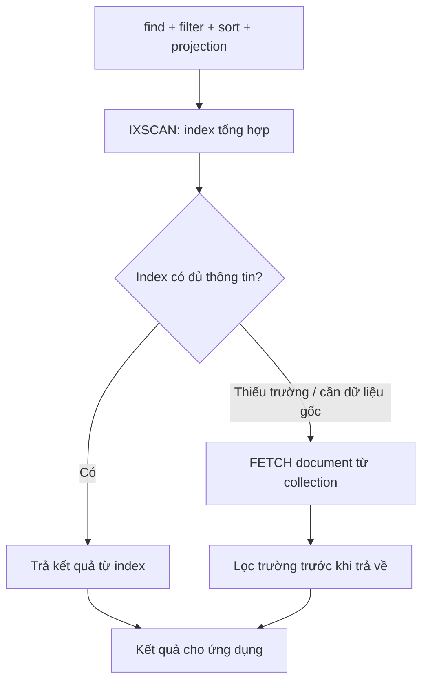

# Truy vấn được chỉ mục bao phủ (covered query) và giới hạn trường trả về

## 1. Vì sao chủ đề này quan trọng?

Trong ứng dụng dùng **Spring Data MongoDB**, một yêu cầu phổ biến là lấy danh sách tóm tắt từ collection có nhiều trường: đơn hàng, giao dịch, hồ sơ hoặc bản ghi audit. Nếu ứng dụng chỉ cần mã đơn, trạng thái, ngày tạo và số tiền, việc đọc toàn bộ document — bao gồm ghi chú dài, địa chỉ giao hàng và các mảng chi tiết — có thể gây tốn tài nguyên.

Có hai kỹ thuật liên quan nhưng khác nhau:

1. **Giới hạn trường trả về (field projection):** chỉ yêu cầu MongoDB trả về các trường mà màn hình hoặc API cần; thường giảm lượng dữ liệu gửi qua mạng và chi phí ánh xạ đối tượng.
2. **Truy vấn được chỉ mục bao phủ (covered query):** MongoDB có thể xử lý điều kiện lọc và lấy toàn bộ trường cần trả về **ngay từ một index**, không cần lấy document gốc từ collection.

Projection tốt **không tự động** tạo ra covered query. Một truy vấn vẫn có thể phải đọc document rồi mới loại các trường không cần thiết. Mục tiêu tối ưu là thiết kế bộ lọc, phép sắp xếp, projection và index như một chỉnh thể, đồng thời xác minh kế hoạch thực thi.

Sau bài này, bạn có thể:

- Xác định điều kiện để truy vấn được index bao phủ và các trường hợp mất coverage.
- Tạo compound index tương ứng với bộ lọc, sắp xếp và trường trả về.
- Viết projection với `MongoTemplate` hoặc `@Query(fields = ...)` của Spring Data MongoDB.
- Dùng `explain("executionStats")` để kiểm tra số document được đọc thực tế.
- Đánh giá đổi chác giữa index rộng, hiệu năng đọc và chi phí ghi.

## 2. Mô hình dữ liệu để theo dõi ví dụ

Giả sử hệ thống lưu đơn hàng ở collection `orders`. API danh sách đơn hàng đã thanh toán của một khách thuê (tenant) chỉ cần `tenantId`, `status`, `createdAt` và `amountMinor`, nhưng document thực tế có nhiều thông tin khác.

```javascript
db.orders.insertMany([
  {
    tenantId: "tenant-a",
    status: "PAID",
    createdAt: ISODate("2026-11-18T09:30:00Z"),
    amountMinor: NumberLong("125000"),
    customer: { name: "Khách hàng A", email: "a@example.test" },
    shippingAddress: { city: "Đà Nẵng", detail: "Thông tin dài" },
    items: [
      { sku: "BOOK-01", quantity: 2, priceMinor: 62500 }
    ],
    internalNote: "Ghi chú chỉ dùng trong hệ thống"
  },
  {
    tenantId: "tenant-a",
    status: "PAID",
    createdAt: ISODate("2026-11-19T13:00:00Z"),
    amountMinor: NumberLong("210000"),
    customer: { name: "Khách hàng B" },
    items: [{ sku: "BOOK-02", quantity: 1, priceMinor: 210000 }]
  },
  {
    tenantId: "tenant-b",
    status: "PAID",
    createdAt: ISODate("2026-11-19T14:00:00Z"),
    amountMinor: NumberLong("89000")
  }
]);
```

`amountMinor` biểu diễn số tiền ở đơn vị nhỏ nhất dưới dạng số nguyên (ở ví dụ này là VND). Dùng kiểu số và quy tắc tiền tệ nhất quán sẽ tránh nhầm lẫn với cách lưu số thực. Các document có trường không đồng nhất chỉ nhằm minh họa MongoDB hỗ trợ dữ liệu linh hoạt; hệ thống thực tế nên có quy ước schema.

Yêu cầu nghiệp vụ:

> Liệt kê tối đa 20 đơn `PAID` của `tenant-a`, sắp xếp `createdAt` mới nhất trước; chỉ trả về bốn trường của thẻ tóm tắt.

### Truy vấn có projection

```javascript
db.orders
  .find(
    { tenantId: "tenant-a", status: "PAID" },
    {
      tenantId: 1,
      status: 1,
      createdAt: 1,
      amountMinor: 1,
      _id: 0
    }
  )
  .sort({ createdAt: -1 })
  .limit(20);
```

Đối số thứ hai của `find()` là **projection document**. Giá trị `1` yêu cầu trả về trường; `0` yêu cầu loại trường. MongoDB thường tự trả về `_id`, vì vậy cần ghi `_id: 0` nếu kết quả không cần ID. Có thể loại `_id` khi đang include các trường khác; không nên tùy tiện trộn include và exclude cho các trường thông thường trong cùng projection.

Projection trên giúp API chỉ nhận dữ liệu cần thiết. Tuy nhiên, để loại luôn bước đọc document, index phải đáp ứng các điều kiện về coverage.

## 3. Covered query là gì?

**Covered query** là truy vấn có thể được đáp ứng bằng dữ liệu trong một index: MongoDB không cần bước **FETCH** document gốc để kiểm tra thêm điều kiện hoặc lấy thêm trường cho kết quả.

Trong ví dụ này, một compound index phù hợp là:

```javascript
db.orders.createIndex(
  {
    tenantId: 1,
    status: 1,
    createdAt: -1,
    amountMinor: 1
  },
  { name: "idx_orders_tenant_status_date_amount" }
);
```

Giải thích từng thành phần:

| Thành phần | Vai trò trong ví dụ |
| --- | --- |
| `tenantId: 1` | Điều kiện bằng nhau, đồng thời giới hạn dữ liệu theo tenant |
| `status: 1` | Điều kiện bằng nhau |
| `createdAt: -1` | Hỗ trợ thứ tự giảm dần sau các điều kiện bằng nhau |
| `amountMinor: 1` | Có giá trị ngay trong index để trả về, dù không cần dùng nó để lọc |

Tất cả trường dùng trong bộ lọc (`tenantId`, `status`), thứ tự mong muốn (`createdAt`) và projection (`tenantId`, `status`, `createdAt`, `amountMinor`) đều xuất hiện trong index. Trường `_id` đã bị loại khỏi kết quả, nên truy vấn mẫu có cơ hội được bao phủ mà không cần thêm `_id` vào index.



### Các điều kiện cơ bản

Để một truy vấn thông thường được xem là covered, cần xét:

1. **Mọi trường dùng để lọc** có thể được xử lý từ index đang dùng.
2. **Mọi trường thực sự được trả về** đều có dữ liệu trong **cùng index** đó.
3. Truy vấn không yêu cầu đọc document để phân biệt giá trị đặc biệt, chẳng hạn điều kiện bằng `null`.
4. Các đặc tính như index đa khóa (multikey), collation, điều kiện truy vấn và kiểu projection không buộc engine phải truy cập document.
5. MongoDB thực sự chọn execution plan có thể tận dụng coverage; chỉ nhìn tên index chưa đủ để khẳng định.

Nếu phép sort cũng được hỗ trợ bởi thứ tự của index, truy vấn có thể tránh thêm bước `SORT` tốn bộ nhớ. Truy vấn có index bao phủ và truy vấn không phải sort trong bộ nhớ là hai thuộc tính cần kiểm tra riêng.

### Dùng index chưa có nghĩa là đã được bao phủ

Ví dụ dưới đây vẫn có thể tận dụng compound index để lọc nhưng cần thêm `customer.name`:

```javascript
db.orders.find(
  { tenantId: "tenant-a", status: "PAID" },
  {
    createdAt: 1,
    amountMinor: 1,
    "customer.name": 1,
    _id: 0
  }
);
```

Vì index mẫu không có `customer.name`, MongoDB phải lấy document gốc để tạo kết quả cho trường đó. Bước này có thể làm tăng số document được đọc và lượng I/O, đặc biệt với document lớn.

## 4. Đọc `explain()` để chứng minh coverage

Điểm kiểm tra quan trọng nhất là **thống kê thực thi**, không phải suy đoán từ đoạn code.

```javascript
db.orders
  .find(
    { tenantId: "tenant-a", status: "PAID" },
    {
      tenantId: 1,
      status: 1,
      createdAt: 1,
      amountMinor: 1,
      _id: 0
    }
  )
  .sort({ createdAt: -1 })
  .limit(20)
  .explain("executionStats");
```

Các phần cần đọc trong output:

| Thuộc tính / dấu hiệu | Diễn giải |
| --- | --- |
| `queryPlanner.winningPlan` | Plan thắng cuộc; cấu trúc có thể khác nhau giữa phiên bản MongoDB và execution engine |
| `IXSCAN` | Đang quét index; chưa đủ để khẳng định coverage |
| `FETCH` | Có bước lấy document gốc trong plan tương ứng |
| `PROJECTION_COVERED` | Một dấu hiệu coverage ở một số dạng execution plan |
| `executionStats.totalKeysExamined` | Số entry index đã kiểm tra |
| `executionStats.totalDocsExamined` | Số document đã được kiểm tra; **0** là dấu hiệu quyết định của covered query trong phép đo này |
| `executionStats.nReturned` | Số bản ghi kết quả được trả về |
| `SORT` | Có bước sắp xếp riêng; cần xem nó có thể tránh được bằng thứ tự index hay không |

Với ví dụ có index và dữ liệu phù hợp, kỳ vọng `totalDocsExamined: 0`. `totalKeysExamined` có thể lớn hơn `nReturned` do cách thực thi và chọn phạm vi quét. Không cần giả định hai giá trị này luôn bằng nhau.

Một đoạn output rút gọn **mang tính minh họa** có thể có dạng:

```javascript
{
  executionStats: {
    nReturned: 2,
    totalKeysExamined: 2,
    totalDocsExamined: 0
  }
}
```

Đây không phải kết quả chạy trực tiếp trên một máy MongoDB cụ thể. Khi sử dụng thật, hãy đọc số liệu từ chính `explain()` của database đang kiểm tra; tên stage và cách lồng plan thay đổi theo phiên bản.

### Thử thay đổi một trường để thấy mất coverage

Giữ nguyên bộ lọc, sort và index, nhưng thêm `internalNote` vào projection:

```javascript
db.orders
  .find(
    { tenantId: "tenant-a", status: "PAID" },
    { createdAt: 1, amountMinor: 1, internalNote: 1, _id: 0 }
  )
  .sort({ createdAt: -1 })
  .limit(20)
  .explain("executionStats");
```

`internalNote` không nằm trong index, vì vậy plan phải lấy document để trả về trường này. `totalDocsExamined` thường tăng lên ở những document thực sự được truy xuất. Index vẫn có thể giúp tìm đúng đơn hàng nhanh; chỉ có thuộc tính **covered** không còn.

Nếu muốn so sánh đường truy vấn với các index khác, có thể thử `hint()` trong **môi trường thử nghiệm**:

```javascript
db.orders
  .find(
    { tenantId: "tenant-a", status: "PAID" },
    { createdAt: 1, amountMinor: 1, _id: 0 }
  )
  .sort({ createdAt: -1 })
  .hint("idx_orders_tenant_status_date_amount")
  .explain("executionStats");
```

`hint()` ép optimizer xem xét index được chỉ định và hữu ích cho việc đo thử. Không nên cố định `hint` trên production chỉ vì một lần đo: phân bố dữ liệu, kích thước collection và đặc điểm truy vấn có thể thay đổi.

## 5. Projection với Spring Data MongoDB: `MongoTemplate`

Trong ứng dụng Java sử dụng `MongoTemplate`, đối tượng `Query` kết hợp `Criteria` để lọc, `Sort` để sắp xếp và `Field` để khai báo projection. Ví dụ chỉ lấy dữ liệu cho màn hình danh sách:

```java
import java.util.List;

import org.bson.Document;
import org.springframework.data.domain.Sort;
import org.springframework.data.mongodb.core.MongoTemplate;
import org.springframework.data.mongodb.core.query.Criteria;
import org.springframework.data.mongodb.core.query.Query;
import org.springframework.stereotype.Service;

@Service
public class OrderSummaryReader {

    private final MongoTemplate mongoTemplate;

    public OrderSummaryReader(MongoTemplate mongoTemplate) {
        this.mongoTemplate = mongoTemplate;
    }

    public List<Document> findPaidOrderSummaries(String tenantId) {
        if (tenantId == null || tenantId.isBlank()) {
            throw new IllegalArgumentException("tenantId must not be blank");
        }

        Query query = Query.query(
                Criteria.where("tenantId").is(tenantId)
                        .and("status").is("PAID")
        );

        query.fields()
                .include("tenantId")
                .include("status")
                .include("createdAt")
                .include("amountMinor")
                .exclude("_id");

        query.with(Sort.by(Sort.Direction.DESC, "createdAt"));
        query.limit(20);

        return mongoTemplate.find(query, Document.class, "orders");
    }
}
```

Ý nghĩa từng phần:

- `Criteria.where("tenantId").is(tenantId)` và `and("status").is("PAID")` tương ứng với filter MongoDB.
- `query.fields().include(...)` khai báo các trường cần thiết; `exclude("_id")` loại ID mặc định.
- `query.with(Sort...)` và `query.limit(20)` tránh trả về danh sách quá lớn, đồng thời dùng thứ tự nhất quán với index mẫu.
- `MongoTemplate.find(query, Document.class, "orders")` trả về các BSON document đã được chiếu, thuận tiện để thấy đúng những trường nhận được. Trong ứng dụng thật, thường nên chuyển chúng sang DTO phù hợp với API.

Projection được truyền xuống MongoDB khi truy vấn được thực thi; đây không chỉ là việc gọi getter ở Java rồi bỏ trường sau khi đã tải document về ứng dụng.

### Có thể tạo index từ Spring Data

Index tương ứng có thể được định nghĩa bằng `Index` và `IndexOperations`:

```java
import org.springframework.data.domain.Sort;
import org.springframework.data.mongodb.core.MongoTemplate;
import org.springframework.data.mongodb.core.index.Index;

Index index = new Index()
        .on("tenantId", Sort.Direction.ASC)
        .on("status", Sort.Direction.ASC)
        .on("createdAt", Sort.Direction.DESC)
        .on("amountMinor", Sort.Direction.ASC)
        .named("idx_orders_tenant_status_date_amount");

mongoTemplate.indexOps("orders").ensureIndex(index);
```

Đoạn mã dùng cùng bean `mongoTemplate` đã cấu hình. Trong dự án thực tế, hãy chạy việc tạo index theo cơ chế quản lý schema/triển khai có kiểm soát; trên collection lớn, xây index tốn thời gian và tài nguyên. Nếu index đã tồn tại với cùng key pattern và options, không nên tạo trùng.

**Vì sao `amountMinor` nằm cuối index?** Nó chỉ cần được trả về, không tham gia điều kiện bằng nhau hay sắp xếp của truy vấn mẫu. Đặt sau các trường lọc và sort thường hợp lý cho truy vấn này; tuy nhiên thứ tự tối ưu phải được kiểm tra trên workload thực, nhất là khi có thêm các loại truy vấn khác.

## 6. Projection với Spring Data Repository

Với `MongoRepository`, bạn có thể khai báo bộ lọc và trường trả về bằng `@Query`, sau đó cho phép truyền `Sort` vào phương thức:

```java
import java.time.Instant;
import java.util.List;

import org.bson.types.ObjectId;
import org.springframework.data.domain.Sort;
import org.springframework.data.mongodb.repository.MongoRepository;
import org.springframework.data.mongodb.repository.Query;

interface OrderCardView {
    String getTenantId();
    String getStatus();
    Instant getCreatedAt();
    Long getAmountMinor();
}

public interface OrderRepository extends MongoRepository<Order, ObjectId> {

    @Query(
        value = "{ 'tenantId': ?0, 'status': ?1 }",
        fields = "{ 'tenantId': 1, 'status': 1, " +
                 "'createdAt': 1, 'amountMinor': 1, '_id': 0 }"
    )
    List<OrderCardView> findCards(
            String tenantId, String status, Sort sort);
}
```

`Order` là entity được ánh xạ với collection `orders` (ví dụ bằng `@Document(collection = "orders")` và trường `@Id ObjectId id`). `OrderCardView` là closed interface projection chỉ công bố các getter cần thiết; trên thực tế, có thể đặt các interface vào các file Java riêng theo quy ước của dự án.

Cách gọi:

```java
Sort newestFirst = Sort.by(Sort.Direction.DESC, "createdAt");

List<OrderCardView> cards = orderRepository.findCards(
        authenticatedTenantId,
        "PAID",
        newestFirst
);
```

Phương thức trên thể hiện cách giới hạn **trường**. Để giới hạn **số kết quả** cho endpoint production, hãy thêm phân trang `Pageable` hoặc thiết kế truy vấn có limit phù hợp. Khi chuyển từ `Sort` sang `Pageable`, đảm bảo backend thực thi limit mong muốn; không nên đọc toàn bộ rồi mới cắt danh sách trong Java.

Một hình thức khác trả về entity là:

```java
@Query(
    value = "{ 'tenantId': ?0, 'status': ?1 }",
    fields = "{ 'createdAt': 1, 'amountMinor': 1, '_id': 0 }"
)
List<Order> findPartialOrders(String tenantId, String status);
```

**Thận trọng:** entity được dựng từ projection có thể thiếu `id` và các trường còn lại; chúng có thể nhận giá trị `null` hoặc mặc định. Đừng dùng entity chỉ được nạp một phần để cập nhật/`save()` như thể nó là document đầy đủ. DTO hoặc projection interface rõ ràng phù hợp hơn cho các API chỉ đọc.

### Projection với trường lồng nhau

Có thể giới hạn trường nằm trong subdocument:

```java
query.fields().include("customer.name").exclude("_id");
```

MongoDB chỉ trả về phần cần thiết trong nhánh `customer`. Tuy nhiên, nếu index không chứa `customer.name` thì truy vấn không còn covered. Thêm một trường vào projection có thể thay đổi đáng kể lượng document được đọc dù số kết quả giữ nguyên.

## 7. Những nguyên nhân thường làm mất covered query

### 7.1. Quên loại `_id`

Projection chỉ include `createdAt` và `amountMinor`:

```javascript
db.orders.find(
  { tenantId: "tenant-a", status: "PAID" },
  { createdAt: 1, amountMinor: 1 }
);
```

MongoDB vẫn trả về `_id`. Trong index mẫu, `_id` **không được liệt kê** như một trường khóa index để trả ra kết quả, nên truy vấn này thường phải `FETCH` document. Có hai lựa chọn:

- Không cần ID: thêm `_id: 0` vào projection.
- Thật sự cần ID: cân nhắc index có chứa `_id` và kiểm tra lại coverage, ví dụ `{ tenantId: 1, status: 1, createdAt: -1, amountMinor: 1, _id: 1 }`. Đây là một index lớn hơn, chỉ nên bổ sung nếu lợi ích đọc đáng giá chi phí lưu trữ/ghi.

### 7.2. Điều kiện khớp `null` hoặc trường thiếu

Ví dụ:

```javascript
db.orders.find(
  { tenantId: "tenant-a", status: null },
  { tenantId: 1, status: 1, _id: 0 }
);
```

Trong MongoDB, điều kiện dạng `{ status: null }` có thể khớp cả giá trị `null` lẫn trường không tồn tại. Điều này khiến MongoDB cần xem thêm document để phân biệt trường hợp, nên không đáp ứng điều kiện covered query điển hình. Nếu nghiệp vụ yêu cầu phân biệt thiếu trường với `null`, cần biểu diễn điều kiện rõ ràng và kiểm tra `explain()`.

### 7.3. Trường mảng và multikey index

Index trên trường mảng trở thành **multikey index**. MongoDB có một số khả năng coverage với multikey index nhưng có giới hạn quan trọng: truy vấn không được yêu cầu trả về chính trường mảng, không dùng `$elemMatch` trong những trường hợp đòi truy cập document và vẫn phải thỏa mãn các điều kiện covered khác.

Vì vậy, không nên thêm `items` — mảng chi tiết hàng hóa có thể rất lớn — vào projection và kỳ vọng index luôn có thể bao phủ. Việc đưa mọi trường vào một compound index cũng không giải quyết được mọi trường hợp: index có giới hạn số lượng, kích thước và quy tắc đối với trường mảng.

### 7.4. Projection chứa trường không có trong index

Đây là lỗi dễ gặp nhất. Index dùng để chọn bản ghi vẫn tốt, nhưng chỉ cần thêm một trường không nằm trong index (chẳng hạn `shippingAddress.detail`) là MongoDB có thể phải fetch document.

Đừng mặc định sửa bằng cách cho tất cả trường vào index. Hãy cân nhắc tần suất dùng endpoint, kích thước trường, độ dài index và số lần ghi.

### 7.5. Sort không khớp thứ tự index

Index `{ tenantId: 1, status: 1, createdAt: -1, amountMinor: 1 }` hỗ trợ tốt yêu cầu đã nêu: lọc bằng nhau theo hai trường đầu, sau đó sắp xếp `createdAt` giảm dần.

Nhưng nếu thay bằng `sort({ amountMinor: -1 })`, index này thường không hỗ trợ tối ưu thứ tự đó vì `createdAt` đứng trước `amountMinor` mà chưa bị ràng buộc bằng điều kiện bằng nhau. MongoDB có thể phải thực hiện `SORT`. Sort không phù hợp còn có thể khiến optimizer chọn plan khác; phải xem `explain()` thay vì suy từ việc “đã có compound index”.

### 7.6. Index và truy vấn dùng collation khác nhau

Với các trường chuỗi cần so sánh theo ngôn ngữ hoặc không phân biệt chữ hoa/chữ thường, collation ảnh hưởng khả năng sử dụng index. Khi query có collation không tương thích với index, optimizer có thể không sử dụng index như kỳ vọng. Hãy định nghĩa collation phù hợp cho workload, đồng thời xác minh kế hoạch thực thi bằng dữ liệu thật.

## 8. Covered query có phải luôn là lựa chọn nhanh nhất?

Không. Đôi khi index rộng giúp giảm `FETCH` nhưng tổng chi phí hệ thống tăng vì:

- **Dung lượng index:** mỗi trường bổ sung làm tăng dung lượng index và dữ liệu cần giữ trong cache.
- **Chi phí ghi:** thêm/sửa/xóa document phải duy trì các index liên quan; số index quá nhiều làm giảm thông lượng ghi.
- **Khả năng chọn lọc:** truy vấn có độ chọn lọc thấp có thể quét nhiều entry index; `totalDocsExamined = 0` không đồng nghĩa `totalKeysExamined` nhỏ.
- **Tần suất endpoint:** một API hiếm khi được gọi có thể không xứng đáng với một index riêng chỉ để cover.
- **Độ rộng trường:** trường chuỗi dài, trường hiếm khi dùng hoặc dữ liệu đa dạng có thể khiến index quá lớn.

Bảng so sánh:

| Giải pháp | Giảm dữ liệu truyền mạng? | Có thể tránh FETCH? | Đánh đổi |
| --- | --- | --- | --- |
| `find()` trả toàn document | Không | Thường không | Mã đơn giản nhưng dễ tải dư dữ liệu |
| `find()` có projection | Có | Tùy index | Cải thiện payload, có thể vẫn đọc document |
| Projection + covered compound index | Có | Có, nếu plan đạt coverage | Tăng dung lượng và chi phí duy trì index |
| Index hỗ trợ filter/sort nhưng chưa cover | Có thể, khi kèm projection | Không | Có thể là cân bằng tốt nếu không muốn index quá rộng |

Các chỉ số nên đo trước và sau tối ưu gồm: `nReturned`, `totalKeysExamined`, `totalDocsExamined`, thời gian ở các percentiles (ví dụ p95), kích thước payload, CPU/I/O, dung lượng index và tốc độ ghi. `executionTimeMillis` của một lần `explain` chỉ là dữ liệu tham khảo; nó thay đổi theo cache, tải máy, dữ liệu và đặc điểm chạy thử.

### Quy trình quyết định thực tế

1. Chọn một endpoint đọc nhiều hoặc đang chậm; xác định chính xác trường cần lọc, sort và trả về.
2. Thu gọn projection trước, đặc biệt khi document chứa mảng hoặc trường lớn.
3. Đo `explain("executionStats")` trên dữ liệu đại diện; ghi lại index đã chọn, `totalKeysExamined` và `totalDocsExamined`.
4. Cân nhắc compound index phục vụ điều kiện bằng nhau, thứ tự sort và các trường output quan trọng; thử trên môi trường an toàn.
5. So sánh lợi ích đọc với bộ nhớ index và tải ghi, rồi chỉ triển khai nếu kết quả phù hợp.
6. Theo dõi query plan và latency sau khi dữ liệu phát triển hoặc khi yêu cầu API thay đổi.

## 9. An toàn dữ liệu và phân trang

**Projection không phải cơ chế phân quyền.** Một truy vấn chỉ trả tên và số tiền vẫn có thể rò rỉ thông tin của tenant khác nếu filter thiếu điều kiện người dùng được phép truy cập. `tenantId` cần được lấy từ thông tin đăng nhập/ngữ cảnh cấp quyền đã xác thực, không được tin nguyên một giá trị do client tự gửi.

Hơn nữa, projection giúp loại thông tin nhạy cảm không cần thiết khỏi response nhưng không thay thế việc kiểm soát quyền ở API, repository và tầng dịch vụ.

Với phân trang, nên áp dụng limit và một thứ tự ổn định. Nếu nhiều document trùng `createdAt`, thứ tự chỉ theo thời gian có thể không đủ ổn định để phân trang bằng cursor. Có thể thêm `_id` làm khóa phụ (tie-breaker), nhưng lúc này index và projection phải được đánh giá lại; nếu cần trả `_id`, hãy đưa nó vào thiết kế index và đo coverage thực tế. `skip` rất lớn có thể làm MongoDB phải bỏ qua nhiều entry, do đó cursor/keyset pagination thường phù hợp hơn cho danh sách sâu.

## 10. Thực hành có đáp án gợi ý

### Bài tập 1: Tìm nguyên nhân mất coverage

Một truy vấn:

```javascript
db.orders.find(
  { tenantId: "tenant-a", status: "PAID" },
  { createdAt: 1, amountMinor: 1 }
).sort({ createdAt: -1 });
```

Với index `{ tenantId: 1, status: 1, createdAt: -1, amountMinor: 1 }`, liệu truy vấn này có được bao phủ không?

**Gợi ý trả lời:** chưa chắc; projection không loại `_id` nên MongoDB mặc định trả ID, trong khi index trên không bao gồm `_id`. Hãy thử bổ sung `_id: 0` và so sánh `explain()` của hai phiên bản.

### Bài tập 2: Viết Spring Data Query

Viết phương thức với `MongoTemplate` liệt kê tối đa 10 đơn `PAID` của một tenant, sắp xếp `createdAt` giảm dần, trả về `createdAt` và `amountMinor`, không trả ID.

**Đáp án tham khảo:**

```java
Query query = Query.query(
        Criteria.where("tenantId").is(authenticatedTenantId)
                .and("status").is("PAID")
);
query.fields()
        .include("createdAt")
        .include("amountMinor")
        .exclude("_id");
query.with(Sort.by(Sort.Direction.DESC, "createdAt"));
query.limit(10);

List<Document> cards = mongoTemplate.find(
        query, Document.class, "orders"
);
```

Kiểm tra rằng index chứa các trường filter, sort và trường output. Không nhất thiết phải trả `tenantId` hoặc `status` trong projection mới được index bao phủ; điều quan trọng là **chúng nằm trong index để xử lý điều kiện lọc**.

### Bài tập 3: Đo thay đổi trước/sau

Trên collection thử nghiệm có số bản ghi đủ lớn:

1. Chạy `explain("executionStats")` với projection chỉ gồm `createdAt`, `amountMinor` và `_id: 0`.
2. Chạy lại sau khi thêm `customer.name` vào projection.
3. So sánh `totalDocsExamined`, `totalKeysExamined`, `nReturned` và stage `FETCH`.
4. Nhận xét liệu việc thêm `customer.name` vào index có hợp lý với tỷ lệ truy cập API và chi phí ghi hiện tại hay không.

Kỳ vọng: phiên bản đầu có thể đạt `totalDocsExamined = 0` khi optimizer chọn index phù hợp. Phiên bản thứ hai thường cần fetch document vì thiếu trường trong index. Cần kiểm tra số liệu thực tế thay vì giả định.

## 11. Câu hỏi thường gặp

**Projection làm giảm số document được đọc phải không?** Không nhất thiết. Projection thường giảm kích thước kết quả trả về. Số document MongoDB phải đọc còn phụ thuộc vào index và execution plan; kiểm tra `totalDocsExamined` để biết.

**Một index bao phủ được mọi truy vấn dùng collection đó không?** Không. Coverage được đánh giá theo **một truy vấn cụ thể**, bao gồm filter, sort và projection. Thêm một trường cần trả về cũng có thể phá coverage.

**Có nên thêm tất cả trường vào compound index để đạt coverage?** Không. Index quá rộng chiếm thêm dung lượng, làm tăng chi phí ghi và có thể không đáp ứng giới hạn/trường mảng. Chỉ thêm trường khi có lợi ích đo được.

**`_id` có tự động được lấy từ bất kỳ secondary index nào không?** Không thể mặc định coi `_id` là trường output của một compound index không khai báo `_id`. Nếu cần trả ID, đưa `_id` vào index thích hợp hoặc chấp nhận bước đọc document và đo hiệu năng.

**`totalDocsExamined = 0` có chắc là truy vấn nhanh không?** Chưa chắc. Truy vấn có thể vẫn quét quá nhiều index key, sort hoặc trả quá nhiều dòng. Phải xem toàn bộ thống kê và độ trễ thực tế.

**Covered query có thể dùng với nested field không?** Có thể nếu các field path cần lọc/trả về được index lưu đủ thông tin và thỏa các giới hạn liên quan. Các trường mảng và phép toán như `$elemMatch` cần được kiểm tra riêng.

## Tài liệu tham khảo

- [MongoDB Manual — Covered Queries](https://www.mongodb.com/docs/manual/core/query-optimization/#covered-queries)
- [MongoDB Manual — Query Plans](https://www.mongodb.com/docs/manual/core/query-plans/)
- [MongoDB Manual — Explain Results](https://www.mongodb.com/docs/manual/reference/explain-results/)
- [MongoDB Manual — Multikey Indexes](https://www.mongodb.com/docs/manual/core/indexes/index-types/index-multikey/)
- [Spring Data MongoDB — Template Query Operations](https://docs.spring.io/spring-data/mongodb/reference/mongodb/template-query-operations.html)
- [Spring Data MongoDB — Query Methods](https://docs.spring.io/spring-data/mongodb/reference/mongodb/repositories/query-methods.html)
- [Spring Data MongoDB — Index Creation](https://docs.spring.io/spring-data/mongodb/reference/mongodb/mapping/mapping-index-management.html)
