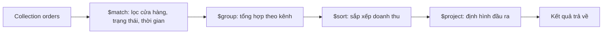

# Đặt `$match` và `$project` hợp lý trong aggregation pipeline

## Mục tiêu

Trong chương **Hiệu năng** của **SPRING_DATA_MONGODB**, chúng ta tối ưu pipeline aggregation khi sử dụng **Spring Data MongoDB** để ánh xạ document, truy vấn bằng `MongoTemplate` hoặc repository, làm báo cáo tổng hợp và chẩn đoán hiệu năng. Hai stage dễ gặp là `$match` (lọc document) và `$project` (chọn, đổi tên hoặc tính trường đầu ra). Đặt chúng sai vị trí có thể khiến pipeline đọc nhiều dữ liệu hơn cần thiết, không tận dụng được index, hoặc thậm chí **trả kết quả sai**.

Sau bài này, bạn có thể:

- Phân biệt vai trò của `$match` và `$project`, nhất là các trường được tạo/loại bỏ tại từng stage.
- Đặt `$match` sớm khi điều kiện lọc dựa trên field gốc, để giảm tài liệu phải xử lý và tạo cơ hội sử dụng index.
- Đặt `$project` muộn để định hình dữ liệu trả về; hiểu vì sao đặt `$project` ở đầu **không mặc nhiên** làm pipeline nhanh hơn.
- Nhận biết trường hợp phải giữ `$match` sau `$group`, `$set`/`$addFields`, `$unwind` hoặc `$lookup`.
- Viết pipeline bằng `mongosh` và `MongoTemplate`, dùng `explain("executionStats")` và đo thực tế để đánh giá thay đổi.

## 1. Pipeline hoạt động như thế nào?

Aggregation là chuỗi xử lý nối tiếp: mỗi stage nhận các document từ stage trước và đưa kết quả cho stage sau. Một pipeline báo cáo doanh thu có dạng:



| Stage | Chức năng | Tác động quan trọng đến hiệu năng |
| --- | --- | --- |
| `$match` | Giữ các document thỏa điều kiện; thường dùng cú pháp như `find()` | Giảm số document đầu vào, có thể sử dụng index khi ở đầu pipeline hoặc được optimizer đưa lên đầu |
| `$project` | Chọn, bỏ, đổi tên hoặc tính field | Quyết định schema đầu ra; giảm dữ liệu truyền về ứng dụng khi chỉ lấy trường cần thiết |
| `$group` | Gom nhóm, `$sum`, `$avg`, `$count`... | Có thể tốn bộ nhớ và CPU khi đầu vào lớn |
| `$sort` | Sắp xếp document | Có thể dùng index trong điều kiện phù hợp; nếu không sẽ phải sắp xếp trung gian |
| `$unwind` | Tách phần tử mảng thành nhiều document | Có thể làm tăng số document trong pipeline |
| `$lookup` | Kết hợp collection khác | Tốn công nếu phải xử lý nhiều document hoặc foreign collection chưa có index phù hợp |

**Quy tắc nền tảng:**

1. Lọc **càng sớm càng hợp lý** trên field đã tồn tại và còn giữ nguyên ý nghĩa.
2. Chỉ tính toán, join hoặc group trên tập dữ liệu thật sự cần thiết.
3. Đưa `$project` về **gần cuối** để quy định chính xác dữ liệu trả về.
4. **Không đánh đổi tính đúng đắn để đổi thứ tự stage.** Một field chưa tồn tại thì không thể lọc theo field đó; một field đã bị loại khỏi `$project` thì các stage tiếp theo không thể sử dụng nó như trước.

MongoDB có một bước **tối ưu hóa pipeline**: máy chủ có thể chia nhỏ `$match`, đẩy các bộ lọc không phụ thuộc vào kết quả tính toán lên trước `$project`/`$set`, hoặc gộp một số stage. Do đó, **thứ tự stage bạn viết không phải lúc nào cũng là thứ tự được thực thi**. Khả năng tối ưu thay đổi theo phiên bản MongoDB; cần xem `explain()` trên phiên bản đang chạy.

## 2. Tình huống thực tế: báo cáo đơn đã thanh toán

Giả sử collection `orders` lưu nhiều triệu đơn hàng. Mỗi đơn có thông tin cửa hàng, kênh bán hàng, trạng thái, thời gian, số tiền và một mảng `items` có thể lớn.

Ví dụ dữ liệu **giả lập** trên database thử nghiệm:

```javascript
db.orders.insertMany([
  {
    _id: "o1", storeId: "store-a", channel: "web",
    status: "PAID", createdAt: ISODate("2026-11-02T10:00:00Z"),
    totalMinor: NumberLong(120000),
    items: [{ sku: "P1", qty: 2 }], note: "Giao buổi sáng"
  },
  {
    _id: "o2", storeId: "store-a", channel: "app",
    status: "PAID", createdAt: ISODate("2026-11-03T09:00:00Z"),
    totalMinor: NumberLong(80000),
    items: [{ sku: "P2", qty: 1 }]
  },
  {
    _id: "o3", storeId: "store-a", channel: "web",
    status: "REFUNDED", createdAt: ISODate("2026-11-04T08:00:00Z"),
    totalMinor: NumberLong(50000)
  },
  {
    _id: "o4", storeId: "store-b", channel: "web",
    status: "PAID", createdAt: ISODate("2026-11-05T08:00:00Z"),
    totalMinor: NumberLong(90000)
  },
  {
    _id: "o5", storeId: "store-a", channel: "web",
    status: "PAID", createdAt: ISODate("2026-11-20T08:00:00Z"),
    totalMinor: NumberLong(40000)
  },
  {
    _id: "o6", storeId: "store-a", channel: "web",
    status: "PAID", createdAt: ISODate("2026-11-06T08:00:00Z"),
    totalMinor: NumberLong(45000)
  }
]);
```

Ở đây `totalMinor` là **số nguyên biểu diễn đơn vị tiền nhỏ nhất** trong ví dụ (để tránh sai số số thực), không phải công thức tính doanh thu áp dụng cho mọi hệ thống. Báo cáo cần tổng số tiền đơn `PAID` của `store-a` từ đầu ngày 01/11/2026 đến trước ngày 15/11/2026 (UTC), nhóm theo `channel`.

### Pipeline khuyến nghị: `$match → $group → $sort → $project`

```javascript
const pipeline = [
  {
    $match: {
      storeId: "store-a",
      status: "PAID",
      createdAt: {
        $gte: ISODate("2026-11-01T00:00:00Z"),
        $lt: ISODate("2026-11-15T00:00:00Z")
      }
    }
  },
  {
    $group: {
      _id: "$channel",
      orderCount: { $sum: 1 },
      revenueMinor: { $sum: "$totalMinor" }
    }
  },
  { $sort: { revenueMinor: -1 } },
  {
    $project: {
      _id: 0,
      channel: "$_id",
      orderCount: 1,
      revenueMinor: 1
    }
  }
];

db.orders.aggregate(pipeline);
```

Kết quả mong đợi từ bộ dữ liệu trên, không phụ thuộc vào trường `items` hay `note`:

```javascript
[
  { channel: "web", orderCount: 2, revenueMinor: NumberLong(165000) },
  { channel: "app", orderCount: 1, revenueMinor: NumberLong(80000) }
]
```

Tại sao cách sắp xếp này hợp lý?

- **`$match` trước `$group`**: chỉ các đơn đúng cửa hàng, trạng thái và thời gian mới tham gia tính tổng; 3 trên 6 document ví dụ được giữ lại.
- **`$group` trước `$sort`**: cần sắp xếp các nhóm kênh theo **tổng doanh thu**, một field chỉ sinh ra sau khi group.
- **`$project` cuối**: đổi `_id` của nhóm thành `channel`, bỏ `_id` và trả về đúng hai chỉ số nghiệp vụ.
- Index phù hợp có thể làm giai đoạn đọc document ban đầu rẻ hơn; `$project` không thay thế được `$match` hay index.

### Pipeline có lỗi logic vì `$project` quá sớm

```javascript
db.orders.aggregate([
  { $project: { channel: 1, totalMinor: 1 } },
  {
    $match: {
      status: "PAID",
      createdAt: { $gte: ISODate("2026-11-01T00:00:00Z") }
    }
  },
  { $group: { _id: "$channel", revenueMinor: { $sum: "$totalMinor" } } }
]);
```

Stage đầu **đã bỏ** `status` và `createdAt`. Stage thứ hai lọc trên các field không còn trong document, nên kết quả không còn phản ánh bài toán; với điều kiện này kết quả thường là rỗng. Đây là **sai ngữ nghĩa**, không chỉ là vấn đề tốc độ. Optimizer phải giữ nguyên ngữ nghĩa pipeline, không thể giả định nó sẽ tự đoán ý định của bạn để phục hồi những field đã loại bỏ.

Nếu viết `$project` đầu nhưng **vẫn giữ tất cả field cần thiết**, pipeline có thể đúng; tuy nhiên nó thường không nhanh hơn vì MongoDB đã tự giảm số field cần chuyển qua các stage nội bộ khi có thể. Một `$project` sớm còn làm khó việc đọc luồng dữ liệu và có thể ảnh hưởng cơ hội tận dụng index cho các stage như `$sort`.

## 3. `$match` đúng vị trí: lọc trên dữ liệu sẵn có

`$match` nhận query predicate giống `find()`, ví dụ:

```javascript
{ $match: { status: "PAID", totalMinor: { $gte: 50000 } } }
```

Đặt `$match` ở đầu có thể làm MongoDB dùng index để giới hạn số document đọc từ collection:

```javascript
// Chỉ chạy một lần trong database thử nghiệm.
db.orders.createIndex({ storeId: 1, status: 1, createdAt: 1 });
```

Thứ tự trên minh họa hai điều kiện **bằng nhau** (`storeId`, `status`) rồi đến điều kiện **khoảng** (`createdAt`). Đây là lựa chọn hợp lý cho báo cáo đang xét, nhưng không phải index tốt nhất cho mọi query; cần cân nhắc độ chọn lọc, các filter khác, sort, tốc độ ghi, dung lượng index và kế hoạch thực thi thực tế.

| Tình huống | Vị trí `$match` gợi ý | Lý do |
| --- | --- | --- |
| Lọc theo field gốc `status`, `createdAt`, `storeId` | Đầu pipeline | Lọc sớm; tạo điều kiện cho index và giảm đầu vào của `$group` |
| Lọc theo `revenueMinor` tạo bằng `$group` | Sau `$group` | Field tổng hợp chưa tồn tại trước khi nhóm |
| Lọc theo `netMinor` tính bằng `$set` | Sau nơi tạo `netMinor` về mặt ngữ nghĩa | Điều kiện phụ thuộc field tính toán; optimizer có thể hoán đổi thêm nếu an toàn |
| Lọc một **phần tử cụ thể** sau `$unwind` | Sau `$unwind`, thường kết hợp lọc cha trước đó | Lọc document mẹ và lọc từng phần tử là hai việc khác nhau |
| Lọc thuộc tính của document từ `$lookup` | Khi trường join đã xuất hiện, hoặc trong pipeline lookup phù hợp | Không thể tham chiếu giá trị từ collection khác trước khi join |
| Lọc `$facet` trên dữ liệu đầu vào chung | Trước `$facet` nếu mọi nhánh cùng cần điều kiện | Giảm dữ liệu cho toàn bộ các nhánh và có cơ hội dùng index |

Không có quy tắc máy móc rằng mọi `$match` đều phải nằm ở dòng đầu. Điều quan trọng là **field đã tồn tại tại thời điểm lọc** và **lọc trước/sau stage có làm đổi ý nghĩa không**.

### Hai `$match` khi có điều kiện đầu vào và điều kiện kết quả

Yêu cầu mới: chỉ trả về những kênh có tổng doanh thu ít nhất `100000` đơn vị nhỏ nhất.

```javascript
db.orders.aggregate([
  {
    $match: {
      storeId: "store-a", status: "PAID",
      createdAt: {
        $gte: ISODate("2026-11-01T00:00:00Z"),
        $lt: ISODate("2026-11-15T00:00:00Z")
      }
    }
  },
  {
    $group: {
      _id: "$channel",
      orderCount: { $sum: 1 },
      revenueMinor: { $sum: "$totalMinor" }
    }
  },
  { $match: { revenueMinor: { $gte: 100000 } } },
  { $project: { _id: 0, channel: "$_id", orderCount: 1, revenueMinor: 1 } }
]);
```

Điều kiện đầu lọc **đơn hàng**, điều kiện thứ hai lọc **nhóm đã tính tổng**. Chuyển điều kiện `revenueMinor` lên trước `$group` là không hợp lệ. Trong ví dụ, chỉ kênh `web` được giữ.

## 4. `$project` đúng mục đích: điều chỉnh schema và payload

`$project` không chỉ chọn field. Nó có thể:

- **Bao gồm field:** `{ $project: { channel: 1, totalMinor: 1 } }`.
- **Loại bỏ field:** `{ $project: { note: 0, items: 0 } }`.
- **Đổi tên field:** `{ $project: { customer: "$customerId" } }`.
- **Tính field:** `{ $project: { netMinor: { $subtract: ["$totalMinor", "$discountMinor"] } } }`.

Ví dụ trả về kết quả API dạng gọn:

```javascript
db.orders.aggregate([
  { $match: { storeId: "store-a", status: "PAID" } },
  { $sort: { createdAt: -1 } },
  { $limit: 20 },
  {
    $project: {
      _id: 0,
      orderId: "$_id",
      createdAt: 1,
      channel: 1,
      totalMinor: 1
    }
  }
]);
```

`$project` này giảm kích thước kết quả gửi về ứng dụng, đặc biệt khi document chứa `items` hoặc `note` lớn. Trường `_id` **được đưa vào mặc định** nếu không chỉ định loại bỏ; khi muốn loại bỏ, khai báo `_id: 0`. Có thể dùng `_id` làm nguồn tạo `orderId` cùng lúc loại `_id` khỏi output.

**Các lưu ý ngữ nghĩa:**

1. Không kết hợp tùy ý chế độ bao gồm field (`field: 1`) với loại bỏ field khác (`field: 0`) trong cùng `$project`; `_id` là ngoại lệ thông dụng. `$unset` thường dễ đọc hơn khi chỉ cần bỏ vài field.
2. `$project` có tính toán cần giữ các trường nguồn đến đúng stage. `$project: { price: 1 }` ở đầu có thể làm stage sau thiếu `discount`.
3. `$project` sau `$group` truy cập được `_id` và các accumulator của `$group`, nhưng không còn các field gốc chưa được gom hoặc đưa vào accumulator.
4. `$project` không bảo đảm toàn bộ pipeline dùng index hay trở thành *covered query*. Covered query còn phụ thuộc field được truy cập và thiết kế index.
5. Dùng phép chiếu cuối để tránh truyền tài liệu lớn lên mạng; muốn giảm số tài liệu được xử lý, cần thiết kế `$match` và các stage tính toán đúng chỗ.

### Một trường hợp `$project` trước `$match` là cần thiết về ngữ nghĩa

```javascript
db.orders.aggregate([
  {
    $project: {
      storeId: 1,
      netMinor: {
        $subtract: [
          "$totalMinor",
          { $ifNull: ["$discountMinor", 0] }
        ]
      }
    }
  },
  { $match: { netMinor: { $gte: 100000 } } }
]);
```

`netMinor` chỉ tồn tại sau `$project`; không được đổi vị trí `$match` với `$project` mà không viết lại biểu thức tương đương. Nếu chỉ quan tâm `storeId` hoặc `createdAt`, nên bổ sung `$match` riêng trên **field gốc** ở phía trước để thu hẹp tập phải tính toán.

Lưu ý về optimizer: MongoDB có thể đẩy các bộ lọc **không phụ thuộc** vào field tính toán lên trước. Từ MongoDB 9.0, một số trường hợp `$match` trên field tính toán còn có thể được di chuyển **cùng phép tính** qua các stage trước đó nếu không vi phạm phụ thuộc. Không suy đoán mọi phiên bản đều thực hiện được; dùng `explain()` để xác nhận.

## 5. Phối hợp với `$sort`, `$unwind`, `$lookup` và `$facet`

### `$match` và `$sort` để tận dụng index

Với truy vấn danh sách đơn gần nhất, pipeline này dễ có cơ hội dùng index:

```javascript
db.orders.createIndex({
  storeId: 1, status: 1, createdAt: -1
});

db.orders.aggregate([
  { $match: { storeId: "store-a", status: "PAID" } },
  { $sort: { createdAt: -1 } },
  { $limit: 20 },
  { $project: { _id: 0, createdAt: 1, channel: 1, totalMinor: 1 } }
]);
```

Hai điều kiện bằng nhau rồi đến field sort tuân theo hướng thiết kế **Equality–Sort–Range** khi thích hợp. `$sort` ở sớm có thể dùng index, nhưng nếu đứng sau `$group`, `$unwind` hoặc một `$project` làm biến đổi field, cơ hội dùng index theo cách trên bị hạn chế. Không tạo nhiều index chỉ vì có nhiều biến thể ví dụ; chọn theo truy vấn chủ đạo và kết quả `explain`.

### Trước và sau `$unwind`: lọc document mẹ khác lọc phần tử

Giả sử `items` là mảng chứa nhiều sản phẩm, một đơn có thể gồm `P1` và `P2`:

```javascript
db.orders.aggregate([
  // Lọc các đơn có ít nhất một phần tử P1.
  { $match: { status: "PAID", "items.sku": "P1" } },
  // Sau stage này, mỗi phần tử items thành một document riêng.
  { $unwind: "$items" },
  // Chỉ giữ dòng sản phẩm P1, không giữ P2 cùng đơn.
  { $match: { "items.sku": "P1" } },
  { $project: { _id: 0, orderId: "$_id", sku: "$items.sku", qty: "$items.qty" } }
]);
```

`$match` đầu giảm số **đơn hàng** đưa vào `$unwind` (có thể hưởng lợi từ multikey index phù hợp), còn `$match` sau chọn các **dòng sản phẩm**. Bỏ điều kiện thứ hai có thể làm sai kết quả vì `$unwind` vẫn phát các dòng SKU khác trong đơn đã lọc. Khi nhiều điều kiện phải khớp trên cùng phần tử của mảng trước `$unwind`, cân nhắc `$elemMatch`.

### Lọc trước `$lookup`, và lọc trên dữ liệu vừa join

```javascript
db.orders.aggregate([
  { $match: { status: "PAID", storeId: "store-a" } },
  {
    $lookup: {
      from: "customers",
      localField: "customerId",
      foreignField: "_id",
      as: "customer"
    }
  },
  { $unwind: "$customer" },
  { $match: { "customer.segment": "GOLD" } },
  { $project: { _id: 1, channel: 1, "customer.segment": 1 } }
]);
```

Đây là ví dụ bổ sung về `customers`; cần đảm bảo dữ liệu thật có `customerId` và collection `customers`. `$match` đầu làm giảm số đơn phải join, nhưng bộ lọc `customer.segment` cần dữ liệu `$lookup` tạo ra. MongoDB có thể gộp chuỗi `$lookup` → `$unwind` → `$match` trên trường đã join vào lookup nội bộ; kiểm tra `explain()` để biết thực tế. Index của **foreign collection** cũng ảnh hưởng chi phí lookup.

### Với `$facet`: lọc chung trước khi tách nhánh

```javascript
db.orders.aggregate([
  { $match: { storeId: "store-a", status: "PAID" } },
  {
    $facet: {
      byChannel: [
        { $group: { _id: "$channel", orders: { $sum: 1 } } }
      ],
      dailyTotal: [
        { $group: { _id: { $dateTrunc: { date: "$createdAt", unit: "day" } },
                     revenueMinor: { $sum: "$totalMinor" } } }
      ]
    }
  }
]);
```

Bộ lọc chung đặt trước `$facet` giảm dữ liệu cho cả hai nhánh và cho phép stage đầu hưởng lợi từ index nếu phù hợp. Nếu `$facet` là stage **đầu tiên**, MongoDB phải quét collection (`COLLSCAN`) cho stage này. Nếu từng nhánh cần tập dữ liệu khác nhau, xác định giao điểm điều kiện nào có thể lọc chung và điều kiện nào phải giữ trong nhánh.

### Các ngoại lệ về stage bắt buộc ở đầu

Một số stage có quy tắc vị trí riêng, ví dụ `$geoNear` phải ở đầu pipeline, `$search` của Atlas Search có yêu cầu về vị trí và `$vectorSearch` có ràng buộc riêng. Khi dùng chúng, áp dụng bộ lọc qua cú pháp được stage hỗ trợ hoặc sau stage theo quy định, rồi xác nhận bằng tài liệu đúng phiên bản. Không chèn `$match` trước một stage chỉ vì quy tắc “lọc sớm”.

## 6. Viết bằng Spring Data MongoDB và `MongoTemplate`

Spring Data cung cấp `Aggregation.match(...)`, `Aggregation.group(...)`, `Aggregation.sort(...)` và `Aggregation.project(...)`. `TypedAggregation` dùng metadata entity để ánh xạ field Java sang field BSON, kể cả khi có annotation `@Field`.

Entity mẫu tương ứng với collection `orders`:

```java
import java.time.Instant;
import org.springframework.data.annotation.Id;
import org.springframework.data.mongodb.core.mapping.Document;

@Document("orders")
public class OrderDocument {
    @Id
    private String id;
    private String storeId;
    private String channel;
    private String status;
    private Instant createdAt;
    private long totalMinor;

    // Getter/setter/constructor theo quy ước dự án.
}
```

Tạo pipeline cùng logic báo cáo ở mục 2:

```java
import java.time.Instant;
import java.util.List;
import org.bson.Document;
import org.springframework.data.domain.Sort;
import org.springframework.data.mongodb.core.MongoTemplate;
import org.springframework.data.mongodb.core.aggregation.Aggregation;
import org.springframework.data.mongodb.core.aggregation.TypedAggregation;
import org.springframework.data.mongodb.core.query.Criteria;

// Giả sử template là bean MongoTemplate đã được cấu hình.
Instant from = Instant.parse("2026-11-01T00:00:00Z");
Instant to   = Instant.parse("2026-11-15T00:00:00Z");

Criteria paidOrders = Criteria.where("storeId").is("store-a")
    .and("status").is("PAID")
    .and("createdAt").gte(from).lt(to);

TypedAggregation<OrderDocument> aggregation =
    Aggregation.newAggregation(
        OrderDocument.class,
        Aggregation.match(paidOrders),
        Aggregation.group("channel")
            .count().as("orderCount")
            .sum("totalMinor").as("revenueMinor"),
        Aggregation.sort(Sort.Direction.DESC, "revenueMinor"),
        Aggregation.project("orderCount", "revenueMinor")
            .and("_id").as("channel")
            .andExclude("_id")
    );

List<Document> results = template
    .aggregate(aggregation, Document.class)
    .getMappedResults();
```

Giá trị `createdAt` trong entity là `Instant`, được Spring Data ánh xạ thành ngày BSON. `MongoTemplate.aggregate` thực hiện pipeline trên MongoDB, còn `Document.class` là kiểu nhận kết quả. Trong ứng dụng thật, có thể thay bằng DTO thống kê có cấu trúc để tránh truy cập field bằng chuỗi.

Nếu entity có `@Field("store_id")` cho thuộc tính `storeId`, `TypedAggregation` giúp Spring Data chuyển tham chiếu phù hợp sang tên field lưu trữ. Vì vậy, khi so sánh với `mongosh`, hãy kiểm tra **field thực trong MongoDB** và pipeline đã được mapping, đặc biệt sau các stage đổi alias. Từ Spring Data MongoDB 3.2, mặc định có thể không báo lỗi với mọi tham chiếu field không tồn tại trong typed aggregation; có thể bật `strictMapping` trong `AggregationOptions` nếu yêu cầu kiểm tra chặt hơn.

### Khi sử dụng repository

Repository thuận tiện để tìm kiếm và lưu document, nhưng khi pipeline cần kết hợp nhiều stage và điều tra execution plan, `MongoTemplate` thường giúp kiểm soát rõ ràng thứ tự stage. Với phương thức repository có `@Aggregation`, nguyên tắc về field và thứ tự stage **vẫn do MongoDB quyết định**, không thay đổi theo cách gọi API.

## 7. Kiểm chứng bằng `explain("executionStats")`

Đừng kết luận chỉ từ việc pipeline viết ngắn hơn. Thử trên dữ liệu gần với production về phân bố, số lượng document, kích thước mảng và index. Bắt đầu bằng pipeline ở mục 2:

```javascript
// Chạy trên môi trường kiểm thử có index và dữ liệu đại diện.
const plan = db.orders.explain("executionStats").aggregate(pipeline);
printjson(plan);
```

Các trường/hiện tượng cần đọc:

| Nội dung | Ý nghĩa |
| --- | --- |
| `IXSCAN` / `DISTINCT_SCAN` | Có một dạng truy cập thông qua index; cần xem index và bounds được dùng |
| `COLLSCAN` | Quét collection; có thể phù hợp với tập dữ liệu nhỏ hoặc filter kém chọn lọc, nhưng đáng xem xét với tập lớn |
| `totalDocsExamined` | Tổng document phải kiểm tra ở phần thực thi query; thấp hơn thường là tốt nếu cùng công việc |
| `totalKeysExamined` | Tổng index key đã duyệt; có thể lớn nếu index chưa chọn lọc |
| `nReturned` | Số document được trả ở một bước; không được nhầm số hàng sau `$group` với số document đầu vào |
| `executionTimeMillis` | Thời gian thực thi được báo trong `explain`; chịu ảnh hưởng cache, tải, phiên bản và cách thực thi |
| `stages`, `queryPlanner`, `winningPlan` | Cho biết cách MongoDB tối ưu và thực thi pipeline; cấu trúc output thay đổi giữa các phiên bản |

Ở một số phiên bản, các chỉ số nằm trong `stages[...].$cursor.executionStats`, phiên bản khác có thể hiển thị qua `queryPlanner` và kế hoạch dùng **slot-based execution engine (SBE)**. Không nên viết script kiểm tra cứng một đường dẫn JSON nếu cần hỗ trợ nhiều phiên bản MongoDB.

### Quy trình đo A/B

1. Chạy phiên bản A của pipeline, giữ kết quả và `explain("executionStats")`.
2. Chạy phiên bản B với bộ lọc/projection được chỉnh vị trí, **đối chiếu kết quả nghiệp vụ trước tiên**; hai pipeline phải cho cùng tập kết quả và giá trị tổng hợp.
3. So sánh index được dùng, `docsExamined`, `keysExamined`, việc có `SORT` trung gian và số document vào `$group`/`$lookup`.
4. Đo thời gian thực nhiều lần dưới điều kiện tương đồng; phân biệt tác động của cache và số lượng trả về. Với dữ liệu lớn, quan sát CPU, RAM, disk spill và network payload.
5. Đặt kết quả cạnh phiên bản MongoDB và phiên bản Spring Data đang triển khai. Optimizer có thể tự biến đổi pipeline, vì vậy hai cách viết có thể dẫn đến **cùng một execution plan** và hiệu năng tương đương.

Chỉ số `executionTimeMillis` từ một lần explain **không đủ** để kết luận chắc chắn A nhanh hơn B trong production. `allowDiskUse` có thể cho phép một số stage ghi tạm ra đĩa khi cần, nhưng không thay thế việc giảm dữ liệu đầu vào và thiết kế index.

## 8. Các lỗi thường gặp và cách xử lý

| Triệu chứng | Nguyên nhân có thể | Hướng sửa |
| --- | --- | --- |
| Kết quả rỗng sau khi thêm `$project` | Đã loại `status`, `createdAt` trước `$match` | Giữ field cần lọc hoặc đưa `$match` trước phép chiếu |
| Tổng doanh thu sai khi lọc theo kênh | Đưa `$match` theo accumulator lên trước `$group` | Lọc trên document đầu vào và lọc trên nhóm ở hai stage riêng |
| Vẫn quét rất nhiều document | Không có index phù hợp, filter không chọn lọc hoặc field/type không khớp | Kiểm tra index, cách viết predicate, BSON type và execution plan |
| Lọc phần tử mảng nhưng ra nhiều SKU khác | Chỉ `$match` trước `$unwind` | Thêm `$match` sau `$unwind` theo phần tử |
| Dùng `$project` đầu mà không nhanh hơn | MongoDB đã tối ưu field dependency | Ưu tiên `$project` cuối; so sánh execution plan |
| `$sort` phải sắp xếp nhiều record | Index không hỗ trợ sort hoặc đã qua `$group`/`$unwind` | Đặt `$match` trước, xem lại thứ tự sort, index và nhu cầu sắp xếp |
| Chuyển code Java sang `mongosh` bị sai field | Có `@Field` hoặc alias sau aggregation | Xem mapping và field thực; đối chiếu pipeline BSON |
| Pipeline nhanh trên vài document nhưng chậm khi lớn | Thiếu dữ liệu thử tương đương production | Kiểm thử với dữ liệu đại diện, xem `docsExamined`, spill, index và tải hệ thống |

## 9. Checklist thiết kế một pipeline

Trước khi đưa aggregation vào production, hãy tự trả lời:

1. `$match` nào lọc **field gốc** và có thể đứng sớm? Có index hỗ trợ không?
2. `$match` nào phụ thuộc **field mới sinh ra** từ `$group`, `$project`, `$set`, `$lookup` hoặc `$unwind`?
3. Có `$project` nào làm mất field mà stage sau cần không? `_id` có cần giữ lại không?
4. Có `$unwind`/join/group đang xử lý nhiều document hơn cần thiết không?
5. `$sort` có khả năng tận dụng index không, hay đang sort trên một giá trị tổng hợp?
6. Đã kiểm tra **tính đúng của kết quả** và execution plan trên MongoDB thật chưa?
7. Đã xác nhận output của `MongoTemplate`/repository khớp schema DTO mong muốn chưa?

## 10. Thực hành

Sử dụng dữ liệu mẫu ở mục 2 trong MongoDB thử nghiệm, rồi thực hiện:

1. Chạy pipeline chuẩn, giải thích tại sao `o3`, `o4`, `o5` không được tính; đối chiếu `web = 165000`, `app = 80000`.
2. Viết một pipeline `$project` đầu **vẫn giữ** `storeId`, `status`, `createdAt`, `channel`, `totalMinor`; so sánh kết quả và `explain` với pipeline chuẩn.
3. Loại `status` khỏi `$project` đầu và giải thích vì sao câu truy vấn trở thành sai. Khôi phục dữ liệu đúng bằng cách điều chỉnh vị trí stage.
4. Thêm `$match` sau `$group` để chỉ giữ kênh có `revenueMinor >= 100000`; giải thích vì sao không chuyển điều kiện đó lên đầu.
5. Thêm index `{ storeId: 1, status: 1, createdAt: 1 }`. So sánh `winningPlan`, `totalDocsExamined`, `totalKeysExamined` có và không có index trên dữ liệu thử nghiệm đủ lớn; tránh kết luận dựa trên 6 document.
6. Tạo dữ liệu có `items` chứa hai SKU khác nhau; xây pipeline có `$match` cả trước và sau `$unwind` để chỉ lấy dòng SKU `P1`.
7. Triển khai báo cáo doanh thu bằng `TypedAggregation<OrderDocument>` và `MongoTemplate`. Đối chiếu kết quả Java và `mongosh`, giải thích chuyện mapping tên field.

**Tiêu chí hoàn thành:** bạn không chỉ nêu được “`$match` sớm, `$project` muộn” mà còn giải thích được **vì sao**, biết xác định trường hợp ngoại lệ, phát hiện lỗi mất field, và dùng `explain` để kiểm chứng trên dữ liệu thật.

## Tài liệu tham khảo

- [MongoDB — Aggregation Pipeline Optimization](https://www.mongodb.com/docs/manual/core/aggregation-pipeline-optimization/)
- [MongoDB — `$match` aggregation stage](https://www.mongodb.com/docs/manual/reference/operator/aggregation/match/)
- [MongoDB — `$project` aggregation stage](https://www.mongodb.com/docs/manual/reference/operator/aggregation/project/)
- [MongoDB — `$unwind` aggregation stage](https://www.mongodb.com/docs/manual/reference/operator/aggregation/unwind/)
- [MongoDB — `$facet` aggregation stage](https://www.mongodb.com/docs/manual/reference/operator/aggregation/facet/)
- [MongoDB — Query Optimization](https://www.mongodb.com/docs/manual/core/query-optimization/)
- [MongoDB — Explain Results](https://www.mongodb.com/docs/manual/reference/explain-results/)
- [Spring Data MongoDB — Aggregation Framework Support](https://docs.spring.io/spring-data/mongodb/reference/mongodb/aggregation-framework.html)
