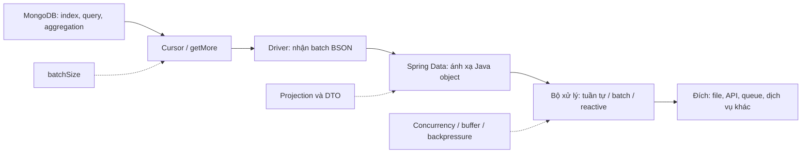

# Chọn batch size, cursor và kiểu xử lý để kiểm soát bộ nhớ

## 1. Vì sao truy vấn nhanh vẫn có thể làm ứng dụng hết bộ nhớ?

Trong **Spring Data MongoDB**, một truy vấn có thể trả về vài triệu document từ MongoDB rất nhanh nhưng khiến Java service bị **OutOfMemoryError**, tăng thời gian garbage collection (GC), hoặc chậm đến mức không đáp ứng được request. Nguyên nhân thường là chương trình giữ toàn bộ kết quả trong `List`, chuyển tất cả thành DTO, rồi mới xuất CSV hoặc tính toán.

Ví dụ, một hệ thống có 3 triệu bản ghi đơn hàng cần xuất báo cáo. Mỗi document truyền qua mạng có kích thước trung bình 1 KiB, nhưng đối tượng Java sau ánh xạ, chuỗi ký tự và cấu trúc tham chiếu có thể chiếm nhiều hơn. Nếu dùng:

```java
List<Order> orders = mongoTemplate.find(query, Order.class);
for (Order order : orders) {
    export(order);
}
```

ứng dụng cố giữ tất cả phần tử của `orders` cho đến khi kết thúc xử lý. **Tăng heap chỉ trì hoãn sự cố** khi số kết quả tiếp tục tăng.

Mục tiêu của bài học là kết hợp đúng ba quyết định:

1. **Batch size**: mỗi lần MongoDB trả về bao nhiêu document qua cursor, trong các giới hạn giao thức.
2. **Cursor**: cách client lấy dữ liệu từng phần, quản lý tài nguyên và đóng cursor khi hoàn tất hoặc có lỗi.
3. **Kiểu xử lý**: giữ từng document, một batch hữu hạn, một trang kết quả hay cả tập dữ liệu trong bộ nhớ; đồng thời kiểm soát số tác vụ xử lý đồng thời.

Dữ liệu đi qua nhiều nơi, mỗi nơi có thể giữ một phần bộ nhớ:



**Không có một tham số `batchSize` nào tự động giới hạn toàn bộ RAM.** Bộ nhớ còn bị ảnh hưởng bởi kích thước document, đối tượng Java, hàng đợi, số luồng đang xử lý, cache, các phép tổng hợp và khả năng tiêu thụ của hệ thống phía sau.

## 2. Hiểu đúng `batchSize`, `limit` và kích thước batch nghiệp vụ

Ba khái niệm dễ bị lẫn:

| Cấu hình | Ý nghĩa | Có giới hạn tổng số kết quả không? |
|---|---|---|
| `cursorBatchSize(256)` của Spring Data `Query` | Yêu cầu driver/server phân phối kết quả theo batch tương ứng khi đọc cursor | **Không**; có thể đọc hết hàng triệu document |
| `limit(256)` | Giới hạn số document mà truy vấn trả về | **Có**, tối đa 256 |
| `buffer(256)` của Reactor hoặc danh sách tự gom | Gom tối đa một số phần tử vào một nhóm **ở phía ứng dụng** | Không nhất thiết giới hạn tổng số phần tử của luồng |
| `BulkOperations` / `bulkWrite` | Gom nhiều thao tác ghi để gửi hiệu quả hơn | Không quyết định kích thước kết quả truy vấn |

MongoDB gửi kết quả của một lệnh `find` qua **cursor**: batch đầu tiên đi kèm phản hồi của lệnh; các batch tiếp theo được lấy bằng `getMore` khi cần. Batch size là yêu cầu về **số document mỗi batch**, không phải số byte tuyệt đối. Giao thức MongoDB còn có giới hạn kích thước phản hồi/batch; một batch thực tế có thể chứa **ít document hơn số đã yêu cầu** vì giới hạn kích thước dữ liệu. MongoDB cũng có giới hạn **16 MiB cho một BSON document**, nên vài document lớn có thể chiếm nhiều RAM dù batch size nhỏ.

Khi không đặt batch size, MongoDB/driver áp dụng hành vi mặc định phù hợp phiên bản. Thường batch đầu của truy vấn `find` có ngưỡng mặc định theo số document và kích thước; đừng lấy một giá trị mặc định lịch sử làm bảo đảm cố định cho mọi driver và loại lệnh.

### Tác động khi tăng hoặc giảm batch size

| Batch size | Lợi ích có thể đạt được | Chi phí/rủi ro |
|---|---|---|
| Nhỏ, ví dụ 32–128 | Ít dữ liệu được vận chuyển trong mỗi lượt; thích hợp document lớn hoặc consumer chậm | Nhiều vòng `getMore`, tốn round trip, dễ giảm throughput |
| Trung bình, ví dụ 256–1.024 | Cân bằng thường hợp lý để **bắt đầu thử nghiệm** khi document vừa | Vẫn cần đo bộ nhớ của đối tượng và hàng đợi |
| Lớn, ví dụ vài nghìn | Ít lượt lấy dữ liệu hơn, có thể tốt khi RTT cao và xử lý nhanh | Tăng đỉnh bộ nhớ, chi phí ánh xạ, thời gian chờ batch và GC |

Các khoảng trên **chỉ là điểm xuất phát để benchmark**, không phải chuẩn bắt buộc. Với document chứa mảng hàng MB, batch 32 cũng có thể là quá lớn; với document vài trăm byte và xử lý thuần CPU nhanh, batch lớn hơn có thể hiệu quả.

Đừng tăng batch size để chữa một truy vấn thiếu index; truy vấn vẫn phải tìm và sắp xếp dữ liệu đúng cách ở server.

## 3. Chọn kiểu đọc theo yêu cầu

| Cách đọc | Đặc điểm bộ nhớ | Trường hợp phù hợp |
|---|---|---|
| `MongoTemplate.find(...)` trả `List<T>` | Bộ nhớ tăng theo toàn bộ kết quả được trả về | Kết quả nhỏ và **đã có giới hạn rõ ràng** |
| `MongoTemplate.stream(...)` | Lấy phần tử dần qua cursor; có thể giữ ít đối tượng hơn | Xuất dữ liệu, đồng bộ, xử lý tuần tự lượng lớn |
| Repository trả `Stream<T>` | Có thể đọc dần, nhưng phải đóng stream/cursor | Khi API repository hỗ trợ và quản lý resource đúng |
| Đọc theo trang `Page`/`Slice` hoặc keyset | Mỗi lần chỉ giữ một trang; nhiều truy vấn độc lập | Job dài, cần checkpoint, retry và tiếp tục sau lỗi |
| `ReactiveMongoTemplate.find(...)` trả `Flux<T>` | Có cơ chế demand/backpressure; vẫn có buffer/prefetch | Pipeline bất đồng bộ, consumer có khả năng điều tiết |
| Aggregation trên server | Client chỉ nhận kết quả đã chọn/tổng hợp | Khi có thể giảm dữ liệu trước khi gửi về Java |

Quy tắc nền tảng: nếu toàn bộ tập kết quả không có giới hạn kích thước nhỏ đã biết, **đừng dùng `findAll()` hoặc `find(...)` trả `List` rồi mới lọc**. Hãy lọc, chiếu trường và giới hạn hoặc stream ngay từ truy vấn MongoDB.

## 4. Stream bằng `MongoTemplate` và đóng cursor đúng cách

Giả sử collection `orders` chứa `tenantId`, `createdAt`, `amountCents` và `_id`. Ứng dụng xuất các đơn hàng của một tenant trong một khoảng thời gian, xử lý từng document và không tích lũy danh sách.

```java
import java.time.Instant;
import java.util.Date;
import java.util.function.Consumer;

import org.bson.Document;
import org.springframework.data.domain.Sort;
import org.springframework.data.mongodb.core.MongoTemplate;
import org.springframework.data.mongodb.core.query.Criteria;
import org.springframework.data.mongodb.core.query.Query;
import org.springframework.data.util.CloseableIterator;

public final class OrderExportService {
    private final MongoTemplate mongoTemplate;

    public OrderExportService(MongoTemplate mongoTemplate) {
        this.mongoTemplate = mongoTemplate;
    }

    public void export(
            String tenantId,
            Instant from,
            Instant to,
            Consumer<Document> sink) {

        Query query = Query.query(
            Criteria.where("tenantId").is(tenantId)
                .and("createdAt").gte(Date.from(from)).lt(Date.from(to))
        );
        query.fields()
            .include("_id")
            .include("tenantId")
            .include("createdAt")
            .include("amountCents");
        query.with(Sort.by(Sort.Direction.ASC, "createdAt", "_id"));
        query.cursorBatchSize(256);

        try (CloseableIterator<Document> cursor =
                 mongoTemplate.stream(query, Document.class, "orders")) {
            while (cursor.hasNext()) {
                Document order = cursor.next();
                sink.accept(order);  // Xử lý xong rồi mới lấy phần tử kế tiếp.
            }
        }
    }
}
```

Đoạn code minh họa API imperative của Spring Data MongoDB:

- **Query được đẩy xuống MongoDB**: lọc tenant và khoảng `[from, to)` trước khi trả dữ liệu.
- **Projection**: chỉ lấy các trường cần cho export; giảm network, ánh xạ BSON và heap.
- **Sort có khóa phụ `_id`**: giúp thứ tự ổn định hơn khi nhiều document có cùng `createdAt`; nên có index phù hợp.
- **`cursorBatchSize(256)`**: yêu cầu batch 256 document, nhưng không thay `limit` và không chặn `sink` giữ lại tất cả đối tượng.
- **`try-with-resources`**: đóng `CloseableIterator` ngay khi xong hoặc khi `sink.accept` ném exception, giải phóng cursor và tài nguyên liên quan phía client.

Một index ứng viên cho workload trên:

```javascript
db.orders.createIndex({
  tenantId: 1,
  createdAt: 1,
  _id: 1
});
```

Index thực tế phải chọn dựa trên truy vấn, cardinality và `explain("executionStats")`; thêm index làm tăng dung lượng và chi phí ghi.

### Điều kiện để streaming thực sự tiết kiệm RAM

Đoạn `sink.accept(order)` nên ghi ngay ra nơi tiêu thụ được điều tiết: `BufferedWriter`, output stream, một bộ biến đổi thống kê, hoặc hàng đợi **có dung lượng tối đa**. Nó không nên thực hiện:

```java
List<Document> all = new ArrayList<>();
service.export(tenantId, from, to, all::add);  // Vẫn giữ mọi bản ghi!
```

Cũng cần tránh gọi `cursor.stream().toList()` hay các thao tác terminal tạo collection toàn bộ dữ liệu. Cursor chỉ là cơ chế đọc dần; **cách consumer xử lý mới quyết định có giữ dữ liệu lâu dài hay không**.

### Vòng đời cursor và timeout

Cursor phía server là một tài nguyên cần được quản lý. Nếu job xử lý quá chậm giữa hai lần lấy batch, cursor có thể bị timeout hoặc phiên làm việc phía server hết hạn. Không nên mặc định bật tùy chọn giữ cursor vô hạn: `noCursorTimeout` (nếu được sử dụng) không bảo đảm tránh mọi timeout của session và có thể làm rò tài nguyên nếu client chết.

Nếu một đơn hàng phải gọi API đối tác mất vài giây, xử lý **trực tiếp từng phần tử ngay trong vòng lặp cursor** có thể biến một cursor ngắn thành job hàng giờ. Khi đó nên chuyển sang **keyset pagination có checkpoint** hoặc giải pháp queue/worker được điều tiết rõ ràng.

## 5. Dùng trực tiếp MongoDB Java Driver khi cần kiểm soát cursor

`MongoTemplate` đủ cho nhiều use case. Để minh họa rõ cursor của MongoDB Java Driver, có thể gọi trực tiếp `MongoCollection`:

```java
import com.mongodb.client.MongoCollection;
import com.mongodb.client.MongoCursor;
import com.mongodb.client.model.Filters;
import com.mongodb.client.model.Projections;
import com.mongodb.client.model.Sorts;
import org.bson.Document;

MongoCollection<Document> orders =
    mongoTemplate.getCollection("orders");

try (MongoCursor<Document> cursor = orders.find(
        Filters.eq("tenantId", "tenant-a"))
        .projection(Projections.include("createdAt", "amountCents"))
        .sort(Sorts.ascending("createdAt", "_id"))
        .batchSize(256)
        .iterator()) {

    while (cursor.hasNext()) {
        Document order = cursor.next();
        processOne(order);
    }
}
```

`processOne(order)` đại diện cho thao tác xử lý từng document trong service. Đoạn trích cần đặt vào một phương thức có triển khai `processOne` và bean `mongoTemplate` tương ứng.

`MongoCursor` giúp đọc tuần tự mà không cần materialize toàn bộ tập kết quả. Tuy nhiên, một `processOne` đưa document vào `ConcurrentLinkedQueue` vô hạn cũng tạo ra cùng vấn đề bộ nhớ như `findAll()`.

**Phân biệt:** stream ở đây là stream kết quả truy vấn hữu hạn. **Tailable cursor** của capped collection và **change stream** là các cơ chế theo dõi thay đổi, có ngữ nghĩa vòng đời, thời gian chờ và logic reconnect riêng. Không áp dụng máy móc mẫu “đọc đến hết cursor” cho nguồn phát sự kiện liên tục.

## 6. Khi job dài: dùng keyset pagination để có checkpoint

Streaming thuận tiện khi chương trình xử lý hết dữ liệu trong một lượt. Với job có thể chạy hàng giờ, lỗi mạng, restart hoặc cần chia công việc theo nhiều worker, việc giữ một cursor xuyên suốt rất bất tiện. Thay vào đó, mỗi lần lấy **một trang hữu hạn** rồi lưu vị trí cuối cùng đã hoàn tất.

### Vì sao không `skip` rất sâu?

```javascript
db.orders.find({ tenantId: "tenant-a" })
  .sort({ createdAt: 1, _id: 1 })
  .skip(2_000_000)
  .limit(500);
```

Ngay cả khi có index hỗ trợ thứ tự, MongoDB vẫn phải vượt qua nhiều bản ghi trước vị trí trang cần lấy. Chi phí thường tăng theo độ sâu của offset. `skip` thích hợp với giao diện trang nhỏ, nhưng thường kém hiệu quả cho export hàng triệu document.

### Keyset với khóa sắp xếp có thứ tự ổn định

Tạo index:

```javascript
db.orders.createIndex({ tenantId: 1, createdAt: 1, _id: 1 });
```

Trang đầu:

```javascript
db.orders.find({ tenantId: "tenant-a" })
  .sort({ createdAt: 1, _id: 1 })
  .limit(500);
```

Sau khi **xử lý thành công** document cuối cùng, lưu hai giá trị `lastCreatedAt` và `lastId`. Trang sau:

```javascript
db.orders.find({
  tenantId: "tenant-a",
  $or: [
    { createdAt: { $gt: lastCreatedAt } },
    { createdAt: lastCreatedAt, _id: { $gt: lastId } }
  ]
})
  .sort({ createdAt: 1, _id: 1 })
  .limit(500);
```

Mỗi trang trả về tối đa 500 document logic, nên có thể xử lý rồi giải phóng bộ nhớ trước trang tiếp theo. Với job restart, tiếp tục từ checkpoint đã lưu thay vì từ đầu.

Những điều kiện để phương pháp đúng:

1. `createdAt` và `_id` phải tồn tại, có kiểu dữ liệu nhất quán và không bị thay đổi trong quá trình duyệt. `_id` dùng để phân giải trường hợp trùng timestamp.
2. Cập nhật checkpoint sau khi output được xử lý thành công. Với tác vụ có retry, **output phải idempotent** hoặc có cơ chế chống trùng; crash giữa ghi output và ghi checkpoint có thể làm ghi lại một trang.
3. Nếu dữ liệu liên tục được thêm, xóa hoặc sửa trường sắp xếp, các trang khác nhau không tự tạo thành snapshot nhất quán. Khi cần tập dữ liệu cố định, ghi nhận mốc cắt `to` hoặc dùng phương án snapshot phù hợp với yêu cầu và khả năng của hệ thống.
4. `limit(500)` giới hạn **tổng document của trang**; `batchSize` vẫn có thể được cấu hình riêng cho cách server phân phối trang đó.

Trong Spring Data, có thể chuyển điều kiện `$or` thành `Criteria.orOperator(...)`, thêm `Sort` và `Query.limit(500)`. Chỉ giữ trang đang xử lý thay vì gộp trang vào một `List` khổng lồ.

## 7. Reactive: backpressure không đồng nghĩa với bộ nhớ bằng không

Với **ReactiveMongoTemplate**, `find(query, Document.class, "orders")` trả về `Flux<Document>`. Subscriber có thể yêu cầu phần tử theo nhu cầu (*backpressure*); MongoDB Reactive Streams Driver phối hợp việc lấy dữ liệu từ cursor. Tuy vậy, các toán tử Reactor vẫn có thể **prefetch, buffer hoặc tạo nhiều tác vụ đồng thời**.

Ví dụ xử lý tuần tự qua một hàm bất đồng bộ:

```java
import java.util.function.Function;

import org.bson.Document;
import org.springframework.data.mongodb.core.ReactiveMongoTemplate;
import org.springframework.data.mongodb.core.query.Query;
import reactor.core.publisher.Mono;

public Mono<Void> processOrders(
        ReactiveMongoTemplate reactiveMongoTemplate,
        Query query,
        Function<Document, Mono<Void>> processAsync) {

    query.cursorBatchSize(128);

    return reactiveMongoTemplate
        .find(query, Document.class, "orders")
        .concatMap(processAsync)  // Hoàn tất thao tác trước khi xử lý kế tiếp.
        .then();
}
```

Nếu đích ghi theo lô, gom từng nhóm hữu hạn:

```java
return reactiveMongoTemplate.find(query, Document.class, "orders")
    .buffer(250)
    .concatMap(batch -> writeBatchAsync(batch))
    .then();
```

Ở đây `writeBatchAsync(List<Document>)` là hàm được triển khai trong service, trả về `Mono<Void>` sau khi xử lý batch. Đây là **batch ở tầng nghiệp vụ**, khác với `query.cursorBatchSize(128)`. Có thể tồn tại đồng thời cả bộ đệm driver và danh sách 250 phần tử.

Cần chú ý:

- `collectList()`, `sort()` không có giới hạn và `reduce` xây collection lớn có thể làm mất lợi ích streaming.
- `flatMap(..., concurrency)` cho throughput tốt nếu tác vụ độc lập, nhưng tăng số phần tử/tác vụ đang hoạt động; đặt **concurrency và prefetch hữu hạn** rồi đo thực tế.
- `buffer(n)` giữ tối đa `n` phần tử *mỗi batch*, nhưng số batch đang chạy đồng thời cũng ảnh hưởng RAM.
- `limitRate(n)` điều chỉnh yêu cầu (*request demand*) trong pipeline Reactor; nó **không thay thế** `cursorBatchSize(n)` của MongoDB.
- Không `block()` trên event-loop; xử lý blocking như truy cập file hoặc thư viện đồng bộ cần chuyển sang scheduler thích hợp, vẫn kiểm soát queue/concurrency.
- Khi subscriber hủy hoặc gặp lỗi, đảm bảo tài nguyên cursor được driver/repository đóng đúng theo hợp đồng API; không giữ subscription vô thời hạn chỉ vì consumer không còn đọc.

**Reactive giúp điều tiết dữ liệu đang chảy qua các thành phần, không sửa được truy vấn thiếu index hoặc phép tính lưu tất cả kết quả trong RAM.**

## 8. Tối ưu ngay từ MongoDB: lọc, projection, sort, aggregation

Trước khi chỉnh batch size, xác nhận MongoDB trả về **đúng số lượng và đúng các trường**:

```javascript
const from = ISODate("2026-11-01T00:00:00Z");
const to = ISODate("2026-11-20T00:00:00Z");

db.orders.find(
  {
    tenantId: "tenant-a",
    createdAt: { $gte: from, $lt: to }
  },
  {
    _id: 1,
    createdAt: 1,
    amountCents: 1
  }
).sort({ createdAt: 1, _id: 1 });
```

Nếu cần tính tổng số tiền theo ngày, **đẩy phần tính toán thích hợp sang MongoDB** thay vì tải tất cả đơn hàng rồi `groupingBy` trong Java:

```javascript
db.orders.aggregate([
  {
    $match: {
      tenantId: "tenant-a",
      createdAt: { $gte: from, $lt: to }
    }
  },
  {
    $group: {
      _id: {
        $dateTrunc: { date: "$createdAt", unit: "day", timezone: "UTC" }
      },
      count: { $sum: 1 },
      totalAmountCents: { $sum: "$amountCents" }
    }
  },
  { $sort: { _id: 1 } }
]);
```

Client giờ chỉ cần đọc các dòng tổng hợp theo ngày. Tuy nhiên, aggregation có thể cần bộ nhớ đáng kể **ở phía server**, nhất là `$sort`, `$group`, `$setWindowFields` và thao tác tạo mảng. Tính năng spill ra đĩa, khi được hỗ trợ/cấu hình, giúp một số stage vượt giới hạn RAM nhưng tăng I/O và không thay thế thiết kế truy vấn đúng.

Sử dụng `explain("executionStats")` để quan sát `totalDocsExamined`, `totalKeysExamined`, plan `IXSCAN`/scan, cách sort được thực thi và thời gian. Đối chiếu `allowDiskUse`/tùy chọn aggregation với phiên bản MongoDB thực tế. Nếu projection còn trường chứa mảng nhiều MB, hãy thiết kế lại DTO hoặc cách tổ chức document trước khi chỉ điều chỉnh batch size.

## 9. Ước lượng working set và chọn batch size bằng số đo

Để bắt đầu, có thể ước lượng phần bộ nhớ dành cho **dữ liệu đang xử lý**:

```text
workingSet ≈
    (số document đang giữ từ driver + mapping + hàng đợi + xử lý)
    × kích thước Java object trung bình
    + chi phí buffer, thread, I/O, cache và runtime
```

Đây là mô hình tư duy, **không phải công thức dự báo heap chính xác**. Kích thước BSON trên mạng khác kích thước Java object trên heap; driver có thể giữ batch, Spring tạo object, downstream có thể giữ bản sao. Batch size cũng không giới hạn số phần tử một consumer tự tích lũy.

Ví dụ giả định: mỗi object Java giữ trung bình 3 KiB, một worker giữ 256 object thì riêng phần này khoảng **768 KiB**; tám worker như vậy khoảng **6 MiB**. Số liệu này **chưa gồm BSON buffers, queue, JVM/GC overhead, object khác, cache và biến động kích thước document**. Vì vậy phải đo trên dữ liệu thực hoặc dữ liệu mô phỏng có phân phối tương tự.

Một vòng benchmark thiết thực:

1. Chọn dữ liệu gồm bản ghi nhỏ, bản ghi lớn (p95/p99), phân phối tenant và độ chọn lọc như production.
2. Khởi đầu với `batchSize = 128`, `256`, `512`, `1.024` (điều chỉnh theo kích thước document); giữ nguyên filter, projection, index, concurrency và downstream.
3. Đo **throughput (document/s), p95/p99 latency, peak heap/RSS, số lần và thời lượng GC, số `getMore`/round trip, CPU, network, lỗi cursor**.
4. Tăng concurrency **riêng một vòng** để phát hiện trường hợp bộ nhớ tăng theo số worker.
5. Thử consumer chậm, dừng giữa chừng, lỗi mạng, huỷ subscription, job restart và checkpoint.
6. Chọn cấu hình đạt độ trễ và throughput mục tiêu **trong giới hạn bộ nhớ**, có dự phòng cho spike và các request khác.

Bảng ghi kết quả mẫu (các ô là mục cần đo, không phải kết quả giả lập):

| Tham số thử | Throughput | Peak heap/RSS | GC pause | Số getMore | Lỗi/timeout |
|---|---|---|---|---|---|
| Batch 128, 1 worker | Đo | Đo | Đo | Đo | Đo |
| Batch 256, 1 worker | Đo | Đo | Đo | Đo | Đo |
| Batch 512, 1 worker | Đo | Đo | Đo | Đo | Đo |
| Batch 256, 8 worker | Đo | Đo | Đo | Đo | Đo |

Đừng tối ưu chỉ theo throughput. Nếu một cấu hình tăng tốc 5% nhưng làm heap lên sát `-Xmx`, rủi ro GC và OOM có thể lớn hơn lợi ích.

## 10. Chẩn đoán các lỗi hay gặp

| Triệu chứng | Nguyên nhân cần điều tra | Thao tác ưu tiên |
|---|---|---|
| OOM ngay sau `findAll()` | Tạo `List` chứa toàn bộ document | Đặt giới hạn, projection, stream hoặc keyset pagination |
| Đã dùng cursor nhưng heap vẫn tăng mãi | Consumer tích lũy, queue không giới hạn, cache hoặc `collectList()` | Dùng sink streaming, buffer hữu hạn, giới hạn concurrency |
| Batch nhỏ chạy rất chậm | Quá nhiều lượt `getMore`, RTT cao, mapping tốn CPU | Đo batch lớn dần, kiểm tra index và projection |
| Batch lớn khiến GC tăng mạnh | Vận chuyển/ánh xạ nhiều đối tượng cùng lúc | Giảm batch, bớt trường, hạn chế số worker |
| Cursor bị timeout giữa job | Xử lý mỗi document quá lâu, cursor/session nhàn rỗi | Tách thành trang có checkpoint hoặc rút ngắn thời gian giữ cursor |
| CPU MongoDB cao dù Java dùng ít RAM | Query scan nhiều, server sort/group, thiếu index | Dùng `explain`, thiết kế lại filter/index/aggregation |
| Page càng sâu càng chậm | `skip` với offset lớn | Chuyển sang keyset và index theo khóa sắp xếp |
| Reactive vẫn OOM | `collectList`, `buffer` quá lớn, `flatMap` concurrency/prefetch cao | Kiểm soát operator, demand và downstream |
| Restart làm lặp dữ liệu output | Checkpoint lưu trễ hoặc retry chưa idempotent | Thiết kế output idempotent, lưu checkpoint sau commit |
| Ứng dụng treo lúc export | Sink chậm, lỗi mạng, backpressure hoặc thread blocking | Đặt timeout phù hợp, telemetry từng chặng, tránh blocking event-loop |

Bộ nhớ thấp ở ứng dụng không bảo đảm hệ thống khỏe: có thể chỉ đang chuyển chi phí sang server, đĩa, network hoặc hàng đợi phía sau. Cần nhìn toàn bộ pipeline.

## 11. Checklist triển khai cho Spring Data MongoDB

1. **Ước lượng kết quả**: số document, kích thước trung bình/p99, thời gian chạy, số consumer đồng thời.
2. **Filter và projection tại MongoDB**: chỉ lấy trường cần; dùng index phục vụ điều kiện lọc và thứ tự.
3. **Chọn kiểu xử lý theo vòng đời**: `List` có `limit` cho dữ liệu nhỏ; `MongoTemplate.stream` cho xử lý tuần tự; keyset cho job dài/restart; `Flux` cho pipeline async.
4. **Chọn batch size thử nghiệm**: bắt đầu từ một mức trung bình và điều chỉnh theo kích thước document, RTT, khả năng downstream và RAM thực tế.
5. **Đóng tài nguyên**: dùng `try-with-resources` cho `CloseableIterator`, `MongoCursor`, và repository `Stream`; quản lý subscription reactive.
6. **Giữ buffer/concurrency hữu hạn**: không tích lũy toàn bộ kết quả trong collection, queue hoặc pipeline Reactor.
7. **Đặt chính sách lỗi**: retry có giới hạn, timeout có chủ đích, checkpoint và idempotency khi xử lý lại.
8. **Phân biệt client và server**: streaming giúp Java xử lý dần nhưng không giải quyết sort/group nặng tại MongoDB.
9. **Đo thực tế**: heap/RSS, GC, throughput, p95/p99, số getMore, scan/index và cursor timeout với workload đại diện.
10. **Đảm bảo khả năng vận hành**: log tiến độ theo checkpoint, cảnh báo memory và thời gian chờ; test restart và hủy job.

Với **SPRING_DATA_MONGODB**, mục tiêu là đưa ra một đường đi dữ liệu có giới hạn bộ nhớ rõ ràng từ `MongoTemplate`/repository hoặc reactive driver tới nơi tiêu thụ. **Batch size điều chỉnh cách lấy dữ liệu; cursor cho phép đọc từng phần; cách xử lý và mức đồng thời mới quyết định dữ liệu bị giữ lại bao lâu.** Khi kết hợp ba yếu tố này với truy vấn và index phù hợp, hệ thống có thể xử lý lượng lớn document mà không phải nạp tất cả vào heap.
