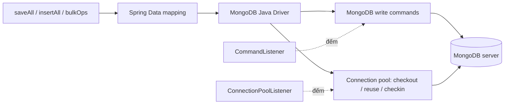

# Đánh giá saveAll, bulk và số lượt kết nối bằng số đo

Khi một dịch vụ Spring Data MongoDB cần ghi hàng nghìn document, câu hỏi thường gặp là: **`saveAll(...)` có gửi một lệnh cho mỗi document không? `bulkOps(...)` có luôn nhanh hơn không? Một lần lưu có mở một connection MongoDB mới không?** Muốn trả lời có cơ sở, ta phải đo **thời gian, số command, số lần mượn connection từ pool và số connection được tạo**, đồng thời phân biệt thao tác **insert mới** với **update dữ liệu có sẵn**.

Bài này thuộc chương **Hiệu năng** của module `SPRING_DATA_MONGODB`: dùng Spring Data MongoDB để ánh xạ document, thao tác bằng `MongoTemplate` hoặc repository, tối ưu index, transaction, reactive access, kiểm thử và chẩn đoán hiệu năng. Mục tiêu là một phương pháp thử nghiệm có thể lặp lại, tránh kết luận dựa trên số lần gọi method Java.

## 1. Phân biệt các đại lượng cần đo

| Đại lượng | Ý nghĩa | Phương pháp quan sát |
| --- | --- | --- |
| Document/operation logic | Bao nhiêu document được chèn, thay thế, cập nhật hoặc xóa | Input, kết quả thao tác, kiểm tra dữ liệu lưu |
| **MongoDB write command** | Một lệnh `insert`, `update` hoặc `delete` được driver gửi | `CommandListener` hoặc server monitoring |
| **Connection checkout** | Một lần driver mượn connection từ connection pool | `ConnectionPoolListener.connectionCheckedOut` |
| **Connection created** | Một connection vật lý mới được pool khởi tạo | `ConnectionPoolListener.connectionCreated` |
| **Connection đang mượn** | Số connection đồng thời được checkout, giá trị đỉnh | Event checkout/checkin và pool metrics |
| **Latency** | Thời gian hoàn thành một thao tác hoặc batch | Đồng hồ đơn điệu `System.nanoTime()`, tracing |
| **Throughput** | Số document hoàn tất mỗi giây | `successfulDocuments / elapsedSeconds` |

**Một command có thể chứa nhiều document. Một connection có thể tái sử dụng cho nhiều command.** Pool checkout không đồng nghĩa tạo connection TCP mới. Driver còn có các kết nối giám sát topology, và khi dùng replica set/sharded cluster có thể có nhiều pool tương ứng với các server.



Ngoài ra, số write command quan sát được **không luôn bằng số lần round trip vật lý** nếu có retry, lỗi mạng, batching hoặc các cơ chế xử lý khác. Do đó phải quan sát thêm kết quả ghi thực tế và độ trễ.

## 2. `saveAll` có phải luôn lưu từng entity?

Trong cách triển khai repository Spring Data MongoDB thông thường, `saveAll(Iterable<S>)` phân nhánh dựa trên việc **tất cả entity được xác định là mới hay không**:

- **Tất cả mới**: repository có thể gọi đường `insert` theo tập, cho phép driver gom nhiều document vào các command.
- **Có entity được xác định là đã tồn tại**: repository thường dùng `save` lần lượt cho từng entity, sinh nhiều thao tác ghi độc lập.
- Khái niệm “mới” chịu ảnh hưởng của `@Id`, `@Version`, `Persistable.isNew()` và cách entity được ánh xạ. Entity mới tạo trong bộ nhớ nhưng có ID tự gán **có thể bị coi là existing**.

Ví dụ model đơn giản cho bài đo:

```java
import org.springframework.data.annotation.Id;
import org.springframework.data.mongodb.core.mapping.Document;

@Document("perf_orders")
public class OrderDoc {
    @Id
    public String id;
    public String sku;
    public int quantity;

    public OrderDoc() { }

    public OrderDoc(String id, String sku, int quantity) {
        this.id = id;
        this.sku = sku;
        this.quantity = quantity;
    }
}
```

Hai workload dưới đây có thể đi qua các nhánh khác nhau:

```java
List<OrderDoc> newDocs = List.of(
        new OrderDoc(null, "SKU-1", 1),
        new OrderDoc(null, "SKU-2", 2));
repository.saveAll(newDocs);  // ID null: thường được coi là insert mới.

List<OrderDoc> existingDocs = List.of(
        new OrderDoc("order-001", "SKU-1", 2),
        new OrderDoc("order-002", "SKU-2", 3));
repository.saveAll(existingDocs); // ID đã gán: thường xử lý save từng entity.
```

Với entity có ID đã gán, `save` có thể ghi theo hướng upsert/replace tùy mapping. Đừng dùng kết quả thời gian của `saveAll(new)` để suy luận tốc độ `saveAll(existing)`, hoặc ngược lại. Nếu domain thật có `@Version` hay auditing, hãy đo thêm một scenario riêng vì vừa thay đổi nhận diện “new”, vừa có thể thêm công việc ở phía client/server.

## 3. So sánh `saveAll`, `insertAll` và bulk

| API Spring Data MongoDB | Tình huống | Cần lưu ý |
| --- | --- | --- |
| `repository.saveAll(docs)` | Insert toàn bộ entity mới, hoặc save các entity đã tồn tại | Cần quan sát nhánh all-new/existing và callback |
| `mongoTemplate.insertAll(docs)` | Insert nhiều entity, nhóm theo collection | Không dùng để update; duplicate key gây lỗi |
| `mongoTemplate.bulkOps(mode, OrderDoc.class).insert(docs).execute()` | Bulk insert được điều khiển tường minh | Driver có thể chia thành nhiều command; mode ordered/unordered |
| `mongoTemplate.bulkOps(...).updateOne(...).execute()` | Nhiều cập nhật có điều kiện | Ngữ nghĩa khác `save` nguyên entity; không tự giữ đầy đủ optimistic locking |
| `mongoTemplate.save(doc)` | Một entity | Không suy số connection từ số lần gọi |

Ví dụ bulk insert:

```java
import org.springframework.data.mongodb.core.BulkOperations;

List<OrderDoc> docs = List.of(
        new OrderDoc(null, "SKU-1", 1),
        new OrderDoc(null, "SKU-2", 2));

mongoTemplate.bulkOps(
        BulkOperations.BulkMode.UNORDERED, OrderDoc.class)
        .insert(docs)
        .execute();
```

- `ORDERED` ưu tiên thứ tự được khai báo và thường dừng ở lỗi ghi đầu tiên.
- `UNORDERED` cho phép linh hoạt thứ tự thực thi và có thể tiếp tục những operation độc lập khi xảy ra lỗi, rồi trả thông tin lỗi tổng hợp.
- **Unordered không mặc nhiên nhanh hơn**: tải server, độ phân bố shard, index, lỗi và kích thước batch quyết định kết quả thực tế.
- Một lần gọi `bulkOps.execute()` **không đảm bảo đúng một command mạng**: driver có thể chia batch theo giới hạn số operation, kích thước document và kích thước message của server.

Bulk operations không thay thế trọn vẹn lifecycle của repository. Khi đổi `saveAll` sang bulk, cần đánh giá các ràng buộc: auditing, entity callbacks, xử lý lỗi từng document, optimistic locking với `@Version`, validation và các sự kiện liên quan. **Nhanh hơn nhưng vi phạm quy tắc ghi dữ liệu là một kết quả không đạt.**

## 4. Thiết kế phép đo với các số liệu cụ thể

Một lần benchmark cho batch gồm `N` document nên ghi các số liệu:

- **Elapsed time**: từ trước khi bắt đầu ghi tới sau khi thao tác kết thúc. Dùng `System.nanoTime()`.
- **Throughput**: `N_success / (elapsedNanos / 1_000_000_000.0)` document/giây.
- **p50/p95/p99 latency theo batch**: tính từ nhiều lượt đo cùng điều kiện, không gọi `elapsedMs / N` là p95 của từng document.
- **Write commands started/succeeded/failed**: đếm theo tên lệnh qua `CommandListener`.
- **Pool checkouts**: đếm lượt mượn connection; **connection created**: đếm connection mới.
- **Peak checked-out**, checkout failures và thời gian đợi pool nếu có metric.
- CPU/heap/GC ứng dụng, CPU/disk/network/index tải MongoDB, kết quả ghi và số document cuối cùng.

Bảng thu thập kết quả dưới đây **chưa có số đo**; điền bằng dữ liệu benchmark thật:

| Workload | N | p50 batch (ms) | p95 batch (ms) | Docs/s | Write commands | Checkouts | Created | Peak in use |
| --- | ---: | ---: | ---: | ---: | ---: | ---: | ---: | ---: |
| `saveAll`, new | … | … | … | … | … | … | … | … |
| `insertAll`, new | … | … | … | … | … | … | … | … |
| `bulkOps.insert`, new | … | … | … | … | … | … | … | … |
| `saveAll`, existing | … | … | … | … | … | … | … | … |
| `bulkOps`, update/replace existing | … | … | … | … | … | … | … | … |

Ghi rõ môi trường đi kèm: phiên bản Spring Data, Java Driver, MongoDB, JDK, kích thước document, index, `WriteConcern`, concurrency, batch size, số lần warmup, transaction và network RTT. **Không bịa ra kết quả đo** để điền bảng.

## 5. Đếm command và connection bằng MongoDB Java Driver

### 5.1. Viết bộ đếm sự kiện

Mẫu dưới đây dùng các interface event listener của synchronous MongoDB Java Driver. Các event có thể chạy trên nhiều thread nên bộ đếm dùng các lớp atomic.

```java
import com.mongodb.event.*;
import java.util.Set;
import java.util.concurrent.atomic.AtomicInteger;
import java.util.concurrent.atomic.AtomicLong;

public final class WriteMetrics
        implements CommandListener, ConnectionPoolListener {

    private static final Set<String> WRITES =
            Set.of("insert", "update", "delete");

    public final AtomicLong writesStarted = new AtomicLong();
    public final AtomicLong writesSucceeded = new AtomicLong();
    public final AtomicLong writesFailed = new AtomicLong();
    public final AtomicLong checkouts = new AtomicLong();
    public final AtomicLong created = new AtomicLong();
    public final AtomicLong closed = new AtomicLong();
    public final AtomicLong checkoutFailures = new AtomicLong();

    private final AtomicInteger inUse = new AtomicInteger();
    public final AtomicInteger peakInUse = new AtomicInteger();

    @Override
    public void commandStarted(CommandStartedEvent event) {
        if (WRITES.contains(event.getCommandName())) {
            writesStarted.incrementAndGet();
        }
    }

    @Override
    public void commandSucceeded(CommandSucceededEvent event) {
        if (WRITES.contains(event.getCommandName())) {
            writesSucceeded.incrementAndGet();
        }
    }

    @Override
    public void commandFailed(CommandFailedEvent event) {
        if (WRITES.contains(event.getCommandName())) {
            writesFailed.incrementAndGet();
        }
    }

    @Override
    public void connectionCheckedOut(ConnectionCheckedOutEvent event) {
        checkouts.incrementAndGet();
        int n = inUse.incrementAndGet();
        peakInUse.accumulateAndGet(n, Math::max);
    }

    @Override
    public void connectionCheckedIn(ConnectionCheckedInEvent event) {
        inUse.decrementAndGet();
    }

    @Override
    public void connectionCreated(ConnectionCreatedEvent event) {
        created.incrementAndGet();
    }

    @Override
    public void connectionClosed(ConnectionClosedEvent event) {
        closed.incrementAndGet();
    }

    @Override
    public void connectionCheckOutFailed(ConnectionCheckOutFailedEvent event) {
        checkoutFailures.incrementAndGet();
    }

    public Snapshot snapshot() {
        return new Snapshot(
                writesStarted.get(), writesSucceeded.get(),
                writesFailed.get(), checkouts.get(), created.get(),
                closed.get(), checkoutFailures.get(), peakInUse.get());
    }

    public record Snapshot(
            long started, long succeeded, long failed,
            long checkouts, long created, long closed,
            long checkoutFailures, int peakInUse) {}
}
```

Với `started`, `succeeded`, `failed`, `checkouts`, `created` và `closed`, lấy hiệu số giữa snapshot trước và sau workload. `peakInUse` ở đây là **đỉnh kể từ khi listener được tạo**, không phải tự động đỉnh riêng mỗi scenario; nếu cần đỉnh riêng, đo trong cửa sổ có reset kiểm soát hoặc phân tách từng lượt trong môi trường riêng. Đừng reset các bộ đếm giữa lúc request khác đang chạy.

### 5.2. Gắn listener trước khi tạo MongoClient

```java
import com.mongodb.ConnectionString;
import com.mongodb.MongoClientSettings;
import com.mongodb.client.MongoClient;
import com.mongodb.client.MongoClients;

WriteMetrics metrics = new WriteMetrics();
MongoClientSettings settings = MongoClientSettings.builder()
        .applyConnectionString(new ConnectionString(mongoUri))
        .addCommandListener(metrics)
        .applyToConnectionPoolSettings(
                pool -> pool.addConnectionPoolListener(metrics))
        .build();

MongoClient client = MongoClients.create(settings);
// Dùng client này cho MongoTemplate/repository được benchmark.
// Chia sẻ và đóng client theo vòng đời ứng dụng; không tạo mỗi request.
```

Nếu Spring Boot tự cấu hình `MongoClient`, cần đăng ký listener bằng customizer tương thích phiên bản **trước khi khởi tạo bean client**. Tạo client mới cho mỗi lượt ghi sẽ khiến benchmark đo DNS, handshake và pool warmup thay vì hiệu năng `saveAll` hay bulk.

Trong replica set/sharded topology, driver có pool theo server và kết nối giám sát riêng; `connectionCreated` chỉ đếm các sự kiện được listener quan sát, không phải toàn bộ socket của tiến trình hoặc mạng.

## 6. Đo một lượt ghi thực tế

Tạo hàm đo lấy snapshot trước/sau một thao tác **synchronous** đã được acknowledge:

```java
public record Sample(
        String name, int documents, double milliseconds,
        double docsPerSecond, long writeCommands,
        long successfulCommands, long checkouts, long created) {}

public static Sample measure(
        String name, int documents,
        WriteMetrics metrics, Runnable write) {

    WriteMetrics.Snapshot before = metrics.snapshot();
    long start = System.nanoTime();

    write.run(); // Chỉ đo synchronous acknowledged write.
    long elapsed = System.nanoTime() - start;

    WriteMetrics.Snapshot after = metrics.snapshot();
    double seconds = elapsed / 1_000_000_000.0;

    return new Sample(
            name, documents, elapsed / 1_000_000.0,
            documents / seconds,
            after.started() - before.started(),
            after.succeeded() - before.succeeded(),
            after.checkouts() - before.checkouts(),
            after.created() - before.created());
}
```

Đo ba chiến lược chèn mới (đoạn sau là **khung thử nghiệm**; `repository`, `mongoTemplate`, `metrics` phải được cấu hình trong lớp benchmark và dùng chung client):

```java
int n = 1_000;

// Dựng collection/index test ngoài cửa sổ đo, KHÔNG chạy ở production.
prepareEmptyCollection();
List<OrderDoc> docsA = newItems(n);
Sample a = measure("saveAll-new", n, metrics,
        () -> repository.saveAll(docsA));

prepareEmptyCollection();
List<OrderDoc> docsB = newItems(n);
Sample b = measure("insertAll-new", n, metrics,
        () -> mongoTemplate.insertAll(docsB));

prepareEmptyCollection();
List<OrderDoc> docsC = newItems(n);
Sample c = measure("bulk-insert-new", n, metrics,
        () -> mongoTemplate.bulkOps(
                BulkOperations.BulkMode.UNORDERED, OrderDoc.class)
                .insert(docsC).execute());

System.out.println(a);
System.out.println(b);
System.out.println(c);
```

`newItems` phải tạo cùng số document, cùng kích thước và cùng dữ liệu nghiệp vụ ở mọi lượt:

```java
static List<OrderDoc> newItems(int n) {
    List<OrderDoc> docs = new java.util.ArrayList<>(n);
    for (int i = 0; i < n; i++) {
        docs.add(new OrderDoc(null, "SKU-" + i, 1));
    }
    return docs;
}
```

`prepareEmptyCollection()` là helper do dự án kiểm thử triển khai, chỉ dùng cho **database test**: xóa dữ liệu thử và tạo lại indexes giống nhau trước mỗi phương án. Chuẩn bị dữ liệu Java/fixture không tính vào thời gian ghi. Trong bài đo production-like, nên tách riêng chi phí mapping/serialization và chi phí network/server khi cần phân tích sâu.

### Cách đọc kết quả đo

- Nếu có **1 write command** cho 1.000 document, đó có thể là một batch insert; không suy ra “1.000 kết nối”.
- Nếu `created = 0` nhưng `checkouts` dương, connection đã tồn tại trong pool và được tái sử dụng.
- Nếu `writesStarted` cao nhưng `created` thấp, bottleneck có thể ở số command, network latency, index hoặc xử lý server chứ không phải mở socket.
- Nếu `writesStarted` khác `writesSucceeded`, kiểm tra exception, retry và write concern; không dùng throughput tính từ `n` khi batch chỉ thành công một phần.
- Nếu `checkouts` vượt xa write command, kiểm tra các command khác (ví dụ đọc, authentication/key vault, metadata hoặc background tasks) trong cửa sổ đo.

Bộ đếm `CommandListener` đo **số command**; `BulkWriteResult`, số document lưu thực tế và exception mới cho biết kết quả thao tác logic. Với driver retryable writes, sự kiện và thời gian có thể chứa các lần thử lại; kết luận cần xét cả lỗi mạng/failover.

## 7. Thiết kế benchmark công bằng: insert và update là hai bài khác nhau

Không nên gộp hai loại thao tác vào một con số “ghi 10.000 document”. Tối thiểu phải tạo hai nhóm scenario.

### Nhóm A: Chèn mới (insert)

1. Tạo các object có `@Id == null` để repository xác định là new. Nếu model dùng `@Version` hoặc `Persistable`, ghi rõ quy tắc `isNew`.
2. Dùng cùng collection test có index giống nhau cho `saveAll`, `insertAll` và `bulkOps.insert`. Trước mỗi lượt phải dọn và khởi tạo lại fixture ngoài cửa sổ đo.
3. Thử các batch size như 100, 1.000 và 10.000; tất cả document có kích thước BSON/field tương đương.
4. Với mỗi batch, kiểm tra số record đã lưu và lỗi duplicate/partial success. Thời gian nhanh nhưng thiếu dữ liệu là kết quả không đạt.
5. Đo cold-start riêng với steady-state. Đảm bảo cả client và connection pool đã warmup khi so sánh hiệu năng đường ghi ổn định.

### Nhóm B: Cập nhật dữ liệu đã tồn tại (update)

1. Seed trước một tập document có `_id` cố định, giữ cùng index và nội dung ban đầu cho mỗi phương án.
2. Gọi `saveAll` với entity được coi là existing. Đo write command count và kết quả document.
3. Với bulk, thực hiện các `updateOne`/`replaceOne` theo yêu cầu nghiệp vụ và cùng điều kiện match. Nếu `saveAll` thay thế document còn `updateOne` chỉ cập nhật một field thì đây là **so sánh hai ngữ nghĩa khác nhau**; phải ghi rõ trong báo cáo.
4. Nếu hệ thống dùng `@Version`, auditing, entity callbacks hoặc optimistic locking, kiểm tra separately các ràng buộc ấy. Một số cơ chế bảo vệ trong đường `save` không được bulk hỗ trợ theo cách tương đương.
5. Với upsert, đo thêm chi phí tìm document, create-versus-update và tỷ lệ trùng index; không so sánh cùng bảng với insert mới thuần túy.

Ví dụ bulk update số lượng đơn hàng:

```java
import org.springframework.data.mongodb.core.BulkOperations;
import org.springframework.data.mongodb.core.query.Criteria;
import org.springframework.data.mongodb.core.query.Query;
import org.springframework.data.mongodb.core.query.Update;

BulkOperations ops = mongoTemplate.bulkOps(
        BulkOperations.BulkMode.UNORDERED, OrderDoc.class);

for (OrderDoc order : existingDocs) {
    Query query = Query.query(
            Criteria.where("_id").is(order.id));
    Update update = new Update().set("quantity", order.quantity);
    ops.updateOne(query, update);
}

ops.execute();
```

Nếu dùng bulk update chỉ thay đổi `quantity`, hãy **kiểm tra rằng các field khác giữ nguyên**. Nếu requirement đòi full replacement, chọn API replace phù hợp trong phiên bản Spring Data đang dùng và kiểm tra behavior khi document bị xóa đồng thời. Một phép thử đúng về hiệu năng phải có **assert dữ liệu đầu ra** ngoài số mili-giây.

## 8. Thực hiện nhiều vòng và tính phân bố latency

Một lần chạy không đủ. JVM có JIT compilation, garbage collection, mapping/codec warmup; MongoDB có cache, journal, replication, network và connection pool, nên các vòng có thể khác nhau.

Quy trình thực nghiệm khuyến nghị:

1. Ghi lại phiên bản **MongoDB server, Java Driver, Spring Data MongoDB, Spring Boot, Java**, cấu hình topology, RTT, disk/index, payload, write concern và connection pool.
2. Warmup các API trên dữ liệu test riêng; không trộn kết quả warmup vào báo cáo.
3. Chạy nhiều lượt độc lập cho mỗi phương án, **đổi thứ tự** `saveAll`/`insertAll`/bulk để giảm tác động cache lạnh hoặc thứ tự thực thi.
4. Chuẩn bị fixture và object ngoài cửa sổ đo; chỉ bao hàm phần chi phí mà cần so sánh. Nếu muốn đo end-to-end từ HTTP hoặc serialization, phải dùng **một benchmark khác** có mô tả rõ.
5. Đo batch sizes và concurrency đại diện, ví dụ concurrency 1, 4, 16, cùng giới hạn CPU/RAM/server. Không chỉ chạy một client đơn luồng rồi suy ra khả năng tải thực.
6. Thu thập vài chục mẫu trở lên ở mỗi cấu hình nếu có thể; báo p50/p95/p99, throughput, error rate cùng command và pool metrics. Với số mẫu ít, p99 rất dễ bị hiểu sai.
7. Lặp lại trên dữ liệu và indexes giống production, đối chiếu network/server metrics khi cần giải thích kết quả.

Để tính percentile theo **latency batch**, có thể lưu toàn bộ thời gian mỗi lượt (đơn vị ms), sort tăng dần và chọn vị trí theo phương pháp percentile đã công bố. Đoạn Java minh họa phương pháp *nearest-rank*:

```java
import java.util.ArrayList;
import java.util.Collections;
import java.util.List;

static double percentile(List<Double> samplesMs, double p) {
    if (samplesMs.isEmpty() || p < 0 || p > 1) {
        throw new IllegalArgumentException("Invalid samples or percentile");
    }
    List<Double> sorted = new ArrayList<>(samplesMs);
    Collections.sort(sorted);
    int rank = (int) Math.ceil(p * sorted.size());
    int index = Math.max(0, rank - 1);
    return sorted.get(index);
}

// Dữ liệu phải đến từ các lượt đo thật, cùng workload/cấu hình.
// double p50 = percentile(latenciesMs, 0.50);
// double p95 = percentile(latenciesMs, 0.95);
// double p99 = percentile(latenciesMs, 0.99);
```

Nếu 1.000 document nằm trong một bulk được thực thi một lần, latency đo là **latency của batch**, không thể tự động suy ra phân bố latency của mỗi document. Đối với dịch vụ trả lời từng request, cần đo latency end-to-end của từng request bằng tracing/metrics và histogram tương ứng.

### Mẫu ghi kết quả

```text
Environment
  Java/JDK: ...
  Spring Data MongoDB / Driver: ...
  MongoDB Server / Topology: ...
  Indexes: ...
  WriteConcern / RetryWrites / Transaction: ...
  Documents per batch / payload size: ...
  Threads / maxPoolSize: ...

Scenario: saveAll(new) / bulkOps.insert / ...
  Warmup rounds: ...
  Measured rounds: ...
  Successful documents: ...
  Batch latency p50/p95/p99 (ms): ...
  Throughput (docs/s): ...
  Write commands started/succeeded/failed: ...
  Pool checkouts / created / closed: ...
  Peak checked-out / checkout failures: ...
  Client CPU/GC and server CPU/IO: ...
  Errors / final document count: ...
```

Không đặt placeholder thành kết quả đo được xác nhận. Nếu chưa chạy test, giữ nguyên dạng khung như trên.

## 9. Điều chỉnh connection pool khi có số đo

MongoDB Java Driver quản lý **pool cho từng server trong mỗi `MongoClient`**; một connection trong pool có thể phục vụ nhiều thao tác theo thời gian. Vì vậy, **không tạo `MongoClient` mới cho mỗi batch/request**. Một số yếu tố cần theo dõi:

| Yếu tố | Tác động | Dấu hiệu cần xem |
| --- | --- | --- |
| `maxPoolSize` | Giới hạn số connection có thể mở trong một pool | Checkout wait, peak in-use, throughput, mức tải server |
| `minPoolSize` | Duy trì connection tối thiểu | Thời gian warmup, idle connection và chi phí socket |
| `maxConnecting` | Giới hạn số kết nối đang thiết lập đồng thời | Tốc độ mở pool lúc cold-start/burst |
| Thời gian chờ checkout | Quy định chờ connection khả dụng trước khi báo lỗi | Checkout failures, p95/p99 khi pool đầy |
| Max idle/lifetime | Ảnh hưởng việc đóng/mở lại connection | Connection created/closed tăng sau thời gian rỗi |
| Số lượng `MongoClient` | Mỗi client có pool của riêng nó | Nhiều pool và socket ngoài dự tính |
| Topology replica set/sharded | Driver giao tiếp với nhiều server và monitor topology | Tách thống kê theo server/pool |

Ví dụ cấu hình API pool trong Java Driver:

```java
MongoClientSettings settings = MongoClientSettings.builder()
        .applyConnectionString(new ConnectionString(mongoUri))
        .applyToConnectionPoolSettings(pool -> pool
                .maxSize(80)
                .minSize(4)
                .maxConnecting(4))
        .build();
```

Các số **80 / 4 / 4 chỉ minh họa cú pháp**, không phải lựa chọn tối ưu mặc định. Tăng `maxPoolSize` chỉ có ích nếu **thật sự nghẽn ở checkout pool** và MongoDB có năng lực phục vụ thêm; nếu server đã bão hòa CPU/IO hoặc lock/index, mở thêm connection có thể tăng contention và p95. Khi nghi ngờ, đối chiếu listener với metric trên server như `connections.current` và queue/latency tùy công cụ giám sát đang dùng.

Một ví dụ diễn giải số liệu:

- `writeCommands = 1`, `checkouts = 1`, `created = 0` trong lượt chèn 1.000 document: driver có thể dùng một kết nối cũ và gửi một batch write command. Không chứng minh “chỉ tồn tại một TCP socket trong toàn hệ thống”.
- `writeCommands = 1.000`, `checkouts` cao, `created = 0`: ứng dụng có khả năng phát nhiều lệnh qua pool đã có, cần xem nhánh save từng entity và network RTT.
- `created` tăng ở warmup, sau đó ổn định: phần lớn là pool mở kết nối ban đầu.
- `peakInUse` gần giới hạn, xuất hiện checkout failures và p95 tăng: xem pool saturation, server capacity và concurrency trước khi điều chỉnh cấu hình.

## 10. Các biến số có thể làm sai kết luận

### Index và dữ liệu

Chèn/cập nhật phải bảo trì các index liên quan. Collection chỉ có index mặc định `_id` thường nhanh hơn đáng kể so với collection có nhiều compound/unique indexes. Hãy chuẩn bị cùng index ở mọi scenario, thử với document/payload có kích thước BSON giống thực tế. Với update theo filter không phải `_id`, kiểm tra index access bằng `explain` trên truy vấn tương đương.

### Write concern và retry

`WriteConcern.W1` và `WriteConcern.MAJORITY` có thể có latency khác nhau, nhất là khi replication lag. Không hạ durability chỉ để cải thiện số đo nếu nghiệp vụ cần xác nhận đa bản sao. Retryable writes cũng có thể làm thay đổi command count và latency khi có lỗi mạng hoặc failover; một thao tác client nhận exception chưa chắc chứng minh server không ghi gì. Với batch có lỗi một phần, kiểm tra kết quả `BulkWriteResult`, exception và dữ liệu cuối, thiết kế retry/idempotency phù hợp.

### Transaction

Transaction có chi phí session, commit, conflict và retry. Nếu nghiệp vụ sử dụng `MongoTransactionManager` hoặc `@Transactional`, phải benchmark **cùng ranh giới transaction và write concern**. Không so `saveAll` trong transaction với bulk ngoài transaction rồi quy tất cả chênh lệch cho API.

### Mapping, callbacks và version

Một đường bulk có thể bỏ qua hoặc xử lý khác các hoạt động của repository/template như auditing, entity callbacks, optimistic locking và logic nghiệp vụ tự xây dựng. Với document dùng `@Version`, kiểm tra hành vi cạnh tranh ghi thật; không chấp nhận tối ưu bỏ qua version check nếu làm mất cập nhật của người dùng.

### Reactive access

Với `ReactiveMongoTemplate` hoặc reactive repository, thao tác tạo `Mono`/`Flux` chưa thực hiện truy vấn. Cần đo tới terminal signal (hoàn tất hoặc lỗi) và kiểm soát mức concurrency trong pipeline. Một phép đo chỉ tính thời gian dựng publisher không đo hiệu năng MongoDB. Reactive driver có client/pool của nó; không dùng metric pool của synchronous client để kết luận cho reactive workload.

### Tác động quan sát

Instrumentation cũng có chi phí. Bộ đếm atomic nhỏ thường ít tác động nhưng vẫn nên giữ cùng listener ở mọi scenario. Không log toàn bộ command/document có dữ liệu nhạy cảm trong benchmark; event có thể chứa thông tin nghiệp vụ. So sánh số liệu từ client với server metrics/tracing nếu có nghi vấn.

## 11. Đưa kết quả đo thành quyết định kỹ thuật

| Kết quả đo quan sát | Diễn giải và quyết định |
| --- | --- |
| `saveAll(new)` có số write command gần `bulk insert` và throughput tương tự | Repository đã có thể tận dụng insert theo tập; đổi API chưa chắc có lợi |
| `saveAll(existing)` có nhiều write commands, bulk giảm rõ command/p95 | Cân nhắc bulk cho các cập nhật độc lập nếu giữ được ngữ nghĩa và xử lý lỗi |
| `checkouts` nhiều nhưng `created` rất ít | Connection pool đang tái sử dụng tốt; xem số command, RTT và tải server |
| `created` cao lúc khởi động, ổn định khi chạy lâu | Tách bài đo cold-start và steady-state |
| Checkout failures, peak in-use sát giới hạn, p95 cao | Đo thời gian đợi pool và tải server rồi cân nhắc pool/concurrency |
| Bulk nhanh nhưng ghi thiếu document hoặc không chạy validation | Phương án không đáp ứng đúng nghiệp vụ; cần sửa logic trước khi đánh giá hiệu năng |
| Kết quả thay đổi mạnh giữa các vòng | Chưa kiểm soát warmup, GC, cache, tải ngoài, network hoặc lỗi |

Bài thực hành cuối:

1. Tạo ba tập, mỗi tập 10.000 `OrderDoc` mới có ID null; benchmark `saveAll`, `insertAll` và `bulkOps.insert`.
2. Tạo 10.000 `OrderDoc` đã tồn tại; đo `saveAll(existing)` và bulk update/replace với logic dữ liệu tương đương.
3. Lặp mỗi scenario ở concurrency 1, 4, 16 và các batch size 100, 1.000, 10.000; có warmup, thứ tự chạy đảo và nhiều vòng đo.
4. Ghi p50/p95/p99, throughput, write commands, pool checkouts, connections created, errors và dữ liệu cuối; xác nhận trên môi trường có index và write concern gần production.
5. Kết luận theo cấu trúc **workload → điều kiện → số đo → cách giải thích → phương án được chọn**, ghi rõ giới hạn của phép đo.

Mẫu kết luận khi **đã chạy** benchmark:

> Trên MongoDB [phiên bản], batch [N] document, [k] index và write concern [mức], `saveAll(new)` có p95 [x] ms, throughput [y] docs/s, [a] write command; `bulkOps.insert` có p95 [u] ms, throughput [v] docs/s, [b] command. Pool tạo thêm lần lượt [c] và [d] connections trong cửa sổ đo. Với điều kiện và yêu cầu nghiệp vụ này, chúng tôi chọn [API] vì [bằng chứng và đánh đổi].

Các ô ngoặc vuông phải được thay bằng **số liệu thực**, không phải giá trị phỏng đoán.

**Điểm cần nhớ:** Để đánh giá `saveAll` và bulk trong Spring Data MongoDB, phải xác định entity là **new hay existing**, so sánh cùng ngữ nghĩa ghi, đo **write command** qua `CommandListener` và **checkout/connection created** qua `ConnectionPoolListener`, rồi đối chiếu với throughput, latency, server metrics và kết quả dữ liệu. **Số method call, số operation và số kết nối mạng là ba thứ khác nhau.**
