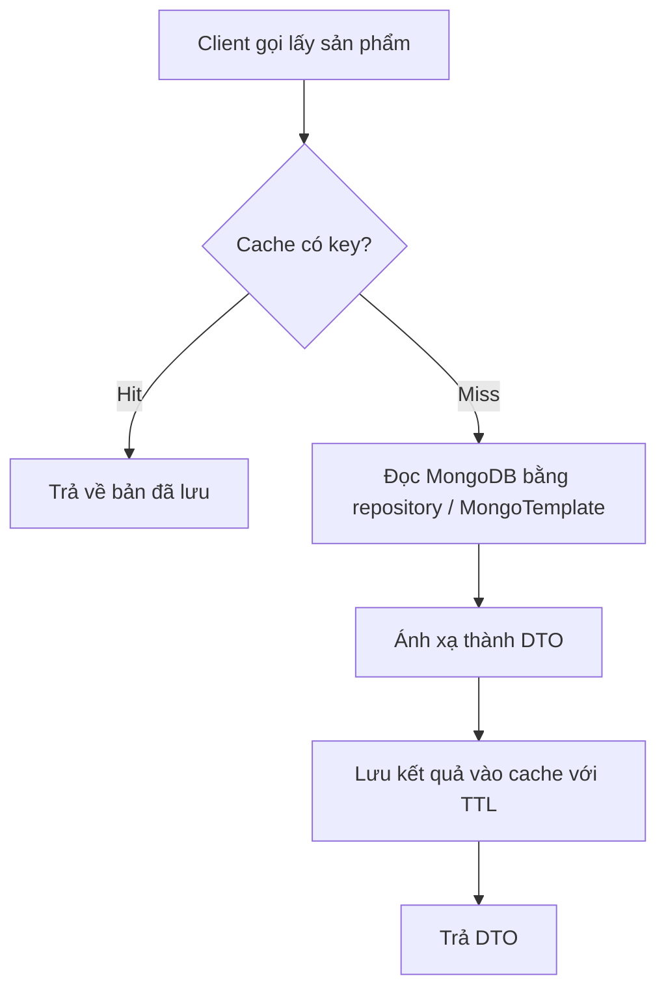
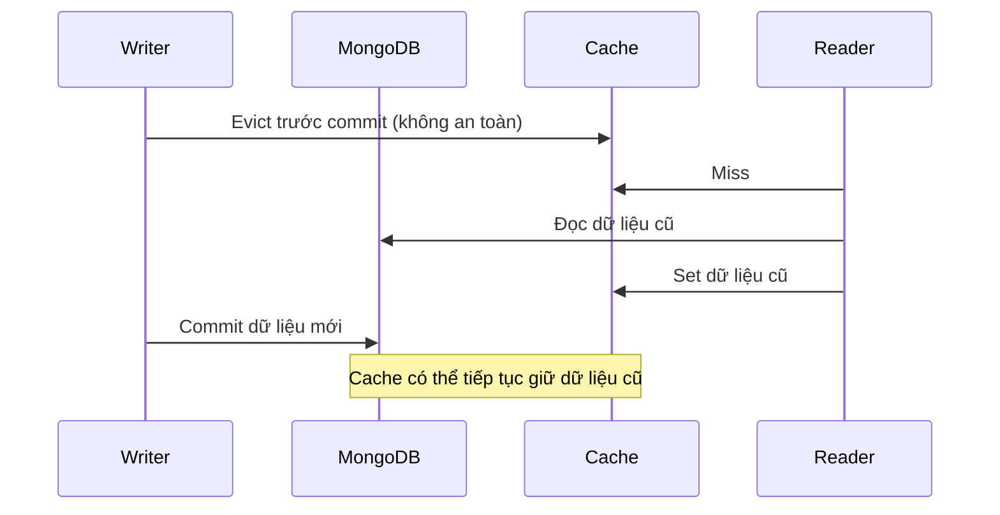
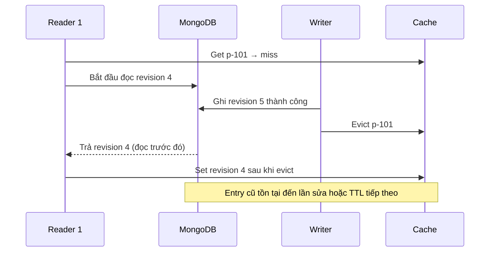
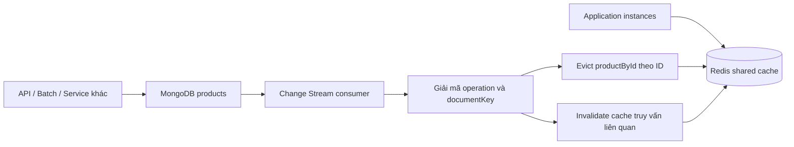
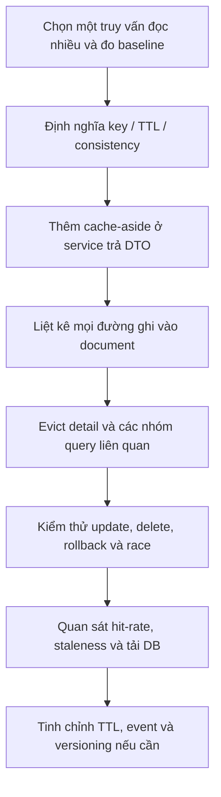

# Cache kết quả và chính sách vô hiệu hóa khi document thay đổi

## 1. Vì sao cache cần một chiến lược vô hiệu hóa?

Trong ứng dụng dùng **Spring Data MongoDB**, cùng một truy vấn có thể được gọi hàng nghìn lần: lấy thông tin sản phẩm theo ID, hiển thị danh sách sản phẩm đang bán, đọc cấu hình theo tenant hoặc tạo một bản tổng hợp bằng `MongoTemplate.aggregate()`. Cache giữ lại kết quả đã tính để giảm số lần truy cập MongoDB, thời gian ánh xạ document và chi phí xử lý aggregation. Đổi lại, dữ liệu trong cache là **bản sao** của trạng thái trong database.

Giả sử một cửa hàng có document:

```json
{
  "_id": "p-101",
  "name": "Bàn phím cơ",
  "price": 1500000,
  "visible": true,
  "revision": 4
}
```

Lúc 10:00, ứng dụng đọc và cache giá `1.500.000`. Lúc 10:01, quản trị viên sửa giá thành `1.350.000` trong MongoDB. Nếu ứng dụng tiếp tục trả kết quả từ cache mà không xóa hay cập nhật bản sao cũ, người dùng có thể thấy giá không đúng. Tình huống còn khó hơn khi một document xuất hiện trong nhiều loại kết quả: chi tiết theo ID, danh sách theo danh mục, tìm kiếm theo từ khóa và báo cáo tổng hợp.

Bài toán không chỉ là *lưu kết quả để đọc nhanh*, mà phải trả lời:

1. Kết quả nào nên được cache và cache theo khóa nào?
2. Document thay đổi thì những cache entry nào chịu ảnh hưởng?
3. Thao tác vô hiệu hóa chạy ở thời điểm nào so với việc ghi MongoDB?
4. Nếu có nhiều instance, job nền hoặc service khác cũng ghi dữ liệu thì mọi cache có nhận được thay đổi không?
5. Khi mất kết nối cache hoặc một thông báo thay đổi, dữ liệu cũ được chấp nhận tối đa trong bao lâu?

**Phân biệt hai giới hạn:** *TTL* quy định khoảng sống của một entry; *invalidation* cố gắng loại bỏ kết quả cũ khi nguồn dữ liệu đổi. TTL là cơ chế dự phòng hữu ích, nhưng một TTL ngắn không tự tạo ra tính nhất quán tức thời.

## 2. Cache-aside và vị trí đặt cache trong Spring Data MongoDB

Với mẫu **cache-aside** (*lazy loading*), ứng dụng kiểm tra cache trước khi truy vấn database. Nếu không thấy dữ liệu, ứng dụng đọc MongoDB, tạo DTO rồi lưu kết quả vào cache.



Nếu dữ liệu bị sửa qua API, trình tự ghi thường là **cập nhật MongoDB thành công → xóa cache liên quan**. Request đọc tiếp theo sẽ tự tải lại giá trị mới. Đây là mô hình dễ triển khai bằng Spring Cache (`@Cacheable`, `@CacheEvict`, `@CachePut`) hoặc bằng API cache trực tiếp.

| Cách đặt cache | Phù hợp | Điểm cần lưu ý |
| --- | --- | --- |
| Tại service trả DTO | Cache kết quả nghiệp vụ, kết hợp nhiều repository hoặc `MongoTemplate` | Key phải bao gồm mọi tham số ảnh hưởng đến DTO |
| Tại từng phương thức repository | Đường đọc đơn giản có quy tắc rõ | Khó quản lý kết quả liên quan đến nhiều phép biến đổi và luồng ghi ngoài repository |
| Redis dùng chung | Nhiều instance truy cập một kho cache thống nhất | Cần mạng, serialization, namespace, TTL và chính sách khôi phục |
| Cache trong bộ nhớ (Caffeine, v.v.) | Dữ liệu nhỏ, workload cục bộ, cần latency rất thấp | Mỗi instance có bản sao; cần phát sự kiện invalidation nếu dữ liệu thay đổi từ nơi khác |

Tài liệu này dùng **Spring Cache + Redis** để minh họa, vì Spring Data MongoDB và Redis đảm nhiệm những vai trò riêng: MongoDB là nguồn dữ liệu có thẩm quyền; Redis là cache. Không nên coi Redis là nguồn sự thật khi hệ thống vẫn ghi document vào MongoDB.

## 3. Chọn dữ liệu để cache và định nghĩa mức độ nhất quán

Cache đem lại lợi ích khi một kết quả được đọc thường xuyên, chi phí tạo kết quả cao, ít thay đổi tương đối so với số lần đọc và có thể xác định rõ điều kiện hết hiệu lực. Một kết quả truy vấn chỉ xuất hiện một lần hoặc luôn phụ thuộc vào trạng thái thay đổi từng mili giây có thể không đáng cache.

| Kết quả | Chính sách tham khảo | Lý do |
| --- | --- | --- |
| Cấu hình công khai ít đổi | Cache theo ID, TTL tương đối dài; evict khi chỉnh sửa | Đọc nhiều, thay đổi hiếm |
| Chi tiết sản phẩm | Cache theo ID hoặc ID + locale/currency; evict khi sửa hoặc xóa | Tỷ lệ đọc cao, key dễ xác định |
| Tìm kiếm, phân trang, lọc/sắp xếp | TTL ngắn, giới hạn kích thước key-space; cân nhắc invalidation nhóm | Một document có thể ảnh hưởng nhiều trang kết quả |
| Aggregation tính số liệu | Cache theo bộ tham số và cửa sổ thời gian; cân nhắc refresh định kỳ | Chi phí tính cao, phụ thuộc nhiều document |
| Tồn kho dùng quyết định giữ/chốt hàng | Hạn chế cache trên đường quyết định; xác nhận lại trong giao dịch ghi | Đòi hỏi tính đúng đắn cao hơn một màn hình chỉ đọc |
| Thông tin phụ thuộc quyền/tenant | Chỉ cache khi key tách biệt đúng phạm vi và không lộ dữ liệu | Tránh trả dữ liệu người này cho người khác |

Ví dụ các mục tiêu độ mới khác nhau:

- **Eventual consistency:** trang danh mục cho phép kết quả cũ trong khoảng ngắn theo yêu cầu sản phẩm.
- **Read-your-writes:** sau khi người dùng tự sửa một sản phẩm, chính request kế tiếp của họ phải thấy bản mới; cần evict/update trên đường ghi và thiết kế để giảm race.
- **Strong consistency:** quyết định tính tiền hoặc kiểm tra hạn mức phải đọc nguồn có đủ bảo đảm; một cache-aside thông thường không tự đáp ứng yêu cầu này.

Không có một TTL đúng cho tất cả ứng dụng. Giá trị TTL phải xuất phát từ mức chịu dữ liệu cũ, tốc độ thay đổi, tần suất đọc và chi phí miss đo được.

## 4. Thiết kế cache key, TTL và serialization

Một key đúng phải phân biệt mọi biến đầu vào làm thay đổi kết quả. Ví dụ:

```text
productById::p-101
productById::tenant-7::p-101::vi-VN::VND
productSearch::tenant-7::category=keyboard::sort=price-asc::page=0::size=20
salesSummary::tenant-7::2026-11::VND
```

Đây là **định dạng minh họa**, không phải yêu cầu Redis phải dùng đúng tên như vậy. Nếu cùng `p-101` thuộc nhiều tenant, key chỉ chứa `id` có thể gây trộn dữ liệu. Với kết quả phụ thuộc ngôn ngữ, loại tiền, nhóm quyền, tính năng được bật, phiên bản thuật toán hay vùng dữ liệu, key cũng phải biểu diễn các yếu tố có ảnh hưởng. Có thể chuẩn hóa bộ filter thành object có thứ tự trường ổn định rồi hash để giới hạn độ dài key; cần tránh collision theo yêu cầu hệ thống.

Giới hạn số key tạo ra từ các tham số có cardinality cao (query tìm kiếm tự do, phân trang sâu, timestamp đến từng giây). Đừng ghi token truy cập, mật khẩu hoặc dữ liệu cá nhân nhạy cảm trực tiếp vào key; key có thể xuất hiện trong metric, log và công cụ vận hành.

Ví dụ bật Spring Cache và cấu hình Redis bằng Spring Boot:

```java
import org.springframework.cache.annotation.EnableCaching;
import org.springframework.context.annotation.Configuration;

@Configuration
@EnableCaching
public class CacheConfiguration {
}
```

```yaml
spring:
  cache:
    type: redis
    redis:
      time-to-live: 60s
      cache-null-values: false
      use-key-prefix: true
  data:
    redis:
      host: localhost
      port: 6379
```

Cấu hình trên là **ví dụ cho môi trường học tập**. Khi dùng Redis trong production phải thiết lập kết nối, TLS, xác thực, giới hạn tài nguyên và thời gian chờ phù hợp. Có thể dùng `RedisCacheManager` để đặt TTL theo từng cache: `productById` và `productSearch` thường không nên có cùng TTL. Cần xác định định dạng serialization và tính tương thích khi deploy: Redis có thể dùng serialization mặc định khác mong muốn; cache DTO Java có thể không đọc được nếu thay đổi lớp hoặc serializer. Dữ liệu trong cache phải được xem là **có thể bỏ và tạo lại**, nên quy trình deploy có thể cần namespace/version key mới hoặc xóa cache tương ứng khi đổi định dạng.

**Không cache trực tiếp entity mutable** nếu các phần khác của code có thể sửa object trong bộ nhớ mà không cập nhật MongoDB. Nên cache DTO bất biến; nếu dùng serializer yêu cầu `Serializable`, DTO có thể triển khai interface đó hoặc chọn serializer JSON được cấu hình rõ ràng.

## 5. Ví dụ `@Cacheable` cho đường đọc theo ID

Giả sử document `products` có `_id`, `name`, `price`, `visible` và một field `revision` dành cho optimistic locking:

```java
import java.math.BigDecimal;
import org.springframework.data.annotation.Id;
import org.springframework.data.annotation.Version;
import org.springframework.data.mongodb.core.mapping.Document;

@Document("products")
public class ProductDocument {
    @Id
    private String id;

    private String name;
    private BigDecimal price;
    private boolean visible;

    @Version
    private Long revision;

    protected ProductDocument() {}

    public String getId() { return id; }
    public String getName() { return name; }
    public BigDecimal getPrice() { return price; }
    public boolean isVisible() { return visible; }
    public Long getRevision() { return revision; }
    public void changePrice(BigDecimal newPrice) { this.price = newPrice; }
}
```

```java
import java.math.BigDecimal;
import java.io.Serializable;

public record ProductView(
    String id,
    String name,
    BigDecimal price,
    boolean visible,
    Long revision
) implements Serializable {
    public static ProductView from(ProductDocument document) {
        return new ProductView(
            document.getId(),
            document.getName(),
            document.getPrice(),
            document.isVisible(),
            document.getRevision()
        );
    }
}
```

```java
import org.springframework.data.mongodb.repository.MongoRepository;

public interface ProductRepository
        extends MongoRepository<ProductDocument, String> {
}
```

```java
import org.springframework.cache.annotation.Cacheable;
import org.springframework.stereotype.Service;

@Service
public class ProductReadService {
    private final ProductRepository products;

    public ProductReadService(ProductRepository products) {
        this.products = products;
    }

    @Cacheable(cacheNames = "productById", key = "#p0",
               unless = "#result == null")
    public ProductView findById(String id) {
        return products.findById(id)
            .map(ProductView::from)
            .orElse(null);
    }
}
```

Khi `findById("p-101")` được gọi qua Spring bean proxy, lần đầu ứng dụng sẽ truy vấn MongoDB; các lần tiếp theo có thể trả `ProductView` từ cache. `unless = "#result == null"` tránh cache kết quả không tìm thấy trong ví dụ này. Một hệ thống cần negative caching có thể chọn TTL rất ngắn cho kết quả "không tồn tại", nhưng phải cân nhắc kịch bản document được tạo ngay sau đó.

Lưu ý về `@Cacheable`:

- Chỉ có tác dụng khi **Spring caching được bật** và lời gọi đi qua proxy; gọi trực tiếp `this.findById(...)` từ cùng một instance thường không kích hoạt interceptor cache trong proxy mode mặc định.
- `#p0` là tham số đầu tiên, không phụ thuộc việc tên tham số Java có được giữ trong bytecode. Nếu method nhận `tenantId`, `locale`, hãy đưa đủ tham số vào key.
- Lần cache hit bỏ qua logic bên trong method, bao gồm kiểm tra quyền nếu quyền chỉ được kiểm tra bên trong đó. Hãy xác thực quyền ở nơi luôn được thực thi, hoặc đưa phạm vi quyền phù hợp vào thiết kế cache.
- Cache không làm cho truy vấn MongoDB không cần index; cache miss vẫn phải được tối ưu bằng index và thiết kế query hợp lý.

## 6. Vô hiệu hóa cache khi sửa hoặc xóa document

Một thay đổi giá sản phẩm có thể ảnh hưởng cả cache chi tiết và cache danh sách tìm kiếm. Spring Cache hỗ trợ khai báo nhiều vùng cần xóa sau khi ghi thành công:

```java
import java.math.BigDecimal;
import java.util.NoSuchElementException;

import org.springframework.cache.annotation.CacheEvict;
import org.springframework.cache.annotation.Caching;
import org.springframework.stereotype.Service;

@Service
public class ProductWriteService {
    private final ProductRepository products;

    public ProductWriteService(ProductRepository products) {
        this.products = products;
    }

    @Caching(evict = {
        @CacheEvict(cacheNames = "productById", key = "#p0"),
        @CacheEvict(cacheNames = "productSearch", allEntries = true)
    })
    public ProductView changePrice(String id, BigDecimal newPrice) {
        ProductDocument product = products.findById(id)
            .orElseThrow(() -> new NoSuchElementException("Không tìm thấy sản phẩm"));

        product.changePrice(newPrice);
        ProductDocument saved = products.save(product);
        return ProductView.from(saved);
    }

    @Caching(evict = {
        @CacheEvict(cacheNames = "productById", key = "#p0"),
        @CacheEvict(cacheNames = "productSearch", allEntries = true)
    })
    public void deleteById(String id) {
        products.deleteById(id);
    }
}
```

Theo mặc định, `@CacheEvict` có `beforeInvocation = false`: cache bị evict **sau khi method thực thi thành công**. Nếu `save()` hoặc `deleteById()` ném exception, cache không bị xóa bởi annotation này. Ví dụ cập nhật một document bằng `repository.save` và `@Version` dùng optimistic locking: khi một bản khác đã được ghi trước đó, Spring Data có thể ném `OptimisticLockingFailureException` thay vì ghi đè bản mới. Muốn retry, phải **đọc lại document hiện tại và đánh giá lại thay đổi**; không retry bằng cách ghi mù đối tượng cũ.

`allEntries = true` hữu ích khi một document có thể xuất hiện trong nhiều query cache. Nhưng nó có thể xóa cả nghìn entry, kể cả tenant không liên quan; chi phí tăng và cache hit rate giảm. Nếu truy vấn được phân vùng rõ theo tenant/danh mục, có thể chọn cơ chế chỉ xóa nhóm liên quan, dùng version/generation cho key theo nhóm hoặc giữ TTL ngắn cho cache truy vấn thay vì xóa toàn bộ.

Lưu ý quan trọng: đoạn mã trên minh họa thao tác **không có transaction bao quanh service**. Nếu phương thức được gắn `@Transactional`, thứ tự commit database và cache eviction phụ thuộc transaction/caching interceptor được cấu hình. Không mặc định rằng `@CacheEvict` luôn chạy sau khi transaction thật sự commit. Xem phần xử lý nhất quán dưới đây.

### Khi nào dùng `@CachePut`?

`@CachePut` luôn thực thi method và ghi kết quả trả về vào cache theo key. Nó phù hợp khi có thể tạo chắc chắn DTO mới từ thao tác ghi thành công. Chẳng hạn, sau khi cập nhật giá và `save()` thành công, có thể đưa `ProductView` mới vào `productById` thay vì xóa. Tuy nhiên `@CachePut` có thể gặp **ghi chồng dữ liệu cũ** khi hai request hoàn thành ngoài thứ tự hoặc khi writer ngoài service sửa DB mà không cập nhật cache. Vô hiệu hóa rồi tải lại bằng đường đọc chung thường đơn giản để bắt đầu; nếu chọn cache update chủ động, nên có cơ chế chống ghi lùi theo revision hoặc version của document.

### Các luồng ghi phải được tính đủ

Ví dụ `ProductWriteService` chỉ bao phủ những thay đổi đi qua bean đó. Một lệnh `MongoTemplate.updateFirst(...)`, `updateMulti(...)`, `findAndModify(...)`, `BulkOperations`, import script, change ở service khác hoặc ghi trực tiếp từ MongoDB Shell **không tự kích hoạt** `@CacheEvict` của service này. Mọi đường ghi có thể làm thay đổi kết quả cache phải được xác định trong bảng quan hệ phụ thuộc và gắn chính sách invalidation tương ứng.

## 7. Vô hiệu hóa cache truy vấn, phân trang và aggregation

Cache theo ID có quan hệ phụ thuộc gần như một-một giữa document và entry. Với danh sách hoặc aggregation, một document ảnh hưởng nhiều entry:

```text
Document p-101:
  ├─ productById::p-101
  ├─ productSearch::category=keyboard::sort=price-asc::page=0
  ├─ productSearch::category=keyboard::sort=price-asc::page=1
  ├─ productSearch::query=mechanical::page=0
  └─ catalogSummary::category=keyboard
```

Nếu giá thay đổi, kết quả sort theo giá có thể đổi **thứ tự lẫn thành viên của nhiều trang**. Nếu `visible` chuyển từ `true` sang `false`, document có thể biến mất khỏi hàng loạt bộ lọc. Vì vậy chỉ evict cache entry đang chứa `p-101` chưa chắc đủ: các entry trước đó không chứa sản phẩm này cũng có thể cần được cập nhật vì kết quả phân trang đã xô dịch.

| Loại kết quả | Chính sách thường dùng | Đánh đổi |
| --- | --- | --- |
| Detail theo ID | Evict đúng key khi insert/update/delete liên quan | Đơn giản, phạm vi nhỏ |
| Danh sách theo danh mục | Evict namespace/nhóm danh mục chịu ảnh hưởng hoặc tăng generation | Cần biết danh mục cũ và mới |
| Tìm kiếm tự do | TTL ngắn, giới hạn key, tùy yêu cầu có thể clear cả cache truy vấn | Dễ dùng nhưng cache dễ mất hiệu lực hàng loạt |
| Aggregation thống kê | Refresh theo lịch hoặc invalidate theo sự kiện thay đổi tài liệu đầu vào | Phải xác định mức chấp nhận số liệu trễ |
| Cache kết quả nhiều collection | Invalidate từ mọi collection tham gia kết quả | Quan hệ phụ thuộc phức tạp hơn |

Có ba lựa chọn phổ biến:

1. **Evict chính xác:** phù hợp khi biết một key đại diện cho một ID và có thể tính được đầy đủ các key liên quan.
2. **Invalidate theo generation/namespace:** khi danh mục đổi, tăng một số phiên bản cho nhóm, ví dụ `catalog:keyboard:v18`; request mới dùng key có version mới. Các entry version cũ sẽ tự hết TTL. Cần thiết kế thao tác tăng generation và đọc version để tránh key cũ bị tiếp tục sử dụng quá lâu.
3. **TTL hoặc refresh định kỳ:** phù hợp khi danh sách/aggregation chỉ cần gần đúng trong một cửa sổ ngắn, với tài nguyên xử lý được giới hạn.

Đối với aggregation qua `MongoTemplate`, cache **kết quả cuối đã chuẩn hóa** theo bộ tham số thực sự dùng trong pipeline, không cache cả `Aggregation`/`Query` object mutable. Khi thay đổi pipeline, cách tính hoặc projection, nên đổi namespace/phiên bản key để tránh dùng lại kết quả của thuật toán trước.

## 8. Thời điểm invalidation so với transaction MongoDB

Trong một nghiệp vụ gồm nhiều bước ghi, thứ tự **MongoDB commit → cache invalidation** quan trọng. Nếu xóa cache **trước** khi transaction commit, request khác có thể cache miss, đọc trạng thái cũ từ database rồi lại đặt dữ liệu cũ vào cache ngay trước commit.



Nếu sử dụng MongoDB transaction do Spring quản lý (cần `MongoTransactionManager`, deployment MongoDB hỗ trợ transaction và cấu hình thích hợp), có thể đăng ký xóa cache **sau commit thành công** bằng `TransactionSynchronizationManager`. Ví dụ minh họa phần cơ chế sau commit:

```java
import org.springframework.cache.Cache;
import org.springframework.cache.CacheManager;
import org.springframework.transaction.support.TransactionSynchronization;
import org.springframework.transaction.support.TransactionSynchronizationManager;

public final class CacheInvalidation {
    private final CacheManager cacheManager;

    public CacheInvalidation(CacheManager cacheManager) {
        this.cacheManager = cacheManager;
    }

    public void evictAfterCommit(String cacheName, Object key) {
        Runnable operation = () -> {
            Cache cache = cacheManager.getCache(cacheName);
            if (cache == null) {
                throw new IllegalStateException("Cache chưa được cấu hình: " + cacheName);
            }
            cache.evict(key);
        };

        if (TransactionSynchronizationManager.isActualTransactionActive()
                && TransactionSynchronizationManager.isSynchronizationActive()) {
            TransactionSynchronizationManager.registerSynchronization(
                new TransactionSynchronization() {
                    @Override
                    public void afterCommit() {
                        operation.run();
                    }
                }
            );
        } else {
            operation.run();
        }
    }
}
```

Đoạn này phù hợp để giải thích **thứ tự** sự kiện, nhưng chưa bảo đảm việc evict luôn thành công: Redis có thể bị mất kết nối sau khi MongoDB đã commit. Cần theo dõi lỗi và có kế hoạch retry/reconciliation hoặc cơ chế sự kiện bền vững. Ngoài ra, nếu đăng ký từ một tầng nằm ngoài transaction, kiểm tra transaction thực tế trước khi dựa vào callback. Một cách khác là dùng `TransactionAwareCacheManagerProxy`/cache được cấu hình transaction-aware để trì hoãn các lệnh `put`, `evict`, `clear` phù hợp đến khi commit. Cần kiểm thử thứ tự interceptor thực sự ở ứng dụng đang chạy.

Nếu không có transaction và chỉ có một thao tác ghi MongoDB đã được xác nhận, có thể evict **sau** khi phương thức ghi trả thành công. Tuy nhiên, vẫn có khoảng thời gian giữa hai thao tác và lỗi mạng; Redis và MongoDB không tự tạo thành một giao dịch ACID chung.

## 9. Race condition: evict sau ghi vẫn có thể để lọt dữ liệu cũ

Xét trình tự khác với ví dụ transaction ở trên:



Kịch bản này là **stale fill race**: reader nạp bản cũ vào cache sau khi writer đã xóa key. Vì thế, công thức “ghi thành công rồi evict” thường cung cấp **nhất quán cuối cùng** chứ không chứng minh được strong consistency.

Các biện pháp, chọn theo yêu cầu hệ thống:

- **TTL hợp lý:** giới hạn vòng đời của entry vô tình bị tái tạo từ dữ liệu cũ; không phải bằng chứng cho read-after-write tuyệt đối.
- **Gắn revision vào kết quả cache:** giúp phát hiện dữ liệu ghi lùi, theo dõi và so sánh; bản thân việc thêm field revision không tự ngăn race.
- **Versioned key với nguồn version đáng tin cậy:** ví dụ `product:p-101:v5`, nơi reader tra revision mới nhất từ một cơ chế nhất quán; key cũ không được dùng cho revision mới. Chi phí đọc revision hoặc duy trì version pointer phải được tính vào thiết kế.
- **Update/evict có điều kiện atomically tại cache:** dùng compare-and-set hoặc script phù hợp với cache backend để chỉ cho phép giá trị có revision không thấp hơn revision đã ghi nhận. Cần thận trọng với thứ tự publish sự kiện và trường hợp xóa document.
- **Đọc nguồn dữ liệu khi tính đúng đắn quan trọng:** những thao tác như xác nhận thanh toán, chuyển tiền, ghi tồn kho phải xác minh bằng MongoDB/trình tự ghi nghiệp vụ phù hợp.

Không nên gọi `@Cacheable(sync = true)` là giải pháp cho mọi race: `sync = true` hỗ trợ phối hợp tải cache theo khả năng của cache provider, có thể giảm nhiều request cùng miss một key; nó **không** tự bảo đảm khóa phân tán giữa mọi node hay giải quyết trường hợp writer thay đổi dữ liệu trong lúc reader đang đọc.

## 10. Document thay đổi ngoài service: Change Streams và sự kiện

Một hệ thống nhiều service thường có các nguồn ghi khác nhau: HTTP API, batch import, consumer và công cụ quản trị. Một cách theo dõi thay đổi mà không cần mọi nguồn gọi chung `@CacheEvict` là dùng **MongoDB Change Streams**.



Change Streams có thể phát sự kiện insert, update, replace, delete cho collection hoặc database. Các sự kiện thường có `documentKey` chứa `_id`, kể cả khi delete không còn `fullDocument`. Với event update, có thể xem `updateDescription` để xác định field đổi và phạm vi cache cần evict. Tuy nhiên cần bảo thủ nếu không xác định chắc quan hệ phụ thuộc: thông tin event có thể không đủ để tái dựng danh mục **trước và sau** của document, nhất là khi chỉ nhận được trạng thái mới.

Các điểm phải thiết kế khi dùng Change Streams:

1. MongoDB phải chạy trong môi trường hỗ trợ Change Streams (thường là replica set hoặc sharded cluster); standalone không đáp ứng yêu cầu này.
2. Consumer phải lưu **resume token** một cách bền vững và chỉ nâng checkpoint theo quy trình phù hợp sau khi xử lý event; dùng token để tiếp tục sau restart.
3. Resume token chỉ dùng được khi lịch sử oplog còn cho phép; nếu mất khoảng lịch sử, cần cơ chế **invalidate rộng/khởi tạo lại cache** trước khi chấp nhận kết quả cũ.
4. Cần xử lý sự kiện lặp, consumer restart, network outage, thay đổi schema event, thay đổi key namespace và trường hợp nhiều consumer cùng nhận event.
5. Nếu nhiều instance dùng **cùng Redis** thì một consumer evict entry chung có thể đủ theo kiến trúc; nếu mỗi instance dùng local cache thì phải phát invalidation đến các instance hoặc có cơ chế nhất quán khác.
6. Change Streams có độ trễ và phụ thuộc vào vận hành consumer; đừng giả định nhận event ngay lập tức hoặc có strong consistency giữa MongoDB và Redis.

Với hệ thống cần **phát sự kiện thay đổi nghiệp vụ đáng tin cậy**, có thể dùng *transactional outbox*: ghi document nghiệp vụ và bản ghi outbox trong cùng MongoDB transaction (khi hạ tầng và thiết kế hỗ trợ), sau đó một worker đọc outbox và phát event invalidation kèm ID/revision. Consumer áp dụng idempotency, retry và giám sát tồn đọng. Outbox giúp tránh thất lạc ý định phát event sau commit, nhưng **không** loại bỏ hoàn toàn độ trễ, thông báo lặp hoặc race nạp cache; tính đúng đắn vẫn phụ thuộc cơ chế tiêu thụ và chính sách đọc.

## 11. Các trường hợp dễ bỏ sót khi vô hiệu hóa

| Thay đổi ở MongoDB | Cache có thể bị ảnh hưởng | Cách xử lý cần cân nhắc |
| --- | --- | --- |
| `insert` sản phẩm mới | Danh sách, tìm kiếm, số lượng | Evict cache truy vấn hoặc đổi generation; detail chưa từng cache có thể không cần evict |
| Sửa `price` | Detail, danh sách sort theo giá, aggregation giá | Evict detail và mọi kết quả phụ thuộc giá |
| Sửa `visible` | Detail, danh mục công khai, thống kê sản phẩm bán | Vô hiệu hóa cả các trang mà sản phẩm mới xuất hiện/biến mất |
| Chuyển `categoryId` từ A sang B | Danh mục A và B | Cần biết category cũ và mới; chỉ xóa B là thiếu |
| `delete` document | Detail, danh sách, thống kê | Evict detail, invalidate query; cân nhắc negative cache |
| `updateMulti`/bulk update | Nhiều detail và query cache | Chọn batch invalidation, nhóm key hoặc epoch/TTL |
| Thay đổi record ở collection phụ thuộc | Aggregation hoặc DTO join từ nhiều nguồn | Invalidate kết quả được xây từ cả hai collection |
| Index hoặc pipeline truy vấn thay đổi | Kết quả/cách sắp xếp nếu semantics đổi | Đổi key namespace khi thay logic tạo kết quả |

Với update hàng loạt, việc liệt kê mọi `_id` rồi xóa từng key có thể tốn tài nguyên hơn việc đổi generation của một vùng cache. Nhưng `allEntries` cũng gây cache miss đồng loạt. Nên đo tỷ lệ hit, số entry bị vô hiệu hóa và áp lực lên MongoDB sau mỗi lần làm rỗng cache.

## 12. Cache stampede, cache outage và cơ chế dự phòng

**Cache stampede** xảy ra khi một key rất phổ biến hết TTL hoặc bị evict, khiến nhiều request đồng thời truy vấn MongoDB và tạo cùng một kết quả. Với aggregation nặng, các lần miss đồng loạt có thể tạo đỉnh CPU và IO.

Các cách giảm tác động:

- Đặt TTL có **jitter** theo key hoặc thời điểm nạp để giảm số entry hết hạn cùng lúc.
- Dùng `@Cacheable(sync = true)` khi provider hỗ trợ cơ chế đồng bộ tải phù hợp; với nhiều instance, cân nhắc single-flight/distributed locking có thời gian chờ và xử lý lỗi an toàn.
- Chủ động **warm** một số key nóng sau deploy hoặc sau invalidation theo nhu cầu thực tế, tránh nạp trước toàn bộ key ít sử dụng.
- Giới hạn concurrency, timeout và đặt circuit breaker cho các truy vấn/aggregation quá tốn tài nguyên.
- Với màn hình đọc cho phép dữ liệu trễ, có thể xem xét stale-while-revalidate có giới hạn tuổi dữ liệu và cơ chế refresh nền, nhưng cần ghi rõ khi nào dữ liệu cũ được phép trả.

Khi Redis không sẵn sàng, ứng dụng phải có hành vi đã thống nhất: truy vấn MongoDB trực tiếp (có giới hạn tải) hoặc trả lỗi ở những chức năng mà cache là một phần bắt buộc của hợp đồng. Cần kiểm thử tình huống cache timeout vì một cache không phản hồi có thể gây độ trễ lớn hơn việc truy vấn trực tiếp. `CacheErrorHandler` có thể được dùng để phân loại lỗi truy cập cache nếu thiết kế cho phép tiếp tục với nguồn dữ liệu, nhưng phải bảo đảm không vô tình che mất lỗi consistency quan trọng.

## 13. Đo hiệu quả và chẩn đoán hệ thống

Đừng đánh giá cache chỉ bằng tỷ lệ hit. Tỷ lệ hit cao có thể đi kèm dữ liệu quá cũ hoặc bộ key sai phạm vi. Ngược lại, TTL quá ngắn có thể khiến Redis mất công ghi rồi MongoDB vẫn chịu phần lớn truy vấn.

| Metric | Điều muốn biết |
| --- | --- |
| Cache hit/miss theo cache name | Key nào thực sự có lợi, entry nào ít tái sử dụng |
| p50/p95/p99 latency của đường đọc | Cache có giảm thời gian trả kết quả cho người dùng không |
| Số query và thời gian xử lý MongoDB | Truy vấn có thực sự giảm; có tăng tải sau evict hàng loạt không |
| Redis memory, evictions, network timeout | Cache có đủ tài nguyên và kết nối ổn định không |
| Số lần invalidation, lỗi và độ trễ xử lý event | Cache có được làm mới kịp sau document update không |
| Change Stream lag, resume failures, outbox backlog | Có bỏ lỡ hoặc chậm nhận thay đổi không |
| Tuổi dữ liệu cache so với revision MongoDB | Tính nhất quán thực tế có đạt SLO không |
| Số key và hiệu quả từng nhóm query | Có bị bùng nổ cardinality hoặc cache không đáng dùng không |

Ví dụ, nếu `productById` hit rate cao nhưng `productSearch` gần như luôn miss và tạo quá nhiều key do bộ lọc thay đổi, nên xem xét ngừng cache tìm kiếm tự do, chỉ cache các bộ lọc phổ biến hoặc dùng TTL ngắn hơn. Nếu sau mỗi `allEntries=true` database tăng CPU đột biến, nên phân vùng cache hoặc warm các key nóng có kiểm soát.

Đo MongoDB bằng `explain()` cho truy vấn phổ biến, theo dõi index được chọn, số document quét và thời gian thực thi khi **cache miss**. Cache giúp che bớt chi phí query, nhưng không sửa được truy vấn sai index hoặc aggregation phải duyệt toàn collection.

## 14. Kiểm thử chức năng và khả năng nhất quán

Có thể dùng Spring Boot Test kết hợp Testcontainers cho MongoDB và Redis thử nghiệm. Nên kiểm tra hành vi bằng các thao tác đọc/ghi thật, không chỉ mock annotation.

| Tình huống | Kỳ vọng |
| --- | --- |
| Hai lần `findById` liên tiếp | Lần sau có thể hit cache; kết quả đúng dữ liệu |
| `changePrice` qua service rồi đọc lại | Entry detail bị evict, trả giá vừa lưu |
| Xóa document | Không tiếp tục trả DTO cũ từ cache |
| Thay `visible`/`categoryId` | Cache danh sách và kết quả thống kê liên quan không tiếp tục dùng dữ liệu cũ quá chính sách |
| `repository.save` thất bại | Không coi thay đổi là thành công; không tạo cache chứa giá trị chưa commit |
| Ghi bằng `MongoTemplate` hoặc process khác | Cơ chế event/invalidation dành cho đường ghi ngoài service vẫn hoạt động |
| Nhiều instance đọc cùng Redis | Một thay đổi được phản ánh theo chính sách trên mọi instance |
| Transaction rollback | Không publish bản cập nhật hoặc invalidation giả định rằng DB đã commit |
| Reader miss đồng thời writer thay đổi giá | Race được phát hiện; tính nhất quán đáp ứng thiết kế đã chọn |
| Redis bị lỗi và phục hồi | Ứng dụng thực hiện đúng fallback và không phục vụ dữ liệu sai vô thời hạn |
| Thay DTO/schema/key namespace khi deploy | Entry cũ không làm hỏng deserialization hoặc kết quả mới |

Một bài kiểm thử tối thiểu cho `ProductWriteService` là: tạo `p-101` giá 1.500.000, gọi `ProductReadService.findById()` để nạp cache, đổi giá thành 1.350.000, rồi gọi lại qua **Spring bean** để xác nhận giá mới; kiểm tra luôn cache `productSearch` đã hết hiệu lực. Nếu chạy unit test bằng cách tự `new ProductReadService(...)`, annotation có thể không được kích hoạt và bài kiểm thử dễ đưa ra kết luận sai.

Với transaction, thực hiện một test buộc rollback sau khi sửa document rồi xác nhận kết quả cache không phản ánh dữ liệu chưa commit. Với Change Streams, cần môi trường MongoDB replica set, cho consumer xử lý event thật và kiểm tra resume sau khi dừng rồi chạy lại.

## 15. Lộ trình áp dụng cho một dịch vụ thực tế



Thực hành bắt đầu với `productById` theo ID, nơi quan hệ giữa document và entry rõ nhất. Sau đó thêm `productSearch` có filter, sort, page và size; thử thay đổi `price`, `visible`, `categoryId` để quan sát vì sao vô hiệu hóa một key detail là chưa đủ. Tiếp theo mô phỏng hai instance và một update trực tiếp qua `MongoTemplate` để kiểm tra thiết kế invalidation xuyên đường ghi.

**Tiêu chí hoàn thành bài thực hành:** có bằng chứng cache giảm số lần truy vấn MongoDB và độ trễ trên dữ liệu đọc lặp, vẫn trả thông tin phù hợp sau các thay đổi document, nhận diện được dữ liệu cũ do race hoặc event trễ, và có phương án phục hồi an toàn khi cache hoặc consumer gặp lỗi. Lựa chọn TTL và mức độ nhất quán cuối cùng phải dựa trên yêu cầu nghiệp vụ cùng metric đo được.
