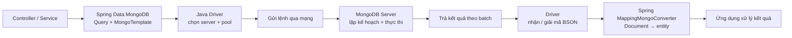

# Phân biệt thời gian server, mạng, driver và chuyển đổi đối tượng

Khi một lời gọi `MongoTemplate.find(...)` mất 450 ms, không thể kết luận MongoDB đã thực thi truy vấn trong 450 ms. Thời gian người dùng nhận thấy có thể gồm nhiều công đoạn: chờ chọn server, chờ lấy connection, gửi lệnh qua mạng, thực thi trên MongoDB, nhận các batch dữ liệu, giải mã BSON, ánh xạ `Document` thành entity Java và xử lý ở ứng dụng. Truy vấn chỉ mất vài mili giây trên server vẫn có thể chậm ở đầu ứng dụng.

Trong module **Spring Data MongoDB**, việc phân biệt các lớp thời gian giúp chọn đúng cách tối ưu: chỉnh truy vấn/index khi MongoDB xử lý chậm; kiểm tra mạng, số batch và kích thước kết quả khi truyền dữ liệu chậm; điều chỉnh cấu hình connection pool khi driver phải chờ; hoặc giảm chi phí ánh xạ đối tượng khi phần xử lý Java mới là nút thắt. Bài học hướng dẫn cách lập mô hình độ trễ, thu thập số đo bằng `explain`/profiler, MongoDB Java Driver và mã Spring Data, sau đó đối chiếu các bằng chứng trước khi quyết định sửa hệ thống.

## 1. Một lời gọi database đi qua những lớp nào?

Với lời gọi đồng bộ đọc nhiều document, luồng tổng quát như sau:



Một mô hình đơn giản cho **một lần đọc đã lấy đủ kết quả**:

```text
T_end_to_end
≈ T_ứng_dụng_trước_truy_vấn
  + T_chọn_server
  + T_chờ_connection
  + Σ T_command(find / getMore)
  + T_ánh_xạ_đối_tượng
  + T_ứng_dụng_sau_truy_vấn

T_command ≈ T_gửi_yêu_cầu + T_thực_thi_server
            + T_trả_kết_quả + T_xử_lý_giao_thức_driver
```

Đây là **mô hình tư duy**, không phải phép cộng các số đo lúc nào cũng tách được hoàn toàn. Giải mã BSON, ánh xạ entity, nhận batch và thực thi có thể xen kẽ; với reactive/async, scheduler và các công việc khác có thể chồng lấp. Ngoài ra, một lần gọi repository có thể phát sinh **nhiều lệnh** trên server do cursor, truy vấn tham chiếu hoặc thao tác phụ.

Định nghĩa bốn nhóm thường được nhắc đến:

| Thành phần | Thường bao gồm | Không nên nhầm với |
| --- | --- | --- |
| **Thời gian server** | Chọn kế hoạch, quét index/document, lọc, sort, aggregate và tạo kết quả trên MongoDB | Toàn bộ thời gian request HTTP hoặc Java |
| **Thời gian mạng** | Đường đi request/response, RTT, truyền số byte, độ trễ giữa ứng dụng và MongoDB | Chỉ số `executionTimeMillis` của `explain` |
| **Thời gian driver** | Chọn server, chờ connection, giao thức, gửi/nhận lệnh, đọc BSON, quản lý cursor, retry | Chỉ riêng thời gian xử lý lệnh trên server |
| **Chuyển đổi đối tượng** | Spring Data mapping từ BSON/`Document` sang entity/DTO; converter, callback, xử lý trường lồng nhau | Thời gian `CommandSucceededEvent` của driver |

`CommandSucceededEvent` đo thời gian thực hiện một **lệnh driver** ở mức command monitoring. Nó thường bao gồm round trip mạng và xử lý liên quan, nhưng **không đại diện cho toàn bộ lời gọi `MongoTemplate.find(...)`**: thời gian chờ pool/chọn server trước lệnh và Spring Data mapping sau lệnh có thể nằm ngoài chỉ số này.

## 2. Bốn đồng hồ khác nhau và cách đặt câu hỏi

Giả sử endpoint `GET /orders?status=PAID` trả về 100 đơn hàng trong 320 ms. Ba hệ thống đo có thể hiển thị:

- Ứng dụng ghi nhận thời gian endpoint 320 ms.
- Một lệnh `find` do driver phát ra hoàn thành trong 120 ms.
- `explain("executionStats")` trên một truy vấn tương đương báo 18 ms.

**Không thể lấy 320 − 120 = 200 ms và mặc định tất cả là mapping**, cũng không thể lấy 120 − 18 = 102 ms và khẳng định mạng đã mất đúng 102 ms. Những số đo có thể được thu ở các thời điểm khác nhau, bằng các cơ chế khác nhau; endpoint còn có xác thực, serialization JSON và nhiều câu lệnh `getMore`.

Muốn kết luận, hãy làm rõ:

1. **Đồng hồ bắt đầu/kết thúc ở đâu?** Tính từ HTTP request, lệnh driver, lần thực thi `find` trên server hay toàn bộ quá trình lấy dữ liệu?
2. **Đo một lệnh hay toàn bộ cursor?** `find` chỉ có thể trả batch đầu tiên; các batch kế tiếp cần `getMore`.
3. **Dữ liệu trả về là bao nhiêu?** Số document, số byte, độ sâu object, mảng lồng nhau và projection ảnh hưởng lớn đến mạng, BSON decoding và mapping.
4. **Khi đo có điều kiện tải nào?** Pool bận, cache lạnh, DNS/TLS, CPU của ứng dụng, garbage collection, tải ghi trên database hoặc tranh chấp tài nguyên.
5. **Có cùng truy vấn/cùng BSON filter/cùng index không?** `explain` trên một truy vấn khác shape, projection hoặc sort không thể dùng để giải thích trực tiếp request thực tế.

## 3. Đo thời gian xử lý trên MongoDB Server

### 3.1. Dùng `explain("executionStats")` để phân tích truy vấn

Ví dụ collection `orders` lưu các trường `status`, `createdAt`, `customerId` và `totalAmount`. Ứng dụng cần lấy 100 đơn hàng đã thanh toán gần nhất:

```javascript
db.orders.find(
  { status: "PAID" },
  { _id: 1, customerId: 1, createdAt: 1, totalAmount: 1 }
).sort({ createdAt: -1 }).limit(100).explain("executionStats");
```

Các trường thường cần đọc trong kết quả:

| Trường | Ý nghĩa thực dụng |
| --- | --- |
| `queryPlanner.winningPlan` | Kế hoạch được chọn; tìm các stage như `IXSCAN`, `COLLSCAN`, `FETCH`, `SORT` |
| `executionStats.executionTimeMillis` | Thời gian được MongoDB báo cho quá trình lập kế hoạch/thực thi trong phép `explain` tương ứng |
| `executionStats.nReturned` | Số document kết quả của truy vấn |
| `executionStats.totalDocsExamined` | Số lần kiểm tra document trong quá trình thực thi |
| `executionStats.totalKeysExamined` | Số lần kiểm tra khóa index |
| Thống kê của từng stage | Xác định nơi tốn công: quét, sort, filter, lookup, group… |

Ví dụ: trả 100 bản ghi nhưng phải kiểm tra hàng trăm nghìn document là dấu hiệu cần xem lại index, độ chọn lọc và shape của truy vấn. Ngược lại, đọc 100 khóa index và trả 100 kết quả nhưng endpoint vẫn chậm có thể cho thấy phần lớn vấn đề ở nơi khác.

Index ghép có thể phù hợp với filter và sort:

```javascript
// Chỉ là chỉ mục ứng viên để đánh giá bằng explain,
// không mặc định phù hợp với mọi workload.
db.orders.createIndex({ status: 1, createdAt: -1 });
```

Một projection nhỏ có thể giảm lượng dữ liệu phải đọc/truyền; trong điều kiện phù hợp, truy vấn còn có thể được index cover. Tuy nhiên yêu cầu `_id`, các trường không có trong index hoặc thao tác khác có thể vẫn cần `FETCH`.

**Giới hạn của `explain`:** kết quả phản ánh lần chạy *giải thích* kế hoạch, không phải đồng hồ end-to-end của một request Java. Việc gọi `explain` có đặc điểm riêng về plan cache/plan selection và môi trường thực thi; thời gian thực tế có thể khác do cache, tải, dữ liệu hay số batch. Không dùng duy nhất `executionTimeMillis` để thay thế số đo sản xuất.

### 3.2. Profiler và slow query trên server

Khi có profiler hoặc công cụ theo dõi slow operation được bật đúng chính sách vận hành, có thể xem thời gian của **operation thực tế** trên MongoDB. Với profiler ở database `appdb`:

```javascript
// Chỉ đọc dữ liệu profiler nếu hệ thống đã bật và có quyền phù hợp.
use appdb;
db.system.profile.find(
  { ns: "appdb.orders" },
  { ts: 1, op: 1, millis: 1, command: 1, planSummary: 1 }
).sort({ ts: -1 }).limit(10);
```

`millis` trong profiler là thời gian operation ghi nhận ở phía MongoDB, **không cộng toàn bộ độ trễ mạng và ánh xạ Java**. Các `getMore` có thể là operation riêng. Phần lớn hệ thống production cần sử dụng profiler, slow query log hoặc công cụ quan sát của dịch vụ MongoDB theo hướng dẫn vận hành, vì bật profiling chi tiết có thể tăng tải và chứa thông tin truy vấn nhạy cảm.

Nếu có khả năng tương quan request với operation, dùng trace ID/`comment` không chứa dữ liệu cá nhân hoặc nhạy cảm để ghép số liệu ở hai phía. Cần kiểm tra khả năng chuyển tiếp và ghi nhận comment ở đúng phiên bản driver/server.

## 4. Đo thời gian lệnh của MongoDB Java Driver

Java Driver cung cấp **Command Monitoring** với các sự kiện `CommandStartedEvent`, `CommandSucceededEvent`, `CommandFailedEvent`. Đây là nơi tốt để quan sát thời lượng của từng lệnh `find`, `aggregate`, `getMore`, `update`…, độc lập với phép đo thời gian ánh xạ entity của Spring Data.

Ví dụ đăng ký `CommandListener` khi khởi tạo `MongoClient`:

```java
import com.mongodb.ConnectionString;
import com.mongodb.MongoClientSettings;
import com.mongodb.client.MongoClient;
import com.mongodb.client.MongoClients;
import com.mongodb.event.CommandFailedEvent;
import com.mongodb.event.CommandListener;
import com.mongodb.event.CommandStartedEvent;
import com.mongodb.event.CommandSucceededEvent;

import java.util.concurrent.TimeUnit;

public class MongoClientFactory {
    public static MongoClient create(String uri) {
        CommandListener listener = new CommandListener() {
            @Override
            public void commandStarted(CommandStartedEvent event) {
                // Có thể ghi tên command / requestId để tương quan.
                // Không log toàn bộ event.getCommand() vì dễ chứa dữ liệu nhạy cảm.
            }

            @Override
            public void commandSucceeded(CommandSucceededEvent event) {
                double elapsedMs =
                    event.getElapsedTime(TimeUnit.NANOSECONDS) / 1_000_000.0;
                System.out.printf(
                    "mongo.command=%s duration_ms=%.3f%n",
                    event.getCommandName(), elapsedMs
                );
            }

            @Override
            public void commandFailed(CommandFailedEvent event) {
                double elapsedMs =
                    event.getElapsedTime(TimeUnit.NANOSECONDS) / 1_000_000.0;
                System.err.printf(
                    "mongo.command=%s failed_ms=%.3f%n",
                    event.getCommandName(), elapsedMs
                );
            }
        };

        MongoClientSettings settings = MongoClientSettings.builder()
            .applyConnectionString(new ConnectionString(uri))
            .addCommandListener(listener)
            .build();

        return MongoClients.create(settings);
    }
}
```

Ví dụ sử dụng `System.out` chỉ để học cách quan sát. Khi triển khai thực tế, gửi metric tới hệ thống monitoring, tổng hợp theo tên command/collection/trạng thái và tránh log mức chi tiết cao trên hot path. Không ghi toàn bộ filter, ciphertext, credential hay nội dung document vào log.

Sự kiện command cho biết:

- **Một command kéo dài bao lâu** khi đã được gửi qua driver; thời lượng phản ánh kết hợp xử lý driver/giao thức, mạng và server theo ranh giới instrumentation của driver.
- **Command nào đang kéo dài**: `find`, `aggregate`, `getMore`, thao tác ghi, v.v.
- **Có nhiều command hay không**: một truy vấn trả danh sách lớn có thể sinh một `find` và nhiều `getMore`, với độ trễ trải trên nhiều lệnh.

Nó **không trực tiếp đo riêng** thời gian server, RTT mạng, thời gian chờ lấy connection hoặc thời gian `MappingMongoConverter` tạo entity. Nếu chỉ log `find` và bỏ qua `getMore`, phép đo có thể đánh giá thiếu đáng kể công việc đọc toàn bộ kết quả.

### 4.1. Server selection và connection pool là thời gian của driver

Trước khi gửi một lệnh, driver có thể:

1. Chọn một server phù hợp với read preference, topology, trạng thái replica set và thông tin server đang có.
2. Chờ một connection sẵn sàng từ pool; có thể cần tạo connection mới, bắt tay TLS và xác thực.
3. Gửi lệnh trên connection đó.

Java Driver có **Connection Pool Monitoring** để quan sát các mốc `connectionCheckOutStarted`, `connectionCheckedOut`, `connectionCheckOutFailed` và hoạt động tạo/đóng connection. Đo khoảng từ *checkout started* đến *checked out* để nhận biết thời gian chờ pool, đồng thời xem số connection đang dùng, số lượt chờ và timeout. Lưu ý cần ghép sự kiện theo đúng định danh của từng lượt checkout; không suy ra chỉ từ timestamp của hai sự kiện bất kỳ.

Các cấu hình như `maxPoolSize`, `minPoolSize`, `maxConnecting`, `maxWaitTime` và thời gian chờ server selection ảnh hưởng đến hành vi tải lớn. Tăng `maxPoolSize` tùy ý không tự xử lý được server chậm hoặc leak cursor; connection quá nhiều còn có thể khiến DB chịu tải nặng hơn.

Nếu chỉ lần gọi đầu tiên sau deploy chậm, kiểm tra DNS, kết nối, TLS, xác thực, khởi tạo pool, tải class/JIT và cache trước khi kết luận truy vấn MongoDB chậm.

## 5. Đo end-to-end tại `MongoTemplate`

Ở tầng Spring Data, đo thời gian bắt đầu **ngay trước khi thực thi** và kết thúc **sau khi đã lấy hết kết quả**. Với API đồng bộ:

```java
import java.util.List;
import java.util.concurrent.TimeUnit;

import org.springframework.data.domain.Sort;
import org.springframework.data.mongodb.core.MongoTemplate;
import org.springframework.data.mongodb.core.query.Criteria;
import org.springframework.data.mongodb.core.query.Query;

public class OrderReadService {
    private final MongoTemplate mongoTemplate;

    public OrderReadService(MongoTemplate mongoTemplate) {
        this.mongoTemplate = mongoTemplate;
    }

    public List<Order> loadPaidOrders() {
        Query query = Query.query(Criteria.where("status").is("PAID"))
            .with(Sort.by(Sort.Direction.DESC, "createdAt"))
            .limit(100);

        long started = System.nanoTime();
        List<Order> orders = mongoTemplate.find(query, Order.class);
        long elapsedNs = System.nanoTime() - started;

        System.out.printf(
            "mongo.template.find count=%d total_ms=%.3f%n",
            orders.size(), elapsedNs / 1_000_000.0
        );
        return orders;
    }
}
```

`Order` là entity domain của ví dụ, có ánh xạ `@Document("orders")` và các trường cần thiết; đây là đoạn code đo trong một service, không phải ứng dụng độc lập. Đồng hồ `System.nanoTime()` phù hợp để tính khoảng thời gian trôi qua, còn `System.currentTimeMillis()` dùng mốc thời gian lịch và có thể bị ảnh hưởng bởi điều chỉnh đồng hồ.

Thời lượng `mongoTemplate.find(...)` ở đây thường bao gồm driver, network, MongoDB và chuyển đổi sang `List<Order>`. Nó **không** bao gồm thời gian sau khi return để controller chuyển thành JSON; nếu response chậm, đo thêm serialization và HTTP response tại tầng web.

Một endpoint dùng `Page<T>` có thể thực hiện cả truy vấn dữ liệu và truy vấn đếm; nếu dùng `@DBRef` hoặc xử lý lazy loading có thể phát sinh thêm command lúc đọc thuộc tính. Vì vậy phải xác định toàn bộ công việc được đo, tránh nghĩ rằng “một lời gọi repository = một command”.

### 5.1. So sánh trả `Document` và mapping entity

Để tìm dấu hiệu chi phí ánh xạ, chạy cùng một filter, sort, projection và limit bằng driver, lấy `Document` thô rồi so với lời gọi `MongoTemplate`:

```java
import java.util.ArrayList;
import java.util.List;
import org.bson.Document;
import com.mongodb.client.model.Filters;
import com.mongodb.client.model.Sorts;

long rawStart = System.nanoTime();
List<Document> raw = mongoTemplate.getCollection("orders")
    .find(Filters.eq("status", "PAID"))
    .sort(Sorts.descending("createdAt"))
    .limit(100)
    .into(new ArrayList<>());
double rawMs = (System.nanoTime() - rawStart) / 1_000_000.0;

// Đo mongoTemplate.find(query, Order.class) cho cùng BSON filter/sort/limit
// ở nhiều lần chạy độc lập để so sánh phân phối thời gian.
```

Đoạn dùng driver thô **vẫn cần** server, network và giải mã BSON thành `Document`. Vì vậy hiệu số giữa hai lần đo **chỉ là ước lượng định hướng**, không phải phép đo chính xác riêng `MappingMongoConverter`. Muốn so sánh công bằng, phải dùng cùng dữ liệu, projection và thứ tự; tránh để một phía lấy nhiều trường hơn. Warm-up JVM trước, chạy nhiều lần ở tải ổn định, xen kẽ thứ tự các phép đo và so sánh phân phối thay vì chỉ một số đơn lẻ.

Nếu nghi ngờ chi phí mapping cao, kiểm tra:

- Entity có nhiều trường lồng nhau, danh sách lớn, constructor phức tạp, custom converters, event callbacks hoặc các phép xử lý khi hydrate hay không.
- Có đang lấy cả document trong khi chỉ dùng hai ba field không? Có thể dùng projection/DTO hoặc interface projection phù hợp để giảm byte truyền và công tạo đối tượng.
- `@DBRef` và lazy reference có phát sinh truy vấn thứ cấp (mô hình N+1) không? Hãy quan sát số command bằng driver monitoring.
- Có bước mapping DTO, serialization JSON hoặc enrichment ở service sau `find` bị nhầm là thời gian Spring mapping không?

Projection giảm dữ liệu rất hiệu quả nhưng cần đảm bảo entity/DTO có đủ trường bắt buộc cho constructor hoặc logic nghiệp vụ; không nên áp dụng projection tùy tiện nếu làm mất invariant của đối tượng.

## 6. Cursor, batch size và streaming

Một truy vấn trả 50.000 document thường không trả toàn bộ trong một response. Driver có thể nhận batch đầu cùng `find` rồi gửi thêm `getMore` khi ứng dụng duyệt cursor. Điều này tạo ba hiện tượng:

- **Time to first result** ngắn nhưng **time to consume all** dài.
- Log lệnh `find` nhỏ, trong khi tổng nhiều `getMore` lớn.
- Mapping/giải mã BSON tiêu thụ CPU cùng lúc với việc nhận batch và duyệt kết quả.

Ví dụ với cursor đồng bộ:

```java
import com.mongodb.client.MongoCursor;
import org.bson.Document;

long started = System.nanoTime();
int count = 0;

try (MongoCursor<Document> cursor =
         mongoTemplate.getCollection("orders")
             .find(Filters.eq("status", "PAID"))
             .batchSize(500)
             .iterator()) {
    while (cursor.hasNext()) {
        Document doc = cursor.next();
        // Xử lý tối thiểu để không biến benchmark thành test business logic.
        count++;
    }
}

double allMs = (System.nanoTime() - started) / 1_000_000.0;
System.out.printf("rows=%d consume_all_ms=%.3f%n", count, allMs);
```

`batchSize` là gợi ý về số lượng document mỗi batch; giới hạn kích thước message và hành vi server có thể khiến một batch chứa ít document hơn. Batch nhỏ tăng số round trip; batch lớn có thể tăng mức dùng bộ nhớ và thời gian xử lý mỗi đợt. Tối ưu nó phải dựa trên kích thước document, số record và cách người dùng tiêu thụ dữ liệu.

Nếu endpoint chỉ cần 20 record, giới hạn kết quả và dùng pagination phù hợp thay vì đọc toàn bộ rồi cắt list ở Java. Với phân trang sâu, `skip` lớn có thể khiến server phải duyệt nhiều dữ liệu; pagination theo khóa ổn định (keyset/seek) thường phù hợp hơn cho luồng có thứ tự xác định.

## 7. Trường hợp reactive: thời điểm đo rất dễ sai

`ReactiveMongoTemplate` sử dụng luồng Publisher: việc tạo `Flux` hoặc `Mono` thường **chưa thực hiện truy vấn**. Đo chỉ quanh lúc khởi tạo `Flux` sẽ báo thời gian rất thấp và không đại diện cho thời gian truy cập MongoDB.

Ví dụ một phép đo ở **môi trường kiểm thử**, tính đến khi tiêu thụ hết dữ liệu:

```java
import java.time.Duration;
import java.util.List;
import reactor.core.publisher.Flux;

long started = System.nanoTime();
List<Order> result = reactiveMongoTemplate
    .find(
        Query.query(Criteria.where("status").is("PAID")).limit(100),
        Order.class
    )
    .collectList()
    .block(Duration.ofSeconds(15));

double totalMs = (System.nanoTime() - started) / 1_000_000.0;
```

`block(...)` ở đây **chỉ dùng minh họa trong benchmark/test đồng bộ**; không chèn `block` vào luồng xử lý non-blocking của WebFlux. Trong ứng dụng reactive thực tế, có thể đo từ subscription đến complete/error bằng operator phù hợp hoặc Micrometer Observation/Tracing, đồng thời theo dõi từng command ở driver.

Với reactive, thời gian chờ gồm cả lịch thực thi của event loop/scheduler, backpressure và tốc độ downstream tiêu thụ dữ liệu. Operator `elapsed()` hay số đo giữa hai `onNext` không phải đồng hồ riêng của MongoDB Server. Nếu downstream xử lý chậm, tổng thời gian Flux dài không có nghĩa DB đang mất từng ấy thời gian để chạy query.

## 8. Nhận diện điểm nghẽn bằng các mẫu số đo

Các số trong bảng chỉ là **ví dụ giả định để luyện phân tích**, không phải ngưỡng chung:

| Quan sát | Nguyên nhân nên điều tra trước | Kiểm chứng tiếp |
| --- | --- | --- |
| Server explain/profiler chậm, `docsExamined` rất lớn | Thiếu index phù hợp, lọc kém chọn lọc, sort/group tốn chi phí | Đối chiếu `winningPlan`, index/filter/sort, tài nguyên DB |
| Server nhanh, từng command driver chậm | Độ trễ mạng, payload lớn, tải đường truyền hoặc driver/protocol | RTT giữa vùng triển khai, số byte, `getMore`, pool và metric mạng |
| Command nhanh nhưng thời gian từ service đến return lâu | Chờ connection/chọn server, mapping, nhiều command phụ hoặc xử lý Java | Pool events, số command, đo `Document` vs entity, profiler JVM |
| `find` nhanh nhưng toàn bộ cursor rất chậm | Nhiều `getMore`, batch nhỏ, số lượng record lớn | Đếm batch/record, đo consume-all, batch size |
| Lần đầu chậm, lần sau ổn định | Khởi tạo connection, TLS/auth, JIT, cache và warm-up | So cold/warm, thời gian checkout, cache và server load |
| p50 thấp nhưng p99 cao khi tăng concurrency | Pool queue, burst load, GC hoặc contention | p95/p99 checkout, active connections, GC, CPU, disk |
| Repository chậm hơn truy vấn driver thô | Mapping, converter, projection khác nhau, `@DBRef` hoặc command phụ | Đảm bảo cùng query shape, so số command, profile Java |
| Chỉ response HTTP chậm, code đọc MongoDB nhanh | JSON serialization, xử lý nghiệp vụ, network client–API | Trace từng span ở service/controller/network |

Sự khác biệt giữa p50, p95 và p99 quan trọng: trung bình thấp có thể che một lượng nhỏ request rất chậm khiến người dùng thấy lag. Hãy tách số liệu theo route, command name, collection, kích thước kết quả và tải. Không nhóm tất cả query vào một histogram rồi tối ưu dựa trên số trung bình.

## 9. Quy trình chẩn đoán từng lớp

Một quy trình có thể áp dụng cho sự cố `find` chậm trong production hoặc staging:

1. **Xác nhận độ trễ end-to-end:** đo từ đầu đến cuối lời gọi `MongoTemplate` và request web, tách phần business logic/JSON. Thống kê số lượng record và kích thước phản hồi.
2. **Đếm command và thời lượng driver:** bật metric command monitoring theo cách giới hạn log; ghi nhận `find`, `getMore` và mọi lệnh phụ, tỷ lệ lỗi, p50/p95/p99.
3. **Đo pool và chọn server:** nếu tổng thời gian service lớn hơn các command quan sát được, kiểm tra checkout wait, timeout, topology/server selection và số kết nối.
4. **Đọc bằng chứng phía MongoDB:** lấy slow operations/profiler của request tương ứng; chạy `explain("executionStats")` với đúng filter/projection/sort để kiểm tra plan và số document được kiểm tra.
5. **Đo số batch và payload:** xem network RTT, số byte, kích thước document, lượng `getMore` và nhu cầu thực sự của endpoint.
6. **Tách chi phí Java:** thử projection phù hợp, so một lần đo trả `Document` với entity, profile CPU/allocations/GC, kiểm tra custom converter và tham chiếu.
7. **Thay đổi một biến có kiểm soát:** chẳng hạn thêm index ứng viên hoặc giảm projection; đo lại dưới tải tương đương để xác nhận hiệu quả và tránh hồi quy.

Tránh điều chỉnh `maxPoolSize`, `batchSize`, index, thread pool và mapping cùng lúc. Khi nhiều biến thay đổi, không thể biết cải thiện hay suy giảm đến từ đâu.

### Một ví dụ phân tích có đối chứng

Giả sử một endpoint đọc 500 document mất 600 ms trong thử nghiệm. Driver báo tổng thời gian các command là khoảng 70 ms, kết quả `explain` của cùng query shape có `nReturned` hợp lý và `totalDocsExamined` thấp. Điều này chưa đủ để khẳng định mapping chiếm 530 ms.

Sau đó nhóm đo được:

- Checkout pool đôi khi chờ khoảng 250 ms vào giờ cao điểm.
- Có một custom converter thực hiện xử lý CPU và tạo nhiều object tạm.
- Việc ghi JSON của 500 entity cũng tiêu tốn thời gian sau `find`.

Giải pháp phải xử lý từng nguyên nhân thực: đánh giá giới hạn concurrency/pool, đơn giản hóa phép chuyển đổi hoặc dùng projection, và đo serialization riêng. Một index mới khó giúp ích khi server vốn trả kết quả nhanh.

## 10. Thiết kế phép đo đáng tin cậy

**Cùng điều kiện đo** quan trọng hơn việc thu được một con số đẹp:

- Dùng dữ liệu có phân bố gần production: cùng số lượng, kích thước document, tỷ lệ hit của filter, độ sâu field và chỉ mục.
- Chạy đủ warm-up JVM và connection pool trước khi đo ổn định; nếu nghiên cứu cold start, báo cáo riêng cold-start latency.
- Kiểm soát concurrency; đo cả khi ít tải và khi sát mức tải thực tế, vì pool và server queue chỉ lộ ra khi đông request.
- Đo nhiều lần, báo cáo phân phối p50/p95/p99 và thông tin mẫu; không rút kết luận từ một `explain` và một lời gọi `find`.
- Tương quan request/trace qua nhiều lớp, nhưng **không log** thông tin định danh, query parameter nhạy cảm hay document trả về.
- Ghi nhận thời điểm thay đổi index, cấu hình pool, phiên bản driver/Spring Data, số node, vùng triển khai và workload.
- Đối với metric thời gian, dùng monotonic clock trong JVM; với các số đo thu từ nhiều máy, dùng trace/correlation để tránh phụ thuộc vào phép trừ wall clock khi lệch đồng hồ.

Mỗi số đo có **ranh giới của nó**. Các phép đo từ server, driver và Java cung cấp những góc nhìn bổ sung; chỉ cộng/trừ trực tiếp khi chúng thuộc cùng operation, cùng thời đoạn và có cơ chế tương quan đáng tin cậy.

## 11. Bài thực hành

Tạo collection `orders` có vài chục nghìn document với phân bố `status` khác nhau, trường `createdAt`, `customerId` và mảng `items` có kích thước thay đổi. Xây dựng endpoint Spring Data MongoDB lấy các đơn `PAID` gần nhất.

Thực hiện theo thứ tự:

1. Dùng `MongoTemplate.find` với filter, sort, limit và projection cụ thể; đo thời gian từ trước khi gọi đến khi nhận `List<Order>`.
2. Đăng ký `CommandListener` và quan sát các lệnh được gửi. Đọc `explain("executionStats")` cho đúng query shape, ghi `nReturned`, `totalDocsExamined` và plan.
3. Thử hai trường hợp: lấy 20 document nhỏ và lấy vài nghìn document có mảng `items` lớn. So sánh thời gian command, số `getMore` và thời gian đọc hết kết quả.
4. Truy vấn cùng BSON filter bằng driver để lấy `Document`, đối chiếu với entity mapping; sử dụng cùng projection/sort/limit và lặp lại nhiều lần.
5. Tăng concurrency có kiểm soát, quan sát thời gian checkout pool và p95/p99; xác định lúc chậm chủ yếu do server hay do chờ connection.
6. Đề xuất và thử **một** cải tiến phù hợp với bằng chứng (index, projection, batch size hoặc tối ưu converter). Đo lại và giải thích sự khác biệt.

Mẫu bảng ghi kết quả:

| Kịch bản | Documents/bytes | Server profiler hoặc explain (ms) | Tổng command (ms) | Checkout wait (ms) | `MongoTemplate.find` (ms) | Ghi chú |
| --- | --- | --- | --- | --- | --- | --- |
| 20 đơn nhỏ | Đo thực tế | Đo thực tế | Đo thực tế | Đo thực tế | Đo thực tế | Số lần `getMore` |
| Nhiều đơn lớn | Đo thực tế | Đo thực tế | Đo thực tế | Đo thực tế | Đo thực tế | Số batch/kích thước |
| Tải đồng thời cao | Đo thực tế | Đo thực tế | Đo thực tế | Đo thực tế | Đo thực tế | p95/p99 và timeout |

Nếu `explain` được chạy riêng, ghi rõ nó chỉ là **mẫu đánh giá query plan**, không diễn giải như thời gian server của chính request được đo. Nếu không có profiler, đánh dấu “không có số đo operation tương ứng” thay vì đoán.

**Tiêu chí hoàn thành:** học viên phân biệt được thời gian end-to-end, command, server, checkout và mapping; nhận ra cursor nhiều batch; biết dùng kết hợp `explain`, driver monitoring và đo ứng dụng để chứng minh nguyên nhân; và chọn một thay đổi tối ưu phù hợp với dữ liệu đã quan sát.

## 12. Ghi nhớ

- **Server nhanh không bảo đảm endpoint nhanh.** Mạng, pool, BSON decoding, Spring mapping và các bước xử lý ứng dụng vẫn có chi phí.
- **`explain.executionTimeMillis` không bằng thời gian `MongoTemplate.find`.** Mỗi chỉ số đo một phạm vi khác nhau.
- **Command monitoring không tự đo pool wait hoặc entity mapping.** Kết hợp với connection-pool events và đồng hồ tại service.
- **Một truy vấn có thể có nhiều command.** Luôn chú ý `getMore`, reference loading, đếm total và các bước phụ.
- **So sánh `Document` và entity phải công bằng.** Cùng query shape, lượng dữ liệu, điều kiện tải, warm-up và cách tiêu thụ kết quả.
- **Tối ưu dựa trên vị trí nút thắt đã đo được.** Dùng index khi server quét quá nhiều; giảm payload/batch khi mạng và cursor tốn chi phí; xem pool khi phải chờ; dùng projection/converter tốt hơn khi Java mapping nặng.
