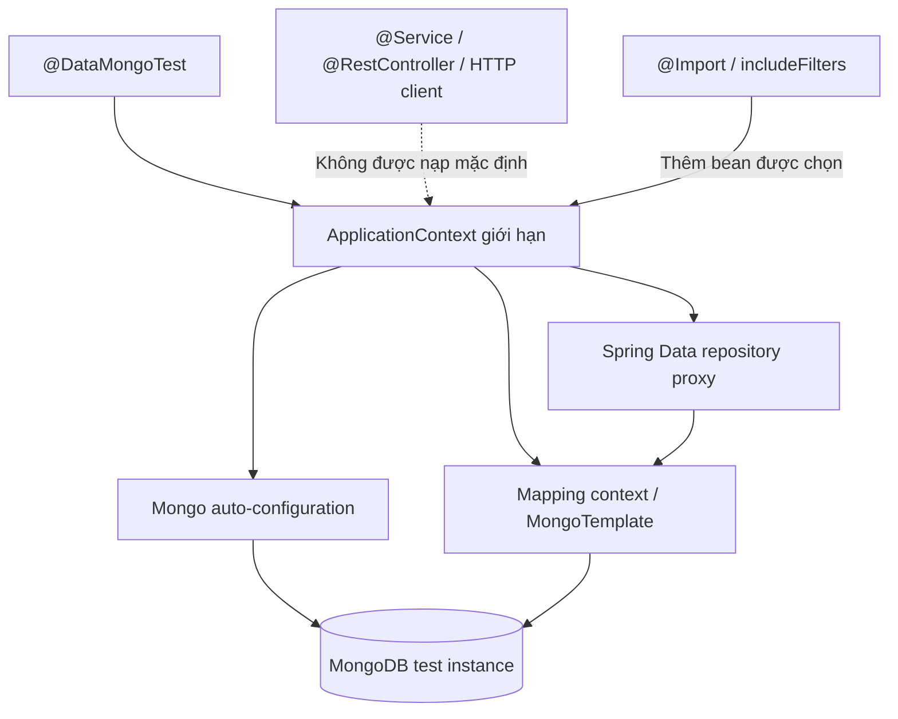

# `@DataMongoTest` và phạm vi bean được nạp

> **Chương:** Kiểm thử  
> **Phạm vi:** Spring Data MongoDB, trọng tâm là kiểm thử mapping document, `MongoTemplate`, repository, index và truy vấn bằng test slice của Spring Boot.

## 1. Mục tiêu của `@DataMongoTest`

Một ứng dụng dùng Spring Data MongoDB thường có nhiều thành phần: REST controller, service xử lý nghiệp vụ, bảo mật, client gọi API ngoài, message broker, scheduled job và tầng truy cập dữ liệu. Khi chỉ muốn kiểm tra repository hoặc cách `MongoTemplate` ghi và đọc BSON, nạp toàn bộ ứng dụng có thể làm bài test chậm, phụ thuộc nhiều hệ thống và khó xác định lỗi nằm ở đâu.

`@DataMongoTest` là **test slice** của Spring Boot dành cho tầng MongoDB. Thay vì khởi tạo toàn bộ application context như `@SpringBootTest`, annotation này giới hạn việc quét bean và kích hoạt các auto-configuration liên quan đến MongoDB. Nhờ đó, bài kiểm thử tập trung vào mapping, repository và thao tác database.

Ví dụ câu hỏi phù hợp với `@DataMongoTest`:

- Một phương thức `findByEmail(...)` của `MongoRepository` có trả đúng document không?
- Annotation `@Field("email_address")` có ánh xạ đúng tên field BSON không?
- `MongoTemplate` có thực hiện đúng điều kiện `Criteria`, update hoặc aggregation không?
- `@Indexed`, custom conversion hoặc callback MongoDB có hoạt động khi được cấu hình trong test context không?

Điều quan trọng: **test slice giới hạn Spring bean được tạo; nó không giả lập MongoDB**. Một test có `@DataMongoTest` vẫn cần MongoDB thực sự có thể kết nối, chẳng hạn một MongoDB chạy bằng Testcontainers hoặc một môi trường kiểm thử được chuẩn bị sẵn.

## 2. `@DataMongoTest` nạp bean gì?

Về mặt khái niệm, Spring Boot dùng cơ chế lọc thành phần để giữ lại các loại cần thiết cho MongoDB và loại bớt các thành phần ứng dụng thông thường. Trong cấu hình phổ biến, những thành phần sau được tạo hoặc phát hiện:

| Thành phần | Trạng thái điển hình trong `@DataMongoTest` | Ý nghĩa |
| --- | --- | --- |
| `MongoClient` và cấu hình kết nối MongoDB | Có, khi auto-configuration và connection settings đáp ứng | Kết nối tới MongoDB thực |
| `MongoTemplate` | Có | Ghi, đọc, query, update, aggregation cho MongoDB đồng bộ |
| `MappingMongoConverter`, mapping context và hạ tầng dữ liệu | Có | Chuyển đổi Java object ↔ BSON, áp dụng `@Field`, `@Id`, v.v. |
| Interface kế thừa `MongoRepository` | Có, nếu nằm trong phạm vi repository scan | Spring Data tạo repository proxy |
| Class gắn `@Document` | Được phát hiện làm entity mapping | **Không đồng nghĩa** bản thân class là Spring bean singleton |
| Reactive MongoDB infrastructure | Tùy classpath và cấu hình phiên bản | Có thể hỗ trợ `ReactiveMongoTemplate`/reactive repository |
| `@Service`, `@Component` nghiệp vụ thông thường | Không mặc định | Không kiểm thử orchestration/service bằng slice này nếu chưa import |
| `@Controller`, `@RestController`, filter web | Không mặc định | Không khởi chạy toàn bộ MVC hoặc web security chain |
| Client HTTP, Kafka listener, mail sender, scheduler của ứng dụng | Không mặc định | Không phải phạm vi kiểm thử dữ liệu của slice |
| `@Configuration` tùy biến, `@Bean` tự viết, auditing, converter, migration | Phụ thuộc cách khai báo và import | Cần kiểm tra context và đưa vào rõ ràng khi test cần chúng |

Một số chi tiết phụ thuộc phiên bản Spring Boot, các dependency có trên classpath, bean do auto-configuration cung cấp, và cấu hình được import. Vì vậy, bảng thể hiện **phạm vi mặc định**, không phải cam kết rằng mọi dự án đều có danh sách bean giống hệt nhau.

### 2.1. Phân biệt entity, repository và service

Ba loại thường bị nhầm:

1. `@Document` báo cho Spring Data biết class là **kiểu dữ liệu để mapping**. `Customer` sẽ được mapping khi thao tác MongoDB, nhưng `@Document` tự nó không biến mọi document thành một bean trong application context.
2. `interface CustomerRepository extends MongoRepository<Customer, String>` được Spring Data dựng thành **repository proxy bean** nếu repository scan tìm thấy interface.
3. `@Service CustomerService` là bean tầng nghiệp vụ. Slice MongoDB **không tự quét và tạo service** chỉ vì service đang gọi `CustomerRepository`.

Nếu một repository test thất bại vì không tìm thấy `CustomerService`, rất có thể bản thân test đang đưa logic tầng service vào sai phạm vi, hoặc một cấu hình được import kéo thêm service không mong muốn.

### 2.2. Sơ đồ context của test slice



Sơ đồ minh họa **phạm vi bean trong JVM**. Việc MongoDB có sẵn để kết nối là một bước riêng của môi trường kiểm thử.

## 3. Ví dụ thực hành: kiểm thử repository bằng Testcontainers

Ví dụ sau dùng **Spring Boot 3.x, JUnit Jupiter, AssertJ và Testcontainers 1.x**. Package của `@DataMongoTest` hoặc Testcontainers có thể thay đổi ở các dòng phiên bản lớn khác; cần kiểm tra import và dependency theo dự án.

Giả sử ứng dụng có cấu trúc:

```text
com.example.shop
├── ShopApplication.java           // @SpringBootApplication
└── customer
    ├── Customer.java
    ├── CustomerRepository.java
    └── CustomerRepositorySliceTest.java
```

Đặt test cùng package hoặc package con của ứng dụng để Spring Boot tìm thấy cấu hình `@SpringBootApplication` thích hợp. Tránh cấu hình quét toàn bộ package một cách thủ công vì có thể vô hiệu hóa ý nghĩa của test slice.

### 3.1. Entity có ánh xạ BSON

```java
package com.example.shop.customer;

import org.springframework.data.annotation.Id;
import org.springframework.data.mongodb.core.mapping.Document;
import org.springframework.data.mongodb.core.mapping.Field;

@Document("customers")
public class Customer {

    @Id
    private String id;

    @Field("email_address")
    private String email;

    protected Customer() {
        // Spring Data dùng khi dựng object từ BSON.
    }

    public Customer(String email) {
        this.email = email;
    }

    public String getId() {
        return id;
    }

    public String getEmail() {
        return email;
    }
}
```

Trong Java, property tên `email`; trong MongoDB, field lưu thực tế là `email_address`.

### 3.2. Repository được tạo thành bean

```java
package com.example.shop.customer;

import java.util.Optional;
import org.springframework.data.mongodb.repository.MongoRepository;

public interface CustomerRepository extends MongoRepository<Customer, String> {
    Optional<Customer> findByEmail(String email);
}
```

Spring Data phân tích `findByEmail` theo property **Java** `email`, sau đó ánh xạ sang field BSON bằng metadata của entity. Không cần tự viết `@Query` cho trường hợp đơn giản này.

### 3.3. Test slice chỉ nạp repository và hạ tầng MongoDB

```java
package com.example.shop.customer;

import static org.assertj.core.api.Assertions.assertThat;

import org.junit.jupiter.api.BeforeEach;
import org.junit.jupiter.api.Test;
import org.springframework.beans.factory.annotation.Autowired;
import org.springframework.boot.test.autoconfigure.data.mongo.DataMongoTest;
import org.springframework.boot.testcontainers.service.connection.ServiceConnection;
import org.springframework.data.mongodb.core.MongoTemplate;
import org.testcontainers.containers.MongoDBContainer;
import org.testcontainers.junit.jupiter.Container;
import org.testcontainers.junit.jupiter.Testcontainers;
import org.testcontainers.utility.DockerImageName;

@DataMongoTest
@Testcontainers
class CustomerRepositorySliceTest {

    @Container
    @ServiceConnection
    static final MongoDBContainer mongo =
        new MongoDBContainer(DockerImageName.parse("mongo:7.0"));

    @Autowired
    CustomerRepository repository;

    @Autowired
    MongoTemplate mongoTemplate;

    @BeforeEach
    void clean() {
        repository.deleteAll();
    }

    @Test
    void savesAndFindsByMappedProperty() {
        Customer saved = repository.save(
            new Customer("mai@example.test")
        );

        assertThat(saved.getId()).isNotBlank();
        assertThat(repository.findByEmail("mai@example.test"))
            .isPresent()
            .get()
            .extracting(Customer::getEmail)
            .isEqualTo("mai@example.test");

        // Đọc raw BSON để xác minh tên field do @Field quy định.
        org.bson.Document stored = mongoTemplate
            .getCollection("customers")
            .find(new org.bson.Document("email_address", "mai@example.test"))
            .first();

        assertThat(stored).isNotNull();
        assertThat(stored.getString("email_address"))
            .isEqualTo("mai@example.test");
        assertThat(stored.containsKey("email")).isFalse();
    }
}
```

Test này kiểm tra ba điều bằng database thật: repository proxy được tạo, `save`/`findByEmail` chạy qua Spring Data và mapping `email` → `email_address` được lưu đúng. Nó **không khởi tạo** controller hay test HTTP endpoint.

`@ServiceConnection` (Spring Boot 3.1+) lấy thông tin kết nối từ container và cấp cho auto-configuration; cần dependency `spring-boot-testcontainers` và Testcontainers/JUnit Jupiter. Docker phải chạy được trên máy thực thi test. Khi dùng bản Spring Boot/Testcontainers khác, kiểm tra lại package `MongoDBContainer` và cơ chế connection details tương ứng.

### 3.4. Phương án `@DynamicPropertySource`

Nếu dự án chưa dùng `@ServiceConnection`, có thể truyền URI Testcontainers cho Spring Boot bằng `@DynamicPropertySource`:

```java
@DataMongoTest
@Testcontainers
class CustomerRepositoryWithDynamicPropertiesTest {
    @Container
    static final MongoDBContainer mongo =
        new MongoDBContainer(DockerImageName.parse("mongo:7.0"));

    @DynamicPropertySource
    static void mongoProperties(DynamicPropertyRegistry registry) {
        registry.add("spring.data.mongodb.uri", mongo::getReplicaSetUrl);
    }

    @Autowired
    CustomerRepository repository;

    // Test methods...
}
```

Các import bổ sung: `org.springframework.test.context.DynamicPropertyRegistry`, `org.springframework.test.context.DynamicPropertySource` cùng các import của ví dụ trước. **Chọn một cơ chế cung cấp kết nối** cho test của bạn để tránh cấu hình URI mâu thuẫn. Property `spring.data.mongodb.uri` ở ví dụ này theo Spring Boot 3.x.

## 4. Kiểm chứng bean nào thực sự được nạp

Có thể kiểm tra trực tiếp application context thay vì suy đoán:

```java
@Autowired
ApplicationContext applicationContext;

@Test
void loadsMongoInfrastructureButNotBusinessService() {
    assertThat(applicationContext.getBeansOfType(MongoTemplate.class))
        .isNotEmpty();
    assertThat(applicationContext.getBeansOfType(CustomerRepository.class))
        .isNotEmpty();

    assertThat(applicationContext.getBeansOfType(CustomerService.class))
        .isEmpty();
}
```

`CustomerService` ở đây là một `@Service` bình thường của ứng dụng, không được import vào slice. Cần import `org.springframework.context.ApplicationContext` và có class `CustomerService` trong project để ví dụ biên dịch. Kiểm tra này hữu ích khi test bất ngờ gọi HTTP client, tạo scheduler hoặc fail do dependency ở tầng nghiệp vụ: hãy xem bean nào đã đi vào context và vì sao.

**Phân biệt hai loại lỗi:**

- **Bean không tồn tại:** `NoSuchBeanDefinitionException` hoặc `UnsatisfiedDependencyException` thường xuất hiện khi test yêu cầu service/converter/config chưa được nạp trong slice.
- **Không kết nối được MongoDB:** timeout hoặc lỗi server selection có thể xảy ra dù `MongoTemplate` đã là bean hợp lệ. Khi đó cần kiểm tra URI, container, credentials, TLS, replica set và trạng thái MongoDB.

## 5. Khi nào cần nạp thêm bean?

`@DataMongoTest` chỉ nên có các bean cần cho câu hỏi kiểm thử. Có ba lựa chọn phổ biến:

### 5.1. `@Import`: thêm đúng cấu hình hoặc component cần dùng

Giả sử query phụ thuộc custom Mongo converter được định nghĩa trong `MongoConversionConfig`. Có thể import có chủ đích:

```java
@DataMongoTest
@Import(MongoConversionConfig.class)
class CustomerConversionTest {
    @Autowired MongoTemplate mongoTemplate;

    // Kiểm tra converter và BSON được đọc/ghi đúng.
}
```

`MongoConversionConfig` phải thực sự định nghĩa bean/conversion cần thiết. Nếu cấu hình này kéo theo hàng loạt service hoặc bean hạ tầng khác, hãy tách phần converter thành một cấu hình nhỏ, tập trung vào persistence. `@Import` phù hợp hơn việc mở rộng quét toàn ứng dụng.

### 5.2. `includeFilters` và `excludeFilters`

`@DataMongoTest` có các thuộc tính như `includeFilters`, `excludeFilters` và `useDefaultFilters` để tùy chỉnh component scanning. Ví dụ một bean converter được khai báo bằng `@Component` nhưng bị loại khỏi slice có thể được thêm rõ ràng:

```java
@DataMongoTest(
    includeFilters = @ComponentScan.Filter(
        type = FilterType.ASSIGNABLE_TYPE,
        classes = CustomerValueConverter.class
    )
)
class CustomerConverterSliceTest {
    // CustomerValueConverter là component độc lập có trong ứng dụng.
}
```

Các import liên quan là `org.springframework.context.annotation.ComponentScan` và `org.springframework.context.annotation.FilterType`. Ví dụ giả định class `CustomerValueConverter` tồn tại và có dependency đáp ứng được trong slice.

`excludeFilters` có ích khi một loại component không nên xuất hiện; `useDefaultFilters = false` làm thay đổi tập được phát hiện nên phải dùng thận trọng. Không nên dùng filter để kéo cả controller/service vào context nếu mục tiêu vẫn là kiểm tra persistence.

### 5.3. `@TestConfiguration` và mock cho dependency ngoài

Một bean bổ sung chỉ phục vụ test có thể được khai báo trong nested `@TestConfiguration`. Chẳng hạn, khi một Mongo callback cần `Clock`, test có thể cung cấp `Clock.fixed(...)` để cố định thời gian. Nếu một thành phần bắt buộc cần collaborator bên ngoài, cân nhắc mock collaborator ấy thay vì gọi hệ thống thật.

Tuy nhiên, nếu bài kiểm thử thực sự kiểm tra logic phối hợp giữa service, transaction, security, web và MongoDB, sử dụng `@SpringBootTest` hoặc phối hợp test slices chuyên biệt sẽ cho phạm vi dễ hiểu hơn. Cố import mọi dependency vào `@DataMongoTest` thường làm mất lợi ích cô lập của slice.

## 6. Những gì `@DataMongoTest` không tự làm

| Giả định dễ gặp | Thực tế | Hướng xử lý |
| --- | --- | --- |
| “Có annotation nên MongoDB tự chạy” | Slice tạo context, không đảm bảo có server | Dùng Testcontainers/MongoDB test instance với URI hoặc `@ServiceConnection` |
| “Tất cả `@Service` và `@Controller` đều được nạp” | Chúng bị loại trong phạm vi mặc định | Dùng `@SpringBootTest` cho test luồng ứng dụng, hoặc import bean cần thiết |
| “`@Document` là bean có thể `@Autowired`” | Nó là kiểu entity mapping, không phải Spring component | Inject repository/template và khởi tạo entity như dữ liệu |
| “`@Indexed` chắc chắn tạo index” | Tự tạo index còn phụ thuộc cài đặt `auto-index-creation` hoặc migration | Bật có chủ ý trong test, dùng index operations/migration và xác minh server |
| “Mọi converter/callback/auditing trong ứng dụng đều hoạt động” | Chỉ bean/config thực sự được nạp mới hoạt động | Import config, kiểm tra context và BSON kết quả |
| “Mỗi `@Test` tự rollback dữ liệu” | MongoDB test slice không mặc nhiên rollback mọi write | Dọn dữ liệu giữa test; dùng database/container riêng |
| “`@DataMongoTest` mô phỏng transactions” | Giao dịch MongoDB cần session, topology và server tương thích | Dùng replica set/container phù hợp và test transaction có chủ đích |
| “Repository chạy nghĩa là HTTP/security đúng” | Slice không kiểm tra toàn bộ request pipeline | Test web/controller hoặc `@SpringBootTest` riêng |

### 6.1. Index không tự nhiên xuất hiện

`@Indexed(unique = true)` là metadata để Spring Data tạo index khi cơ chế index creation được bật hoặc khi quy trình quản lý index chạy. Trong cấu hình Spring Data MongoDB hiện đại, **auto index creation mặc định không bật**; cần xem lại phiên bản và cấu hình:

```java
@DataMongoTest(properties = "spring.data.mongodb.auto-index-creation=true")
class CustomerIndexTest {
    // Dùng repository/MongoTemplate để kích hoạt mapping và kiểm tra
    // db.customers.getIndexes() hoặc IndexOperations.
}
```

Ví dụ property dành cho dòng Spring Boot 3.x. Nếu ứng dụng quản lý index bằng migration, nên chạy migration tương ứng hoặc khai báo index cần kiểm tra; không trộn tùy tiện hai cơ chế trong cùng môi trường. Với index `unique`, test phải ghi dữ liệu trùng và xác nhận lỗi từ MongoDB thì mới chứng minh được ràng buộc đang hoạt động.

### 6.2. Dữ liệu test không tự cô lập

`@DataMongoTest` có thể được Spring Test cache và tái sử dụng application context giữa các phương thức test; MongoDB server cũng có thể giữ dữ liệu qua nhiều test. Không dựa vào thứ tự chạy test hoặc mong đợi `@Transactional` tự rollback như cách làm phổ biến với một số cơ sở dữ liệu quan hệ.

Trong ví dụ trên, `@BeforeEach repository.deleteAll()` đơn giản và hiệu quả khi collection chỉ dùng cho test đó. Với test lớn, song song hoặc nhiều collection, hãy dùng database riêng, tên collection riêng, fixture và chiến lược cleanup rõ ràng. Không xóa dữ liệu trên MongoDB dùng chung ngoài môi trường test.

## 7. Lựa chọn mức kiểm thử phù hợp

| Mục tiêu kiểm thử | Công cụ thường phù hợp | Kiểm chứng được gì? |
| --- | --- | --- |
| Logic thuần Java, không cần MongoDB | JUnit + mock/fake | Điều kiện nghiệp vụ, xử lý input, quy tắc tính toán |
| Repository query, `@Field`, converter, index và `MongoTemplate` | **`@DataMongoTest` + MongoDB test instance** | Mapping và hành vi persistence với MongoDB thực |
| Reactive repository, `ReactiveMongoTemplate` | `@DataMongoTest` với reactive dependencies phù hợp | Query reactive thực, backpressure/cancellation ở phạm vi được test |
| Service phối hợp nhiều repository và infrastructure | `@SpringBootTest` hoặc integration test cấu hình đủ bean | Tương tác các thành phần trong một context rộng |
| REST API, validation HTTP, serialization/controller | `@WebMvcTest` hoặc HTTP integration test | Request/response, controller, HTTP status và cơ chế web |
| Transaction, session, change stream, failover, sharding | Integration test với topology MongoDB phù hợp | Tính năng đặc thù của database và driver |

Đừng suy từ việc một unit test dùng repository mock thành bằng chứng MongoDB query chạy đúng. Cũng đừng đòi `@DataMongoTest` chứng minh rằng toàn bộ sản phẩm đã được cấu hình đầy đủ.

### 7.1. Reactive MongoDB

Nếu dự án dùng reactive driver và Spring Data reactive, hãy inject `ReactiveMongoTemplate` hoặc `ReactiveMongoRepository` và dùng `StepVerifier` để chờ và kiểm tra publisher. Chỉ tạo một `Mono` mà không subscribe/verify có thể khiến câu lệnh database chưa chạy. Các bean reactive phụ thuộc classpath và auto-configuration thực tế; kiểm tra application context thay vì giả định slice nào cũng có cả đồng bộ lẫn reactive.

### 7.2. Transactions và sessions

Một lệnh `MongoTemplate.save` thành công trên MongoDB đơn lẻ không chứng minh transaction đa document hoạt động. Transaction cần topology MongoDB hỗ trợ (như replica set), `MongoTransactionManager` hoặc transaction setup thích hợp, và đường thực thi thực sự mở session/transaction. `@DataMongoTest` không tự tạo đầy đủ các điều kiện này; test giao dịch nên khai báo rõ ràng các bean và môi trường cần thiết.

## 8. Checklist debug khi context nạp sai

Khi gặp lỗi, xử lý theo chuỗi ngắn sau:

1. **Xem annotation trên test:** đang dùng `@DataMongoTest` hay `@SpringBootTest`? Có `@Import`, `includeFilters` hoặc `@ComponentScan` riêng làm thay đổi phạm vi không?
2. **Kiểm tra bootstrap configuration:** test có nằm dưới package chứa `@SpringBootApplication` không? Có nhiều `@SpringBootConfiguration` gây mơ hồ hoặc một cấu hình tùy chỉnh đang kéo thêm bean không?
3. **Xác minh dependency:** `spring-boot-starter-data-mongodb` hoặc reactive starter có trên classpath? Interface repository có được phát hiện và dựng proxy không?
4. **Xác minh connection:** MongoDB container đang chạy? `@ServiceConnection` hoặc `@DynamicPropertySource` cung cấp đúng URI? Database name, TLS, credentials, replica set có tương thích không?
5. **Xác minh mapping:** entity có `@Document`, `@Id`, `@Field` đúng không? Custom converter hay listener cần import đã có trong context chưa?
6. **Xác minh query và index:** phương thức derived query có dùng đúng tên **property Java**? MongoDB raw BSON có field đúng không? Index/migration đã chạy? Có dữ liệu test sót lại không?
7. **Kiểm tra kết quả thực:** đọc qua repository và đọc BSON bằng `MongoTemplate.getCollection(...)`; so sánh query plan khi hiệu năng là mục tiêu của bài test.

Ví dụ `NoSuchBeanDefinitionException` cho một `@Service` có thể hoàn toàn phù hợp với mục đích của `@DataMongoTest`; đây là dấu hiệu nên thay đổi phạm vi bài test hoặc import tối thiểu. Trong khi đó, `MongoTimeoutException` chỉ ra một hướng điều tra khác: kết nối database.

## 9. Bài tập áp dụng

Từ ví dụ `Customer` và `CustomerRepository`, tự triển khai ba bài kiểm thử:

1. **Mapping:** lưu `Customer("mai@example.test")`, đọc `Document` raw và xác nhận có `email_address`, không có `email`.
2. **Repository query:** lưu hai email khác nhau, kiểm tra `findByEmail` trả đúng khách hàng và `Optional.empty()` khi email không tồn tại.
3. **Index:** khai báo `@Indexed(unique = true)` trên `email`, bật cơ chế tạo index có chủ đích hoặc tạo bằng `IndexOperations`; lưu hai khách hàng có email trùng nhau và kiểm tra lỗi unique constraint từ MongoDB. Sau đó bỏ index và quan sát test đổi kết quả thế nào.

Tự hỏi sau mỗi test: “Mình vừa chứng minh **mapping/query/database thật** hoạt động, hay chỉ chứng minh một bean được khởi tạo?”. Đây là cách đặt đúng kỳ vọng cho từng phạm vi kiểm thử.

## 10. Ghi nhớ

- `@DataMongoTest` là **MongoDB test slice của Spring Boot**: thường nạp `MongoTemplate`, MongoDB mapping infrastructure và repository proxy trong phạm vi được quét.
- `@Document` là metadata của entity; `MongoRepository` trở thành repository bean; `@Service` và controller ứng dụng **không được nạp mặc định**.
- MongoDB vẫn phải có nơi kết nối: dùng Testcontainers/instance kiểm thử và cấu hình connection phù hợp; slice không thay thế database.
- Mở rộng context bằng `@Import`, test configuration hoặc filter khi thật sự cần; dùng `@SpringBootTest` cho hành vi tích hợp nhiều tầng.
- Xác minh bằng dữ liệu BSON, query, index và lỗi thực tế; kiểm soát dữ liệu test, phiên bản và topology để tránh kết luận sai.

## Tài liệu tham khảo

- [Spring Boot — Auto-configured Spring Data MongoDB Tests](https://docs.spring.io/spring-boot/reference/testing/spring-boot-applications.html#testing.spring-boot-applications.autoconfigured-spring-data-mongodb): phạm vi test slice và đặc điểm auto-configuration.
- [Spring Boot 3.x — `@DataMongoTest` API](https://docs.spring.io/spring-boot/3.3/api/java/org/springframework/boot/test/autoconfigure/data/mongo/DataMongoTest.html): annotation, `includeFilters`, `excludeFilters` và các thuộc tính cấu hình.
- [Spring Boot — Testcontainers](https://docs.spring.io/spring-boot/reference/testing/testcontainers.html): `@ServiceConnection`, `@DynamicPropertySource` và connection details.
- [Spring Data MongoDB — Object Mapping](https://docs.spring.io/spring-data/mongodb/reference/mongodb/mapping/mapping.html): `@Document`, `@Field`, mapping context và converter.
- [Spring Data MongoDB — Index Creation](https://docs.spring.io/spring-data/mongodb/reference/mongodb/mapping/mapping-index-management.html): điều kiện tạo index và tự động tạo index.
- [Spring Data MongoDB — MongoTemplate](https://docs.spring.io/spring-data/mongodb/reference/mongodb/template-api.html): hoạt động template, truy vấn và mapping.
