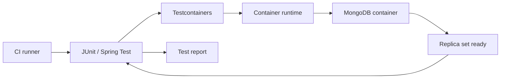
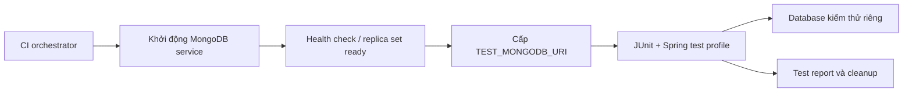

# Cung cấp MongoDB cho test bằng Testcontainers hoặc dịch vụ kiểm thử

Khi kiểm thử ứng dụng dùng **Spring Data MongoDB**, mock `MongoRepository` hoặc `MongoTemplate` chỉ xác nhận cách tầng nghiệp vụ gọi dependency. Mock không thể chứng minh tên field thực sự được ánh xạ đúng, aggregation chạy được trên server, index đã được tạo, hay transaction rollback như mong đợi. Những hành vi này cần một **MongoDB thật** được cấp phát và quản lý trong quá trình chạy test.

Hai cách phổ biến là **Testcontainers** (bộ test tự khởi động MongoDB trong container) và **dịch vụ kiểm thử** (MongoDB đã được Docker Compose, CI hoặc hạ tầng riêng chuẩn bị sẵn). Bài này hướng dẫn cả hai phương án, từ thiết lập kết nối, viết integration test, cách ly dữ liệu đến xử lý replica set, reactive API và kiểm thử hiệu năng.

## 1. Chọn mức kiểm thử phù hợp

| Loại test | Có cần MongoDB thật? | Đặc tính có thể kiểm chứng |
| --- | --- | --- |
| Unit test cho hàm thuần | Không | Validation, chuyển đổi dữ liệu, điều kiện và tính toán nghiệp vụ |
| Unit test với repository mock | Không | Luồng gọi dependency và cách xử lý lỗi giả lập |
| MongoDB data slice test | Có | BSON mapping, derived query, `MongoTemplate`, index, aggregation |
| Integration test toàn ứng dụng | Có | Tương tác service, repository, controller và transaction |
| Kiểm thử hiệu năng | Có, dữ liệu/tải đại diện | Latency, số document quét, command, throughput, dung lượng kết quả |

Chọn phạm vi nhỏ nhất kiểm chứng được yêu cầu. Test hàm kiểm tra định dạng email không cần MongoDB; nhưng test rằng trường `email` trong Java được lưu thành `email_address` trên BSON thì cần database thật.

Một môi trường MongoDB dành cho test cần đáp ứng:

1. **Cấu hình xác định được**: phiên bản MongoDB, topology, URI, index và dữ liệu đầu vào rõ ràng.
2. **Cách ly**: test chạy lại hoặc đổi thứ tự mà không bị dữ liệu cũ ảnh hưởng.
3. **Sẵn sàng**: quá trình chạy test biết khi MongoDB đã nhận được kết nối và hoàn thành thiết lập cần thiết.
4. **An toàn**: tài khoản và địa chỉ test không nhầm với production; cleanup chỉ tác động database do test sở hữu.
5. **Tái lập trên CI**: cùng bộ test chạy được trong môi trường tự động, có log khi thiết lập thất bại.

## 2. Testcontainers so với MongoDB service

| Tiêu chí | Testcontainers | MongoDB service dành cho test |
| --- | --- | --- |
| Ai cấp MongoDB? | Test yêu cầu Docker khởi động container | Docker Compose/CI/hạ tầng khởi động trước |
| Điều kiện chạy | Container runtime được hỗ trợ, truy cập được Docker engine và image | Network, URI, quyền truy cập và dịch vụ sẵn sàng |
| Vòng đời | Thường theo test class hoặc test suite | Theo CI job, Compose hoặc chính sách môi trường |
| Cách ly | Dễ khởi động container riêng, vẫn phải reset dữ liệu | Cần database/instance riêng cho job hoặc class |
| Chi phí startup | Mất thời gian tải image và khởi tạo container | Có thể nhanh nếu dịch vụ đã sẵn sàng |
| Transaction | MongoDBContainer hỗ trợ khởi tạo replica set | Service cần replica set/sharded topology phù hợp |
| CI | Runner phải truy cập container runtime | Runner cần network/credentials tới MongoDB test |
| Trường hợp phù hợp | Repository/integration test độc lập và lặp lại | Tổ chức đã có MongoDB service, topology đặc biệt hoặc job không chạy được Docker |

**Lựa chọn thông thường:** Nếu CI có container runtime, Testcontainers giúp bộ test tự quản lý dependency và tránh dựa vào MongoDB được cài cố định trên máy lập trình. Nếu hệ thống đã có hạ tầng MongoDB cho test, cách cấp qua URI môi trường dễ chia sẻ và phù hợp với test cần topology cụ thể. Hai lựa chọn dùng **cùng mã repository và cùng tiêu chí kiểm chứng**; khác nhau ở khâu cấp phát kết nối.

## 3. Ví dụ ứng dụng cần kiểm thử

Ví dụ dưới đây dùng **Java 17+, Spring Boot 3.x và Spring Data MongoDB**. Ứng dụng đã có dependency chính `spring-boot-starter-data-mongodb`. Tạo entity và repository trong cùng package `example.accounts`.

**`CustomerAccount.java`**

```java
package example.accounts;

import java.time.Instant;
import org.springframework.data.annotation.Id;
import org.springframework.data.mongodb.core.mapping.Document;
import org.springframework.data.mongodb.core.mapping.Field;

@Document(collection = "accounts")
public record CustomerAccount(
        @Id String id,
        @Field("email_address") String email,
        Instant createdAt
) {}
```

**`AccountRepository.java`**

```java
package example.accounts;

import java.util.Optional;
import org.springframework.data.mongodb.repository.MongoRepository;

public interface AccountRepository
        extends MongoRepository<CustomerAccount, String> {
    Optional<CustomerAccount> findByEmail(String email);
}
```

Ở đây thuộc tính Java là `email` nhưng field được lưu trong document là `email_address`. Test có giá trị phải kiểm tra repository truy vấn đúng **và** BSON trong MongoDB chứa tên field được kỳ vọng.

## 4. Cấp MongoDB bằng Testcontainers

### 4.1. Khai báo thư viện và image

Với **Spring Boot 3.x và API Testcontainers Java 1.x**, dependency Maven dành cho test:

```xml
<dependencies>
    <dependency>
        <groupId>org.springframework.boot</groupId>
        <artifactId>spring-boot-starter-test</artifactId>
        <scope>test</scope>
    </dependency>
    <dependency>
        <groupId>org.testcontainers</groupId>
        <artifactId>junit-jupiter</artifactId>
        <scope>test</scope>
    </dependency>
    <dependency>
        <groupId>org.testcontainers</groupId>
        <artifactId>mongodb</artifactId>
        <scope>test</scope>
    </dependency>
</dependencies>
```

Ví dụ giả định Spring Boot BOM hoặc Testcontainers BOM quản lý phiên bản dependency tương thích. Nếu project dùng dòng Testcontainers mới hơn, kiểm tra lại **artifact và package** của phiên bản đó: đoạn mã ở đây dùng API 1.x với `org.testcontainers.containers.MongoDBContainer`. Với Gradle, dùng các dependency tương ứng trong `testImplementation`.

Pin image như `mongo:7.0` để test không tự đổi tính năng theo tag `latest`. Chọn version MongoDB phù hợp ứng dụng và môi trường dự kiến triển khai. CI cần Docker engine hoặc container runtime được Testcontainers hỗ trợ, quyền truy cập runtime và khả năng kéo image.

### 4.2. Tạo MongoDB và cấp URI cho Spring

**`AccountRepositoryContainerTest.java`**

```java
package example.accounts;

import com.mongodb.client.model.Filters;
import java.time.Instant;
import org.bson.Document;
import org.junit.jupiter.api.BeforeEach;
import org.junit.jupiter.api.Test;
import org.springframework.beans.factory.annotation.Autowired;
import org.springframework.boot.test.autoconfigure.data.mongo.DataMongoTest;
import org.springframework.data.mongodb.core.MongoTemplate;
import org.springframework.test.context.DynamicPropertyRegistry;
import org.springframework.test.context.DynamicPropertySource;
import org.testcontainers.containers.MongoDBContainer;
import org.testcontainers.junit.jupiter.Container;
import org.testcontainers.junit.jupiter.Testcontainers;
import org.testcontainers.utility.DockerImageName;

import static org.assertj.core.api.Assertions.assertThat;

@DataMongoTest
@Testcontainers
class AccountRepositoryContainerTest {

    @Container
    static final MongoDBContainer MONGO =
            new MongoDBContainer(DockerImageName.parse("mongo:7.0"));

    @DynamicPropertySource
    static void mongoProperties(DynamicPropertyRegistry registry) {
        registry.add("spring.data.mongodb.uri", MONGO::getReplicaSetUrl);
    }

    @Autowired
    AccountRepository repository;

    @Autowired
    MongoTemplate mongoTemplate;

    @BeforeEach
    void clearAccounts() {
        repository.deleteAll();
    }

    @Test
    void storesAndFindsAccountWithMappedField() {
        CustomerAccount saved = repository.insert(new CustomerAccount(
                null, "alice@example.test",
                Instant.parse("2026-01-01T00:00:00Z")));

        assertThat(saved.id()).isNotBlank();
        assertThat(repository.findByEmail("alice@example.test"))
                .hasValueSatisfying(account ->
                        assertThat(account.id()).isEqualTo(saved.id()));

        Document raw = mongoTemplate.getCollection("accounts")
                .find(Filters.eq("email_address", "alice@example.test"))
                .first();
        assertThat(raw).isNotNull();
        assertThat(raw.containsKey("email_address")).isTrue();
        assertThat(raw.containsKey("email")).isFalse();
    }

    @Test
    void returnsEmptyForUnknownEmail() {
        assertThat(repository.findByEmail("missing@example.test")).isEmpty();
    }
}
```

Điểm cần hiểu:

- `@DataMongoTest` chỉ tạo Spring context cho data layer MongoDB. Service/controller nằm ngoài slice thường không được nạp; dùng `@SpringBootTest` khi cần kiểm tra ứng dụng đầy đủ.
- `@Testcontainers` và `@Container` để JUnit extension quản lý container. Field `static` khởi động MongoDB một lần trong vòng đời class thay vì mỗi test method.
- `@DynamicPropertySource` cung cấp `spring.data.mongodb.uri` từ container. Host/port do Docker gán, không giả định `localhost:27017`.
- `getReplicaSetUrl()` lấy URI cho replica set mà MongoDBContainer thiết lập, hữu ích nếu về sau kiểm thử transaction hay change stream.
- `@BeforeEach` loại bỏ dữ liệu do class này sở hữu; chỉ an toàn khi không có test chạy song song cùng collection.
- Thử thêm truy vấn driver đối với BSON raw để xác nhận `@Field("email_address")` thực sự có hiệu lực.

### 4.3. Cách khác: `@ServiceConnection`

Với **Spring Boot 3.1+**, thêm dependency test `spring-boot-testcontainers`:

```xml
<dependency>
    <groupId>org.springframework.boot</groupId>
    <artifactId>spring-boot-testcontainers</artifactId>
    <scope>test</scope>
</dependency>
```

Trong class test có `@DataMongoTest` hoặc `@SpringBootTest`, thay phần đăng ký `@DynamicPropertySource` bằng một container có `@ServiceConnection`:

```java
import org.springframework.boot.testcontainers.service.connection.ServiceConnection;
import org.testcontainers.containers.MongoDBContainer;
import org.testcontainers.junit.jupiter.Container;
import org.testcontainers.utility.DockerImageName;

@Container
@ServiceConnection
static final MongoDBContainer MONGO =
        new MongoDBContainer(DockerImageName.parse("mongo:7.0"));
```

Giữ `@Testcontainers` trên class test. Spring Boot dùng connection details từ container để cấu hình client, vì vậy không phải tự khai báo URI qua `@DynamicPropertySource` cho cùng kết nối. Chọn **một** cách kết nối để tránh các nguồn cấu hình xung đột.

### 4.4. Tốc độ, chia sẻ container và cache context

Container riêng từng class giúp cách ly nhưng tăng startup. Chia sẻ container cho nhiều class có thể tiết kiệm thời gian, đổi lại phải kiểm soát reset dữ liệu, index, database và việc chạy song song.

Spring TestContext có cache application context. Nếu nhiều test class có cấu hình tương đương nhưng mỗi class dùng container riêng, cache có thể giữ `MongoClient` trỏ đến container của class đã kết thúc. Cần thống nhất vòng đời container với context, hoặc tạo context mới khi thay đổi URI. Không bật tái sử dụng container cho CI chỉ để tăng tốc nếu điều đó khiến test dùng lại dữ liệu của lần chạy trước.

## 5. Dùng MongoDB service kiểm thử

Khi MongoDB được khởi động từ Docker Compose, CI service container hoặc cluster test độc lập, ứng dụng chỉ cần nhận URI. Cách này phù hợp khi runner không thể tự tạo container hoặc cần topology cụ thể.

### 5.1. Cấu hình thông qua môi trường

Ví dụ **`src/test/resources/application-test.yml`**:

```yaml
spring:
  data:
    mongodb:
      uri: ${TEST_MONGODB_URI}
```

Đặt biến `TEST_MONGODB_URI` trước khi chạy test. URI phải trỏ tới database **chuyên dụng cho test** và được tạo bởi CI/hạ tầng. Với MongoDB yêu cầu xác thực, cấp username/password bằng cơ chế secrets của môi trường, tránh ghi thông tin xác thực vào repository hoặc log.

Test dùng cùng entity/repository:

```java
package example.accounts;

import org.junit.jupiter.api.BeforeEach;
import org.junit.jupiter.api.Test;
import org.springframework.beans.factory.annotation.Autowired;
import org.springframework.boot.test.autoconfigure.data.mongo.DataMongoTest;
import org.springframework.test.context.ActiveProfiles;
import java.time.Instant;

import static org.assertj.core.api.Assertions.assertThat;

@DataMongoTest
@ActiveProfiles("test")
class AccountRepositoryServiceTest {
    @Autowired
    AccountRepository repository;

    @BeforeEach
    void resetOwnCollection() {
        repository.deleteAll();
    }

    @Test
    void queriesDatabaseProvidedByEnvironment() {
        repository.insert(new CustomerAccount(
                null, "ci@example.test", Instant.EPOCH));
        assertThat(repository.findByEmail("ci@example.test")).isPresent();
    }
}
```

Lúc này JUnit **không khởi động MongoDB**. CI phải cung cấp service, network, quyền truy cập, cơ chế readiness và database test trước khi Spring context được tạo. Không thêm `@Testcontainers` nếu môi trường đã cấp một service độc lập.

### 5.2. Chọn hostname theo nơi chạy test

| Môi trường chạy Java test | URI minh họa | Lưu ý |
| --- | --- | --- |
| Test chạy trên host, MongoDB container publish port | `mongodb://127.0.0.1:27018/accounts_test?directConnection=true` | Port host đã map tới 27017 trong container |
| Test chạy cùng mạng Docker Compose | `mongodb://mongo-test:27017/accounts_test?directConnection=true` | `mongo-test` là DNS service trong network đó |
| CI với MongoDB service | URI do CI cung cấp | Đọc đúng host, port, credentials và network của job |
| Replica set/managed test cluster | URI theo provider, replica set, TLS/auth tương ứng | Không ép `directConnection=true` nếu cần khám phá topology |

Các ví dụ localhost hoặc tên service ở trên dành cho MongoDB không yêu cầu auth trong môi trường thử nghiệm được kiểm soát. Nếu test dùng replica set, CI cần khởi tạo replica set và chờ trạng thái sẵn sàng trước khi chạy; một server standalone có thể không hỗ trợ các bài test transaction/change stream.

### 5.3. Dịch vụ test dùng chung

Nếu nhiều CI job kết nối cùng MongoDB, cấp mỗi job một database riêng, ví dụ `test_accounts_<run-id>`. Giá trị `run-id` cần được sinh/cấp ở CI và đưa vào URI trước khi Spring tạo `MongoClient`. Không để hai job cùng gọi `deleteAll()` hoặc `dropDatabase()` trên một database.

Tài khoản test chỉ nên có quyền trong database test, đủ cho các thao tác cần kiểm chứng. Trước khi cleanup hoặc tạo index, xác nhận database/hostname là môi trường kiểm thử; không dùng URI production làm giá trị mặc định khi thiếu cấu hình.

## 6. Seed dữ liệu và cô lập test

Database thật chỉ giải quyết một nửa bài toán; kết quả kiểm thử phải **lặp lại được**.

### 6.1. Nạp fixture phù hợp mục tiêu

Với test repository, dùng `repository.insert(...)` hoặc `repository.save(...)` để seed. Với dữ liệu cũ, BSON type khác chuẩn, missing field hay migration, có thể seed document thô để kiểm tra reader:

```java
import org.bson.Document;
import java.time.Instant;
import java.util.Date;

mongoTemplate.getCollection("accounts").insertOne(
        new Document("_id", "legacy-001")
                .append("email_address", "legacy@example.test")
                .append("createdAt", Date.from(
                        Instant.parse("2020-01-01T00:00:00Z"))));
```

Hãy test cả đường lỗi: dữ liệu trùng, field không tồn tại, BSON type sai, `null`, trường đổi tên. Với migration, chèn nhiều phiên bản document rồi xác minh cách đọc tương thích hoặc cách cập nhật theo phiên bản.

### 6.2. Các phương pháp làm sạch

| Phương pháp | Phù hợp | Giới hạn |
| --- | --- | --- |
| `repository.deleteAll()` trước mỗi test | Test tuần tự và sở hữu một collection | Không xóa collection phụ; nguy hiểm nếu test song song |
| Xóa tập collection test sở hữu | Test có nhiều collection và muốn giữ index | Phải nắm đúng tất cả collection |
| Drop database dành riêng cho một job | Reset hoàn toàn suite | Index cũng mất, cần tạo lại |
| Container/database riêng cho từng class | Cách ly mạnh | Tăng thời gian hoặc chi phí cấp phát |
| Fixture có ID/namespace riêng | MongoDB service chia sẻ | Cần cleanup khi test thất bại |

Không giả định test được rollback tự động chỉ vì có `@Transactional`. MongoDB cần transaction manager được cấu hình, topology hỗ trợ transaction và thao tác tham gia đúng transaction. Phần lớn repository test thông thường có thể dọn dữ liệu trực tiếp để dễ hiểu.

### 6.3. Song song và tính quyết định

Khi các test chạy song song cùng collection, `@BeforeEach deleteAll()` của test này có thể xóa dữ liệu vừa được test kia tạo. Có thể tắt parallelism cho nhóm test dùng database chung hoặc cấp database riêng; ưu tiên dữ liệu, ID, timestamp xác định được. Không giả định thứ tự trả về nếu query chưa có `sort`. Với kiểm thử thời gian, dùng `Instant.parse(...)` cố định thay vì đồng hồ hệ thống khi điều kiện nghiệp vụ không liên quan tới "hiện tại".

## 7. Những tính năng cần kiểm chứng trên MongoDB thật

### 7.1. Index và ràng buộc unique

Annotation `@Indexed(unique = true)` chỉ có tác dụng nếu cơ chế tạo index được bật hoặc index đã được triển khai. Để test hành vi unique, nên tạo index rõ ràng trong database test:

```java
import com.mongodb.client.model.IndexOptions;
import com.mongodb.client.model.Indexes;
import org.springframework.dao.DuplicateKeyException;
import java.time.Instant;
import static org.assertj.core.api.Assertions.assertThatThrownBy;

mongoTemplate.getCollection("accounts").createIndex(
        Indexes.ascending("email_address"),
        new IndexOptions().unique(true));

repository.insert(new CustomerAccount(
        null, "dupe@example.test", Instant.EPOCH));

assertThatThrownBy(() -> repository.insert(new CustomerAccount(
        null, "dupe@example.test", Instant.EPOCH)))
        .isInstanceOf(DuplicateKeyException.class);
```

Đoạn trên giả định dữ liệu cũ đã được dọn trước khi tạo index. Spring Data chuyển lỗi database thành nhóm exception truy cập dữ liệu; nếu khác biệt theo phiên bản, nên kiểm tra cause/mã lỗi thật thay vì so khớp nguyên văn message.

Với index compound, text hoặc TTL, kiểm tra index metadata và dữ liệu thực. TTL monitor hoạt động theo chu kỳ, vì vậy không viết test yêu cầu document biến mất chính xác sau một mili-giây. Với query cần hiệu năng, xem `explain("executionStats")` và `totalDocsExamined`, `totalKeysExamined` trên dữ liệu đại diện.

### 7.2. Transaction và replica set

Transaction nhiều document của MongoDB yêu cầu topology hỗ trợ, thông thường replica set hoặc sharded cluster. `MongoDBContainer` trong ví dụ tạo replica set phục vụ test; MongoDB standalone đơn giản có thể đủ cho CRUD nhưng không đáp ứng kiểm thử transaction.

Để dùng Spring-managed MongoDB transaction, cấu hình `MongoTransactionManager`:

```java
import org.springframework.context.annotation.Bean;
import org.springframework.context.annotation.Configuration;
import org.springframework.data.mongodb.MongoDatabaseFactory;
import org.springframework.data.mongodb.MongoTransactionManager;

@Configuration
class MongoTransactionConfiguration {
    @Bean
    MongoTransactionManager mongoTransactionManager(
            MongoDatabaseFactory databaseFactory) {
        return new MongoTransactionManager(databaseFactory);
    }
}
```

Import/nạp cấu hình này vào Spring context cần kiểm thử. Tạo service có `@Transactional` thực hiện hai write, cố ý ném lỗi sau write đầu rồi xác minh dữ liệu không commit. Cần phân biệt rollback do Spring Test quản lý với rollback của transaction tại service; luôn kiểm tra kết quả thật trong MongoDB.

### 7.3. Aggregation, BSON mapping và migration

Các case nên đưa vào test database:

- `Criteria`, `Query`, sort, paging và các derived query method.
- `$group`, `$lookup`, `$unwind`, `$project`, biểu thức ngày/thời gian và Decimal128 trong aggregation.
- `@Field`, custom `@ReadingConverter`, `@WritingConverter`, `MongoConverter`, kiểu `ObjectId`, `Date`, số thập phân.
- Document V1/V2/V3 từ schema cũ, reader tương thích và migration idempotent.
- Index thực tế: unique, compound, TTL và index được query planner lựa chọn.

Unit test mock không phát hiện được lỗi BSON mapping hoặc cú pháp aggregation chỉ được server kiểm tra khi thực thi.

### 7.4. Reactive MongoDB và change stream

Với `ReactiveMongoTemplate` hoặc `ReactiveMongoRepository`, test cần **subscribe publisher**. Thêm dependency test `reactor-test`, dùng `StepVerifier` để xác nhận dữ liệu phát ra và lifecycle:

```java
import reactor.test.StepVerifier;

// Giả định account đã được seed trong test database.
StepVerifier.create(
        reactiveRepository.findByEmail("reactive@example.test"))
        .assertNext(account ->
                org.assertj.core.api.Assertions.assertThat(account.email())
                        .isEqualTo("reactive@example.test"))
        .verifyComplete();
```

Với change stream, cần replica set/sharded deployment hỗ trợ, điều kiện phát sự kiện xác định, timeout có giới hạn và cleanup subscription. Không đo reactive pipeline bằng thời gian tạo `Flux` vì dữ liệu thường chỉ được đọc khi subscribe.

## 8. Chạy bộ test trong CI

**Testcontainers trong CI:**



CI cần quyền truy cập container runtime, network và khả năng lấy image. Đặt timeout startup hợp lý và thu thập container logs khi thất bại. Dùng readiness check của công cụ hoặc health check thực thay vì ngủ cố định với thời gian đoán trước.

**MongoDB service trong CI:**



CI chịu trách nhiệm start/stop service và cấp URI. Nếu test chạy bên trong một container, hostname `localhost` thường chỉ container đó; phải dùng DNS service của network phù hợp. Nếu test chạy trên host, kết nối có thể dùng cổng được publish ra host.

| Triệu chứng | Nguyên nhân có thể | Kiểm tra |
| --- | --- | --- |
| Không tìm được Docker | Runner thiếu quyền hoặc Docker engine | Container runtime, socket, quyền |
| Startup timeout | Image pull chậm, MongoDB chưa sẵn sàng | Logs, CPU/RAM, chiến lược chờ |
| `Connection refused` | Host/port sai, dịch vụ chưa listen | URI, port mapping, service readiness |
| `Authentication failed` | Sai user/password/auth database | Credentials test, `authSource` |
| `NotPrimary` hoặc lỗi discovery | Replica set chưa ready, URI thiếu cấu hình | Trạng thái replica set, host được công bố |
| Test rò dữ liệu | Hai job cùng dùng một database | Database namespace, cleanup, parallelism |
| Transaction không được hỗ trợ | MongoDB standalone, chưa có manager | Topology và cấu hình transaction |
| Local qua nhưng CI lỗi | Khác version, network hoặc trạng thái | Image, URI không chứa secrets, cấu hình CI |

## 9. Integration test khác với benchmark

MongoDB chạy thật giúp kiểm chứng semantics. Tuy nhiên, test dùng vài document không chứng minh truy vấn sẽ nhanh trên hàng triệu document hay cluster có sharding. Với test hiệu năng, cần dataset đủ lớn, index giống production, warm-up, tải đồng thời và đo nhiều lần.

| Mục tiêu | Bài test | Bằng chứng |
| --- | --- | --- |
| Mapping | Lưu/đọc entity và kiểm BSON thô | Field name, BSON type |
| Repository | Filter, sort, projection, paging | Kết quả, thứ tự, giới hạn |
| Aggregation | Pipeline xử lý nhóm và join | Đầu ra thực của server |
| Index | Unique/compound và query planner | Index metadata, `explain` |
| Transaction | Nhiều write và rollback | Trạng thái collection sau lỗi |
| Reactive | Publisher được subscribe | `StepVerifier` và tín hiệu complete/error |
| Hiệu năng | Dataset lớn, concurrency, warm-up | p95/p99, command, docsExamined, BSON bytes |

Trong các phép đo hiệu năng Spring Data MongoDB, kết hợp `explain("executionStats")` với telemetry từ ứng dụng/driver: độ trễ HTTP không phải thời gian server, số document trả không phải số document được quét và kích thước BSON không hoàn toàn là byte thực truyền trên mạng.

## 10. Bài tập thực hành

**Bài 1 — Testcontainers repository test.** Dùng `CustomerAccount` và `AccountRepository`, chạy hai test lưu/tìm và tìm không thấy. Đọc BSON thật để xác minh `email_address`. Giải thích vai trò của `@DataMongoTest`, `@Container`, `@DynamicPropertySource`.

**Bài 2 — Chuyển sang MongoDB service.** Cấp MongoDB qua Docker Compose hoặc CI, truyền `TEST_MONGODB_URI` và chạy lại cùng nhóm test với profile `test`. Chứng minh test không phụ thuộc port MongoDB cố định và chạy lại được trên database sạch.

**Bài 3 — Kiểm tra cách ly.** Thử chạy hai test class song song cùng database có `deleteAll()`. Xác định lỗi xung đột và triển khai database riêng theo test job hoặc giới hạn parallelism.

**Bài 4 — Transaction.** Viết service transactional thực hiện hai write rồi ném exception. Chạy trên MongoDB replica set, kiểm tra rollback và giải thích vì sao một service standalone khác biệt.

**Bài 5 — Index và hiệu năng.** Tạo dữ liệu giả lập đủ lớn, đo `nReturned`, `totalDocsExamined`, `totalKeysExamined`, winning plan trước/sau khi thêm index. Giải thích tại sao mock repository không thể chứng minh hiệu quả index.

**Tiêu chí hoàn thành:** Người học có thể chọn và cấp MongoDB cho test bằng Testcontainers hoặc MongoDB service; xác nhận mapping và query trên database thật; seed/cleanup dữ liệu độc lập; kiểm thử index, transaction và reactive theo topology; chạy trong CI và phân biệt kết quả integration test với benchmark hiệu năng.
