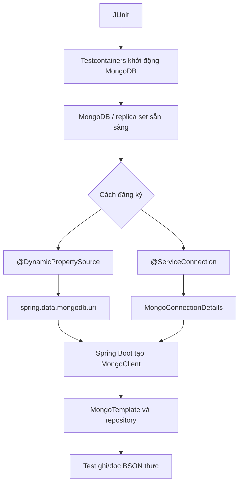

# @DynamicPropertySource hoặc @ServiceConnection theo Spring Boot

Khi kiểm thử ứng dụng dùng **Spring Data MongoDB**, một khó khăn thường gặp là MongoDB do Testcontainers khởi động có host và cổng được gán động. Test phải cung cấp thông tin kết nối cho Spring **trước khi** tạo `MongoClient`, `MongoTemplate` và repository. Hai cách phổ biến là **`@DynamicPropertySource`** trong Spring Test và **`@ServiceConnection`** trong Spring Boot.

Bài học thuộc chương **Kiểm thử** của `SPRING_DATA_MONGODB`. Ta dùng cùng một entity và repository để xác minh lưu/đọc document, mapping BSON và query; sau đó phân tích lựa chọn annotation theo phiên bản Spring Boot, vòng đời container, cấu hình CI, index, transaction và reactive access.

> **Phiên bản áp dụng:** Các ví dụ mã hoàn chỉnh bên dưới dành cho **Java 17+, Spring Boot 3.x và Testcontainers Java 1.x**. `@DynamicPropertySource` có từ Spring Framework 5.2.5; `@ServiceConnection` được Spring Boot cung cấp từ **3.1**. Khi sử dụng Spring Boot 4.x hoặc Testcontainers 2.x, hãy kiểm tra lại package, dependency và cấu hình MongoDB của dòng phiên bản đó.

## 1. Vì sao kết nối trong test phải linh hoạt?

Container MongoDB sử dụng cổng nội bộ `27017` nhưng có thể được Docker ánh xạ ra một cổng host ngẫu nhiên, ví dụ `49183`. Nếu hard-code `mongodb://localhost:27017`, test có thể kết nối nhầm MongoDB trên máy phát triển hoặc thất bại trên CI. Với replica set, connection string còn mang các tham số giúp driver tìm đúng topology.

Một test đáng tin cậy cần:

1. Được cấp đúng MongoDB dành riêng cho test, đúng phiên bản và topology.
2. Cấu hình kết nối **trước** khi Spring tạo các bean MongoDB.
3. Không phụ thuộc vào host/port cụ thể của máy chạy.
4. Seed và dọn dữ liệu để test có thể chạy lặp lại và đổi thứ tự.
5. Quan sát được lỗi khởi tạo môi trường thay vì nhầm với lỗi nghiệp vụ.



**`@DynamicPropertySource` đăng ký property** (ví dụ `spring.data.mongodb.uri`) vào test environment thông qua một supplier. **`@ServiceConnection` đăng ký thông tin kết nối** cho Spring Boot dựa trên loại container được hỗ trợ. Cả hai đều sử dụng MongoDB thực; chúng không tự mock database hay giải quyết việc reset dữ liệu.

## 2. Lựa chọn nhanh theo Spring Boot

| Trường hợp | Giải pháp | Điều kiện |
| --- | --- | --- |
| Spring Boot 2.7, 3.0 | `@DynamicPropertySource` | Sử dụng key kết nối đúng phiên bản Boot |
| Spring Boot 3.1+ và `MongoDBContainer` được hỗ trợ | `@ServiceConnection` | Thêm `spring-boot-testcontainers` ở phạm vi test |
| Boot 3.1+ nhưng phải inject thêm property tùy chỉnh | `@DynamicPropertySource` cho các property đó | Có thể dùng cùng `@ServiceConnection` nếu không trùng nguồn cấu hình MongoDB |
| MongoDB do CI/Compose cấp sẵn | Test profile và URI từ môi trường | Không cần hai annotation trên nếu URI đã biết |
| Có `MongoClient` bean do ứng dụng tự viết | Cấu hình bean tùy chỉnh | Kiểm tra bean có tiêu thụ property hoặc connection details hay không |

Với Spring Boot 3.1+ và MongoDBContainer chính thức, `@ServiceConnection` thường ngắn hơn. `@DynamicPropertySource` hữu ích khi cần tương thích các phiên bản Boot cũ, hoặc đăng ký property động theo cách linh hoạt. Không cần khai báo **hai nguồn URI** cho cùng một MongoDB.

## 3. Entity và repository dùng trong hai ví dụ

Đặt entity, repository và test cùng package `example.customer` dưới gốc ứng dụng Spring Boot.

**`Customer.java`**

```java
package example.customer;

import java.time.Instant;
import org.springframework.data.annotation.Id;
import org.springframework.data.mongodb.core.mapping.Document;
import org.springframework.data.mongodb.core.mapping.Field;

@Document(collection = "customers")
public record Customer(
        @Id String id,
        @Field("email_address") String email,
        Instant registeredAt
) {}
```

**`CustomerRepository.java`**

```java
package example.customer;

import java.util.Optional;
import org.springframework.data.mongodb.repository.MongoRepository;

public interface CustomerRepository
        extends MongoRepository<Customer, String> {
    Optional<Customer> findByEmail(String email);
}
```

Thuộc tính `email` trong Java được lưu dưới field BSON `email_address`. Test sẽ xác minh cả derived query và document thô; mock `MongoRepository` không thể chứng minh dữ liệu đã được ánh xạ đúng vào MongoDB server.

### 3.1. Dependency cần có

Ứng dụng dùng dependency chính `spring-boot-starter-data-mongodb`. Với Spring Boot 3.x và **Testcontainers 1.x**, thêm vào Maven `<dependencies>`:

```xml
<dependency>
    <groupId>org.springframework.boot</groupId>
    <artifactId>spring-boot-starter-test</artifactId>
    <scope>test</scope>
</dependency>
<dependency>
    <groupId>org.testcontainers</groupId>
    <artifactId>junit-jupiter</artifactId>
    <scope>test</scope>
</dependency>
<dependency>
    <groupId>org.testcontainers</groupId>
    <artifactId>mongodb</artifactId>
    <scope>test</scope>
</dependency>
```

Các phiên bản cần được quản lý bởi Spring Boot BOM/Testcontainers BOM hoặc pin phiên bản tương thích. Khi dùng Gradle, khai báo dependencies tương ứng với `testImplementation`. Chọn image cố định như `mongo:7.0` cho ví dụ; trong dự án thật, dùng version MongoDB phù hợp ma trận hỗ trợ của ứng dụng, tránh dựa vào tag `latest`.

## 4. Cách 1 — `@DynamicPropertySource`

### 4.1. Ví dụ repository test hoàn chỉnh

**`CustomerDynamicPropertyTest.java`:**

```java
package example.customer;

import com.mongodb.client.model.Filters;
import java.time.Instant;
import org.bson.Document;
import org.junit.jupiter.api.BeforeEach;
import org.junit.jupiter.api.Test;
import org.springframework.beans.factory.annotation.Autowired;
import org.springframework.boot.test.autoconfigure.data.mongo.DataMongoTest;
import org.springframework.data.mongodb.core.MongoTemplate;
import org.springframework.test.context.DynamicPropertyRegistry;
import org.springframework.test.context.DynamicPropertySource;
import org.testcontainers.containers.MongoDBContainer;
import org.testcontainers.junit.jupiter.Container;
import org.testcontainers.junit.jupiter.Testcontainers;
import org.testcontainers.utility.DockerImageName;

import static org.assertj.core.api.Assertions.assertThat;

@DataMongoTest
@Testcontainers
class CustomerDynamicPropertyTest {

    @Container
    static final MongoDBContainer MONGO =
            new MongoDBContainer(DockerImageName.parse("mongo:7.0"));

    @DynamicPropertySource
    static void configureMongo(DynamicPropertyRegistry registry) {
        registry.add("spring.data.mongodb.uri", MONGO::getReplicaSetUrl);
    }

    @Autowired
    CustomerRepository repository;

    @Autowired
    MongoTemplate mongoTemplate;

    @BeforeEach
    void resetData() {
        repository.deleteAll();
    }

    @Test
    void readsMappedFieldFromRealMongoDb() {
        Customer saved = repository.insert(new Customer(
                "c-101",
                "alice@example.test",
                Instant.parse("2026-01-01T00:00:00Z")));

        assertThat(repository.findByEmail("alice@example.test"))
                .contains(saved);

        Document stored = mongoTemplate.getCollection("customers")
                .find(Filters.eq("_id", "c-101"))
                .first();

        assertThat(stored).isNotNull();
        assertThat(stored.getString("email_address"))
                .isEqualTo("alice@example.test");
        assertThat(stored.containsKey("email")).isFalse();
    }

    @Test
    void returnsEmptyForUnknownEmail() {
        assertThat(repository.findByEmail("missing@example.test")).isEmpty();
    }
}
```

**Diễn biến:**

1. `@Testcontainers` và `static @Container` giúp JUnit extension quản lý vòng đời của MongoDB container trước khi Spring context sử dụng nó.
2. Phương thức `@DynamicPropertySource` đăng ký supplier cung cấp URI trong `DynamicPropertyRegistry`.
3. Khi Spring Boot cấu hình `MongoClient`, supplier trả `MONGO.getReplicaSetUrl()` chứa cổng đã được cấp và thông tin replica set.
4. `@DataMongoTest` nạp cấu hình Spring Data MongoDB, `MongoTemplate` và repository phù hợp cho data slice.
5. Test insert, tìm bằng repository và dùng driver đọc BSON raw để xác nhận mapping.

### 4.2. Tại sao dùng supplier?

Phương thức dùng với `@DynamicPropertySource` phải là `static` và nhận `DynamicPropertyRegistry`. Lệnh `add(key, supplier)` lưu **Supplier**, giá trị được truy xuất khi property được resolve:

```java
@DynamicPropertySource
static void dynamicProperties(DynamicPropertyRegistry registry) {
    registry.add("spring.data.mongodb.uri", MONGO::getReplicaSetUrl);
}
```

Vì host/port chỉ biết sau khi tạo container, không hard-code `localhost:27017`, cũng không tự nối chuỗi host và cổng mà bỏ qua thông tin replica set. `getReplicaSetUrl()` là URI dành cho client theo cấu hình MongoDBContainer của phiên bản Testcontainers đang dùng.

Dynamic properties có độ ưu tiên cao trong Spring Test `Environment` và thường ghi đè cùng key từ `application-test.yml` hoặc biến môi trường. Vì thế cần tránh đăng ký URI test ở nhiều nơi rồi không biết nguồn nào có hiệu lực.

Khi cần cung cấp thêm các property động khác, annotation này vẫn dùng được:

```java
@DynamicPropertySource
static void dynamicProperties(DynamicPropertyRegistry registry) {
    registry.add("spring.data.mongodb.uri", MONGO::getReplicaSetUrl);
    registry.add("app.integration-test-mode", () -> true);
}
```

Đây là ưu điểm của `@DynamicPropertySource`: nó không giới hạn ở MongoDB và không đòi hỏi Boot có service connection factory cho loại resource được test sử dụng.

## 5. Cách 2 — `@ServiceConnection` của Spring Boot 3.1+

### 5.1. Thêm dependency

Giữ các dependency ở phần trước và bổ sung:

```xml
<dependency>
    <groupId>org.springframework.boot</groupId>
    <artifactId>spring-boot-testcontainers</artifactId>
    <scope>test</scope>
</dependency>
```

Đây là thư viện cung cấp phần tích hợp Testcontainers của Spring Boot, trong đó có `@ServiceConnection`. Không nhầm với `spring-boot-starter-test`.

### 5.2. Ví dụ tương đương không cần đăng ký URI

**`CustomerServiceConnectionTest.java`:**

```java
package example.customer;

import com.mongodb.client.model.Filters;
import java.time.Instant;
import org.bson.Document;
import org.junit.jupiter.api.BeforeEach;
import org.junit.jupiter.api.Test;
import org.springframework.beans.factory.annotation.Autowired;
import org.springframework.boot.test.autoconfigure.data.mongo.DataMongoTest;
import org.springframework.boot.testcontainers.service.connection.ServiceConnection;
import org.springframework.data.mongodb.core.MongoTemplate;
import org.testcontainers.containers.MongoDBContainer;
import org.testcontainers.junit.jupiter.Container;
import org.testcontainers.junit.jupiter.Testcontainers;
import org.testcontainers.utility.DockerImageName;

import static org.assertj.core.api.Assertions.assertThat;

@DataMongoTest
@Testcontainers
class CustomerServiceConnectionTest {

    @Container
    @ServiceConnection
    static final MongoDBContainer MONGO =
            new MongoDBContainer(DockerImageName.parse("mongo:7.0"));

    @Autowired
    CustomerRepository repository;

    @Autowired
    MongoTemplate mongoTemplate;

    @BeforeEach
    void resetData() {
        repository.deleteAll();
    }

    @Test
    void readsBsonWithServiceConnection() {
        repository.insert(new Customer(
                "c-202",
                "bob@example.test",
                Instant.parse("2026-01-01T00:00:00Z")));

        assertThat(repository.findByEmail("bob@example.test")).isPresent();

        Document stored = mongoTemplate.getCollection("customers")
                .find(Filters.eq("_id", "c-202"))
                .first();

        assertThat(stored).isNotNull();
        assertThat(stored.getString("email_address"))
                .isEqualTo("bob@example.test");
    }
}
```

Spring Boot nhận diện `MongoDBContainer` được chú thích `@ServiceConnection` và tạo thông tin kết nối cho MongoDB auto-configuration. Trong Boot 3.x, cơ chế này sử dụng `MongoConnectionDetails`; test không tự đăng ký `spring.data.mongodb.uri`. `@Testcontainers` và `@Container` vẫn có nhiệm vụ quản lý vòng đời container.

### 5.3. Connection details khác Spring property thế nào?

Thông tin từ `@ServiceConnection` không nhất thiết hiện ra như một property mới trong `Environment`. Auto-configuration của Spring Boot sử dụng **connection details** để dựng MongoDB client. Nếu còn khai báo `spring.data.mongodb.uri` trong test profile, cấu hình đó không nhất thiết là đích kết nối thực tế khi Boot đang dùng `MongoConnectionDetails` từ Testcontainers.

Đây cũng là lý do không nên vừa dùng `@DynamicPropertySource` để cấp URI MongoDB **vừa** thêm `@ServiceConnection` cho cùng container: kết quả có thể đúng nhưng gây nhầm lẫn khi debug hoặc di chuyển cấu hình.

Nếu ứng dụng tự tạo `@Bean MongoClient` mà bỏ qua auto-configuration, các connection details của Boot không tự động thay đổi bean đó. Khi test vẫn kết nối sai nơi, kiểm tra bean tùy chỉnh đã nhận nguồn kết nối nào.

### 5.4. Loại container phải được nhận diện

Field kiểu `MongoDBContainer` là lựa chọn rõ ràng vì Spring Boot có factory cho dịch vụ MongoDB được hỗ trợ. Một `GenericContainer<?>` dùng image tùy chỉnh có thể cần tên dịch vụ trong `@ServiceConnection(name = "...")`, nhưng phải kiểm tra factory của phiên bản Boot có hỗ trợ tên/kiểu đó hay không. Không mặc định mọi generic container đều tạo connection details phù hợp.

## 6. Đổi từ `@DynamicPropertySource` sang `@ServiceConnection`

| Tiêu chí | `@DynamicPropertySource` | `@ServiceConnection` |
| --- | --- | --- |
| Thuộc | Spring Framework Test | Spring Boot Testcontainers |
| Mốc phiên bản | Spring Framework 5.2.5+ | Spring Boot 3.1+ |
| Thông tin chính | Supplier cho property | Connection details theo service |
| Dòng quan trọng | `registry.add("spring.data.mongodb.uri", ...)` | `@ServiceConnection` trên container |
| Cần biết key MongoDB | Có | Không cần cho container đã hỗ trợ |
| Hỗ trợ property riêng | Có | Không phải mục đích chính |
| Dependency riêng của Boot | Không | `spring-boot-testcontainers` |
| Lỗi thường gặp | Sai key, supplier, context cache | Thiếu dependency, loại container không được nhận diện |

Để di chuyển một project Spring Boot 3.1+:

1. Xác nhận module `org.testcontainers:mongodb` và JUnit extension đã có và chạy ổn định.
2. Thêm `spring-boot-testcontainers` trong dependency scope test.
3. Giữ `@Testcontainers` và `static @Container`. Thêm `@ServiceConnection` lên container.
4. Xóa phương thức `@DynamicPropertySource` **cấp URI cho container đó**. Các property động khác vẫn có thể giữ nếu cần.
5. Chạy lại cùng assertions, kiểm tra đúng database, sau đó xác nhận CI và các test cần replica set.

Phần thay đổi tối thiểu:

```diff
 @Container
+@ServiceConnection
 static final MongoDBContainer MONGO =
         new MongoDBContainer(DockerImageName.parse("mongo:7.0"));

-@DynamicPropertySource
-static void configureMongo(DynamicPropertyRegistry registry) {
-    registry.add("spring.data.mongodb.uri", MONGO::getReplicaSetUrl);
-}
```

Annotation này không thay thế `@DataMongoTest`, không tự nạp service nghiệp vụ, không khởi tạo index do ứng dụng tự quản lý và không reset collection.

## 7. Lifecycle và dữ liệu độc lập giữa các test

### 7.1. Vòng đời container và Spring context cache

Trong các ví dụ, `static @Container` sống theo test class. Spring TestContext có thể **cache** một application context giữa những test class có cấu hình tương đương. Nếu context còn `MongoClient` trỏ tới container A đã dừng, nhưng class sau dùng container B, việc tái sử dụng context cũ có thể gây lỗi kết nối.

Chọn một chiến lược nhất quán: container dùng chung có vòng đời dài bằng suite/context; hoặc tách context cho class có URI khác và dùng `@DirtiesContext` khi cần làm mới. Đặc biệt, nếu `@DynamicPropertySource` được kế thừa từ lớp cha nhưng giá trị khác theo lớp con, cần xem xét tính đúng đắn của context cache.

Không gọi `MONGO.start()` thủ công rồi đồng thời trông chờ JUnit extension quản lý cùng container nếu không thiết kế lifecycle rõ ràng. Reusable containers phục vụ phát triển cục bộ có thể giữ trạng thái; không mặc định bật trong CI khi test yêu cầu isolation.

### 7.2. Cleanup không đồng nghĩa rollback

`repository.deleteAll()` trong `@BeforeEach` chỉ phù hợp nếu test sở hữu collection đó và không có test khác cùng xóa dữ liệu **song song**. Với test chạy đồng thời, mỗi job hoặc class cần database riêng, collection namespace riêng hoặc giới hạn parallelism.

MongoDB không tự rollback mọi thao tác test chỉ vì có `@Transactional`. Transaction nhiều document yêu cầu topology hỗ trợ (thường là replica set hoặc sharded cluster), transaction manager phù hợp và các thao tác thực sự tham gia transaction.

### 7.3. Seed dữ liệu đủ trường hợp

Seed qua repository để test hành vi ứng dụng. Khi cần kiểm tra BSON type, document lịch sử, missing field hoặc migration, seed qua driver:

```java
import org.bson.Document;
import java.util.Date;
import java.time.Instant;

mongoTemplate.getCollection("customers").insertOne(
        new Document("_id", "legacy-001")
                .append("email_address", "old@example.test")
                .append("registeredAt", Date.from(
                        Instant.parse("2020-01-01T00:00:00Z"))));
```

Việc tạo container đúng cách không tự bảo đảm dữ liệu kiểm thử đại diện cho thực tế. Cần test field thiếu, giá trị `null`, dữ liệu trùng khi có unique index, điều kiện sort và ánh xạ kiểu BSON nếu module sử dụng chúng.

## 8. Transaction, reactive và nhiều MongoClient

`MongoDBContainer` hỗ trợ môi trường replica set thích hợp cho nhiều test transaction và change stream. URI từ `getReplicaSetUrl()` giúp driver khám phá topology mà container thiết lập. Nếu dùng MongoDB service standalone thay cho Testcontainers, CRUD có thể hoạt động nhưng transaction nhiều document và change stream có thể không hoạt động.

Với Spring-managed transaction blocking, cần `MongoTransactionManager` trên `MongoDatabaseFactory`. Khi kiểm thử rollback, thực hiện hai write qua một service có `@Transactional`, chủ động ném exception và xác minh trạng thái thật trong MongoDB. Không suy rollback chỉ từ exception hoặc `@Transactional` trên chính test method.

Với `spring-boot-starter-data-mongodb-reactive`, cần kiểm thử kết nối đến `ReactiveMongoTemplate` hoặc reactive repository thực. Publisher chỉ thực thi khi được subscribe:

```java
import reactor.test.StepVerifier;

// Giả định reactiveRepository đã được inject và fixture đã được seed.
StepVerifier.create(
        reactiveRepository.findByEmail("alice@example.test"))
        .assertNext(customer ->
                org.assertj.core.api.Assertions.assertThat(customer.email())
                        .isEqualTo("alice@example.test"))
        .verifyComplete();
```

Để dùng đoạn này cần reactive repository và dependency test `reactor-test`. Change stream là publisher kéo dài, cần timeout, sự kiện phát chủ động và cleanup subscription. Đừng đo hiệu năng reactive bằng thời gian chỉ để tạo `Flux`.

Nếu ứng dụng dùng **nhiều MongoDB cluster**, một connection details mặc định không có nghĩa tất cả `MongoClient` tùy chỉnh trỏ đúng nơi. Xác định rõ bean, qualifier và config riêng cho mỗi kết nối; kiểm chứng bằng thao tác đọc/ghi vào đúng database test.

## 9. CI và MongoDB service có sẵn

### 9.1. CI chạy Testcontainers

Runner cần quyền truy cập Docker engine/container runtime tương thích, khả năng pull image và network. Tránh hard-code cổng. Dùng log của MongoDBContainer và nguyên nhân exception để chẩn đoán startup, health và replica set. Không dùng sleep cố định khi có thể đợi tín hiệu sẵn sàng.

| Lỗi | Khả năng thường gặp | Cách kiểm tra |
| --- | --- | --- |
| Không tìm thấy Docker | CI không có engine/socket/quyền | Runtime và permission của runner |
| Timeout khi start | Image pull chậm, thiếu tài nguyên, chưa ready | Container logs và trạng thái replica set |
| `Connection refused` | URI/cổng sai, context trỏ container cũ | Connection source, lifecycle và cache |
| `UnknownHostException` | Hostname không phân giải trong network runner | Vị trí chạy JUnit và DNS container |
| URI trong YAML có nhưng kết nối tới chỗ khác | Connection details hoặc custom bean có ưu tiên khác | Auto-configuration thực sự được dùng |
| Transaction báo lỗi topology | Standalone MongoDB hoặc thiếu transaction manager | Replica set + Spring config |
| Test flake song song | Một test xóa dữ liệu của test khác | Database riêng, test IDs, parallelism |

### 9.2. CI cấp MongoDB như một service độc lập

Nếu MongoDB được Docker Compose, CI service hay cluster test cấp **trước khi** chạy JUnit, không cần Testcontainers trong test code. Với Spring Boot 3.x, có thể đặt trong `src/test/resources/application-test.yml`:

```yaml
spring:
  data:
    mongodb:
      uri: ${TEST_MONGODB_URI}
```

Trong cấu hình trên, `${TEST_MONGODB_URI}` đại diện cho **placeholder lấy từ biến môi trường TEST_MONGODB_URI** của Spring; phải cung cấp biến trước khi Spring context bắt đầu. Chạy test với `@ActiveProfiles("test")`. Không đưa credentials vào source. Nếu JUnit chạy trong container riêng, `localhost` chỉ chính container đó; dùng host/dns service của network CI phù hợp.

Với dịch vụ chia sẻ, cấp database riêng cho từng job và chỉ dọn database mà job sở hữu. Không để URI thiếu cấu hình khiến test âm thầm kết nối đến môi trường khác.

## 10. Kiểm tra kết quả và lỗi cấu hình thường gặp

Không chỉ xác minh Spring context khởi tạo được. Integration test nên **ghi và đọc document thật**, đối chiếu field BSON, rồi chạy lại hai lần để phát hiện lỗi cleanup và context cache.

| Hiểu nhầm | Cách hiểu đúng |
| --- | --- |
| `@DynamicPropertySource` tự khởi động MongoDB | Annotation chỉ đăng ký property; container/service có lifecycle riêng |
| `@ServiceConnection` có trên mọi phiên bản Boot | Bắt đầu từ Boot 3.1 và cần tích hợp Testcontainers |
| Cả hai annotation đều gán URI vào `Environment` | Service connection cung cấp connection details, không đơn giản là property |
| `@Container` nghĩa là MongoDB xuất hiện ở host port 27017 | Port động; lấy URI do container cấp |
| `@DataMongoTest` nạp toàn bộ application | Chỉ nạp phần MongoDB data slice; dùng `@SpringBootTest` khi cần full integration |
| Container riêng luôn có dữ liệu sạch | Còn phụ thuộc context cache, database và chạy song song |
| Test repository chạy xanh chứng minh hiệu năng tốt | Benchmark cần dataset và tải đủ lớn; dùng `explain("executionStats")` và telemetry |

Khi module sử dụng aggregation, index hoặc performance diagnostics, test trên MongoDB thật giúp xác minh query, `$lookup`/`$group`, index metadata và `totalDocsExamined`; các phép đo latency, số command và byte BSON phải được thu thập riêng trên tập dữ liệu đại diện.

## 11. Bài tập

**Bài 1 — Dynamic properties.** Sử dụng `@DynamicPropertySource` cấp URI từ `MongoDBContainer`. Chạy hai test lưu/tìm và không tìm thấy; đọc BSON thô xác nhận `email_address`. Giải thích vì sao không dùng cổng cố định.

**Bài 2 — Service connection.** Nâng project lên Spring Boot 3.1+ phù hợp, thêm `spring-boot-testcontainers`, thay dynamic property của bài 1 bằng `@ServiceConnection`. Giữ nguyên assertions và xác định cơ chế nào cấp kết nối.

**Bài 3 — Ưu tiên cấu hình.** Cung cấp một URI khác qua profile test và thử từng annotation. Quan sát database thực được dùng bằng thao tác đọc/ghi; giải thích tại sao việc in `Environment.getProperty("spring.data.mongodb.uri")` chưa chắc mô tả đích của `MongoClient` khi có service connection.

**Bài 4 — Lifecycle và chạy song song.** Hai test class dùng container hoặc database khác nhau. Chạy nhiều lượt, kiểm tra Spring context caching và lỗi do cùng gọi `deleteAll()`. Điều chỉnh lifecycle/namespace để test độc lập.

**Bài 5 — Replica set và transaction.** Tạo service thực hiện hai write trong transaction, ném exception để rollback. Chạy trên Testcontainers replica set rồi so sánh với MongoDB standalone từ một service kiểm thử. Nêu rõ transaction manager và topology cần thiết.

**Tiêu chí hoàn thành:** Người học chọn đúng `@DynamicPropertySource` hoặc `@ServiceConnection` theo Spring Boot; phân biệt dynamic properties với connection details; tích hợp Testcontainers vào test Spring Data MongoDB; xác minh query/BSON mapping và quản lý context, data, CI; hiểu giới hạn của transaction, reactive access và kiểm thử hiệu năng.
