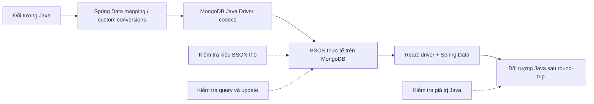

# Kiểm thử ObjectId, UUID, Decimal128, thời gian và converter

## 1. Vì sao kiểm thử ánh xạ BSON quan trọng?

Với **Spring Data MongoDB**, một đối tượng Java có thể được ghi qua `MongoTemplate` hoặc repository và đọc lại mà không báo lỗi, nhưng kiểu BSON thực tế trên MongoDB vẫn khác với hợp đồng dữ liệu mong muốn. Điều này đặc biệt nguy hiểm với **ObjectId**, **UUID**, **Decimal128**, kiểu thời gian và **custom converter**: hai giá trị trông giống nhau khi hiển thị chưa chắc có cùng kiểu, cách sắp xếp, độ chính xác hoặc khả năng truy vấn.

Ví dụ, chuỗi `"507f1f77bcf86cd799439011"` có thể là **String** hoặc **ObjectId**; `UUID` có thể được lưu dưới binary subtype 4 hoặc legacy subtype 3; `BigDecimal` có thể bị lưu thành chuỗi nếu không cấu hình dạng Decimal128; `Instant` chứa nano-giây nhưng BSON Date chỉ lưu độ chính xác **mili-giây**. Converter tự viết có thể đọc/ghi đúng ở một đường đi nhưng không được áp dụng khi cập nhật trực tiếp.

Mục tiêu kiểm thử là bảo đảm ít nhất bốn hợp đồng:

1. **Giá trị Java đầu vào → BSON lưu trên server** đúng kiểu, đúng nội dung.
2. **BSON trên server → đối tượng Java** giải mã đúng, có quy tắc rõ cho độ chính xác và dữ liệu thiếu.
3. **Truy vấn, cập nhật và index** hoạt động với kiểu BSON đã chọn; không chỉ kiểm tra `save`/`findById`.
4. **Dữ liệu cũ và cấu hình thực tế** vẫn tương thích khi nâng cấp Java driver, Spring Data MongoDB hoặc thay converter.

Bài sử dụng `MongoTemplate` làm ví dụ chính; repository và reactive access cần được kiểm tra với cùng hợp đồng lưu trữ.



## 2. Chọn tầng kiểm thử đúng trách nhiệm

| Tầng | Kiểm tra được | Không chứng minh được |
|---|---|---|
| Unit test hàm chuyển đổi riêng | Logic chuẩn hóa, kiểm tra null, phân tích chuỗi, quy tắc nghiệp vụ | MongoDB đang lưu đúng BSON type |
| Test converter trực tiếp | `Converter<S, T>` trả đúng kiểu và giá trị | Converter đã được Spring đăng ký và áp dụng ở mọi đường truy cập |
| Integration test với MongoDB thật | Ánh xạ `MongoTemplate`/repository, raw BSON, query, update, index | Dữ liệu production cũ và môi trường triển khai thật |
| Test migration/compatibility | Đọc lại các fixture BSON lịch sử, phát hiện thay đổi giữa phiên bản | Hiệu năng hoặc khả năng chịu tải thực tế |
| Test hiệu năng và lỗi | Chi phí converter, throughput, kết nối, phân phối kiểu dữ liệu | Tính đúng đắn của mọi trường hợp biên nếu không có assertion |

**Nên ưu tiên integration test bằng MongoDB thật** (ví dụ Testcontainers), vì bản giả lập repository hoặc mock `MongoTemplate` thường bỏ qua chính tầng codec/BSON đang cần kiểm thử. Testcontainers cần Docker hoặc môi trường container tương thích.

Dữ liệu test nên được tạo riêng trong database/collection kiểm thử, không ghi vào môi trường đang dùng chung. Sử dụng những mã định danh cụ thể, timestamp cố định và `BigDecimal(String)` để kết quả tái lập được.

## 3. Một entity mẫu chứa đủ các kiểu cần kiểm tra

Ví dụ một document ghi nhận giao dịch:

```java
import java.math.BigDecimal;
import java.time.Instant;
import java.util.UUID;

import org.bson.types.ObjectId;
import org.springframework.data.annotation.Id;
import org.springframework.data.mongodb.core.mapping.Document;
import org.springframework.data.mongodb.core.mapping.Field;
import org.springframework.data.mongodb.core.mapping.FieldType;

@Document("type_samples")
public record TypeSample(
    @Id ObjectId id,
    UUID requestId,
    @Field(targetType = FieldType.DECIMAL128) BigDecimal total,
    Instant receivedAt
) {}
```

Có bốn quyết định có chủ đích:

- `id` dùng `ObjectId` thực sự, tránh phải dựa vào quy tắc suy diễn chuỗi.
- `requestId` có kiểu `UUID`; cần cấu hình Java driver dùng **`UuidRepresentation.STANDARD`** để lưu UUID chuẩn BSON binary subtype **4**.
- `total` có `@Field(targetType = FieldType.DECIMAL128)`; mặc định của `BigDecimal` trong một số cấu hình Spring Data có thể là String, vì vậy bài test phải quan sát kiểu BSON thật.
- `receivedAt` dùng `Instant` đại diện một thời điểm trên trục UTC; BSON Date lưu số mili-giây kể từ epoch.

Không cần đổi mọi field trong ứng dụng thành những kiểu này. Điều quan trọng là chọn chuẩn lưu trữ trước, rồi **viết test có khả năng phát hiện khi chuẩn bị thay đổi**.

### Cấu hình UUID nhất quán

Với Java driver hiện đại, nên cấu hình biểu diễn UUID tường minh trên **MongoClient mà Spring Data thực sự sử dụng**:

```java
import org.bson.UuidRepresentation;
import com.mongodb.MongoClientSettings;

MongoClientSettings settings = MongoClientSettings.builder()
    .uuidRepresentation(UuidRepresentation.STANDARD)
    .build();
```

Đây là phần cấu hình lõi của driver. Trong Spring Boot, đưa cấu hình tương ứng vào `MongoClientSettingsBuilderCustomizer` hoặc cấu hình client do ứng dụng quản lý, rồi xác nhận `MongoTemplate`/repository sử dụng đúng client đó. Package/tên property auto-configuration phụ thuộc phiên bản Spring Boot; không nên dựa vào default ngầm định.

## 4. Dựng integration test với MongoDB và kiểm tra raw BSON

Ví dụ dùng JUnit 5, AssertJ, Spring Boot test slice và Testcontainers. Dependency cần có gồm Spring Data MongoDB, Spring Boot test starter, Testcontainers MongoDB và Testcontainers JUnit Jupiter; chọn phiên bản tương thích với BOM đang dùng. Ví dụ cấu hình sau áp dụng phong cách Spring Boot 3.x, có thể cần đổi package customizer ở phiên bản khác.

```java
import static com.mongodb.client.model.Filters.eq;
import static org.assertj.core.api.Assertions.assertThat;

import java.math.BigDecimal;
import java.time.Instant;
import java.util.UUID;

import org.bson.BsonBinarySubType;
import org.bson.BsonDocument;
import org.bson.UuidRepresentation;
import org.bson.types.ObjectId;
import org.junit.jupiter.api.Test;
import org.springframework.beans.factory.annotation.Autowired;
import org.springframework.boot.autoconfigure.mongo.MongoClientSettingsBuilderCustomizer;
import org.springframework.boot.test.autoconfigure.data.mongo.DataMongoTest;
import org.springframework.boot.test.context.TestConfiguration;
import org.springframework.context.annotation.Bean;
import org.springframework.data.mongodb.core.MongoTemplate;
import org.springframework.test.context.DynamicPropertyRegistry;
import org.springframework.test.context.DynamicPropertySource;
import org.testcontainers.containers.MongoDBContainer;
import org.testcontainers.junit.jupiter.Container;
import org.testcontainers.junit.jupiter.Testcontainers;
import org.testcontainers.utility.DockerImageName;

@Testcontainers
@DataMongoTest
class TypeSampleMongoTest {

    @Container
    static final MongoDBContainer mongo =
        new MongoDBContainer(DockerImageName.parse("mongo:7.0"));

    @DynamicPropertySource
    static void mongoProperties(DynamicPropertyRegistry registry) {
        registry.add("spring.data.mongodb.uri", mongo::getReplicaSetUrl);
    }

    @TestConfiguration(proxyBeanMethods = false)
    static class UuidConfig {
        @Bean
        MongoClientSettingsBuilderCustomizer standardUuid() {
            return builder ->
                builder.uuidRepresentation(UuidRepresentation.STANDARD);
        }
    }

    @Autowired
    MongoTemplate mongoTemplate;

    @Test
    void preservesJavaValuesAndBsonTypes() {
        ObjectId id = new ObjectId("507f1f77bcf86cd799439011");
        UUID requestId =
            UUID.fromString("123e4567-e89b-12d3-a456-426614174000");
        BigDecimal total = new BigDecimal("12345.6700");
        Instant receivedAt =
            Instant.parse("2026-11-20T13:02:03.123456789Z");

        mongoTemplate.insert(
            new TypeSample(id, requestId, total, receivedAt)
        );

        TypeSample result =
            mongoTemplate.findById(id, TypeSample.class);

        assertThat(result).isNotNull();
        assertThat(result.id()).isEqualTo(id);
        assertThat(result.requestId()).isEqualTo(requestId);
        assertThat(result.total()).isEqualByComparingTo(total);
        assertThat(result.receivedAt()).isEqualTo(
            Instant.ofEpochMilli(receivedAt.toEpochMilli())
        );

        BsonDocument raw = mongoTemplate.getCollection("type_samples")
            .withDocumentClass(BsonDocument.class)
            .find(eq("_id", id))
            .first();

        assertThat(raw).isNotNull();
        assertThat(raw.getObjectId("_id").getValue()).isEqualTo(id);
        assertThat(raw.getBinary("requestId").getType())
            .isEqualTo(BsonBinarySubType.UUID_STANDARD.getValue());
        assertThat(raw.getDecimal128("total")
            .getValue().bigDecimalValue())
            .isEqualByComparingTo(total);
        assertThat(raw.getDateTime("receivedAt").getValue())
            .isEqualTo(receivedAt.toEpochMilli());
    }
}
```

Trọng tâm của ví dụ là cấu hình container, MongoClient và các assertion về BSON; tùy phiên bản phụ thuộc, điều chỉnh import và cấu hình Spring Boot tương ứng. Thực tế nên dùng phiên bản Testcontainers và MongoDB image đã được dự án chốt thay vì cố định `mongo:7.0` cho mọi môi trường.

**Vì sao phải đọc `BsonDocument`?** `mongoTemplate.findById(...)` chứng minh mapping round-trip; trong khi `withDocumentClass(BsonDocument.class)` cho biết server đang giữ kiểu **ObjectId**, **Binary subtype 4**, **Decimal128** và **BSON Date**. Nếu một converter bị cấu hình sai nhưng cả ghi và đọc cùng sửa lỗi theo cách “đối xứng”, riêng phép so sánh object có thể không phát hiện được.

Đừng dùng dữ liệu `raw` đã đi qua custom converter để kiểm tra chính custom converter đó: cần đường đọc BSON ở cấp driver để có quan sát độc lập.

## 5. ObjectId: cùng chuỗi hiển thị, khác BSON type

`ObjectId` là BSON type chuyên biệt, gồm 12 byte; biểu diễn 24 chữ số hexadecimal chỉ là **cách hiển thị**. Dùng `String` làm `@Id` có thể kích hoạt chuyển đổi sang ObjectId nếu nội dung chuyển đổi được. Nếu không, một số giá trị có thể được lưu dưới BSON String. Vì thế hai document có `_id` hiển thị tương tự nhưng không tương đương khi truy vấn.

### Hai hợp đồng định danh hợp lệ

**Hợp đồng A — ObjectId thật**: entity có `@Id ObjectId id` và truy vấn bằng `ObjectId`.

```java
import org.bson.types.ObjectId;

ObjectId id = new ObjectId("507f1f77bcf86cd799439011");
TypeSample stored = mongoTemplate.findById(id, TypeSample.class);

assertThat(stored).isNotNull();
assertThat(stored.id()).isEqualTo(id);
```

**Hợp đồng B — mã nghiệp vụ luôn là chuỗi**: dùng `@MongoId(FieldType.STRING)` để tránh suy diễn sang ObjectId.

```java
import org.springframework.data.mongodb.core.mapping.Document;
import org.springframework.data.mongodb.core.mapping.FieldType;
import org.springframework.data.mongodb.core.mapping.MongoId;

@Document("external_ids")
public record ExternalId(
    @MongoId(FieldType.STRING) String id,
    String label
) {}
```

Test phải chứng minh `_id` trên server có kiểu BSON String, kể cả khi giá trị **trông giống ObjectId**:

```java
String value = "507f1f77bcf86cd799439011";

mongoTemplate.insert(new ExternalId(value, "external"));
BsonDocument raw = mongoTemplate.getCollection("external_ids")
    .withDocumentClass(BsonDocument.class)
    .find(eq("_id", value))
    .first();

assertThat(raw).isNotNull();
assertThat(raw.getString("_id").getValue()).isEqualTo(value);
```

### Các ca biên nên kiểm tra

| Tình huống | Kỳ vọng/điểm cần kiểm tra |
|---|---|
| ObjectId hợp lệ, 24 chữ số hex | Được chuyển sang ObjectId ở những đường mapping đã chủ đích |
| Chuỗi 24 ký tự nhưng có ký tự ngoài hex | Không được tự suy rằng đó là ObjectId hợp lệ |
| `@MongoId(FieldType.STRING)` với chuỗi giống ObjectId | Vẫn lưu BSON String |
| Query id bằng `String` và bằng `ObjectId` | Kết quả nhất quán với hợp đồng mapping; raw query không tự chuyển kiểu tùy ý |
| ID thiếu/null trước insert | Cơ chế tạo ID hoặc lỗi được quy định rõ; không để test phụ thuộc ngẫu nhiên |
| `_id` trong collection cũ bị lẫn String/ObjectId | Phát hiện dữ liệu không đồng nhất, có kế hoạch migration rõ |
| Phân trang theo `_id` | So sánh/sắp xếp bằng type BSON thực, không lấy kết quả từ thứ tự chuỗi hiển thị |

ObjectId có chứa thành phần thời gian lúc ID được tạo, **không phải timestamp nghiệp vụ đáng tin cậy** của document. Khi kiểm thử thời gian tạo hoặc chỉnh sửa, nên dùng các trường timestamp chuyên biệt.

## 6. UUID: kiểm tra representation và binary subtype

MongoDB không lưu UUID theo một kiểu riêng ngang hàng với ObjectId: Java driver có thể mã hóa `UUID` thành BSON Binary. Chuẩn hiện đại là **binary subtype 4** với cách sắp byte chuẩn. Các hệ thống cũ có thể dùng **subtype 3** với quy ước `JAVA_LEGACY`, `C_SHARP_LEGACY` hoặc `PYTHON_LEGACY`. Cùng UUID hiển thị trong Java có thể trở thành các byte khác nhau nếu representation khác.

Không nên dựa vào kết quả của `UUID.toString()` để kết luận dữ liệu BSON tương thích.

### Test ba chiều

1. **Giá trị Java**: UUID sau round-trip bằng UUID trước khi ghi.
2. **Dữ liệu BSON**: subtype là `UUID_STANDARD` (giá trị 4), byte encoding khớp với representation đã chọn.
3. **Truy vấn**: lọc theo `UUID` bằng `MongoTemplate` hoặc repository tìm thấy document; raw query kiểu `Binary` khác representation không được xem là tương đương.

Ví dụ phần test raw nằm trong `preservesJavaValuesAndBsonTypes()` ở trên. Với fixture đã có từ hệ thống cũ, lập một bộ thử riêng đọc BSON thật của các subtype 3/4, xác định representation cũ và viết rõ chiến lược chuyển đổi. Không tự sửa byte array để “khớp” mà chưa xác nhận nó được tạo theo quy ước nào.

### Một lỗi phổ biến

Hai ứng dụng dùng cùng database nhưng cấu hình khác nhau:

```text
App A: UUID -> STANDARD -> BSON Binary subtype 4
App B: UUID -> JAVA_LEGACY -> BSON Binary subtype 3

Cùng UUID hiển thị trong log,
nhưng không bảo đảm truy vấn và giải mã tương thích.
```

Trong bài kiểm thử tích hợp nhiều service, cần xác nhận **cả writer và reader**, cũng như lệnh query, đều có cùng hợp đồng UUID. Khi thay cấu hình từ legacy sang STANDARD, hãy thử đọc fixture dữ liệu cũ và triển khai migration có kiểm tra trước khi chuyển production.

## 7. Decimal128: kiểm thử tiền tệ, độ chính xác và scale

Java `double` là số dấu phẩy động nhị phân; dùng trực tiếp cho tiền tệ hoặc dữ liệu đòi hỏi số thập phân chính xác có thể gây sai số. `BigDecimal` là lựa chọn thường gặp ở tầng Java, trong khi **BSON Decimal128** là kiểu có khả năng biểu diễn số thập phân với tối đa **34 chữ số có nghĩa** và khoảng số mũ hữu hạn.

Cấu hình ở entity:

```java
@Field(targetType = FieldType.DECIMAL128)
BigDecimal total;
```

Nếu bỏ cấu hình này, cần kiểm tra lại quy tắc mapping BigDecimal của phiên bản Spring Data MongoDB đang dùng; không nên mặc định trường đã ở BSON Decimal128. Từ `mongosh` có thể kiểm tra bằng `$type`:

```javascript
db.type_samples.aggregate([
  { $project: {
      totalBsonType: { $type: "$total" },
      receivedAtBsonType: { $type: "$receivedAt" }
  }}
]);
// Mong đợi: totalBsonType = "decimal", receivedAtBsonType = "date".
```

### Dữ liệu biên quan trọng

| Giá trị Java | Điều cần chứng minh |
|---|---|
| `new BigDecimal("0.1")` | Không bị lệch như khi chuyển qua double |
| `new BigDecimal("12345.6700")` | Giá trị số vẫn chính xác; xác nhận quy tắc scale nếu là yêu cầu nghiệp vụ |
| `new BigDecimal("-0.01")` | Giữ dấu và độ chính xác |
| `BigDecimal.ZERO` | Không lỗi hoặc đổi kiểu BSON |
| Giá trị rất nhỏ/rất lớn sát giới hạn Decimal128 | Driver xử lý trong phạm vi biểu diễn; lỗi được xác định khi vượt giới hạn |
| Số có hơn 34 chữ số có nghĩa | Không âm thầm làm tròn nếu hệ thống yêu cầu chính xác tuyệt đối |
| Dữ liệu cũ lưu dưới String hoặc Double | Được phát hiện; có migration hoặc converter tương thích có kiểm soát |

Lưu ý `BigDecimal.equals()` xét cả **scale**: `new BigDecimal("1.0").equals(new BigDecimal("1.00"))` là false, trong khi `compareTo(...) == 0`. Để kiểm tra **bằng nhau về mặt số học**, dùng AssertJ `isEqualByComparingTo`. Nếu nghiệp vụ yêu cầu **giữ đúng số chữ số thập phân** (ví dụ tiền tệ luôn có hai chữ số lẻ), viết test riêng về scale và chuẩn hóa bằng quy tắc domain rõ ràng.

Không chuyển `BigDecimal` qua `doubleValue()` trước khi tạo `Decimal128`. Khi cần ghi raw driver trực tiếp:

```java
import java.math.BigDecimal;
import org.bson.types.Decimal128;

BigDecimal value = new BigDecimal("0.10");
Decimal128 encoded = new Decimal128(value);
BigDecimal decoded = encoded.bigDecimalValue();

assertThat(decoded).isEqualByComparingTo(value);
```

### Equality, sort và tổng hợp

Test riêng một truy vấn tìm theo giá trị `Decimal128`:

```java
import org.springframework.data.mongodb.core.query.Criteria;
import org.springframework.data.mongodb.core.query.Query;

Query q = Query.query(
    Criteria.where("total").is(new BigDecimal("12345.6700"))
);
TypeSample match =
    mongoTemplate.findOne(q, TypeSample.class);

assertThat(match).isNotNull();
```

Sau đó kiểm tra một phép so sánh khoảng (`$gte`/`$lt`), sắp xếp và aggregation `$sum` trên dữ liệu kiểm thử. Hợp đồng mong muốn phải dựa trên giá trị số và BSON type thực, không dựa trên chuỗi thập phân để sort lexicographic. Nên kiểm tra cả truy vấn tạo bởi `Query`/`Criteria` và truy vấn raw của driver nếu ứng dụng dùng cả hai: hai đường này có thể đi qua conversion khác nhau.

## 8. Thời gian: UTC, mili-giây, timezone và biên khoảng

MongoDB BSON Date lưu **số mili-giây từ Unix epoch** biểu diễn một thời điểm. Java `Instant` có độ chính xác nano-giây. Nếu ghi `2026-11-20T13:02:03.123456789Z`, dữ liệu BSON Date thường lưu timestamp ở `.123` giây, nên `Instant` sau round-trip không còn phần `456789` nano-giây bổ sung.

### Chọn quy tắc độ chính xác trước khi assert

```java
import java.time.Instant;

Instant original =
    Instant.parse("2026-11-20T13:02:03.123456789Z");

Instant expected =
    Instant.ofEpochMilli(original.toEpochMilli());

assertThat(expected).isEqualTo(
    Instant.parse("2026-11-20T13:02:03.123Z")
);
```

Test lưu và đọc lại nên so với `Instant.ofEpochMilli(original.toEpochMilli())`, không so bằng `original` nếu đầu vào có độ chính xác cao hơn mili-giây. Nếu nghiệp vụ thật sự cần nano-giây, phải lưu thêm trường có độ chính xác cao hơn theo thiết kế riêng, kèm quy tắc truy vấn và chuyển đổi.

### Không trộn lẫn thời điểm và thời gian lịch địa phương

- `Instant`: một thời điểm trên trục UTC; thích hợp cho sự kiện, audit, ingestion time.
- `LocalDate`: ngày lịch, không mang timezone; cần định nghĩa rõ zone khi chuyển thành khoảng thời gian truy vấn.
- `LocalDateTime`: ngày giờ địa phương, không có offset; tại thời điểm chuyển DST có thể không xác định duy nhất hoặc không tồn tại trong một timezone.
- `OffsetDateTime` / `ZonedDateTime`: có thông tin offset/zone ở Java, nhưng **BSON Date không giữ nguyên tên múi giờ hay offset gốc**. Cần lưu thêm nếu phải khôi phục chúng.

Ví dụ yêu cầu “toàn bộ đơn hàng trong ngày tại Việt Nam” phải biến ngày lịch thành khoảng `[from, to)` theo `Asia/Ho_Chi_Minh`, sau đó truy vấn bằng `Instant`:

```java
import java.time.Instant;
import java.time.LocalDate;
import java.time.ZoneId;
import org.springframework.data.mongodb.core.query.Criteria;

ZoneId zone = ZoneId.of("Asia/Ho_Chi_Minh");
LocalDate day = LocalDate.of(2026, 11, 20);

Instant from = day.atStartOfDay(zone).toInstant();
Instant to = day.plusDays(1).atStartOfDay(zone).toInstant();

Criteria timeRange = Criteria.where("receivedAt")
    .gte(from)
    .lt(to); // [from, to) để không đếm trùng ở ranh giới.
```

Với các timezone có DST, **không mặc định** một ngày lịch luôn dài chính xác 24 giờ; hãy tính đầu ngày kế tiếp trong cùng zone. Không dựa vào timezone mặc định của máy chạy test, vì CI và máy developer có thể khác nhau. Nếu dùng `LocalDateTime` hoặc custom time converter, kiểm tra cả trường hợp DST, ngày nhuận, thời điểm trước Unix epoch và null.

### Test ranh giới truy vấn

Tạo tối thiểu ba bản ghi ở:

- `from` — phải được trả về với `$gte`.
- Ngay trước `to` ở độ chính xác mili-giây — phải được trả về.
- `to` — không được trả về với `$lt`.

Trong integration test, kiểm tra tập ID trả về chính xác; tránh chỉ kiểm tra số lượng vì có thể lọc sai đối tượng nhưng tình cờ cùng số lượng.

## 9. Custom converter: test logic lẫn việc đăng ký

Một custom converter hữu ích khi domain dùng một kiểu giá trị riêng, chẳng hạn `Money(amount, currency)`, còn MongoDB phải lưu dạng document con có `amount` là **Decimal128**. Khi đó phải kiểm tra cả **chiều ghi** lẫn **chiều đọc**.

Ví dụ domain object:

```java
import java.math.BigDecimal;
import java.util.Objects;

public record Money(BigDecimal amount, String currency) {
    public Money {
        Objects.requireNonNull(amount, "amount");
        Objects.requireNonNull(currency, "currency");
        if (currency.isBlank()) {
            throw new IllegalArgumentException("currency is blank");
        }
    }
}
```

Converter viết và đọc:

```java
import org.bson.Document;
import org.bson.types.Decimal128;
import org.springframework.core.convert.converter.Converter;
import org.springframework.data.convert.ReadingConverter;
import org.springframework.data.convert.WritingConverter;

@WritingConverter
public final class MoneyWriteConverter
        implements Converter<Money, Document> {

    @Override
    public Document convert(Money source) {
        return new Document("amount",
                new Decimal128(source.amount()))
            .append("currency", source.currency());
    }
}

@ReadingConverter
public final class MoneyReadConverter
        implements Converter<Document, Money> {

    @Override
    public Money convert(Document source) {
        Object amount = source.get("amount");
        if (!(amount instanceof Decimal128 decimal)) {
            throw new IllegalArgumentException(
                "Invalid BSON amount; expected Decimal128"
            );
        }
        return new Money(
            decimal.bigDecimalValue(),
            source.getString("currency")
        );
    }
}
```

Đăng ký cả hai với Spring Data MongoDB:

```java
import java.util.List;

import org.springframework.context.annotation.Bean;
import org.springframework.context.annotation.Configuration;
import org.springframework.data.mongodb.core.convert.MongoCustomConversions;

@Configuration
public class MongoConversionConfig {
    @Bean
    MongoCustomConversions mongoCustomConversions() {
        return new MongoCustomConversions(List.of(
            new MoneyWriteConverter(),
            new MoneyReadConverter()
        ));
    }
}
```

Một entity sử dụng Money:

```java
import org.bson.types.ObjectId;
import org.springframework.data.annotation.Id;
import org.springframework.data.mongodb.core.mapping.Document;

@Document("payments")
public record Payment(
    @Id ObjectId id,
    Money price
) {}
```

### Test converter theo hai lớp

**Unit test** của converter xác nhận dữ liệu trả về, cả lỗi đầu vào:

```java
Money input = new Money(
    new BigDecimal("120.50"), "VND"
);

Document bson = new MoneyWriteConverter().convert(input);
assertThat(bson.get("amount")).isInstanceOf(Decimal128.class);
assertThat(((Decimal128) bson.get("amount")).bigDecimalValue())
    .isEqualByComparingTo("120.50");

Money output = new MoneyReadConverter().convert(bson);
assertThat(output.amount()).isEqualByComparingTo(input.amount());
assertThat(output.currency()).isEqualTo(input.currency());
```

**Integration test** của việc đăng ký phải thực sự dùng `MongoTemplate` đã load `MongoCustomConversions`:

```java
ObjectId id = new ObjectId();
Money price = new Money(
    new BigDecimal("120.50"), "VND"
);

mongoTemplate.insert(new Payment(id, price));

BsonDocument raw = mongoTemplate.getCollection("payments")
    .withDocumentClass(BsonDocument.class)
    .find(eq("_id", id))
    .first();

assertThat(raw).isNotNull();
assertThat(raw.getDocument("price")
    .getDecimal128("amount").getValue().bigDecimalValue())
    .isEqualByComparingTo(price.amount());
assertThat(raw.getDocument("price")
    .getString("currency").getValue())
    .isEqualTo("VND");

Payment loaded = mongoTemplate.findById(id, Payment.class);
assertThat(loaded.price().amount())
    .isEqualByComparingTo(price.amount());
assertThat(loaded.price().currency())
    .isEqualTo(price.currency());
```

Để đoạn integration test này chạy, phải đưa `MongoConversionConfig` vào Spring test context, ví dụ bằng `@Import(MongoConversionConfig.class)` trên class `@DataMongoTest` nếu slice chưa tự đưa cấu hình đó vào. Test unit đi qua `new MoneyWriteConverter()` **không thể thay thế** phép thử này vì nó không chứng minh bean đã được đăng ký và mapping context đang dùng đúng converter.

### Tình huống cần thử khi converter phát triển

1. **Null hoặc field bị thiếu**: giá trị tùy chọn phải được xử lý theo hợp đồng; với dữ liệu bắt buộc, phát sinh lỗi rõ ràng.
2. **BSON type cũ**: bản ghi đã lưu `String`/`Double` thay vì Decimal128 phải được xử lý bằng migration hoặc nhánh tương thích có chủ đích.
3. **Dữ liệu sai**: currency rỗng, amount không hợp lệ, document con thiếu thuộc tính.
4. **Nested objects và lists**: converter vẫn được gọi khi giá trị nằm trong entity con hoặc phần tử collection.
5. **Query trên field đã convert**: kiểm thử `Criteria` đúng kiểu và đường dẫn BSON; không giả định phép query đi qua cùng các bước như `insert`.
6. **Partial update**: `updateFirst`, `findAndModify`, bulk update và raw driver có thể đi qua các đường chuyển đổi khác nhau. Với raw driver, lập trình viên phải cung cấp BSON đúng hợp đồng.
7. **Migration sau khi sửa converter**: test fixture ở phiên bản dữ liệu cũ để tránh một thay đổi Java làm document cũ không còn đọc được.

## 10. Bảng test matrix gọn để tránh bỏ sót ca biên

| Loại | Ghi và đọc | Kiểm tra BSON thô | Query / update | Trường hợp âm |
|---|---|---|---|---|
| ObjectId | ID ObjectId round-trip | `_id` kiểu ObjectId | `findById` và raw `_id` query | String giống ObjectId, malformed ID, dữ liệu trộn kiểu |
| UUID | UUID round-trip | Binary subtype 4, byte representation chuẩn | Query theo UUID | Legacy subtype 3, cấu hình client không khớp |
| Decimal128 | BigDecimal round-trip | BSON decimal | `$gte`, `$lt`, sort, sum | Vượt độ chính xác, String/Double cũ, null |
| Thời gian | Instant round-trip theo ms | BSON date và epoch ms | `[from, to)`, timezone | Nano-giây, DST, ngày nhuận, timestamp cũ |
| Converter | Money ↔ Document | Document con và Decimal128 | Query, nested value, partial update | Missing field, sai BSON type, bean chưa đăng ký |

Đặt tên test để mô tả **quy tắc lưu trữ**, ví dụ `storesUuidAsStandardSubtype4`, `storesBigDecimalAsDecimal128`, `instantRoundTripUsesMillisecondPrecision`, `stringIdRemainsBsonString`. Những tên này tạo ra thông báo lỗi hữu ích hơn `testSave()` hoặc `testFind()`.

Một bộ dữ liệu test hữu ích gồm cả bản ghi do ứng dụng hiện tại ghi ra **và** các fixture BSON đã lưu từ phiên bản cũ. Fixture nên thể hiện kiểu BSON nguyên bản (ObjectId, Binary, Decimal128, Date) chứ không chỉ là JSON đã làm mất thông tin kiểu.

## 11. Kiểm thử repository, reactive và đường update thực tế

Trong một ứng dụng có nhiều cách thao tác MongoDB, cần chọn ít nhất một đường đại diện cho mỗi cơ chế được sử dụng:

- `MongoTemplate.insert`, `save` và `findById`: ánh xạ document hai chiều.
- `MongoRepository`: tạo query theo method name, đặc biệt với `@Id`, UUID và các trường do converter xử lý.
- `MongoTemplate.updateFirst`, `findAndModify`, `BulkOperations`: ánh xạ giá trị cập nhật; kiểm tra kết quả raw BSON sau lệnh.
- `ReactiveMongoTemplate` hoặc reactive repository: kiểm thử cùng hợp đồng BSON và cách truyền lỗi khi giải mã. Trong test có thể dùng `StepVerifier` để assert các giá trị phát ra; tránh dùng `block()` trên event-loop trong mã chạy production.
- **Raw MongoDB driver**: nếu có thao tác trực tiếp, kiểm tra đường đó vì nó có thể bỏ qua `MongoCustomConversions` của Spring Data.

Ví dụ truy vấn ranh giới bằng `MongoTemplate`:

```java
import java.time.Instant;
import java.util.List;

import org.springframework.data.mongodb.core.query.Criteria;
import org.springframework.data.mongodb.core.query.Query;

Instant from = Instant.parse("2026-11-20T00:00:00Z");
Instant to = Instant.parse("2026-11-21T00:00:00Z");

Query query = Query.query(Criteria.where("receivedAt")
    .gte(from)
    .lt(to));

List<TypeSample> samples =
    mongoTemplate.find(query, TypeSample.class);

// Trong test, so tập ID đúng với fixture đã chèn ở from, trước to và tại to.
```

Khi test index hoặc aggregation sử dụng `Decimal128`, không khẳng định query đúng chỉ vì nó trả được dữ liệu: kiểm tra giá trị, BSON type và giải thích truy vấn (`explain`) nếu hiệu năng là một phần yêu cầu. Test mapping và test performance là hai mục tiêu khác nhau.

Với môi trường đồng thời hoặc test chạy song song, cô lập collection/database và dữ liệu theo test để tránh thứ tự thực thi làm sai kết quả. Không sửa `TimeZone.setDefault(...)` toàn JVM trong test chạy song song; thay vào đó truyền `ZoneId` tường minh.

## 12. Chẩn đoán lỗi và quy trình xử lý

| Triệu chứng | Nguyên nhân thường gặp | Cách xác nhận |
|---|---|---|
| `findById` không tìm thấy dù shell có document | `_id` String/ObjectId bị lẫn hoặc query sai kiểu | Đọc raw `BsonDocument`, so BSON type của `_id` |
| UUID được insert nhưng query theo UUID không ra | UUID representation khác hoặc subtype legacy | Kiểm tra subtype 3/4 và cấu hình MongoClient của cả hai phía |
| Tiền tệ đọc lại khác kỳ vọng | Ghi Double, String, Decimal128, hoặc so bằng `BigDecimal.equals` sai nghĩa | Kiểm tra `$type` và so bằng `compareTo` khi hợp đồng là giá trị số |
| Timestamp lệch mili/nano-giây | BSON Date chỉ giữ mili-giây | So `epochMillis` và viết test round-trip đúng precision |
| Thời gian lệch giờ giữa CI và máy developer | Dùng timezone mặc định hoặc LocalDateTime chưa gắn zone | Truy vết `ZoneId`/`Instant` từ lúc tạo input tới lúc đọc BSON |
| Unit converter test xanh nhưng ứng dụng ghi sai | Bean chưa được load vào Mongo mapping context | Kiểm tra test với `@DataMongoTest` và `@Import` tương ứng |
| Document mới đọc được, document cũ lỗi | Schema/converter hoặc driver version thay đổi | Dùng fixture BSON lịch sử và test migration |
| Partial update tạo field sai kiểu | Đường update/raw driver bỏ qua conversion mong đợi | Đọc raw BSON ngay sau update, đối chiếu schema |
| Sort/range query cho kết quả khó hiểu | String được lưu thay vì Date/Decimal128 hoặc dữ liệu lẫn BSON type | Kiểm tra từng `$type` và index/query plan |

Khi gặp lỗi, nên chụp **kiểu BSON thực**, câu query được gửi, cấu hình client/converter và phiên bản phụ thuộc. Không cần log toàn bộ dữ liệu nhạy cảm; có thể thay giá trị bằng fixture giả lập mà vẫn giữ đúng BSON type.

## 13. Checklist nghiệm thu

1. **Khai báo hợp đồng kiểu dữ liệu** cho từng field: ObjectId hay String, UUID subtype/representation, Decimal128 hay String, UTC Instant ở độ chính xác nào.
2. **Tạo integration test với MongoDB thật** và dữ liệu cố định; không chỉ mock repository.
3. **Đọc raw BSON riêng** để kiểm tra `_id`, binary subtype, decimal, date và cấu trúc converter.
4. **Kiểm tra round-trip Java** với assertion đúng ngữ nghĩa: `BigDecimal` so về giá trị số khi phù hợp, `Instant` so về mili-giây.
5. **Kiểm tra query và update** qua những API ứng dụng thực sự dùng: `MongoTemplate`, repository, reactive và driver trực tiếp.
6. **Thử dữ liệu lỗi và dữ liệu cũ**: ID lẫn kiểu, UUID legacy, BigDecimal quá phạm vi, thời gian thiếu timezone, converter thiếu field.
7. **Cô lập test** về database, collection, timezone và cấu hình driver; không phụ thuộc dữ liệu hoặc thời gian chạy thực.
8. **Xác minh cấu hình thật**: `MongoCustomConversions` đã được đăng ký, UUID representation thống nhất và mapping field Decimal128 có hiệu lực.
9. **Kiểm tra migration khi nâng cấp** Spring Data MongoDB hoặc Java driver bằng fixture BSON lịch sử.
10. **Giữ báo cáo rõ ràng**: test nào bảo vệ kiểu dữ liệu, test nào bảo vệ nghiệp vụ, test nào kiểm tra hiệu năng và giới hạn.

Trong **SPRING_DATA_MONGODB**, kiểm thử ObjectId, UUID, Decimal128, thời gian và converter là kiểm thử **hợp đồng giữa Java và BSON**. Một bộ test đáng tin cậy phải xác nhận đồng thời giá trị sau round-trip, kiểu thực sự lưu trên MongoDB và hành vi truy vấn/cập nhật. Đó là cách phát hiện sai lệch âm thầm trước khi dữ liệu production tích lũy nhiều phiên bản và trở nên khó sửa.
