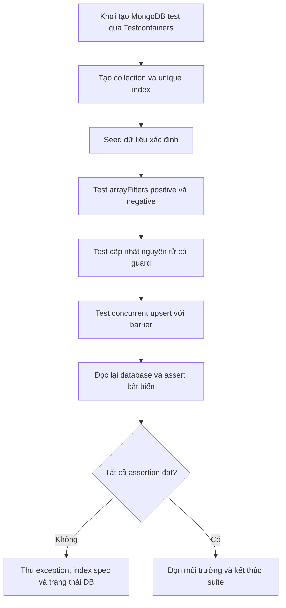

# Kiểm thử array filter, update nguyên tử và upsert đồng thời

> **Chương:** Kiểm thử · **Module:** `SPRING_DATA_MONGODB`. Spring Data MongoDB cho phép thao tác document qua `MongoTemplate`, repository và reactive access. Ba nhóm thao tác dễ tạo lỗi khó tái hiện là cập nhật phần tử mảng bằng `arrayFilters`, thay đổi trạng thái có điều kiện cần tính nguyên tử và `upsert` khi nhiều request cùng chạy. Bài này xây dựng các trường hợp kiểm thử có thể quan sát được trên MongoDB thật, đồng thời chỉ ra những giới hạn cần bảo vệ bằng thiết kế dữ liệu và chỉ mục.

## 1. Mục tiêu và các hợp đồng cần chứng minh

Giả sử dịch vụ quản lý đơn hàng nhận các thao tác:

- Cập nhật `reserved` cho **đúng dòng hàng** trong mảng `items`, không đổi những dòng khác.
- Trừ số lượng tồn kho khi `available >= 1`. Nếu hai request cùng tranh một đơn vị cuối cùng, **chỉ một request** được phép trừ thành công.
- Ghi nhận số lần xử lý cùng một đơn bằng `upsert`. Nếu nhiều thread cùng tạo bản ghi chưa tồn tại, phải còn **đúng một document theo khóa nghiệp vụ**, và mỗi lần cập nhật thành công được tính chính xác.

Ba hợp đồng tương ứng với ba kỹ thuật:

| Bài toán | Công cụ MongoDB | Điều kiểm thử cần xác nhận |
|---|---|---|
| Chọn phần tử trong array | `$[identifier]` + `arrayFilters` | Chỉ phần tử thỏa filter được sửa; phần tử khác giữ nguyên |
| Tránh lost update | `$inc`/`$set` có điều kiện ở query | Điều kiện được kiểm tra tại thời điểm cập nhật; không âm tồn kho |
| Tạo nếu chưa có trong cạnh tranh | `upsert` + **unique index** | Không tạo bản ghi trùng; xử lý trường hợp đụng khóa một cách có chủ đích |

**Ranh giới tính nguyên tử:** một lệnh ghi vào **một document** là nguyên tử trong MongoDB, kể cả khi sửa nhiều phần tử mảng của document đó. `updateMany()` thực hiện cập nhật nguyên tử **trên từng document**, nhưng không biến cả tập document thành một transaction. Nếu cần bất biến trên nhiều document, phải thiết kế lại mô hình dữ liệu hoặc dùng transaction khi topology hỗ trợ.

## 2. Vì sao cần integration test với MongoDB thật?

Unit test bằng Mockito giúp kiểm tra business flow như “gọi `updateFirst` một lần” hoặc “trả lỗi khi stock hết”, nhưng không thể xác nhận:

- Cách MongoDB diễn giải `arrayFilters`, `$[line]` và các đường dẫn mảng lồng nhau.
- `matchedCount`, `modifiedCount` và trường hợp document tồn tại nhưng không phần tử nào thỏa filter.
- Việc thực thi cùng lúc của `$inc`, điều kiện ở query, unique index và `upsert`.
- Lỗi của server như `E11000 duplicate key` hoặc hạn chế khi kết hợp `upsert` với positional array operators.

Vì vậy, với các bất biến ghi dữ liệu, sử dụng **integration test chạy với MongoDB server thực**. Testcontainers là một lựa chọn phù hợp để khởi tạo một MongoDB cô lập cho mỗi test suite, có thể dùng trong CI nếu môi trường có Docker.

### Các lớp kiểm thử

| Lớp | Nên kiểm tra | Không nên kết luận từ lớp này |
|---|---|---|
| Unit test service | Validate input, retry policy, mapping lỗi, gọi đúng repository/template | Tính nguyên tử của lệnh MongoDB |
| Integration test MongoDB | Giá trị BSON sau ghi, kết quả update, unique index, concurrent requests | Tải production lớn hay độ trễ p99 |
| Load/stress test | Throughput, timeout, pool saturation, deadlock/rate lỗi dưới tải | Tính đúng độc lập với các assertion về dữ liệu |
| End-to-end | REST/API, transaction boundary, auth và consistency end-to-end | Chi tiết cơ chế mỗi operator nếu không kiểm tra database |

Không thay thế integration test bằng một MongoDB giả lập in-memory không hỗ trợ đầy đủ các operator đang được kiểm tra.

## 3. Chuẩn bị môi trường kiểm thử

Ví dụ dùng **Java 17+, Spring Boot 3.x, Spring Data MongoDB, JUnit 5 và Testcontainers**. Mã Testcontainers trong bài dùng API của **Testcontainers 1.x**; với dòng 2.x, tên artifact và package MongoDB module có thể thay đổi, cần chọn dependency phù hợp với BOM của dự án.

Gradle (minh họa các dependency, để dependency management của Spring Boot/Testcontainers quản lý phiên bản tương thích):

```groovy
dependencies {
    implementation 'org.springframework.boot:spring-boot-starter-data-mongodb'

    testImplementation 'org.springframework.boot:spring-boot-starter-test'
    testImplementation 'org.testcontainers:junit-jupiter'
    testImplementation 'org.testcontainers:mongodb'
}
```

Nếu dự án đã sử dụng một MongoDB replica set dành cho test thay vì Testcontainers, có thể kết nối qua `spring.data.mongodb.uri` và giữ nguyên các assertion. Tách database test khỏi môi trường thật. Ví dụ dưới đây tạo hai collection tạm và dọn chúng trước mỗi test để tránh phụ thuộc thứ tự chạy.

**Cần phân biệt ba phạm vi:** `@DataMongoTest` chỉ dựng phần context cần cho kiểm thử truy cập dữ liệu; `@Testcontainers` điều khiển container; `@DynamicPropertySource` truyền URI của server test vào Spring trước khi `MongoTemplate` khởi tạo. Đây là integration test của tầng persistence, không cần dựng HTTP server.

## 4. Cú pháp array filter trong MongoDB

Một đơn hàng có mảng `items`:

```javascript
{
  _id: "order-1",
  tenantId: "t-1",
  items: [
    { lineId: "L-1", sku: "SKU-A", reserved: 0, cancelled: false },
    { lineId: "L-2", sku: "SKU-B", reserved: 1, cancelled: false },
    { lineId: "L-3", sku: "SKU-B", reserved: 0, cancelled: true }
  ]
}
```

Muốn tăng `reserved` đúng dòng `L-2` và chỉ khi chưa hủy:

```javascript
db.orders.updateOne(
  { _id: "order-1" },
  { $inc: { "items.$[line].reserved": 2 } },
  {
    arrayFilters: [
      { "line.lineId": "L-2", "line.cancelled": false }
    ]
  }
);
```

Kết quả mong muốn: `L-1.reserved = 0`, `L-2.reserved = 3`, `L-3.reserved = 0`. MongoDB kiểm tra filter cho các phần tử mảng, sau đó áp dụng `$inc` cho những phần tử phù hợp **bên trong một thao tác update của document**.

### 4.1. Phân biệt ba cách chọn phần tử mảng

| Cú pháp trong đường dẫn update | Ý nghĩa | Ví dụ |
|---|---|---|
| `$` | Positional operator trên phần tử đầu tiên khớp điều kiện mảng của query, với các ràng buộc riêng | `items.$.reserved` |
| `$[]` | Áp dụng cho **mọi phần tử** trong mảng | `items.$[].flag` |
| `$[line]` | Áp dụng cho các phần tử thỏa `arrayFilters` tương ứng | `items.$[line].reserved` |

`$[line]` chỉ hợp lệ khi identifier `line` được xác định bằng array filter. Identifier phải tuân theo quy tắc đặt tên của MongoDB (bắt đầu bằng chữ thường, tiếp theo là ký tự chữ hoặc số); không tự thay thế nó bằng một giá trị lấy từ request người dùng.

### 4.2. Tương đương trong Spring Data

```java
Query query = Query.query(Criteria.where("_id").is("order-1"));

Update update = new Update()
    .inc("items.$[line].reserved", 2)
    .filterArray(
        Criteria.where("line.lineId").is("L-2")
                .and("line.cancelled").is(false)
    );

UpdateResult result = mongoTemplate.updateFirst(
    query, update, "orders"
);
```

`Update.filterArray(CriteriaDefinition)` thêm điều kiện `arrayFilters` cho driver. Chú ý rằng các biểu thức filter array được truyền xuống driver mà **không được Spring Data ánh xạ lại tên field**, vì vậy tên đường dẫn trong filter phải khớp với **tên field BSON đã lưu**. Nếu entity dùng `@Field("line_id")`, đừng viết filter theo property `lineId` nếu dữ liệu thực tế là `line_id`.

### 4.3. Cập nhật mảng lồng nhau

Ví dụ cần sửa `qty` ở item `SKU-A`, trong section `zone-1`:

```javascript
db.warehouses.updateOne(
  { _id: "w-1" },
  { $inc: { "zones.$[zone].items.$[item].qty": 1 } },
  {
    arrayFilters: [
      { "zone.name": "zone-1" },
      { "item.sku": "SKU-A" }
    ]
  }
);
```

Spring Data:

```java
Update update = new Update()
    .inc("zones.$[zone].items.$[item].qty", 1)
    .filterArray(Criteria.where("zone.name").is("zone-1"))
    .filterArray(Criteria.where("item.sku").is("SKU-A"));
```

Mọi phần tử ở các cấp mảng không khớp filter phải giữ nguyên. Test chỉ kiểm tra “có một dòng được cập nhật” là chưa đủ: cần xác nhận **tất cả dòng lân cận** không bị thay đổi.

### 4.4. Những giới hạn dễ nhầm

- `arrayFilters` không hỗ trợ các toán tử như `$expr`, `$text` và `$where` bên trong biểu thức lọc array.
- `arrayFilters` không tự tạo phần tử thiếu trong mảng. Nếu đường dẫn không có phần tử phù hợp, lệnh có thể match document nhưng không sửa gì.
- Khi dùng positional array update với **upsert tạo document mới**, MongoDB yêu cầu điều kiện phù hợp, bao gồm **exact equality match trên array field** cho một số phép upsert dùng `$[identifier]`/`$[]`; không nên coi đây là cách tạo mảng mới tùy ý.
- Không được nhầm bộ lọc document ở `Query` với bộ lọc **phần tử mảng** ở `arrayFilters`. Một document có thể match query dù không có phần tử nào match `arrayFilters`.

## 5. Đọc kết quả update: matched, modified, upserted

`UpdateResult` của MongoDB Java Driver cung cấp:

| Trường | Ý nghĩa | Sai lầm thường gặp |
|---|---|---|
| `getMatchedCount()` | Số document khớp bộ lọc top-level | Tưởng là số phần tử mảng khớp |
| `getModifiedCount()` | Số document thực sự thay đổi | Tưởng là số lần tăng counter hoặc số array element |
| `getUpsertedId()` | `_id` của document vừa được tạo bởi upsert, nếu có | Tưởng rằng mọi upsert thành công đều có upsertedId |
| `wasAcknowledged()` | Write concern đã xác nhận kết quả hay chưa | Đọc count khi dùng unacknowledged write concern |

Ví dụ document tồn tại nhưng `arrayFilters` nhắm vào `lineId = "khong-co"`:

```java
UpdateResult result = mongoTemplate.updateFirst(
    Query.query(Criteria.where("_id").is("order-1")),
    new Update()
        .inc("items.$[line].reserved", 1)
        .filterArray(Criteria.where("line.lineId").is("khong-co")),
    "orders"
);

assertEquals(1L, result.getMatchedCount());
assertEquals(0L, result.getModifiedCount());
```

`matchedCount = 1` chỉ chứng minh **document đơn hàng tồn tại**. Với mục tiêu cập nhật một line cụ thể, muốn biết line có thực sự thay đổi hay không phải xem `modifiedCount` và đọc lại trạng thái liên quan. Một lệnh `$set` đặt giá trị bằng chính giá trị đang có cũng có thể có `matchedCount=1` nhưng `modifiedCount=0`.

Nếu cần **phân biệt** “không có đơn hàng” với “có đơn hàng nhưng không tìm thấy dòng hàng”, bổ sung điều kiện `$elemMatch` ở query hoặc thực hiện truy vấn kiểm chứng phù hợp; không biến `modifiedCount` thành nguồn chân lý duy nhất cho mọi trường hợp.

## 6. Tính nguyên tử: kiểm thử với cập nhật có điều kiện

### 6.1. Vì sao read → sửa trong Java → save là nguy hiểm?

Giả sử hàng `SKU-A` còn đúng một đơn vị.

```text
available = 1

Thread A: read available = 1
Thread B: read available = 1
Thread A: save available = 0, báo đặt hàng thành công
Thread B: save available = 0, cũng báo thành công

Kết quả database = 0 nhưng cả hai request đã nhận hàng.
```

Đây là **lost update / check-then-act race**. Nếu không có cơ chế kiểm soát phiên bản hoặc khóa, hai thread có thể dùng cùng giá trị đọc ban đầu. Với Spring Data MongoDB, `@Version` có thể hỗ trợ optimistic locking khi dùng thao tác phù hợp; tuy nhiên kiểm thử ví dụ này tập trung vào **cập nhật nguyên tử có điều kiện trực tiếp trên server**.

### 6.2. Đưa điều kiện vào chính lệnh update

```javascript
db.stock.updateOne(
  { _id: "SKU-A", available: { $gte: 1 } },
  { $inc: { available: -1 } }
);
```

Spring Data:

```java
Query guard = Query.query(
    Criteria.where("_id").is("SKU-A")
            .and("available").gte(1)
);

UpdateResult result = mongoTemplate.updateFirst(
    guard,
    new Update().inc("available", -1),
    "stock"
);

boolean claimed = result.getMatchedCount() == 1;
```

MongoDB đánh giá điều kiện update cùng thao tác ghi vào một document. Hai request cạnh tranh đơn vị cuối cùng: request thắng sẽ trừ từ 1 xuống 0; request còn lại không còn match `available >= 1` và không được trừ tiếp. Dùng `matchedCount` để biết guard có match; với `$inc -1` có acknowledged write, matched document sẽ thay đổi như dự kiến trong trường hợp này.

Đây không phải transaction cho cả “trừ kho + tạo document đơn hàng” nếu chúng nằm ở hai document khác nhau. Để bảo toàn bất biến liên document, cần transaction phù hợp hoặc thiết kế workflow có bù trừ/idempotency.

### 6.3. Điều kiện thay đổi state

Có thể dùng query như một **compare-and-set**:

```javascript
db.orders.updateOne(
  { _id: "order-1", state: "NEW" },
  { $set: { state: "PAID" } }
);
```

Nếu hai luồng cùng cố chuyển `NEW → PAID`, chỉ một luồng match điều kiện. Đây là kỹ thuật tốt cho phép chuyển trạng thái chỉ được thực hiện một lần. Nếu cần chống mọi thay đổi cạnh tranh trên nhiều field, có thể thêm trường `version` vào query và tăng version bằng `$inc` trong cùng update.

## 7. Concurrent upsert: không tạo bản ghi trùng bằng may mắn

`Upsert` có nghĩa là **update nếu tìm thấy document phù hợp, hoặc insert nếu không có**:

```javascript
db.orderAttempts.updateOne(
  { tenantId: "t-1", orderNo: "O-101" },
  {
    $inc: { attempts: 1 },
    $setOnInsert: { createdAt: ISODate("2026-01-01T00:00:00Z") }
  },
  { upsert: true }
);
```

Nếu hai request cùng kiểm tra một khóa chưa tồn tại, chúng có thể cùng đi tới nhánh tạo mới. **Upsert tự nó không đủ để bảo đảm khóa nghiệp vụ không trùng** khi không có unique index tương ứng.

### 7.1. Unique index là phần bắt buộc của bất biến

```javascript
db.orderAttempts.createIndex(
  { tenantId: 1, orderNo: 1 },
  {
    unique: true,
    name: "uq_order_attempts_tenant_order"
  }
);
```

Unique index ép MongoDB từ chối việc tồn tại hai document cùng cặp `(tenantId, orderNo)`. Chỉ mục phải tồn tại và được xây dựng thành công **trước** khi chạy kiểm thử cạnh tranh; kiểm thử không được mặc định annotation `@CompoundIndex(unique = true)` trên entity đã tạo index thật trong database.

Lưu ý điều kiện riêng với sharded cluster: unique index bị ràng buộc theo shard key và phiên bản MongoDB; hãy xác minh thiết kế index/topology. Ví dụ kiểm thử dưới đây dùng một collection trong MongoDB replica set.

### 7.2. Khi unique upsert có thể phát sinh duplicate key

Tùy điều kiện và kiểu truy vấn, một request đua để insert có thể được MongoDB tự xử lý thành update khi đã có document tương ứng, hoặc trả **`E11000 duplicate key`**. MongoDB chỉ có thể chuyển tình huống đụng unique key thành cập nhật khi một số điều kiện được đáp ứng, ví dụ query dùng equality trên các field của unique index và update không làm thay đổi key đó.

Thiết kế service cần định nghĩa rõ cách xử lý:

1. Nếu request tạo/upsert thành công, coi đó là một lần ghi thành công.
2. Nếu bị duplicate key do cạnh tranh, **đọc hoặc update lại theo đúng khóa nghiệp vụ**, có thể áp dụng một retry có giới hạn.
3. Nếu duplicate key đến từ ràng buộc khác, hoặc không có document phù hợp sau retry, **không nuốt lỗi** và không tiếp tục giả định thành công.

`DuplicateKeyException` có thể xuất hiện trong Spring Data từ lớp chuyển đổi exception của driver. Việc bắt rộng mọi lỗi rồi lặp vô hạn là không an toàn: lỗi timeout, mất kết nối, write concern hoặc transaction có ngữ nghĩa retry khác nhau.

### 7.3. Không nhầm upsert với exactly-once

Bài test sau chứng minh **mỗi lệnh upsert được tính một lần trong môi trường thử nghiệm**. Nó không chứng minh exactly-once cho retry qua mạng: nếu client timeout sau khi server đã ghi, client có thể không biết lần cập nhật đã thành công hay chưa. Với nghiệp vụ không được đếm hai lần cho cùng một request, cần **idempotency key** ở tầng nghiệp vụ, chẳng hạn lưu một document duy nhất theo requestId hoặc transaction/ledger thiết kế phù hợp.

## 8. Bộ integration test thực tế với JUnit 5 và Testcontainers

Ví dụ dưới đây sử dụng:

- Hai collection `array_atomic_lab` và `upsert_atomic_lab`, riêng cho suite.
- `MongoTemplate` làm API cập nhật.
- Một MongoDB container chạy như replica set đơn node do Testcontainers cấu hình.
- `CountDownLatch` để tăng khả năng nhiều thread bắt đầu cùng lúc; mỗi test cũng **assert trạng thái cuối**, không kết luận dựa trên thời gian chạy.

Mẫu Java dùng API package của Testcontainers **1.x** và Spring Boot **3.x**; các dự án dùng Testcontainers 2.x cần điều chỉnh import/container module cho đúng phiên bản.

### 8.1. Lớp test và khởi tạo kho dữ liệu

```java
import static org.junit.jupiter.api.Assertions.*;

import com.mongodb.client.result.UpdateResult;
import java.util.ArrayList;
import java.util.Date;
import java.util.List;
import java.util.concurrent.Callable;
import java.util.concurrent.CountDownLatch;
import java.util.concurrent.ExecutorService;
import java.util.concurrent.Executors;
import java.util.concurrent.Future;
import java.util.concurrent.TimeUnit;

import org.bson.Document;
import org.junit.jupiter.api.BeforeEach;
import org.junit.jupiter.api.Test;
import org.springframework.beans.factory.annotation.Autowired;
import org.springframework.boot.test.autoconfigure.data.mongo.DataMongoTest;
import org.springframework.dao.DuplicateKeyException;
import org.springframework.data.domain.Sort.Direction;
import org.springframework.data.mongodb.core.MongoTemplate;
import org.springframework.data.mongodb.core.index.Index;
import org.springframework.data.mongodb.core.query.Criteria;
import org.springframework.data.mongodb.core.query.Query;
import org.springframework.data.mongodb.core.query.Update;
import org.springframework.test.context.DynamicPropertyRegistry;
import org.springframework.test.context.DynamicPropertySource;
import org.testcontainers.containers.MongoDBContainer;
import org.testcontainers.junit.jupiter.Container;
import org.testcontainers.junit.jupiter.Testcontainers;
import org.testcontainers.utility.DockerImageName;

@DataMongoTest
@Testcontainers
class AtomicMongoWriteIT {

    private static final String ARRAY_COLL = "array_atomic_lab";
    private static final String UPSERT_COLL = "upsert_atomic_lab";

    @Container
    static final MongoDBContainer MONGO =
        new MongoDBContainer(DockerImageName.parse("mongo:7.0"));

    @DynamicPropertySource
    static void properties(DynamicPropertyRegistry registry) {
        registry.add("spring.data.mongodb.uri", MONGO::getReplicaSetUrl);
    }

    @Autowired
    MongoTemplate template;

    @BeforeEach
    void resetCollections() {
        template.dropCollection(ARRAY_COLL);
        template.dropCollection(UPSERT_COLL);

        // Ràng buộc unique được tạo TRƯỚC test đồng thời.
        template.indexOps(UPSERT_COLL).ensureIndex(
            new Index()
                .on("tenantId", Direction.ASC)
                .on("orderNo", Direction.ASC)
                .unique()
                .named("uq_tenant_order")
        );
    }

    // Các test và helper ở các mục tiếp theo đặt bên trong lớp này.
}
```

Ở dự án thực tế, lớp test cần nằm trong package phù hợp để `@DataMongoTest` tìm thấy cấu hình Spring Boot, hoặc phải khai báo cấu hình test rõ ràng. Không bật test song song toàn suite nếu chúng cùng drop hai collection này.

### 8.2. Test 1 — array filter chỉ sửa đúng dòng hàng

Thêm vào lớp `AtomicMongoWriteIT`:

```java
@Test
void arrayFilterChangesOnlySelectedLine() {
    Document order = new Document("_id", "order-1")
        .append("items", List.of(
            new Document("lineId", "L-1")
                .append("reserved", 0)
                .append("cancelled", false),
            new Document("lineId", "L-2")
                .append("reserved", 1)
                .append("cancelled", false),
            new Document("lineId", "L-3")
                .append("reserved", 0)
                .append("cancelled", true)
        ));
    template.insert(order, ARRAY_COLL);

    Query query = Query.query(
        Criteria.where("_id").is("order-1")
    );
    Update update = new Update()
        .inc("items.$[line].reserved", 2)
        .filterArray(
            Criteria.where("line.lineId").is("L-2")
                    .and("line.cancelled").is(false)
        );

    UpdateResult result =
        template.updateFirst(query, update, ARRAY_COLL);

    assertTrue(result.wasAcknowledged());
    assertEquals(1L, result.getMatchedCount());
    assertEquals(1L, result.getModifiedCount());

    Document stored = template.findById(
        "order-1", Document.class, ARRAY_COLL
    );
    assertNotNull(stored);

    List<?> items = stored.getList("items", Document.class);
    assertEquals(3, items.size());

    Document first = (Document) items.get(0);
    Document second = (Document) items.get(1);
    Document third = (Document) items.get(2);

    assertEquals(0, first.getInteger("reserved"));
    assertEquals(3, second.getInteger("reserved"));
    assertEquals(0, third.getInteger("reserved"));
}
```

Test này chứng minh đồng thời: document đúng được match, document đã sửa, và chỉ một phần tử **đúng điều kiện** thay đổi. Nếu test chỉ assert `modifiedCount == 1`, nó **không thể khẳng định** dòng mảng nào đã bị sửa.

### 8.3. Test 2 — match document nhưng không match phần tử

```java
@Test
void arrayFilterWithoutMatchingElementDoesNotModifyDocument() {
    template.insert(
        new Document("_id", "order-2")
            .append("items", List.of(
                new Document("lineId", "L-1")
                    .append("reserved", 0)
            )),
        ARRAY_COLL
    );

    UpdateResult result = template.updateFirst(
        Query.query(Criteria.where("_id").is("order-2")),
        new Update()
            .inc("items.$[line].reserved", 1)
            .filterArray(Criteria.where("line.lineId").is("missing")),
        ARRAY_COLL
    );

    assertEquals(1L, result.getMatchedCount());
    assertEquals(0L, result.getModifiedCount());

    Document stored = template.findById(
        "order-2", Document.class, ARRAY_COLL
    );
    assertNotNull(stored);
    Document first = stored.getList("items", Document.class).get(0);
    assertEquals(0, first.getInteger("reserved"));
}
```

Đây là test âm tính quan trọng: kết quả không thay đổi là đúng với array filter, không tự động đồng nghĩa lỗi ghi.

### 8.4. Test 3 — hai thread tranh đơn vị tồn kho cuối cùng

```java
@Test
void conditionalDecrementAllowsOnlyOneWinner() throws Exception {
    template.insert(
        new Document("_id", "SKU-A").append("available", 1),
        ARRAY_COLL
    );

    List<UpdateResult> results = runConcurrently(2, () ->
        template.updateFirst(
            Query.query(
                Criteria.where("_id").is("SKU-A")
                        .and("available").gte(1)
            ),
            new Update().inc("available", -1),
            ARRAY_COLL
        )
    );

    long winners = results.stream()
        .filter(result -> result.getMatchedCount() == 1L)
        .count();

    assertEquals(1L, winners);

    Document stock = template.findById(
        "SKU-A", Document.class, ARRAY_COLL
    );
    assertNotNull(stock);
    assertEquals(0, stock.getInteger("available"));
}
```

Hai thread bắt đầu sau cùng một barrier, nhưng không giả định một thứ tự scheduler cụ thể. Assertion quan trọng là **tổng số thành công bằng 1 và tồn kho không âm**. Dù không tạo được mức đồng thời tuyệt đối trong mọi lần chạy, mỗi lệnh vẫn dùng guard nguyên tử; có thể lặp test trong stress suite để tìm thêm lỗi ở tầng ứng dụng.

### 8.5. Test 4 — nhiều upsert cùng một khóa nghiệp vụ

```java
@Test
void concurrentUpsertsKeepOneDocumentAndAllIncrements()
        throws Exception {

    String tenant = "t-1";
    String orderNo = "O-101";
    int callers = 12;

    runConcurrently(callers, () -> {
        Query query = Query.query(
            Criteria.where("tenantId").is(tenant)
                    .and("orderNo").is(orderNo)
        );

        Update update = new Update()
            .inc("attempts", 1)
            .setOnInsert("createdAt", new Date());

        try {
            return template.upsert(query, update, UPSERT_COLL);
        } catch (DuplicateKeyException duplicate) {
            // Xử lý tranh chấp unique key, trong bài thử không có
            // tác vụ xóa document đang cạnh tranh.
            UpdateResult retry = template.updateFirst(
                Query.query(
                    Criteria.where("tenantId").is(tenant)
                            .and("orderNo").is(orderNo)
                ),
                new Update().inc("attempts", 1),
                UPSERT_COLL
            );
            if (retry.getMatchedCount() != 1L) {
                throw duplicate; // Không che giấu lỗi không đúng dự kiến.
            }
            return retry;
        }
    });

    Query key = Query.query(
        Criteria.where("tenantId").is(tenant)
                .and("orderNo").is(orderNo)
    );

    assertEquals(1L, template.count(key, UPSERT_COLL));

    Document stored = template.findOne(
        key, Document.class, UPSERT_COLL
    );
    assertNotNull(stored);
    assertEquals(callers, stored.getInteger("attempts"));
    assertNotNull(stored.getDate("createdAt"));
}
```

Test dùng `$inc` ở server, không tăng `attempts` trong Java sau khi đọc document. Đường xử lý lỗi `DuplicateKeyException` chỉ thực hiện một **update lại theo unique key** trong ngữ cảnh kiểm thử có tập thao tác cố định và không có delete; với hệ thống thật, phải xác định retry policy, idempotency và phân loại các unique constraint.

Một số môi trường sẽ không phát sinh `DuplicateKeyException` trong test vì server tự chuyển các upsert cạnh tranh đủ điều kiện thành update. Điều đó không phải test “chưa chạy”: assertion **một document, đủ 12 increment** mới là hợp đồng cần chứng minh.

### 8.6. Helper chạy đồng thời có barrier và giới hạn thời gian

Đặt thêm trong lớp `AtomicMongoWriteIT`:

```java
private static <T> List<T> runConcurrently(
        int callers, Callable<T> operation) throws Exception {

    ExecutorService executor = Executors.newFixedThreadPool(callers);
    CountDownLatch ready = new CountDownLatch(callers);
    CountDownLatch start = new CountDownLatch(1);

    try {
        List<Future<T>> futures = new ArrayList<>();

        for (int i = 0; i < callers; i++) {
            futures.add(executor.submit(() -> {
                ready.countDown();
                if (!start.await(10, TimeUnit.SECONDS)) {
                    throw new AssertionError("Start barrier timed out");
                }
                return operation.call();
            }));
        }

        assertTrue(
            ready.await(10, TimeUnit.SECONDS),
            "All worker threads must reach the barrier"
        );

        start.countDown();

        List<T> results = new ArrayList<>();
        for (Future<T> future : futures) {
            results.add(future.get(30, TimeUnit.SECONDS));
        }
        return results;
    } finally {
        start.countDown();
        executor.shutdownNow();
    }
}
```

`Future.get()` ném lỗi nếu tác vụ thất bại hoặc vượt timeout, vì vậy test không được phép **im lặng bỏ qua** exception từ thread con. `CountDownLatch` tăng xác suất overlap nhưng không tạo bằng chứng tuyệt đối rằng tất cả request được server xử lý ở cùng một nano-giây. Điều cần khẳng định vẫn là kết quả dữ liệu sau nhiều interleaving hợp lệ.

## 9. Kiểm thử lỗi có chủ đích và khác biệt giữa các loại ghi

### 9.1. Khi không có unique index, upsert có thể trùng

Một test quan trọng ở mức thiết kế là kiểm tra **môi trường production luôn có unique index**:

```javascript
db.orderAttempts.getIndexes();
```

Nếu bỏ unique index và tạo 12 upsert đồng thời cho một khóa chưa tồn tại, có nguy cơ tạo nhiều document khác nhau có cùng `tenantId, orderNo`. Tuy nhiên race là bất định: một lần chạy **không tạo trùng** không có nghĩa hệ thống an toàn. Vì vậy nên kiểm tra metadata index bằng assertion, thay vì dùng một test kỳ vọng phải xuất hiện duplicate để “chứng minh” lỗi.

### 9.2. Kiểm thử `$setOnInsert`

Trong upsert:

- Nếu document **chưa tồn tại**, MongoDB insert và áp dụng `$setOnInsert`.
- Nếu document **đã tồn tại**, `$setOnInsert` không ghi đè dữ liệu cũ.

Ví dụ dùng `createdAt` hoặc trạng thái khởi tạo. Kiểm thử nên upsert hai lần, đảm bảo `createdAt` giữ nguyên còn counter `$inc` tăng theo số lần ghi. Không trộn chung `$set` và `$setOnInsert` để sửa cùng một đường dẫn gây xung đột.

### 9.3. `updateFirst`, `updateMulti` và `findAndModify`

| Spring Data API | Ý nghĩa | Assertion phù hợp |
|---|---|---|
| `updateFirst(query, update, ...)` | Cập nhật tối đa một document | `matchedCount`/`modifiedCount` + trạng thái cuối |
| `updateMulti(query, update, ...)` | Cập nhật nhiều document | Count theo **document**, không phải toàn bộ transaction |
| `upsert(query, update, ...)` | Update hoặc insert một document | Unique key, `upsertedId`/count và dữ liệu sau ghi |
| `findAndModify(query, update, options, ...)` | Tìm và cập nhật một document rồi trả trạng thái trước/sau | Test `returnNew(true)` và giá trị trạng thái trả về |
| `save(entity)` | Ghi entity theo `_id` | Kiểm thử đồng thời cần `@Version`/chiến lược concurrency phù hợp |

Nếu `findAndModify` dùng `FindAndModifyOptions.options().returnNew(true)`, kết quả thường là document **sau** update, không phải một `UpdateResult`. Đừng nhầm assertion của API này với `modifiedCount`.

## 10. Các ca kiểm thử bổ sung nên có

| Test case | Dữ liệu đầu vào | Kết quả mong muốn |
|---|---|---|
| Array filter nhiều dòng khớp | Hai line có cùng `sku` và cùng trạng thái | Cả hai được sửa; `modifiedCount` vẫn là số **document** |
| Array filter không khớp | Document tồn tại, không có `lineId` phù hợp | `matchedCount=1`, `modifiedCount=0` |
| Array filter gặp line đã hủy | `cancelled=true` | Không sửa line đã hủy |
| Mảng rỗng | `items=[]` | Không sửa; không tự sinh item |
| Tên field lưu khác tên property | `@Field("line_id")` | Filter dùng đúng đường dẫn BSON |
| Guard thiếu hàng | `available=0` | Không trừ; `matchedCount=0` |
| Nhiều thread trừ một đơn vị | `available=1`, hai request | Một request thành công, còn 0 |
| Retry update có `$inc` | Cùng request được gọi lại | Làm rõ ngữ nghĩa at-least-once và idempotency |
| Upsert cùng khóa có unique index | 12 request cùng `tenantId/orderNo` | Đúng một document và đủ số lần cập nhật |
| Upsert với unique khác gây xung đột | Hai request dùng unique key khác nhau nhưng đụng constraint phụ | Không nuốt lỗi hoặc lặp vô hạn |
| `$setOnInsert` trên document đã tồn tại | Upsert lần hai | Không đổi field chỉ thiết lập lúc insert |
| Readback sau write | Lấy document mới từ MongoDB | Kiểm tra **giá trị cuối**, không chỉ API return |

Đối với reactive access (`ReactiveMongoTemplate`), vẫn áp dụng các hợp đồng dữ liệu tương tự. Có thể dùng `StepVerifier` để xác minh publisher chỉ phát kết quả khi đã subscribe, kết quả update và lỗi. Khi kiểm tra concurrency, chạy nhiều publisher cùng lúc (`Flux.merge` hoặc subscription độc lập) và **đọc lại MongoDB**; một phép thử StepVerifier riêng lẻ không chứng minh tác động đồng thời.

## 11. Phân biệt tính nguyên tử, transaction và idempotency

Ba khái niệm này liên quan nhưng không thay thế nhau.

**Atomic single-document update**: một lệnh cập nhật một document không để các thread khác quan sát trạng thái document bị cập nhật dở. Có thể dùng query guard cùng `$inc`/`$set` để thực thi bất biến trong document.

**Transaction**: nhiều lệnh trên nhiều document cần thành công hoặc rollback như một đơn vị, thường yêu cầu replica set/sharded cluster và cấu hình transaction phù hợp. Test cần khởi tạo transaction, chủ động ném lỗi giữa chừng rồi xác minh tất cả thay đổi bị rollback; ngoài phạm vi ba test cốt lõi trên.

**Idempotency**: xử lý lại cùng một yêu cầu không làm sai kết quả nghiệp vụ. Một `$inc` lặp hai lần sẽ tăng hai lần; vì vậy dù từng update nguyên tử, nó **không idempotent**. Trong hệ thống có retry mạng, nên dùng idempotency key và quyết định bền vững để tránh tính lại cùng giao dịch, thay vì chỉ tăng counter trong mỗi lần request đến.

Ví dụ mô hình ledger đơn giản:

```javascript
// Unique key trên {requestId: 1} bảo vệ việc ghi nhận cùng request.
db.processedRequests.createIndex(
  { requestId: 1 },
  { unique: true, name: "uq_request_id" }
);
```

Nếu việc “ghi request đã xử lý” và “trừ kho” nằm ở hai document, chỉ index unique vẫn chưa bảo đảm cả hai thay đổi cùng commit; cần transaction hoặc thiết kế trạng thái có thể khôi phục theo workflow.

## 12. Những lỗi phổ biến khi viết integration test

### 12.1. Chỉ kiểm tra `modifiedCount`

Với mảng có nhiều phần tử, `modifiedCount=1` chỉ cho biết **một document** đã đổi, không cho biết có một hay nhiều phần tử được sửa. Hãy đọc lại document và xác nhận từng phần tử liên quan, bao gồm phần tử không được phép đổi.

### 12.2. Không tạo unique index trong test

Một entity khai báo `@CompoundIndex(unique = true)` không đảm bảo index được tạo tự động; Spring Data MongoDB không bật tự động tạo index mặc định ở nhiều phiên bản hiện đại. Tạo index trong fixture và xác minh có index thực trước khi chạy concurrent upsert.

### 12.3. Test các thread nhưng không đợi chúng kết thúc

Nếu chỉ `submit` nhiều future rồi assert ngay, test có thể kiểm tra trạng thái trước khi các update hoàn tất. Dùng `Future.get()`, timeout rõ ràng và propagate exception. Tránh dùng `Thread.sleep` để mong scheduler “chạy đủ”; sleep không tạo điều kiện đồng bộ đáng tin.

### 12.4. Chia sẻ đối tượng `Query` hoặc `Update` mutable giữa nhiều thread

Đối tượng `Query`/`Update` thường là các builder có thể thay đổi, không nên giả định thread-safe. Trong mỗi callable, tạo `Query` và `Update` riêng; chỉ chia sẻ `MongoTemplate` đã được cấu hình vì nó được thiết kế để dùng lại giữa các request.

### 12.5. Bắt mọi exception rồi retry vô hạn

Một lỗi duplicate key có thể do:
- Tranh unique key đúng như dự kiến, sau đó có thể cập nhật theo khóa.
- Unique constraint khác trên cùng collection.
- Dữ liệu hoặc truy vấn không đúng hợp đồng.

Retry có điều kiện, giới hạn số lần, quan sát log và bảo toàn nguyên nhân lỗi. Với lỗi mạng không rõ thao tác đã được commit hay chưa, cần idempotency chứ không thể mặc định chạy lại `$inc`.

### 12.6. Dùng `arrayFilters` cho biểu thức không được hỗ trợ

`$expr` trong `arrayFilters` không được hỗ trợ. Nếu bất biến đòi so sánh hai field trong cùng phần tử mảng (ví dụ `reserved + delta <= quantity`), cần thiết kế một phương án update phù hợp, có thể là aggregation pipeline update với các biểu thức cần thiết, hoặc mô hình lại dữ liệu. Không tách thành “đọc trước, cập nhật sau” rồi tuyên bố nguyên tử nếu không có guard/CAS tương ứng.

### 12.7. Tạo fixture trên collection có dữ liệu sót

Các test phải cô lập dữ liệu. Dùng database/collection riêng, dọn trạng thái qua `@BeforeEach` hoặc cơ chế setup/teardown đáng tin. Nếu chạy test song song, mỗi test nên có namespace riêng thay vì cùng `dropCollection`.

## 13. Quy trình CI và tiêu chí chấp nhận

Một pipeline hợp lý cho nhóm kiểm thử này:



**Tiêu chí đạt tối thiểu:**

1. Array filter sửa đúng những phần tử đã chọn, không ảnh hưởng phần tử lân cận.
2. Không có array element match thì data giữ nguyên; report count được diễn giải đúng.
3. Với một đơn vị tồn kho và hai thao tác tranh chấp, chỉ một thao tác thành công; tồn kho không âm.
4. Concurrent upsert có unique index chỉ để lại **một document** theo khóa nghiệp vụ; giá trị counter đúng theo số lần ghi được xác nhận.
5. Mọi lỗi thread con được trả về test runner; timeout không bị bỏ qua.
6. Kết quả lặp lại được trên môi trường CI với MongoDB server thật, không phụ thuộc thứ tự test hay data tồn dư.

Các test xác định tính đúng không cần cố ép tải cực lớn. Khi cần nghiên cứu contention hoặc throughput, hãy có một stress suite riêng với nhiều lần lặp, dữ liệu đủ lớn, đo write latency và connection pool, không thay thế các assertion về bất biến.

## 14. Câu hỏi tự kiểm tra

1. Vì sao `matchedCount=1` nhưng `modifiedCount=0` vẫn có thể là kết quả hợp lệ của `arrayFilters`?
2. Nếu hai phần tử mảng cùng match filter, `modifiedCount` của `updateOne` sẽ là mấy?
3. Vì sao `@Version` và `$inc` cùng có thể ngăn lost update trong những bối cảnh khác nhau?
4. Khi hai request tranh đúng một đơn vị tồn kho, tại sao guard phải nằm trong **cùng lệnh update** với `$inc`?
5. Nếu concurrent upsert không có unique index theo khóa nghiệp vụ, một lần test không thấy duplicate chứng minh được gì?
6. Tại sao unique index có thể vẫn dẫn đến `DuplicateKeyException` trong một số upsert cạnh tranh?
7. Vì sao một lệnh `$inc` là atomic nhưng **không idempotent** khi client retry?
8. Nếu field Java ánh xạ bằng `@Field("line_id")`, filter cho `items.$[line]` nên dùng tên nào?
9. Những assertion nào cần thêm để xác nhận một phép update thực sự chỉ sửa đúng dòng mảng dự kiến?
10. Khi một nghiệp vụ phải vừa trừ kho vừa tạo đơn ở hai document, có đủ chỉ dùng `updateFirst` với guard không?

## 15. Ghi nhớ

- Dùng `$[identifier]` + `arrayFilters` khi cần sửa các phần tử mảng theo điều kiện; kiểm tra **cả giá trị thay đổi và giá trị không được thay đổi**.
- `matchedCount` tính **document match**, `modifiedCount` tính **document đổi**, không phải số array element.
- Đặt điều kiện nghiệp vụ và phép cập nhật cùng một lệnh MongoDB để giữ tính nguyên tử **trên một document**.
- Concurrent upsert muốn một document theo khóa nghiệp vụ phải có **unique index trên server**; thêm retry có giới hạn khi thực sự cần.
- `$inc` nguyên tử nhưng không idempotent; nghiệp vụ có retry/timeout cần một hợp đồng chống lặp riêng.
- Integration test chạy trên MongoDB thật và đọc lại dữ liệu là bằng chứng quan trọng hơn việc chỉ mock `MongoTemplate`.

### Tài liệu tham khảo

- [MongoDB Manual — Update Documents](https://www.mongodb.com/docs/manual/tutorial/update-documents/)
- [MongoDB Manual — Array Update Operators](https://www.mongodb.com/docs/manual/reference/operator/update/positional-filtered/)
- [MongoDB Manual — Update with `arrayFilters`](https://www.mongodb.com/docs/manual/reference/method/db.collection.updateOne/)
- [MongoDB Manual — Atomicity and Transactions](https://www.mongodb.com/docs/manual/core/write-operations-atomicity/)
- [MongoDB Manual — Unique Indexes](https://www.mongodb.com/docs/manual/core/index-unique/)
- [MongoDB Manual — Upsert with Unique Index](https://www.mongodb.com/docs/manual/reference/method/db.collection.update/#std-label-upsert-behavior)
- [Spring Data MongoDB Reference — Template Update Operations](https://docs.spring.io/spring-data/mongodb/reference/mongodb/template-crud-operations.html)
- [Spring Data MongoDB API — Update](https://docs.spring.io/spring-data/mongodb/docs/current/api/org/springframework/data/mongodb/core/query/Update.html)
- [Testcontainers — MongoDB Module](https://java.testcontainers.org/modules/databases/mongodb/)
