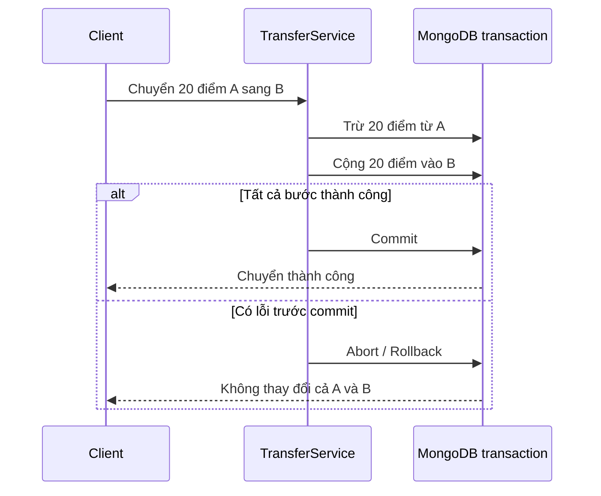
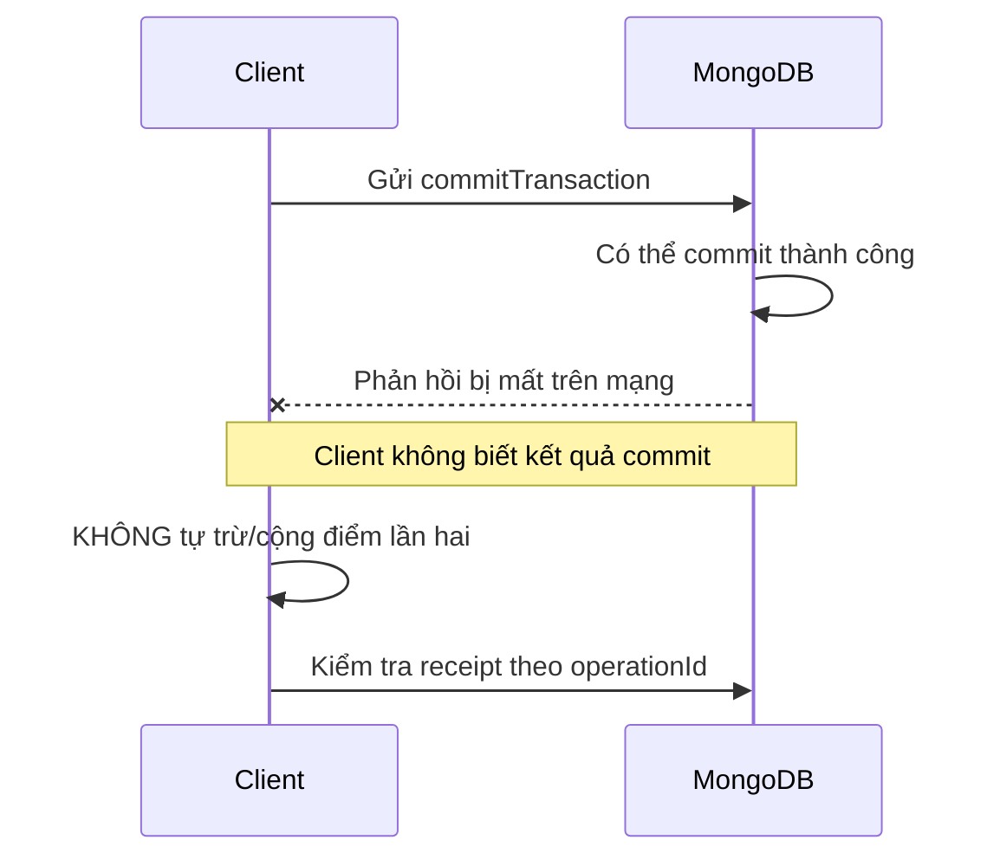

# Kiểm thử `@Version`, rollback và retry khi lỗi tạm thời trong Spring Data MongoDB

## 1. Ba tình huống dễ nhầm lẫn trong kiểm thử ghi dữ liệu

Khi dùng **Spring Data MongoDB** để ánh xạ document, lưu qua repository hoặc `MongoTemplate` và thực hiện transaction, ứng dụng cần biết điều gì xảy ra nếu có hai yêu cầu sửa cùng bản ghi hoặc MongoDB gặp lỗi tạm thời. Một lệnh ghi trả về lỗi không phải lúc nào cũng đồng nghĩa dữ liệu chưa được ghi; một lần retry cũng không mặc nhiên an toàn.

Ví dụ dịch vụ chuyển 20 điểm từ ví A sang ví B. Ba tình huống sau cần bộ kiểm thử khác nhau:

| Tình huống | Rủi ro | Cơ chế chính | Điều cần chứng minh bằng test |
| --- | --- | --- | --- |
| Hai request cùng sửa ví A | Ghi đè trạng thái mới bằng dữ liệu cũ (*lost update*) | `@Version` và optimistic locking | Chỉ một bản ghi với version cũ được lưu thành công; bản còn lại bị từ chối |
| Chuyển điểm đã trừ A nhưng bước cộng B lỗi | Dữ liệu giữa nhiều document bị lệch | MongoDB transaction và rollback | Cả phần trừ A, cộng B và bản ghi giao dịch đều không được commit |
| MongoDB báo lỗi tạm thời hoặc mất kết nối gần lúc commit | Retry có thể trùng chuyển điểm | Phân loại lỗi, retry có giới hạn, idempotency | Chỉ chạy lại khi an toàn; kết quả commit không rõ được đối soát |

Hai loại version khác nhau: `@Version` (`org.springframework.data.annotation.Version`) dùng để **phát hiện xung đột ghi**; `schemaVersion` nếu có là một trường ứng dụng dùng để mô tả cấu trúc document. Không dùng `schemaVersion` thay cho optimistic locking.

Nội dung dưới đây dùng ví dụ *ví điểm thưởng* để minh họa. Mọi con số là dữ liệu kiểm thử; với tiền tệ thực cần thêm các quy tắc về sổ cái, làm tròn, đối soát và nghiệp vụ theo quy định hệ thống.

## 2. Thiết lập model và repository có `@Version`

```java
import org.springframework.data.annotation.Id;
import org.springframework.data.annotation.Version;
import org.springframework.data.mongodb.core.mapping.Document;

@Document("wallets")
public class WalletDocument {
    @Id
    private String id;

    private long points;

    @Version
    private Long revision;

    protected WalletDocument() {
        // Dành cho Spring Data MongoDB mapping.
    }

    public WalletDocument(String id, long points) {
        if (points < 0) {
            throw new IllegalArgumentException("points phải không âm");
        }
        this.id = id;
        this.points = points;
    }

    public String getId() { return id; }
    public long getPoints() { return points; }
    public Long getRevision() { return revision; }

    public void debit(long amount) {
        if (amount <= 0 || points < amount) {
            throw new IllegalArgumentException("Số dư không đủ hoặc amount không hợp lệ");
        }
        points -= amount;
    }

    public void credit(long amount) {
        if (amount <= 0) {
            throw new IllegalArgumentException("amount phải dương");
        }
        points = Math.addExact(points, amount);
    }
}
```

```java
import org.springframework.data.mongodb.repository.MongoRepository;

public interface WalletRepository
        extends MongoRepository<WalletDocument, String> {
}
```

Khi Spring Data lưu một document đã có `revision`, nó dùng phiên bản kỳ vọng làm điều kiện trong thao tác cập nhật và tăng version theo cơ chế mapping tương ứng. Nếu bản ghi trong database đã được cập nhật lên version mới bởi một writer khác, thao tác lưu từ bản snapshot cũ có thể ném `OptimisticLockingFailureException`. Cơ chế này cần **write concern có xác nhận**; không dùng `WriteConcern.UNACKNOWLEDGED` nếu muốn kiểm tra chính xác kết quả optimistic locking.

Ví dụ diễn tiến:

```text
T0  MongoDB: wallet-A {points: 100, revision: 0}
T1  Request X đọc wallet-A, revision = 0
T2  Request Y đọc wallet-A, revision = 0
T3  X trừ 20, save với điều kiện revision = 0 → thành công, revision = 1
T4  Y trừ 30 từ snapshot revision = 0, save → xung đột, không ghi đè X
```

Số version khởi tạo trong ví dụ là giá trị minh họa: Spring Data xử lý version ban đầu tùy kiểu `@Version` (wrapper và primitive có quy tắc khác nhau). Test nên dựa vào **giá trị version thực tế sau khi save**, thay vì giả định version đầu tiên luôn là số cụ thể.

### Giới hạn của `@Version`

`@Version` bảo vệ đường ghi có dùng cơ chế mapping/version phù hợp. Nếu một đoạn code dùng native MongoDB driver, script import hoặc thao tác cập nhật có truy vấn bỏ qua version, nó có thể sửa document mà không tuân theo hợp đồng optimistic locking của entity. Khi dùng `MongoTemplate.updateFirst`/`updateMulti`, cần kiểm tra cách Spring Data bổ sung version trong overload và truy vấn cụ thể; không suy đoán mọi kiểu update đều tự kiểm soát version như `repository.save`.

Ví dụ cần kiểm soát version tường minh với native update:

```java
import com.mongodb.client.model.Filters;
import com.mongodb.client.model.Updates;
import com.mongodb.client.result.UpdateResult;
import org.springframework.data.mongodb.core.MongoTemplate;

public boolean updatePointsIfVersionMatches(
        MongoTemplate template, String id, long expectedRevision, long newPoints) {
    UpdateResult result = template.getCollection("wallets").updateOne(
        Filters.and(
            Filters.eq("_id", id),
            Filters.eq("revision", expectedRevision)
        ),
        Updates.combine(
            Updates.set("points", newPoints),
            Updates.inc("revision", 1L)
        )
    );
    return result.getModifiedCount() == 1;
}
```

Đây là một ví dụ **compare-and-set** trên version đã biết; nó không thay thế việc kiểm tra nghiệp vụ (chẳng hạn không để điểm âm), kiểm soát loại dữ liệu hoặc transaction nếu còn nhiều document liên quan. Không đưa đồng thời `@Version` và một cơ chế tăng revision khác vào cùng một đường ghi nếu chưa xác định rõ ai sở hữu việc tăng version.

## 3. Test optimistic locking bằng hai bản snapshot độc lập

Kiểm thử dễ đọc và ổn định nhất là tải cùng một document hai lần, tạo hai bản đối tượng độc lập rồi ghi lần lượt. Kết quả thể hiện đúng một cuộc đua phiên bản mà không phụ thuộc scheduler của hai thread.

```java
import static org.junit.jupiter.api.Assertions.*;

import org.junit.jupiter.api.BeforeEach;
import org.junit.jupiter.api.Test;
import org.springframework.beans.factory.annotation.Autowired;
import org.springframework.dao.OptimisticLockingFailureException;
import org.springframework.boot.test.context.SpringBootTest;

@SpringBootTest
class WalletVersionTest {
    @Autowired WalletRepository wallets;

    @BeforeEach
    void reset() {
        wallets.deleteAll();
    }

    @Test
    void staleSnapshotCannotOverwriteNewerDocument() {
        wallets.save(new WalletDocument("wallet-A", 100));

        WalletDocument first = wallets.findById("wallet-A").orElseThrow();
        WalletDocument stale = wallets.findById("wallet-A").orElseThrow();
        assertEquals(first.getRevision(), stale.getRevision());

        first.debit(20);
        WalletDocument saved = wallets.save(first);
        assertNotEquals(stale.getRevision(), saved.getRevision());

        stale.debit(30);
        assertThrows(OptimisticLockingFailureException.class,
            () -> wallets.save(stale));

        WalletDocument inDb = wallets.findById("wallet-A").orElseThrow();
        assertEquals(80, inDb.getPoints());
        assertEquals(saved.getRevision(), inDb.getRevision());
    }
}
```

Đoạn test trên cần một MongoDB thực để kiểm tra hành vi phiên bản của `save()`. Nó không có giá trị nếu `WalletRepository` chỉ là mock được lập trình sẵn để ném exception. Đối với một test suite lớn, có thể đưa cấu hình MongoDB thử nghiệm chung vào fixture của các integration test.

Để kiểm tra lỗi cạnh tranh thực tế, có thể thêm bài test sử dụng `CountDownLatch` hoặc barrier để hai thread đọc cùng revision rồi cùng lưu. Khi đó phải ghi nhận **hai kết quả**: một lần lưu thành công, một lần bị từ chối; đồng thời xác minh giá trị cuối cùng, tránh chỉ assert số exception trong log.

## 4. Retry xung đột version: đọc lại rồi tính lại từ trạng thái mới

Một optimistic locking conflict không nhất thiết phải hiện thành lỗi cho người dùng. Nếu nghiệp vụ cho phép, service có thể đọc bản mới nhất và **thực hiện lại quy tắc nghiệp vụ**, với số lần thử hữu hạn:

```java
import org.springframework.dao.OptimisticLockingFailureException;
import org.springframework.stereotype.Service;

@Service
public class WalletDebitService {
    private final WalletRepository wallets;

    public WalletDebitService(WalletRepository wallets) {
        this.wallets = wallets;
    }

    public void debitWithVersionRetry(String id, long amount) {
        final int maxAttempts = 3;

        for (int attempt = 1; attempt <= maxAttempts; attempt++) {
            WalletDocument wallet = wallets.findById(id).orElseThrow();
            wallet.debit(amount); // Kiểm tra lại số dư trên trạng thái mới.

            try {
                wallets.save(wallet);
                return;
            } catch (OptimisticLockingFailureException conflict) {
                if (attempt == maxAttempts) {
                    throw conflict;
                }
                // Lần tiếp theo đọc version mới và đánh giá lại nghiệp vụ.
            }
        }
    }
}
```

Nếu hai request cùng trừ điểm, yêu cầu thứ hai **không được lặp lại trên snapshot cũ**. Ví dụ ví còn 20 điểm sau lượt đầu mà lượt hai muốn trừ 30, lần thử sau phải từ chối vì không đủ điểm. Ngoài ra, nếu client gửi lại **chính một yêu cầu trừ điểm** vì timeout, mã trên có thể trừ hai lần: optimistic locking bảo vệ dữ liệu khỏi ghi đè, **không tự tạo idempotency cho yêu cầu nghiệp vụ**. Với thao tác không được phép thực hiện hai lần, cần một `operationId` duy nhất và kiểm tra kết quả đã xử lý như mô tả ở phần transaction.

Không retry vô hạn. Dưới contention cao, cân nhắc số lần thử nhỏ, backoff có jitter, giới hạn độ trễ, đo tỷ lệ conflict và xem lại cách tổ chức document/hotspot.

## 5. Transaction và rollback khi ghi nhiều document

MongoDB bảo đảm tính nguyên tử **mỗi thao tác ghi trên một document**. Nhưng chuyển điểm giữa hai ví phải sửa ít nhất hai document: trừ A và cộng B. Nếu có lỗi giữa hai bước, chỉ bảo vệ từng document chưa đủ; một transaction giúp commit hoặc rollback các thay đổi cùng nhau.



MongoDB transaction yêu cầu deployment hỗ trợ, điển hình là **replica set** hoặc sharded cluster. Trong Spring Data MongoDB, cần cấu hình `MongoTransactionManager` và gọi phương thức `@Transactional` qua Spring proxy. Chỉ gắn annotation khi chưa có transaction manager phù hợp không đủ để chứng minh các thao tác đã chạy trong cùng transaction.

Ví dụ bản ghi chứng từ giao dịch dùng `_id` làm idempotency key:

```java
import org.springframework.data.annotation.Id;
import org.springframework.data.mongodb.core.mapping.Document;

@Document("transferReceipts")
public record TransferReceipt(
    @Id String operationId,
    String fromWalletId,
    String toWalletId,
    long amount
) {
    public boolean sameRequest(String from, String to, long value) {
        return fromWalletId.equals(from)
            && toWalletId.equals(to)
            && amount == value;
    }
}
```

```java
import org.springframework.data.mongodb.repository.MongoRepository;

public interface TransferReceiptRepository
        extends MongoRepository<TransferReceipt, String> {
}
```

Service xử lý giao dịch:

```java
import org.springframework.stereotype.Service;
import org.springframework.transaction.annotation.Transactional;

@Service
public class TransferService {
    private final WalletRepository wallets;
    private final TransferReceiptRepository receipts;

    public TransferService(WalletRepository wallets,
                           TransferReceiptRepository receipts) {
        this.wallets = wallets;
        this.receipts = receipts;
    }

    @Transactional
    public void transferOnce(String operationId,
                             String fromId,
                             String toId,
                             long amount,
                             boolean failAfterDebitForTest) {
        if (fromId.equals(toId) || amount <= 0) {
            throw new IllegalArgumentException("Yêu cầu chuyển điểm không hợp lệ");
        }

        var existing = receipts.findById(operationId);
        if (existing.isPresent()) {
            if (!existing.get().sameRequest(fromId, toId, amount)) {
                throw new IllegalArgumentException("operationId đã dùng cho yêu cầu khác");
            }
            return; // Đây là lần gửi lại một giao dịch đã được ghi nhận.
        }

        WalletDocument from = wallets.findById(fromId).orElseThrow();
        WalletDocument to = wallets.findById(toId).orElseThrow();

        from.debit(amount);
        wallets.save(from);

        if (failAfterDebitForTest) {
            throw new IllegalStateException("Giả lập lỗi sau bước trừ điểm");
        }

        to.credit(amount);
        wallets.save(to);

        receipts.insert(new TransferReceipt(operationId, fromId, toId, amount));
    }
}
```

`failAfterDebitForTest` chỉ là một **điểm tiêm lỗi để giải thích kiểm thử**; ở production nên dùng hook hoặc fixture kiểm thử riêng, không cho client điều khiển tham số này. Với `@Transactional`, một runtime exception trước commit sẽ khiến transaction bị rollback theo mặc định. Với checked exception, cần cấu hình quy tắc rollback (`rollbackFor`) khi nghiệp vụ yêu cầu.

Việc `findById(operationId)` rồi `insert(receipt)` **không đủ để chống hai request đồng thời chỉ nhờ bước đọc trước**: hai transaction có thể cùng thấy chưa có receipt. Tuy nhiên `_id` duy nhất ở MongoDB ngăn cả hai bản receipt cùng được commit. Một transaction bị xung đột hoặc duplicate key phải được xử lý như lỗi toàn transaction; lần thử tiếp theo kiểm tra receipt đã commit và so sánh đầy đủ dữ liệu yêu cầu. Không nuốt lỗi duplicate key ngay trong transaction rồi trả thành công khi các bước trước đó chưa chắc đã commit.

Ngoài ra, transaction không rollback được các tác dụng phụ ở hệ thống khác như email, HTTP call, gửi message không qua outbox, hoặc cập nhật Redis nằm ngoài transaction MongoDB. Những tác dụng phụ cần idempotency riêng hoặc mô hình transactional outbox.

## 6. Môi trường kiểm thử transaction bằng MongoDB thực

Mock repository không mô phỏng được optimistic locking, snapshot isolation, write conflict hay rollback của MongoDB. Nên chạy integration test trên MongoDB phù hợp phiên bản triển khai, với **replica set** để transaction hoạt động.

Ví dụ phác thảo cấu hình Spring Boot Test + Testcontainers (import/package của `MongoDBContainer` cần đối chiếu với phiên bản Testcontainers được chọn):

```java
import org.junit.jupiter.api.Test;
import org.springframework.boot.test.context.SpringBootTest;
import org.springframework.boot.test.context.TestConfiguration;
import org.springframework.context.annotation.Bean;
import org.springframework.context.annotation.Import;
import org.springframework.data.mongodb.MongoDatabaseFactory;
import org.springframework.data.mongodb.MongoTransactionManager;
import org.springframework.test.context.DynamicPropertyRegistry;
import org.springframework.test.context.DynamicPropertySource;
import org.testcontainers.containers.MongoDBContainer;
import org.testcontainers.junit.jupiter.Container;
import org.testcontainers.junit.jupiter.Testcontainers;
import org.testcontainers.utility.DockerImageName;

@SpringBootTest
@Testcontainers
@Import(TransferIntegrationTest.TransactionConfig.class)
class TransferIntegrationTest {
    @Container
    static MongoDBContainer mongo =
        new MongoDBContainer(DockerImageName.parse("mongo:7.0"));

    @DynamicPropertySource
    static void mongoProperties(DynamicPropertyRegistry registry) {
        registry.add("spring.data.mongodb.uri", mongo::getReplicaSetUrl);
    }

    @TestConfiguration
    static class TransactionConfig {
        @Bean
        MongoTransactionManager transactionManager(MongoDatabaseFactory factory) {
            return new MongoTransactionManager(factory);
        }
    }
}
```

Đây là **khung cấu hình**, chưa chứa các test case. Phải có Spring Boot application/repository/component scan phù hợp để tìm các bean trong ví dụ. Với Testcontainers 2.x hoặc các bộ dependency khác, package và cách tạo `MongoDBContainer` có thể thay đổi; lấy API đúng phiên bản dự án. `getReplicaSetUrl()` giúp client kết nối đến replica set do container khởi tạo; không thay bằng MongoDB standalone rồi mong `@Transactional` tự hoạt động.

Không dùng `@Transactional` trên chính phương thức test nếu muốn quan sát kết quả đã commit/rollback của service từ góc nhìn một request độc lập. Test fixture có thể dọn dữ liệu bằng repository trước/sau từng case để tránh lẫn trạng thái.

## 7. Test rollback sau khi đã ghi document thứ nhất

Mục tiêu không chỉ là kiểm tra service ném exception, mà là xác nhận **database đã rollback thật**. Test dưới đây được đặt trong lớp integration test vừa cấu hình; các field repository và service được inject từ Spring:

```java
import static org.junit.jupiter.api.Assertions.*;

import org.junit.jupiter.api.BeforeEach;
import org.junit.jupiter.api.Test;
import org.springframework.beans.factory.annotation.Autowired;

// Các thành phần bên trong TransferIntegrationTest:
@Autowired WalletRepository wallets;
@Autowired TransferReceiptRepository receipts;
@Autowired TransferService transfers;

@BeforeEach
void prepareData() {
    receipts.deleteAll();
    wallets.deleteAll();
    wallets.save(new WalletDocument("A", 100));
    wallets.save(new WalletDocument("B", 40));
}

@Test
void mustRollBackBothWalletsAndReceiptWhenStepTwoFails() {
    Long revisionA = wallets.findById("A").orElseThrow().getRevision();

    assertThrows(IllegalStateException.class,
        () -> transfers.transferOnce("op-rollback", "A", "B", 20, true));

    WalletDocument afterA = wallets.findById("A").orElseThrow();
    WalletDocument afterB = wallets.findById("B").orElseThrow();

    assertEquals(100, afterA.getPoints());
    assertEquals(40, afterB.getPoints());
    assertEquals(revisionA, afterA.getRevision());
    assertFalse(receipts.existsById("op-rollback"));
}

@Test
void successfulTransferCommitsBothSidesAndItsReceipt() {
    transfers.transferOnce("op-ok", "A", "B", 20, false);

    assertEquals(80, wallets.findById("A").orElseThrow().getPoints());
    assertEquals(60, wallets.findById("B").orElseThrow().getPoints());
    assertTrue(receipts.existsById("op-ok"));

    transfers.transferOnce("op-ok", "A", "B", 20, false);
    assertEquals(80, wallets.findById("A").orElseThrow().getPoints());
    assertEquals(60, wallets.findById("B").orElseThrow().getPoints());
}
```

Lưu ý các phương thức test không có `@Transactional`; mỗi lần gọi `TransferService` đi qua Spring proxy để mở và kết thúc transaction. Test thứ hai xác minh gửi lại cùng `operationId` với cùng tham số không chuyển thêm lần nữa. Nếu dùng lại `operationId` với nội dung khác, service phải từ chối, tránh tình huống một ID đã commit bị tái sử dụng cho thao tác khác.

Một kiểm thử rollback đủ tốt cũng nên thử lỗi sau khi **cả hai ví đã được cập nhật nhưng trước ghi receipt**, lỗi khi insert receipt và lỗi write conflict trong transaction. Nếu chỉ kiểm tra exception mà không đọc lại MongoDB sau khi phương thức kết thúc, test có thể bỏ sót lỗi cấu hình transaction.

## 8. Phân loại lỗi để quyết định retry

Không phải mọi exception từ MongoDB đều có thể thử lại. Retry cần biết **đã thực hiện ở đâu** trong chuỗi đọc–ghi–commit, có operation ID hay không và dữ liệu có thể đã được commit hay chưa.

| Lỗi / tín hiệu | Cách xử lý khuyến nghị | Lý do |
| --- | --- | --- |
| `OptimisticLockingFailureException` | Đọc version mới rồi tính lại; retry hữu hạn nếu nghiệp vụ cho phép | Bản snapshot cũ bị từ chối, dữ liệu đã thay đổi |
| Duplicate key từ receipt/unique index | Đối chiếu `operationId` và payload, không tự coi là thành công | Có thể là request lặp hoặc lỗi dữ liệu khác |
| Lỗi có nhãn `TransientTransactionError` | Có thể retry **toàn bộ transaction** trong một session/transaction mới khi an toàn | Transaction trước không hoàn tất như mong muốn; cần thực hiện lại từ đầu |
| Lỗi có nhãn `UnknownTransactionCommitResult` | Không chạy lại toàn bộ nghiệp vụ một cách mù quáng; xác định kết quả hoặc retry **commit** theo cơ chế driver phù hợp | Commit có thể đã thành công dù client không nhận xác nhận |
| `MongoSocketException`, timeout, lỗi mạng nói chung | Phân tích giai đoạn lỗi, nhãn driver và idempotency; không blanket retry | Có trường hợp server đã xử lý thao tác nhưng phản hồi bị mất |
| Validation, quyền, dữ liệu sai, không đủ điểm | Không retry nếu chưa thay điều kiện đầu vào | Thử lại cùng dữ liệu sẽ lặp lỗi và tăng tải |

MongoDB Java Driver cung cấp `MongoException.hasErrorLabel(String)` cho các nhãn error được gắn bởi driver/server. Spring có thể bọc exception trong lớp khác, nên khi làm classifier cho bài học cần duyệt chuỗi `cause` thay vì chỉ `instanceof MongoException` ở exception ngoài cùng:

```java
import com.mongodb.MongoException;

public final class MongoErrorLabels {
    private MongoErrorLabels() {}

    public static boolean contains(Throwable failure, String label) {
        for (Throwable cause = failure; cause != null; cause = cause.getCause()) {
            if (cause instanceof MongoException mongo && mongo.hasErrorLabel(label)) {
                return true;
            }
        }
        return false;
    }
}
```

Đừng suy rằng mọi lỗi từ `MongoTransactionManager` đều giữ nguyên nhãn theo cách giống nhau ở mọi phiên bản: cần viết test với driver và cấu hình thật, log tên exception cùng mã/nhãn lỗi mà không ghi dữ liệu nhạy cảm.

### Phân biệt retryable writes và transaction retry

Tùy topology và cấu hình, MongoDB Driver có thể hỗ trợ **retryable writes** cho một số lệnh ghi phù hợp khi `retryWrites=true`. Đây là cơ chế ở mức driver cho các operation được hỗ trợ; nó không thay thế retry nghiệp vụ nhiều bước hoặc rollback transaction. Ngược lại, việc tự viết vòng lặp retry ở tầng Spring cần tính đến driver đã retry nội bộ hay chưa, tránh tăng số lần thử và độ trễ quá mức.

## 9. Vòng retry cho transaction có thể khởi động lại

Một tầng orchestration ở **ngoài** bean `@Transactional` có thể gọi lại toàn bộ phương thức transactional khi một lỗi được xác định là có thể retry. Mỗi lần gọi qua Spring proxy tạo ranh giới transaction mới; không đặt vòng retry bên trong cùng một transaction đã bị đánh dấu rollback-only.

```java
import org.springframework.stereotype.Service;

@Service
public class TransferRetryFacade {
    private final TransferService transferService;

    public TransferRetryFacade(TransferService transferService) {
        this.transferService = transferService;
    }

    public void transfer(String operationId, String fromId,
                         String toId, long amount) {
        final int maxAttempts = 3;

        for (int attempt = 1; attempt <= maxAttempts; attempt++) {
            try {
                // Spring proxy quản lý transaction/commit trước khi trả về.
                transferService.transferOnce(
                    operationId, fromId, toId, amount, false);
                return;
            } catch (RuntimeException failure) {
                if (MongoErrorLabels.contains(
                        failure, "UnknownTransactionCommitResult")) {
                    // Không tự lặp lại nghiệp vụ khi chưa biết commit ra sao.
                    throw new IllegalStateException(
                        "Kết quả commit chưa xác định; cần đối soát operationId",
                        failure);
                }

                boolean transientTransaction = MongoErrorLabels.contains(
                    failure, "TransientTransactionError");
                if (!transientTransaction || attempt == maxAttempts) {
                    throw failure;
                }

                pauseBeforeRetry(attempt);
            }
        }
    }

    private static void pauseBeforeRetry(int attempt) {
        try {
            Thread.sleep(50L * attempt); // Demo: production có thể thêm jitter.
        } catch (InterruptedException interrupted) {
            Thread.currentThread().interrupt();
            throw new IllegalStateException("Luồng retry bị ngắt", interrupted);
        }
    }
}
```

Đây là mẫu **imperative** để minh họa, không phù hợp để chặn thread trong một pipeline reactive. Với `ReactiveMongoTemplate`/Reactive MongoDB và Reactor, cần tổ chức transaction qua reactive context và retry theo các toán tử không blocking, bảo đảm mỗi lần retry tạo đúng transaction mới; không dùng `Thread.sleep` trên event loop.

Vòng lặp trên không xử lý mọi biến thể lỗi. Trong thực tế, quyết định retry có thể nằm ở driver transaction callback, transaction manager hoặc một coordinator có chính sách cụ thể. Nếu có nhiều tầng cùng retry, phải đặt tổng giới hạn thời gian và số lần thử toàn bộ request. Quan trọng nhất là **không retry toàn bộ thao tác sau `UnknownTransactionCommitResult` chỉ vì mã lỗi có chữ “transient”**.

## 10. Vì sao `UnknownTransactionCommitResult` cần test riêng?

Xem tình huống kết nối bị rớt khi client gửi `commitTransaction`:



Không thể suy ra *transaction thất bại* chỉ từ việc client không nhận được phản hồi commit. Driver có cơ chế retry **lệnh commit** với cùng transaction/session trong những điều kiện được hỗ trợ; Spring transaction manager và phiên bản driver cần được kiểm tra để biết phần nào đã được triển khai. Sau khi rời khỏi transaction, ứng dụng có thể kiểm tra receipt qua một đường đọc phù hợp để xác nhận kết quả, nhưng **một lần đọc chưa thấy receipt không luôn chứng minh commit trước đó chắc chắn thất bại** nếu trạng thái commit vẫn chưa được xác định.

Một thiết kế đáng tin cậy sử dụng:

1. `operationId` cố định cho mỗi yêu cầu chuyển điểm; client gửi lại phải giữ nguyên ID.
2. Bản ghi receipt có unique `_id` lưu **cùng transaction** với cập nhật hai ví.
3. Khi kết quả commit không rõ, trả trạng thái chưa xác định hoặc chạy quy trình reconcile theo `operationId` với read/write concern và thời gian chờ được thiết kế rõ.
4. Nếu tìm thấy receipt, xác minh đủ `(fromId, toId, amount)` và trạng thái đã commit trước khi trả kết quả thành công.
5. Nếu sau thời gian kiểm chứng vẫn chưa xác định được, báo lỗi cần điều tra hoặc đưa vào hàng đợi xử lý; không tự phát lệnh chuyển điểm mới với ID khác.

Điều này tránh nhầm lẫn giữa **retry lệnh commit đã thực hiện** và **khởi chạy một lần chuyển điểm mới**.

## 11. Cách kiểm thử lỗi tạm thời một cách có kiểm soát

Có hai lớp test cần kết hợp:

**Test nhanh cho quyết định retry:** mock/stub ranh giới gọi transaction, chủ động cho hai lần đầu ném lỗi được phân loại là có nhãn `TransientTransactionError`, lần thứ ba thành công. Xác minh số lần gọi tối đa, backoff được áp dụng theo thiết kế, request giữ nguyên `operationId`. Với lỗi `UnknownTransactionCommitResult`, xác minh façade **không** gọi `transferOnce` lần hai. Test này tập trung vào policy retry, không giả vờ chứng minh MongoDB rollback.

**Integration test với MongoDB thật:** dùng replica set và failure injection có kiểm soát (chẳng hạn failpoint `failCommand` nếu bản MongoDB test hỗ trợ, hoặc công cụ ngắt kết nối trong môi trường test) để kiểm thử sự cố mạng/transaction. Kiểm tra nhãn lỗi thực tế của phiên bản driver, số lần mở transaction, kết quả cuối, receipt và hai ví. Không bật failpoint trên production để chạy test.

| Kịch bản | Kết quả cần quan sát |
| --- | --- |
| Lỗi `TransientTransactionError` trước commit | Transaction không để lại chuyển điểm nửa chừng; có thể thử lại từ trạng thái mới |
| Lỗi tạm thời lặp nhiều lần | Hết giới hạn retry thì trả lỗi; không lặp vô hạn |
| Lỗi sau khi server đã xử lý commit nhưng client không nhận phản hồi | Không có lần chuyển điểm thứ hai; reconcile theo `operationId` |
| Writer khác sửa ví trước transaction | Không mất cập nhật; lỗi xung đột được phân loại và xử lý thích hợp |
| Cùng `operationId` được gửi lại | Không trừ/cộng điểm lần nữa; receipt đối chiếu đúng payload |
| Cùng `operationId` nhưng payload khác | Bị từ chối, không coi là request lặp hợp lệ |
| Client dừng đột ngột sau commit | Sau restart vẫn đọc được kết quả từ MongoDB và receipt |
| MongoDB không hỗ trợ transaction | Test thất bại rõ ràng, phát hiện cấu hình sai |

Test nên ghi nhận mã lỗi, error label, số lần retry và thời gian hoàn thành thay vì chỉ assert có exception. Điều này giúp phân biệt bug ở nghiệp vụ với timeout do môi trường test quá chậm.

## 12. Vấn đề dễ bị test che khuất

| Sai lầm | Vì sao nguy hiểm | Cách kiểm chứng tốt hơn |
| --- | --- | --- |
| Mock `repository.save` rồi kết luận `@Version` hoạt động | Mock không áp dụng điều kiện version trên MongoDB | Dùng MongoDB thực, lưu hai snapshot khác revision |
| Gắn `@Transactional` nhưng MongoDB standalone | Test không phản ánh transaction hỗ trợ trên production | Chạy replica set/sharded test environment và xác nhận manager |
| `@Transactional` đặt ở method tự gọi bằng `this` | Spring proxy mặc định có thể bị bỏ qua | Gọi service qua bean khác hoặc proxy hợp lệ |
| Chỉ assert exception khi rollback | Một document có thể đã bị ghi trước khi lỗi | Đọc lại mọi document, version và receipt ngoài transaction |
| Retry ngay trong cùng transaction đang lỗi | Transaction/session có thể không còn dùng được | Khởi chạy toàn bộ transaction mới qua boundary riêng |
| Retry tất cả timeout | Có thể nhân đôi thao tác đã commit | Phân loại giai đoạn lỗi, idempotency, đối soát commit |
| Dùng ID mới cho một request được client gửi lại | Không thể nhận diện duplicate business operation | Giữ `operationId` ổn định qua retry |
| Catch exception rồi trả thành công trong transaction | Có thể che rollback-only hoặc lỗi duplicate | Để exception rollback, đối soát sau transaction |
| Cho rằng Redis/email rollback cùng MongoDB | Tạo tác dụng phụ khi transaction thất bại | Dùng outbox hoặc xử lý idempotent sau commit |
| Dựa vào thời gian ngủ để ép race test | Test dễ chập chờn khi CI tải cao | Dùng barrier/latch và sự kiện đồng bộ rõ ràng |

### Vấn đề write concern và read concern

Optimistic locking cần nhận được kết quả ghi để phát hiện document không khớp version. Với transaction quan trọng, môi trường triển khai phải cấu hình write concern/read concern phù hợp chính sách durability và consistency. Đừng suy rằng chỉ vì test chạy với một MongoDB đơn lẻ là đã xác minh được lỗi failover hay thời điểm xác nhận commit trong replica set thật. Cần thêm test phục hồi khi đổi primary và giám sát từ hạ tầng nếu chức năng yêu cầu mức độ tin cậy cao.

## 13. Quy trình thực hành theo từng bước

1. Tạo collection `wallets` với hai document A (100 điểm), B (40 điểm), dùng `@Version` và `WalletRepository`.
2. Đọc A thành hai object độc lập, cập nhật object thứ nhất rồi thử lưu object thứ hai. Xác nhận `OptimisticLockingFailureException`, giá trị và revision cuối đúng.
3. Bật `MongoTransactionManager` trên một MongoDB replica set thử nghiệm. Triển khai `TransferService` sửa A, B và chèn receipt trong một transaction.
4. Tiêm lỗi sau thao tác trừ A; xác nhận A, B và receipt không đổi. Tiêm lỗi ở bước sau cùng để chắc chắn các thao tác trước đó cũng rollback.
5. Gọi transfer thành công với `operationId = op-101`, sau đó gọi lại cùng ID và payload. Xác nhận chỉ có **một** lần chuyển điểm.
6. Giả lập lỗi transient ở boundary transaction, thử retry tối đa ba lần; xác nhận mọi lần thử giữ cùng `operationId`.
7. Giả lập kết quả commit chưa xác định, xác nhận hệ thống chuyển sang đối soát và không tự khởi chạy nghiệp vụ với ID mới.
8. Ghi nhận metrics lỗi, số lần retry, commit/rollback, số receipt trùng và thời gian hoàn thành; chạy lại bộ test nhiều lần để phát hiện test flakiness.

Các lệnh trên chỉ là bài tập kiểm thử trên môi trường có thể xóa dữ liệu. Không đưa failpoint hoặc dữ liệu ví thử nghiệm vào MongoDB đang phục vụ người dùng.

## 14. Tiêu chí hoàn thành

Một bộ kiểm thử đáng tin cậy cho Spring Data MongoDB phải chứng minh cả **giá trị cuối cùng trong database** lẫn **hành vi ứng dụng trong các trạng thái lỗi**. Với bài toán chuyển điểm, các bất biến cốt lõi là:

```text
Nếu chuyển 20 điểm từ A sang B thành công đúng một lần:
    A giảm đúng 20; B tăng đúng 20; có một receipt cho operationId.

Nếu transaction thất bại và rollback:
    A không đổi; B không đổi; không có receipt đã commit.

Nếu hai writer tranh cùng version:
    Không có writer nào được ghi đè dữ liệu mới bằng snapshot cũ.

Nếu chưa xác định được kết quả commit:
    Không tự chạy lại nghiệp vụ theo một operationId khác;
    cần đối soát trước khi báo kết quả chắc chắn cho client.
```

Từ những bất biến này, nhóm phát triển có thể chọn chính sách retry, timeout, backoff, transaction và idempotency phù hợp với nhu cầu nghiệp vụ, rồi tiếp tục chẩn đoán hiệu năng bằng số liệu từ `MongoTemplate`, repository, driver và MongoDB thực tế. Bộ kiểm thử cần được duy trì khi thay version Spring Data, MongoDB Driver hoặc cấu hình cluster, vì hành vi wrapping exception và transaction có thể thay đổi theo phiên bản.
