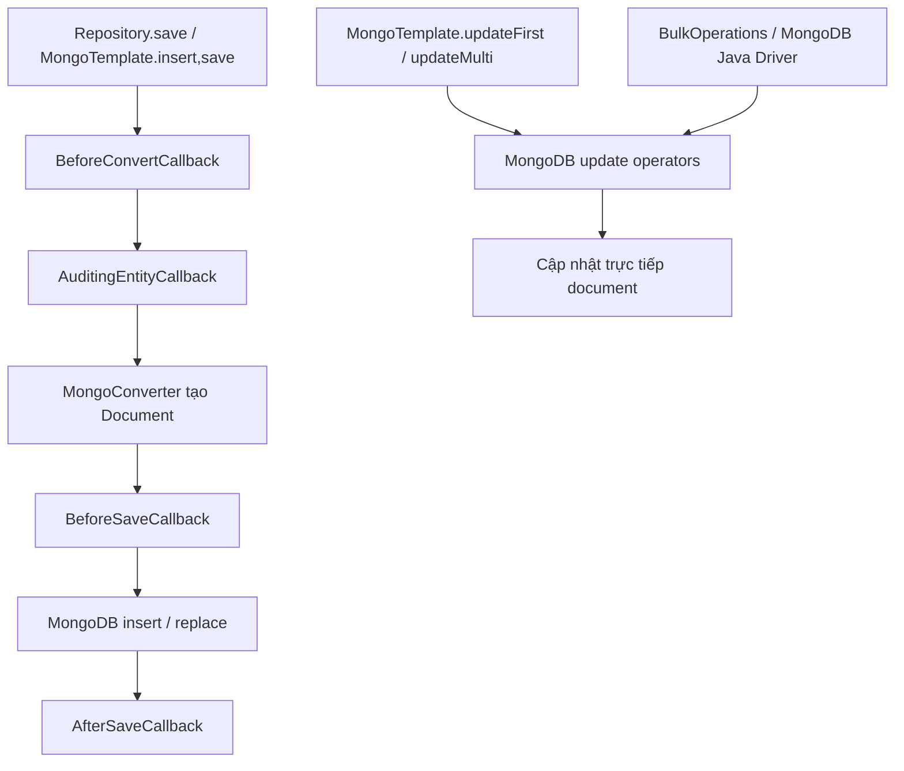

# Kiểm thử callback, auditing và thao tác ghi ngoài entity lifecycle

## Mục tiêu và phạm vi

Khi sử dụng **Spring Data MongoDB**, ứng dụng thường bổ sung nghiệp vụ ngay lúc lưu entity: chuẩn hóa mã, kiểm tra dữ liệu, gán người tạo, ghi thời điểm sửa đổi hoặc phát sinh sự kiện. Các hành vi đó có thể được thực hiện bằng **entity callback**, **MongoDB mapping event** và **auditing**. Điểm dễ bỏ sót là **không phải mọi lệnh ghi MongoDB đều đi qua vòng đời chuyển đổi và lưu entity**.

Ví dụ, `MongoRepository.save(invoice)` và `MongoTemplate.save(invoice)` đi qua luồng lưu đối tượng; một lệnh `MongoTemplate.updateFirst(...)` thực thi cập nhật trực tiếp trên document. Nếu chỉ viết test cho `save`, ứng dụng có thể bỏ sót trường audit và quy tắc chuẩn hóa khi chạy bulk update, sửa dữ liệu bằng script hay gọi trực tiếp MongoDB Java Driver.

Sau bài này, bạn có thể:

- Viết và kiểm thử `BeforeConvertCallback`, `BeforeSaveCallback` và `AfterSaveCallback`.
- Bật và xác minh `@CreatedDate`, `@LastModifiedDate`, `@CreatedBy`, `@LastModifiedBy` với `@EnableMongoAuditing`.
- Phân biệt unit test callback với integration test xác nhận dữ liệu thực tế trong MongoDB.
- Chứng minh bằng test rằng `updateFirst`, bulk write và thao tác từ MongoDB Driver không tự chạy các callback lưu entity.
- Thiết kế đường cập nhật trực tiếp có quy tắc audit rõ ràng, tránh làm lệch dữ liệu.

Nội dung dùng **Java**, **Spring Data MongoDB** và **Spring Boot** với API đồng bộ (`MongoTemplate`, `MongoRepository`), sau đó chỉ ra khác biệt của API reactive. Ví dụ integration test minh họa cấu hình quen thuộc với **Spring Boot 3.x**, **JUnit 5** và **Testcontainers 1.x**; nếu dùng các phiên bản khác, cần điều chỉnh tọa độ dependency/import tương ứng.

## 1. Bản đồ các đường ghi



Sơ đồ thể hiện các giai đoạn **theo ý nghĩa**. Thứ tự cụ thể của nhiều `BeforeConvertCallback` phụ thuộc vào `@Order`/`Ordered`; auditing mặc định là một `BeforeConvertCallback` với order `100`. Vì vậy, đừng suy rằng mọi callback do ứng dụng tạo đều luôn chạy trước auditing.

| Lệnh ghi | Chuyển entity thành document? | Callback trước khi lưu entity? | Auditing entity tự động? |
| --- | --- | --- | --- |
| `MongoTemplate.insert(entity)`, `save(entity)` | Có | Có | Có, nếu bật/cấu hình đúng |
| `MongoRepository.save(entity)` | Có, qua hạ tầng Spring Data | Có | Có, nếu bật/cấu hình đúng |
| `MongoTemplate.updateFirst(query, update, Entity.class)` | Không chuyển toàn bộ entity để lưu | Không thực hiện chuỗi `BeforeConvert`/`BeforeSave` của `save` | Không tự điền annotation audit qua entity callback |
| `MongoTemplate.updateMulti(...)` | Tương tự update trực tiếp | Không | Không |
| `MongoTemplate.bulkOps(...).updateOne/updateMulti(...)` | Bulk write trực tiếp | Không | Không |
| `MongoCollection.updateOne/updateMany(...)` qua Java Driver | Bỏ qua Spring Data entity lifecycle | Không | Không |
| `mongosh`/migration script | Bỏ qua Spring Data entity lifecycle | Không | Không |

**Cần phân biệt:** phép update của Spring Data vẫn có thể ánh xạ tên trường, kiểu dữ liệu và hỗ trợ `@Version` trong những trường hợp phù hợp. Việc đó **không đồng nghĩa** với gọi `BeforeConvertCallback` hoặc tự cập nhật các annotation auditing. Ngoài ra, `findAndModify` có thể chuyển kết quả trả về thành đối tượng và phát sinh callback/event ở đường **đọc**; không vì thế mà chuỗi callback của `save` được gọi cho phép update.

## 2. Ba điểm móc chính trong entity lifecycle

### `BeforeConvertCallback<T>`

Chạy trước khi Spring Data chuyển đối tượng Java thành `org.bson.Document`. Đây là chỗ phù hợp để sửa một trường **cần được lưu**:

```java
import java.util.Locale;
import org.springframework.core.annotation.Order;
import org.springframework.data.mongodb.core.mapping.event.BeforeConvertCallback;

@Order(0)
public class InvoiceNormalizer implements BeforeConvertCallback<Invoice> {

    @Override
    public Invoice onBeforeConvert(Invoice entity, String collection) {
        if (entity.code != null) {
            entity.code = entity.code.strip().toUpperCase(Locale.ROOT);
        }
        return entity;
    }
}
```

Ở ví dụ trên, chuỗi `"  inv-001  "` được chuẩn hóa thành `"INV-001"` trước khi chuyển đổi. `@Order(0)` giúp callback này chạy trước `AuditingEntityCallback` có order `100` khi cùng tham gia giai đoạn `BeforeConvert`.

### `BeforeSaveCallback<T>`

Chạy **sau khi** entity đã được chuyển thành `Document` và trước khi lệnh ghi thực hiện. Muốn tác động vào dữ liệu được lưu ở bước này, hãy sửa **document** truyền vào:

```java
import org.bson.Document;
import org.springframework.data.mongodb.core.mapping.event.BeforeSaveCallback;

public class InvoiceWriteMarker implements BeforeSaveCallback<Invoice> {

    @Override
    public Invoice onBeforeSave(
            Invoice entity, Document document, String collection) {
        document.put("writePath", "entity-lifecycle");
        return entity;
    }
}
```

Chỉ gán `entity.code = ...` trong `BeforeSaveCallback` có thể **không được lưu** vì `Document` đã được tạo trước đó. Nếu cần thay đổi trường bền vững ở entity, ưu tiên `BeforeConvertCallback`; nếu cần thao tác trực tiếp trên BSON, sửa `document`.

### `AfterSaveCallback<T>`

Chạy sau khi thao tác lưu hoàn tất. Có thể dùng nó để ghi nhận việc callback đã chạy trong test, hoặc xử lý bổ sung không phụ thuộc việc ghi lại chính entity:

```java
import java.util.concurrent.atomic.AtomicInteger;
import org.bson.Document;
import org.springframework.data.mongodb.core.mapping.event.AfterSaveCallback;

public class SaveInvocationCounter implements AfterSaveCallback<Invoice> {
    private final AtomicInteger calls = new AtomicInteger();

    @Override
    public Invoice onAfterSave(
            Invoice entity, Document document, String collection) {
        calls.incrementAndGet();
        return entity;
    }

    public int count() {
        return calls.get();
    }

    public void reset() {
        calls.set(0);
    }
}
```

`AfterSaveCallback` chỉ là một phép quan sát tiện lợi cho bài test; không nên dựa vào counter trong JVM làm bằng chứng duy nhất rằng mọi hệ thống bên ngoài đã nhận được một sự kiện nghiệp vụ. Nếu phải phát sự kiện đáng tin cậy sau một giao dịch, cần cơ chế bảo đảm riêng (ví dụ outbox).

## 3. Entity mẫu với auditing

Ví dụ dưới đây dùng tên collection `invoice_samples` và các trường package-private để mã kiểm thử ngắn, dễ đọc. Các class trong cùng package có thể truy cập trực tiếp những trường này; mã production thường dùng constructor/getter/setter phù hợp với thiết kế entity.

```java
import java.time.Instant;
import org.bson.types.ObjectId;
import org.springframework.data.annotation.CreatedBy;
import org.springframework.data.annotation.CreatedDate;
import org.springframework.data.annotation.Id;
import org.springframework.data.annotation.LastModifiedBy;
import org.springframework.data.annotation.LastModifiedDate;
import org.springframework.data.mongodb.core.mapping.Document;

@Document(collection = "invoice_samples")
public class Invoice {

    @Id
    ObjectId id;

    String tenantId;
    String code;

    @CreatedBy
    String createdBy;

    @CreatedDate
    Instant createdAt;

    @LastModifiedBy
    String lastModifiedBy;

    @LastModifiedDate
    Instant lastModifiedAt;

    public Invoice() {
    }

    public Invoice(String tenantId, String code) {
        this.tenantId = tenantId;
        this.code = code;
    }
}
```

Spring Data hỗ trợ metadata auditing qua các annotation:

| Annotation | Dữ liệu | Kiểm tra nên có |
| --- | --- | --- |
| `@CreatedBy` | Tác nhân tạo | Đúng danh tính do `AuditorAware` cung cấp khi insert |
| `@CreatedDate` | Thời điểm tạo | Có giá trị, được giữ nguyên khi cập nhật entity hiện có |
| `@LastModifiedBy` | Tác nhân sửa đổi | Phản ánh tác nhân trong lần `save` cập nhật |
| `@LastModifiedDate` | Thời điểm sửa đổi | Thay đổi khi `save` cập nhật entity (nếu clock được chủ động điều khiển) |

Mặc định `@EnableMongoAuditing` có `modifyOnCreate = true`, tức các trường sửa đổi có thể **được điền ngay khi tạo mới**. Test không nên mặc định rằng `lastModifiedAt` hoặc `lastModifiedBy` phải `null` sau insert.

**Chú ý cách xác định entity mới:** Spring Data dựa vào metadata như ID, `@Version` hoặc `Persistable.isNew()`. Nếu ứng dụng gán sẵn ID nhưng không cung cấp chiến lược `isNew` phù hợp, auditing có thể xem đối tượng là bản cập nhật. Test nên bao gồm trường hợp ID được gán trước nếu domain sử dụng kiểu đó.

## 4. Cấu hình auditing có thể kiểm thử

Để test có tính quyết định, cần kiểm soát **người thao tác** và **đồng hồ**. So sánh hai lần `Instant.now()` trên máy chạy CI rất dễ thiếu ổn định; thay vào đó dùng `DateTimeProvider` do test điều khiển.

```java
import java.time.Instant;
import java.time.temporal.TemporalAccessor;
import java.util.Optional;
import org.springframework.data.auditing.DateTimeProvider;

public class ControlledTimeProvider implements DateTimeProvider {

    private Instant current = Instant.parse("2026-11-20T00:00:00Z");

    public void set(Instant current) {
        this.current = current;
    }

    @Override
    public Optional<TemporalAccessor> getNow() {
        return Optional.of(current);
    }
}
```

Đây là một stub chỉ dùng trong test đơn luồng. Nếu các test chạy song song và dùng chung Spring context, hãy tách context hoặc thay cách quản lý clock để tránh chia sẻ trạng thái.

```java
import java.util.Optional;
import org.springframework.boot.test.context.TestConfiguration;
import org.springframework.context.annotation.Bean;
import org.springframework.data.domain.AuditorAware;
import org.springframework.data.mongodb.config.EnableMongoAuditing;

@TestConfiguration(proxyBeanMethods = false)
@EnableMongoAuditing(
    auditorAwareRef = "testAuditor",
    dateTimeProviderRef = "testTimeProvider"
)
public class InvoiceMongoTestConfig {

    @Bean
    AuditorAware<String> testAuditor() {
        return () -> Optional.of("ci-test-user");
    }

    @Bean
    ControlledTimeProvider testTimeProvider() {
        return new ControlledTimeProvider();
    }

    @Bean
    InvoiceNormalizer invoiceNormalizer() {
        return new InvoiceNormalizer();
    }

    @Bean
    InvoiceWriteMarker invoiceWriteMarker() {
        return new InvoiceWriteMarker();
    }

    @Bean
    SaveInvocationCounter saveInvocationCounter() {
        return new SaveInvocationCounter();
    }
}
```

Cấu hình này được **import vào test slice**, không dùng để thay `AuditorAware` sản xuất. Trong ứng dụng thật, `AuditorAware` thường lấy principal từ ngữ cảnh bảo mật; với tác vụ nền, cần định nghĩa rõ tài khoản hệ thống tương ứng.

Nếu chỉ dùng `@CreatedDate` và `@LastModifiedDate`, ứng dụng không nhất thiết phải có `AuditorAware`; nhưng các trường `@CreatedBy`/`@LastModifiedBy` trong ví dụ yêu cầu nguồn danh tính.

## 5. Unit test callback: kiểm tra logic không cần MongoDB

Một callback thuần có thể kiểm tra nhanh bằng JUnit 5 mà không khởi chạy Spring:

```java
import static org.junit.jupiter.api.Assertions.assertEquals;
import static org.junit.jupiter.api.Assertions.assertSame;
import org.bson.Document;
import org.junit.jupiter.api.Test;

class InvoiceCallbackUnitTest {

    @Test
    void normalizeCodeBeforeConversion() {
        Invoice invoice = new Invoice("tenant-a", "  inv-001  ");
        Invoice result = new InvoiceNormalizer()
                .onBeforeConvert(invoice, "invoice_samples");

        assertSame(invoice, result);
        assertEquals("INV-001", result.code);
    }

    @Test
    void beforeSaveChangesDocumentThatWillBePersisted() {
        Invoice invoice = new Invoice("tenant-a", "INV-001");
        Document bson = new Document("code", invoice.code);

        new InvoiceWriteMarker()
                .onBeforeSave(invoice, bson, "invoice_samples");

        assertEquals("entity-lifecycle", bson.getString("writePath"));
    }
}
```

Unit test chứng minh **thuật toán callback** đúng, nhưng **chưa chứng minh Spring Data có đăng ký bean, gọi callback đúng giai đoạn hoặc lưu trường vào MongoDB**. Những điều đó cần integration test.

Với callback phát sự kiện, gọi HTTP hoặc ghi sang hệ thống khác, unit test nên dùng collaborator giả lập, tập trung kiểm tra đối số và tình huống lỗi. Tránh phụ thuộc hạ tầng thật trong unit test.

## 6. Integration test với `@DataMongoTest` và Testcontainers

Một integration test cần MongoDB chạy thực để phân biệt:

- Giá trị trên **entity Java trước khi lưu**.
- Giá trị được **persist trong BSON**.
- Giá trị được **đọc lại sau một đường ghi khác**.

`@DataMongoTest` khởi tạo lát cắt Spring Data MongoDB cho kiểm thử. `@Import(InvoiceMongoTestConfig.class)` làm rõ các bean auditing/callback của bài; dùng Testcontainers để tránh phụ thuộc database dữ liệu dùng chung.

Ví dụ sau sử dụng **Testcontainers 1.x** (`org.testcontainers.containers.MongoDBContainer`). Với Testcontainers 2.x, package MongoDB module thay đổi; chọn import và dependency theo BOM của dự án. Docker cần sẵn sàng để chạy integration test.

```java
import static org.junit.jupiter.api.Assertions.*;

import java.time.Instant;
import org.bson.Document;
import org.junit.jupiter.api.BeforeEach;
import org.junit.jupiter.api.Test;
import org.springframework.beans.factory.annotation.Autowired;
import org.springframework.boot.test.autoconfigure.data.mongo.DataMongoTest;
import org.springframework.context.annotation.Import;
import org.springframework.data.mongodb.core.MongoTemplate;
import org.springframework.data.mongodb.core.query.Criteria;
import org.springframework.data.mongodb.core.query.Query;
import org.springframework.data.mongodb.core.query.Update;
import org.springframework.test.context.DynamicPropertyRegistry;
import org.springframework.test.context.DynamicPropertySource;
import org.testcontainers.containers.MongoDBContainer;
import org.testcontainers.junit.jupiter.Container;
import org.testcontainers.junit.jupiter.Testcontainers;
import org.testcontainers.utility.DockerImageName;

import com.mongodb.client.result.UpdateResult;
import static com.mongodb.client.model.Filters.eq;

@Testcontainers
@DataMongoTest
@Import(InvoiceMongoTestConfig.class)
class InvoiceLifecycleIntegrationTest {

    private static final Instant T0 =
            Instant.parse("2026-11-20T08:00:00Z");
    private static final Instant T1 =
            Instant.parse("2026-11-20T09:00:00Z");

    @Container
    static final MongoDBContainer mongo = new MongoDBContainer(
            DockerImageName.parse("mongo:7.0"));

    @DynamicPropertySource
    static void mongoConnection(DynamicPropertyRegistry properties) {
        properties.add("spring.data.mongodb.uri", mongo::getReplicaSetUrl);
    }

    @Autowired
    MongoTemplate template;

    @Autowired
    ControlledTimeProvider time;

    @Autowired
    SaveInvocationCounter saveCalls;

    @BeforeEach
    void resetData() {
        // Chỉ xóa collection của môi trường Testcontainers.
        template.dropCollection(Invoice.class);
        time.set(T0);
        saveCalls.reset();
    }

    @Test
    void insertInvokesCallbackAndAuditing() {
        Invoice saved = template.insert(
                new Invoice("tenant-a", "  inv-001  "));

        assertNotNull(saved.id);
        assertEquals("INV-001", saved.code);
        assertEquals("ci-test-user", saved.createdBy);
        assertEquals(T0, saved.createdAt);
        assertEquals(T0, saved.lastModifiedAt);
        assertEquals(1, saveCalls.count());

        // Đọc raw BSON: xác minh điều gì thực sự đã được lưu.
        Document raw = template.getCollection("invoice_samples")
                .find(eq("_id", saved.id))
                .first();

        assertNotNull(raw);
        assertEquals("INV-001", raw.getString("code"));
        assertEquals("ci-test-user", raw.getString("createdBy"));
        assertEquals(T0, raw.getDate("createdAt").toInstant());
        assertEquals("entity-lifecycle", raw.getString("writePath"));
    }

    @Test
    void saveExistingEntityUpdatesAuditMetadata() {
        Invoice saved = template.insert(
                new Invoice("tenant-a", "inv-002"));

        time.set(T1);
        saved.code = "  inv-002-new  ";
        template.save(saved);

        Invoice reread = template.findById(saved.id, Invoice.class);
        assertNotNull(reread);
        assertEquals("INV-002-NEW", reread.code);
        assertEquals(T0, reread.createdAt);
        assertEquals(T1, reread.lastModifiedAt);
        assertEquals("ci-test-user", reread.lastModifiedBy);
        assertEquals(2, saveCalls.count());
    }

    @Test
    void directUpdateDoesNotRunSaveCallbacksOrAuditing() {
        Invoice saved = template.insert(
                new Invoice("tenant-a", "inv-003"));
        int callbacksAfterInsert = saveCalls.count();

        time.set(T1);
        Query byId = Query.query(Criteria.where("_id").is(saved.id));
        UpdateResult result = template.updateFirst(
                byId,
                new Update().set("code", "  direct-value  "),
                Invoice.class
        );

        assertEquals(1L, result.getMatchedCount());
        assertEquals(callbacksAfterInsert, saveCalls.count());

        Invoice reread = template.findById(saved.id, Invoice.class);
        assertNotNull(reread);
        // Không được InvoiceNormalizer xử lý.
        assertEquals("  direct-value  ", reread.code);
        // updateFirst không tự gọi AuditingEntityCallback.
        assertEquals(T0, reread.lastModifiedAt);
    }
}
```

**Cách đọc kết quả:**

- Test 1 kiểm tra `BeforeConvertCallback` (mã được chuẩn hóa), auditing (người và giờ tạo), `BeforeSaveCallback` (trường `writePath` trong raw BSON), `AfterSaveCallback` (counter).
- Test 2 cố định thời điểm thay đổi nên không cần `Thread.sleep(...)`. `createdAt` giữ nguyên trong khi `lastModifiedAt` chuyển từ `T0` sang `T1`.
- Test 3 chứng minh `updateFirst` thực hiện cập nhật trực tiếp: dữ liệu thay đổi, nhưng mã vẫn còn khoảng trắng, thời điểm sửa đổi không tự cập nhật và số lần `AfterSaveCallback` không tăng.

Khi chạy các test song song, cấu hình clock/counter chia sẻ theo Spring context có thể gây nhiễu. Có thể dùng test instance riêng hoặc thiết kế bean state độc lập; ví dụ ở đây giả định không chạy song song trong cùng context.

**Vì sao đọc raw BSON?** Đọc lại bằng `MongoTemplate.findById(..., Invoice.class)` có thể kích hoạt callback ở đường đọc (`AfterConvertCallback`) nếu ứng dụng đăng ký. Kiểm tra bằng `template.getCollection(...).find(...)` cho biết dữ liệu thực có trong collection và không đi qua entity mapping callbacks.

## 7. Kiểm thử các đường ghi ngoài entity lifecycle

### 7.1. `updateFirst`, `updateMulti` và `findAndModify`

Các lệnh cập nhật này sử dụng `Update`/MongoDB update operators trên document đã tồn tại. Chúng **không làm bước chuyển đổi toàn bộ entity để lưu** như `save`, nên các bước `BeforeConvertCallback`, `BeforeSaveCallback` và `AfterSaveCallback` cho lần ghi đó không diễn ra.

```java
Query selector = Query.query(
        Criteria.where("tenantId").is("tenant-a")
                .and("code").is("INV-001"));

Update change = new Update()
        .set("code", "INV-001-PAID");

template.updateFirst(selector, change, Invoice.class);
```

Nếu hệ thống đòi `lastModifiedAt` và `lastModifiedBy` cho **mọi** đường cập nhật, hãy thêm chúng **một cách tường minh** trong update:

```java
Instant now = clock.instant(); // Clock do service được inject
String actor = authenticatedActorId; // Lấy từ ngữ cảnh đã xác thực

Update auditedChange = new Update()
        .set("code", "INV-001-PAID")
        .set("lastModifiedAt", now)
        .set("lastModifiedBy", actor);

UpdateResult result = template.updateFirst(
        Query.query(Criteria.where("_id").is(invoiceId)
                .and("tenantId").is(authorizedTenantId)),
        auditedChange,
        Invoice.class
);

if (result.getMatchedCount() == 0) {
    // Không tìm thấy tài liệu thuộc phạm vi quyền truy cập.
}
```

Trong đoạn mã trên, `clock` là `java.time.Clock` đã được cấp qua constructor của service, `invoiceId` là ID tệp/bản ghi hóa đơn hợp lệ, còn `authenticatedActorId` và `authorizedTenantId` phải được lấy từ ngữ cảnh bảo mật. Không đưa giá trị danh tính tùy ý do client gửi vào metadata audit.

Khi gọi `findAndModify`, cách xử lý update về bản chất vẫn là cập nhật trực tiếp. Nếu trả về entity, việc ánh xạ kết quả có thể kích hoạt callback ở đường đọc; test phải phân biệt **callback khi ghi** và **callback khi đọc**. Cũng nên kiểm tra lựa chọn trả về giá trị trước/sau cập nhật (ví dụ `FindAndModifyOptions.returnNew(true)`) trước khi viết assertion.

### 7.2. BulkOperations

Bulk write giúp gom nhiều lệnh để giảm round-trip, nhưng không đi qua chuỗi callback lưu từng entity:

```java
import org.springframework.data.mongodb.core.BulkOperations;

BulkOperations bulk = template.bulkOps(
        BulkOperations.BulkMode.UNORDERED, Invoice.class);

bulk.updateMulti(
        Query.query(Criteria.where("tenantId").is("tenant-a")),
        new Update().set("code", "BULK-UPDATED"));

bulk.execute();
```

Test cho bulk write nên xác minh:

1. Số bản ghi bị tác động và điều kiện tenant có đúng không.
2. Trường nghiệp vụ đã đổi trên BSON thực.
3. `lastModifiedAt`, `lastModifiedBy` và dữ liệu do custom callback sinh ra có bị giữ nguyên ngoài ý muốn không.
4. Nếu hệ thống yêu cầu audit, bulk update có cập nhật metadata tương ứng hay có một cơ chế audit độc lập khác không.

Không lấy việc có `BulkWriteResult` thành công làm bằng chứng rằng auditing cũng chạy. Với bulk operation, những ràng buộc dựa vào entity callback cần được chuyển thành quy tắc của service, cập nhật tường minh hoặc cơ chế ở database phù hợp.

### 7.3. Truy cập MongoDB Java Driver trực tiếp

```java
import static com.mongodb.client.model.Filters.eq;
import static com.mongodb.client.model.Updates.set;

template.getCollection("invoice_samples")
        .updateOne(
                eq("_id", invoiceId),
                set("code", "RAW-UPDATE")
        );
```

Đường này bỏ qua `MongoConverter` và các callback/auditing của Spring Data. Nó cũng không tự áp dụng cách ánh xạ tên field từ entity Java và các cơ chế do Spring Data tự quản lý. Test cần kiểm tra trực tiếp BSON cũng như hậu quả khi ứng dụng đọc lại entity.

Lưu ý: việc sử dụng `MongoTemplate` để lấy `MongoCollection` không khiến lệnh `updateOne` của Java Driver trở thành lệnh `save` của Spring Data.

### 7.4. Chèn bằng bulk hoặc thao tác từ mongosh

Tương tự, script migration hoặc thao tác `db.invoice_samples.updateMany(...)` trong `mongosh` không biết đến callback được đăng ký trong JVM. Nếu migration tạo hoặc sửa các trường phải có audit, hãy quyết định trước:

- Giá trị `createdAt`/`lastModifiedAt` sẽ lấy từ đâu?
- `createdBy`/`lastModifiedBy` sẽ là tài khoản migration nào?
- Có phải backfill các trường thiếu hoặc cập nhật phiên bản schema không?
- Có cần audit trail riêng (ai chạy, thời điểm chạy, ID các document thay đổi) không?

Kiểm thử migration nên xác minh các trường đó trên database thử nghiệm với dữ liệu đại diện, thay vì mặc định Spring auditing sẽ xử lý hộ.

## 8. Ma trận kiểm thử tối thiểu

| Tình huống | Assertion chính | Lỗi tìm được |
| --- | --- | --- |
| `insert(entity)` | `code` chuẩn hóa, `createdAt`/`createdBy` đúng, callback được gọi | Bean callback/audit chưa đăng ký |
| `save(existingEntity)` | `lastModifiedAt` được cập nhật, `createdAt` giữ nguyên | Auditing nhận sai trạng thái “new” |
| `repository.save(entity)` | Cùng chính sách với `template.save` | Repository path thiếu cấu hình mong đợi |
| `updateFirst` | Dữ liệu được update; callback không tăng; audit không tự đổi | Ngộ nhận update operator đi qua lifecycle |
| `updateMulti` | Số bản ghi khớp và phạm vi tenant đúng; audit tường minh nếu cần | Cập nhật nhầm tenant hoặc thiếu audit |
| `bulkOps` | BSON có thay đổi đúng; mọi trường bắt buộc được xử lý rõ ràng | Bulk bỏ qua quy tắc trên callback |
| Java Driver / `mongosh` | BSON và schema hậu cập nhật chính xác | Đường ghi ngoài Spring Data bỏ qua mapping/audit |
| Ngay sau `findAndModify` | Phân biệt data trả về trước/sau và callback đọc/ghi | Assertion nhầm trạng thái hoặc nhầm loại callback |
| Entity có ID được cấp trước | `createdAt`/`createdBy` trên insert đúng | `isNew` xác định sai |
| Thiếu principal hoặc clock | Phản ứng có chủ đích, không tự ghi thông tin giả | Metadata audit thiếu không được phát hiện |

Không cần viết test lặp cho mọi cặp field. Hãy chọn mỗi test chứng minh một hợp đồng quan trọng: **luồng entity**, **luồng update trực tiếp**, **audit của bản ghi**, **phạm vi truy cập**, **kết quả sau ghi**.

### Tách test theo tầng

**Unit test:** gọi trực tiếp callback, không cần MongoDB, kiểm tra chuẩn hóa hoặc sửa `Document`. Dùng fake/stub cho collaborator; tránh khởi tạo toàn Spring context.

**Slice integration test:** dùng `@DataMongoTest` với MongoDB thật/Testcontainers, import cấu hình callback/audit cần thiết, đọc cả entity đã ánh xạ và raw BSON.

**End-to-end/service test:** gọi API hoặc service thực tế để xác minh actor/tenant lấy từ authentication và tất cả update path đều tuân theo chính sách audit. Đây là nơi phù hợp để kiểm tra phân quyền và behavior của endpoint.

## 9. Reactive MongoDB: tương đồng và khác biệt

Khi sử dụng reactive access, Spring Data MongoDB cung cấp `ReactiveBeforeConvertCallback`, `ReactiveBeforeSaveCallback` và `ReactiveAfterSaveCallback`, cùng cơ chế `@EnableReactiveMongoAuditing` và `ReactiveAuditorAware`. Không dùng bean `AuditorAware` đồng bộ để thay thế cho reactive auditor của luồng reactive.

Ví dụ khai báo auditor cho test reactive:

```java
import org.springframework.context.annotation.Bean;
import org.springframework.context.annotation.Configuration;
import org.springframework.data.domain.ReactiveAuditorAware;
import org.springframework.data.mongodb.config.EnableReactiveMongoAuditing;
import reactor.core.publisher.Mono;

@Configuration
@EnableReactiveMongoAuditing(auditorAwareRef = "reactiveAuditor")
class ReactiveAuditConfig {

    @Bean
    ReactiveAuditorAware<String> reactiveAuditor() {
        return () -> Mono.just("reactive-test-user");
    }
}
```

Trong test reactive, sử dụng `StepVerifier` để subscribe và xác minh kết quả; nếu không subscribe thì pipeline chưa nhất thiết thực thi:

```java
StepVerifier.create(reactiveTemplate.insert(
        new Invoice("tenant-a", "  inv-reactive  ")))
    .assertNext(saved -> {
        assertEquals("INV-REACTIVE", saved.code);
        assertEquals("reactive-test-user", saved.createdBy);
    })
    .verifyComplete();
```

Để assertion trên đúng, cần đăng ký **reactive** before-convert callback tương ứng (ví dụ `ReactiveBeforeConvertCallback<Invoice>` thực hiện chuẩn hóa). Bean `InvoiceNormalizer` đồng bộ ở phần trước không tự động được áp dụng lên `ReactiveMongoTemplate`. Với kiểm thử tích hợp, cấu hình MongoDB reactive và các bean callback/auditing reactive phải thực sự được load.

Các cập nhật theo operator trong `ReactiveMongoTemplate` cũng cần được xem là đường ghi trực tiếp khi đánh giá chính sách audit. Hãy kiểm tra trạng thái document sau khi terminal signal hoàn tất.

## 10. Các lỗi hay gặp và cách chẩn đoán

### “`@CreatedDate` vẫn null khi gọi `save`”

Kiểm tra lần lượt:

1. Có bật `@EnableMongoAuditing` hoặc `@EnableReactiveMongoAuditing` phù hợp API đang dùng không?
2. Entity có thực sự đi qua `MongoTemplate.insert/save` hoặc repository `save` hay không?
3. Có bean `DateTimeProvider` hợp lệ và auditing có được import vào test slice không?
4. Entity có bị xác định nhầm là bản ghi đã tồn tại do ID hoặc `Persistable.isNew()` không?
5. Có callback trước convert khác xóa/ghi đè trường auditing hay không?

### “`@LastModifiedDate` không đổi sau `updateFirst`”

Đó thường là hành vi đúng của **update trực tiếp**. Hãy đặt `lastModifiedAt` bằng `Update.set(...)` một cách tường minh ở đường này, hoặc chuyển nghiệp vụ sang cơ chế cần lưu entity nếu phù hợp hiệu năng và tính nhất quán. Không sửa test để kỳ vọng một callback chưa từng được gọi.

### “Callback chạy trong unit test nhưng không chạy trong integration test”

Unit test đã gọi callback thủ công. Hãy xác minh bean callback được đưa vào Spring context thực tế, các type generic được đăng ký đúng và request đi qua API có hỗ trợ callback. Với `@DataMongoTest`, các bean nghiệp vụ không thuộc auto-configuration của slice có thể cần `@Import`.

### “Giá trị chỉnh trong `BeforeSaveCallback` không được persist”

Kiểm tra bạn đã sửa `Document` thay vì chỉ thay đổi entity. Muốn sửa thuộc tính bền vững trước khi ánh xạ, dùng `BeforeConvertCallback`.

### “Test auditing thỉnh thoảng thất bại trên CI”

Tránh so sánh thời gian với `Instant.now()` theo khoảng quá hẹp hoặc dùng `Thread.sleep` để tạo chênh lệch. Cung cấp `DateTimeProvider` cố định và đổi thời điểm có chủ đích. Tránh chia sẻ clock/counter mutable giữa test chạy song song.

### “Test callback theo thứ tự luôn thất bại trên một cấu hình khác”

Kiểm tra `@Order`/`Ordered`; auditing entity callback mặc định ở order `100`. Với legacy `AbstractMongoEventListener`, event có thể được dispatch bất đồng bộ nếu event multicaster dùng executor; không dựa vào thứ tự event bất đồng bộ để sửa dữ liệu đồng bộ. Entity callback thường phù hợp hơn khi cần biến đổi dữ liệu một cách quyết định.

### “Nested object không nhận sự kiện như root entity”

MongoDB mapping events thường gắn với **root entity**; không mặc định mỗi object lồng trong document nhận sự kiện như một document độc lập. Nếu audit hoặc chuẩn hóa phải áp dụng cho thành phần con, hãy kiểm tra cách map đối tượng và gọi logic cần thiết ở callback của root entity hoặc tầng domain.

## 11. Bài tập thực hành

### Bài 1 — Xác minh callback trước và sau chuyển đổi

Tạo một `BeforeConvertCallback<Invoice>` chuẩn hóa `code` thành chữ hoa và một `BeforeSaveCallback<Invoice>` gắn `document.put("writePath", "entity-lifecycle")`. Hãy viết:

1. Unit test cho từng callback.
2. Integration test gọi `MongoTemplate.insert`.
3. Assertion dùng raw MongoDB Driver để chứng minh cả `code` và `writePath` tồn tại chính xác trong BSON.

**Tiêu chí đạt:** unit test chứng minh thuật toán; integration test chứng minh bean thực sự được Spring Data gọi đúng thứ tự và dữ liệu được lưu.

### Bài 2 — Khác biệt giữa `save` và `updateFirst`

Với entity có `@CreatedDate` và `@LastModifiedDate`:

1. Insert ở thời điểm cố định `T0`, khẳng định `createdAt = T0`.
2. Save entity ở `T1`, khẳng định `lastModifiedAt = T1` và `createdAt = T0`.
3. Update bằng `updateFirst` ở `T2` nhưng **chưa set** trường audit; xem `lastModifiedAt` còn giá trị `T1`.
4. Update tiếp bằng `updateFirst` có `set("lastModifiedAt", T2)`; xác minh giá trị được cập nhật.

**Tiêu chí đạt:** test phân biệt rõ phần Spring tự xử lý qua auditing callback và phần ứng dụng phải tự cập nhật trong direct update.

### Bài 3 — Bulk update không phá ràng buộc tenant

Tạo hai hóa đơn cùng trạng thái cho `tenant-a` và `tenant-b`. Chạy `bulkOps(...).updateMulti` chỉ với selector của `tenant-a`. Xác minh số bản ghi khớp, kiểm tra `tenant-b` không bị ảnh hưởng và tất cả trường audit bắt buộc được set theo chính sách.

**Tiêu chí đạt:** có assertion trên **BSON thật**, có xác minh phạm vi quyền truy cập và không nhầm `execute()` thành chạy entity callback.

## 12. Checklist đưa vào review

- Khi chọn API ghi, đã xác định có đi qua entity lifecycle hay không?
- Khi triển khai callback, đã phân biệt `BeforeConvert` và `BeforeSave` chưa?
- Test đã xác minh dữ liệu persisted chứ không chỉ kiểm tra đối tượng Java chưa?
- `AuditorAware` và `DateTimeProvider` trong test có giá trị xác định được không?
- Với `updateFirst`/bulk/driver, đã khai báo chính sách cập nhật audit tường minh chưa?
- Có test đường ghi theo ID và tenant, kể cả thao tác đồng loạt, chưa?
- Các test có độc lập, không phụ thuộc thứ tự chạy hoặc sleep để chờ callback không?
- Với reactive API, test đã subscribe và đăng ký đúng loại callback/auditor chưa?

## Tài liệu tham khảo

- [Spring Data MongoDB — Lifecycle Events and Entity Callbacks](https://docs.spring.io/spring-data/mongodb/reference/mongodb/lifecycle-events.html)
- [Spring Data MongoDB — Auditing](https://docs.spring.io/spring-data/mongodb/reference/mongodb/auditing.html)
- [Spring Data Commons — Auditing](https://docs.spring.io/spring-data/mongodb/reference/data-commons/auditing.html)
- [Spring Data MongoDB — MongoOperations API](https://docs.spring.io/spring-data/mongodb/docs/current/api/org/springframework/data/mongodb/core/MongoOperations.html)
- [Spring Data MongoDB — BeforeSaveCallback API](https://docs.spring.io/spring-data/mongodb/docs/current/api/org/springframework/data/mongodb/core/mapping/event/BeforeSaveCallback.html)
- [Spring Data MongoDB — EnableMongoAuditing API](https://docs.spring.io/spring-data/mongodb/docs/current/api/org/springframework/data/mongodb/config/EnableMongoAuditing.html)
- [Spring Boot — Testcontainers](https://docs.spring.io/spring-boot/reference/testing/testcontainers.html)
