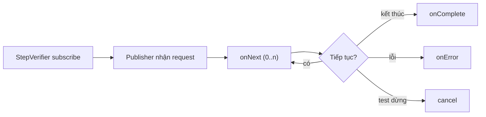

# Kiểm thử reactive bằng StepVerifier: change stream và tailable cursor

## Mục tiêu

Bài học thuộc chương **Kiểm thử** của **SPRING_DATA_MONGODB**: dùng Spring Data MongoDB để kết nối, ánh xạ document và thao tác MongoDB bằng template/repository, đồng thời kiểm thử truy vấn, aggregation, index, transaction và reactive access. Trọng tâm ở đây là cách **xác minh hành vi bất đồng bộ** của `ReactiveMongoTemplate`, **change stream** và **tailable cursor** bằng `StepVerifier` của Reactor Test.

Sau bài học, bạn có thể:

- Viết kỳ vọng cho `Mono`/`Flux`: subscription, `onNext`, `onError`, `onComplete`, request và cancel.
- Chọn `verifyComplete()` cho chuỗi hữu hạn, `thenCancel()` cho nguồn phát sự kiện dài hạn.
- Kiểm thử CRUD/reactive repository với MongoDB thật và đối chiếu dữ liệu trả về.
- Dùng **replica set** để kiểm tra change stream và **capped collection** để kiểm tra tailable cursor.
- Phân biệt **test logic bằng publisher giả lập** với **integration test bằng MongoDB**; hạn chế false positive, race condition, test treo và rò rỉ subscription.
- Chẩn đoán các lỗi thường gặp về timeout, dữ liệu seed, `resume token`, số lần request và thứ tự sự kiện.

## 1. Vì sao các luồng reactive cần cách kiểm thử khác nhau?

Một ứng dụng có thể đọc một document bằng `Mono`, truy vấn hàng trăm document bằng `Flux`, hoặc nghe sự kiện MongoDB liên tục. Cả ba đều là `Publisher`, nhưng **điều kiện kết thúc** khác nhau:

| Nguồn | Ví dụ Spring Data MongoDB | Đặc điểm | Kỳ vọng thường dùng |
| --- | --- | --- | --- |
| `Mono` hữu hạn | `ReactiveMongoTemplate.findById(...)`, `insert(...)` | Tối đa một giá trị rồi hoàn tất hoặc lỗi | `assertNext(...).verifyComplete()` |
| `Flux` hữu hạn | `find(...)`, `findAll(...)` | Có thể phát nhiều giá trị rồi hoàn tất | `expectNextCount(n).verifyComplete()` |
| Change stream | `template.changeStream(...).listen()` | Nghe các thay đổi mới, thường không tự hoàn tất | `assertNext(...).thenCancel().verify(timeout)` |
| Tailable cursor | `template.tail(query, Entity.class)` | Giữ cursor trên **capped collection** để đọc thêm khi dữ liệu mới đến | `assertNext(...).thenCancel().verify(timeout)` |

Chuỗi signal theo Reactive Streams:



Sau `onComplete` hoặc `onError`, publisher không phát thêm giá trị; `cancel` là hành động **subscriber yêu cầu dừng nhận**, không phải một tín hiệu kết thúc từ publisher. Với nguồn được thiết kế để chạy lâu dài, chờ `onComplete` có thể khiến test treo vô thời hạn.

Một điểm quan trọng: **publisher thường là lazy**. Khai báo `Mono`/`Flux` chưa tạo I/O; thao tác MongoDB thực sự thường bắt đầu khi có subscription. Vì vậy, `StepVerifier.create(...)` thiết lập kịch bản và `verify(...)` mới kích hoạt quá trình kiểm chứng.

## 2. Làm quen với StepVerifier

`StepVerifier` thuộc package `reactor.test` trong dependency **`io.projectreactor:reactor-test`**, chỉ dùng cho test. Đây là công cụ mô tả các signal theo thứ tự, đồng thời phát sinh `AssertionError` nếu thực tế khác kỳ vọng.

```java
import java.time.Duration;
import reactor.core.publisher.Flux;
import reactor.test.StepVerifier;

Flux<String> names = Flux.just("An", "Bình")
    .map(String::toUpperCase);

StepVerifier.create(names)
    .expectNext("AN")
    .expectNext("BÌNH")
    .verifyComplete();
```

Với các phần tử không cần so sánh bằng `equals`, sử dụng `expectNextMatches` hoặc `assertNext`:

```java
import static org.junit.jupiter.api.Assertions.assertTrue;

StepVerifier.create(Flux.just("sensor-17"))
    .assertNext(value -> assertTrue(value.startsWith("sensor-")))
    .verifyComplete();
```

Các API thiết yếu:

| API | Ý nghĩa |
| --- | --- |
| `expectSubscription()` | Xác minh đã nhận subscription; **chưa chứng minh** kết nối/cursor MongoDB đã mở trên server |
| `expectNext(x)` | Giá trị tiếp theo phải bằng `x` |
| `expectNextMatches(p)` | Giá trị tiếp theo phải thỏa predicate |
| `assertNext(consumer)` | Chạy assertion JUnit/AssertJ trực tiếp trên phần tử tiếp theo |
| `expectNextCount(n)` | Bỏ qua chi tiết nhưng xác nhận đúng `n` phần tử tiếp theo |
| `expectComplete()` / `verifyComplete()` | Nguồn phải kết thúc thành công sau các kỳ vọng |
| `expectError(...)` / `verifyError(...)` | Nguồn phải phát lỗi phù hợp |
| `thenRequest(n)` | Subscriber yêu cầu thêm `n` phần tử (backpressure) |
| `expectNoEvent(duration)` | Trong khoảng thời gian đó không có signal; phải đặt **sau** `expectSubscription()` nếu cần |
| `thenCancel()` | Kết thúc kịch bản bằng cách cancel subscription |
| `verify(Duration.ofSeconds(n))` | Chạy verification với **giới hạn thời gian thực** |

### Kiểm tra backpressure

```java
StepVerifier.create(Flux.just(10, 20), 0)
    .expectSubscription()
    .thenRequest(1)
    .expectNext(10)
    .thenRequest(1)
    .expectNext(20)
    .verifyComplete();
```

Overload `create(publisher, 0)` yêu cầu ban đầu bằng 0. Nếu quên `thenRequest`, test có thể đứng chờ do chưa cấp demand. Trong các test integration, đừng mặc định việc publisher phát ra nhiều phần tử đồng nghĩa driver đã truy vấn mọi bản ghi: batching, prefetch và demand có thể ảnh hưởng cách lấy dữ liệu.

### Phân biệt `verifyComplete`, `thenCancel` và `take`

```java
// Nguồn hữu hạn tự hoàn tất.
StepVerifier.create(Flux.just("a", "b"))
    .expectNext("a", "b")
    .verifyComplete();

// Nguồn không tự hoàn tất: subscriber chủ động cancel.
StepVerifier.create(Flux.concat(Flux.just("ready"), Flux.never()))
    .expectNext("ready")
    .thenCancel()
    .verify(Duration.ofSeconds(3));

// take(1) tự cancel upstream và phát onComplete xuống downstream.
StepVerifier.create(
        Flux.concat(Flux.just("ready"), Flux.never()).take(1))
    .expectNext("ready")
    .verifyComplete();
```

`take(1)` là cách biến một luồng vô hạn thành phép thử hữu hạn. Tuy nhiên, nếu mục tiêu của bài kiểm tra là chứng minh **chính hành vi cancel** của subscriber, `thenCancel()` thể hiện ý định rõ hơn.

**Luôn đặt timeout cho integration test:** nếu chỉ gọi `verify()` hoặc `verifyComplete()` không giới hạn, một luồng chưa kết thúc có thể khiến bộ test chạy mãi. Với `verifyComplete()` cần giới hạn, dùng `expectComplete().verify(Duration.ofSeconds(10))`.

## 3. Chuẩn bị môi trường chạy MongoDB thật

### Dependency

Ví dụ Gradle Groovy DSL sử dụng Spring Boot với dependency được quản lý thống nhất qua BOM:

```groovy
dependencies {
    implementation 'org.springframework.boot:spring-boot-starter-data-mongodb-reactive'

    testImplementation 'org.springframework.boot:spring-boot-starter-test'
    testImplementation 'io.projectreactor:reactor-test'

    // Testcontainers 2.x; khóa phiên bản thông qua BOM tương thích.
    testImplementation 'org.testcontainers:testcontainers-junit-jupiter'
    testImplementation 'org.testcontainers:testcontainers-mongodb'
}
```

Testcontainers **2.x** dùng package `org.testcontainers.mongodb.MongoDBContainer` và module `testcontainers-mongodb`. Nếu dự án dùng **1.x**, thường là `org.testcontainers.containers.MongoDBContainer` và module `org.testcontainers:mongodb`; chọn đúng bộ artifact/import theo phiên bản đang dùng, không trộn hai hệ. Cấu hình Maven cũng có các dependency tương ứng ở scope `test`.

### MongoDB replica set cho change streams

Change streams cần một **replica set** hoặc **sharded cluster**. Đối với tích hợp tự động, có thể dùng MongoDBContainer chạy replica set một node; một MongoDB standalone thông thường không đáp ứng điều kiện này.

```java
import org.junit.jupiter.api.Test;
import org.springframework.beans.factory.annotation.Autowired;
import org.springframework.boot.test.context.SpringBootTest;
import org.springframework.test.context.DynamicPropertyRegistry;
import org.springframework.test.context.DynamicPropertySource;
import org.springframework.data.mongodb.core.ReactiveMongoTemplate;
import org.testcontainers.junit.jupiter.Container;
import org.testcontainers.junit.jupiter.Testcontainers;
import org.testcontainers.mongodb.MongoDBContainer;

@SpringBootTest
@Testcontainers
class ReactiveMongoStreamIT {

    @Container
    static final MongoDBContainer mongo =
        new MongoDBContainer("mongo:7.0").withReplicaSet();

    @DynamicPropertySource
    static void configureMongo(DynamicPropertyRegistry properties) {
        properties.add("spring.data.mongodb.uri", mongo::getReplicaSetUrl);
        properties.add("spring.data.mongodb.database", () -> "stepverifier_it");
    }

    @Autowired
    ReactiveMongoTemplate template;

    // Các test ở các mục sau được đặt trong lớp này.
}
```

Ví dụ trên giả định môi trường có **Docker** và dependency tương thích với Spring Boot. Khi chạy, Testcontainers khởi tạo MongoDB và cung cấp kết nối replica set; không đặt cứng `localhost:27017` vì host/port thay đổi trên CI.

Nếu sử dụng `@DataMongoTest` với reactive driver, cần bảo đảm slice test đang bật cấu hình và bean phù hợp; ví dụ dùng `@SpringBootTest` để minh họa thiết lập kết nối đơn giản. Nên chạy integration test trong database riêng, có tên collection duy nhất hoặc dọn dữ liệu giữa các test. Không dùng database production để thử.

### Model tối giản dùng xuyên suốt

```java
import org.springframework.data.annotation.Id;
import org.springframework.data.mongodb.core.mapping.Document;

@Document("sensor_readings")
public record SensorReading(
    @Id String id,
    String deviceId,
    double temperatureC
) {}

@Document("sensor_tail")
public record TailEvent(
    @Id String id,
    String message
) {}
```

Các record trên yêu cầu Java hỗ trợ `record` (ví dụ Java 17+). `id` được truyền tường minh để test có dữ liệu so sánh ổn định; không phụ thuộc vào ID tự sinh.

## 4. Kiểm thử thao tác reactive hữu hạn

Một kịch bản xác minh cả ghi và đọc document bằng `ReactiveMongoTemplate`:

```java
import java.time.Duration;
import java.util.UUID;

import static org.junit.jupiter.api.Assertions.*;

@Test
void insertThenFindById() {
    String id = "reading-" + UUID.randomUUID();

    var operation = template
        .insert(new SensorReading(id, "sensor-17", 4.5))
        .flatMap(saved -> template.findById(saved.id(), SensorReading.class));

    StepVerifier.create(operation)
        .assertNext(reading -> {
            assertEquals(id, reading.id());
            assertEquals("sensor-17", reading.deviceId());
            assertEquals(4.5, reading.temperatureC(), 0.00001);
        })
        .expectComplete()
        .verify(Duration.ofSeconds(10));
}
```

Mỗi toán tử `flatMap` được nối sau thao tác insert để đảm bảo truy vấn chỉ chạy **sau khi insert thành công**. Nếu `findById` không có giá trị, `assertNext` sẽ thất bại thay vì âm thầm coi là thành công.

Cũng cần kiểm tra kịch bản không có bản ghi và kịch bản lỗi:

```java
@Test
void missingDocumentReturnsEmptyMono() {
    StepVerifier.create(
        template.findById("missing-id", SensorReading.class)
    )
        .expectComplete()
        .verify(Duration.ofSeconds(10));
}

@Test
void validationFailurePropagatesError() {
    // Đây là publisher giả lập để kiểm tra nhánh xử lý lỗi,
    // KHÔNG phải MongoDB thật tự phát lỗi này.
    StepVerifier.create(
        Mono.<SensorReading>error(new IllegalArgumentException("invalid sensor"))
    )
        .expectErrorMatches(error ->
            error instanceof IllegalArgumentException
                && error.getMessage().contains("invalid"))
        .verify(Duration.ofSeconds(3));
}
```

Đoạn thứ hai cần `import reactor.core.publisher.Mono;`. Với lỗi MongoDB thật, nên tạo điều kiện gây lỗi có kiểm soát (ví dụ vi phạm unique index trong database test) và kiểm tra kiểu lỗi thích hợp. Không dựa vào nguyên văn chuỗi lỗi của server vì thông điệp có thể khác theo phiên bản.

## 5. Change stream: kiểm tra sự kiện insert/update/delete

Change stream phát thông báo về thay đổi trong collection, database hoặc cluster mà không cần đọc trực tiếp oplog. Spring Data MongoDB hỗ trợ API reactive như:

```java
import org.springframework.data.mongodb.core.ChangeStreamEvent;
import reactor.core.publisher.Flux;

Flux<ChangeStreamEvent<SensorReading>> events = template
    .changeStream(SensorReading.class)
    .watchCollection("sensor_readings")
    .listen();
```

Mỗi `ChangeStreamEvent` có thể chứa `operationType`, `resumeToken`, `timestamp`, `collectionName`, `getBody()` (full document khi có) và dữ liệu gốc `getRaw()`.

**Chú ý:** `getBody()` có thể `null` đối với delete và một số update nếu không yêu cầu lookup full document. Khi khẳng định sự kiện DELETE, cần xem `getOperationType()` và khóa document từ raw event hoặc cơ chế tương ứng; không giả định luôn có object Java đầy đủ.

### Mẫu StepVerifier nghe sự kiện insert

```java
import java.time.Duration;
import java.util.UUID;
import com.mongodb.client.model.changestream.OperationType;
import org.springframework.data.mongodb.core.ChangeStreamEvent;
import reactor.core.publisher.Flux;
import reactor.test.StepVerifier;

@Test
void changeStreamReceivesInsert() {
    String id = "event-" + UUID.randomUUID();

    Flux<ChangeStreamEvent<SensorReading>> inserts = template
        .changeStream(SensorReading.class)
        .watchCollection("sensor_readings")
        .listen()
        .filter(event ->
            event.getOperationType() == OperationType.INSERT
                && event.getBody() != null
                && id.equals(event.getBody().id()));

    StepVerifier.create(inserts)
        .expectSubscription()
        .then(() -> template
            .insert(new SensorReading(id, "sensor-42", 5.2))
            .block(Duration.ofSeconds(5)))
        .assertNext(event -> {
            assertEquals(OperationType.INSERT, event.getOperationType());
            assertEquals("sensor-42", event.getBody().deviceId());
            assertNotNull(event.getResumeToken());
        })
        .thenCancel()
        .verify(Duration.ofSeconds(15));
}
```

Đây là **kịch bản trực quan** để thấy cách nối hành động ghi với kỳ vọng sự kiện, nhưng còn một **race condition quan trọng**: `expectSubscription()` chỉ xác nhận Reactor subscribe, **không đảm bảo MongoDB server đã đăng ký change stream**. Nếu lệnh insert chạy trước khi server thiết lập stream, sự kiện có thể bị bỏ lỡ và test chạy hết timeout.

Với CI, cần giải quyết race một cách có kiểm soát:

1. **Sử dụng resume token hợp lệ** đã ghi nhận từ một sự kiện mốc, sau đó ghi các document mục tiêu rồi mở stream với `resumeAfter(token)`. Khi đó việc subscribe sau insert vẫn có thể đọc lại các event phát sinh sau token trong oplog còn được giữ.
2. Hoặc có **tín hiệu xác nhận stream đã mở từ phía driver/server** (chẳng hạn instrumentation/command listener cho thao tác tạo cursor), rồi mới cho writer hoạt động.
3. Tránh dựa vào `Thread.sleep(500)` hay `thenAwait(...)` như bảo đảm đồng bộ; điều kiện tải CI và thời gian khởi động MongoDB thay đổi.

### Kiểm tra replay với resume token

Giả sử fixture integration đã thu được `BsonValue checkpointToken` từ **một event thực** trước thay đổi cần kiểm thử; event đó thuộc cùng phạm vi watch và token vẫn tồn tại trong lịch sử oplog. Đặt đoạn sau **bên trong lớp kiểm thử**; helper nhận token và ID mục tiêu từ fixture:

```java
import org.bson.BsonValue;
import org.springframework.data.mongodb.core.ChangeStreamOptions;
import org.springframework.data.mongodb.core.ReactiveMongoTemplate;

void verifyReplayedInsert(
        ReactiveMongoTemplate template,
        BsonValue checkpointToken,
        String expectedId) {

    ChangeStreamOptions options = ChangeStreamOptions.builder()
        .resumeAfter(checkpointToken)
        .build();

    Flux<ChangeStreamEvent<SensorReading>> replay = template.changeStream(
        "sensor_readings", options, SensorReading.class);

    // Fixture đã ghi document expectedId sau mốc checkpointToken.
    // Subscriber có thể bắt đầu muộn mà vẫn nhận event trong oplog.
    StepVerifier.create(replay
            .filter(event -> event.getOperationType() == OperationType.INSERT)
            .filter(event -> event.getBody() != null
                && expectedId.equals(event.getBody().id()))
            .take(1))
        .assertNext(event -> {
            assertEquals(expectedId, event.getBody().id());
            assertNotNull(event.getResumeToken());
        })
        .expectComplete()
        .verify(Duration.ofSeconds(15));
}
```

Helper trên kiểm chứng **sau bước chuẩn bị fixture**: truyền token thật qua `checkpointToken`, ghi một document có ID `expectedId` sau mốc đó, rồi gọi `verifyReplayedInsert(template, checkpointToken, expectedId)`. Nó cho thấy cách tránh lỗi “subscriber đăng ký muộn” bằng **replay có checkpoint**; không thể tự chọn một token bất kỳ. Khi thử cùng nhiều writer, phải lọc `operationType`, `documentKey`/ID hoặc một correlation ID duy nhất để tránh nhận sự kiện từ test khác. Không giả định event phát một lần duy nhất khi ứng dụng dùng retry/resume.

### Kiểm tra update và delete

- **INSERT:** so `OperationType.INSERT`, `getBody()` và các field vừa ghi.
- **UPDATE:** so `OperationType.UPDATE` và `getRaw().getUpdateDescription()`; muốn lấy toàn bộ document mới, cấu hình full-document lookup qua `ChangeStreamOptions`.
- **DELETE:** so `OperationType.DELETE`, khóa document từ raw event; `getBody()` có thể `null`.
- **Resume:** kiểm chứng `resumeAfter` khởi động tiếp sau token đã lưu; không giả định có thể resume mãi khi oplog đã cắt bỏ lịch sử cần thiết.
- **Cancel:** `thenCancel()` đảm bảo subscriber chủ động đóng luồng kiểm thử, tránh giữ cursor vô hạn.

Change stream có thể hoàn tất hoặc báo lỗi khi collection bị drop/rename, khi quyền truy cập thay đổi hoặc sau lỗi không thể resume. Kiểm thử những tình huống này cần fixture riêng và không nên dựa vào toàn bộ chuỗi exception text.

## 6. Tailable cursor: stream trên capped collection

**Tailable cursor** theo dõi dữ liệu mới được thêm vào **capped collection**. Khác với change stream, nó trả về **document** được truy vấn chứ không phải sự kiện `operationType`. Tính năng hữu ích cho log/event dạng append-only.

Capped collection có giới hạn kích thước; khi đầy, MongoDB tự loại bỏ document cũ theo thứ tự để nhường chỗ. Nó cần được tạo **tường minh**, ví dụ bằng `CollectionOptions`:

```java
import org.springframework.data.mongodb.core.CollectionOptions;
import org.springframework.data.mongodb.core.ReactiveMongoTemplate;

String collection = "sensor_tail_test";

template.createCollection(
        collection,
        CollectionOptions.empty()
            .capped()
            .size(1024 * 1024)
            .maxDocuments(1000))
    .block(Duration.ofSeconds(10));
```

`size(...)` là bắt buộc khi tạo capped collection. Nếu collection thường đã tồn tại với cùng tên, không được coi như capped chỉ vì gọi `tail`; kiểm tra metadata hoặc tạo tên riêng cho bài test.

API reactive:

```java
import org.springframework.data.mongodb.core.query.Query;
import reactor.core.publisher.Flux;

Flux<TailEvent> stream = template.tail(
    new Query(),
    TailEvent.class,
    "sensor_tail_test"
);
```

Tailable cursor có thể **chết sớm** khi truy vấn ban đầu không khớp document, hoặc khi vị trí document cuối mà cursor đang theo dõi bị loại khỏi capped collection. Vì vậy, bài test nên **seed một document phù hợp trước khi subscribe**, giới hạn kích thước dữ liệu để tránh vòng quay capped, và không gắn `$sort` vào truy vấn tail.

### Test có marker: seed trước, ghi tiếp sau khi cursor đã nhận

Ví dụ này sử dụng tên collection duy nhất mỗi lần chạy để tránh ảnh hưởng các test khác:

```java
import java.time.Duration;
import java.util.UUID;
import org.springframework.data.mongodb.core.CollectionOptions;
import org.springframework.data.mongodb.core.query.Query;
import reactor.core.publisher.Flux;
import reactor.test.StepVerifier;

import static org.junit.jupiter.api.Assertions.assertEquals;

@Test
void tailableCursorReadsExistingThenNewDocument() {
    String collection = "sensor_tail_" +
        UUID.randomUUID().toString().replace("-", "");

    template.createCollection(
        collection,
        CollectionOptions.empty().capped().size(1024 * 1024))
        .block(Duration.ofSeconds(10));

    try {
        template.insert(new TailEvent("seed", "READY"), collection)
            .block(Duration.ofSeconds(5));

        Flux<TailEvent> tail = template.tail(
            new Query(), TailEvent.class, collection);

        StepVerifier.create(tail)
            .assertNext(first -> {
                assertEquals("seed", first.id());
                assertEquals("READY", first.message());
            })
            .then(() -> template
                .insert(new TailEvent("next", "TEMPERATURE_CHANGED"),
                        collection)
                .block(Duration.ofSeconds(5)))
            .assertNext(second -> {
                assertEquals("next", second.id());
                assertEquals("TEMPERATURE_CHANGED", second.message());
            })
            .thenCancel()
            .verify(Duration.ofSeconds(15));
    } finally {
        template.dropCollection(collection)
            .block(Duration.ofSeconds(10));
    }
}
```

Điểm quan trọng: `assertNext(first)` kiểm chứng đã nhận **seed từ cursor thật**. Sau khi nhận marker, mới thực hiện insert `next`, nhờ vậy tránh race “insert trước khi cursor sẵn sàng” ở giai đoạn phát sự kiện mới. `thenCancel()` hủy subscription sau khi thấy sự kiện mong đợi; `finally` dọn **chính collection riêng của bài test**.

Nếu muốn chỉ nhận các sự kiện mới, phải thiết kế cursor và checkpoint phù hợp; seed chỉ bảo đảm cursor có ít nhất một document để bám theo, không tự loại dữ liệu cũ khỏi kết quả.

### Reactive repository với `@Tailable`

```java
import org.springframework.data.mongodb.repository.ReactiveMongoRepository;
import org.springframework.data.mongodb.repository.Tailable;
import reactor.core.publisher.Flux;

public interface TailEventRepository
        extends ReactiveMongoRepository<TailEvent, String> {

    @Tailable
    Flux<TailEvent> findByMessage(String message);
}
```

Dù dùng `@Tailable` trên repository hay `ReactiveMongoTemplate.tail(...)`, collection tương ứng **vẫn phải là capped collection**. Với query lọc `message`, nếu chưa có document thỏa điều kiện lúc cursor bắt đầu, cursor có thể bị đóng trước khi sự kiện mới tới. Trong integration test nên tạo trước ít nhất một bản ghi thỏa filter hoặc điều chỉnh chiến lược theo dõi.

## 7. Kiểm thử timeout, cancel và backpressure an toàn

### Không nhầm timeout của verification với timeout của publisher

```java
StepVerifier.create(Flux.never())
    .expectSubscription()
    .expectNoEvent(Duration.ofMillis(100))
    .thenCancel()
    .verify(Duration.ofSeconds(2));
```

Ở đây `expectNoEvent` kiểm tra trong 100 ms **không có onNext/onComplete/onError**; `thenCancel` đóng nguồn. `verify(Duration.ofSeconds(2))` chỉ là thời hạn tối đa cho **toàn bộ test**. Nó không kiểm tra timeout nghiệp vụ của luồng, và không chứng minh MongoDB đang hoạt động nếu nguồn là `Flux.never()`.

Để kiểm tra timeout nghiệp vụ:

```java
import java.util.concurrent.TimeoutException;

StepVerifier.create(
        Flux.<String>never().timeout(Duration.ofMillis(150)))
    .expectError(TimeoutException.class)
    .verify(Duration.ofSeconds(2));
```

Với change stream hoặc tailable cursor, `timeout` có thể có nghĩa “không thấy sự kiện mới trong khoảng N giây”, nhưng **không nhất thiết là lỗi vận hành**: một nguồn dữ liệu có thể hoàn toàn hợp lệ khi im lặng. Chọn timeout theo hợp đồng nghiệp vụ (heartbeat, SLA dữ liệu), không áp dụng máy móc cho mọi stream.

### Kiểm tra hủy subscription thực sự

Ở mức unit, có thể dùng `doOnCancel` để đo tín hiệu cancellation:

```java
import java.time.Duration;
import java.util.concurrent.atomic.AtomicBoolean;
import reactor.core.publisher.Flux;
import reactor.test.StepVerifier;

AtomicBoolean cancelled = new AtomicBoolean();

Flux<String> stream = Flux.<String>never()
    .doOnCancel(() -> cancelled.set(true));

StepVerifier.create(stream)
    .expectSubscription()
    .thenCancel()
    .verify(Duration.ofSeconds(2));

assertTrue(cancelled.get());
```

Trong integration test MongoDB, `doOnCancel` xác nhận lệnh cancel **đã truyền đến phần Reactor**, nhưng không phải bằng chứng server đã giải phóng cursor tức thời; muốn kiểm tra tài nguyên phía MongoDB phải có thêm quan sát server/driver.

### Virtual time: chỉ dùng cho thời gian của Reactor

```java
StepVerifier.withVirtualTime(() ->
        Flux.interval(Duration.ofSeconds(1)).take(2))
    .expectSubscription()
    .thenAwait(Duration.ofSeconds(1))
    .expectNext(0L)
    .thenAwait(Duration.ofSeconds(1))
    .expectNext(1L)
    .verifyComplete();
```

`withVirtualTime` tăng thời gian giả lập của các scheduler Reactor do nhà máy scheduler quản lý. Tạo publisher **bên trong lambda** để operator dùng đúng virtual scheduler. Nó **không làm MongoDB server, I/O mạng, oplog, cursor hay Testcontainers chạy nhanh hơn**. Với integration test MongoDB thật, dùng clock thực, timeout hữu hạn và cơ chế đồng bộ hóa dựa trên tín hiệu/marker.

## 8. Lập chiến lược test để tránh chập chờn

| Rủi ro | Dấu hiệu | Cách xử lý |
| --- | --- | --- |
| Dùng standalone MongoDB cho change stream | Lỗi server không hỗ trợ `$changeStream` | Test trên replica set/sharded cluster; Testcontainers có thể khởi tạo replica set một node |
| `expectSubscription` rồi ghi ngay | Thỉnh thoảng miss event | Dùng event checkpoint/resume token hoặc tín hiệu server đã mở cursor; đừng thay bằng sleep |
| Tailable query trên collection thường | Lỗi cursor không tailable | Tạo collection có `capped().size(...)`; kiểm tra loại collection |
| Tailable bắt đầu khi không có document khớp | Luồng có thể kết thúc sớm | Seed marker phù hợp trước khi tail; kiểm tra hành vi theo phiên bản |
| Chờ `verifyComplete()` trên stream dài hạn | Test không kết thúc | Dùng `thenCancel().verify(timeout)` hoặc `take(n)` khi phù hợp |
| `thenRequest` không đủ demand | Test đứng chờ giá trị | Kiểm tra initial request và `thenRequest(n)` |
| Test chạy song song dùng chung collection | Event xen lẫn, assertion nhận nhầm | Collection/ID duy nhất theo test, filter correlation ID, dọn fixture |
| Dùng `getBody()` với delete | `NullPointerException` | So `operationType`, đọc raw/documentKey, xử lý body nullable |
| Kiểm thử timing bằng `sleep` cố định | CI lúc pass lúc fail | Dựa vào tín hiệu sẵn sàng/marker/replay, timeout cho cả verification |
| Không dispose subscription | Test treo, cursor tồn tại lâu | `thenCancel()`, `take`, cleanup trong `finally` |

Một số quy tắc vận hành cần ghi nhớ:

1. **Test dữ liệu có tính cô lập:** ID/collection duy nhất hoặc database riêng; tạo fixture trước, dọn fixture sau. Không xóa collection mà test khác đang dùng.
2. **Gắn correlation ID:** change stream có thể phát event không liên quan khi nhiều test chung replica set.
3. **Assertion theo nội dung trước khi xét thời gian:** ưu tiên ID/field/operation type; chỉ dùng thời gian để giới hạn test, không giả định event đến chính xác ở thời điểm định trước.
4. **Không dùng dữ liệu tài khoản thật:** test trên cluster tách biệt, credential test riêng, đường dẫn Docker/CI đã được cấu hình.
5. **Nếu kiểm tra resume:** lưu token từ sự kiện thực, biết thời gian giữ oplog, thử mất kết nối/cancel và xác nhận chỉ các event sau checkpoint được xử lý.
6. **Quan sát trên server nếu cần:** việc `StepVerifier` hoàn tất không chứng minh mọi thao tác dọn dẹp ở server đã kết thúc đồng bộ.

## 9. Bài thực hành

Chuẩn bị Spring Boot, Spring Data MongoDB reactive, Reactor Test và MongoDB replica set từ Testcontainers hoặc môi trường test. Hoàn thành các phần:

1. Tạo `SensorReading` và viết `StepVerifier` cho `insert(...).flatMap(findById(...))`, so đủ `id`, `deviceId`, `temperatureC`.
2. Viết trường hợp `findById` không có document, kiểm tra `expectComplete()` và không có `onNext`.
3. Mở change stream cho `sensor_readings`, quan sát một `INSERT`, đối chiếu `getOperationType()`, `getBody()`, `getResumeToken()`; giải thích race khi ghi quá sớm.
4. Thu resume token từ một event mốc và thử khởi động lại stream từ token trên cùng collection; kiểm tra sự kiện được replay mà không trộn sang test khác.
5. Tạo capped collection dung lượng 1 MiB, seed marker `READY`, mở tailable cursor, ghi sự kiện thứ hai rồi xác minh và cancel.
6. Cố tình đổi sang collection thường để thấy giới hạn của tailable cursor; ghi rõ loại lỗi và cách phát hiện từ metadata.
7. So sánh `Flux.never().timeout(...)` với `StepVerifier.verify(Duration)`, nêu trường hợp nào kiểm tra hợp đồng nghiệp vụ và trường hợp nào chỉ bảo vệ test.
8. Thử `create(publisher, 0)` cùng `thenRequest(1)` để thấy backpressure, rồi thử thiếu request trong một test có giới hạn thời gian.

**Tiêu chí hoàn thành:** test kiểm chứng đúng giá trị và signal, có timeout hữu hạn, không mắc kẹt vì chờ `onComplete` của stream dài hạn, giải thích được yêu cầu replica set/capped collection và ngăn được race lúc khởi tạo stream.

## 10. Tài liệu tham khảo chính thức

- [Project Reactor — Testing (StepVerifier và virtual time)](https://projectreactor.io/docs/core/release/reference/testing.html)
- [Project Reactor — StepVerifier Javadoc](https://projectreactor.io/docs/test/release/api/reactor/test/StepVerifier.html)
- [Spring Data MongoDB — Change Streams](https://docs.spring.io/spring-data/mongodb/reference/mongodb/change-streams.html)
- [Spring Data MongoDB — Tailable Cursors](https://docs.spring.io/spring-data/mongodb/reference/mongodb/tailable-cursors.html)
- [Spring Data MongoDB — ReactiveMongoTemplate Javadoc](https://docs.spring.io/spring-data/mongodb/reference/api/java/org/springframework/data/mongodb/core/ReactiveMongoTemplate.html)
- [Spring Data MongoDB — ChangeStreamOptions Javadoc](https://docs.spring.io/spring-data/mongodb/reference/api/java/org/springframework/data/mongodb/core/ChangeStreamOptions.html)
- [MongoDB — Change Streams](https://www.mongodb.com/docs/manual/changeStreams/)
- [MongoDB — Capped Collections](https://www.mongodb.com/docs/manual/core/capped-collections/)
- [Testcontainers for Java — MongoDB Module](https://java.testcontainers.org/modules/databases/mongodb/)
