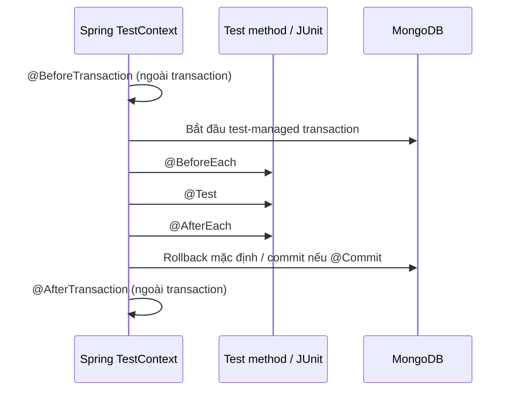

# Cô lập dữ liệu giữa test và cleanup sau commit

## 1. Vì sao kiểm thử MongoDB dễ rò rỉ dữ liệu?

Trong ứng dụng **Spring Data MongoDB**, `MongoRepository`, `MongoTemplate` và `ReactiveMongoTemplate` thường cùng truy cập một MongoDB dành cho kiểm thử. Nếu hai test dùng chung collection, dữ liệu do test trước tạo có thể làm test sau đọc sai kết quả, gặp lỗi unique key hoặc đếm thừa document. Với test có transaction, vấn đề còn tinh vi hơn: test tưởng rằng mọi thao tác đã rollback, nhưng service có thể commit trong một transaction khác hoặc ghi dữ liệu sau khi commit.

Xét một dịch vụ đặt hàng:

- Collection `orders` chứa đơn hàng.
- Collection `outbox_events` chứa sự kiện để một worker khác xử lý.
- Phương thức `placeOrder()` lưu đơn trong transaction MongoDB và có thể phát một sự kiện sau commit.
- Hai test chạy song song đều dùng khách hàng `customer-01` và cùng dữ liệu mẫu.

Nếu test A để lại đơn hàng đã commit, test B có thể thất bại khi đếm `orders` hoặc kiểm tra sự kiện của chính mình. Ngược lại, nếu cleanup xóa `orders` toàn bộ, test A có thể xóa dữ liệu của test B giữa lúc B đang chạy.

Mục tiêu của bài:

1. Chọn cấp độ cô lập phù hợp: container, database, collection hay khóa nhận diện riêng cho mỗi test.
2. Hiểu sự khác nhau giữa **rollback test transaction**, **commit thực sự** và **cleanup sau commit**.
3. Viết integration test với Testcontainers, `MongoTransactionManager` và `MongoTemplate`.
4. Thu dọn dữ liệu đã commit mà không đụng vào dữ liệu test khác.
5. Xử lý test có `@TransactionalEventListener(AFTER_COMMIT)`, thao tác async và reactive.
6. Xác minh cleanup bằng việc đọc lại database, kể cả khi test thất bại.

## 2. Ba câu hỏi phải trả lời trước khi chọn cách dọn dữ liệu

### 2.1. Dữ liệu thuộc quyền sở hữu của test nào?

Mỗi test cần xác định chính xác document mà nó có quyền xóa. Các cách phổ biến:

| Phạm vi cô lập | Cách triển khai | Lợi ích | Điểm cần cân nhắc |
| --- | --- | --- | --- |
| **MongoDBContainer riêng** | Một container MongoDB riêng cho test hoặc nhóm test | Cách ly tiến trình và dữ liệu tốt; dễ hủy toàn bộ môi trường | Tốn thời gian khởi động và tài nguyên; nên cân đối theo suite |
| **Database riêng** | Tên database riêng cho từng suite/test, dùng URI/cấu hình tương ứng | Dễ xóa toàn bộ database mà không ảnh hưởng test khác nếu tên duy nhất | Spring context và `MongoTemplate` phải trỏ đúng database; chú ý cache context |
| **Collection riêng** | Định tuyến sang các collection mang tên riêng | Dễ kiểm soát phạm vi | Repository mapping và tên index phải được quản lý; một số đường ghi có thể không định tuyến theo tên động |
| **`testRunId` riêng trong document** | Gắn UUID của test vào mọi document do test tạo, cleanup bằng truy vấn lọc | Phù hợp khi nhiều test dùng cùng schema/collection | Mọi đường ghi phát sinh phải truyền `testRunId`; dữ liệu không có tag cần cách khác |
| **Danh sách ID đã tạo** | Ghi lại `_id` của từng document rồi xóa theo ID | Không phải thay đổi schema nghiệp vụ | Dễ bỏ sót document được tạo bởi listener, worker hoặc side effect |

**Không dùng `dropDatabase()`, `dropCollection()`, `repository.deleteAll()` hay `remove(new Query(), ...)` trên database dùng chung cho nhiều test.** Các thao tác đó vượt phạm vi sở hữu và đặc biệt nguy hiểm khi test được chạy song song.

### 2.2. Test có cần nhìn thấy dữ liệu đã commit?

Nếu chỉ kiểm tra một repository lưu rồi đọc trong cùng transaction, rollback cuối test có thể đủ. Nếu yêu cầu là “sau khi service trả về, người đọc khác thấy dữ liệu”, “`AFTER_COMMIT` được gọi” hoặc “outbox được ghi và xử lý sau commit”, test phải thực hiện **commit thật** rồi kiểm tra kết quả **ngoài transaction vừa commit**.

Các cơ chế này không tương đương:

| Cơ chế | Khi kết thúc test/transaction | Có đủ để kiểm thử hành vi sau commit? |
| --- | --- | --- |
| Test Spring `@Transactional` mặc định | Spring Test thường **rollback** test-managed transaction | Không; listener `AFTER_COMMIT` sẽ không chạy vì không có commit |
| Test `@Transactional` + `@Commit` hoặc `@Rollback(false)` | Commit test-managed transaction | Có thể; nhưng phải cleanup **sau** transaction và xử lý side effect |
| `TransactionTemplate.execute(...)` trong test **không có** `@Transactional` | Transaction commit khi callback kết thúc thành công | Phù hợp; `@AfterEach` sau method sẽ chạy ngoài transaction đó |
| Service dùng `REQUIRES_NEW` | Có thể commit transaction riêng khi outer transaction vẫn còn | Rollback của test-managed transaction không xóa dữ liệu đã commit ở transaction mới |
| Ghi bất đồng bộ hoặc gửi sang worker khác | Có thể xảy ra sau khi test method hoàn thành | Phải đồng bộ và có cơ chế cleanup/giải phóng tài nguyên riêng |

Lưu ý: `@Transactional` chỉ có tác dụng trên tài nguyên được **transaction manager tương ứng** quản lý. Nếu ứng dụng có cả JDBC và MongoDB, một `DataSourceTransactionManager` không tự bao bọc thao tác `MongoTemplate`. Cần chọn đúng `MongoTransactionManager` hoặc `ReactiveMongoTransactionManager`.

### 2.3. Test được đánh giá bằng tiêu chí gì?

Một test cô lập đạt yêu cầu khi:

- Chạy riêng lẻ và chạy cùng suite đều có kết quả giống nhau.
- Đọc được dữ liệu của mình sau commit khi nghiệp vụ yêu cầu.
- Sau cleanup, **không còn document thuộc test** trong mọi collection được kiểm tra.
- Dữ liệu thuộc test khác vẫn nguyên vẹn.
- Chạy lại nhiều lần hoặc đảo thứ tự chạy không tạo lỗi do dữ liệu cũ.

## 3. Transaction của MongoDB và vòng đời Spring Test

### 3.1. Điều kiện cần để giao dịch MongoDB thực sự hoạt động

Multi-document transaction của MongoDB cần một môi trường hỗ trợ transaction, điển hình là **replica set** hoặc **sharded cluster**. Một MongoDB standalone thông thường không đáp ứng yêu cầu này. Với Testcontainers, `MongoDBContainer` cung cấp cách chạy MongoDB trong chế độ replica set phục vụ kiểm thử.

Trong ứng dụng Spring Data MongoDB blocking, cần khai báo transaction manager:

```java
import org.springframework.context.annotation.Bean;
import org.springframework.context.annotation.Configuration;
import org.springframework.data.mongodb.MongoDatabaseFactory;
import org.springframework.data.mongodb.MongoTransactionManager;

@Configuration
class MongoTransactionConfig {

    @Bean
    MongoTransactionManager mongoTransactionManager(
            MongoDatabaseFactory databaseFactory) {
        return new MongoTransactionManager(databaseFactory);
    }
}
```

Chỉ thêm `@Transactional` mà không cấu hình đúng transaction manager và topology không bảo đảm giao dịch MongoDB sẽ thành công. Với reactive stack, dùng **`ReactiveMongoTransactionManager`** và Reactor context thay vì manager blocking.

### 3.2. Thứ tự chạy các callback trong test-managed transaction

Đối với Spring Test có `@Transactional`, vòng đời điển hình:



Điều này dẫn tới một lỗi thường gặp:

```java
@Transactional
@Test
void shouldCreateOrder() {
    orderService.placeOrder(...);
}

@AfterEach
void cleanup() {
    orderRepository.deleteAll();
}
```

Trong một lớp test-managed transaction, `@AfterEach` **thường chạy trước khi transaction kết thúc**. Lệnh `deleteAll()` trong callback có thể tham gia transaction đó; nếu test rollback, xóa cũng bị rollback. Nếu service đã ghi bằng transaction riêng hoặc một tiến trình bất đồng bộ, dữ liệu đó có thể còn lại. Nếu test commit, thao tác xóa trong `@AfterEach` có thể cũng được commit, nhưng side effect thực hiện **sau commit** vẫn có thể tạo dữ liệu mới không được dọn. Ngoài ra, `deleteAll()` xóa cả dữ liệu của test khác nên không phù hợp dù transaction có hoạt động.

Để cleanup sau khi transaction do Spring Test quản lý kết thúc, dùng `@AfterTransaction`. Với test **không có** `@Transactional` ở method/class mà tự commit bằng `TransactionTemplate`, `@AfterEach` có thể dọn dữ liệu sau khi `TransactionTemplate` đã kết thúc.

### 3.3. `@Commit`, `@AfterTransaction` và cleanup đúng thời điểm

Nếu muốn Spring Test trực tiếp quản lý transaction đã commit, có thể dùng mẫu sau:

```java
import org.junit.jupiter.api.Test;
import org.springframework.test.annotation.Commit;
import org.springframework.test.context.transaction.AfterTransaction;
import org.springframework.transaction.annotation.Transactional;

// Các dependency và test context MongoDB đã được cấu hình ở cấp lớp.
@Test
@Transactional("mongoTransactionManager")
@Commit
void writeInTestTransaction() {
    // Ghi document có testRunId; Spring Test sẽ commit sau @AfterEach.
}

@AfterTransaction
void cleanupCommittedRows() {
    // Chạy sau khi test-managed transaction đã kết thúc.
    // Chỉ xóa dữ liệu được đánh dấu bằng testRunId của test này.
}
```

Đây là minh họa **vòng đời**, chưa phải toàn bộ một lớp test độc lập. `@AfterTransaction` chỉ áp dụng cho **test-managed transaction** của Spring Test. Nó không tự chạy sau mọi transaction do service hoặc `TransactionTemplate` mở; trong những trường hợp đó, phải tự tổ chức kiểm tra và teardown bên ngoài transaction.

## 4. Ví dụ integration test có commit thật và cleanup an toàn

Ví dụ hoàn chỉnh dưới đây sử dụng:

- Spring Boot + Spring Data MongoDB + JUnit Jupiter + AssertJ.
- **Testcontainers MongoDB** có replica set để chạy transaction thật.
- `TransactionTemplate` để chủ động commit mà không cần đặt `@Transactional` lên test.
- UUID `testRunId` nhận diện document do test tạo.
- `@AfterEach` để xóa đúng document của test **sau khi commit**, không xóa toàn bộ collection.

Mẫu này sử dụng `Document` để tập trung vào transaction và cleanup; cùng nguyên tắc áp dụng cho entity được ánh xạ bằng `@Document` và repository.

```java
import java.util.UUID;

import org.bson.Document;
import org.junit.jupiter.api.AfterEach;
import org.junit.jupiter.api.Test;
import org.junit.jupiter.api.extension.ExtendWith;
import org.springframework.beans.factory.annotation.Autowired;
import org.springframework.boot.test.context.SpringBootTest;
import org.springframework.boot.test.context.TestConfiguration;
import org.springframework.context.annotation.Bean;
import org.springframework.context.annotation.Import;
import org.springframework.data.mongodb.MongoDatabaseFactory;
import org.springframework.data.mongodb.MongoTransactionManager;
import org.springframework.data.mongodb.core.MongoTemplate;
import org.springframework.data.mongodb.core.query.Criteria;
import org.springframework.data.mongodb.core.query.Query;
import org.springframework.test.context.DynamicPropertyRegistry;
import org.springframework.test.context.DynamicPropertySource;
import org.springframework.transaction.support.TransactionTemplate;
import org.testcontainers.containers.MongoDBContainer;
import org.testcontainers.junit.jupiter.Container;
import org.testcontainers.junit.jupiter.Testcontainers;
import org.testcontainers.utility.DockerImageName;

import static org.assertj.core.api.Assertions.assertThat;

@Testcontainers
@SpringBootTest
@Import(OrderPersistenceIT.TxConfig.class)
class OrderPersistenceIT {

    @Container
    static final MongoDBContainer mongo =
        new MongoDBContainer(DockerImageName.parse("mongo:7.0"));

    @DynamicPropertySource
    static void mongoProperties(DynamicPropertyRegistry registry) {
        registry.add("spring.data.mongodb.uri", mongo::getReplicaSetUrl);
    }

    @TestConfiguration
    static class TxConfig {
        @Bean
        MongoTransactionManager mongoTransactionManager(
                MongoDatabaseFactory databaseFactory) {
            return new MongoTransactionManager(databaseFactory);
        }
    }

    @Autowired
    MongoTemplate template;

    @Autowired
    MongoTransactionManager mongoTransactionManager;

    // JUnit Jupiter mặc định tạo instance mới cho mỗi @Test.
    // ID này thuộc về một test, không dùng chung với test khác.
    private final String testRunId = UUID.randomUUID().toString();

    private Query ownedOrders() {
        return Query.query(Criteria.where("testRunId").is(testRunId));
    }

    @Test
    void committedOrderIsVisibleOutsideTransaction() {
        String orderId = "it-" + testRunId;
        TransactionTemplate tx = new TransactionTemplate(mongoTransactionManager);

        tx.executeWithoutResult(status ->
            template.insert(
                new Document("_id", orderId)
                    .append("testRunId", testRunId)
                    .append("status", "PAID"),
                "orders"
            )
        );

        // TransactionTemplate đã commit thành công khi trả về.
        // Phép đọc dưới đây được thực hiện ngoài transaction vừa kết thúc.
        Document saved = template.findById(orderId, Document.class, "orders");

        assertThat(saved).isNotNull();
        assertThat(saved.getString("status")).isEqualTo("PAID");
        assertThat(saved.getString("testRunId")).isEqualTo(testRunId);
    }

    @Test
    void rollbackDoesNotLeaveOrderBehind() {
        String orderId = "it-rollback-" + testRunId;
        TransactionTemplate tx = new TransactionTemplate(mongoTransactionManager);

        tx.executeWithoutResult(status -> {
            template.insert(
                new Document("_id", orderId)
                    .append("testRunId", testRunId)
                    .append("status", "PENDING"),
                "orders"
            );
            status.setRollbackOnly();
        });

        assertThat(template.findById(orderId, Document.class, "orders"))
            .isNull();
    }

    @AfterEach
    void cleanupCommittedDocuments() {
        // Test method không khai báo @Transactional.
        // @AfterEach chạy ngoài transaction do TransactionTemplate đã kết thúc.
        template.remove(ownedOrders(), "orders");
        assertThat(template.count(ownedOrders(), "orders")).isZero();
    }
}
```

**Lưu ý để chạy thực tế:**

1. Phải có Docker, dependency Testcontainers MongoDB/JUnit Jupiter và `spring-boot-starter-test` tương thích với phiên bản Spring Boot đang dùng. Ví dụ sử dụng API `MongoDBContainer` của Testcontainers 1.x/2.x tương thích; ở các bản mới, artifact Maven và package có thể khác nhau, cần đối chiếu với dependency thực tế.
2. `spring.data.mongodb.uri` trong `@DynamicPropertySource` phải là cấu hình mà ứng dụng thực sự dùng; nếu ứng dụng tự tạo `MongoClient`, phải xác minh URI kết nối đó cũng trỏ vào container.
3. Test không được đánh dấu `@Transactional` ở cấp lớp/method, vì một transaction bao ngoài có thể làm `TransactionTemplate` tham gia vào transaction của test và thay đổi thời điểm commit.
4. `@AfterEach` chỉ xóa document trong `orders` có `testRunId` của test. Nếu service còn tạo `outbox_events`, `audit_logs` hoặc tài liệu liên quan, phải cleanup **cả các collection đó** bằng cùng khóa sở hữu.
5. `@Import` có thể bỏ khi ứng dụng đã khai báo `MongoTransactionManager`; nếu đã có bean cùng tên, tránh khai báo trùng. Với nhiều transaction manager, chỉ rõ bean cần dùng.

Phương thức `rollbackDoesNotLeaveOrderBehind` cho biết transaction rollback có tác dụng trong phạm vi nó quản lý; phương thức `committedOrderIsVisibleOutsideTransaction` chứng minh việc đọc sau commit thành công. Cả hai vẫn dọn lại bằng `testRunId` để test idempotent.

### 4.1. Dọn nhiều collection theo khóa sở hữu

Nếu một lần tạo đơn hàng có cả outbox và audit, dùng một `testRunId` xuyên suốt toàn bộ side effect:

```java
@AfterEach
void cleanup() {
    Query owned = Query.query(Criteria.where("testRunId").is(testRunId));

    // Thứ tự chọn theo quan hệ dữ liệu và các event listener trong ứng dụng.
    template.remove(owned, "outbox_events");
    template.remove(owned, "audit_logs");
    template.remove(owned, "orders");

    assertThat(template.count(owned, "outbox_events")).isZero();
    assertThat(template.count(owned, "audit_logs")).isZero();
    assertThat(template.count(owned, "orders")).isZero();
}
```

Với ứng dụng không thể thêm `testRunId` vào schema, test có thể tạo các `_id` duy nhất và ghi lại ID phát sinh, rồi xóa theo danh sách sở hữu. Nếu service tự tạo tài liệu ở nhiều collection mà không có cách truy vết, **database riêng cho mỗi test/suite** đáng tin cậy hơn việc cố đoán document cần xóa.

### 4.2. Cleanup vẫn phải chạy khi assert thất bại

`@AfterEach` của JUnit được gọi sau test thông thường, kể cả khi assertion thất bại. Tuy nhiên, cleanup vẫn có thể lỗi do mất kết nối, tiến trình bị dừng đột ngột hoặc container chết. Để giới hạn tác động:

- Dùng môi trường test được tạo và hủy bởi Testcontainers/CI, tránh phụ thuộc vào việc `@AfterEach` luôn hoàn thành.
- Viết cleanup **idempotent**: xóa cùng một tập document lần thứ hai không làm hỏng dữ liệu khác.
- Khi cleanup lỗi, để test báo lỗi rõ ràng; không nuốt exception, vì suite tiếp theo có thể gặp dữ liệu tồn dư.
- Với database/collection dành riêng, teardown có thể xóa toàn bộ namespace nếu xác minh đúng tên và quyền sở hữu; không áp dụng thao tác đó cho namespace dùng chung.

## 5. Khi `@Transactional` và `@Commit` phù hợp hơn

Đôi khi cần thử chính cơ chế test-managed transaction của Spring, hoặc một test service được tổ chức bằng `@Transactional` sẵn. Khi đó dùng `@Commit` để commit và `@AfterTransaction` cho cleanup:

```java
@SpringBootTest
class CommitLifecycleIT {

    @Autowired
    MongoTemplate template;

    private final String testRunId = UUID.randomUUID().toString();

    @Test
    @Transactional("mongoTransactionManager")
    @Commit
    void emitsCommittedOrder() {
        template.insert(
            new Document("_id", "committed-" + testRunId)
                .append("testRunId", testRunId),
            "orders"
        );
        // Tại đây transaction của test CHƯA commit.
    }

    @AfterTransaction
    void cleanupAfterTestCommit() {
        Query owned =
            Query.query(Criteria.where("testRunId").is(testRunId));
        template.remove(owned, "orders");
        assertThat(template.count(owned, "orders")).isZero();
    }
}
```

Đoạn trên giả định cấu hình `MongoTransactionManager` và MongoDB replica set đã có, và cần các import tương tự ví dụ mục 4. `@AfterTransaction` chạy ngoài test-managed transaction **sau khi Spring Test đã xử lý commit/rollback**. Nếu test cần assert dữ liệu tồn tại **sau commit** trước khi cleanup, đặt phần xác minh đó trong `@AfterTransaction` rồi mới xóa, hoặc dùng `TransactionTemplate` để kiểm soát rõ từng bước.

**Không lạm dụng `@Commit` cho mọi repository test:** nhiều test chỉ cần kiểm tra mapping, query và rollback, vì thế commit thật cộng cleanup ngoài transaction có thể làm suite chậm hơn. Dành commit thực sự cho các yêu cầu nghiệp vụ cần chứng minh hành vi commit.

## 6. Side effect sau commit: listener, outbox và tác vụ bất đồng bộ

### 6.1. Sự kiện sau commit không xuất hiện trong test tự rollback

Spring hỗ trợ callback theo phase:

```java
@TransactionalEventListener(phase = TransactionPhase.AFTER_COMMIT)
public void afterOrderCommitted(OrderCreated event) {
    // Thực hiện hành động sau khi transaction hoàn tất commit.
}
```

Nếu test chỉ có `@Transactional` mặc định rollback, `AFTER_COMMIT` không chạy. Test “xanh” vì đã gọi `placeOrder()` không chứng minh listener đúng. Muốn kiểm thử listener, phải cho transaction thật commit (ví dụ `TransactionTemplate` hoặc `@Commit`) rồi quan sát kết quả sau commit.

Nếu listener **ghi tiếp vào MongoDB** sau commit, cần lưu ý: ở phase `AFTER_COMMIT`, một số tài nguyên transaction có thể vẫn đang được gắn với thread; dùng một transaction mới (ví dụ service riêng với `@Transactional(propagation = REQUIRES_NEW)`) khi cần lưu dữ liệu bền vững theo mô hình transaction đồng bộ. Không viết code dựa trên giả định rằng bất kỳ lệnh save nào trong listener cũng sẽ được tự commit.

Đối với **outbox pattern**, bản ghi outbox thường được tạo **trong cùng transaction** với đơn hàng, để cả hai commit hoặc rollback cùng nhau. Phần việc sau commit có thể chỉ đánh thức worker; worker xử lý message cần được kiểm thử độc lập hoặc trong integration test đã kiểm soát tác vụ.

### 6.2. Tránh cleanup chạy trước side effect

Một kịch bản race:

```text
Test: commit đơn hàng
Listener: lên lịch ghi audit bất đồng bộ
Test: @AfterEach xóa orders và audit hiện có
Listener: ghi audit muộn
Test kế tiếp: thấy audit còn tồn dư
```

Để xử lý:

1. Test phải có khả năng **đợi kết quả có giới hạn thời gian** (Awaitility, StepVerifier hoặc một tín hiệu từ fake executor/worker), thay vì `Thread.sleep()` tùy tiện.
2. Sử dụng một `testRunId`/correlation ID để worker và listener có thể gắn đúng bản ghi liên quan.
3. Chỉ cleanup khi các tác vụ thuộc test đã hoàn thành, bị hủy an toàn hoặc hệ thống xử lý chúng đã được tắt.
4. Với hệ thống event-driven có nhiều consumer, ưu tiên queue/topic giả lập, worker được kiểm soát hoặc database riêng; chỉ xóa record MongoDB chưa đủ nếu có tác động bên ngoài.

Ví dụ dùng Awaitility để chờ một bản ghi outbox đã commit:

```java
await().atMost(Duration.ofSeconds(5)).untilAsserted(() ->
    assertThat(template.count(
        Query.query(Criteria.where("testRunId").is(testRunId)),
        "outbox_events"
    )).isEqualTo(1)
);
```

Đoạn ví dụ cần `import static org.awaitility.Awaitility.await;` và `java.time.Duration`. Nó minh họa một điều kiện quan sát được; nếu business xử lý outbox bằng cách xóa record sau khi gửi, cần chờ trạng thái khác (sự kiện đã xử lý, spy ghi nhận invocation, hoặc thông điệp đã nhận) để tránh kiểm thử chập chờn.

## 7. Test chạy song song và quản lý namespace

### 7.1. Dùng UUID và tách cả dữ liệu tham chiếu

Không chỉ đơn hàng: mọi fixture có thể xung đột phải sở hữu ID riêng:

```java
String runId = UUID.randomUUID().toString();
String customerId = "customer-" + runId;
String orderId = "order-" + runId;
String email = "integration+" + runId + "@example.test";
```

Một unique index trên `email` hay `orderNumber` sẽ xung đột nếu mọi test cùng tạo `test@example.com`. Gắn hậu tố duy nhất cho các trường unique và chỉ cleanup theo `runId`, `_id` hoặc ID được kiểm soát.

Nếu mỗi test sở hữu cả collection riêng, cần bảo đảm index và mapping tương ứng được tạo đúng; nếu mỗi test sở hữu database riêng, dùng tên database hợp lệ, có prefix cố định ví dụ `it_orders_<uuid>`, và đối chiếu tên database khi teardown trước khi xóa.

### 7.2. Vì sao `@DirtiesContext` không thay thế cleanup?

`@DirtiesContext` báo Spring Test tạo lại `ApplicationContext`. Nó giúp xử lý bean state hoặc configuration bị thay đổi, nhưng **không tự xóa dữ liệu trong MongoDB**. Ngay cả khi context mới khởi động, nó vẫn có thể trỏ vào cùng một database chứa dữ liệu cũ.

Tương tự, `repository.deleteAll()` trong `@BeforeEach` chỉ làm test tạm thời “sạch” bằng cách xóa dữ liệu trước test; khi chạy song song, nó có thể xóa chính dữ liệu test khác đang sử dụng. Cleanup đúng là xóa **tài nguyên thuộc quyền sở hữu** sau khi chúng không còn được dùng.

### 7.3. Không chia sẻ container vượt vòng đời của Spring context

Một `@Container static` sống theo vòng đời lớp test, trong khi Spring có cơ chế cache `ApplicationContext` giữa các lớp. Nếu một context được dùng lại nhưng container mà nó trỏ tới đã dừng, test kế tiếp có thể kết nối sai hoặc thất bại. Đối với suite lớn, lựa chọn nhất quán:

- Giữ container dùng chung cho suốt suite theo cơ chế quản lý vòng đời rõ ràng.
- Hoặc buộc context không dùng lại khi datasource/container tương ứng đã bị dừng.
- Hoặc dùng container riêng mỗi lớp với cấu hình context khác biệt, tránh vô tình tái sử dụng kết nối cũ.

Đừng cố giải quyết lỗi vòng đời này bằng cách tăng retry; xác minh URI, thời điểm container bắt đầu/kết thúc và vòng đời context.

## 8. Reactive transaction và cleanup

Reactive access dùng `ReactiveMongoTemplate` hoặc `ReactiveMongoRepository` không dựa trên thread-bound transaction theo cách của `MongoTransactionManager`. Reactive transaction state được truyền theo **Reactor Context**; để điều phối transaction, dùng `ReactiveMongoTransactionManager` và `TransactionalOperator`.

Ví dụ minh họa luồng commit rồi mới cleanup (các bean được cấu hình sẵn):

```java
import org.bson.Document;
import org.springframework.data.mongodb.core.ReactiveMongoTemplate;
import org.springframework.data.mongodb.core.query.Criteria;
import org.springframework.data.mongodb.core.query.Query;
import org.springframework.transaction.reactive.TransactionalOperator;
import reactor.test.StepVerifier;

Document order = new Document("_id", "reactive-" + testRunId)
    .append("testRunId", testRunId)
    .append("status", "PAID");

StepVerifier.create(
    reactiveTemplate.insert(order, "orders")
        .as(transactionalOperator::transactional)
).expectNextCount(1).verifyComplete();

// Publisher transaction đã hoàn tất trước khi cleanup bắt đầu.
Query owned = Query.query(Criteria.where("testRunId").is(testRunId));

StepVerifier.create(reactiveTemplate.remove(owned, "orders"))
    .expectNextCount(1)
    .verifyComplete();
```

Đoạn này là ví dụ ghép vào test reactive đã có `testRunId`, `reactiveTemplate` và `transactionalOperator`. Khi đăng ký `@AfterEach`, teardown reactive phải **subscribe và đợi hoàn tất**; tạo `Mono` rồi bỏ đó không thực hiện xóa. Không dùng `Thread.sleep` để thay việc await publisher và không nhầm backpressure của client với việc MongoDB đã commit.

Không mặc nhiên áp dụng các giả định rollback của blocking `@Transactional` test lên reactive publisher: transaction liên kết với subscription/Context, và thời điểm hoàn tất phải được khẳng định bằng `StepVerifier` hoặc cơ chế tương đương.

## 9. Checklist kiểm chứng và chẩn đoán lỗi

| Dấu hiệu | Nguyên nhân thường gặp | Cách kiểm tra và sửa |
| --- | --- | --- |
| Test chạy một mình pass, chạy suite fail | Document hoặc unique key từ test trước còn lại | Dùng runId/DB riêng, query xác nhận dữ liệu trước/sau test |
| Test `@Transactional` pass nhưng listener `AFTER_COMMIT` chưa chạy | Spring Test rollback mặc định | Dùng commit thật, kiểm tra listener sau transaction |
| Dữ liệu vẫn còn sau `@AfterEach` | Cleanup tham gia test transaction bị rollback hoặc ghi sau cleanup | Dùng `@AfterTransaction`/commit có kiểm soát và đồng bộ side effect |
| Gặp lỗi “Transaction numbers are only allowed…” | MongoDB chưa chạy trong topology hỗ trợ transaction | Dùng replica set/Testcontainers được cấu hình đúng |
| `@Transactional` không rollback document MongoDB | Sai transaction manager hoặc thao tác ở transaction khác | Kiểm tra bean manager và propagation, reactive context, đường ghi |
| Cleanup xóa nhầm fixture của test khác | `deleteAll`, `dropCollection` hoặc filter thiếu runId | Gắn testRunId và xóa theo điều kiện ownership |
| Test reactive kết thúc nhưng document vẫn tồn tại | Publisher cleanup chưa được subscribe hoặc hoàn tất | Verify/await `Mono` xóa; kiểm tra mã lỗi |
| Sau commit vẫn còn outbox/audit không mong muốn | Worker/after-commit listener ghi muộn | Chờ side effect và cleanup cả collection phụ |
| Test không khởi động MongoDB sau lần chạy trước | Context cache trỏ vào container đã dừng | Quản lý lại vòng đời container và Spring context |

### 9.1. Quy trình kiểm thử đáng tin cậy

1. **Dựng fixture duy nhất**: UUID cho `testRunId`, document ID và các trường unique; bảo đảm không phụ thuộc dữ liệu từ test khác.
2. **Thực thi thao tác cần kiểm chứng**: rollback nếu mục tiêu là atomicity, commit thật nếu mục tiêu là visibility/after-commit.
3. **Kiểm tra ngoài transaction**: đọc lại từ MongoDB sau commit; nếu cần, dùng một client hoặc bước đọc riêng để tránh hiểu nhầm dữ liệu chưa commit.
4. **Đợi side effect**: nếu có listener/worker, dùng tín hiệu hoàn thành hoặc polling có timeout rõ ràng.
5. **Cleanup chỉ theo ownership**: xóa ở từng collection liên quan sau khi transaction kết thúc và mọi tác vụ đã được kiểm soát.
6. **Readback xác nhận sạch**: truy vấn đếm các bản ghi có `testRunId` và xác minh bằng 0; không đánh đồng số xóa trả về với toàn bộ phạm vi dữ liệu.
7. **Chạy thử suite theo thứ tự khác nhau và song song**: tìm xung đột namespace, unique key và điều kiện race; không dựa vào thứ tự chạy ổn định.

Khi dùng kho dữ liệu test có tuổi thọ dài (ví dụ môi trường CI chia sẻ), có thể bổ sung quy trình dọn dữ liệu cũ theo prefix và timestamp. Nhưng quy trình đó phải xác minh namespace thuộc môi trường test, có giới hạn phạm vi và không thay thế cleanup theo từng test.

## 10. Bài tập thực hành

Một dự án dùng `OrderService`, `OrderRepository` và `OutboxRepository`. Method `placeOrder()` commit đơn hàng rồi một listener `AFTER_COMMIT` chuyển trạng thái và ghi `audit_logs`. Ba integration test chạy song song; một test xác nhận rollback, một test xác nhận commit, một test xử lý event bất đồng bộ.

1. Chọn một chiến lược cô lập cho ba test (database riêng hoặc `testRunId`); giải thích khi nào lựa chọn còn lại tốt hơn.
2. Viết pseudo-code cho test rollback: mở transaction, ghi `orders` và `outbox_events`, đánh dấu rollback, rồi xác nhận bên ngoài transaction không còn document nào thuộc `testRunId`.
3. Viết test commit với `TransactionTemplate` và `MongoTemplate`, kiểm tra đơn hàng đọc lại được sau commit và cleanup an toàn trong `@AfterEach`.
4. Nếu dùng `@Transactional` và `@Commit` ở test method, vì sao cần cân nhắc `@AfterTransaction` để dọn dữ liệu sau commit?
5. Một listener ghi `audit_logs` sau 300 ms. Hãy chỉ ra race khi `@AfterEach` xóa ngay lập tức và đề xuất cách đợi không dùng `Thread.sleep(300)`.
6. Dự án có cả `JpaTransactionManager` và `MongoTransactionManager`. Làm thế nào chắc chắn thao tác `MongoTemplate` thuộc transaction manager mong muốn?
7. Với `ReactiveMongoTemplate`, vì sao tạo `Mono<DeleteResult>` trong `@AfterEach` nhưng không subscribe có thể không xóa gì?
8. Thiết kế một assertion cuối test: `orders`, `outbox_events`, `audit_logs` của `testRunId` đều còn 0 document, trong khi document mang `testRunId` của test khác vẫn tồn tại.

**Gợi ý:** Test có transaction tự rollback chỉ xác minh một phần hành vi. Muốn kiểm thử commit và listener, phải có commit thật; muốn cleanup đáng tin cậy, phải xác định quyền sở hữu dữ liệu và kết thúc các công việc sau commit trước khi xóa. `@AfterTransaction` thuộc Spring Test-managed transaction, còn `@AfterEach` là lựa chọn hợp lý khi test tự commit bằng `TransactionTemplate` và không có transaction bao ngoài.

## Tài liệu tham khảo

- [Spring Framework — Test-managed Transactions](https://docs.spring.io/spring-framework/reference/testing/testcontext-framework/tx.html)
- [Spring Framework — `@AfterTransaction`](https://docs.spring.io/spring-framework/reference/testing/annotations/integration-spring/annotation-aftertransaction.html)
- [Spring Framework — `@TransactionalEventListener`](https://docs.spring.io/spring-framework/reference/data-access/transaction/event.html)
- [Spring Data MongoDB — Transactions](https://docs.spring.io/spring-data/mongodb/reference/mongodb/client-session-transactions.html)
- [Spring Data MongoDB — MongoTemplate API](https://docs.spring.io/spring-data/mongodb/reference/mongodb/template-api.html)
- [Spring Boot — Testcontainers](https://docs.spring.io/spring-boot/reference/testing/testcontainers.html)
- [Testcontainers — MongoDB Module](https://java.testcontainers.org/modules/databases/mongodb/)
- [MongoDB — Transactions](https://www.mongodb.com/docs/manual/core/transactions/)
- [Project Reactor — Testing with StepVerifier](https://projectreactor.io/docs/core/release/reference/testing.html)
