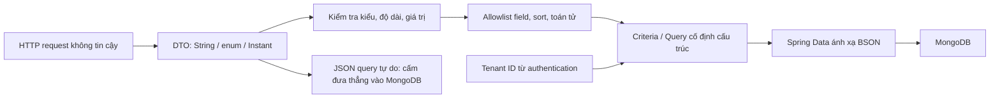

# Bind tham số và phòng NoSQL injection trong bộ lọc động

Khi ứng dụng sử dụng **Spring Data MongoDB** để tìm kiếm, người dùng thường được phép nhập nhiều điều kiện: trạng thái, ngày tạo, email, thứ tự sắp xếp hoặc từ khóa. Bộ lọc càng linh hoạt, ranh giới giữa **giá trị dữ liệu** do người dùng nhập và **cấu trúc truy vấn** do ứng dụng quyết định càng quan trọng. Nếu cho phép một chuỗi JSON hoặc object bất kỳ từ HTTP request trở thành điều kiện MongoDB, người dùng có thể tác động đến toán tử, đường dẫn field và phạm vi dữ liệu được truy cập.

**NoSQL injection** là tình huống đầu vào không đáng tin cậy bị diễn giải thành một phần cấu trúc hoặc biểu thức truy vấn thay vì chỉ là dữ liệu. Trong MongoDB, rủi ro thường liên quan đến các khóa toán tử bắt đầu bằng dấu `$`, biểu thức truy vấn động, tên field do người dùng lựa chọn và truy vấn JSON được ghép từ chuỗi.

Với module `SPRING_DATA_MONGODB`, ta sẽ thực hành **bind giá trị đúng kiểu** qua repository và `MongoTemplate`/`Criteria`, thiết kế whitelist cho bộ lọc động, giới hạn truy vấn tốn tài nguyên, kiểm thử với MongoDB thực và giám sát trong vận hành. Đây cũng là nền tảng khi xây dựng aggregation, index, reactive access và xử lý nhiều tenant.

## 1. Hiểu chính xác ranh giới tin cậy

Giả sử API hỗ trợ:

```http
GET /orders?status=PAID&buyerEmail=an@example.test&sortBy=createdAt&limit=20
```

Ứng dụng cần biến các tham số thành một truy vấn tương đương:

```javascript
db.orders.find({
  tenantId: "tenant-from-auth",
  status: "PAID",
  buyerEmail: "an@example.test"
}).sort({ createdAt: -1, _id: 1 }).limit(20)
```

Trong ví dụ này, `tenantId` đến từ danh tính đã xác thực tại server. Người dùng được quyết định **giá trị** `status` và `buyerEmail`, nhưng không được tự thay toán tử `$eq` bằng toán tử khác, thêm `$or` để bỏ qua tenant, hay chọn đường dẫn field tùy ý.

Một payload minh họa cho đầu vào **phải bị từ chối** khi API mong đợi chuỗi:

```json
{
  "status": { "$ne": null }
}
```

Giá trị `status` ở đây là object chứa toán tử MongoDB, không phải chuỗi `"PAID"`. Nếu API nhận `Map<String,Object>` rồi đưa thẳng vào cấu trúc query, điều kiện có thể mang ý nghĩa hoàn toàn khác dự kiến. Với DTO có field `String status` và bước validation, request dạng object phải bị từ chối; không được chuyển nó thành một filter tùy ý.



| Thành phần | Ai được quyết định? | Ví dụ an toàn |
| --- | --- | --- |
| Tên collection | Server | `orders` |
| Field được lọc | Server, qua allowlist | `status`, `buyerEmail`, `createdAt` |
| Toán tử và logic `AND/OR` | Server | `eq` với status, `gte` với ngày |
| Giá trị so sánh | Client sau validation | `"PAID"`, `Instant` |
| Field và chiều sort | Client chọn từ allowlist | `createdAt DESC` |
| Giới hạn số kết quả | Server giới hạn trên | 1–100 document |
| Tenant hiện tại | Security context của server | ID đã xác thực |
| Projection trả về | Server | Chỉ các trường API được phép trả |

Không nên hiểu “bind tham số” trong MongoDB hoàn toàn giống prepared statement của SQL. Với Spring Data, `?0` trong `@Query` hoặc `Criteria.where(...).is(value)` tạo điều kiện với giá trị được chuyển thành BSON theo kiểu dữ liệu. Cơ chế này **không tự an toàn hóa** tên field, fragment JSON, pipeline aggregation hoặc toàn bộ object do người dùng có thể điều khiển.

## 2. Bind giá trị qua repository

### 2.1. Ưu tiên derived query khi hình dạng truy vấn cố định

Một repository có thể biểu diễn truy vấn được thiết kế trước:

```java
package example.orders;

import java.util.List;
import org.springframework.data.mongodb.repository.MongoRepository;

public interface OrderRepository extends MongoRepository<Order, String> {
    List<Order> findByTenantIdAndStatus(String tenantId, String status);
}
```

Spring Data tạo điều kiện tương ứng từ tên method và truyền `tenantId`, `status` dưới dạng giá trị. Điều kiện bảo mật còn phụ thuộc việc **tenantId do server lấy từ người dùng đã xác thực**, và quyền truy cập được kiểm tra đúng; chỉ có tên method không tự thực hiện authorization.

### 2.2. Khi dùng `@Query`, bind bằng placeholder

Ví dụ khai báo query BSON **tĩnh**:

```java
import java.util.List;
import org.springframework.data.mongodb.repository.Query;

public interface OrderRepository extends MongoRepository<Order, String> {
    @Query("{ 'tenantId': ?0, 'status': ?1 }")
    List<Order> findForTenantWithStatus(String tenantId, String status);
}
```

Trong repository query của Spring Data MongoDB, placeholder `?0` và `?1` được bind với tham số Java. **Tham số chuỗi được escape khi bind**, nên một chuỗi chứa các ký tự trông giống cấu trúc MongoDB vẫn được xử lý như dữ liệu chuỗi; nó không tự trở thành toán tử truy vấn.

Không thay placeholder bằng phép ghép chuỗi để tạo JSON:

```java
// KHÔNG dùng với nội dung đầu vào từ request:
String json = "{ 'status': '" + userSuppliedStatus + "' }";
// Nếu dữ liệu được chèn vào JSON không đúng cách, người dùng
// có thể làm thay đổi cấu trúc query hoặc khiến query không hợp lệ.
```

Nếu cần điều kiện tùy chọn phức tạp, nên xây dựng `Criteria` bằng các nhánh Java đã kiểm soát thay vì nối các fragment JSON. Trường hợp query có SpEL `?#{...}` cũng cần xem xét riêng: biểu thức có thể tạo cấu trúc BSON, và cho đối số không đáng tin cậy quyết định operator/fragment sẽ làm mất ranh giới an toàn. Không coi mọi biểu thức SpEL là “bind chuỗi có escape” giống `?0`.

## 3. Xây dựng bộ lọc động có kiểm soát với `MongoTemplate`

Ví dụ use case: người dùng được lọc đơn hàng theo trạng thái, email người mua và thời điểm tạo; được chọn sort theo `createdAt`, `total` hoặc `status`, tối đa 100 bản ghi. Mọi truy vấn luôn bị giới hạn vào một tenant đã xác thực.

### 3.1. DTO có kiểu rõ ràng

File `OrderSearchFilter.java`:

```java
package example.orders;

import java.time.Instant;

public record OrderSearchFilter(
        String status,
        String buyerEmail,
        Instant createdFrom,
        String sortBy,
        String sortDirection,
        Integer limit
) {}
```

Ở tầng HTTP, để Spring/Jackson bind từ query parameters hoặc JSON body vào DTO được khai báo rõ kiểu, sau đó trả lỗi `400 Bad Request` cho giá trị sai kiểu. Với `createdFrom` kiểu `Instant`, client gửi ngày giờ ISO 8601 hợp lệ; không để client gửi một object chứa toán tử thay cho thời điểm.

DTO là bước đầu: **DTO không thay thế validation**. Các giá trị chuỗi phải được kiểm tra độ dài, tập giá trị hợp lệ và quy tắc nghiệp vụ trước khi tạo truy vấn.

### 3.2. Service dựng điều kiện từ allowlist

File `OrderSearchService.java`:

```java
package example.orders;

import java.util.ArrayList;
import java.util.List;
import java.util.Locale;
import java.util.Set;
import org.bson.Document;
import org.springframework.data.domain.Sort;
import org.springframework.data.mongodb.core.MongoTemplate;
import org.springframework.data.mongodb.core.query.Criteria;
import org.springframework.data.mongodb.core.query.Query;
import org.springframework.stereotype.Service;

@Service
public class OrderSearchService {
    private static final Set<String> ALLOWED_STATUSES =
            Set.of("NEW", "PAID", "CANCELLED");

    private final MongoTemplate mongoTemplate;

    public OrderSearchService(MongoTemplate mongoTemplate) {
        this.mongoTemplate = mongoTemplate;
    }

    public List<Document> search(
            String authenticatedTenantId, OrderSearchFilter filter) {
        if (authenticatedTenantId == null ||
                authenticatedTenantId.isBlank()) {
            throw new IllegalArgumentException("Missing tenant identity");
        }
        if (filter == null) {
            throw new IllegalArgumentException("Missing filter");
        }

        // Điều kiện do server quyết định luôn hiện diện.
        List<Criteria> parts = new ArrayList<>();
        parts.add(Criteria.where("tenantId").is(authenticatedTenantId));

        if (filter.status() != null && !filter.status().isBlank()) {
            String status = filter.status().trim()
                    .toUpperCase(Locale.ROOT);
            if (!ALLOWED_STATUSES.contains(status)) {
                throw new IllegalArgumentException("Invalid status");
            }
            parts.add(Criteria.where("status").is(status));
        }

        if (filter.buyerEmail() != null
                && !filter.buyerEmail().isBlank()) {
            String email = filter.buyerEmail().trim()
                    .toLowerCase(Locale.ROOT);
            if (email.length() > 254 || !email.contains("@")) {
                throw new IllegalArgumentException("Invalid email filter");
            }
            // Chỉ phù hợp khi email lưu trữ đã được chuẩn hóa tương ứng.
            parts.add(Criteria.where("buyerEmail").is(email));
        }

        if (filter.createdFrom() != null) {
            parts.add(Criteria.where("createdAt")
                    .gte(filter.createdFrom()));
        }

        String sortField = switch (
                filter.sortBy() == null ? "createdAt" : filter.sortBy()) {
            case "createdAt" -> "createdAt";
            case "total" -> "total";
            case "status" -> "status";
            default -> throw new IllegalArgumentException("Invalid sortBy");
        };

        String requestedDirection = filter.sortDirection() == null
                ? "desc"
                : filter.sortDirection().toLowerCase(Locale.ROOT);
        Sort.Direction direction = switch (requestedDirection) {
            case "asc" -> Sort.Direction.ASC;
            case "desc" -> Sort.Direction.DESC;
            default -> throw new IllegalArgumentException(
                    "Invalid sort direction");
        };

        int limit = filter.limit() == null ? 20 : filter.limit();
        if (limit < 1 || limit > 100) {
            throw new IllegalArgumentException("Invalid limit");
        }

        Query query = Query.query(
                new Criteria().andOperator(parts.toArray(new Criteria[0])));
        query.with(Sort.by(direction, sortField)
                .and(Sort.by(Sort.Direction.ASC, "_id")));
        query.limit(limit);
        query.fields()
                .include("_id")
                .include("status")
                .include("buyerEmail")
                .include("createdAt")
                .include("total");

        return mongoTemplate.find(query, Document.class, "orders");
    }
}
```

Đoạn code nhằm minh họa **boundary an toàn của truy vấn**; trong ứng dụng thực, nên ánh xạ `Document` sang DTO phản hồi chỉ chứa các field được phép công bố. Trả nguyên document MongoDB ra API có thể làm lộ những field nội bộ nếu projection thay đổi.

Điều gì khiến service trên an toàn hơn một bộ lọc JSON tùy ý?

1. **Tên field** là literal trong mã hoặc được chọn bằng `switch`. Client không thể nhập `$where`, `tenantId` hay một đường dẫn nested bất kỳ làm tên trường cần lọc.
2. **Toán tử** `is` và `gte` do server chọn theo loại field. Client không cung cấp một `Map` chứa `$ne` hoặc `$or`.
3. **Giá trị** được kiểm tra và giữ kiểu Java như `String`, `Instant`, `Integer`; sau đó Spring Data mã hóa sang BSON đúng kiểu.
4. **Tenant condition** luôn được thêm như một nhánh `AND` tại cấp truy vấn gốc. Không lấy tenant ID từ request.
5. **Sort và limit** bị giới hạn bằng allowlist và chặn trên, tránh tạo query quá nặng hoặc truy vấn ngoài phạm vi mong đợi.
6. **Projection** cố định giảm khả năng trả về field ngoài hợp đồng API và giảm kích thước BSON truyền qua mạng.

Kiểm tra `email.contains("@")` chỉ là validation tối giản phục vụ ví dụ, **không phải bộ xác nhận đầy đủ mọi dạng địa chỉ email hợp lệ**. Chọn quy tắc định dạng, độ dài và chuẩn hóa phù hợp dữ liệu đã lưu; nếu email được lưu hỗn hợp chữ hoa/thường, phép so sánh chính xác trên chuỗi đã lowercase có thể bỏ sót dữ liệu. Không dùng regex không kiểm soát để vá vấn đề này.

## 4. Các cách dựng query có nguy cơ injection

### 4.1. Không chuyển JSON của client thành query trực tiếp

Hai anti-pattern cần nhận diện:

```java
// KHÔNG dùng với JSON trực tiếp từ HTTP request:
BasicQuery query = new BasicQuery(rawFilterJson);

// KHÔNG dùng với JSON chưa được kiểm soát:
org.bson.Document filter = org.bson.Document.parse(rawFilterJson);
mongoTemplate.getCollection("orders").find(filter);
```

`BasicQuery` và `Document.parse(...)` **không phải API có lỗi bảo mật tự thân**. Chúng hữu ích với BSON/JSON được lập trình viên kiểm soát. Rủi ro phát sinh khi `rawFilterJson` đến từ người dùng, cấu hình có thể bị sửa tùy ý hoặc hệ thống bên ngoài không đáng tin cậy: những trường `$or`, `$ne`, `$regex`... có thể trở thành operator thật.

Đừng giải quyết bằng cách xóa mọi dấu `$` trong chuỗi JSON rồi tiếp tục parse: đó không phải cách xác nhận schema và có thể phá dữ liệu hợp lệ. Cách đúng là **chỉ nhận cấu trúc DTO được định nghĩa**, kiểm tra từng lựa chọn và dựng query từ các nhánh đáng tin cậy.

### 4.2. Tên field động cũng là đầu vào có thể gây rủi ro

Ví dụ không nên dùng:

```java
// Client được quyền đặt tên field bất kỳ: nguy cơ vượt hợp đồng API.
Criteria criterion = Criteria.where(requestedField).is(requestedValue);
```

Ngay cả khi `requestedValue` là String, `requestedField` có thể nhắm tới field nhạy cảm, field nested, field không được index, hoặc tên đặc biệt khiến truy vấn không còn theo ý định. Nếu API phải hỗ trợ danh sách field được chọn, ánh xạ từng khóa công khai sang một field nội bộ cố định:

```java
String actualField = switch (requestedField) {
    case "status" -> "status";
    case "created" -> "createdAt";
    default -> throw new IllegalArgumentException("Unsupported field");
};
```

Không sử dụng `requestedField` để tạo projection hoặc `Sort.by(requestedField)` trước khi qua allowlist. Với trường nested, chỉ cho phép những đường dẫn mà ứng dụng đã công bố rõ, không mặc định mọi chuỗi có dấu chấm đều hợp lệ.

### 4.3. Không nhận `Object` tùy ý để chọn operator

Một controller kiểu `@RequestBody Map<String,Object> filters` rồi dùng toàn bộ map làm BSON query là thiết kế khó kiểm soát. Nếu client cần các phép toán như “lớn hơn”, “nằm trong tập” hoặc “bắt đầu bằng”, hãy thiết kế **ngôn ngữ filter nhỏ, có schema rõ ràng**:

```json
{
  "status": "PAID",
  "createdFrom": "2026-01-01T00:00:00Z",
  "sortBy": "createdAt",
  "sortDirection": "desc",
  "limit": 20
}
```

Mỗi field được chuyển thành kiểu Java xác định; service quyết định toán tử. Nếu hỗ trợ điều kiện dạng `IN`, giới hạn số phần tử, loại bỏ giá trị sai kiểu và áp dụng giới hạn tài nguyên. Không nhận trực tiếp object MongoDB như `{"$in":[...]}` chỉ để tránh phải viết parser.

## 5. Bảo vệ điều kiện regex và tìm kiếm gần đúng

Một dạng injection khác là **regex injection**: người dùng nhập từ khóa nhưng lại được diễn giải như biểu thức chính quy. Điều này có thể làm điều kiện khớp rộng ngoài dự định và gây tốn CPU với pattern phức tạp.

Nếu yêu cầu nghiệp vụ thực sự là “tên bắt đầu bằng từ khóa”, hãy giới hạn độ dài và escape metacharacters:

```java
import java.util.regex.Pattern;
import org.springframework.data.mongodb.core.query.Criteria;

String prefix = userPrefix == null ? "" : userPrefix.trim();
if (prefix.isEmpty() || prefix.length() > 40) {
    throw new IllegalArgumentException("Invalid prefix");
}

Pattern literalPrefix = Pattern.compile(
        "^" + Pattern.quote(prefix),
        Pattern.CASE_INSENSITIVE);
Criteria criterion = Criteria.where("displayName").regex(literalPrefix);
```

Với input như `.*`, `Pattern.quote(...)` bảo đảm người dùng tìm đúng **hai ký tự dấu chấm và dấu sao**, không biến chúng thành wildcard. Hạn chế chiều dài, timeout và tài nguyên truy vấn vẫn cần thiết: regex với cờ case-insensitive có thể không tận dụng index thông thường như một phép tìm chính xác, nhất là khi khác biệt collation. Với dữ liệu lớn, cân nhắc field chuẩn hóa để tìm kiếm theo prefix hoặc tính năng search phù hợp thay vì cho chạy regex tùy ý.

Nếu hệ thống cần hỗ trợ **regex do người dùng tự viết** như một tính năng chuyên biệt, nên xem đó là chức năng có rủi ro riêng: quyền sử dụng, parser, giới hạn pattern/CPU/thời gian và giám sát. Không dùng chung endpoint tìm kiếm thông thường.

## 6. Giữ điều kiện ủy quyền độc lập với filter người dùng

**Không có NoSQL injection không đồng nghĩa đã bảo đảm phân quyền.** Một truy vấn bind giá trị đúng cách vẫn có thể làm lộ dữ liệu nếu tenant ID lấy từ HTTP request thay vì danh tính đã xác thực, hoặc application quên chèn tenant scope trên một nhánh truy vấn.

Thiết kế an toàn cho hệ thống nhiều tenant:

- Lấy `authenticatedTenantId` từ principal/token đã xác thực và kiểm tra quyền của người gọi.
- Dựng điều kiện tenant cố định ở cấp `AND` ngoài các điều kiện tùy chọn.
- Không cho client ghi đè `tenantId`, `ownerId` hoặc thao tác để bỏ điều kiện authorization.
- Đảm bảo những đường truy cập khác như `findById`, `updateFirst`, `remove`, bulk operation và aggregation cũng có giới hạn phân quyền tương ứng.
- Khi dùng `$lookup` trong aggregation, phải xem riêng quyền đọc dữ liệu từ collection liên kết; điều kiện tenant ở collection đầu vào không tự bảo đảm collection được join có đúng tenant.

Ví dụ kết hợp filter theo trạng thái và tenant ở tầng Spring Data:

```java
Criteria safeCriteria = new Criteria().andOperator(
        Criteria.where("tenantId").is(authenticatedTenantId),
        Criteria.where("status").is(validatedStatus));

Query safeQuery = Query.query(safeCriteria);
```

Trong trường hợp hỗ trợ `OR` giữa nhiều điều kiện người dùng, đặt `OR` **bên trong** một nhánh của `AND` với tenant. Cần test riêng tình huống document khớp user filter nhưng thuộc tenant khác để chắc chắn không được trả về.

## 7. Aggregation, reactive và thao tác ghi

### 7.1. Aggregation: khống chế pipeline stages

Với aggregation, chỉ tạo stage bằng API Spring Data hoặc các fragment đã được ứng dụng kiểm soát. Ví dụ:

```java
import org.springframework.data.mongodb.core.aggregation.Aggregation;
import org.springframework.data.mongodb.core.query.Criteria;

Aggregation aggregation = Aggregation.newAggregation(
        Aggregation.match(new Criteria().andOperator(
                Criteria.where("tenantId").is(authenticatedTenantId),
                Criteria.where("status").is(validatedStatus))),
        Aggregation.group("status").count().as("orders"));
```

Đây là ví dụ khung: `validatedStatus` đã qua kiểm tra allowlist ở tầng gọi. Không lấy `$match`, `$project`, `$lookup` hoặc biểu thức tùy ý do client gửi để thêm trực tiếp vào pipeline. Tương tự, các biểu thức chạy mã/biểu thức server-side như `$where` hoặc các operator thực thi JavaScript không nên là cách triển khai một bộ lọc văn bản thông thường.

### 7.2. ReactiveMongoTemplate tuân thủ cùng ranh giới

Tư duy bind và validation không thay đổi khi chuyển từ `MongoTemplate` sang `ReactiveMongoTemplate`:

```java
// query là Query được dựng từ các giá trị đã validate và allowlist.
reactiveMongoTemplate.find(query, Document.class, "orders");
```

Publisher được thực thi khi subscribe. Không đặt phần validate “sau khi đã gửi query”; bảo đảm query builder là hàm rõ ràng, được kiểm tra trước khi truy cập database. Với ứng dụng reactive, đưa tenant context đã xác thực qua cơ chế security/reactor context phù hợp; tránh dựa vào ThreadLocal tùy tiện làm mất phạm vi tenant khi luồng xử lý thay đổi.

### 7.3. Update và delete cần được giới hạn tương tự

NoSQL injection không chỉ ảnh hưởng `find`. Một endpoint sửa hoặc xóa document cần tách rõ:

1. **Filter xác định document đích:** có tenant/owner scope và ID đã validate.
2. **Danh sách field được cập nhật:** do ứng dụng quyết định hoặc ánh xạ từ allowlist.
3. **Toán tử cập nhật:** `set`, `inc`... được chọn theo nghiệp vụ, không nhận `$set`/`$unset` tùy ý từ request.
4. **Giới hạn số document được tác động:** phân biệt `updateFirst`/`updateMulti` hoặc `delete` với điều kiện cụ thể; cần authorization và audit trước khi thao tác.

Một update dùng điều kiện tenant cố định:

```java
import org.springframework.data.mongodb.core.query.Update;

Query query = Query.query(new Criteria().andOperator(
        Criteria.where("_id").is(validatedOrderId),
        Criteria.where("tenantId").is(authenticatedTenantId)));
Update update = new Update().set("status", validatedStatus);
mongoTemplate.updateFirst(query, update, "orders");
```

Đừng nhận trực tiếp một BSON update document từ client chỉ vì driver hỗ trợ nó.

## 8. Hạn chế truy vấn gây quá tải

Bên cạnh injection làm thay đổi ý nghĩa điều kiện, một bộ lọc hợp lệ vẫn có thể quá tốn tài nguyên. Ví dụ query với nhiều phần tử `$in`, regex rộng, sort trên field không có index hoặc pagination dùng `skip` sâu có thể khiến server quét nhiều document và ứng dụng tiêu thụ nhiều bộ nhớ.

| Rủi ro | Biện pháp |
| --- | --- |
| Trả quá nhiều document | Giới hạn `limit` và kích thước trang, dùng projection |
| Danh sách ID quá dài | Giới hạn kích thước `IN`, số điều kiện và độ dài chuỗi |
| Regex tốn CPU | Escape ký tự, giới hạn độ dài, index/search phù hợp |
| Sort không phù hợp index | Chỉ cho sort theo field được thiết kế và kiểm tra execution plan |
| Bộ lọc trên field nested tùy ý | Allowlist đường dẫn và loại toán tử được hỗ trợ |
| Truy vấn chạy quá lâu | Thiết lập thời hạn truy vấn thích hợp cùng timeout phía API |
| Mất phạm vi tenant khi dùng nhiều nhánh | Gắn authorization ở điều kiện bắt buộc và test riêng |

Với truy vấn thường xuyên, dùng `explain("executionStats")` trên môi trường kiểm thử có dữ liệu đại diện để xem `totalDocsExamined`, `totalKeysExamined`, `nReturned` và stage như `COLLSCAN`, `IXSCAN`, `SORT`. Index có thể giúp filter/authorization: ví dụ một truy vấn tenant + status + createdAt có thể cần xem xét index ghép `{ tenantId: 1, status: 1, createdAt: -1 }`. Không tạo index theo cảm tính: index tăng chi phí ghi và cần lựa chọn theo workload thực.

Không sử dụng `explain` hoặc thời gian một truy vấn đơn lẻ để suy ra toàn bộ latency của HTTP request. Cần đo cả thời gian chờ pool, số command, kích thước BSON và thao tác ánh xạ Java khi chẩn đoán hiệu năng.

## 9. Kiểm thử phòng NoSQL injection

### 9.1. Bộ ca kiểm thử cần có

| Đầu vào / tình huống | Kết quả mong đợi |
| --- | --- |
| `status=PAID` | Kết quả cùng tenant, đúng trạng thái |
| `status={"$ne":null}` gửi dưới dạng JSON object | Bị từ chối nếu DTO yêu cầu String |
| Chuỗi status trông như JSON | Bị từ chối vì không thuộc allowlist, không diễn giải thành toán tử |
| `sortBy=$where` hoặc field không công bố | Bị từ chối, không tạo query |
| `limit=1000000` hoặc giá trị âm | Bị từ chối theo giới hạn API |
| Email/chuỗi rất dài | Bị từ chối trước truy vấn |
| `prefix=.*` ở tìm kiếm literal | Tìm đúng ký tự literal, không khớp mọi tên |
| Document tenant B khớp mọi filter | Không bao giờ xuất hiện trong kết quả của tenant A |
| Update/delete với ID tenant B | Không thay đổi document của tenant B |

Với controller nhận JSON body vào DTO có field `String`, kiểm tra HTTP layer trả `400` khi field là object/array. Tùy cấu hình Jackson, cần đảm bảo không có converter tự viết biến cấu trúc tùy ý thành một chuỗi rồi bỏ qua validation. Test ở tầng service cũng phải xác nhận field/sort/status bị từ chối trước khi database được gọi.

### 9.2. Integration test với MongoDB thật

Sử dụng Testcontainers hoặc MongoDB test service để xác minh không truy cập chéo tenant. Ví dụ dưới đây là phần cốt lõi của một test đã được cấu hình `@DataMongoTest`, kết nối MongoDB test và import `OrderSearchService`:

```java
import java.time.Instant;
import java.util.List;
import org.bson.Document;
import org.junit.jupiter.api.Test;
import static org.assertj.core.api.Assertions.*;

@Test
void searchNeverReturnsOrdersOfAnotherTenant() {
    mongoTemplate.getCollection("orders").insertMany(List.of(
            new Document("_id", "a-1")
                    .append("tenantId", "tenant-A")
                    .append("status", "PAID")
                    .append("buyerEmail", "an@example.test")
                    .append("createdAt", java.util.Date.from(Instant.EPOCH))
                    .append("total", 100),
            new Document("_id", "b-1")
                    .append("tenantId", "tenant-B")
                    .append("status", "PAID")
                    .append("buyerEmail", "an@example.test")
                    .append("createdAt", java.util.Date.from(Instant.EPOCH))
                    .append("total", 200)));

    OrderSearchFilter filter = new OrderSearchFilter(
            "PAID", null, null, "createdAt", "desc", 20);

    List<Document> found = searchService.search("tenant-A", filter);
    assertThat(found).hasSize(1);
    assertThat(found.get(0).getString("_id")).isEqualTo("a-1");
}

@Test
void rejectsUnapprovedSortBeforeQuery() {
    OrderSearchFilter filter = new OrderSearchFilter(
            "PAID", null, null, "$where", "desc", 20);

    assertThatThrownBy(() -> searchService.search("tenant-A", filter))
            .isInstanceOf(IllegalArgumentException.class)
            .hasMessageContaining("sortBy");
}
```

Hai test trên giả định `mongoTemplate` và `searchService` đã inject, database `orders` thuộc riêng suite và được làm sạch trước mỗi test. Đối với MongoDB test dùng chung hoặc chạy song song, tạo database riêng theo job/test để tránh xóa dữ liệu của nhau. Kiểm thử logic query qua MongoDB thật bổ sung giá trị cho unit test mock vì nó xác nhận cách Spring Data chuyển `Criteria` sang BSON và cách server thực hiện filter.

### 9.3. Kiểm thử repository `@Query`

Với repository query tĩnh, test trường hợp dữ liệu đầu vào chứa ký tự đặc biệt và payload được biểu diễn dưới **dạng chuỗi**. Xác minh nó không làm thay đổi cấu trúc query và không trả tài liệu thuộc tenant khác. Đối với object mang khóa `$ne`, gửi nó qua HTTP layer để kiểm tra lỗi validation, vì method repository đã khai báo `String` không nên nhận object trực tiếp.

## 10. Giám sát, log và xử lý lỗi

Thiết kế API nên trả lỗi có kiểm soát cho filter không hợp lệ, không cố “sửa” đầu vào thành query rộng hơn. Lỗi validation ở HTTP thường ánh xạ thành `400 Bad Request`; lỗi quyền truy cập thành `403 Forbidden` khi phù hợp, và lỗi hạ tầng MongoDB thành nhóm lỗi server đã được xử lý.

Khi điều tra sự cố, log các thông tin như loại filter, trường bị từ chối, mã lỗi, trace ID và thời gian thực thi. **Không log toàn bộ email, access token, BSON query chứa dữ liệu cá nhân** hoặc body request chỉ để tìm dấu `$`. Sử dụng metric tổng hợp cho số request bị từ chối, số query vượt timeout, lỗi mapping và phân bố latency. Các tag metric phải có số giá trị nhỏ; tránh đưa query string và ID người dùng vào tag.

Nếu có nhu cầu audit truy vấn nhạy cảm, ghi nhận hoạt động theo chính sách dữ liệu và quyền truy cập: ai thực hiện thao tác, loại đối tượng, phạm vi tenant, thời gian, kết quả cho phép/từ chối và mã truy vết. Audit không thay thế permission checks ở query.

## 11. Những hiểu nhầm cần tránh

| Nhận định | Thực tế |
| --- | --- |
| MongoDB không dùng SQL nên không có injection | JSON/BSON có operator và biểu thức; truy vấn động vẫn có thể bị thao túng |
| Chỉ cần escape dấu nháy | Không xử lý được BSON object/operator hoặc tên field do client kiểm soát |
| Dùng `Criteria` lúc nào cũng an toàn | Chỉ an toàn trong phạm vi cấu trúc, field, operator và giá trị đã kiểm soát |
| `@Query` có `?0` là cho phép bind cả một đoạn JSON bất kỳ | Placeholder giá trị chuỗi khác với chèn raw query fragment hoặc SpEL tạo operator |
| Chuỗi `{"$ne":null}` luôn là operator | Chỉ trở thành operator khi bị chuyển/nhúng thành cấu trúc query; chuỗi literal vẫn là dữ liệu |
| Validate ở controller là đủ | Service/job khác có thể gọi query builder; cần ranh giới validation ở nơi sử dụng |
| Có tenant filter tức là không cần authorization | Tenant ID phải do server xác thực, và các thao tác đọc/ghi khác vẫn cần kiểm tra quyền |
| Giới hạn `limit` là đủ để chống quá tải | Server có thể quét/sort lượng dữ liệu lớn trước khi trả một trang nhỏ |
| Dùng regex escape thì chắc chắn nhanh | Regex literal vẫn có thể không dùng index tối ưu và cần giới hạn tài nguyên |

## 12. Bài tập thực hành

**Bài 1 — Viết filter an toàn.** Tạo endpoint lọc đơn hàng theo status, ngày tạo và email. Chỉ cho phép các trường được định nghĩa, validate kiểu và giới hạn kết quả. Dùng `MongoTemplate` và `Criteria`, đảm bảo tenant ID lấy từ authentication.

**Bài 2 — Kiểm chứng `@Query` binding.** Tạo repository dùng `@Query("{ 'tenantId': ?0, 'status': ?1 }")`. Test một status hợp lệ, một chuỗi chứa ký tự giống JSON và một request body có status là object. Phân biệt việc escape giá trị với việc từ chối dữ liệu sai schema.

**Bài 3 — Sort và regex.** Viết allowlist cho ba lựa chọn sort, xử lý `sortBy=$where`, kiểm thử tìm prefix literal `.*` bằng `Pattern.quote(...)`. Dùng `explain("executionStats")` để đánh giá một điều kiện regex hay sort có thể làm scan lớn.

**Bài 4 — Tenant isolation.** Seed cùng một trạng thái và email ở hai tenant. Thử tất cả đường đọc, update và delete trong service; đảm bảo yêu cầu của tenant A không đọc/sửa/xóa bản ghi tenant B.

**Bài 5 — Aggregation và reactive.** Dùng cùng DTO/validation để xây dựng `Aggregation.match(...)` và truy vấn `ReactiveMongoTemplate`. Kiểm tra khi người dùng chọn field không hỗ trợ hoặc cung cấp operator dưới dạng JSON object thì hệ thống từ chối trước khi gửi command.

**Tiêu chí hoàn thành:** Người học phân biệt giá trị dữ liệu với cấu trúc truy vấn BSON, biết bind tham số qua Spring Data MongoDB, kiểm soát field/operator/sort bằng allowlist, bảo đảm tenant scope, hạn chế filter quá tốn tài nguyên và kiểm thử được các trường hợp NoSQL injection bằng MongoDB thật.
