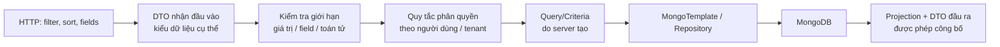

# Giới hạn trường, toán tử, sort và projection được phép từ đầu vào

Khi xây dựng API tìm kiếm trên **Spring Data MongoDB**, ứng dụng thường nhận filter, trường sắp xếp và danh sách trường muốn hiển thị từ HTTP request. Đây là một ranh giới bảo mật quan trọng: người dùng được yêu cầu tìm dữ liệu theo chức năng công khai, nhưng không được tự quyết định mọi toán tử, đường dẫn BSON hay trường bí mật mà MongoDB có thể xử lý.

Ví dụ endpoint `GET /api/products` cho phép lọc sản phẩm theo `sku`, `active` và khoảng giá, sắp xếp theo tên hoặc ngày tạo, chọn một số trường kết quả. Nếu ứng dụng chuyển nguyên JSON hoặc tên trường do người dùng gửi thành `Query`/`Document`, người gọi có thể thay đổi ngữ nghĩa truy vấn, yêu cầu phép tính rất tốn kém hoặc truy xuất dữ liệu không thuộc quyền của họ.

Bài học thuộc chương **Bảo mật và vận hành** hướng dẫn cách thiết kế **allowlist** cho trường, toán tử, sort và projection; dựng `Criteria` có kiểu dữ liệu rõ ràng; áp đặt điều kiện phân quyền và giới hạn chi phí truy vấn; đồng thời kiểm thử cả đầu vào hợp lệ lẫn đầu vào cố tình vượt phạm vi. Trọng tâm là `MongoTemplate` và repository, nhưng các nguyên tắc cũng áp dụng cho aggregation, update và reactive access.

## 1. Nhìn rõ ranh giới tin cậy

Một API tìm kiếm nên đi qua chuỗi xử lý sau:



**Nguyên tắc thiết kế:** client gửi **giá trị và các lựa chọn trong phạm vi đã định nghĩa**; server quyết định cấu trúc truy vấn, toán tử, tên trường lưu trữ, chính sách phân quyền và dữ liệu có thể trả về.

| Thành phần đầu vào | Nên cho người dùng chọn gì? | Server phải kiểm soát điều gì? |
| --- | --- | --- |
| Filter | Giá trị `sku`, trạng thái, khoảng giá trong giới hạn | Danh sách field, kiểu BSON/Java, toán tử `eq`/`gte`/`lte` |
| Sort | Một khóa sắp xếp công khai và hướng `asc`/`desc` | Ánh xạ khóa sang property thật, số lượng khóa, tie-breaker |
| Projection | Tập con các trường được công khai | Field-level authorization, trường bí mật, cấu trúc DTO trả về |
| Pagination | Trang hoặc cursor trong phạm vi cho phép | `limit` tối đa, offset, số bản ghi, tổng chi phí |
| Phân quyền | Không cho client tự cung cấp làm nguồn tin cậy | `tenantId`/`ownerId` lấy từ principal đã xác thực |

Một request được xác thực hợp lệ vẫn có thể gửi đầu vào nguy hiểm hoặc rất đắt tiền. Authentication xác định người gọi; **authorization, input validation và query budgeting** mới xác định được họ được hỏi và nhận những gì.

## 2. Các lỗi thường gặp khi cho client điều khiển query

### 2.1. Query selector injection

MongoDB dùng các khóa bắt đầu bằng `$` làm toán tử. Nếu ứng dụng tin JSON đầu vào là điều kiện MongoDB, một giá trị người dùng được mong đợi là chuỗi có thể biến thành object điều kiện:

```json
{
  "sku": {
    "$ne": null
  }
}
```

Ý nghĩa đã đổi từ “SKU bằng một chuỗi cụ thể” thành “SKU khác null”. Nếu tương tự với `$in`, `$exists`, `$or`, `$expr` hoặc một số toán tử phức tạp khác, hậu quả có thể là mở rộng tập kết quả, bỏ qua filter hoặc tăng tải hệ thống.

**Cách phòng tránh:** định nghĩa `sku` bằng `String` trong DTO, từ chối object/array, kiểm tra định dạng hợp lệ và tự tạo `Criteria.where("sku").is(sku)`. Không deserialize trực tiếp JSON filter từ client thành `org.bson.Document` rồi chuyển cho MongoDB.

### 2.2. Cho phép tên trường tùy ý

Ví dụ không an toàn:

```java
// Đầu vào fieldName đến trực tiếp từ HTTP request:
Query query = Query.query(
    Criteria.where(fieldName).is(userValue)
);
```

Người dùng có thể thử các trường không được công bố như `passwordHash`, `internalCost`, `billing.secret` hoặc đường dẫn lồng nhau. Ngay cả khi không trả về trực tiếp trường bí mật, việc filter theo giá trị bí mật vẫn có thể gây **rò rỉ qua sự tồn tại của kết quả hoặc số lượng bản ghi**.

Chỉ cho phép field được định nghĩa sẵn và liên kết từng field với đúng toán tử cùng kiểu dữ liệu. Không nên chỉ kiểm tra field bằng quy tắc “không bắt đầu bằng `$`” hoặc “chỉ chứa chữ và dấu chấm”: tên trông hợp lệ vẫn có thể là trường không được phép.

### 2.3. Sort và projection không được giới hạn

```java
// Cả hai câu sau đều đưa tên trường không đáng tin vào MongoDB.
query.with(Sort.by(clientSortField));
query.fields().include(clientRequestedField);
```

Sort tùy ý có thể yêu cầu sắp xếp trên trường không có index, trên mảng hoặc trường chiếm nhiều tài nguyên. Projection tùy ý có thể làm lộ trường nhạy cảm, dữ liệu liên hệ nội bộ hay các cấu trúc con mà API không định công bố.

Đầu vào độc hại không nhất thiết phải chứa toán tử `$`: `sort=passwordHash` hoặc `fields=internalNotes` cũng có thể là yêu cầu sai phạm nếu server không kiểm soát danh sách cho phép.

## 3. Thiết kế allowlist từ hợp đồng API

Giả sử collection `products` có các field:

```javascript
{
  _id: "p-100",
  tenantId: "tenant-a",
  sku: "SKU-100",
  name: "Bàn phím",
  priceInCents: NumberLong("259000"),
  active: true,
  createdAt: ISODate("2026-01-10T08:00:00Z"),
  internalCostInCents: NumberLong("180000"),
  supplierNotes: "Điều khoản riêng của nhà cung cấp"
}
```

API công khai chỉ hỗ trợ:

| Input API | Field Java/BSON mục tiêu | Toán tử cho phép | Kiểu giá trị và giới hạn |
| --- | --- | --- | --- |
| `sku` | `sku` | Bằng tuyệt đối (`eq`) | Chuỗi có cấu trúc SKU, tối đa 40 ký tự |
| `active` | `active` | Bằng (`eq`) | Boolean |
| `minPrice` | `priceInCents` | Lớn hơn hoặc bằng (`gte`) | `Long` không âm, có giới hạn |
| `maxPrice` | `priceInCents` | Nhỏ hơn hoặc bằng (`lte`) | `Long` không âm, không nhỏ hơn min |
| `sort=created` | `createdAt` | Sắp xếp `asc/desc` | Khóa được định nghĩa sẵn |
| `sort=name` | `name` | Sắp xếp `asc/desc` | Khóa được định nghĩa sẵn |
| `sort=price` | `priceInCents` | Sắp xếp `asc/desc` | Khóa được định nghĩa sẵn |
| `fields=id,name,price` | `id`, `name`, `priceInCents` | Include projection | Tập con trường được công bố |

`tenantId` được **server thêm vào mọi truy vấn từ principal hiện tại** và không xuất hiện trong danh sách field người dùng có quyền chọn. Các trường `internalCostInCents` và `supplierNotes` không nằm trong allowlist filter, sort hoặc projection.

Allowlist nên tách biệt theo mục đích. Một field được phép hiển thị **không nhất thiết** được phép lọc hoặc sắp xếp; một field có thể dùng trong điều kiện phân quyền nhưng không bao giờ được trả về. Chỉ một tập `ALLOWED_FIELDS` dùng chung cho mọi thao tác thường quá rộng.

### 3.1. Ưu tiên tên từ hợp đồng API

Thay vì để client truyền tên property Java hoặc đường dẫn BSON, định nghĩa khóa bên ngoài như `created`, `price`, `name`, rồi ánh xạ sang property được server chọn:

```java
private static final Map<String, String> SORT_KEYS = Map.of(
    "created", "createdAt",
    "name", "name",
    "price", "priceInCents"
);
```

Lợi ích là có thể thay đổi tên lưu trong MongoDB hoặc `@Field("created_at")` mà không làm thay đổi API công khai. Khi dùng `MongoTemplate.find(query, Product.class)`, Spring Data ánh xạ các property của entity theo quy tắc mapping. Ngược lại, khi dùng trực tiếp `MongoTemplate.getCollection(...)` của Java Driver, tên trường gửi đi phải là **tên BSON thực tế**.

## 4. Định nghĩa request bằng kiểu dữ liệu cụ thể

Không nhận một `Map<String, Object> filters` chung rồi cho phép từng entry tạo tùy ý `Criteria`. Với API xác định trước, DTO tường minh dễ kiểm soát hơn:

```java
import java.util.List;

public record ProductSearchRequest(
    String sku,
    Boolean active,
    Long minPrice,
    Long maxPrice,
    String sort,
    String direction,
    List<String> fields,
    int page,
    int size
) {}
```

Trong HTTP layer, chỉ bind đúng các tham số được hỗ trợ. Với body JSON, cấu hình xử lý **trường không biết trước** theo hợp đồng API: từ chối những trường lạ nếu cần một hợp đồng chặt chẽ, thay vì vô tình bỏ qua các lựa chọn người gọi tưởng đã được áp dụng.

Nên kết hợp Bean Validation với kiểm tra nghiệp vụ. Ví dụ:

- `page` từ 0 đến một ngưỡng chấp nhận được; `size` từ 1 đến 100.
- `minPrice` và `maxPrice` không âm, không vượt miền tiền tệ đã chọn, `minPrice <= maxPrice`.
- `sku` phải thuộc định dạng được hệ thống hỗ trợ, ví dụ `[A-Z0-9-]{1,40}`.
- `sort` nằm trong `created/name/price`; `direction` chỉ là `asc` hoặc `desc`.
- Mỗi trường projection phải thuộc tập cho phép, không có đường dẫn tùy ý hoặc danh sách quá dài.

Kiểu Java tường minh giúp chặn nhiều trường hợp dữ liệu sai hình dạng ngay khi bind request. Tuy nhiên chỉ dùng kiểu Java là chưa đủ: một `Long` rất lớn, một danh sách 100.000 phần tử hay một chuỗi dài hàng megabyte vẫn có thể gây tốn tài nguyên nếu không giới hạn giá trị và kích thước request.

## 5. Xây `Query` an toàn với `MongoTemplate`

Ví dụ dưới đây minh họa service tự quyết định tên field và toán tử. Dữ liệu về quyền `tenantId` phải được lấy từ hệ thống xác thực, **không truyền từ HTTP form**.

Entity dùng trong ví dụ:

```java
import java.time.Instant;
import org.springframework.data.annotation.Id;
import org.springframework.data.mongodb.core.mapping.Document;

@Document("products")
public record Product(
    @Id String id,
    String tenantId,
    String sku,
    String name,
    Long priceInCents,
    Boolean active,
    Instant createdAt,
    Long internalCostInCents,
    String supplierNotes
) {}
```

Service xây dựng query:

```java
import java.time.Duration;
import java.util.ArrayList;
import java.util.List;
import java.util.Map;
import java.util.Set;

import org.springframework.data.domain.PageRequest;
import org.springframework.data.domain.Sort;
import org.springframework.data.mongodb.core.MongoTemplate;
import org.springframework.data.mongodb.core.query.Criteria;
import org.springframework.data.mongodb.core.query.Query;

public final class ProductSearchService {
    // Giới hạn minh họa, phải thống nhất theo miền giá thực tế.
    private static final long MAX_PRICE = 1_000_000_000_000L;
    private static final Map<String, String> SORT_KEYS = Map.of(
        "created", "createdAt",
        "name", "name",
        "price", "priceInCents"
    );
    private static final Set<String> VISIBLE_FIELDS = Set.of(
        "id", "sku", "name", "priceInCents", "active", "createdAt"
    );
    private final MongoTemplate mongoTemplate;

    public ProductSearchService(MongoTemplate mongoTemplate) {
        this.mongoTemplate = mongoTemplate;
    }

    // tenantId phải đến từ thông tin xác thực đã được server kiểm chứng.
    public List<Product> findProducts(
            String tenantId, ProductSearchRequest request) {
        if (request == null) {
            throw new IllegalArgumentException("Thiếu điều kiện tìm kiếm");
        }
        if (tenantId == null || tenantId.isBlank()) {
            throw new IllegalArgumentException("Thiếu tenant hợp lệ");
        }
        if (request.page() < 0 || request.page() > 1000
                || request.size() < 1 || request.size() > 100) {
            throw new IllegalArgumentException("Pagination ngoài giới hạn");
        }
        if ((request.minPrice() != null
                && (request.minPrice() < 0
                    || request.minPrice() > MAX_PRICE))
                || (request.maxPrice() != null
                && (request.maxPrice() < 0
                    || request.maxPrice() > MAX_PRICE))) {
            throw new IllegalArgumentException("Giá ngoài miền hợp lệ");
        }
        if (request.minPrice() != null && request.maxPrice() != null
                && request.minPrice() > request.maxPrice()) {
            throw new IllegalArgumentException("Khoảng giá không hợp lệ");
        }

        String sortField = request.sort() == null
            ? null : SORT_KEYS.get(request.sort());
        if (sortField == null) {
            throw new IllegalArgumentException("Sort field không được phép");
        }
        if (request.direction() == null) {
            throw new IllegalArgumentException("Thiếu direction");
        }
        Sort.Direction sortDirection =
            switch (request.direction()) {
                case "asc" -> Sort.Direction.ASC;
                case "desc" -> Sort.Direction.DESC;
                default -> throw new IllegalArgumentException(
                    "Direction không được phép");
            };

        List<String> requestedFields = request.fields() == null
            ? List.of("id", "sku", "name", "priceInCents")
            : request.fields();
        if (requestedFields.isEmpty() || requestedFields.size() > 6
                || requestedFields.stream().anyMatch(
                    field -> field == null || !VISIBLE_FIELDS.contains(field))) {
            throw new IllegalArgumentException("Projection không hợp lệ");
        }
        requestedFields = List.copyOf(requestedFields);

        List<Criteria> rules = new ArrayList<>();
        rules.add(Criteria.where("tenantId").is(tenantId));

        if (request.sku() != null) {
            if (!request.sku().matches("[A-Z0-9-]{1,40}")) {
                throw new IllegalArgumentException("SKU không hợp lệ");
            }
            rules.add(Criteria.where("sku").is(request.sku()));
        }
        if (request.active() != null) {
            rules.add(Criteria.where("active").is(request.active()));
        }
        if (request.minPrice() != null) {
            rules.add(Criteria.where("priceInCents")
                .gte(request.minPrice()));
        }
        if (request.maxPrice() != null) {
            rules.add(Criteria.where("priceInCents")
                .lte(request.maxPrice()));
        }

        Query query = Query.query(
            new Criteria().andOperator(rules.toArray(new Criteria[0]))
        );
        Sort stableSort = Sort.by(
            new Sort.Order(sortDirection, sortField),
            new Sort.Order(Sort.Direction.ASC, "id")
        );
        query.with(PageRequest.of(
            request.page(), request.size(), stableSort
        ));
        query.maxTime(Duration.ofSeconds(2));

        // Chỉ đưa property được công bố vào kết quả đọc.
        query.fields().include("id");
        for (String field : requestedFields) {
            query.fields().include(field);
        }

        return mongoTemplate.find(query, Product.class);
    }
}
```

Những điểm cần chú ý:

1. **Không có tên field nào được đưa nguyên từ request vào `Criteria.where(...)` hoặc `Sort.Order(...)`.** Khóa sort phải qua `SORT_KEYS`, còn filter chỉ dùng những field đã được hardcode.
2. **Giá trị không được dùng như cấu trúc query.** SKU là String đã kiểm tra, giá là Long, trạng thái là Boolean; client không được gửi `{"$ne":null}` làm toán tử.
3. **Điều kiện tenant được chèn bắt buộc.** Tập filter động chỉ được `AND` với điều kiện phân quyền do server chọn, không thể thay thế nó bằng một `$or` do client tự tạo.
4. **Sort có tie-breaker theo ID.** Khi nhiều document trùng giá hoặc ngày tạo, thứ tự ổn định giúp phân trang dễ dự đoán hơn. Với phân trang sâu, `skip` vẫn có chi phí; cần xem xét cursor/keyset pagination.
5. **Projection chỉ gồm property trong allowlist.** Với entity mapping, field không được chọn có thể đọc thành `null` hoặc giá trị mặc định. Không dùng entity chưa đầy đủ này cho thao tác `save` sau đó, vì có nguy cơ ghi đè dữ liệu bị thiếu.
6. **Giới hạn thời gian không thay thế index.** `maxTime` là cơ chế bảo vệ bổ sung; cần đo trên workload thật và xử lý timeout đúng cách.

Đoạn code trả `List<Product>` để tập trung minh họa `Query`. **Không trả trực tiếp entity này từ HTTP controller.** Ở lớp web, ánh xạ sang DTO hoặc đối tượng phản hồi chỉ chứa field công khai, vì entity có các property nội bộ. Lựa chọn projection trong query có lợi cho lượng dữ liệu truyền, nhưng **hợp đồng DTO/serialization mới là ranh giới cuối cùng của dữ liệu trả ra**.

### 5.1. Đảm bảo projection không tạo đường lộ dữ liệu

Một cách đơn giản là dùng response DTO cố định:

```java
public record ProductSummary(
    String id,
    String sku,
    String name,
    Long priceInCents,
    Boolean active
) {
    static ProductSummary from(Product product) {
        return new ProductSummary(
            product.id(),
            product.sku(),
            product.name(),
            product.priceInCents(),
            product.active()
        );
    }
}
```

Nếu API thực sự hỗ trợ `fields` động, xây response từ một registry field-to-value được phép, hoặc từ các projection DTO đã thiết kế; không dùng phản chiếu tùy ý theo tên trường client gửi. Trường hợp dùng DTO cố định như trên, query cần lấy đủ các property mà mapper đọc. Vì thế phải **thống nhất projection của truy vấn với cấu trúc DTO kết quả**.

Khi cần tách hẳn mô hình, có thể định nghĩa những response như `ProductSummary` và `ProductDetail` theo endpoint, rồi dùng projection tĩnh cho mỗi loại. Cách này thường dễ kiểm thử và kiểm soát quyền trường hơn một API `fields` quá linh hoạt.

## 6. Giới hạn toán tử: cho phép theo nhu cầu thật

MongoDB hỗ trợ nhiều toán tử nhưng endpoint công khai chỉ nên cấp những toán tử phục vụ trực tiếp yêu cầu. Bảng sau gợi ý chính sách cho một API tìm kiếm phổ thông:

| Nhóm | Toán tử thường gặp | Quyết định khuyến nghị |
| --- | --- | --- |
| Equality | `$eq` | Chấp nhận trên field đã khai báo, với kiểu giá trị rõ ràng |
| Range | `$gte`, `$gt`, `$lte`, `$lt` | Chỉ chấp nhận trên trường số/ngày có miền hợp lệ |
| Tập giá trị | `$in` | Chỉ nếu nghiệp vụ cần, giới hạn số phần tử và độ dài từng giá trị |
| Khác/loại trừ | `$ne`, `$nin` | Không cấp mặc định; có thể làm truy vấn ít chọn lọc |
| Kiểm tra cấu trúc | `$exists`, `$type` | Chỉ khi chức năng yêu cầu, không để tự truy vấn trường bí mật |
| Logic | `$or`, `$nor`, `$and` | Server xây biểu thức với số nhánh/độ sâu giới hạn |
| Mảng | `$elemMatch`, `$all` | Chỉ dùng trên đường dẫn và cấu trúc được định nghĩa |
| Mẫu chuỗi | `$regex` | Mặc định từ chối regex tùy ý; nếu hỗ trợ thì giới hạn pattern, độ dài và tài nguyên |
| Biểu thức/chương trình | `$expr`, `$where`, `$function` | Không cấp cho API filter thông dụng |
| Pipeline/ghi | `$lookup`, `$graphLookup`, `$out`, `$merge` | Không cho client cung cấp tùy ý; tạo từ quy trình nội bộ có kiểm soát |

Các toán tử như `$ne` và `$regex` không phải lúc nào cũng là lỗ hổng tự thân. Rủi ro xuất hiện khi **không có giới hạn mục đích, kiểu dữ liệu, trường, ngân sách truy vấn và quyền truy cập**. Một chức năng tìm kiếm có nhu cầu regex chính đáng vẫn có thể triển khai bằng cách thiết kế và kiểm thử riêng.

### 6.1. Trường hợp `$in`

Nếu API cần lọc một danh sách SKU, giới hạn số phần tử trước khi tạo query:

```java
List<String> skus = requestSkus;
if (skus == null || skus.isEmpty() || skus.size() > 30
        || skus.stream().anyMatch(
            sku -> sku == null || !sku.matches("[A-Z0-9-]{1,40}")
        )) {
    throw new IllegalArgumentException("Danh sách SKU không hợp lệ");
}

Criteria condition = Criteria.where("sku").in(
    skus.stream().distinct().toList()
);
```

Số lượng phần tử tối đa là quy tắc sản phẩm, không phải giới hạn cố định của MongoDB. Một danh sách hàng nghìn phần tử có thể ảnh hưởng kích thước lệnh, chi phí lập kế hoạch và hiệu năng tùy index/dữ liệu. Nếu cần lọc danh sách lớn thường xuyên, nên thiết kế batch hoặc quy trình riêng thay vì mở vô hạn tham số `$in`.

### 6.2. Regex và tìm kiếm chuỗi

Tránh nhận chuỗi regex nguyên trạng:

```java
// Không an toàn nếu pattern hoàn toàn do client kiểm soát:
Criteria.where("name").regex(userPattern);
```

Một regex phức tạp có thể tốn CPU; regex không phù hợp index cũng có thể quét lượng dữ liệu lớn. Nếu nghiệp vụ chỉ cần khớp đúng, dùng `is(...)`. Nếu cần tìm tiền tố, có thể **escape input thành literal** và thêm anchor, với giới hạn độ dài nghiêm ngặt:

```java
import java.util.regex.Pattern;

String prefix = requestPrefix;
if (prefix == null || prefix.isBlank() || prefix.length() > 32) {
    throw new IllegalArgumentException("Prefix không hợp lệ");
}
String safePattern = "^" + Pattern.quote(prefix);
Criteria startsWith = Criteria.where("name").regex(safePattern);
```

`Pattern.quote(...)` ngăn ký tự đặc biệt trong prefix được diễn giải thành regex do người dùng tự viết; nó **không bảo đảm** query nhanh. Hiệu quả của index phụ thuộc pattern, collation và phiên bản MongoDB. Với tìm kiếm văn bản đa ngôn ngữ, có thể cân nhắc chức năng search được thiết kế riêng thay vì biến một endpoint liệt kê thành máy thực thi regex tùy ý.

## 7. Sort an toàn, ổn định và có thể vận hành

Một truy vấn như `sort={"arbitraryField":-1}` không chỉ gây rủi ro field-level security mà còn tạo truy vấn khó dự đoán, có thể phải sort trong bộ nhớ và gây tải lớn.

Các nguyên tắc nên áp dụng:

1. **Allowlist khóa sắp xếp:** map `created` sang `createdAt`, `price` sang `priceInCents`. Không chấp nhận dot path tùy ý như `supplier.secretRank`.
2. **Giới hạn hướng sort:** chỉ `asc` hoặc `desc`, không nhận trực tiếp toàn bộ object MongoDB từ client.
3. **Hạn chế số khóa sort:** với endpoint đơn giản, một khóa do người dùng chọn và một khóa phụ cố định thường đủ.
4. **Tie-breaker ổn định:** thêm `id`/`_id` để giảm sự xáo trộn khi nhiều record có cùng khóa; dữ liệu thay đổi đồng thời vẫn có thể ảnh hưởng offset pagination.
5. **Thiết kế index theo filter và sort thực tế:** ví dụ trong hệ thống đa tenant, query theo `tenantId`, `active` và sort `createdAt` có thể cần index ghép được đo đạc.

Ví dụ một index ứng viên:

```javascript
db.products.createIndex({
  tenantId: 1,
  active: 1,
  createdAt: -1,
  _id: 1
});
```

Index trên chỉ phù hợp với **một số query shape**. Đối với sort `name` hoặc `price`, yêu cầu index và collation có thể khác. Cần dùng `explain("executionStats")` với truy vấn thật, đo `totalDocsExamined`, `totalKeysExamined` và thao tác sort; đừng tạo index chỉ vì tên xuất hiện trong allowlist.

Không cho client tự truyền `hint` hoặc `collation` tùy ý. Những tham số này ảnh hưởng trực tiếp đến query plan, ngữ nghĩa so sánh và mức sử dụng tài nguyên. Nếu cần các chế độ collation khác nhau, thiết kế từng lựa chọn có giới hạn và index tương thích.

## 8. Projection: giới hạn dữ liệu đọc và dữ liệu tiết lộ

Projection quyết định những field server trả về. MongoDB thường bao gồm `_id` mặc định trừ khi chủ động loại bỏ nó; khi xây inclusion projection, cần xác định rõ quy tắc đối với ID. Không trộn inclusion và exclusion trong một projection thông thường, ngoại trừ trường hợp đặc biệt với `_id`.

Ví dụ projection tĩnh:

```java
Query query = Query.query(
    Criteria.where("tenantId").is(trustedTenantId)
);
query.fields()
    .include("id")
    .include("sku")
    .include("name")
    .include("priceInCents");

List<Product> products = mongoTemplate.find(query, Product.class);
```

Query trên chỉ lấy các property cần thiết, giảm lượng BSON truyền về client. Nhưng một entity có field thiếu hoặc nhận giá trị null sau khi projection **không nên được dùng làm aggregate đầy đủ để cập nhật trực tiếp**.

Hai tầng bảo vệ phải đi cùng nhau:

- **Database projection:** chỉ lấy dữ liệu cần thiết, tiết kiệm I/O và tránh đưa trường bí mật đến ứng dụng khi không cần.
- **Response projection/DTO:** quyết định dữ liệu thực sự được phép xuất hiện trong JSON, GraphQL, CSV hoặc message trả cho người dùng.

Nếu một field chỉ được phép xem với quyền quản trị, cần kiểm tra quyền **trước khi thêm field vào projection**, và mapper đầu ra vẫn phải tuân thủ cùng chính sách. Việc dùng `@JsonIgnore` hoặc một serializer tùy chỉnh có thể giúp chặn một đường xuất dữ liệu cụ thể, nhưng không thay thế phân quyền theo trường nếu API có nhiều hình thức phản hồi.

### 8.1. Cẩn thận với nested projection

Cho phép `fields=address` có thể trả toàn bộ subdocument:

```javascript
{
  address: {
    city: "Hà Nội",
    street: "Đường A",
    accessNote: "Thông tin nội bộ"
  }
}
```

Nếu chỉ được công khai `address.city`, cần định nghĩa field công khai cụ thể hoặc dùng DTO chỉ có `city`. Đừng mặc định rằng việc allowlist tên field cha cũng an toàn cho mọi field con hiện tại và tương lai.

Tương tự, projection theo đường dẫn lồng nhau trong một mảng có các quy tắc của MongoDB về cấu trúc kết quả. Hãy kiểm thử BSON và JSON đầu ra thực tế với dữ liệu có nhiều phần tử, thay vì suy luận chỉ từ entity Java.

## 9. Đảm bảo filter phân quyền không bị thay thế

Một endpoint đa tenant phải giới hạn dữ liệu theo tenant hiện tại. Rủi ro xuất hiện khi `tenantId` được nhận từ query string hoặc khi filter do client cung cấp có thể ghi đè điều kiện này:

```java
// Sai về mặt thiết kế quyền: tenantId do người gọi quyết định.
Query query = Query.query(
    Criteria.where("tenantId").is(httpRequestTenantId)
);
```

Nên lấy tenant từ principal/token đã được xác minh và gắn điều kiện trong server:

```java
Criteria scope = Criteria.where("tenantId").is(currentTenantId);
Criteria userAllowed = Criteria.where("active").is(true);

Query query = Query.query(
    new Criteria().andOperator(scope, userAllowed)
);
```

Điều kiện `AND` ở trên giúp giữ phạm vi khi mở rộng bộ lọc hợp lệ. Tuy nhiên, **lọc theo tenant trong query vẫn là một phần của authorization**, không thay thế việc kiểm tra quyền khi đọc/cập nhật một resource cụ thể. Những luồng khác như `findById`, `updateFirst`, aggregation và bulk operations cũng phải áp dụng cùng phạm vi.

Nếu áp dụng field-level access, ví dụ chỉ admin được xem `supplierNotes`, kiểm tra vai trò ở tầng ứng dụng và xây chính sách projection/response tương ứng. Không nên hy vọng rằng “field không xuất hiện trên màn hình UI” nghĩa là API đã bảo vệ nó.

## 10. Đầu vào cho aggregation và update cần chính sách riêng

### 10.1. Aggregation

Aggregation pipeline có thể thực hiện lọc, lookup, group, projection và một số stage ghi kết quả. Không nhận một `List<Document> pipeline` tùy ý từ client:

```java
// Tránh thiết kế cho phép HTTP body trở thành pipeline:
// mongoTemplate.aggregate(userProvidedPipeline, "products", Document.class);
```

Thay vào đó, tạo pipeline theo **mẫu công việc cố định**. Ví dụ báo cáo số sản phẩm đang hoạt động của tenant hiện tại:

```java
import org.springframework.data.mongodb.core.aggregation.Aggregation;
import org.springframework.data.mongodb.core.aggregation.AggregationResults;
import org.springframework.data.mongodb.core.query.Criteria;

Aggregation aggregation = Aggregation.newAggregation(
    Aggregation.match(
        Criteria.where("tenantId").is(currentTenantId)
            .and("active").is(true)
    ),
    Aggregation.count().as("total")
);

AggregationResults<org.bson.Document> result =
    mongoTemplate.aggregate(
        aggregation, "products", org.bson.Document.class
    );
```

Thực tế cần chú ý input cho `$lookup`, `$group`, số nhóm, độ sâu pipeline, `allowDiskUse` và giới hạn thời gian. Một stage do server tạo cũng cần phân tích chi phí nếu dữ liệu có thể rất lớn.

### 10.2. Update: chống mass assignment

Không áp dụng toàn bộ JSON người dùng gửi lên entity rồi `save(...)` nếu API chỉ được sửa `name` và `active`. Cách này có thể cho phép client sửa `tenantId`, `internalCostInCents`, vai trò hoặc các trạng thái nhạy cảm.

Sử dụng DTO và `Update` tường minh:

```java
import org.springframework.data.mongodb.core.query.Update;

public record ProductPatch(String name, Boolean active) {}

public void patchProduct(String tenantId, String productId,
                         ProductPatch patch) {
    Query query = Query.query(
        Criteria.where("tenantId").is(tenantId)
            .and("id").is(productId)
    );
    Update update = new Update();

    if (patch.name() != null) {
        if (patch.name().isBlank() || patch.name().length() > 120) {
            throw new IllegalArgumentException("Tên không hợp lệ");
        }
        update.set("name", patch.name());
    }
    if (patch.active() != null) {
        update.set("active", patch.active());
    }
    if (update.getUpdateObject().isEmpty()) {
        throw new IllegalArgumentException("Không có trường cần sửa");
    }

    mongoTemplate.updateFirst(query, update, Product.class);
}
```

Ví dụ minh họa cơ chế chọn field; trong code thực tế hãy kiểm tra quyền sửa theo resource và kết quả `matchedCount`/`modifiedCount` để phân biệt không tồn tại, không thuộc quyền và không có thay đổi. Tùy tính chất API, có thể thêm optimistic locking/`@Version` để tránh ghi đè thay đổi đồng thời.

Không chuyển key từ JSON patch trực tiếp thành `Update.set(key, value)`. Dù chỉ dùng toán tử `$set`, một key do client cung cấp có thể chỉ đến field nội bộ hoặc đường dẫn lồng nhau không được phép.

## 11. Giới hạn tài nguyên và phòng tránh truy vấn quá tốn kém

Một query hợp lệ về cú pháp và quyền vẫn có thể gây quá tải. Ví dụ nhiều request liên tục dùng filter rất rộng, sort không có index, offset lớn hoặc trả nhiều document có mảng lớn.

Cần giới hạn từ nhiều tầng:

| Tầng | Biện pháp | Mục đích |
| --- | --- | --- |
| HTTP | Giới hạn kích thước body/URL, rate limit, concurrency | Tránh quá nhiều request và payload bất thường |
| DTO | Giới hạn độ dài chuỗi, số phần tử, độ sâu cấu trúc | Tránh input quá lớn hoặc khó kiểm tra |
| Query builder | Allowlist field/operator, giới hạn số predicate, `size`/`page` | Giữ số dạng truy vấn có thể dự đoán |
| MongoDB | Index phù hợp, `maxTime`/giới hạn thời gian, quyền DB tối thiểu | Hạn chế tác động của truy vấn chậm |
| Response | DTO, pagination, giới hạn byte, streaming có kiểm soát | Không làm rò rỉ hoặc trả lượng dữ liệu quá lớn |
| Quan sát | Theo dõi `p95/p99`, `docsExamined`, timeout và tỷ lệ từ chối | Phát hiện mẫu sử dụng gây tải |

Ví dụ endpoint chỉ cần 20–100 sản phẩm mỗi lần nên dùng `limit` trước khi trả kết quả. Với phân trang theo `page`, offset cao vẫn có thể khiến MongoDB duyệt nhiều kết quả; nếu cần duyệt hàng trăm nghìn document, chuyển sang **keyset pagination** theo cặp khóa sắp xếp ổn định và cursor được kiểm soát.

Không tự động trả `countDocuments` trên mọi truy vấn nếu lượng dữ liệu lớn và giao diện không cần tổng số chính xác. Việc đếm cũng có chi phí riêng; dùng giải pháp phân trang và thông tin `hasNext` khi phù hợp.

Một hệ thống có nhiều tenant nên có chỉ mục tính đến điều kiện tenant. Ví dụ:

```javascript
// Index ứng viên cho filter tenant + active, sort theo createdAt.
db.products.createIndex({
  tenantId: 1,
  active: 1,
  createdAt: -1,
  _id: 1
});
```

Kiểm chứng bằng `explain` trên dữ liệu đại diện, không mặc định index trên sẽ tối ưu mọi tổ hợp filter/sort. Ràng buộc truy vấn an toàn và thiết kế index phải được phát triển cùng nhau.

## 12. Logging, lỗi và vận hành an toàn

Khi request bị từ chối, API nên trả lỗi có thể hiểu được như “Trường sắp xếp không được hỗ trợ” hoặc “Kích thước trang vượt giới hạn”. Không cần trả lại toàn bộ chuỗi filter gốc trong thông báo lỗi.

Trong log/metric, nên ghi:

- Route hoặc loại truy vấn, tên khóa sort **đã chuẩn hóa**, số predicate và page size.
- Trạng thái chấp nhận/từ chối, lý do phân loại (field không hợp lệ, type sai, size quá lớn).
- Độ trễ end-to-end, số document trả về, timeout và lỗi driver/server.
- Thông tin tương quan request ở dạng không làm lộ bí mật; tránh ghi dữ liệu định danh nhạy cảm, token hoặc plaintext từ trường cần bảo vệ.

Nếu dùng `CommandListener` hoặc MongoDB profiler, chú ý dữ liệu query có thể chứa giá trị đầu vào hoặc điều kiện bảo mật. Áp dụng redaction/giới hạn quyền xem log và chỉ bật mức chi tiết phù hợp môi trường. Đừng dùng log toàn bộ request JSON như phương pháp mặc định để điều tra query injection.

Database account của ứng dụng cũng cần quyền tối thiểu. Một API chỉ đọc không nên có quyền tạo/xóa collection hoặc thực thi thao tác ghi tùy ý. Quyền database là lớp bảo vệ bổ sung: nó không thay thế authorization theo người dùng, nhưng giúp giới hạn hậu quả nếu query builder gặp lỗi.

## 13. Kiểm thử allowlist và hành vi thực tế

Unit test kiểm tra các lựa chọn bị từ chối; integration test với MongoDB thật kiểm tra filter/projection không làm lộ dữ liệu và query dùng đúng kiểu BSON.

### 13.1. Ma trận test đầu vào

| Input | Kỳ vọng |
| --- | --- |
| `sku=SKU-100` | Trả đúng SKU trong phạm vi tenant |
| `sku={"$ne":null}` dưới dạng JSON object | Binding/validation từ chối; không chuyển object thành MongoDB operator |
| `sort=created&direction=desc` | Áp dụng sắp xếp được phép và tie-breaker theo ID |
| `sort=internalCostInCents` | Từ chối trước khi gọi MongoDB |
| `fields=id,name` | Không trả `supplierNotes` hoặc `internalCostInCents` |
| `fields=supplierNotes` | Từ chối field projection |
| `size=100000` hoặc `page=-1` | Từ chối theo giới hạn |
| `minPrice > maxPrice` | Từ chối khoảng giá không hợp lệ |
| `sku` dài hơn 40 ký tự | Từ chối trước truy vấn |
| Client cố truyền `tenantId=tenant-b` | Không dùng làm nguồn tin cậy; chỉ tenant của principal được áp dụng |
| Truy vấn qua raw filter/pipeline tùy ý | Endpoint không hỗ trợ, không có đường chuyển object thành `Document` |

Test phân quyền nên tạo ít nhất hai tenant có các sản phẩm giống SKU và cùng trạng thái. Chạy query dưới principal tenant A và xác nhận không có record tenant B, kể cả khi filter người dùng không có `sku`. Kiểm thử các đường `findById`, `update`, aggregate và export dữ liệu, không chỉ endpoint tìm kiếm.

### 13.2. Kiểm tra Query được dựng

Nếu tách hàm dựng `Query` thành một method thuần theo request đã validate, unit test có thể xem điều kiện/field/sort mà nó tạo:

```java
Query query = buildQuery(
    "tenant-a",
    validSearchRequest
);

org.bson.Document filter = query.getQueryObject();
org.bson.Document projection = query.getFieldsObject();
org.bson.Document order = query.getSortObject();

// Assert các cấu trúc đã chuẩn hóa:
// - filter chứa điều kiện tenant do server áp đặt
// - sort chỉ gồm khóa allowlist và tie-breaker
// - projection chỉ gồm các field được công bố
```

Đây là phác thảo test; `buildQuery(...)` là hàm được tách ra từ service ở trên, không phải API sẵn có của Spring Data. Để xác minh mapping khi entity dùng `@Field(...)`, cần test tích hợp gửi query qua `MongoTemplate` hoặc kiểm tra BSON đã được ánh xạ bởi framework; `query.getQueryObject()` phản ánh cấu trúc ở tầng `Query` và chưa nhất thiết là command cuối cùng sau mapping.

### 13.3. Test tích hợp từ HTTP đến MongoDB

Dùng `@SpringBootTest` cùng MongoDB Testcontainers khi cần xác minh cả request binding, authentication, authorization, query mapping và serialization JSON:

1. Seed collection với hai tenant, có trường bí mật `supplierNotes` khác nhau.
2. Gửi request hợp lệ từ tenant A, assert tất cả document thuộc tenant A và chỉ có field công khai.
3. Gửi body chứa JSON object thay vì String cho `sku`, assert HTTP 4xx theo hợp đồng API.
4. Thử sort và projection không được phép, assert bị từ chối trước khi tạo truy vấn.
5. Thử size lớn, khoảng giá sai, prefix/regex dài bất thường, assert không có truy vấn tốn kém chạy trên database.
6. Kiểm tra rằng mọi đường cập nhật chỉ sửa field được phép và không thể đổi `tenantId`.

Khi test hiệu năng, không dùng một dataset chỉ có vài document để suy ra sort/index đã an toàn. Tạo dữ liệu có phân bố gần thực tế, đo `explain("executionStats")`, số bản ghi trả về, độ trễ driver và hành vi dưới tải đồng thời.

## 14. Bài tập thực hành

Thiết kế endpoint `GET /api/products` cho các tenant, với bộ lọc tùy chọn `sku`, `active`, `minPrice`/`maxPrice`, sort theo `created/name/price` và trả danh sách sản phẩm đã phân trang.

Yêu cầu:

1. Định nghĩa DTO đầu vào có kiểu dữ liệu cụ thể, không dùng raw MongoDB JSON filter.
2. Viết bảng allowlist riêng cho filter, sort và projection; chỉ rõ field bí mật không được xuất hiện trong bất kỳ nhóm nào.
3. Dùng `Criteria` để tạo filter, tự thêm điều kiện `tenantId` từ principal và không chấp nhận toán tử ngoài các loại đã định nghĩa.
4. Chỉ chấp nhận `asc/desc`, giới hạn `size` và chọn tie-breaker ổn định.
5. Trả DTO công khai, kiểm chứng JSON không bao giờ có `internalCostInCents` hoặc `supplierNotes`.
6. Viết test với input `{"$ne":null}`, tên sort không được phép, projection nhạy cảm, khoảng giá sai, size quá lớn và truy vấn chéo tenant.
7. Chọn index ứng viên theo query shape và dùng `explain` để đánh giá trên dữ liệu đại diện.

**Tiêu chí hoàn thành:** mọi đường từ đầu vào HTTP tới `Criteria`, `Sort`, projection và update đều đi qua quy tắc đã định nghĩa; điều kiện phân quyền không thể bị thay thế; dữ liệu nhạy cảm không xuất hiện trong response; truy vấn hợp lệ có giới hạn tài nguyên và có kiểm thử chứng minh hành vi đó.

## 15. Ghi nhớ

- **Chỉ nhận giá trị và lựa chọn đã định nghĩa.** Client không được tự cung cấp tên trường BSON, toán tử MongoDB hay toàn bộ pipeline cho endpoint thông dụng.
- **Allowlist phải theo mục đích.** Filter, sort, projection và update có quyền riêng; một field được đọc không có nghĩa được lọc hay sửa.
- **Dùng DTO có kiểu và Criteria do server tạo.** Không chuyển JSON/`Map` không tin cậy thành cấu trúc MongoDB query.
- **Phân quyền phải là điều kiện bắt buộc ở server.** Tenant/owner scope lấy từ principal được xác thực, áp dụng cho cả đọc, ghi và aggregate.
- **Projection không thay thế response DTO.** Kiểm soát cả dữ liệu đọc từ database lẫn dữ liệu được phép gửi qua API.
- **Giới hạn chi phí song song với giới hạn cú pháp.** Pagination, index, timeout, số phần tử trong `$in` và độ dài chuỗi đều quan trọng.
- **Kiểm thử trường hợp từ chối.** Một API an toàn phải chứng minh có thể chặn selector injection, truy vấn ngoài phạm vi, sort/projection trái phép và input quá lớn.
