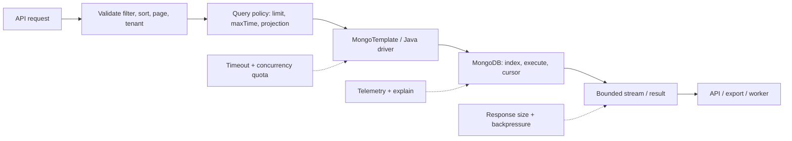

# Giới hạn thời gian, kích thước kết quả và truy vấn tốn tài nguyên

## 1. Vì sao giới hạn truy vấn là yêu cầu bảo mật và vận hành?

Trong ứng dụng **Spring Data MongoDB**, truy vấn được tạo từ `MongoTemplate`, repository hoặc reactive API thường nhận bộ lọc, khoảng thời gian, trang kết quả và tùy chọn sắp xếp từ người dùng. Một câu truy vấn hợp lệ về cú pháp vẫn có thể đọc hàng triệu document, phải sort trong bộ nhớ, chạy aggregation nặng hoặc giữ cursor quá lâu. Khi nhiều request cùng thực hiện, vấn đề có thể lan từ một endpoint sang cả hệ thống.

Ví dụ API báo cáo đơn hàng nhận `tenantId`, `from`, `to` và `limit`. Nếu không có ràng buộc:

- Người dùng chọn khoảng mười năm làm MongoDB phải quét lượng dữ liệu lớn.
- `limit=1000000` khiến service tải nhiều document vào heap, gây GC hoặc `OutOfMemoryError`.
- Sắp xếp theo một trường không có index buộc server thực hiện sort tốn RAM hoặc đĩa.
- Một truy vấn aggregation có `$lookup` hoặc `$unwind` làm kết quả trung gian phình to.
- Nhiều request truy vấn đồng thời chiếm connection, CPU, I/O và làm các tenant khác bị chậm.

Do đó, **giới hạn truy vấn là một phần của bảo vệ tính sẵn sàng**. Mục tiêu là thiết kế một ngân sách tài nguyên có thể kiểm tra được: mỗi request chỉ được phép lấy bao nhiêu document, đọc trong khoảng thời gian nào, chạy tối đa bao lâu, chiếm bao nhiêu tác vụ đồng thời và trả về bao nhiêu byte qua API.



Chương **Bảo mật và vận hành** này tập trung vào giới hạn thời gian, kích thước kết quả và truy vấn tốn tài nguyên trong **SPRING_DATA_MONGODB**. Các nguyên tắc áp dụng tương tự cho `MongoTemplate`, repository và reactive access, nhưng điểm cấu hình cụ thể có thể khác nhau theo phiên bản Spring Data MongoDB và MongoDB Java Driver.

## 2. Phân biệt những giới hạn thường bị nhầm

| Cơ chế | Giới hạn cái gì? | Không tự giới hạn cái gì? |
|---|---|---|
| `Query.limit(n)` / MongoDB `limit(n)` | **Tổng số document** kết quả truy vấn | Tổng số byte; thời gian; CPU/IO để tìm và sort |
| `Query.cursorBatchSize(n)` | Số document được yêu cầu mỗi batch cursor | Tổng số document và bộ nhớ do ứng dụng tự tích lũy |
| Projection `fields().include(...)` | Các field trả về trong mỗi document | Số document quét, thời gian thực thi |
| `Query.maxTime(Duration)` / `maxTimeMS` | Ngân sách thực thi phía MongoDB cho thao tác được hỗ trợ | Deadline end-to-end của toàn request, thời gian xử lý tại ứng dụng |
| Client/network timeout | Thời gian chờ của kết nối/lệnh theo cấu hình driver | Bảo đảm server đã dừng mọi công việc tại thời điểm client bỏ cuộc |
| HTTP deadline / request timeout | Thời gian phục vụ request ở tầng API | Mọi công việc DB đang chạy nếu không truyền hủy/cấu hình timeout |
| Page size và concurrency quota | Dữ liệu trả về và số request được phục vụ đồng thời | Hiệu quả query plan trên MongoDB |
| `allowDiskUse` cho aggregation | Cho phép các stage đủ điều kiện ghi tạm ra đĩa | Tổng tài nguyên hay thời gian tiêu thụ |

**Một bộ giới hạn đúng cần nhiều lớp.** `limit(100)` chỉ bảo đảm trả tối đa 100 document, nhưng nếu MongoDB phải scan hàng triệu bản ghi mới tìm đủ 100, CPU/IO vẫn lớn. Ngược lại, `maxTimeMS(1000)` có thể làm truy vấn thất bại đúng kỳ vọng nhưng không giảm số byte của một kết quả nhỏ gồm các document rất lớn.

MongoDB giới hạn kích thước một BSON document tối đa **16 MiB**. Đây là giới hạn cho từng document, **không phải hạn mức hợp lý cho API**: vài chục document sát ngưỡng đã có thể tạo đáp ứng rất lớn, khiến client chậm hoặc ngốn heap.

## 3. Đặt ngân sách truy vấn từ yêu cầu nghiệp vụ

Trước khi viết `Query`, phải xác định endpoint phục vụ cách sử dụng nào:

| Loại endpoint | Ngân sách ví dụ để bắt đầu | Cách xử lý khuyến nghị |
|---|---|---|
| Danh sách trên UI | 20–100 document/trang; khoảng thời gian có giới hạn | Index, projection, pagination có thứ tự ổn định |
| Tìm kiếm có bộ lọc | Giới hạn field lọc/sort, tối đa 100 document, timeout ngắn | Whitelist sort/filter, từ chối truy vấn quá rộng |
| Dashboard tổng hợp | Giới hạn khoảng ngày và số nhóm trả về | Aggregation có `$match` sớm, index và giới hạn thời gian |
| Export dữ liệu lớn | Trang hữu hạn và quota job; có thể kéo dài hơn HTTP thông thường | Job nền của ứng dụng, keyset pagination/checkpoint, streaming tới đích |
| Tác vụ quản trị | Mức đồng thời thấp, có audit và phạm vi rõ | Quyền riêng và ngân sách tài nguyên được phê duyệt |

Các con số trên là **ví dụ về policy**, không phải giá trị mặc định của MongoDB. Ngưỡng đúng cần đo bằng dữ liệu thật, p95/p99 latency, giới hạn heap và khả năng phục vụ nhiều tenant.

Một policy dễ vận hành nên có các thuộc tính tường minh:

```text
search.orders:
  maxPageSize: 100
  maxDateRangeDays: 31
  maxQueryTimeMs: 1500
  allowedSorts: [createdAt_desc, createdAt_asc]
  maxConcurrentRequestsPerTenant: 4
  maxHttpResponseBytes: 1048576

export.orders:
  pageSize: 500
  maxConcurrentJobsPerTenant: 1
  requiresAsyncJob: true
```

Đây là bản phác thảo policy **ở tầng ứng dụng**, không phải cấu hình MongoDB tự hiểu. Từ policy đó, code service cần triển khai validation, timeout, cursor và giới hạn kích thước phản hồi.

## 4. Giới hạn kết quả bằng `MongoTemplate`

Giả sử collection `orders` chứa `tenantId`, `createdAt`, `totalCents`, `status` và các field khác, trong đó có thể có mảng `items` lớn. Endpoint trả danh sách đơn hàng theo tenant và khoảng thời gian. Ta chỉ chọn những field cần dùng.

```java
import java.time.Duration;
import java.time.Instant;
import java.util.Date;
import java.util.List;

import org.bson.Document;
import org.springframework.data.domain.Sort;
import org.springframework.data.mongodb.core.MongoTemplate;
import org.springframework.data.mongodb.core.query.Criteria;
import org.springframework.data.mongodb.core.query.Query;

public final class OrderQueryService {
    private static final int MAX_PAGE_SIZE = 100;
    private static final Duration QUERY_BUDGET =
        Duration.ofMillis(1500);

    private final MongoTemplate mongoTemplate;

    public OrderQueryService(MongoTemplate mongoTemplate) {
        this.mongoTemplate = mongoTemplate;
    }

    public List<Document> findRecentOrders(
            String authorizedTenantId,
            Instant from,
            Instant to,
            int requestedPageSize) {

        if (authorizedTenantId == null || authorizedTenantId.isBlank()) {
            throw new IllegalArgumentException("Tenant is required");
        }
        if (from == null || to == null || !from.isBefore(to)) {
            throw new IllegalArgumentException("Invalid time range");
        }
        if (Duration.between(from, to).compareTo(Duration.ofDays(31)) > 0) {
            throw new IllegalArgumentException("Time range exceeds 31 days");
        }
        if (requestedPageSize < 1 || requestedPageSize > MAX_PAGE_SIZE) {
            throw new IllegalArgumentException("Page size is out of range");
        }

        Query query = Query.query(
            Criteria.where("tenantId").is(authorizedTenantId)
                .and("createdAt")
                .gte(Date.from(from))
                .lt(Date.from(to))
        );

        query.fields()
            .include("_id")
            .include("createdAt")
            .include("totalCents")
            .include("status");

        query.with(Sort.by(
            Sort.Order.desc("createdAt"),
            Sort.Order.desc("_id")
        ));
        query.limit(requestedPageSize);
        query.cursorBatchSize(Math.min(requestedPageSize, 100));
        query.maxTime(QUERY_BUDGET);

        return mongoTemplate.find(query, Document.class, "orders");
    }
}
```

Các quyết định quan trọng:

1. **`authorizedTenantId` lấy từ ngữ cảnh xác thực/phân quyền**, không tin `tenantId` bất kỳ do client tự cung cấp.
2. Khoảng thời gian có điều kiện `from < to` và tối đa 31 ngày; dùng khoảng nửa mở `[from, to)` để tránh chồng lấn bản ghi giữa hai lần truy vấn.
3. `limit` giới hạn số lượng document ở đường trả kết quả; từ chối page size lớn thay vì chấp nhận giá trị vô hạn.
4. **Projection** chỉ lấy vài field, tránh trả mảng lớn `items` vào HTTP response không cần thiết.
5. Thứ tự `createdAt` rồi `_id` giúp phân trang ổn định hơn khi nhiều đơn hàng có cùng timestamp.
6. `maxTime` yêu cầu MongoDB giới hạn thời gian thực thi thao tác; khi vượt ngân sách có thể phát sinh lỗi timeout cần xử lý ở tầng API.
7. `cursorBatchSize` giảm số lượng document trong một batch, nhưng với `find(...)` trả `List`, ứng dụng vẫn giữ **toàn bộ số document đã trả về** trong bộ nhớ. Vì vậy cần `limit` và projection.

Trên DB, một index ứng viên cho filter và sort này là:

```javascript
db.orders.createIndex({
  tenantId: 1,
  createdAt: -1,
  _id: -1
});
```

Index phù hợp hay không cần dựa trên phân bố dữ liệu, tần suất ghi, điều kiện lọc và kết quả `explain("executionStats")`. Không thêm index cho mọi tùy chọn sort nếu workload không cần, vì index tăng chi phí ghi và dung lượng.

## 5. Giới hạn thời gian: deadline phía server và phía ứng dụng

### `maxTimeMS` bảo vệ thao tác MongoDB, không phải toàn bộ request

Trong `mongosh`, có thể đặt giới hạn thời gian thực thi cho thao tác:

```javascript
db.orders.find({
  tenantId: "tenant-a",
  createdAt: {
    $gte: ISODate("2026-11-01T00:00:00Z"),
    $lt: ISODate("2026-11-20T00:00:00Z")
  }
}).sort({ createdAt: -1, _id: -1 })
  .limit(100)
  .maxTimeMS(1500);
```

Trong Spring Data MongoDB, `query.maxTime(Duration.ofMillis(1500))` truyền ngân sách tới driver/server theo API của phiên bản sử dụng. Khi MongoDB nhận ra thao tác đã vượt giới hạn, truy vấn có thể bị kết thúc với lỗi **MaxTimeMSExpired** (mã lỗi thường gặp: `50`).

Cần hiểu các giới hạn thực tế:

- Đây là giới hạn **thực thi ở server theo cơ chế được hỗ trợ**, không bảo đảm dừng ở thời điểm chính xác từng mili-giây.
- Nó không bao gồm thời gian xử lý Java object, serialize JSON, upload/download qua HTTP hoặc các lời gọi dịch vụ khác.
- Cursor nhiều batch, thời gian nhàn rỗi giữa các lần `getMore`, thao tác transaction và các lệnh đặc biệt có quy tắc riêng; không suy ra rằng một `maxTimeMS` kiểm soát hoàn toàn thời lượng của cả job.
- `maxTimeMS` không biến một truy vấn không có index thành truy vấn tốt: truy vấn chậm vẫn tiêu thụ tài nguyên trước khi bị hủy.

### Các lớp timeout khác nhau

| Tầng | Ví dụ | Bảo vệ điều gì |
|---|---|---|
| Chọn MongoDB server | `serverSelectionTimeoutMS` | Driver không chờ vô hạn khi không tìm được server phù hợp |
| Tạo kết nối | `connectTimeoutMS` | Giới hạn thời gian bắt tay/kết nối |
| Socket/đọc mạng | `socketTimeoutMS` hoặc cơ chế timeout mới hơn của driver | Không chờ vô hạn khi nhận dữ liệu qua network |
| Client-side operation deadline | `timeoutMS` / CSOT nếu phiên bản driver hỗ trợ | Ngân sách cho toàn bộ thao tác client theo hợp đồng driver |
| Server query execution | `maxTimeMS` | Giới hạn thời gian thực thi phía MongoDB |
| Application request | HTTP deadline, gateway timeout | Giới hạn thời gian phục vụ request từ góc nhìn client |
| Async job | Job timeout và cancellation token | Ngăn tác vụ nền chạy quá thời gian cho phép |

Vì semantics và cách cấu hình các timeout có thể thay đổi giữa MongoDB Java Driver 4.x/5.x và các bản mới hơn, cần đối chiếu **phiên bản thực tế** trước khi đặt `timeoutMS` hoặc các tùy chọn connection string.

**Timeout ở client không đồng nghĩa chắc chắn server đã ngừng làm việc.** Khi request bị hủy, phải bảo đảm đóng cursor, hủy subscription và dọn các tài nguyên đang sử dụng. Với thao tác có side effect, cần thiết kế idempotency trước khi retry: không tự động lặp lại một ghi không rõ đã commit hay chưa.

### Phản hồi khi truy vấn hết thời gian

Đừng trả stack trace hoặc cấu trúc collection/index cho người dùng. API nên phản hồi lỗi có mã ứng dụng và correlation ID để tra log. Ví dụ:

```json
{
  "code": "QUERY_BUDGET_EXCEEDED",
  "message": "Yêu cầu vượt giới hạn xử lý. Hãy thu hẹp bộ lọc.",
  "requestId": "req-8a71"
}
```

Mã HTTP phụ thuộc hợp đồng API và nguồn timeout; thông thường cần phân biệt **input không hợp lệ** (trả lỗi 4xx) với **server đã nhận truy vấn nhưng vượt ngân sách** (lỗi tải/timeout ở phía dịch vụ, tùy chính sách có thể dùng 503 hoặc 504). Không gộp mọi timeout thành “không tìm thấy dữ liệu”.

## 6. Kiểm soát kích thước trả về thực sự

`Query.limit(100)` kiểm soát số document, nhưng một document 1 KiB và một document 5 MiB có ảnh hưởng rất khác nhau. Cần quản lý **ba kích thước riêng**: payload BSON từ MongoDB, object Java sau ánh xạ và HTTP response sau serialize.

### Projection và DTO

Nếu endpoint chỉ cần mã đơn, thời điểm và trạng thái, không nên trả `items`, `addresses`, dữ liệu nhị phân hoặc các trường nội bộ.

```javascript
db.orders.find(
  { tenantId: "tenant-a" },
  { _id: 1, createdAt: 1, status: 1 }
).limit(100);
```

Projection là cơ chế giảm dữ liệu trả về, đồng thời có thể tạo cơ hội truy vấn chỉ dựa trên index nếu điều kiện và field được cover. Tuy nhiên, **projection không tự giới hạn chi phí quét hoặc sort** khi query plan không hiệu quả.

### Với export hoặc dữ liệu lớn: stream có giới hạn tài nguyên

```java
import java.time.Duration;
import org.bson.Document;
import org.springframework.data.util.CloseableIterator;
import org.springframework.data.mongodb.core.query.Query;

Query query = /* truy vấn đã được kiểm tra quyền, filter, sort */;
query.cursorBatchSize(200);
query.maxTime(Duration.ofSeconds(3));

try (CloseableIterator<Document> cursor =
         mongoTemplate.stream(query, Document.class, "orders")) {

    long emitted = 0;
    final long maxRows = 50_000;

    while (cursor.hasNext()) {
        if (emitted >= maxRows) {
            break;
        }

        Document row = cursor.next();
        writeOneRow(row);  // Ghi tới đích có điều tiết.
        emitted++;
    }
}
```

`writeOneRow` là hàm nghiệp vụ minh họa, cần được triển khai bằng một sink có dung lượng/buffer hữu hạn. `try-with-resources` đảm bảo đóng cursor kể cả khi người dùng hủy export hoặc có exception. Đoạn này giới hạn **số dòng xuất**, nhưng chưa giới hạn số byte; nếu yêu cầu quota byte, phải đếm kích thước đầu ra đã encode và ngừng trước khi vượt hạn mức. Cần tránh ghi một response HTTP chưa thể thay đổi status sau khi stream đã gửi một phần dữ liệu.

Đối với export rất lớn hoặc kéo dài, **job bất đồng bộ có checkpoint, quota và file đích** thường dễ kiểm soát hơn giữ request HTTP/cursor chạy lâu. Xử lý bằng keyset pagination nếu cần tiếp tục sau restart.

### Batch size không phải giới hạn memory

Driver có thể fetch nhiều batch; phía ứng dụng vẫn OOM nếu dùng `collectList()`, `toList()`, `ArrayList.add(...)` không giới hạn, queue vô hạn hoặc giữ nhiều batch đang xử lý đồng thời.

Với reactive pipeline:

```java
import reactor.core.publisher.Mono;
import org.bson.Document;
import org.springframework.data.mongodb.core.query.Query;

Query query = /* bộ lọc đã được validate */;
query.cursorBatchSize(128);
query.maxTime(java.time.Duration.ofSeconds(3));

Mono<Void> result = reactiveMongoTemplate
    .find(query, Document.class, "orders")
    .concatMap(row -> writeRowAsync(row))
    .then();
```

`writeRowAsync` là hàm ứng dụng trả `Mono<Void>`. Với Reactor, `concatMap` giảm số tác vụ xử lý đồng thời; một số toán tử vẫn có prefetch/buffer theo cấu hình. Nếu dùng `flatMap`, phải đặt concurrency và prefetch hợp lý. **Backpressure không thay thế giới hạn trang, projection hay query plan.**

## 7. Những mẫu truy vấn dễ tiêu thụ tài nguyên

| Mẫu truy vấn | Vì sao đắt đỏ? | Cách xử lý |
|---|---|---|
| `find({})` không filter trên collection lớn | Duyệt quá nhiều document | Bắt buộc filter nghiệp vụ, phân trang, index |
| `skip(1000000)` | MongoDB vẫn phải vượt qua nhiều kết quả trước trang cần lấy | Dùng keyset/cursor pagination theo khóa sắp xếp |
| Sort trường không có index | Có thể phải sort lượng lớn document trên server | Whitelist sort, tạo index phù hợp truy vấn phổ biến |
| `$regex` không neo đầu hoặc pattern tự do | Khó tận dụng index; pattern có thể tốn CPU | Giới hạn pattern, kiểm tra input, cân nhắc search index/phương án tìm kiếm |
| `$lookup` với nhiều kết quả mỗi document | Join tạo nhiều dữ liệu trung gian, sử dụng RAM/IO | Giới hạn fan-out, filter sớm, index trường join |
| `$unwind` mảng lớn | Nhân số bản ghi trong pipeline | Kiểm tra kích thước mảng, filter và project phù hợp |
| `$group` / `$sort` / `$setWindowFields` trên dữ liệu lớn | Blocking stage có thể cần nhiều RAM, spill đĩa | Thu hẹp `$match`, index, chia nhỏ báo cáo hoặc rollup |
| `$facet` với nhiều nhánh | Mỗi nhánh xử lý dữ liệu và có giới hạn tài nguyên riêng | Giới hạn số nhánh, lượng đầu vào, kết quả |
| `$graphLookup` sâu / dữ liệu liên kết dày | Phân nhánh dữ liệu lớn, tốn CPU và bộ nhớ | Giới hạn độ sâu theo yêu cầu thực tế, kiểm soát dữ liệu |
| `countDocuments` trên bộ lọc rộng | Vẫn phải xác định lượng bản ghi phù hợp | Tránh gọi count không cần thiết, cache/estimate khi ngữ nghĩa cho phép |
| Nhiều query đồng thời trên cùng tập lớn | Tích lũy CPU/IO, connection và cạnh tranh tài nguyên | Quota per tenant, rate/concurrency limit, admission control |

Một thao tác dùng `Page<T>` có thể tạo **truy vấn count** riêng để tính tổng số trang. Nếu UI chỉ cần biết có trang tiếp theo, dùng `Slice<T>` (khi phù hợp với repository) hoặc đọc tối đa `pageSize + 1` document, thay vì luôn đếm toàn bộ bản ghi.

### Truy vấn động từ API là bề mặt tấn công

Không nhận thẳng JSON do client cung cấp rồi chuyển thành MongoDB query/pipeline tùy ý. Người dùng có thể chỉ định filter/sort phức tạp ngoài phạm vi sản phẩm, khiến server xử lý nặng hoặc truy cập dữ liệu không được phép.

Thay vào đó, DTO request chỉ nhận những trường hợp lệ; service tự tạo `Criteria`, `Sort` và pipeline:

- Whitelist các field có thể lọc/sắp xếp; không cho client chọn tên trường nội bộ hoặc phép toán MongoDB tùy ý.
- Ràng buộc `tenantId` từ ngữ cảnh authorization trên **mọi nhánh truy vấn**, kể cả aggregate, lookup và count.
- Giới hạn thời gian truy vấn, khoảng ngày, độ dài chuỗi tìm kiếm, số phần tử của `$in` và số điều kiện OR.
- Với regex, không cho phép pattern phức tạp không kiểm soát; nếu chỉ hỗ trợ tìm tiền tố, xác thực định dạng đầu vào và sử dụng index phù hợp.
- Với aggregation do hệ thống tạo, quy định tập stage được phép, số nhánh `$facet`, số join và ngưỡng tài nguyên.

**Không có một server parameter duy nhất chống được mọi kiểu truy vấn gây cạn tài nguyên.** Giới hạn đầu vào và quyền truy cập ở service vẫn là lớp phòng vệ quan trọng.

## 8. Aggregation: giới hạn thời gian, bộ nhớ và dữ liệu trung gian

Aggregation thường cần cho thống kê qua `MongoTemplate.aggregate`. Đặt `$match` có tính chọn lọc sớm và chọn stage đúng với ý nghĩa nghiệp vụ. Ví dụ tính tổng giá trị theo trạng thái:

```javascript
db.orders.aggregate(
  [
    {
      $match: {
        tenantId: "tenant-a",
        createdAt: {
          $gte: ISODate("2026-11-01T00:00:00Z"),
          $lt: ISODate("2026-11-20T00:00:00Z")
        }
      }
    },
    {
      $group: {
        _id: "$status",
        count: { $sum: 1 },
        totalCents: { $sum: "$totalCents" }
      }
    },
    { $sort: { totalCents: -1 } },
    { $limit: 20 }
  ],
  { maxTimeMS: 2000, allowDiskUse: false }
);
```

`maxTimeMS` giới hạn thời gian thao tác được hỗ trợ; `allowDiskUse: false` yêu cầu không spill tạm ra đĩa đối với các stage chịu kiểm soát đó, nên một phép tổng hợp nặng có thể **thất bại do giới hạn bộ nhớ**. Điều này có thể phù hợp với endpoint tương tác nếu ưu tiên bảo vệ tài nguyên hơn hoàn thành một báo cáo quá lớn.

Trong các phiên bản MongoDB hiện đại, một số aggregation stage có giới hạn RAM khoảng **100 MiB** trước khi spill hoặc báo lỗi; hành vi mặc định của `allowDiskUseByDefault` thay đổi theo phiên bản (đáng chú ý từ MongoDB 6.0). Các stage và operator không áp dụng mọi giới hạn giống nhau. Vì thế cần kiểm tra quy tắc version-specific khi quy hoạch tài nguyên.

Với Spring Data, sử dụng `AggregationOptions` để cấu hình giới hạn cho pipeline. Ví dụ theo API builder phổ biến:

```java
import java.time.Duration;
import org.springframework.data.mongodb.core.aggregation.Aggregation;
import org.springframework.data.mongodb.core.aggregation.AggregationOptions;
import org.springframework.data.mongodb.core.aggregation.MatchOperation;
import org.springframework.data.mongodb.core.aggregation.GroupOperation;
import org.springframework.data.mongodb.core.query.Criteria;
import org.bson.Document;

MatchOperation match = Aggregation.match(
    Criteria.where("tenantId").is(authorizedTenantId)
);
GroupOperation group = Aggregation.group("status")
    .count().as("count");

AggregationOptions options = AggregationOptions.builder()
    .maxTime(Duration.ofSeconds(2))
    .allowDiskUse(false)
    .build();

Aggregation pipeline = Aggregation.newAggregation(match, group)
    .withOptions(options);

var rows = mongoTemplate.aggregate(
    pipeline, "orders", Document.class
).getMappedResults();
```

Lưu ý ví dụ này giới hạn **thời gian** và policy spill, nhưng chưa giới hạn số nhóm trả về. Với số trạng thái nghiệp vụ nhỏ, số nhóm được ràng buộc bởi domain; với group theo giá trị có cardinality cao, hãy thêm `limit` hoặc thay mô hình tổng hợp. `getMappedResults()` materialize toàn bộ kết quả ở Java; khi kết quả lớn, dùng phương án streaming/đưa aggregation vào job xử lý theo lô phù hợp với phiên bản Spring Data.

### Không áp dụng `$limit` tùy tiện

Đặt `$limit` trước `$sort` có thể giảm tài nguyên nhưng **thay đổi ý nghĩa** top-N toàn cục: pipeline sẽ chỉ sort các document đã lấy trước. Muốn “20 đơn hàng mới nhất”, thứ tự logic cần giữ là filter → sort → limit; index phù hợp có thể giúp MongoDB thực hiện hiệu quả. Muốn “top 20 trạng thái có doanh thu lớn nhất”, cần group theo trạng thái rồi sort kết quả nhóm trước khi limit.

`$match` sớm, `$project` bỏ field không cần và index phù hợp thường hiệu quả hơn chỉ tăng `allowDiskUse`.

## 9. Phân trang và checkpoint thay vì kết quả không giới hạn

Với giao diện danh sách, trang đầu có thể dùng `limit(pageSize)`. Nếu hệ thống cho duyệt sâu, tránh dùng offset/skip quá lớn; thay bằng **keyset pagination** theo một bộ khóa ổn định như `(createdAt, _id)`.

Trang tiếp theo khi sort giảm dần:

```javascript
db.orders.find({
  tenantId: "tenant-a",
  $or: [
    { createdAt: { $lt: lastCreatedAt } },
    { createdAt: lastCreatedAt, _id: { $lt: lastId } }
  ]
})
.sort({ createdAt: -1, _id: -1 })
.limit(100)
.maxTimeMS(1500);
```

Điều kiện trên giả định đã có `lastCreatedAt` và `lastId` từ document cuối của trang trước. Index `{ tenantId: 1, createdAt: -1, _id: -1 }` là một ứng viên.

Các điểm cần thiết kế:

1. Cursor/page token phải được xác thực hoặc ký để không cho client giả mạo ranh giới, tenant hay filter.
2. Khóa sắp xếp cần ổn định; nếu `createdAt` thay đổi giữa các lần đọc, có thể bị thiếu/trùng document.
3. Khi dữ liệu được chèn/xóa trong lúc phân trang, các trang không tự động tạo thành snapshot toàn cục. Nếu cần một tập dữ liệu cố định cho báo cáo, cố định mốc cắt và thiết kế ngữ nghĩa snapshot/chỉ số phiên bản phù hợp.
4. Đối với export có retry, lưu checkpoint **sau khi đầu ra đã hoàn tất**; thao tác ghi đích cần idempotency để tránh xuất trùng khi job restart.

Keyset pagination kiểm soát lượng dữ liệu mỗi lần đọc, nhưng vẫn cần giới hạn tổng số trang/job nếu người dùng có thể tải vô hạn.

## 10. Giới hạn concurrency và bảo vệ tenant

Ngay cả khi mỗi truy vấn có `limit` và `maxTime`, hàng trăm truy vấn cùng lúc vẫn có thể làm cạn connection pool hoặc tài nguyên server. Chính sách tài nguyên nên áp dụng ở nhiều cấp:

- **API gateway/rate limiter:** hạn chế số request theo người dùng, tenant và loại endpoint.
- **Semaphore/bulkhead ở service:** giới hạn số query/export chạy đồng thời; trả phản hồi từ chối phù hợp khi hàng đợi đầy.
- **MongoClient pool settings:** đặt giới hạn connection và thời gian chờ lấy connection theo workload; không dùng pool size như thay thế giới hạn request.
- **Job queue:** export, report và aggregation nặng có concurrency thấp hơn API tra cứu bình thường.
- **Quyền truy cập:** tách tài khoản đọc báo cáo và tài khoản quản trị; không cấp quyền chạy lệnh đặc quyền hoặc truy cập dữ liệu tenant khác chỉ để thực hiện tìm kiếm.

Ví dụ phân loại ngân sách theo workload:

```text
UI search:
  100 rows/request
  1.5 s server query budget
  4 concurrent requests per tenant

Analytics:
  2 s server query budget
  bounded date range
  1 concurrent aggregation per tenant

Export:
  async job
  500 rows/page
  1 active export per tenant
  checkpoint + output size quota
```

Các giá trị chỉ minh họa. Cần tránh đưa các thao tác report nặng vào pool xử lý request latency thấp nếu không có cơ chế phân luồng và admission control.

## 11. Quan sát truy vấn chậm và xác định nguyên nhân

### Đọc `explain("executionStats")`

Một truy vấn có `limit(100)` vẫn có thể rất đắt nếu scan nhiều document hoặc sort không có index. Dùng `explain` với bộ lọc đại diện:

```javascript
db.orders.find({
  tenantId: "tenant-a",
  createdAt: {
    $gte: ISODate("2026-11-01T00:00:00Z"),
    $lt: ISODate("2026-11-20T00:00:00Z")
  }
}, { _id: 1, createdAt: 1, status: 1 })
.sort({ createdAt: -1, _id: -1 })
.limit(100)
.explain("executionStats");
```

Chú ý:

| Chỉ số/tín hiệu | Câu hỏi vận hành |
|---|---|
| `winningPlan` và `IXSCAN` / `COLLSCAN` | Truy vấn có dùng index phù hợp không? |
| `totalDocsExamined` so với `nReturned` | Có đọc nhiều document chỉ để trả rất ít kết quả? |
| `totalKeysExamined` | Có scan phạm vi index quá rộng? |
| Sort stage, spill và memory indicators | Có sort/group tốn RAM hoặc disk không? |
| `executionTimeMillis` | Chi phí thực thi ở server có nằm trong ngân sách không? |
| `getMore` và số batch | Client có đọc dần, duy trì cursor lâu hay phải round-trip nhiều? |

`explain("executionStats")` cũng có thể khiến DB làm việc đáng kể; hãy dùng trên môi trường hoặc khung thời gian phù hợp. Tối ưu query plan phải dựa trên **độ chọn lọc dữ liệu thật**, không chỉ dựa vào việc index tồn tại.

### Theo dõi toàn hệ thống

Ngoài thông tin slow queries từ MongoDB profiler/diagnostic logging (hoặc Atlas Query Profiler), service nên thu thập:

- P50/p95/p99 latency theo endpoint và loại truy vấn, tách phần chờ pool, xử lý DB và serialize.
- Số query hết `maxTimeMS`, network timeout, retry và cancellation.
- Documents/bytes returned, số trang, giới hạn response size bị chạm và lượng output của job.
- Tỷ lệ `COLLSCAN`, documents examined/returned, sort spill, CPU/IO, queue wait và số cursor mở.
- Heap/RSS, GC pause, connection pool utilization, số request đang chạy theo tenant.
- Lỗi phân quyền hoặc phát hiện truy vấn vượt policy.

Không log dữ liệu nhạy cảm hoặc toàn bộ query chứa PII để phục vụ chẩn đoán. Có thể log **shape của truy vấn**, namespace, mã policy, tenant ID đã được xử lý phù hợp chính sách, thời gian và correlation ID.

Profiler và current operations là công cụ chẩn đoán có tác động tài nguyên và yêu cầu quyền thích hợp. Với thao tác gây sự cố, chỉ cân nhắc hủy operation sau khi xác định đúng tác vụ và ảnh hưởng đến transaction/job; không xây hệ thống tự động `killOp` dựa trên một ngưỡng đơn giản.

## 12. Kiểm thử giới hạn và tình huống thất bại

Một bộ kiểm thử hữu ích cần chứng minh cả kết quả bình thường lẫn khả năng từ chối công việc quá lớn.

| Bài test | Kết quả mong đợi |
|---|---|
| `pageSize=100`, filter hợp lệ | Trả tối đa 100 document với những field đã cho phép |
| `pageSize=0` hoặc `pageSize=100000` | Bị từ chối theo policy, không gửi query không giới hạn |
| Khoảng ngày vượt 31 ngày | Nhận lỗi input rõ ràng, không chạy MongoDB query |
| Tenant khác được đưa vào tham số | Bộ lọc DB vẫn dựa vào tenant đã được xác thực |
| Chọn sort field không nằm trong whitelist | Bị từ chối, không sort trên field tùy ý |
| Truy vấn chạy lâu hơn ngân sách server | Phát sinh timeout có thể quan sát, API không lộ stack trace |
| Một trang có document rất lớn | Giới hạn tổng byte của response được thực thi |
| Consumer export dừng giữa chừng | Cursor/subscription được đóng, job lưu checkpoint đúng |
| Nhiều request đồng thời vượt quota | Request dư bị từ chối/chờ theo chính sách hữu hạn |
| Aggregation có group lớn hoặc join rộng | Phát hiện query plan tốn tài nguyên, áp timeout/quota |
| Truy vấn hợp lệ nhưng index bị thiếu | Benchmark phát hiện scan/sort lớn và latency vượt mục tiêu |

Test timeout cần thận trọng: hiệu năng trong CI không ổn định, nên không cố tạo một phép sleep trong MongoDB rồi khẳng định nó luôn vượt đúng một ngưỡng mili-giây. Kiểm tra cấu hình `maxTime` đã đi vào query, chạy integration test với MongoDB thật và benchmark riêng với workload đủ lớn để quan sát hành vi timeout.

### Một ví dụ kiểm tra logic giới hạn trước khi gọi DB

```java
import static org.assertj.core.api.Assertions.assertThatThrownBy;

import java.time.Instant;
import java.time.temporal.ChronoUnit;

import org.junit.jupiter.api.Test;

class QueryPolicyTest {

    @Test
    void rejectsExcessiveDateRange() {
        Instant from = Instant.parse("2026-01-01T00:00:00Z");
        Instant to = from.plus(60, ChronoUnit.DAYS);

        assertThatThrownBy(() ->
            queryService.findRecentOrders(
                "tenant-a", from, to, 50
            )
        ).isInstanceOf(IllegalArgumentException.class);
    }

    @Test
    void rejectsUnboundedPageSize() {
        Instant from = Instant.parse("2026-11-01T00:00:00Z");
        Instant to = Instant.parse("2026-11-02T00:00:00Z");

        assertThatThrownBy(() ->
            queryService.findRecentOrders(
                "tenant-a", from, to, 50_000
            )
        ).isInstanceOf(IllegalArgumentException.class);
    }
}
```

Đây là ví dụ trích đoạn trong test class có `queryService` được khởi tạo/inject phù hợp. Nó kiểm tra business policy; **integration test** phải kiểm tra thêm BSON query thực tế, `limit`, `maxTime`, index và hành vi cursor.

## 13. Quy trình xử lý sự cố và cải thiện query

Khi phát hiện một endpoint MongoDB tiêu thụ CPU/IO hoặc tạo timeout hàng loạt, xử lý theo thứ tự:

1. **Xác định phạm vi:** endpoint, tenant, tần suất, độ trễ, connection pool, query shape và mức độ ảnh hưởng.
2. **Áp giới hạn ở cửa vào:** giới hạn concurrency, tạm thu hẹp bộ lọc/trang hoặc hoãn export để giảm tác động; giữ thông báo lỗi rõ.
3. **Đo query plan:** dùng `explain` với query đại diện, so `docsExamined` với `nReturned`, xem sort và index.
4. **Giảm dữ liệu đầu vào và đầu ra:** thêm filter, projection, đổi phân trang, chia lại report/aggregation nếu cần.
5. **Thiết kế index theo workload:** bảo đảm filter và sort được hỗ trợ, đo thêm chi phí ghi/dung lượng index.
6. **Đặt ngân sách nhất quán:** thời gian server, deadline ứng dụng, giới hạn response bytes, quota per tenant và giới hạn job đồng thời.
7. **Kiểm tra hồi quy:** chạy lại cùng workload, đo p95/p99, CPU/IO, GC và số timeout trước khi tăng quota.
8. **Theo dõi sau thay đổi:** cảnh báo khi query shape mới hoặc số dữ liệu thay đổi khiến các giới hạn không còn phù hợp.

Không giải quyết truy vấn chậm chỉ bằng tăng `maxTimeMS`, tăng pool hoặc bật `allowDiskUse` vô điều kiện; cách đó có thể chuyển sự cố từ timeout sang nghẽn CPU/đĩa hoặc cạn bộ nhớ.

## 14. Checklist triển khai production

1. **Phân loại endpoint** thành tra cứu, dashboard, export và tác vụ quản trị; có ngân sách riêng.
2. **Luôn kiểm soát đầu vào**: tenant lấy từ authorization, filter/sort whitelist, khoảng thời gian và số phần tử truy vấn có giới hạn.
3. **Đặt `limit` và projection** cho API trả danh sách, không trả document đầy đủ khi chỉ cần vài field.
4. **Đặt `maxTime` có chủ đích** cho query/aggregation và deadline cho client/HTTP/job; xử lý lỗi timeout nhất quán.
5. **Quản lý cursor và downstream**: đóng khi hoàn tất/hủy, tránh `collectList` hay queue vô hạn.
6. **Dùng pagination/checkpoint** cho tập lớn, tránh `skip` sâu và response hàng triệu dòng.
7. **Tối ưu query plan** bằng index dựa trên `explain`, tránh sort và join có fan-out không kiểm soát.
8. **Ràng buộc aggregation** theo nhóm nghiệp vụ, bộ lọc sớm, giới hạn kết quả và policy `allowDiskUse` phù hợp.
9. **Giới hạn concurrency theo tenant và workload** để một khách hàng hoặc report không chiếm hết tài nguyên chung.
10. **Quan sát và kiểm thử thất bại**: timeout, query scan, response byte, cancel, retry và quá tải trong điều kiện thật.

Với **Spring Data MongoDB**, an toàn vận hành không đến từ một câu lệnh `limit` hay một giá trị `maxTimeMS` đơn lẻ. Hệ thống cần kết hợp **giới hạn đầu vào**, **truy vấn có index**, **giới hạn thời gian và kích thước kết quả**, **cursor/stream có vòng đời rõ ràng** và **hạn mức đồng thời**. Những ràng buộc đó cho phép `MongoTemplate`, repository và reactive access phục vụ dữ liệu một cách dự đoán được ngay cả khi khối lượng dữ liệu và số lượng người dùng tăng.
