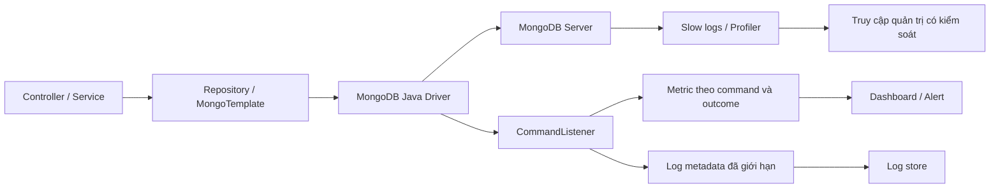

# Theo dõi command, query log và dữ liệu nhạy cảm trong tham số

> **Chương:** Bảo mật và vận hành · **Module:** `SPRING_DATA_MONGODB`. Khi sử dụng Spring Data MongoDB để truy vấn và cập nhật qua `MongoTemplate`, repository hoặc reactive access, việc quan sát hoạt động MongoDB giúp điều tra lỗi, độ trễ và truy vấn kém hiệu quả. Tuy nhiên, command và query có thể chứa email, số điện thoại, token, nội dung giao dịch hoặc dữ liệu cá nhân trong cả **điều kiện lọc lẫn tài liệu ghi**. Bài này hướng dẫn thu thập tín hiệu vận hành vừa đủ, kiểm soát log và kiểm tra không làm lộ dữ liệu nhạy cảm.

## 1. Bài toán: bật log để tìm truy vấn chậm, rồi vô tình lộ dữ liệu

Một dịch vụ tra cứu tài khoản theo email:

```java
Query query = Query.query(
    Criteria.where("email").is(emailFromRequest)
);
Customer customer = mongoTemplate.findOne(query, Customer.class);
```

Khi chậm, kỹ sư bật logging ở mức `DEBUG` cho MongoDB driver và thấy một command dạng khái niệm:

```javascript
{
  find: "customers",
  filter: { email: "sensitive-test@example.invalid" },
  limit: 1,
  $db: "shop"
}
```

Đây là **dữ liệu nhạy cảm trong tham số truy vấn** dù ứng dụng không trực tiếp gọi `logger.info("email={}", email)`. Một truy vấn `$in` có thể chứa hàng nghìn định danh khách hàng; một `update` có thể chứa địa chỉ, thông tin thanh toán hoặc thông tin cá nhân trong `$set`. Lệnh `aggregate` cũng có thể đặt dữ liệu đầu vào trong pipeline và một command `findAndModify` vừa có filter vừa có update.

Điều tra một truy vấn chậm thường chỉ cần:

- Lệnh loại gì: `find`, `aggregate`, `update`, `insert`, `getMore`?
- Lệnh thành công hay thất bại, mất bao lâu, tần suất thế nào?
- Vấn đề nằm ở MongoDB, pool kết nối, network, ứng dụng hay số lần gọi?
- Query shape nào gây chậm và có sử dụng index đúng không?

Những câu hỏi này **không đòi hỏi ghi toàn bộ giá trị BSON** vào application log, dashboard hay hệ thống trace.

### Ranh giới cần phân biệt

| Nguồn quan sát | Thu thập ở đâu | Có thể thấy gì? | Rủi ro nhạy cảm |
|---|---|---|---|
| `CommandListener` của MongoDB Java Driver | Trong tiến trình ứng dụng | Event start/success/failure; nếu chủ động đọc có thể thấy BSON command hoặc response | Rất cao nếu log `getCommand()`, `getResponse()` hoặc exception message |
| Logger của driver | Trong tiến trình ứng dụng | Thông tin kết nối, protocol, command tùy logger/level/phiên bản | DEBUG/TRACE có thể chứa nội dung truy vấn/response |
| Logger của Spring Data MongoDB | Trong tiến trình ứng dụng | Thao tác template, tiêu chí `Query`, mapping hoặc lifecycle | Có thể chứa filter, update và field nghiệp vụ |
| Slow query log của MongoDB server | Tại server/cluster | Thời lượng, namespace, plan summary và trường command tùy cấu hình | Có thể lưu tham số truy vấn trong log server |
| Database profiler (`system.profile`) | Bên trong database được cấu hình | Bản ghi thao tác, stats, thông tin command | Lưu bền dữ liệu có thể nhạy cảm, cần kiểm soát truy cập |
| Metrics/tracing | Hệ thống observability | Latency, lỗi, span, tags, một số attributes | Tags/attributes không kiểm soát vẫn có thể lộ tham số |
| Database audit | Cơ chế auditing riêng, nếu được cấp phép/cấu hình | Hành vi truy cập, quyền, thao tác quản trị theo audit policy | Phụ thuộc policy; không đồng nghĩa với query profiler |

**Nguyên tắc:** chỉ đưa dữ liệu thực sự cần cho mục đích quan sát vào hệ thống log/metrics/traces, và coi mọi nơi lưu các tín hiệu này là một vùng dữ liệu có quyền truy cập và thời hạn lưu riêng.

## 2. MongoDB command là gì, liên quan thế nào đến Spring Data?

Một lệnh Java:

```java
mongoTemplate.find(
    Query.query(Criteria.where("tenantId").is(tenantId)),
    Order.class
);
```

được Spring Data chuyển thành lệnh gửi qua MongoDB Java Driver. Driver có thể phát các sự kiện **Command Monitoring** cho command được thực thi.



Lệnh có thể khác tên method trong repository. Ví dụ:

- `findByEmail` của repository thường trở thành command `find`.
- `mongoTemplate.updateFirst(...)` thường tạo command `update`.
- Aggregation pipeline dùng command `aggregate`; việc đọc tiếp cursor có thể tạo `getMore`.
- `bulkOps` có thể tạo thao tác bulk mà tên command và dạng gói lệnh phụ thuộc driver/MongoDB version.

Command monitoring quan sát **các lần giao tiếp với server**, không phải một-một với request HTTP. Một request có thể chạy nhiều command, driver có thể retry thao tác đủ điều kiện, và cursor có thể tiếp tục phát `getMore` sau `find`/`aggregate` ban đầu.

### 2.1. Ba loại event cơ bản

API `com.mongodb.event.CommandListener` gồm:

- `commandStarted(CommandStartedEvent event)`: lệnh bắt đầu; cung cấp `commandName`, request ID, database name và BSON command (không nên log).
- `commandSucceeded(CommandSucceededEvent event)`: lệnh hoàn thành; có tên command, thời gian, request ID và BSON response (không nên log).
- `commandFailed(CommandFailedEvent event)`: lệnh lỗi; có tên command, thời gian, request ID và `Throwable` (message có thể chứa dữ liệu nhạy cảm).

Driver có cơ chế xử lý hoặc lược bỏ một số command nhạy cảm theo thông số kỹ thuật, nhưng **không được dựa vào việc này** để an toàn với các lệnh nghiệp vụ như `find`, `update` và `aggregate`.

`CommandListener` là cơ chế ở cấp driver; nó không tự biết email, token hoặc các field nghiệp vụ nào là dữ liệu nhạy cảm. Quyết định ghi log an toàn thuộc trách nhiệm ứng dụng.

## 3. Thiết kế telemetry theo danh sách cho phép

### 3.1. Phân loại dữ liệu từ đầu

Một policy thực tế:

| Loại dữ liệu | Ví dụ | Chính sách |
|---|---|---|
| Metadata có số giá trị hữu hạn | `command=find`, `outcome=success` | Cho phép dùng làm metric tag |
| Thông tin thời gian / số lượng | `durationMs`, số lỗi, số command | Cho phép đo, tổng hợp và alert |
| Mã tương quan ngắn, sinh ngẫu nhiên | Trace ID, request ID ở phạm vi đã hiểu | Chỉ đưa vào log/trace khi cần; không làm metric label |
| Giá trị query từ khách hàng | Email, phone, address, account ID, tenant ID | Không đưa vào log/metric tag mặc định |
| Tham số xác thực | URI credentials, password, secret, token, API key | Không log và không đưa vào exception/trace attribute |
| BSON command / response | `getCommand().toJson()`, `getResponse().toJson()` | Không lưu nguyên bản ở production telemetry |
| Thông tin môi trường | Hostname, database/collection name | Đánh giá có tiết lộ tenant/topology hay không trước khi dùng |

**Allowlist có lợi hơn blacklist:** blacklist `password` và `token` không bao quát được các field mới như `customer.profile.phone`, `identityNumber` hoặc dữ liệu nhạy cảm trong `$in` và pipeline nhiều cấp.

### 3.2. Query shape có thể thay thế giá trị query

Để phân nhóm các truy vấn chậm, thường muốn nhận diện **cấu trúc**:

```text
find customers WHERE email = ?
find orders WHERE tenantId = ? AND status = ? SORT createdAt DESC
aggregate orders MATCH tenantId = ? GROUP BY status
```

thay vì lưu giá trị thực:

```text
find customers WHERE email = "sensitive-test@example.invalid"
```

Việc chuẩn hóa query shape phải được thực hiện bằng parser/biểu diễn có cấu trúc hoặc cơ chế query-shape được hệ thống hỗ trợ. **Không** chỉ dùng regex thay chuỗi trong BSON JSON: giá trị có thể nằm trong mảng, nested operator, số, ngày, regex, `$expr`, pipeline và nhiều dạng Extended JSON.

Tên field hoặc collection đôi khi cũng nhạy cảm; chỉ đưa các nhãn shape vào hệ thống chung sau khi xem xét phân quyền và độ đa dạng giá trị. Ở môi trường có tenant riêng theo database/collection, ghi trực tiếp namespace vào metric tag dễ làm nổ cardinality và vô tình lộ định danh tenant.

## 4. Spring Boot: gắn `CommandListener` chỉ thu thập metadata an toàn

Ví dụ dùng Spring Boot 3.x, MongoDB Java Driver đồng bộ và Micrometer (được cung cấp qua Spring Boot Actuator). Ứng dụng sử dụng MongoDB auto-configuration của Spring Boot; nếu tự tạo `MongoClient`, phải gắn listener trong chính cấu hình client đó.

Dependency minh họa:

```groovy
dependencies {
    implementation 'org.springframework.boot:spring-boot-starter-data-mongodb'
    implementation 'org.springframework.boot:spring-boot-starter-actuator'
}
```

### 4.1. Cấu hình listener bằng `MongoClientSettingsBuilderCustomizer`

```java
import com.mongodb.event.CommandFailedEvent;
import com.mongodb.event.CommandListener;
import com.mongodb.event.CommandStartedEvent;
import com.mongodb.event.CommandSucceededEvent;
import io.micrometer.core.instrument.MeterRegistry;
import io.micrometer.core.instrument.Timer;
import java.util.Locale;
import java.util.Set;
import java.util.concurrent.TimeUnit;
import org.slf4j.Logger;
import org.slf4j.LoggerFactory;
import org.springframework.boot.autoconfigure.mongo.MongoClientSettingsBuilderCustomizer;
import org.springframework.context.annotation.Bean;
import org.springframework.context.annotation.Configuration;

@Configuration(proxyBeanMethods = false)
public class MongoCommandTelemetryConfig {

    @Bean
    MongoClientSettingsBuilderCustomizer safeMongoCommandMonitoring(
            MeterRegistry meterRegistry) {

        return builder -> builder.addCommandListener(
            new SafeCommandListener(meterRegistry)
        );
    }

    static final class SafeCommandListener implements CommandListener {

        private static final Logger log =
            LoggerFactory.getLogger(SafeCommandListener.class);

        private static final Set<String> ALLOWED_COMMANDS = Set.of(
            "find", "aggregate", "getmore", "insert", "update",
            "delete", "findandmodify", "count", "distinct",
            "createindexes", "dropindexes", "committransaction",
            "aborttransaction"
        );

        private final MeterRegistry registry;

        SafeCommandListener(MeterRegistry registry) {
            this.registry = registry;
        }

        private static String safeCommand(String name) {
            if (name == null) {
                return "other";
            }
            String normalized = name.toLowerCase(Locale.ROOT);
            return ALLOWED_COMMANDS.contains(normalized)
                ? normalized : "other";
        }

        private void measure(String command, String outcome, long nanos) {
            Timer.builder("mongodb.driver.command.duration")
                .description("Driver command duration by safe command name")
                .tag("command", safeCommand(command))
                .tag("outcome", outcome)
                .register(registry)
                .record(nanos, TimeUnit.NANOSECONDS);
        }

        @Override
        public void commandStarted(CommandStartedEvent event) {
            // Mặc định không ghi 1 log cho mỗi command.
            // Không truy cập event.getCommand() để tạo message.
        }

        @Override
        public void commandSucceeded(CommandSucceededEvent event) {
            long elapsed = event.getElapsedTime(TimeUnit.NANOSECONDS);
            measure(event.getCommandName(), "success", elapsed);
        }

        @Override
        public void commandFailed(CommandFailedEvent event) {
            long elapsed = event.getElapsedTime(TimeUnit.NANOSECONDS);
            measure(event.getCommandName(), "failure", elapsed);

            if (log.isDebugEnabled()) {
                log.debug(
                    "mongo command failed: command={}, durationMs={}, "
                        + "failureType={}",
                    safeCommand(event.getCommandName()),
                    TimeUnit.NANOSECONDS.toMillis(elapsed),
                    event.getThrowable().getClass().getSimpleName()
                );
            }
            // Không ghi getThrowable().getMessage() hoặc stacktrace
            // một cách tự động vào luồng log mặc định.
        }
    }
}
```

Ở đây, tên command chỉ có thể thuộc một tập giá trị nhỏ, kết quả chỉ là `success` hoặc `failure`, và thời gian đo bằng số. Không có `databaseName`, filter BSON, command JSON, response JSON, user ID hay query parameter trong log/metric.

Đặc biệt, không viết:

```java
// KHÔNG dùng trong production:
log.debug("Mongo command: {}", event.getCommand().toJson());
log.debug("Mongo response: {}", event.getResponse().toJson());
log.error("Mongo failed", event.getThrowable());
```

Đoạn cấm trên minh họa những đường rò rỉ cần phát hiện khi review. Stacktrace hoặc error message có thể chứa namespace, thành phần query, giá trị unique key hoặc nội dung exception từ tầng khác. Nếu điều tra cần stacktrace, hãy kiểm soát quyền và thực hiện phân loại/redaction phù hợp, không tự động đẩy vào log chung.

### 4.2. Cách đọc metric mà không làm bùng nổ cardinality

Metric `mongodb.driver.command.duration` được phân nhóm bởi:

- `command`: một trong các giá trị allowlist, còn lại là `other`;
- `outcome`: `success` hoặc `failure`.

Không gắn `requestId`, `traceId`, `customerId`, `tenantId`, `email`, `queryJson` hay `connectionId` vào metric tag. Các trường này có thể tạo hàng triệu chuỗi thời gian khác nhau hoặc tiết lộ thông tin.

Micrometer có thể xuất `Timer` dưới tên/đơn vị cụ thể tùy registry. Ví dụ Prometheus có quy tắc đổi tên metric và chuyển đơn vị sang giây; vì vậy nên kiểm tra tên metric thực tế được exporter tạo thay vì giả định mọi hệ thống dùng đúng chuỗi Java trong dashboard.

### 4.3. Lưu ý riêng về `getMore` và việc thực thi listener

`getMore` có thể chờ dữ liệu khi đọc cursor, đặc biệt ở **change streams/tailable cursors**. Một lần `getMore` mất nhiều thời gian chưa chắc là truy vấn có index kém. Nên xây dashboard riêng cho loại này hoặc tránh gộp tất cả command vào một chỉ số p95 duy nhất.

Callback của driver có thể chạy trên thread thực thi I/O/driver. Code listener cần **nhanh, không chặn**: không truy vấn MongoDB từ chính callback để lưu log (gây lặp), không gửi HTTP đồng bộ đến hệ thống tập trung và không dựng JSON của toàn bộ command. Nếu cần xử lý thêm, dùng hàng đợi có giới hạn và chính sách bỏ mẫu/đếm lỗi khi quá tải.

## 5. Phân biệt log của driver và Spring Data MongoDB

### 5.1. Logger của MongoDB Java Driver

Tên logger cụ thể có thể khác theo driver version, nhưng các nhóm thường gặp gồm:

- `org.mongodb.driver.protocol.command` — thông tin protocol/command;
- `org.mongodb.driver.connection` — lifecycle kết nối;
- `org.mongodb.driver.cluster` — topology, khám phá và trạng thái cluster;
- `org.mongodb.driver.operation` — các thao tác driver.

Ở mức `DEBUG` hoặc `TRACE`, command logger có thể ghi cấu trúc lệnh hoặc giá trị query. Một số command được driver lược bỏ vì nhạy cảm, nhưng **dữ liệu nghiệp vụ trong `find`/`update`/`aggregate` không được coi là đã tự động che an toàn**.

Với Spring Boot, cấu hình mức log có thể theo dạng:

```yaml
logging:
  level:
    root: INFO
    org.mongodb.driver.protocol.command: WARN
    org.mongodb.driver.connection: WARN
    org.springframework.data.mongodb.core: WARN
```

Đây là cấu hình thận trọng cho môi trường thường ngày, không thay thế việc kiểm tra log từ những thư viện khác. Nếu cần điều tra theo thời điểm ở môi trường kiểm soát, chỉ bật DEBUG có thời hạn sau khi đã đánh giá dữ liệu được xuất, quyền đọc log và cách thu hồi. Không mở DEBUG lâu dài trên production chỉ để tìm một slow query.

### 5.2. Spring Data có thể log `Query` hoặc `Update`

Trong Spring Data MongoDB, các API như:

```java
Query query = Query.query(
    Criteria.where("email").is(emailFromRequest)
);
Update update = new Update()
    .set("contactPhone", phoneFromRequest);

mongoTemplate.updateFirst(query, update, Customer.class);
```

có thể làm lộ giá trị khi code viết:

```java
// KHÔNG log đối tượng chứa giá trị từ request:
log.info("query={}, update={}", query, update);
log.info("payload={}", requestDto);
```

Ngay cả khi đã tắt driver command DEBUG, log do code ứng dụng hoặc interceptor tùy biến vẫn có thể ghi tham số. Vì vậy, rà soát toàn bộ logger, AOP aspect, exception handler, access log, trace attribute và interceptor truy cập dữ liệu.

**Mẫu an toàn hơn:**

```java
long started = System.nanoTime();

try {
    var result = mongoTemplate.updateFirst(query, update, Customer.class);
    log.debug(
        "customer update completed: operation={}, matched={}",
        "contact-update",
        result.getMatchedCount()
    );
} finally {
    long elapsedMs = TimeUnit.NANOSECONDS.toMillis(
        System.nanoTime() - started
    );
    // Metric hoặc log chỉ số tổng hợp, không xuất query/update/DTO.
}
```

Đoạn trên minh họa **ranh giới dữ liệu**; nếu dùng metrics ở service, tránh đếm hai lần cùng một metric với listener của driver vì hai cấp đo có ngữ nghĩa khác nhau. Metric service bao gồm mapping/business logic; metric driver chỉ bao gồm command.

### 5.3. Tham số trong exception và log tự động

Một số lỗi dễ kèm dữ liệu:

- `DuplicateKeyException` hoặc lỗi duplicate key từ MongoDB có thể chứa tên index và giá trị khóa trùng.
- `MongoCommandException` hoặc exception driver có thể chứa thông báo lỗi trả về từ server.
- Log filter hoặc payload do HTTP layer tạo có thể xuất chính tham số đã dùng trong query.
- Hệ thống APM tự động thu thập `db.statement`, `db.query.text` hoặc thuộc tính tương đương có thể ghi câu lệnh với giá trị cụ thể, tùy instrument/version/config.

Không mặc định “chỉ log exception” là an toàn. Chọn **mã lỗi/loại lỗi/nhóm command** để quan sát mặc định; khi cần nội dung đầy đủ, mở quy trình hỗ trợ có kiểm soát, thời hạn lưu ngắn và phân quyền riêng.

## 6. Slow query log và database profiler: quan sát ở phía server

### 6.1. Slow operation logging

MongoDB server có thể ghi những thao tác vượt ngưỡng chậm vào diagnostic/structured log. Các bản ghi có thể chứa:

- Command hoặc nội dung rút gọn của command;
- Namespace, plan summary, index/query thông tin;
- Thời lượng, số khóa/document đã xét, cursor/lock/yield tùy phiên bản;
- Dữ liệu client và correlation metadata tùy cấu hình.

Các trường cụ thể phụ thuộc phiên bản MongoDB, query engine và môi trường triển khai. **Không giả định server log đã ẩn mọi giá trị nhạy cảm** chỉ vì một vài command đặc biệt được driver redacted.

Các hệ thống MongoDB được quản lý (ví dụ Atlas) có tính năng giám sát slow operations và Performance Advisor; quyền truy cập và khả năng bật profiler trực tiếp có thể khác với một deployment tự quản lý. Luôn dựa trên tài liệu và quyền của cluster đang dùng.

### 6.2. Database profiler và collection `system.profile`

MongoDB database profiler thu thập thông tin về thao tác database vào collection hệ thống `system.profile` của database được cấu hình. Chế độ cơ bản thường là:

| Profiling level | Ý nghĩa tổng quát |
|---|---|
| `0` | Không ghi profiling cho thao tác |
| `1` | Ghi các thao tác chậm theo ngưỡng/cấu hình phù hợp |
| `2` | Ghi tất cả thao tác đủ điều kiện, gây overhead cao hơn |

**Không bật level 2 trên production theo thói quen.** Profiler làm tăng I/O/chi phí, và bản ghi của nó có thể lưu **command với tham số nhạy cảm** ngay trong database. Ngoài ra, profiler level khác với cơ chế server logging; tắt profiler không có nghĩa slow log của server chắc chắn đã tắt.

Ví dụ kiểm tra trạng thái hiện tại trong `mongosh`:

```javascript
use shop

const before = db.getProfilingStatus();
printjson(before);
```

Chỉ trên **môi trường lab/staging được cho phép**, nếu MongoDB triển khai hỗ trợ và tài nguyên đáp ứng, có thể chủ động thử profiling thao tác chậm:

```javascript
// Ví dụ lab: điều chỉnh ngưỡng và tỷ lệ theo phiên bản/server.
db.setProfilingLevel(1, {
  slowms: 100,
  sampleRate: 0.1
});

// Chạy workload kiểm thử với dữ liệu giả trong thời gian ngắn.
```

Khi đọc, **chỉ chọn metadata cần thiết**:

```javascript
db.system.profile.find(
  {},
  {
    _id: 0,
    ts: 1,
    ns: 1,
    millis: 1,
    planSummary: 1,
    keysExamined: 1,
    docsExamined: 1
  }
).sort({ ts: -1 }).limit(20);
```

Phép projection giới hạn dữ liệu được **trả ra trong truy vấn này**, nhưng không xóa trường nhạy cảm đã được ghi vào `system.profile`. Người có quyền đọc toàn bộ collection vẫn có thể thấy chúng. Khi hoàn tất phép thử, hoàn nguyên profiling theo runbook, ví dụ:

```javascript
// before là kết quả db.getProfilingStatus() đã lưu trong cùng session.
db.setProfilingLevel(before.was, {
  slowms: before.slowms,
  sampleRate: before.sampleRate
});
```

Cú pháp/khả năng hỗ trợ `sampleRate` và các tùy chọn có thể khác giữa phiên bản và triển khai quản lý; kiểm tra trạng thái sau khi hoàn nguyên, không coi ví dụ là lệnh phù hợp cho mọi cluster. Nếu không có quyền thay đổi profiling, dùng công cụ quan sát chính thức của cluster.

### 6.3. Profiler không phải audit log

**Profiler/slow log** giúp chẩn đoán hiệu năng. **Database auditing** (nếu deployment hỗ trợ và đã cấu hình) có mục tiêu theo dõi sự kiện truy cập và thao tác quản trị theo policy. Audit có cơ chế quyền, lọc và lưu trữ riêng. Không kết luận rằng đã có bằng chứng tuân thủ chỉ vì `system.profile` có dữ liệu.

Khi điều tra cần biết “ai đã xem hoặc sửa thông tin nào”, phối hợp audit policy, ứng dụng và quy trình phân quyền; tránh dựa vào query log có thể thiếu, bị sampling hoặc chứa dữ liệu không nên giữ.

## 7. Kết nối telemetry từ ứng dụng tới MongoDB

### 7.1. Correlation ID, request ID và trace ID

Có ít nhất ba dạng định danh:

| Định danh | Phạm vi | Cách dùng |
|---|---|---|
| HTTP/request trace ID | Vòng đời request trong ứng dụng | Tìm tương quan giữa service log và trace |
| MongoDB driver `requestId` | Tương quan các event command trong phạm vi kết nối/request của driver | Debug ở cấp driver khi cần |
| MongoDB server operation metadata | Lệnh/operation ở phía server, tùy công cụ và phiên bản | Ghép với thông tin log server nếu có cơ sở chắc chắn |

**Không đồng nhất** MongoDB driver `requestId` với HTTP request ID. Với reactive processing và I/O thread, `MDC` truyền theo thread thông thường không tự động phản ánh context của subscriber. Nên dùng tracing instrumentation được Spring Boot/driver stack hỗ trợ và cấu hình chính sách attribute; không tự suy diễn trace ID từ event command.

Nếu dùng lệnh MongoDB `comment` hoặc query comment để hỗ trợ tìm operation, **chỉ đưa định danh nội bộ ngẫu nhiên, giới hạn độ dài, không nhúng email, token, JWT, tenant name hoặc nội dung request**. Comment cũng có thể xuất hiện trong server log/profiler.

### 7.2. Dùng duration, error và pool metrics để chẩn đoán

Một query chậm ở HTTP có thể do nhiều nguồn:

```text
HTTP request 320 ms
├─ Validate/serialize/app work       15 ms
├─ Chờ lấy connection / scheduling   170 ms
├─ Mongo command                     80 ms
└─ Network/response/other            55 ms
```

Các số chỉ minh họa. `CommandSucceededEvent` cho thời gian của command ở cấp driver, không chứng minh toàn bộ thời gian ứng dụng đã tiêu thụ. Nếu service bị nghẽn connection pool, metric command có thể rất thấp trong khi request latency cao. Kết hợp:

- HTTP server latency và error rate;
- MongoDB command duration/error theo loại command;
- connection pool sử dụng, chờ, timeout;
- server CPU/I/O, replication lag, slow operations;
- trace liên kết các bước ở tầng ứng dụng.

Không biến collection, người dùng, query value thành dimension metrics chỉ vì muốn lọc sâu trên dashboard.

## 8. Query log an toàn qua ví dụ nghiệp vụ

### 8.1. Đọc theo email

**Không an toàn:**

```java
log.info("Searching customer by email={}", emailFromRequest);
log.debug("Mongo query={}", query.getQueryObject().toJson());
```

**An toàn hơn trong log mặc định:**

```java
log.debug(
    "customer lookup finished: operation={}, found={}",
    "customer-by-email",
    customer != null
);
```

Có thể dùng một nhãn `operation` do ứng dụng định nghĩa và có giới hạn giá trị, không phải email. Nếu cần đo tần suất lỗi theo loại khách hàng, phân nhóm theo tiêu chí không định danh và được chấp thuận.

### 8.2. Update có nhiều trường nhạy cảm

Một lệnh cập nhật:

```javascript
db.customers.updateOne(
  { _id: "customer-test-001" },
  {
    $set: {
      "contact.email": "private-test@example.invalid",
      "contact.phone": "000-TEST-ONLY"
    }
  }
);
```

Các giá trị phía trên chỉ là **dữ liệu thử nghiệm giả**, nhưng trong production có thể là dữ liệu cá nhân. Nếu interceptor ghi toàn bộ `Update` hoặc command BSON, thông tin sẽ đi theo đường:

```text
HTTP input → Query / Update → Driver command → Log formatter
                                         └──→ Log agent → Central storage
                                                          └──→ Dashboard / Ticket
```

Một khi đã có dữ liệu trong log tập trung, việc đổi level logging về `WARN` **không xóa** các bản ghi đã được thu thập. Cần xử lý retention, xóa theo chính sách và đánh giá những nơi đã sao chép dữ liệu.

### 8.3. Aggregation pipeline và giá trị lồng nhau

Ví dụ có tham số trong `$match`:

```javascript
db.orders.aggregate([
  { $match: { tenantId: "tenant-example", contactEmail: "private-test@example.invalid" } },
  { $group: { _id: "$status", total: { $sum: 1 } } }
]);
```

Dữ liệu nhạy cảm có thể xuất hiện ở nhiều vị trí trong pipeline, không chỉ ở `find.filter`. Một giải pháp redaction chỉ xử lý khóa tên `email` ở mức root sẽ bỏ sót `$match.contactEmail`, mảng `$or` hoặc các stage khác.

**Quy tắc review:** nếu không chứng minh được một biểu diễn command đã được chuẩn hóa an toàn cho mọi toán tử đang hỗ trợ, đừng đưa biểu diễn đó vào log. Dùng nhãn operation, tên command đã allowlist, duration và outcome là đường đi mặc định.

## 9. Kiểm thử bảo mật log và metric

### 9.1. Test bằng sentinel giả

Sử dụng một chuỗi không phải thông tin người dùng thật, có hình dạng dễ nhận biết, ví dụ `SENSITIVE_TEST_SENTINEL_7E42`. Gửi nó qua query và update trong môi trường integration test, sau đó kiểm tra **log do ứng dụng tạo ra không chứa sentinel**.

Ví dụ Spring Boot/JUnit 5, giả định test context có `MongoTemplate` kết nối tới database test riêng:

```java
import static org.assertj.core.api.Assertions.assertThat;

import org.junit.jupiter.api.Test;
import org.junit.jupiter.api.extension.ExtendWith;
import org.springframework.beans.factory.annotation.Autowired;
import org.springframework.boot.test.autoconfigure.data.mongo.DataMongoTest;
import org.springframework.boot.test.system.CapturedOutput;
import org.springframework.boot.test.system.OutputCaptureExtension;
import org.springframework.data.mongodb.core.MongoTemplate;
import org.springframework.data.mongodb.core.query.Criteria;
import org.springframework.data.mongodb.core.query.Query;

@DataMongoTest
@ExtendWith(OutputCaptureExtension.class)
class MongoLoggingPrivacyIT {

    @Autowired
    MongoTemplate template;

    @Test
    void queryParameterNeverAppearsInApplicationConsole(CapturedOutput logs) {
        String sentinel = "SENSITIVE_TEST_SENTINEL_7E42";

        Query query = Query.query(
            Criteria.where("contactEmail").is(sentinel)
        );

        template.find(query, org.bson.Document.class, "customers_test");

        assertThat(logs.getAll()).doesNotContain(sentinel);
    }
}
```

**Giới hạn của test này:** `CapturedOutput` chỉ đọc stdout/stderr mà cơ chế capture nắm được trong suite. Nó không tự chứng minh các hệ thống APM, log agent, MongoDB server log, profiler hay cloud export đều đã loại bỏ tham số. Phải có kiểm thử riêng cho từng sink và chính sách instrumentation đang triển khai.

### 9.2. Đo đúng hành vi của listener

Một bộ test riêng cho `SafeCommandListener` nên xác nhận:

1. Một event `commandSucceeded` tên `find` làm tăng timer tương ứng, không có tag giá trị email.
2. Một tên command không nằm trong allowlist được gắn tag `command=other`, tránh cardinality không kiểm soát.
3. `commandFailed` ghi `outcome=failure` và không log message, command BSON hay stacktrace chứa sentinel.
4. Các command thành công/thất bại vẫn có thời gian đo; không phụ thuộc vào `commandStarted` đã log.
5. Logger level ở production/staging không vô tình bật raw protocol command logging.

Có thể tạo event bằng mock trong unit test, nhưng **không dùng mock để thay thế integration test kiểm tra thực tế logger và driver**. Nếu trong test cố tình bật DEBUG của driver, hãy dùng dữ liệu giả và bảo đảm không gửi output sang log sink production.

### 9.3. Kiểm tra cấu hình trước khi phát hành

| Kiểm tra | Điều cần đạt |
|---|---|
| Logging level production | Không bật `DEBUG/TRACE` cho command hoặc query logger ngoài phiên điều tra được kiểm soát |
| Custom `CommandListener` | Chỉ đọc metadata đã cho phép; không log command/response BSON |
| Logger ứng dụng/AOP | Không log `Query`, `Update`, DTO/HTTP body chứa thông tin nhạy cảm |
| Metrics labels | Có cardinality giới hạn; không có email, token, userId, tenantId hoặc query JSON |
| Tracing attributes | Không thu thập raw statement/command nếu chưa được xử lý an toàn |
| Server slow logs/profiler | Có phân quyền, retention và chính sách sampling/profiling rõ |
| Credential trong Mongo URI | Không bị ghi vào log khởi tạo client, health endpoint hoặc exception |
| CI sentinel test | Không thấy sentinel ở các sink được kiểm tra |
| Truy cập log tập trung | Phân quyền theo vai trò, ghi nhận truy cập và giới hạn thời hạn lưu |
| Tắt diagnostic level | Có thời gian hết hạn và xác nhận đã quay về cấu hình bình thường |

## 10. Triển khai vận hành và xử lý khi phát hiện rò rỉ

### 10.1. Mặc định an toàn cho production

- Dùng `CommandListener`/metrics nhẹ để theo dõi thời gian và tỷ lệ lỗi.
- Chỉ bật log chi tiết khi cần, có thời hạn và người chịu trách nhiệm rõ.
- Bảo vệ credentials trong URI kết nối, cấu hình và các bản ghi exception.
- Giới hạn quyền đọc log, profiler, audit; mã hóa truyền/lưu theo chính sách tổ chức.
- Thiết lập retention ngắn nhất đủ cho mục tiêu vận hành và cơ chế xóa khi hết hạn.
- Tránh xuất dữ liệu log nhạy cảm sang ticket, email, chat hoặc dashboard có quyền rộng hơn.
- Đánh giá tải của profiler, listener và log exporter; không để hệ thống quan sát làm hệ thống chính nghẽn.

Khi xử lý sự cố, **ưu tiên** bản ghi metadata theo loại command/thời lượng/lỗi, slow query metrics và `explain` với dữ liệu giả/đã tối giản trên môi trường kiểm soát. Nếu bắt buộc phân tích command thật có dữ liệu cá nhân, phải áp dụng quy trình truy cập, bảo vệ và xóa dữ liệu phù hợp.

### 10.2. Nếu phát hiện tham số nhạy cảm đã vào log

Quy trình phản ứng theo phạm vi sự cố:

1. **Ngăn phát sinh thêm:** tắt logger hoặc interceptor ghi dữ liệu thô; kiểm tra cả driver, Spring Data, custom listener và APM.
2. **Khoanh vùng:** tìm thời điểm, nguồn, sink, nhóm dữ liệu, quyền truy cập và bản sao đã tạo; tránh sao chép thêm nội dung nhạy cảm vào ticket điều tra.
3. **Đánh giá ảnh hưởng:** phân biệt dữ liệu cá nhân, dữ liệu nghiệp vụ và secrets/credentials; nếu là secrets, kích hoạt quy trình xoay vòng/thu hồi tương ứng.
4. **Xử lý bản ghi đã tồn tại:** phối hợp với quản trị log, retention, backup và quy trình xử lý sự cố của tổ chức; chỉ thay đổi cấu hình log không giải quyết được dữ liệu đã phát tán.
5. **Chặn tái diễn:** bổ sung sentinel test, review hook logging và kiểm tra tags/attributes trước đợt phát hành tiếp theo.

Trong mọi bước, nguyên tắc là tối thiểu hóa việc tiếp xúc với dữ liệu thật khi điều tra sự cố logging.

## 11. Bài thực hành: đo chậm mà không ghi tham số

**Bối cảnh:** API `GET /orders` nhận tenant và trạng thái từ request, sau đó gọi `MongoTemplate` để truy vấn. Phần vận hành cần biết `find` có chậm và tỷ lệ lỗi tăng không; nhóm tối ưu dữ liệu cần biết query shape nào phải xây index.

Thực hiện trong môi trường test với dữ liệu giả:

1. Cấu hình `SafeCommandListener` theo mục 4 và bật Actuator/metrics theo cấu hình có phân quyền.
2. Gửi truy vấn `find` với `tenantId` và `status` mang giá trị giả, xác nhận timer `command=find` và `outcome=success` xuất hiện.
3. Dùng sentinel ở điều kiện `Criteria.where("contactEmail")`, xác nhận application logs không chứa sentinel.
4. Gây một lỗi MongoDB có chủ đích trong test, xác nhận metric có `outcome=failure`; kiểm tra log không chứa command JSON, exception message hay query parameter.
5. Quan sát `getMore` khi dùng cursor/Change Stream, phân biệt thời gian chờ dữ liệu với độ chậm của truy vấn `find`.
6. Xem `explain("executionStats")` của query shape trên dữ liệu giả để đánh giá index, tránh sao chép filter chứa giá trị người dùng vào ticket.
7. Nếu môi trường lab cho phép profiler, đọc projection metadata của `system.profile`, xác nhận quyền truy cập và khôi phục level trước đó sau thử nghiệm.
8. Kiểm tra log exporter/tracing theo sink thực tế: sentinel không xuất hiện ở nơi nào đã khai báo là không lưu raw parameters.

### Tình huống đánh giá

| Hiện tượng | Nguyên nhân có thể | Hướng kiểm tra |
|---|---|---|
| HTTP p95 cao, command latency thấp | Chờ connection, ứng dụng, mạng hoặc serialization | Xem connection pool, trace và end-to-end latency |
| Command `getMore` lâu | Cursor chờ dữ liệu, đặc biệt Change Stream | Tách loại command; xem semantics cursor |
| Command `find` chậm và server scan nhiều | Index không khớp filter/sort | Dùng `explain` đã kiểm soát dữ liệu |
| Metrics có hàng trăm nghìn series | Gắn giá trị email/user/tenant/request ID làm tag | Gỡ tags động, đưa về allowlist hữu hạn |
| Log không có raw query nhưng APM vẫn lộ tham số | Trace instrumentation ghi database statement | Kiểm soát attributes ở tracer/exporter |
| Tắt Spring Data DEBUG mà log vẫn lộ query | Custom listener, driver logger, HTTP logger hoặc server profiler | Kiểm tra từng tầng và từng sink riêng |
| `system.profile` có command nhạy cảm | Đã bật profiler ghi thao tác thật | Kiểm soát truy cập và retention, giảm phạm vi profiler |

## 12. Câu hỏi tự kiểm tra

1. Vì sao `CommandListener` có thể ghi lộ email dù code service không log tham số?
2. `CommandStartedEvent.getCommand()` và `CommandSucceededEvent.getResponse()` khác metadata `getCommandName()` ở nguy cơ nào?
3. Tại sao tên database/collection không phải lúc nào cũng là metric tag an toàn?
4. Vì sao `requestId` của MongoDB không thể tự động coi là HTTP trace ID?
5. `getMore` mất nhiều thời gian trong Change Stream có chứng minh query có index xấu không?
6. Tại sao dùng regex thay mọi chuỗi trong `toJson()` khó bảo đảm redaction đúng?
7. Nếu `system.profile.find()` chỉ project metadata, điều đó có xóa field nhạy cảm trong dữ liệu profiler đã lưu không?
8. Khi logger driver đã trở về `WARN`, cần làm gì với bản ghi cũ trong log store?
9. Một phép test `CapturedOutput` không thấy sentinel có đủ kết luận tracing và slow log phía server an toàn không?
10. Khi nhận `DuplicateKeyException`, vì sao không nên log nguyên `Throwable` lên hệ thống log chung?
11. Để điều tra truy vấn chậm, nên ưu tiên những số liệu và query-shape nào trước khi cân nhắc dữ liệu raw?
12. Sự khác nhau giữa log/metrics về hiệu năng và database auditing là gì?

## 13. Ghi nhớ

- **Theo dõi command:** `CommandListener` cung cấp sự kiện và thời gian thực thi ở cấp driver; logger DEBUG có thể nhìn thấy nội dung lệnh, vì vậy chỉ thu thập metadata cần thiết.
- **Theo dõi query chậm:** kết hợp metrics phía ứng dụng, MongoDB server logs, `explain` và profiler khi được phép; hiểu rằng từng nguồn có phạm vi và chi phí khác nhau.
- **Bảo vệ tham số:** giá trị filter, update, aggregation, response và exception đều có thể nhạy cảm. Ưu tiên danh sách trường cho phép và số liệu tổng hợp.
- **Bảo vệ telemetry:** giới hạn metric tag, trace attribute, quyền truy cập, thời hạn lưu và test sentinel trên từng sink.
- **Vận hành an toàn:** log chi tiết phải có mục tiêu, thời hạn và phương án thu hồi; đừng coi việc tắt DEBUG là đã xóa dữ liệu từng được ghi.

### Tài liệu tham khảo

- [MongoDB Java Driver — Command Monitoring](https://www.mongodb.com/docs/drivers/java/sync/current/logging-monitoring/monitoring/)
- [MongoDB Java Driver — Logging](https://www.mongodb.com/docs/drivers/java/sync/current/logging-monitoring/logging/)
- [MongoDB Manual — Database Profiler](https://www.mongodb.com/docs/manual/tutorial/manage-the-database-profiler/)
- [MongoDB Manual — Analyze Query Performance](https://www.mongodb.com/docs/manual/tutorial/analyze-query-plan/)
- [MongoDB Manual — Diagnostic Log Messages](https://www.mongodb.com/docs/manual/reference/log-messages/)
- [MongoDB Manual — Auditing](https://www.mongodb.com/docs/manual/core/auditing/)
- [Spring Data MongoDB — Logging](https://docs.spring.io/spring-data/mongodb/reference/mongodb/logging.html)
- [Spring Boot — Observability](https://docs.spring.io/spring-boot/reference/actuator/observability.html)
- [Micrometer — Timers](https://docs.micrometer.io/micrometer/reference/concepts/timers.html)
