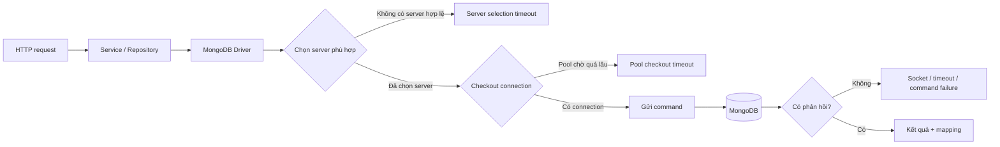

# Health indicator, pool metric và lỗi server selection trong Spring Data MongoDB

Trong ứng dụng Java dùng **Spring Data MongoDB**, một API có thể đang chạy bình thường nhưng không thể truy vấn MongoDB vì mất primary, cấu hình DNS/TLS sai hoặc connection pool bị nghẽn. Khi ấy câu hỏi vận hành quan trọng không chỉ là **“MongoDB còn sống không?”** mà là **“ứng dụng có chọn được server phù hợp, lấy được connection từ pool và hoàn tất thao tác dữ liệu với độ trễ chấp nhận được không?”**.

Bài thuộc chương **Bảo mật và vận hành** của module `SPRING_DATA_MONGODB`: ứng dụng kết nối và ánh xạ document qua `MongoTemplate`/repository, sử dụng query, aggregation, index, transaction, reactive access và kiểm thử hiệu năng. Nội dung tập trung vào ba công cụ: **health indicator**, **metric của connection pool** và **chẩn đoán lỗi server selection**, kết hợp với quyền truy cập, cấu hình an toàn và kiểm thử sự cố.

## 1. Ba lớp kiểm tra tình trạng kết nối

Hãy phân biệt các điểm lỗi trong một lời gọi `repository.findById(...)` hoặc `mongoTemplate.find(...)`:



| Tầng | Cần trả lời | Dấu hiệu chính |
| --- | --- | --- |
| **Server discovery/selection** | Driver tìm được server phù hợp với read preference/write operation và topology không? | `MongoTimeoutException` kèm thông báo chờ server phù hợp, topology `UNKNOWN`, không thấy primary |
| **Connection pool** | Đã chọn server nhưng có connection khả dụng và mượn được kịp không? | Checkout wait, `ConnectionCheckOutFailedEvent`, lỗi wait queue/checkout timeout |
| **Command và dữ liệu** | Command đã gửi có chạy và trả kết quả đúng không? | `CommandListener`, socket read/write errors, authorization, duplicate key, server overload |

**Một lỗi ở tầng trước có thể khiến tầng sau hoàn toàn không diễn ra.** Vì vậy không nên thấy “timeout” rồi lập tức tăng `maxPoolSize` hoặc giả định MongoDB đang quá tải. Chọn server thất bại có thể xảy ra ngay cả khi pool chưa bị sử dụng.

Đồng thời, một command `ping` thành công không chứng minh các thao tác ghi, quyền collection, độ trễ p95, transaction hay aggregation của ứng dụng đều hoạt động tốt.

## 2. MongoDB Health Indicator với Spring Boot Actuator

### 2.1. Health indicator làm gì?

Khi ứng dụng dùng Spring Boot Actuator và MongoDB auto-configuration thích hợp, Boot thường tự cung cấp một **MongoDB health contributor** (thường xuất hiện dưới tên `mongo`) để kiểm tra kết nối/hoạt động MongoDB thông qua driver/template. Với stack synchronous có `MongoHealthIndicator`; stack reactive có health contributor tương ứng. Câu lệnh chi tiết được thực hiện bởi health indicator có thể thay đổi theo phiên bản Spring Boot, vì vậy không nên cố định giả định rằng mọi bản Boot đều chỉ chạy `ping`.

Trạng thái quan sát thường là:

- `UP`: health check của contributor đã hoàn thành thành công tại thời điểm gọi.
- `DOWN`: contributor không thể hoàn tất kiểm tra và báo trạng thái lỗi.
- `UNKNOWN`/trạng thái khác: phụ thuộc cách tổ chức contributor, health group và cấu hình.

Các đường dẫn phổ biến: `GET /actuator/health` và, nếu bật probes, `GET /actuator/health/liveness`, `GET /actuator/health/readiness`. Không suy từ HTTP 200 đơn lẻ rằng **mọi** contributor trong health group đều `UP`; phải biết nội dung group và cách status mapping được cấu hình.

### 2.2. Cấu hình health và readiness

Ví dụ cấu hình Spring Boot bằng `application.yml`:

```yaml
spring:
  data:
    mongodb:
      uri: ${MONGODB_URI}

management:
  endpoint:
    health:
      probes:
        enabled: true
      show-details: when_authorized
      group:
        readiness:
          include: readinessState,mongo
  endpoints:
    web:
      exposure:
        include: health,info
```

Trong ví dụ, `${MONGODB_URI}` là chỗ điền URI từ **biến môi trường hoặc secret manager**; không lưu mật khẩu trực tiếp trong source code. Nếu triển khai Spring Boot bằng biến môi trường, cấu hình thực tế có thể dùng placeholder tương ứng của Spring, ví dụ một biến `MONGODB_URI` được hệ thống triển khai truyền vào.

**Vì sao đưa `mongo` vào readiness?** Nếu API không thể xử lý request quan trọng khi không kết nối được MongoDB, readiness nên phản ánh tình trạng này để load balancer ngừng chuyển lưu lượng tới instance có dependency chưa sẵn sàng. Ngược lại, việc thêm MongoDB vào **liveness** có thể gây khởi động lại hàng loạt instance khi database bị sự cố chung; liveness nên phản ánh khả năng tiến trình tự hoạt động và tự phục hồi, theo thiết kế deployment.

Trong nhiều hệ thống, nên giữ readiness đơn giản nhưng đại diện cho dependency **thiết yếu**. Một truy vấn health quá nặng chạy thường xuyên có thể tăng tải MongoDB hoặc gây lỗi giả khi server đang bận. Cần xác nhận security và timeout của health endpoint.

### 2.3. Thực hiện phép kiểm tra đơn giản bằng MongoTemplate

Khi cần chẩn đoán trong môi trường kiểm thử hoặc cung cấp một probe tùy chỉnh, có thể chạy lệnh `ping` trên database đã cấu hình:

```java
import org.bson.Document;
import org.springframework.data.mongodb.core.MongoTemplate;

public final class MongoPingProbe {
    private final MongoTemplate template;

    public MongoPingProbe(MongoTemplate template) {
        this.template = template;
    }

    public boolean canPing() {
        Document result = template.executeCommand(new Document("ping", 1));
        return result.get("ok") instanceof Number
                && ((Number) result.get("ok")).doubleValue() == 1.0;
    }
}
```

Ví dụ cố ý để lỗi driver/Spring Data lan lên caller; trong `HealthIndicator` thực tế, nên chuyển exception sang `Health.down(exception)` và giới hạn thông tin chi tiết hiển thị. Không ghi full connection URI, credentials, cấu hình TLS hoặc stack trace nội bộ vào endpoint công khai.

**Health check chỉ chứng minh được đúng phạm vi đã kiểm tra.** Nó có thể thành công với quyền thực hiện `ping` nhưng người dùng MongoDB của ứng dụng vẫn thiếu quyền cập nhật `orders`. Nếu dịch vụ cần transaction, write concern majority hoặc đọc secondary, hãy thêm **integration test và metric thao tác nghiệp vụ** phù hợp; không thay health check thành một workload ghi dữ liệu liên tục nếu chưa thiết kế mục tiêu/chi phí rõ ràng.

## 3. Liveness, readiness và startup: dùng đúng vai trò

| Endpoint | Câu hỏi chính | Có nên phụ thuộc MongoDB? | Hậu quả khi thất bại |
| --- | --- | --- | --- |
| **Liveness** | Process còn đáp ứng và có khả năng tự hồi phục không? | Thường **không**, để tránh vòng lặp restart vì lỗi dependency bên ngoài | Orchestrator có thể restart container |
| **Readiness** | Instance có nên nhận request mới ngay lúc này không? | Có thể **có**, nếu MongoDB là điều kiện bắt buộc để phục vụ request | Orchestrator tạm ngừng chuyển lưu lượng |
| **Startup** | Ứng dụng đã hoàn tất quá trình khởi tạo chưa? | Tùy khởi tạo thực tế và thời gian mở kết nối | Cho thêm thời gian khởi động trước khi liveness/readiness được đánh giá |

Không có một chính sách chung cho mọi microservice. Dịch vụ chỉ xử lý queue với cơ chế buffer có thể vẫn chấp nhận request trong một khoảng mất MongoDB; dịch vụ thanh toán cần ghi đồng bộ thì thường phải sẵn sàng phụ thuộc database. Quyết định phải dựa trên contract của API và hành vi khi mất kết nối.

Nếu readiness bị chuyển sang `DOWN` khi MongoDB tạm mất vài giây, cần hiểu ảnh hưởng với load balancer và thời gian phục hồi. Đặt probe interval/timeout/failure threshold hợp lý; không thay thế các metric và cảnh báo bằng duy nhất tình trạng `UP`/`DOWN`.

## 4. Connection pool: mượn lại connection, không tạo mới mỗi lần truy vấn

MongoDB Java Driver duy trì các **connection pool** cho từng server trong topology của một `MongoClient`. Cơ chế thường là:

1. Thread hoặc pipeline yêu cầu thực hiện command.
2. Driver chọn server phù hợp.
3. Driver **checkout** một connection còn khả dụng, hoặc chờ/tạo connection theo cấu hình pool.
4. Sau khi sử dụng xong, connection được **checkin** để tái sử dụng.
5. Connection có thể bị đóng khi idle quá lâu, quá hạn, lỗi hoặc thay đổi topology.

`MongoTemplate` và repository thường cùng dùng các connection từ một `MongoClient` được cấu hình; việc gọi `saveAll`, `find` hoặc bulk operation **không mặc nhiên tạo một TCP connection riêng**.

### Các đại lượng quan trọng

| Metric | Ý nghĩa | Cách đọc |
| --- | --- | --- |
| **Checked-out / in-use** | Số connection đang được mượn | Tăng cao kéo dài có thể là tải lớn hoặc truy vấn kéo dài |
| **Available / idle** | Connection sẵn dùng trong pool | Thấp khi tải cao không nhất thiết là lỗi nếu checkout vẫn nhanh |
| **Pending/waiting requests** | Các request đang chờ mượn connection | Có ý nghĩa khi đi cùng thời gian chờ và tail latency |
| **Checkout time / wait** | Thời gian đợi để mượn connection | Phân biệt pool nghẽn với server selection |
| **Checkout failures** | Số lần checkout không thành công | Phân nhóm theo lý do timeout, đóng pool hoặc lỗi connection |
| **Created / closed connections** | Pool mở/đóng kết nối | Tăng đột biến khi pool khởi tạo, failover hoặc mạng không ổn định |
| **Peak checked-out** | Đỉnh connection đã mượn | Đối chiếu `maxPoolSize` và throughput |

Tên metric thực tế phụ thuộc driver, Spring Boot, Micrometer và cách gắn listener. Đừng giả định mọi ứng dụng đã có sẵn metric tên `mongodb.pool.*`; cần kiểm tra cách instrumentation được bật và nơi xuất dữ liệu (`/actuator/metrics`, Prometheus, APM).

### Không lẫn metric client với server

- **Client-side pool:** đo connection của **một MongoClient** trong một ứng dụng, thường có từng pool theo server.
- **MongoDB server connections:** quan sát số connection từ nhiều ứng dụng, mongos, monitor và nguồn khác.
- **Toàn bộ TCP socket của process:** có thể bao gồm cả connection giám sát topology, HTTP, Redis và dịch vụ khác.

Do đó `connections.current` ở server, số `connectionCreated` của một listener và số `checkout` trong một request **không thể dùng thay cho nhau**.

## 5. Thu thập pool metric bằng ConnectionPoolListener

### 5.1. Một listener tối thiểu

Ví dụ dưới dùng interface event của MongoDB Java Driver và bộ đếm thread-safe. Đoạn code không tự gắn nhãn server nên **đang cộng tổng các pool của MongoClient được quan sát**. Khi giám sát replica set/sharded deployment, nên tách theo server address/pool nếu cần phân tích topology, đồng thời tránh labels có cardinality quá cao.

```java
import com.mongodb.event.ConnectionPoolListener;
import com.mongodb.event.ConnectionCreatedEvent;
import com.mongodb.event.ConnectionClosedEvent;
import com.mongodb.event.ConnectionCheckedOutEvent;
import com.mongodb.event.ConnectionCheckedInEvent;
import com.mongodb.event.ConnectionCheckOutFailedEvent;

import java.util.concurrent.atomic.AtomicInteger;
import java.util.concurrent.atomic.LongAdder;

public final class MongoPoolProbe implements ConnectionPoolListener {
    private final AtomicInteger checkedOut = new AtomicInteger();
    private final AtomicInteger peakCheckedOut = new AtomicInteger();

    private final LongAdder created = new LongAdder();
    private final LongAdder closed = new LongAdder();
    private final LongAdder checkouts = new LongAdder();
    private final LongAdder checkoutFailures = new LongAdder();

    @Override
    public void connectionCheckedOut(ConnectionCheckedOutEvent event) {
        checkouts.increment();
        int now = checkedOut.incrementAndGet();
        peakCheckedOut.accumulateAndGet(now, Math::max);
    }

    @Override
    public void connectionCheckedIn(ConnectionCheckedInEvent event) {
        checkedOut.decrementAndGet();
    }

    @Override
    public void connectionCreated(ConnectionCreatedEvent event) {
        created.increment();
    }

    @Override
    public void connectionClosed(ConnectionClosedEvent event) {
        closed.increment();
    }

    @Override
    public void connectionCheckOutFailed(
            ConnectionCheckOutFailedEvent event) {
        checkoutFailures.increment();
    }

    public Snapshot snapshot() {
        return new Snapshot(
                checkedOut.get(),
                peakCheckedOut.get(),
                checkouts.sum(),
                created.sum(),
                closed.sum(),
                checkoutFailures.sum());
    }

    public record Snapshot(
            int checkedOut, int peakCheckedOut,
            long checkouts, long created, long closed,
            long checkoutFailures) {}
}
```

`checkedOut` tăng ở checkout và giảm ở checkin; `peakCheckedOut` là **đỉnh kể từ lúc listener khởi động**, không tự reset khi lấy snapshot. Các counter phản ánh event quan sát được, không trực tiếp đo số kết nối TCP của cả tiến trình. Trong trường hợp pool bị clear, topology thay đổi hoặc connection lỗi, cần đối chiếu các loại event và metric pool thực tế của driver nếu muốn xây dựng một gauge chính xác ở mức production.

Nếu cần thời gian checkout, có thể dùng listener/event hoặc instrumentation có hỗ trợ checkout wait histogram trong driver/Micrometer. Không ước lượng checkout wait đơn giản bằng độ trễ `MongoTemplate.find(...)`, vì nó còn chứa thời gian server selection, command và mapping.

### 5.2. Đăng ký listener trong Spring Boot

Khi Spring Boot tự tạo `MongoClient`, có thể dùng `MongoClientSettingsBuilderCustomizer` (import đúng package theo phiên bản Spring Boot) để gắn listener vào cấu hình pool **trước khi client được tạo**:

```java
import org.springframework.boot.autoconfigure.mongo.MongoClientSettingsBuilderCustomizer;
import org.springframework.context.annotation.Bean;
import org.springframework.context.annotation.Configuration;

@Configuration(proxyBeanMethods = false)
class MongoMonitoringConfig {

    @Bean
    MongoPoolProbe mongoPoolProbe() {
        return new MongoPoolProbe();
    }

    @Bean
    MongoClientSettingsBuilderCustomizer mongoPoolCustomizer(
            MongoPoolProbe probe) {
        return builder -> builder.applyToConnectionPoolSettings(
                pool -> pool.addConnectionPoolListener(probe));
    }
}
```

Nếu ứng dụng tự khai báo nhiều `MongoClient`, customizer của auto-configuration có thể không được áp dụng cho tất cả: phải gắn listener cho **client thực sự được repository/MongoTemplate dùng**. Không tạo `MongoClient` riêng cho mỗi request hoặc chỉ để đo mỗi lệnh; mỗi client sở hữu pool và tài nguyên của riêng nó.

### 5.3. Đưa metric tới Micrometer

Với Actuator/Micrometer, có thể gắn `Gauge`/`FunctionCounter` vào listener vừa tạo. Ví dụ tạo một `MeterBinder` trong lớp cấu hình:

```java
import io.micrometer.core.instrument.Gauge;
import io.micrometer.core.instrument.FunctionCounter;
import io.micrometer.core.instrument.binder.MeterBinder;
import org.springframework.context.annotation.Bean;

@Bean
MeterBinder mongoPoolMeterBinder(MongoPoolProbe probe) {
    return registry -> {
        Gauge.builder("app.mongo.pool.checked_out", probe,
                p -> p.snapshot().checkedOut())
            .description("Connections currently checked out")
            .register(registry);

        FunctionCounter.builder(
                "app.mongo.pool.checkouts", probe,
                p -> p.snapshot().checkouts())
            .register(registry);

        FunctionCounter.builder(
                "app.mongo.pool.checkout_failures", probe,
                p -> p.snapshot().checkoutFailures())
            .register(registry);

        FunctionCounter.builder(
                "app.mongo.pool.connections_created", probe,
                p -> p.snapshot().created())
            .register(registry);
    };
}
```

Đoạn `@Bean` này đặt trong một lớp `@Configuration` hợp lệ, cùng với bean `MongoPoolProbe`. Tên `app.mongo.pool.*` là **metric do ví dụ tự định nghĩa**, không phải tên metric mặc định bảo đảm có sẵn ở mọi bản Spring Boot. Khi xuất Prometheus, hệ thống registry có thể đổi quy ước dấu chấm/đơn vị và thêm suffix `_total` cho counter.

Trong môi trường production, bổ sung nhãn ổn định như `application`, `mongo_client` hoặc server ID nếu cần. **Tránh tag theo user ID, tenant ID động, request ID hay URI đầy đủ** vì sẽ tăng cardinality và có thể lộ bí mật. Nếu dùng nhiều pool, lấy metric theo pool trước rồi tổng hợp thành dashboard.

Không nên đặt metric code ghi toàn bộ command/document, JWT hay URI có username/password. Lấy latency và lỗi từ instrumentation phù hợp hoặc APM; giữ số liệu nhạy cảm ở mức tối thiểu.

## 6. Phân biệt server selection timeout và pool checkout timeout

### 6.1. Server selection xảy ra trước checkout

MongoDB Driver dùng thông tin topology để chọn một server đáp ứng yêu cầu của operation. Ví dụ:

- **Write** thường cần primary hoặc endpoint có khả năng xử lý write theo topology đang sử dụng.
- **Read** phụ thuộc `ReadPreference`, tag set, max staleness và trạng thái server.
- **Replica set** không có primary trong lúc election hoặc network partition có thể khiến write phải chờ.
- **Sharded cluster** cần truy cập mongos và topology thích hợp.
- **DNS SRV**, TLS, firewall, hostname hoặc cấu hình `replicaSet` sai có thể khiến các host được khám phá không kết nối được.

Dạng lỗi thường gặp:

```text
com.mongodb.MongoTimeoutException:
Timed out after 30000 ms while waiting for a server
that matches ... Client view of cluster state is ...
```

**“Timed out after 30000 ms”** ở đây là ví dụ của một cấu hình timeout; không coi 30 giây là bất biến. Hãy đọc **toàn bộ chuỗi nguyên nhân** và trạng thái topology trong exception (nhưng không công khai URI/host nội bộ nếu đó là thông tin nhạy cảm). Exception có thể được Spring Data chuyển sang một `DataAccessException`; cần truy vết root cause.

### 6.2. Checkout timeout xảy ra sau khi có server phù hợp

Nếu driver đã xác định server nhưng không mượn được connection, có thể gặp lỗi wait queue hoặc timeout ở tầng pool, ví dụ `MongoWaitQueueTimeoutException` tùy phiên bản API/driver. Dấu hiệu đi kèm thường là:

- `checkedOut` gần giới hạn pool;
- thời gian chờ checkout tăng;
- `connectionCheckOutFailed` tăng, đặc biệt với lý do timeout;
- p95/p99 tăng khi concurrency cao dù topology vẫn có server hợp lệ.

Đây là nhóm khác với lỗi **không có primary** hoặc **DNS không thể resolve**. Tăng `maxPoolSize` chỉ có lý do khi pool thực sự là nút nghẽn và MongoDB có đủ năng lực xử lý thêm yêu cầu.

### 6.3. Một số lỗi khác thường bị gọi chung là “connection error”

| Dấu hiệu | Tầng có khả năng liên quan | Bước kiểm tra phù hợp |
| --- | --- | --- |
| `MongoTimeoutException` chờ server, topology `UNKNOWN` | Server discovery/selection | DNS, SRV, TLS, mạng, firewall, replica set/host name |
| Không có primary phù hợp cho write | Replica set election/availability | Topology, heartbeat, primary state, mạng giữa các node |
| Chờ connection pool quá lâu | Pool saturation | Checkout wait, in-use, pool limit, concurrency, query chậm |
| `MongoSocketOpenException` / `MongoSocketReadException` | Mở socket hoặc đọc phản hồi | Network path, firewall, TLS, socket timeout, server load |
| `MongoSecurityException` / authentication failure | Xác thực với MongoDB | Credential, authSource, cơ chế auth, quyền KMS/secret rotation nếu liên quan |
| `MongoCommandException` với not authorized | Quyền thực thi command | Role/privilege trên DB/collection, thay đổi user |
| `MongoWriteConcernException` hoặc write concern timeout | Acknowledgment/replication | Replication lag, majority, topology, write concern |
| Lỗi trùng key `E11000` | Unique index/logic dữ liệu | Trường unique, xử lý upsert/cạnh tranh, idempotency |

Tên exception có thể khác theo phiên bản MongoDB Java Driver và cách Spring Data dịch exception. **Dựa vào root cause, command context, timeline và metric**, không phân loại chỉ bằng chữ “timeout”.

## 7. Quy trình chẩn đoán lỗi server selection

Khi API trả lỗi truy cập MongoDB, trước tiên ghi lại **khoảng thời gian bắt đầu lỗi**, phiên bản ứng dụng, topology và thay đổi gần nhất (deploy, rotate certificate/credential, sửa DNS, thay đổi IP allowlist, failover).

### Bước 1: Xác định phạm vi ảnh hưởng

- **Một instance hay tất cả?** Một container/app instance lỗi gợi ý cấu hình, DNS cache, network namespace hoặc pool cục bộ. Toàn bộ instance lỗi gợi ý dependency/topology chung.
- **Chỉ write hay cả read?** Write lỗi nhưng read từ secondary được có thể liên quan election, primary và read preference.
- **Chỉ một database/collection hay mọi lệnh?** Lệnh quản trị `ping` có thể thành công nhưng CRUD thiếu quyền hoặc index/mapping sai.
- **Lỗi liên tục hay theo đợt?** Theo đợt ở tải cao có thể liên quan pool/server saturation; theo failover thường đi cùng log topology.
- **Bắt đầu sau sự kiện nào?** Đối chiếu deploy, restart mongos, thay chứng chỉ, đổi route/firewall hoặc cấu hình pool.

### Bước 2: Đọc server selection reason, không chỉ thông báo đầu

Các thông tin hữu ích trong exception/log driver: `readPreference`/operation type, danh sách server được thấy, state `UNKNOWN`/`CONNECTED`, loại topology và underlying socket/TLS/DNS error. Nếu log có URI hoặc thông tin host nhạy cảm, cần **ẩn** trước khi chia sẻ.

Lưu ý: tình huống **“connect successfully to one host”** không nhất thiết đồng nghĩa driver tìm được server hợp lệ để ghi. Ví dụ một secondary có thể reachable nhưng không đáp ứng operation yêu cầu primary.

### Bước 3: Kiểm tra mạng và cấu hình từ chính môi trường chạy ứng dụng

Kiểm tra DNS và DNS SRV/TXT nếu dùng `mongodb+srv://`, firewall/allowlist, IP/port, security group, TLS certificate chain/hostname verification, route tới các node mà topology trả về. Chạy phép kiểm tra **từ cùng container, VM hoặc mạng** mà ứng dụng dùng, vì laptop lập trình viên có thể có tuyến mạng hoàn toàn khác.

Xác minh lại URI dạng đã redacted, tên replica set, cơ chế auth và database xác thực. Không tắt TLS certificate validation chỉ để “test nhanh” trong production; điều này có thể che giấu sai cấu hình thật và tăng rủi ro bảo mật.

### Bước 4: Đối chiếu topology và metric pool

Dùng monitoring có quyền phù hợp để kiểm tra:

- Tình trạng primary/secondary, failover/election, độ trễ replication và mongos.
- `ConnectionPoolListener`: `checkedOut`, `checkouts`, `created`, `closed`, checkout failures; tốt nhất có checkout wait histogram và pool theo từng server.
- `CommandListener`/APM: latency, số command bị lỗi, loại operation; filter để tránh log dữ liệu hoặc bí mật.
- MongoDB server metrics: connections, CPU, disk, lock contention, slow queries và index nếu công cụ giám sát cho phép.

Nếu selection timeout xảy ra trong lúc **không có server phù hợp**, pool metrics có thể hoàn toàn bình thường. Nếu server selection thành công nhưng checkout failures tăng, tập trung vào pool/query latency/concurrency.

### Bước 5: Kiểm tra hành vi sau khi phục hồi

Từ **sự cố tạm thời**, driver có thể phục hồi topology mà không cần restart ứng dụng nếu network và configuration đúng. Xác minh request mới có thể đọc/ghi đúng collection, readiness chuyển về UP, metric pool giảm nghẽn và không còn lỗi lặp lại. Kiểm tra tác động với các lời gọi đang dở, retryable writes và idempotency của nghiệp vụ.

Đừng tự động retry vô hạn một thao tác ghi không idempotent: khi client gặp lỗi mạng, server **có thể đã xử lý thao tác** trước khi client nhận kết quả. Dùng idempotency key/unique constraint và chính sách retry có giới hạn khi nghiệp vụ cần.

## 8. Cấu hình timeout theo từng tầng

MongoDB Driver có các timeout khác nhau, mỗi timeout phục vụ một mục tiêu:

| Thiết lập | Tác động | Không nên hiểu thành |
| --- | --- | --- |
| **Server selection timeout** | Tối đa thời gian driver tìm server phù hợp | Thời gian chờ một query sau khi đã gửi |
| **Connect timeout** | Thời gian tối đa thiết lập kết nối socket ở giai đoạn kết nối | Tổng thời gian hoàn thành mọi MongoDB operation |
| **Socket/read timeout** | Hạn chờ đọc dữ liệu từ socket theo chính sách driver | Thời gian chờ connection trong pool |
| **Pool max wait / checkout timeout** | Chờ lấy connection từ pool | Thời gian tìm primary |
| **Server-side maxTimeMS** | Giới hạn thời gian thực thi một số command/query phía server | Thay thế mọi timeout kết nối ở client |

Ví dụ customizer dành cho Spring Boot dùng synchronous MongoDB driver (điều chỉnh đúng phiên bản):

```java
import java.util.concurrent.TimeUnit;
import org.springframework.boot.autoconfigure.mongo.MongoClientSettingsBuilderCustomizer;
import org.springframework.context.annotation.Bean;

@Bean
MongoClientSettingsBuilderCustomizer mongoTimeouts() {
    return builder -> {
        builder.applyToClusterSettings(cluster ->
                cluster.serverSelectionTimeout(5, TimeUnit.SECONDS));

        builder.applyToSocketSettings(socket ->
                socket.connectTimeout(3, TimeUnit.SECONDS)
                      .readTimeout(10, TimeUnit.SECONDS));

        builder.applyToConnectionPoolSettings(pool ->
                pool.maxWaitTime(2, TimeUnit.SECONDS));
    };
}
```

Các giá trị **5/3/10/2 giây chỉ là ví dụ để phân biệt API**, không phải cấu hình tối ưu đề xuất cho mọi dịch vụ. Chọn timeout theo SLO, RTT giữa app–MongoDB, thời gian failover thực tế, transaction workload và cơ chế retry. Timeout quá ngắn tạo lỗi giả khi có jitter/failover; timeout quá dài làm request chờ và cạn thread/connection dưới tải.

Một số phiên bản driver có cơ chế **client-side operation timeout** bổ sung; cần kiểm tra tài liệu và tính tương tác với các timeout khác trong phiên bản đang triển khai. Nếu đang dùng URI, đối chiếu các option như `serverSelectionTimeoutMS`, `connectTimeoutMS` và `socketTimeoutMS` với cấu hình chương trình, tránh đặt hai nơi không nhất quán.

## 9. Readiness và pool metric phải đọc cùng nhau

Có thể xây một dashboard đơn giản gồm:

| Panel | Mục đích | Dấu hiệu cảnh báo |
| --- | --- | --- |
| Mongo health/readiness theo instance | Biết instance đã mất điều kiện phục vụ request chưa | DOWN kéo dài, flapping UP/DOWN |
| Server selection failures/latency | Biết driver mất khả năng tìm server phù hợp | Timeout tăng sau failover hoặc thay mạng |
| Pool checked-out/available/waiting | Xem mức sử dụng pool và request chờ | Checked-out gần giới hạn cùng wait tăng |
| Connection checkout failures | Phát hiện pool saturation hoặc pool đóng | Failures tăng theo giờ cao điểm |
| Connection created/closed | Phát hiện churn, cold start, gián đoạn kết nối | Open/close liên tục bất thường |
| MongoDB command p95/p99 & error rate | Biết thao tác dữ liệu có chậm hoặc lỗi không | P95 tăng trong khi health vẫn UP |
| Application endpoint p95/p99 | Đo tác động thật lên người dùng | SLO bị vi phạm khi DB metric thay đổi |
| Server CPU/IO/replication/topology | Xác định giới hạn phía database | Election, lag, IO saturation |

Không áp dụng ngưỡng tuyệt đối cho mọi hệ thống. **Xây baseline theo tải thật** và cảnh báo theo tỷ lệ lỗi, phần trăm sử dụng, độ trễ checkout, p95/p99, cũng như thời gian duy trì sự cố. Ví dụ checkout failures kéo dài cùng với p95 tăng thường đáng chú ý hơn một event failure đơn lẻ khi khởi động.

Thời gian và timestamp giữa application logs, APM, driver metrics và database monitoring cần đồng bộ để phân tích một sự cố. Nên đính kèm request ID/correlation ID ở application trace thay vì tenant/user ID thô trong metric tags.

## 10. Bảo mật khi bật health và observability

- **Không công khai chi tiết kết nối.** `/actuator/health` có thể trả status tổng quát, còn chi tiết exception, hostname, topology hoặc metrics nên giới hạn cho nhóm vận hành đã được xác thực. `show-details: when_authorized` chỉ là một phần; cần cấu hình role/security thực tế.
- **Phân biệt kiểm tra hạ tầng với quyền nghiệp vụ.** MongoDB auth/role của app phải đủ cho các thao tác được cấp phép, nhưng không trao quyền admin chỉ để health endpoint có “nhiều thông tin”.
- **Đảm bảo TLS đúng.** Khi chẩn đoán certificate lỗi, kiểm tra trust store, hostname và hiệu lực chứng chỉ; không dùng `tlsAllowInvalidCertificates` như giải pháp production.
- **Không log URI có password, secret hoặc payload.** Redact connection string, credential, auth token và tên database nhạy cảm trước khi đưa vào incident report.
- **Giới hạn lượng log từ CommandListener.** Ghi loại command, thời gian, server, request correlation và mã lỗi đã lọc; không đưa nguyên nội dung `find`/`aggregate` chứa dữ liệu cá nhân vào hệ thống metric.
- **Tách quyền observability.** Monitoring service cần quyền xem metrics vừa đủ; không dùng tài khoản ứng dụng có toàn quyền dữ liệu trên dashboard công khai.
- **Không dùng health probe gây thay đổi dữ liệu** trừ khi đã thiết kế riêng một synthetic transaction có rollback/cleanup, quyền và chi phí rõ ràng.

## 11. Kiểm thử sự cố có kiểm soát

Để tin health và alert thật sự hữu ích, cần kiểm thử tích hợp/chaos test trên **môi trường riêng**, chẳng hạn MongoDB Testcontainers hoặc một replica set thử nghiệm. Không cố tình ngắt network production để thử runbook.

### Ma trận ca kiểm thử

| Tình huống mô phỏng | Health/readiness kỳ vọng | Pool/driver kỳ vọng | Điều cần xác minh |
| --- | --- | --- | --- |
| MongoDB chạy và user có quyền | `mongo` UP | Command/checkout thành công | CRUD nghiệp vụ đúng |
| MongoDB dừng hoặc mất route | Sau timeout, health mongo xuống | Server selection timeout hoặc socket errors | Readiness có phản ánh dependency thiết yếu |
| Primary tạm mất trong replica set | Có thể DOWN/gián đoạn tùy probe và topology | Selection chờ server phù hợp | Request write thất bại có kiểm soát, sau recovery hoạt động lại |
| Pool nhỏ, nhiều truy vấn đồng thời | Health có thể vẫn UP hoặc chậm | Checked-out cao, checkout wait/failures tăng | Tránh suy “server không sẵn sàng” khi thật ra pool nghẽn |
| Sai credential | Mongo health/CRUD lỗi | Authentication exception | Không lộ password/URI vào response/log |
| TLS hostname/CA sai | Mongo health/CRUD lỗi | TLS handshake/socket errors, topology có thể UNKNOWN | Không giải quyết bằng cách tắt verification |
| MongoDB đạt tới mức tải cao | Health có thể UP | Command p95 cao, pool wait tăng | Alert dựa cả metric và SLO, không chỉ health status |
| Sau khi sửa sự cố | Mongo health trở UP | Command/checkout bình thường, error rate giảm | Kết quả đọc/ghi không bị thiếu hoặc trùng do retry |

Một test đọc MongoDB thật bằng `MongoTemplate`:

```java
import static org.assertj.core.api.Assertions.assertThat;
import org.bson.Document;
import org.junit.jupiter.api.Test;
import org.springframework.beans.factory.annotation.Autowired;
import org.springframework.boot.test.autoconfigure.data.mongo.DataMongoTest;
import org.springframework.data.mongodb.core.MongoTemplate;

@DataMongoTest
class MongoReachabilityIT {
    @Autowired MongoTemplate template;

    @Test
    void pingCompletesOnTestMongo() {
        Document result = template.executeCommand(new Document("ping", 1));
        assertThat(((Number) result.get("ok")).doubleValue())
                .isEqualTo(1.0);
    }
}
```

Test này cần một MongoDB thử nghiệm có thể kết nối (embedded setup nếu được môi trường hỗ trợ hoặc Testcontainers với cấu hình Spring tương ứng). Nó chỉ kiểm tra **ping**, không tự chứng minh endpoint Actuator, readiness group hoặc authorization. Muốn kiểm tra readiness, thêm `@SpringBootTest`/HTTP test với Actuator, bảo mật phù hợp và tình huống mất dependency, rồi assert status sau thời gian timeout thực tế.

### Cách kiểm thử pool không tạo false positive

1. Gắn `ConnectionPoolListener` vào chính client đang được test, ghi snapshot trước và sau.
2. Warmup connection pool trước khi đo steady-state.
3. Chạy một workload read/write hữu hạn và xác nhận listener thấy các event; **created** có thể bằng 0 vì pool tái sử dụng.
4. Chạy nhiều operation đồng thời trong môi trường test với `maxPoolSize` nhỏ, rồi quan sát checkout wait/failure.
5. Sau khi workload dừng, xác minh số connection đang checked-out giảm về mức ổn định; tránh rò cursor/stream chưa đóng.
6. Không dựa vào chính xác số event nếu driver phiên bản khác, retry/topology thay đổi hoặc server có command phụ; dùng các bất biến mạnh hơn như không có checkout failures khi tải thấp và không rò connection sau khi hoàn tất.

## 12. Runbook xử lý sự cố trên môi trường thật

Khi xuất hiện `MongoTimeoutException` hoặc readiness MongoDB DOWN:

1. **Xác định tác động:** API nào lỗi, một instance hay toàn cụm, bắt đầu từ lúc nào, write hay read, error rate và p95 thay đổi bao nhiêu.
2. **Kiểm tra topology và root cause:** đọc server selection reason, loại topology, primary, DNS/SRV, TLS, network/firewall và thay đổi cấu hình gần đây.
3. **Kiểm tra pool metrics:** in-use, waiting, checkout failures, created/closed. Phân biệt selection không tìm được server với checkout chờ pool.
4. **Kiểm tra server:** replica set/mongos, CPU/IO, replication lag, slow queries/index và giới hạn kết nối theo quyền monitoring.
5. **Khắc phục đúng tầng:** sửa hostname/cert/allowlist/primary issue; nếu pool nghẽn, tối ưu query/concurrency và chỉ điều chỉnh kích thước pool dựa trên capacity; nếu auth lỗi, sửa credential/role an toàn.
6. **Xác nhận phục hồi:** readiness trở UP ổn định, p95/error rate giảm, CRUD/transaction quan trọng hoạt động, các thao tác retry không gây duplicate/ghi sai.
7. **Ghi nhận hậu kiểm:** lưu timeline, metric hữu ích, nguyên nhân gốc, thời gian phát hiện/khắc phục và hành động phòng ngừa. Redact mọi thông tin bí mật trước khi chia sẻ.

### Câu hỏi tự kiểm tra

- Một API có `ConnectionPoolListener.created = 0` nhưng `checkouts = 200`. Có phải không có kết nối MongoDB? **Không:** pool có thể đã tạo connection trong giai đoạn warmup và tái sử dụng.
- Health `UP` nhưng write vào `orders` bị `not authorized`. Mâu thuẫn không? **Không:** health check có thể dùng command khác với yêu cầu quyền của nghiệp vụ.
- `MongoTimeoutException` sau 5 giây có tự động chứng minh `maxPoolSize` quá nhỏ không? **Không:** cần xem server selection reason và metric checkout. Tăng pool không giải quyết DNS hoặc thiếu primary.
- Vì sao không luôn gắn MongoDB vào liveness? Vì sự cố DB chung có thể khiến toàn bộ application pod bị restart dù process vẫn khỏe và có khả năng phục hồi khi DB trở lại.
- Tại sao phải giám sát p95/p99 và checkout wait khi health vẫn UP? Vì health là phép kiểm tra tức thời, không thể hiện đầy đủ khả năng phục vụ tải hay thời gian chờ của người dùng.

**Điểm cần nhớ:** Với Spring Data MongoDB, **health indicator** cho biết trạng thái một phép kiểm tra dependency, **connection pool metric** cho biết việc mượn/tạo/tái sử dụng kết nối, còn **server selection** quyết định driver có tìm được server phù hợp trước khi mượn connection hay không. Muốn chẩn đoán đúng và vận hành an toàn, hãy kết hợp cả ba với command latency, topology, quyền truy cập, SLO và các phép kiểm thử sự cố có kiểm soát.
