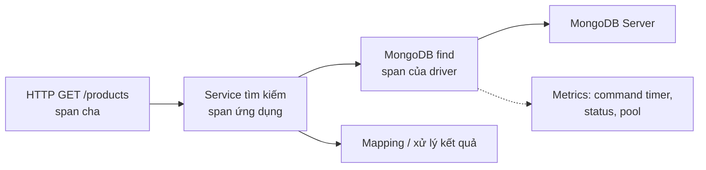
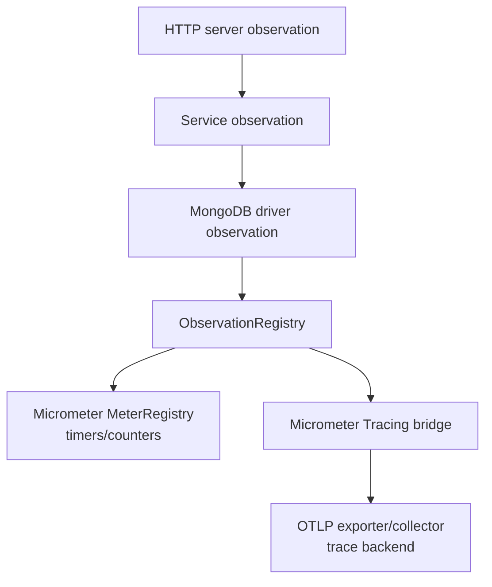

# Micrometer, observation và tracing theo phiên bản driver/Spring Data

Khi một endpoint sử dụng **Spring Data MongoDB** bắt đầu phản hồi chậm, thông tin “MongoDB chậm” thường chưa đủ để chẩn đoán. Một lời gọi `MongoTemplate.find(...)` có thể chờ connection pool, gửi nhiều lệnh `find`/`getMore` qua mạng, nhận BSON rồi chuyển thành entity Java; một repository method cũng có thể phát sinh nhiều command. Cần quan sát từng lớp thay vì suy đoán từ thời gian của toàn bộ HTTP request.

**Micrometer Metrics**, **Micrometer Observation** và **distributed tracing** là ba công cụ liên quan nhưng không đồng nghĩa. Chúng giúp trả lời các câu hỏi khác nhau: *Có bao nhiêu lệnh MongoDB và p95 của chúng là bao nhiêu?*; *Lời gọi này được ghi nhận bằng một cơ chế đo đạc thống nhất chưa?*; *Command chậm nằm ở đâu trong hành trình HTTP → service → repository → MongoDB?*

Điểm quan trọng của bài là **cách tích hợp thay đổi theo phiên bản**:

- Spring Boot có khả năng tự cấu hình các listener Micrometer để đo command và connection pool.
- Spring Data MongoDB từ phiên bản 4.0 có `MongoObservationCommandListener` và cơ chế truyền ngữ cảnh cho quan sát ở tầng driver.
- MongoDB Java Driver **5.7 trở lên** hỗ trợ observability trực tiếp bằng `ObservabilitySettings`. Các lớp observability do Spring Data cung cấp đã được đánh dấu deprecated từ **Spring Data MongoDB 5.1** để chuyển sang khả năng native của driver.

Vì vậy, cấu hình cần bắt đầu bằng **kiểm tra phiên bản thực tế**, chủ động chọn một đường instrumentation chính và kiểm chứng các metric/span sau khi ứng dụng đã gửi lệnh thật. Những ví dụ trong bài được phân thành lựa chọn theo phiên bản; không nên dán tất cả các phương án vào cùng một `MongoClient`.

## 1. Phân biệt metrics, observation và tracing

| Khái niệm | Dữ liệu quan sát | Phù hợp với câu hỏi | Giới hạn |
| --- | --- | --- | --- |
| **Micrometer Metrics** | Counter, timer, gauge và tags | Số lệnh, độ trễ theo phân phối, lỗi, số connection đang dùng | Không mặc định cho biết một lệnh cụ thể thuộc request nào |
| **Micrometer Observation** | Vòng đời start/stop/error + context + convention; có thể phát metric và trace qua handler phù hợp | Đo một hoạt động theo hợp đồng instrumentation thống nhất | `ObservationRegistry` không tự xuất trace nếu thiếu tracing handler/exporter |
| **Distributed tracing** | Trace ID, span ID, quan hệ cha–con, thời điểm thực thi, lỗi và một số attributes | Request cụ thể chậm ở HTTP, service hay command MongoDB? | Sampling có thể bỏ một số trace; span không thay thế MongoDB profiler |
| **MongoDB server profiler/`explain`** | Thực thi, plan, docs/keys examined, thời gian phía server | Có index scan, collection scan hay sort tốn kém không? | Không đo đầy đủ network, pool wait và Java mapping |

Ví dụ một request:



Một timer lệnh và một span lệnh có thể cùng xuất hiện nhưng mang ngữ nghĩa khác nhau: timer tổng hợp nhiều lần thực thi theo bộ tag hữu hạn, còn span đại diện cho một hoạt động cụ thể trong một trace được lấy mẫu. Không nên đếm số span để suy ra chính xác tổng số command của toàn bộ hệ thống khi có sampling.

**Observation không đồng nghĩa với logging.** Bạn có thể bật metrics mà không thu thập payload truy vấn, và có thể thêm tracing mà vẫn hạn chế thông tin nhạy cảm trong attributes/span events. Với hệ thống đa tenant, bảo mật dữ liệu quan sát là một phần của thiết kế vận hành.

## 2. Xác định đúng phiên bản trước khi cấu hình

Tổ hợp phiên bản cần kiểm tra gồm **Spring Boot**, **Spring Data MongoDB**, **MongoDB Java Driver**, **Micrometer** và thư viện tracing/exporter. Spring Boot thường quản lý dependency versions, nhưng ứng dụng có thể đã override driver hoặc dùng nhiều `MongoClient` tự tạo.

| Môi trường | Đường tích hợp nên xem xét | Lưu ý |
| --- | --- | --- |
| Spring Boot có Actuator + client được auto-configure | Dùng metrics command/pool do Boot cung cấp trước | Kiểm tra property và tên metric của đúng nhánh Boot |
| Spring Data MongoDB **4.0–5.0**, driver chưa có native observability | Dùng `MongoObservationCommandListener` kèm `ContextProviderFactory` nếu cần Observation/tracing | Cần cấu hình rõ ràng; tránh đăng ký trùng command listener với Boot |
| MongoDB Java Driver **5.7+** | Ưu tiên `MongoClientSettings.Builder.observabilitySettings(ObservabilitySettings)` | Có native Micrometer Observation cho operations/commands/transactions |
| Spring Data MongoDB **5.1+** | Ưu tiên driver-native khi driver tương thích | Package `org.springframework.data.mongodb.observability` đã deprecated từ 5.1 |
| Ứng dụng tự tạo `MongoClient`/nhiều cluster | Gắn instrumentation lên **từng client cần đo**, thống nhất registry | Auto-configuration của Boot có thể không áp dụng cho client thủ công |

**Phân biệt hai họ version:**

1. **Spring Data version** quyết định có hay không các adapter như `MongoObservationCommandListener`, `ContextProviderFactory`.
2. **MongoDB Java Driver version** quyết định có API `ObservabilitySettings` native hay không; nó được giới thiệu từ **driver 5.7**.

Không suy từ “dự án dùng Spring Boot 3.x” rằng nó có sẵn API của driver 5.7. Hãy kiểm tra dependency thực tế và khả năng tương thích do Spring Boot quản lý trước khi dùng code.

### 2.1. Property thay đổi tên theo nhánh Spring Boot

Trong tài liệu **Spring Boot 3.5**, cờ tắt command metrics sử dụng:

```properties
management.metrics.mongo.command.enabled=false
management.metrics.mongo.connectionpool.enabled=false
```

Trong tài liệu **Spring Boot 4.x**, ví dụ tương ứng dùng:

```properties
management.metrics.mongodb.command.enabled=false
management.metrics.mongodb.connectionpool.enabled=false
```

Đây là **hai biến thể dành cho các phiên bản khác nhau**, không phải bốn cờ cần khai báo đồng thời. Nếu cấu hình không có tác dụng, kiểm tra metadata/configuration properties của đúng Spring Boot artifact đã sử dụng. Các đoạn cấu hình tắt listener chỉ cần thiết khi bạn chủ động thay thế đường đo mặc định; một ứng dụng chỉ cần metrics Boot có thể giữ cơ chế auto-configure.

## 3. Micrometer metrics có sẵn từ Spring Boot Actuator

Với một ứng dụng Spring Boot tương thích, hãy bắt đầu từ các phụ thuộc cơ bản:

- Spring Data MongoDB starter để có repository, `MongoTemplate` và `MongoClient`.
- `spring-boot-starter-actuator` để có Micrometer/Metrics endpoint và auto-configuration tương ứng.
- Một registry exporter nếu cần gửi metric ra hệ giám sát, ví dụ `micrometer-registry-prometheus`. Có Actuator không có nghĩa hệ thống mặc định đã xuất metric tới Prometheus.

Trên các nhánh Boot có MongoDB metrics auto-configuration, thường gặp:

| Tên Micrometer meter | Loại dữ liệu | Ý nghĩa |
| --- | --- | --- |
| `mongodb.driver.commands` | Timer | Thời gian của command từ Java Driver |
| `mongodb.driver.pool.size` | Gauge | Tổng số connection trong pool |
| `mongodb.driver.pool.checkedout` | Gauge | Số connection đang được sử dụng |
| `mongodb.driver.pool.waitqueuesize` | Gauge | Số lượt đang chờ connection |
| `mongodb.driver.pool.checkoutfailed` | Counter (theo binder/version) | Số lần checkout thất bại |

Timer command mặc định thường có tags như `command`, `cluster.id`, `server.address` và `status`. Pool metric có thể có `cluster.id` và `server.address`. Danh sách và cấu trúc tag chính xác phụ thuộc bản Micrometer/binder và cấu hình custom tags; cần kiểm tra endpoint thực tế.

**Lưu ý về ranh giới:** timer `mongodb.driver.commands` đo một **command của driver**, không phải toàn bộ `MongoTemplate.find(...)`. Một cuộc gọi find đọc nhiều batch có thể phát sinh `find` cùng nhiều `getMore`. Thời gian chờ pool, chuyển đổi `Document` thành entity, xử lý service và JSON serialization cũng không tự nằm trong cùng một timer này.

### 3.1. Bật endpoint để quan sát trong môi trường thử nghiệm

Ví dụ dành cho một ứng dụng Boot có Micrometer registry đã được cấu hình:

```properties
management.endpoints.web.exposure.include=health,info,metrics,prometheus
management.tracing.enabled=true
```

Nếu có Actuator và exporter tương ứng, bạn có thể kiểm tra bằng HTTP ở **môi trường test**:

```text
GET /actuator/metrics
GET /actuator/metrics/mongodb.driver.commands
GET /actuator/metrics/mongodb.driver.pool.checkedout
GET /actuator/prometheus
```

`/actuator/prometheus` chỉ có nếu registry/exporter và endpoint phù hợp được bật. **Không để toàn bộ actuator endpoints công khai trên Internet.** Hạn chế quyền truy cập, dùng network policy hoặc cổng quản trị riêng. Một meter có thể chưa xuất hiện cho đến khi ứng dụng đã tạo pool/gửi command và registry thu được mẫu.

Trong production, cấu hình bảo mật và đường xuất metric cần được thiết kế cùng hệ giám sát. Không nên bật mọi endpoint Actuator chỉ để kiểm thử metrics MongoDB.

### 3.2. Đọc metric để phát hiện vấn đề gì?

Giả sử số request tăng, p95 ứng dụng chậm và `mongodb.driver.pool.waitqueuesize` tăng. Điều đó gợi ý cần điều tra **connection checkout**: pool có thể đang bận hoặc command đang giữ connection quá lâu. Tuy nhiên pool wait tăng **không khẳng định** rằng `maxPoolSize` phải tăng; nguyên nhân có thể là truy vấn chậm, lưu cursor lâu, tải cao hoặc connection bị dùng sai cách.

Nếu command `getMore` xuất hiện nhiều và tổng thời gian đọc lớn, hãy kiểm tra batch size, số lượng document, kích thước payload và cách tiêu thụ cursor. Nếu command timer tốt nhưng endpoint vẫn chậm, hãy đo thêm Spring mapping, xử lý nghiệp vụ và serialization.

Không coi timer p95 là “thời gian MongoDB server”. Nó phản ánh một ranh giới ở client/driver và thường bao gồm round-trip mạng và xử lý giao thức.

## 4. Tự đăng ký Micrometer listener khi quản lý `MongoClient`

Nếu ứng dụng **tự tạo** `MongoClient` và muốn đo metrics theo phương án Micrometer binder, có thể đăng ký các listener được Micrometer cung cấp.

Ví dụ dưới đây dành cho môi trường có MongoDB Java Driver tương thích và `io.micrometer:micrometer-core`:

```java
import com.mongodb.ConnectionString;
import com.mongodb.MongoClientSettings;
import com.mongodb.client.MongoClient;
import com.mongodb.client.MongoClients;
import io.micrometer.core.instrument.MeterRegistry;
import io.micrometer.core.instrument.binder.mongodb.MongoMetricsCommandListener;
import io.micrometer.core.instrument.binder.mongodb.MongoMetricsConnectionPoolListener;
import org.springframework.data.mongodb.core.MongoTemplate;

public final class InstrumentedMongoFactory {

    public static MongoClient createClient(
            String mongoUri, MeterRegistry registry) {

        MongoMetricsCommandListener commands =
            new MongoMetricsCommandListener(registry);
        MongoMetricsConnectionPoolListener pool =
            new MongoMetricsConnectionPoolListener(registry);

        MongoClientSettings settings = MongoClientSettings.builder()
            .applyConnectionString(new ConnectionString(mongoUri))
            .addCommandListener(commands)
            .applyToConnectionPoolSettings(
                builder -> builder.addConnectionPoolListener(pool))
            .build();

        return MongoClients.create(settings);
    }

    public static MongoTemplate createTemplate(
            MongoClient client, String database) {
        return new MongoTemplate(client, database);
    }
}
```

Nếu Spring Boot đã gắn `MongoMetricsCommandListener` hoặc `MongoMetricsConnectionPoolListener` lên client do Boot tạo, **không thêm lại** chỉ vì muốn thấy nhiều metric hơn: đăng ký trùng có thể tạo số đo chồng lấp, metric tăng bất thường hoặc nội dung ghi nhận khó giải thích.

Một ứng dụng có cả synchronous và reactive clients cần kiểm tra từng `MongoClient`. `ReactiveMongoTemplate` không sử dụng cùng instance của synchronous driver client; việc bạn thêm listener vào sync client không bảo đảm reactive client cũng được quan sát.

Ở các phiên bản mới, nên cân nhắc đường **driver-native Observation** ở phần tiếp theo khi mục tiêu chính là tracing. Micrometer binder listener truyền thống là một cách đo metrics, nhưng không tự tạo trace hoàn chỉnh.

## 5. Tích hợp Observation trên MongoDB Java Driver 5.7+

Từ **MongoDB Java Driver 5.7**, API `com.mongodb.observability.ObservabilitySettings` hỗ trợ cấu hình Micrometer Observation trực tiếp trên `MongoClientSettings`. Đây là hướng được tài liệu Spring Data MongoDB mới khuyến nghị.

Trong dự án Spring Boot có `ObservationRegistry` và `MongoClientSettingsBuilderCustomizer` phù hợp, cấu hình mẫu:

```java
import com.mongodb.observability.ObservabilitySettings;
import io.micrometer.observation.ObservationRegistry;
import org.springframework.context.annotation.Bean;
import org.springframework.context.annotation.Configuration;
// Với Spring Boot 3.x, import thường là:
import org.springframework.boot.autoconfigure.mongo.MongoClientSettingsBuilderCustomizer;

@Configuration(proxyBeanMethods = false)
public class MongoDriverObservabilityConfiguration {

    @Bean
    MongoClientSettingsBuilderCustomizer mongoNativeObservability(
            ObservationRegistry registry) {
        return settings -> settings.observabilitySettings(
            ObservabilitySettings.micrometerBuilder()
                .observationRegistry(registry)
                // Không đính kèm nguyên câu lệnh chứa dữ liệu người dùng vào trace.
                .enableCommandPayloadTracing(false)
                .build()
        );
    }
}
```

**Điều kiện áp dụng:**

1. `MongoClientSettings.Builder.observabilitySettings(...)` và `ObservabilitySettings.micrometerBuilder()` chỉ tồn tại ở driver hỗ trợ, từ **5.7+**. Với driver 5.6 hoặc thấp hơn, đoạn code không compile.
2. Type `MongoClientSettingsBuilderCustomizer` và package import có thể chuyển vị trí theo thế hệ Spring Boot. Ví dụ trên trình bày kiểu thường gặp ở Boot 3.x; với Boot 4.x phải đối chiếu package API của nhánh đang dùng.
3. `ObservationRegistry` cần có cơ chế handler/tracer phù hợp để biến Observation thành spans, cùng exporter và sampling nếu muốn nhìn thấy trace ở backend.
4. `MongoClient` dùng trong `MongoTemplate`/repositories phải được tạo từ builder đã nhận customizer. Nếu dự án tự khởi tạo client trong một `@Bean` khác và bỏ qua Boot builder, customizer không tự áp dụng.
5. Đường native và các adapter Observation cũ nên được **thay thế có kiểm soát**, tránh cả hai cùng tạo span cho một command.

Driver mới có thể tạo nhiều mức observation (operation, command, transaction), do đó số span không nhất thiết bằng số lời gọi repository. Hãy phân biệt span HTTP/service, span operation và span command trước khi tính độ trễ hoặc dựng dashboard.

### 5.1. Chặn lộ payload trong tracing

Driver có các tùy chọn như `enableCommandPayloadTracing(...)` và `maxQueryTextLength(...)` ở các bản hỗ trợ native observability. Dữ liệu command có thể chứa giá trị filter, trường nhạy cảm hoặc metadata nghiệp vụ.

Ví dụ **không phù hợp** với môi trường sản xuất nếu không được đánh giá bảo mật:

```java
// Chỉ dùng khi đã đánh giá rủi ro và quyền truy cập traces:
ObservabilitySettings.micrometerBuilder()
    .observationRegistry(registry)
    .enableCommandPayloadTracing(true)
    .maxQueryTextLength(10000)
    .build();
```

Giới hạn ký tự **không đồng nghĩa với ẩn danh hóa**: một giá trị nhạy cảm có thể nằm ngay đầu câu lệnh. Trong hệ thống thực tế, mặc định nên **không lưu command payload**; nếu buộc phải lưu, thiết kế redaction, giới hạn truy cập và retention rõ ràng.

Với instrumentation trong Spring Data cũ hoặc exporter khác, các thuộc tính được gắn vào trace có thể khác. Cần kiểm tra dữ liệu đã được gửi ra backend quan sát, không chỉ xem code cấu hình.

## 6. Observation theo cơ chế Spring Data MongoDB 4.0–5.0

Nếu chưa nâng lên MongoDB Java Driver 5.7+, Spring Data MongoDB từ 4.0 cung cấp `MongoObservationCommandListener` để tạo Observation dựa trên command events, cùng `ContextProviderFactory` để truyền ngữ cảnh.

Trong Spring Boot có API `MongoClientSettingsBuilderCustomizer` tương thích:

```java
import io.micrometer.observation.ObservationRegistry;
import org.springframework.context.annotation.Bean;
import org.springframework.context.annotation.Configuration;
import org.springframework.boot.autoconfigure.mongo.MongoClientSettingsBuilderCustomizer;
import org.springframework.data.mongodb.observability.ContextProviderFactory;
import org.springframework.data.mongodb.observability.MongoObservationCommandListener;

@Configuration(proxyBeanMethods = false)
public class LegacyMongoObservationConfiguration {

    @Bean
    MongoClientSettingsBuilderCustomizer mongoLegacyObservation(
            ObservationRegistry registry) {
        return settings -> settings
            .contextProvider(ContextProviderFactory.create(registry))
            .addCommandListener(new MongoObservationCommandListener(registry));
    }
}
```

**Đây là phương án tương thích cho thế hệ thư viện cũ.** Các lớp trong package `org.springframework.data.mongodb.observability` được đánh dấu deprecated từ **Spring Data MongoDB 5.1**, và tài liệu Spring Data đề xuất chuyển sang driver-native observability khi nâng driver lên 5.7+. Không nên tiếp tục thêm mã legacy vào dự án mới đã sử dụng driver hỗ trợ native.

Khi bật phương án legacy, tài liệu cho các nhánh Boot 3.x cũng hướng dẫn tắt command metric listener do Boot tự cấu hình để tránh ghi nhận chồng lấp. Ví dụ trên Boot 3.x:

```properties
# Chỉ áp dụng khi bạn chủ động chọn Spring Data legacy observation.
management.metrics.mongo.command.enabled=false
management.tracing.enabled=true
```

Trên Boot 4.x, tên property và gói autoconfigure cần tra theo tài liệu phiên bản. Không gộp cấu hình legacy + native + command timer listener tùy tiện. Sau khi thay đổi, khởi động ứng dụng rồi kiểm tra một request đơn giản để thấy số span/metric đúng với số command được phát ra.

### 6.1. Khi nào chỉ cần command metrics?

Nếu mục tiêu là dashboard lượng command và connection pool, **Actuator/Micrometer metrics có thể đã đủ**. Việc thêm tracing đòi hỏi exporter, sampling, propagation và quy tắc bảo mật. Không nên bật thu toàn bộ trace ở tải lớn nếu không có nhu cầu điều tra theo request.

Nếu mục tiêu là điều tra *một request cụ thể* đi qua nhiều service, tracing giúp kết nối các span theo ngữ cảnh; lúc đó chọn đường Observation tương thích với driver và cung cấp bridge/exporter đúng hệ sinh thái.

## 7. Kết nối Observation với distributed tracing

Một `ObservationRegistry` là điểm tích hợp. Tùy cấu hình, một Observation có thể:

- Phát metrics qua `DefaultMeterObservationHandler`.
- Phát span qua Micrometer Tracing handler/bridge.
- Được xuất tới backend như OpenTelemetry Collector, Tempo hoặc Jaeger nhờ exporter tương ứng.

Một mô hình khái niệm:



Trên Spring Boot 3.x, một bộ dependency điển hình cho OpenTelemetry qua Micrometer Tracing gồm:

```text
org.springframework.boot:spring-boot-starter-actuator
io.micrometer:micrometer-tracing-bridge-otel
io.opentelemetry:opentelemetry-exporter-otlp
```

Các artifact tracing, cấu hình exporter và module autoconfigure **khác nhau theo Boot 4.x**; dùng BOM và hướng dẫn của phiên bản thực tế để tránh conflict. Hãy kiểm tra metric, span và context propagation end-to-end thay vì cho rằng việc dependency có trên classpath là đã xuất trace thành công.

Ví dụ cấu hình sampling ở **môi trường test** với Spring Boot phù hợp:

```properties
management.tracing.enabled=true
# Chỉ phục vụ kiểm thử để nhìn thấy mọi trace; production chọn tỉ lệ phù hợp.
management.tracing.sampling.probability=1.0
```

Sampling là nguyên nhân thường gặp khi endpoint hoạt động nhưng một số request không có trace ở backend. **Metrics command vẫn có thể được ghi nhận** dù trace bị lấy mẫu thấp; không nên xem số trace làm tổng số truy vấn.

### 7.1. Tạo Observation cho thao tác nghiệp vụ

Tracing driver giúp biết command nào được gửi, còn span ứng dụng giúp diễn giải người dùng đang làm gì. Với `ObservationRegistry`:

```java
import io.micrometer.observation.Observation;
import io.micrometer.observation.ObservationRegistry;
import org.springframework.data.mongodb.core.MongoTemplate;
import org.springframework.data.mongodb.core.query.Query;
import java.util.List;

public final class ProductReadService {
    private final MongoTemplate mongoTemplate;
    private final ObservationRegistry registry;

    public ProductReadService(
            MongoTemplate mongoTemplate, ObservationRegistry registry) {
        this.mongoTemplate = mongoTemplate;
        this.registry = registry;
    }

    public List<Product> loadProducts(Query query) {
        return Observation.createNotStarted(
                "app.mongo.load-products", registry)
            .lowCardinalityKeyValue("operation", "product-list")
            .observe(() -> mongoTemplate.find(query, Product.class));
    }
}
```

Ở đây `Product` là entity ứng dụng. Đoạn code tạo Observation với tên và tag **ổn định**, không thêm SKU, email, tên người dùng hay ID request vào low-cardinality tags. Nếu trace context được truyền đúng, span của driver sẽ được liên kết với span nghiệp vụ đang hoạt động.

**Ranh giới thời gian:** Observation quanh `mongoTemplate.find(...)` bao gồm thêm các công việc như server selection, pool wait, network, BSON decoding, mapping entity và materialize list. Span command của driver đo ranh giới khác; không lấy hiệu số hai span bất kỳ để suy ra chính xác thời gian mapping nếu không có phép đo chi tiết hơn.

### 7.2. Reactive và context propagation

Với `ReactiveMongoTemplate`, publisher có tính **lazy**: tạo `Flux` chưa chắc đã gửi command. Đo một hàm chỉ *trả về* Flux không đồng nghĩa đo lúc query thực sự thực thi.

Những điểm cần quan sát:

- Xác định từ **subscription** đến complete/error/cancel khi đo toàn bộ luồng.
- Trong Reactor, context truyền qua `Context` và các operator; việc tự tạo thread, `subscribe()` ngoài request hoặc thay scheduler có thể làm mất liên kết tracing nếu không được cấu hình truyền ngữ cảnh.
- Đừng chèn `block()` chỉ để dễ quan sát vào WebFlux production. Dùng instrumentation phù hợp với reactive pipeline và driver.
- Khi một Flux xử lý nhiều batch, có thể xuất hiện `find` rồi `getMore`; yêu cầu trace phải liên kết đúng command với luồng nghiệp vụ.
- Nếu dùng cả sync và reactive driver trong một dịch vụ, kiểm tra cả hai client thực sự nhận instrumentation.

Với lời gọi `@Async`, CompletableFuture hoặc executor tự tạo, ngữ cảnh quan sát có thể không tự truyền từ HTTP thread sang worker. Hãy dùng cơ chế context propagation/TaskDecorator tương thích với phiên bản Spring thay vì tự gắn một trace ID vào mọi thread bằng biến toàn cục.

## 8. Tags, cardinality và bảo mật dữ liệu quan sát

**Low-cardinality tags** có số lượng giá trị hữu hạn và nhỏ, phù hợp để tạo time series metrics. **High-cardinality attributes** có thể hữu ích trong trace nhưng không nên dùng làm metric labels tùy ý.

| Thành phần | Có thể dùng cho metric? | Lý do |
| --- | --- | --- |
| Tên command: `find`, `aggregate`, `getMore` | Có | Tập giá trị tương đối hữu hạn |
| Trạng thái: `SUCCESS`/`FAILED` | Có | Phân nhóm lỗi/hành vi rõ ràng |
| Tên workload chuẩn hóa: `catalog-read` | Có | Không phụ thuộc dữ liệu người dùng |
| `tenantId`, `userId`, `orderId`, `traceId` | Tránh trong metric labels | Số giá trị tăng rất nhanh, dễ rò rỉ |
| Query JSON, số định danh, token, email | Không lưu trong metric/span mặc định | Có dữ liệu nhạy cảm và rủi ro truy cập/retention |
| `server.address`, `cluster.id` | Cân nhắc | Có ích cho vận hành nhưng có thể tiết lộ topology nội bộ |

Ví dụ anti-pattern:

```java
// Không đưa input động vào tên metric hay low-cardinality tag:
Observation.createNotStarted("mongo.find." + customerId, registry);
```

Một request ID duy nhất trên mỗi request tạo hàng triệu time series nếu dùng làm metric label. Với tracing, request/trace ID là metadata phục vụ tương quan nhưng cần policy bảo vệ và thời gian lưu.

Ngay cả khi payload query được tắt, dữ liệu trong **span attributes, baggage, exception messages, profiler hoặc structured logs** vẫn có thể chứa thông tin nhạy cảm. Việc xem dữ liệu trace cần có phân quyền riêng; export pipeline cần TLS, giới hạn retention và redaction phù hợp.

## 9. Đọc trace đúng với kiến trúc MongoDB

Giả sử một request HTTP mất 400 ms:

| Đo được | Thời gian minh họa | Diễn giải ban đầu |
| --- | ---: | --- |
| Span HTTP | 400 ms | Bao gồm logic trước/sau MongoDB, serialization và framework |
| Observation service quanh `MongoTemplate.find` | 300 ms | Bao gồm nhiều phần của truy vấn ở client và materialization |
| Command `find` | 35 ms | Chỉ một command và kết quả batch tương ứng |
| Ba command `getMore` | 35 + 45 + 50 ms | Phần đọc thêm từ cursor |
| MongoDB `explain.executionTimeMillis` | 12 ms | Số đo của lần explain riêng, không phải exact span của request này |

Các thời gian trên là **giả định minh họa**, không phải kết quả benchmark. Không suy luận rằng 300 − (35 + 35 + 45 + 50) = 135 ms chính là mapping: các phép đo có thể xen kẽ, chênh khác thời điểm và không cùng phạm vi. Ngoài ra, có thể còn checkout wait, server selection, codec, conversion hoặc xử lý ứng dụng giữa các batch.

Để tìm nút thắt:

1. Tìm span HTTP và service của request có p95/p99 cao.
2. Xác định số command thực sự, tên command và thời gian tương ứng.
3. Kiểm tra metrics pool (`checkedout`, `waitqueuesize`, checkout failures) theo cùng khoảng thời gian.
4. Đối chiếu profiler/slow query và `explain("executionStats")` để đánh giá riêng plan và server time.
5. Kiểm tra số document/byte, kích thước batch, projection, custom converters và thời gian serialization tại Java.

Một lệnh `aggregate` có thể đọc rất nhiều document rồi trả một kết quả nhỏ. Nếu server sử dụng nhiều CPU hoặc có `COLLSCAN`/sort, tăng pool size không chữa được nguồn gốc truy vấn chậm. Ngược lại, chỉ nhìn `executionTimeMillis` thấp và kết luận endpoint “không thể chậm vì MongoDB” cũng là sai.

## 10. Ghi nhận lỗi, retry và transaction

Command có thể thất bại rồi được driver retry tự động khi cấu hình cho phép; một logical operation có thể có nhiều command attempts. Vì vậy:

- **Counter command errors** phản ánh số command thất bại, không nhất thiết bằng số request HTTP lỗi.
- Nếu driver retry thành công, client có thể không thấy exception cuối cùng dù đã có một failed command/span.
- Transaction có thể phát sinh `startTransaction` (implicit trong command đầu), `commitTransaction` hoặc `abortTransaction` tùy đường thực thi; trace cần được đọc theo ranh giới operation/transaction.
- Khi bật sampling, không kỳ vọng mọi retry đều có span được lưu để phân tích; dùng metrics/driver monitoring cho thống kê đầy đủ hơn.
- Đừng đưa exception message nguyên văn vào label có cardinality lớn hoặc chứa thông tin dữ liệu.

Với reactive transaction, Session và Context phải được quản lý trong pipeline; việc truyền context sai có thể khiến span rời khỏi request gốc hoặc operation nằm ngoài transaction đang mong muốn. Cần kiểm thử cả hành vi MongoDB lẫn propagation.

## 11. Kiểm thử instrumentation

Nên dùng integration test với MongoDB thật (ví dụ Testcontainers) cho đường phát command, đồng thời dùng registry/test tracing exporter phù hợp để kiểm tra metrics và spans.

### 11.1. Đếm lệnh bằng `SimpleMeterRegistry`

Ví dụ test minh họa việc tạo metrics command **bằng listener thủ công** khi không bật auto-configuration của Boot:

```java
import com.mongodb.ConnectionString;
import com.mongodb.MongoClientSettings;
import com.mongodb.client.MongoClient;
import com.mongodb.client.MongoClients;
import io.micrometer.core.instrument.simple.SimpleMeterRegistry;
import io.micrometer.core.instrument.binder.mongodb.MongoMetricsCommandListener;
import org.bson.Document;

// mongoUri phải trỏ tới MongoDB test được cô lập, chẳng hạn Testcontainers.
try (SimpleMeterRegistry registry = new SimpleMeterRegistry()) {
    MongoClientSettings settings = MongoClientSettings.builder()
        .applyConnectionString(new ConnectionString(mongoUri))
        .addCommandListener(new MongoMetricsCommandListener(registry))
        .build();

    try (MongoClient client = MongoClients.create(settings)) {
        client.getDatabase("observability_test")
              .getCollection("records")
              .insertOne(new Document("_id", "r-1"));
        client.getDatabase("observability_test")
              .getCollection("records")
              .countDocuments();

        // Đọc registry theo tên + tags thực tế trong bản Micrometer đang dùng.
        // Có thể tìm "mongodb.driver.commands" và lọc tag "command".
        long meterCount = registry.find("mongodb.driver.commands")
            .timers()
            .stream()
            .mapToLong(timer -> timer.count())
            .sum();

        if (meterCount < 2) {
            throw new AssertionError("Chưa quan sát đủ lệnh MongoDB");
        }
    }
}
```

Test trên chủ yếu xác nhận listener đã được gắn và ghi metrics. Để kiểm thử các tag/trạng thái lỗi, chủ động tạo một lệnh thất bại **an toàn** trong database test (ví dụ duplicate key với unique index) rồi kiểm tra thông tin ghi nhận mà bản Micrometer hỗ trợ. Hãy giữ namespace và tên test ổn định, tránh để các test chạy song song dùng chung collection làm thay đổi số command ngoài dự kiến.

### 11.2. Kiểm thử Observation và trace cha–con

Với đường driver-native 5.7+ hoặc Spring Data legacy, test nên xác nhận:

1. Một HTTP test request tạo span cha khi tracing đã được bật và sampled.
2. Phép đọc `MongoTemplate.find(...)` tạo observation/span MongoDB thuộc trace tương ứng.
3. Span có tên/attributes theo convention hiện tại; số command có thể khác số operation do `getMore` hoặc retry.
4. Khi xảy ra lỗi driver, observation kết thúc ở trạng thái phù hợp và không làm rò rỉ nội dung filter.
5. Nếu dùng reactive API, span vẫn nằm trong trace mong đợi sau subscription và chuyển scheduler được hỗ trợ.
6. Không có **hai** span MongoDB trùng hệt nhau do vừa gắn `MongoObservationCommandListener` legacy vừa dùng `ObservabilitySettings` native.

Một bộ test sử dụng `ObservationRegistry` đơn thuần chưa chứng minh trace được gửi tới backend. Muốn kiểm tra export, cần tracing bridge và exporter kiểm thử, rồi assert số span và quan hệ parent/child; khi test qua collector, phải chờ xuất bất đồng bộ theo cơ chế test phù hợp.

## 12. Ma trận chẩn đoán khi metric hoặc trace không xuất hiện

| Triệu chứng | Nguyên nhân có thể | Cách xác minh |
| --- | --- | --- |
| `/actuator/metrics` không có lệnh MongoDB | Chưa gửi command, endpoint chưa exposed, Actuator/registry thiếu hoặc client không được instrument | Gửi `find` thật; xem `MongoClient` đang dùng và endpoint |
| Có metrics nhưng không có trace | Chưa có tracing bridge/exporter, sampling, Observation không được gắn hoặc context propagation lỗi | Kiểm tra registry handlers, sampling, cấu hình exporter và một request sampled |
| Một request tạo hai command spans giống nhau | Gắn đồng thời legacy và native instrumentation | Kiểm tra các `MongoClientSettings` và listener tự đăng ký |
| Metric count cao hơn số HTTP request | Một request có nhiều command, `getMore`, count, retry, DBRef hoặc lỗi | Đếm command theo tên và trace logic thay vì ép tỉ lệ 1:1 |
| Pool gauges xuất hiện nhưng command timer không | Chỉ có pool listener, cờ command metrics tắt hoặc client dùng path khác | Kiểm tra cấu hình hai loại listener độc lập |
| Tên property cấu hình không hiệu lực | Đổi prefix giữa nhánh Boot, sai module config | Đối chiếu tài liệu/metadata Spring Boot đúng phiên bản |
| Lỗi compile `ObservabilitySettings` | MongoDB Java Driver thấp hơn 5.7 hoặc dependency bị lệch | Kiểm tra driver version trong dependency tree |
| Span MongoDB rời khỏi trace HTTP | Lỗi propagation qua Reactor, executor, `@Async` hoặc tạo client khác | Đo trong cùng request, kiểm tra context provider/hook |
| Metrics gây tốn RAM/bộ nhớ hệ giám sát | Tag chứa user ID, tenant, query, path động | Giảm cardinality, dùng tên operation ổn định |
| Traces chứa dữ liệu người dùng | Bật command payload tracing, ghi query đầy đủ, exception/log không redact | Tắt capture payload, rà attributes/exporter và quyền truy cập |

### Ví dụ về sự khác nhau giữa metric lỗi và trace lỗi

Giả sử một lần `find` bị timeout, driver retry rồi thành công. Meter `mongodb.driver.commands` có thể ghi failed attempt rồi success attempt; span logical operation có thể hoàn thành bình thường hoặc thể hiện lỗi nội bộ tùy kiểu instrumentation. Đối chiếu event/attempt với kết quả service để tránh báo động “mọi failed command đều làm endpoint thất bại”.

Đối với connection checkout timeout, không nhất thiết có command event tương ứng vì driver có thể chưa gửi lệnh. Khi đó pool metrics và thời gian end-to-end ở service hữu ích hơn command timer.

## 13. Checklist triển khai cho production

Trước khi phát hành, thực hiện theo thứ tự:

1. **Ghi rõ versions** của Spring Boot, Spring Data MongoDB, Java Driver, Micrometer và tracing bridge. Chốt BOM để không vô tình nâng lệch API.
2. **Chọn một đường chính cho MongoDB Observation:** native driver 5.7+ hoặc legacy Spring Data cho môi trường cũ; dùng Boot metrics như đã thiết kế, tránh listener trùng.
3. **Xác định phạm vi quan sát:** command, pool, service operations và HTTP. Chọn tags có cardinality thấp; kiểm tra mọi trường dễ lộ dữ liệu.
4. **Cấu hình exporter/sampling và quyền truy cập:** Actuator, Prometheus/OTLP hoặc hệ giám sát tương ứng phải được giới hạn mạng và xác thực phù hợp.
5. **Chạy smoke test end-to-end:** một `find`, một lần đọc nhiều batch, một lần lỗi, một phép đọc reactive nếu dùng, một request có trace HTTP → MongoDB.
6. **Thiết lập dashboard:** command latency và error rate theo command; pool checkedout/wait queue/checkout failures; p95/p99 endpoint; DB slow query/profiler để đối chiếu.
7. **Chạy kiểm thử tải thực tế:** kiểm tra chi phí instrumentation, độ trễ bổ sung, số lượng spans/time series và tỷ lệ sampling; tắt những attributes không cần.
8. **Chuẩn bị quy trình nâng phiên bản:** khi chuyển từ Spring Data legacy sang driver-native, tháo cấu hình cũ, kiểm tra khác biệt tên span/tag và cập nhật truy vấn dashboard/alert.

Các metric cần được xem theo **phân phối thời gian và tải**, không chỉ một con số trung bình. Nếu pool wait queue tăng cùng p99 latency, hãy xác định có truy vấn hoặc cursor giữ connection lâu trước khi tăng số connection. Nếu server `explain` cho thấy quét dữ liệu quá nhiều, tối ưu index/query thường hiệu quả hơn việc bật thêm tracing.

## 14. Bài thực hành

**Tình huống:** API Spring Data MongoDB cho phép tìm đơn hàng đã thanh toán. Dịch vụ đang dùng `MongoTemplate` và Spring Boot Actuator; trong giờ cao điểm, p99 tăng nhưng `executionTimeMillis` từ `explain` cho query tương tự vẫn thấp.

Yêu cầu:

1. Xác định bộ versions hiện có, chọn đường instrumentation phù hợp (Boot metrics, Spring Data legacy Observation hoặc driver-native 5.7+).
2. Gửi 10 request đọc đơn hàng, quan sát timer `mongodb.driver.commands` và gauges pool; phân biệt `find` và `getMore`.
3. Bật Observation/tracing qua exporter thử nghiệm; tìm trace HTTP → service → MongoDB, xác định số command thực tế.
4. Kiểm tra trong backend trace rằng query plaintext, mã định danh khách hàng và token **không được ghi** trong attributes hoặc payload.
5. Dựng tình huống pool bận và đối chiếu checkedout/wait queue với thời gian command. Giải thích vì sao chờ checkout không nhất thiết xuất hiện trong command timer.
6. Lấy `explain("executionStats")` và profiler/slow query ở môi trường test để phân biệt thời gian server và tổng thời gian đầu ứng dụng.
7. Thử migration từ listener legacy sang native (nếu versions cho phép), xác nhận không có span kép, dashboard và cảnh báo vẫn hoạt động.

| Kiểm tra | Kết quả đạt |
| --- | --- |
| Có command metrics sau lệnh thật | Timer/counter/gauge hiển thị từ `MongoClient` đã instrument |
| Có trace MongoDB dưới request HTTP | Parent/child hoặc liên kết ngữ cảnh đúng theo công cụ truy vết |
| Không có instrumentation trùng | Một đường Observation chủ động được chọn cho cùng phạm vi command |
| Không lộ dữ liệu nhạy cảm | Không có filter plaintext, user ID hoặc token trong metric tags/span attributes |
| Có phân biệt server/client | Không đồng nhất `explain`, command timer, pool wait và thời gian service |
| Có chính sách sampling/cardinality | Số time series và lượng span phát sinh phù hợp yêu cầu vận hành |

**Tiêu chí hoàn thành:** người học chọn đúng tích hợp theo phiên bản, cấu hình và quan sát được metrics/trace, biết giải thích độ trễ ở nhiều lớp, phát hiện listener trùng và giữ dữ liệu nhạy cảm ra khỏi hệ thống giám sát.

## 15. Những điểm cần ghi nhớ

- **Metrics, Observation và tracing liên quan nhưng khác chức năng:** metrics tổng hợp; Observation chuẩn hóa vòng đời; tracing liên kết hoạt động theo request.
- **MongoDB Java Driver 5.7+** có `ObservabilitySettings.micrometerBuilder()`; **Spring Data MongoDB 5.1+** đánh dấu deprecated adapter Observation cũ.
- **Spring Boot có thể đã tự đo MongoDB command và pool.** Kiểm tra auto-configuration trước khi gắn thêm listener.
- **Prefix property khác nhau giữa các nhánh Boot:** `management.metrics.mongo.*` thường gặp trong Boot 3.x; `management.metrics.mongodb.*` trong tài liệu Boot 4.x.
- **Một lời gọi repository có thể sinh nhiều command; một timer command không đo toàn bộ HTTP request.** Dùng thêm span service, pool metrics và profiler/`explain` để xác định nguyên nhân.
- **Observability không tự bảo đảm bảo mật:** không gắn identifier/chuỗi query vào metric tags, tắt capture payload khi không cần, bảo vệ exporter và retention.
- **Kiểm chứng bằng dữ liệu thực tế:** gửi command, quan sát metric/span và thử cả lỗi, retry, reactive context và nhiều batch trước khi tin dashboard.

## Tài liệu đối chiếu theo phiên bản

- [Spring Data MongoDB — Observability](https://docs.spring.io/spring-data/mongodb/reference/observability/observability.html): hướng chuyển sang `ObservabilitySettings` native, ví dụ legacy và các lưu ý tương thích.
- [MongoDB Java Driver — `ObservabilitySettings` API](https://mongodb.github.io/mongo-java-driver/5.11/apidocs/driver-core/com/mongodb/observability/ObservabilitySettings.html): API bắt đầu từ 5.7.
- [MongoDB Java Driver — `MicrometerObservabilitySettings.Builder` API](https://mongodb.github.io/mongo-java-driver/5.12/apidocs/driver-core/com/mongodb/observability/micrometer/MicrometerObservabilitySettings.Builder.html): cấu hình registry, payload tracing và convention.
- [Micrometer — MongoDB Metrics Instrumentation](https://docs.micrometer.io/micrometer/reference/reference/mongodb.html): `MongoMetricsCommandListener` và `MongoMetricsConnectionPoolListener`.
- [Spring Boot 3.5 — Metrics](https://docs.spring.io/spring-boot/3.5/reference/actuator/metrics.html) và [Spring Boot 4.x — Metrics](https://docs.spring.io/spring-boot/4.0/reference/actuator/metrics.html): đối chiếu property cùng cách tự cấu hình MongoDB metrics.

> **Lưu ý:** các package, property và khả năng phát span có thể đổi khi nâng Spring Boot, Spring Data MongoDB, MongoDB Java Driver hoặc Micrometer. Luôn dùng tài liệu ứng với dependency thực tế và chạy kiểm thử instrumentation trên chính tổ hợp đó trước khi áp dụng sản xuất.
