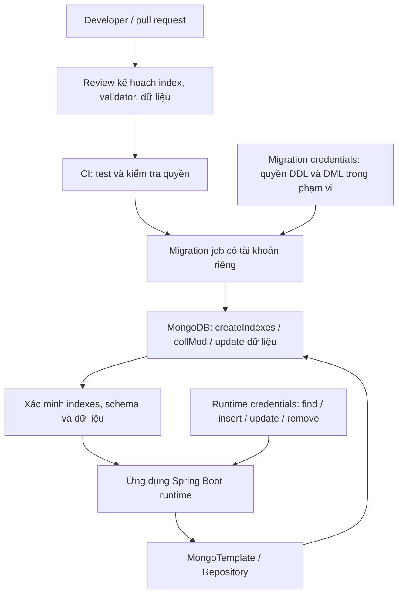
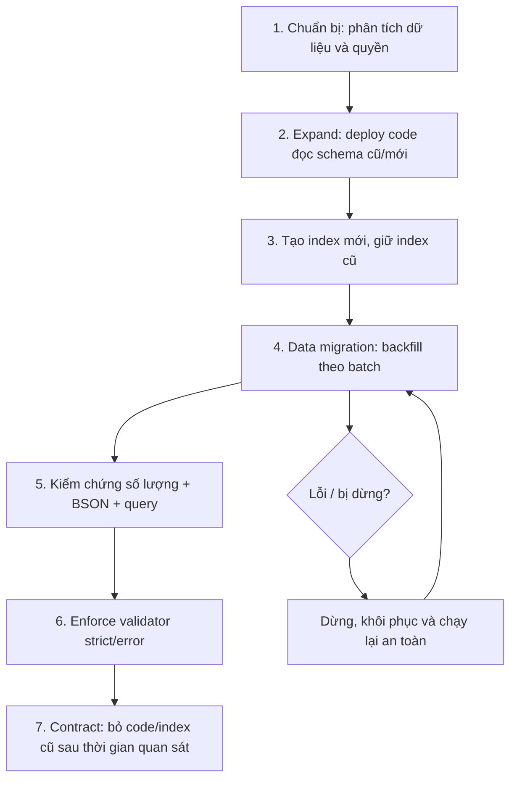

# Kiểm soát quyền tạo index, đổi validator và chạy migration

## 1. Bài toán: ai được thay đổi cấu trúc MongoDB?

Trong hệ thống **Spring Data MongoDB**, một dịch vụ có thể dùng `MongoTemplate` hoặc repository để đọc, ghi và truy vấn document hằng ngày. Nhưng ba loại công việc sau có tác động vượt ra ngoài một request thông thường:

- **Tạo, sửa hoặc xóa index:** thay đổi cách MongoDB truy cập dữ liệu, sử dụng thêm bộ nhớ và dung lượng đĩa, có thể ảnh hưởng tốc độ ghi và độ trễ của các node.
- **Thay đổi validator:** điều chỉnh quy tắc cho phép insert/update, có khả năng khiến luồng ghi đang hoạt động đột ngột bị từ chối.
- **Chạy migration dữ liệu hoặc cấu trúc:** có thể chạm đến hàng triệu document, cần xử lý dữ liệu cũ, tương thích phiên bản ứng dụng và kiểm soát rollback.

Nếu mọi instance Spring Boot đều có quyền thay đổi index, validator và dữ liệu, một cấu hình sai, bản triển khai song song hay tài khoản bị lộ có thể gây sự cố trên toàn bộ database. Vì vậy, cần **tách danh tính và vòng đời của ứng dụng chạy thường xuyên khỏi công cụ thay đổi schema/migration**.

Bài này thuộc chương **Bảo mật và vận hành** của **SPRING_DATA_MONGODB**. Mục tiêu là thiết kế quyền tối thiểu ở MongoDB, vận hành các thay đổi bằng quy trình được kiểm duyệt, và kiểm thử để biết chắc ứng dụng chỉ có đúng các quyền cần thiết.



**Nguyên tắc:** thay đổi schema phải là thao tác triển khai được quản lý; request API không được tự ý nâng quyền chỉ để khắc phục index hoặc validator còn thiếu.

## 2. Phân biệt quyền DML, DDL và quản lý tài khoản

MongoDB dùng **role-based access control (RBAC)**. Một role được xây dựng từ các privilege action áp dụng trên resource: collection, database hoặc cluster. Tài khoản có thể thừa hưởng quyền từ nhiều role, vì vậy phải xem **tập quyền hiệu lực**, không chỉ tên role.

| Công việc | Privilege action thường liên quan | Lưu ý |
|---|---|---|
| Đọc document | `find` | Giới hạn collection/tenant ở tầng ứng dụng theo thiết kế |
| Thêm, sửa, xóa dữ liệu | `insert`, `update`, `remove` | Cần cho các thao tác ghi thông thường và nhiều data migration |
| Xem danh sách index | `listIndexes` | Chỉ là quyền quan sát metadata index |
| Tạo index | `createIndex` | Áp dụng cho `createIndexes`/`createIndex()` |
| Xóa index | `dropIndex` | Nên cấp riêng khi kế hoạch thực sự cần xóa |
| Đổi validator hoặc tùy chọn collection | `collMod` | Phạm vi rộng hơn riêng validation; có thể liên quan TTL/index |
| Tạo collection | `createCollection` | Cấp riêng khi migration tạo collection mới |
| Bỏ qua document validation | `bypassDocumentValidation` | Chỉ cho thao tác ngoại lệ có chủ đích |
| Tạo role hoặc cấp quyền | `createRole`, `grantRole` và các action quản trị liên quan | Không cấp cho application runtime |

Tên action quan trọng hơn tên API. Ví dụ, `MongoTemplate.indexOps(...).ensureIndex(...)` cuối cùng yêu cầu thao tác tạo index ở MongoDB; việc phương thức nằm trong Spring Data không làm thay đổi kiểm tra quyền tại server.

**Cảnh báo về built-in roles:**

- `readWrite` không chỉ cung cấp CRUD; trên MongoDB, nó còn bao gồm quyền như **`createIndex`, `dropIndex`** và một số thao tác quản lý collection. Vì vậy **`readWrite` không đáp ứng yêu cầu “ứng dụng không được tạo index”**.
- `dbAdmin` cho phép tác vụ quản trị schema/index, bao gồm `collMod`; phạm vi thường rộng hơn nhu cầu của một migration riêng lẻ.
- `root`, `dbOwner` hoặc quyền quản trị toàn database/cluster không phù hợp để gắn vào tài khoản runtime.
- Atlas và self-managed có cơ chế cấp role/quản lý người dùng khác nhau; đối chiếu loại deployment và phiên bản trước khi cấu hình.

Để thực thi quyền tối thiểu thực sự, ưu tiên **custom role giới hạn từng collection và action**, kiểm tra quyền hiệu lực sau khi gán role, rồi thử cả các thao tác phải được cho phép lẫn những thao tác phải bị từ chối.

## 3. Mô hình tài khoản đề xuất

Một hệ thống có collection `shop.orders` có thể tách bốn nhóm danh tính:

| Danh tính | Nhiệm vụ | Quyền mong muốn | Thời gian sử dụng |
|---|---|---|---|
| `orders-runtime` | Phục vụ API, repository, `MongoTemplate` | CRUD đúng collection; không `createIndex`/`dropIndex`/`collMod` | Trong quá trình ứng dụng chạy |
| `schema-migrator` | Tạo index, cập nhật validator của `orders` | Chỉ action DDL được duyệt, `find`/`listIndexes` để kiểm chứng | Khi chạy migration |
| `data-migrator` | Backfill và chuyển đổi document | `find`, `update`, đôi khi `insert` và quyền cần thiết khác | Theo từng lần migration |
| `db-security-admin` | Provisioning user/role, khôi phục quyền khi có sự cố | Quyền quản lý người dùng/role có kiểm soát | Chỉ khi vận hành có thẩm quyền |

Không nhất thiết phải có đúng bốn user ở mọi hệ thống. Điều quan trọng là **không cho credential của runtime thừa hưởng quyền schema qua một role khác**, và không cài credential có quyền cao trong toàn bộ pod/instance chỉ vì migration đôi lúc cần chạy.

### Ví dụ custom role MongoDB

Đoạn sau được chạy **bởi tài khoản quản trị có quyền tạo role** khi provisioning, tại database `shop`. Đây là mô hình minh họa để điều chỉnh theo collection và endpoint thực tế:

```javascript
const shop = db.getSiblingDB("shop");

// Runtime chỉ truy cập dữ liệu của collection orders.
shop.createRole({
  role: "ordersRuntime",
  privileges: [
    {
      resource: { db: "shop", collection: "orders" },
      actions: [ "find", "insert", "update", "remove" ]
    }
  ],
  roles: []
});

// Schema migration chỉ được thay index/validator của orders.
shop.createRole({
  role: "ordersSchemaMigrator",
  privileges: [
    {
      resource: { db: "shop", collection: "orders" },
      actions: [ "find", "listIndexes", "createIndex", "collMod" ]
    }
  ],
  roles: []
});

// Data migration chỉ được đọc và cập nhật dữ liệu orders.
shop.createRole({
  role: "ordersDataMigrator",
  privileges: [
    {
      resource: { db: "shop", collection: "orders" },
      actions: [ "find", "update" ]
    }
  ],
  roles: []
});
```

Để gán role cho tài khoản, người quản trị dùng `createUser`/`grantRolesToUser` hoặc công cụ quản lý database users của Atlas theo chính sách tổ chức. Không đưa mật khẩu thật hoặc lệnh tạo user kèm secret vào mã nguồn hay bài kiểm thử.

Tùy cách ứng dụng khám phá collection, kiểm tra thêm nhu cầu `listCollections` hoặc `listIndexes` để **đọc metadata**. Cấp đúng resource cần thiết, không suy rằng phải gắn `dbAdmin`. Không cấp `createCollection`/`dropCollection` chỉ vì ứng dụng có dùng `MongoTemplate`: nên provision collection theo quy trình riêng nếu mô hình vận hành yêu cầu.

**Vai trò “schema migrator” trong ví dụ không có quyền `dropIndex`.** Nếu một thay đổi đã được duyệt cần xóa index, tạo role tạm thời hoặc mở rộng quyền theo phạm vi và thời hạn cụ thể rồi thu hồi; không cấp vĩnh viễn để tiện sử dụng.

### Phạm vi quyền và các trường hợp không thể thay thế bằng RBAC

MongoDB RBAC cho phép giới hạn đến resource/collection, nhưng **không tự kiểm tra tenantId bên trong từng document**. Một dịch vụ có `find` trên `shop.orders` vẫn phải ràng buộc tenant theo authentication/authorization, và kiểm soát dữ liệu nhạy cảm bằng cơ chế phù hợp.

Một role MongoDB không thay thế review quy trình release: một người được quyền `collMod` vẫn có thể đổi validator sang `warn` hoặc đổi tùy chọn của collection ngoài mục tiêu ban đầu. Vì thế cần kết hợp quyền tối thiểu, kiểm duyệt thay đổi, log/audit và thông tin trạng thái triển khai.

## 4. Quyền tạo index và tác động vận hành

Index hỗ trợ điều kiện lọc, sort và tính duy nhất, nhưng index không miễn phí. Khi tạo trên collection lớn, MongoDB cần đọc dữ liệu, tính index keys, dùng CPU/IO/disk, xử lý concurrent writes và chờ quy tắc commit index build trong replica set/sharded cluster.

Ví dụ giao diện xem đơn hàng theo tenant và thời điểm:

```javascript
db.getSiblingDB("shop").orders.createIndex(
  { tenantId: 1, createdAt: -1 },
  { name: "idx_orders_tenant_createdAt_desc" }
);
```

Lệnh này yêu cầu `createIndex` trên collection tương ứng. Nếu tài khoản runtime chỉ có `find/insert/update/remove`, lệnh phải bị từ chối theo chính sách đã thiết kế.

### Ba loại rủi ro khi tạo index

1. **Rủi ro dung lượng và tải:** index mới chiếm thêm disk, tăng chi phí ghi/replication và có thể khiến latency tăng trong thời gian build.
2. **Rủi ro dữ liệu:** unique index có thể không tạo được nếu dữ liệu đang có duplicate; index partial/sparse/collation khác kỳ vọng có thể làm hành vi query/uniqueness khác dự kiến.
3. **Rủi ro triển khai:** nhiều instance cùng chạy `ensureIndex` hoặc cùng phát động DDL khiến việc phát hành khó dự đoán; index build chờ commit quorum của replica set có thể kéo dài khi node không sẵn sàng.

Với bản MongoDB có index build đồng thời trên replica set, commit quorum và write concern có ý nghĩa khác nhau; không hạ quorum tùy tiện để che sự cố replica. Trước khi tạo index lớn, cần đo trước dung lượng còn trống, tải cluster, thời gian dự kiến, ảnh hưởng trên shard/secondary và phương án khắc phục.

### Spring Data: annotation không đồng nghĩa với index đã tồn tại

`@Indexed` hoặc `@CompoundIndex` là **metadata để Spring Data biết index mong muốn**. Chúng không chứng minh rằng database hiện đang có index đó.

```java
import java.time.Instant;

import org.springframework.data.annotation.Id;
import org.springframework.data.mongodb.core.index.CompoundIndex;
import org.springframework.data.mongodb.core.mapping.Document;

@Document("orders")
@CompoundIndex(
    name = "idx_orders_tenant_createdAt_desc",
    def = "{ 'tenantId': 1, 'createdAt': -1 }"
)
public record Order(
    @Id String id,
    String tenantId,
    Instant createdAt,
    String status
) {}
```

Từ Spring Data MongoDB 3.0, **auto-index creation mặc định bị tắt**. Nếu bật, ứng dụng có thể cố tạo index khi khởi động/khám phá entity, gây lỗi quyền hoặc phát sinh DDL không được kiểm soát.

Với kiến trúc tách quyền, giữ auto-index của runtime ở trạng thái tắt và đưa DDL vào migration job:

```properties
# Cấu hình runtime (áp dụng theo phiên bản Spring Boot thực tế)
spring.data.mongodb.auto-index-creation=false
```

Ví dụ migration job dùng `MongoTemplate` đã được cấu hình với **credential có `createIndex`**:

```java
import org.springframework.data.domain.Sort;
import org.springframework.data.mongodb.core.MongoTemplate;
import org.springframework.data.mongodb.core.index.Index;

// migrationTemplate dùng MongoClient/credential riêng của migration.
Index index = new Index()
    .on("tenantId", Sort.Direction.ASC)
    .on("createdAt", Sort.Direction.DESC)
    .named("idx_orders_tenant_createdAt_desc");

migrationTemplate.indexOps("orders").ensureIndex(index);
```

`ensureIndex` chỉ giúp đảm bảo định nghĩa index theo API Spring Data. Nó **không vượt qua RBAC**, không kiểm duyệt thay đổi và không bảo đảm một định nghĩa index khác tên/tùy chọn sẽ tự được sửa. Nếu đã có index không tương thích, cần một kế hoạch rõ ràng để xử lý xung đột. Không xóa index cũ theo phản xạ.

### Kiểm chứng index trước và sau thay đổi

```javascript
const shop = db.getSiblingDB("shop");

printjson(shop.orders.getIndexes());

printjson(shop.orders.find({
  tenantId: "tenant-a",
  createdAt: {
    $gte: ISODate("2026-11-01T00:00:00Z"),
    $lt: ISODate("2026-11-20T00:00:00Z")
  }
}).sort({ createdAt: -1 }).explain("executionStats"));
```

So sánh `winningPlan`, `totalKeysExamined`, `totalDocsExamined`, latency, tài nguyên đĩa/CPU và throughput ghi trước–sau trên workload đại diện. Nếu cần xác minh ảnh hưởng đến optimizer, tùy phiên bản MongoDB có thể dùng **hidden index** để kiểm tra việc không cho query planner chọn index, với quyền `collMod` phù hợp. Hidden index không giảm chi phí duy trì index khi ghi.

## 5. Quyền đổi validator: `collMod` là DDL quan trọng

**Schema validation** tại MongoDB cho phép kiểm tra cấu trúc và kiểu dữ liệu ở server, bổ sung cho Jakarta Bean Validation, mapping/converter và validation ở service. Ví dụ, ứng dụng muốn mỗi đơn hàng phải có `tenantId`, `status` và `schemaVersion`.

MongoDB dùng lệnh `collMod` để thay validator trên collection đã tồn tại. Đây là hành động khác với `update` lên document.

```javascript
const shop = db.getSiblingDB("shop");

shop.runCommand({
  collMod: "orders",
  validator: {
    $jsonSchema: {
      bsonType: "object",
      required: [ "tenantId", "status", "schemaVersion" ],
      properties: {
        tenantId: { bsonType: "string" },
        status: {
          bsonType: "string",
          enum: [ "CREATED", "PAID", "CANCELLED" ]
        },
        schemaVersion: {
          bsonType: "int",
          enum: [ 2 ]
        }
      }
    }
  },
  validationLevel: "strict",
  validationAction: "error"
});
```

Lệnh trên yêu cầu privilege `collMod` trên resource phù hợp. Tài khoản runtime chỉ có `update` không đủ quyền thay validator.

**Các thành phần của validator:**

- `validator` là biểu thức kiểm tra; ở đây dùng `$jsonSchema` với BSON types, field bắt buộc và danh sách giá trị hợp lệ.
- `validationLevel: "strict"` áp dụng việc kiểm tra cho mọi insert/update được hỗ trợ. Thay đổi validator **không tự sửa hoặc backfill document cũ**: document cũ không hợp lệ có thể chỉ gây lỗi khi bị cập nhật sau đó.
- `validationLevel: "moderate"` áp dụng cho insert và update các document đang hợp lệ; những document cũ đã không hợp lệ có thể được cập nhật mà không phải qua validation theo cùng cách. Đây là một chế độ hỗ trợ chuyển đổi, cần hiểu rõ hệ quả.
- `validationAction: "error"` từ chối ghi không hợp lệ; `"warn"` cho phép ghi nhưng ghi cảnh báo trong log. Dùng `warn` để quan sát vi phạm khi rollout, **không coi nó là biện pháp cưỡng chế schema**.

Một số phiên bản MongoDB mới bổ sung lựa chọn validation action/level khác. Chỉ sử dụng các giá trị được hỗ trợ bởi **server và feature compatibility version đang triển khai**; không sao chép cấu hình từ tài liệu phiên bản mới vào cluster cũ.

### Kiểm tra dữ liệu cũ trước khi bật `strict/error`

Nếu collection đang có hàng triệu đơn hàng chưa có `schemaVersion`, việc cập nhật validator như trên sẽ không tự chuyển các document cũ thành version 2. Khi ứng dụng cố đổi `status` của một document cũ, lệnh update có thể bị từ chối vì document sau cập nhật vẫn thiếu `schemaVersion`.

Cần kiểm tra số bản ghi không đáp ứng schema mong muốn, dữ liệu BSON type sai, các giá trị `status` ngoài enum, cả các client/job vẫn đang ghi theo schema cũ. Chỉ khi mức độ phù hợp đã được xác nhận mới chuyển sang enforcement.

Không nên tạm cấp `collMod` cho API service để “nới” validator khi gặp lỗi. Nếu phải điều chỉnh schema, hãy đưa yêu cầu qua migration được review.

### Quyền bỏ qua validator

Với những lệnh hỗ trợ, option `bypassDocumentValidation` chỉ được sử dụng khi principal có privilege action **`bypassDocumentValidation`**. Quyền này có thể hữu ích trong một số migration đặc thù, nhưng có thể đưa dữ liệu không hợp lệ vào collection nếu dùng sai.

Không cấp `bypassDocumentValidation` cho runtime hoặc mặc định cho mọi migrator. Ưu tiên thiết kế migration tạo document hợp lệ; nếu có ngoại lệ, giới hạn role, thời hạn, tập dữ liệu, log và bước đối soát. Một số chế độ validation mới có thể giới hạn khả năng bypass; cần đối chiếu phiên bản.

`collMod` có thể thay nhiều thiết lập của collection, không chỉ `validator`; ví dụ thay thông số TTL của index, hoặc một số thuộc tính index được hỗ trợ. Điều này làm quyền `collMod` nhạy cảm hơn việc chỉ chỉnh một quy tắc Java.

## 6. Migration an toàn với mô hình Expand → Migrate → Contract

Một migration tốt không chỉ có câu lệnh `updateMany`. Nó cần đảm bảo **các phiên bản ứng dụng chạy song song trong lúc rollout**, dữ liệu cũ, validator và index vẫn tương thích.

Ví dụ yêu cầu: thêm `schemaVersion: 2` cho document của `shop.orders`, đồng thời tạo index cho danh sách đơn hàng theo tenant và thời gian. Quy trình đề xuất:



### Giai đoạn 1 — Preflight và kế hoạch

Trước khi ghi dữ liệu:

1. Xác nhận **phiên bản MongoDB, Java driver, Spring Data MongoDB, FCV** và các giới hạn index/validator liên quan.
2. Kiểm kê schema hiện tại, các index, kích thước collection, dữ liệu bất thường, query plan chính và các service cùng truy cập.
3. Xác định role nào cần `createIndex`, `collMod`, `find`, `update`, `insert` hoặc quyền khác; lưu mapping từ bước sang danh tính dùng thực thi.
4. Kiểm tra backup/restore và cách khôi phục dữ liệu hoặc tái chạy migration; lưu checkpoint và tiêu chí thành công.
5. Chọn thời điểm triển khai có khả năng giám sát, dự phòng dung lượng/replication lag, có người chịu trách nhiệm xử lý sự cố.

Một lệnh index build hoặc `collMod` có thể tác động đến khóa/metadata của collection và hiệu năng cluster. Dù một thao tác thường chạy được khi hệ thống còn ghi, vẫn cần đánh giá và theo dõi khi chạy trên tập dữ liệu lớn.

### Giai đoạn 2 — Expand: ứng dụng chấp nhận cả schema cũ và mới

Triển khai phiên bản ứng dụng hiểu được document chưa có `schemaVersion`, đồng thời ghi document mới với `schemaVersion = 2`. Khi chạy rolling deployment, đảm bảo bản ứng dụng cũ không bị validator mới từ chối trước khi rollout hoàn tất.

Nếu thay đổi tên field hoặc kiểu BSON (ví dụ chuyển `total` từ String sang Decimal128), logic dual-read/dual-write hoặc adapter chuyển đổi tạm thời có thể cần thiết. Không bật luật `required` mới khi một phần hệ thống còn ghi dữ liệu không đáp ứng luật đó.

### Giai đoạn 3 — Index migration

Tạo index với tài khoản `schema-migrator` đã duyệt. Giữ index cũ trong giai đoạn chuyển đổi trừ khi có lý do và kế hoạch cụ thể để loại bỏ. Kiểm tra `getIndexes()` và `explain` sau khi lệnh hoàn tất.

Với unique index, cần phát hiện duplicate **trước** khi bắt đầu build; không nên chờ lệnh build thất bại mới biết dữ liệu có xung đột. Cần chú ý kiểu BSON của field, collation, partial index và quy tắc uniqueness trên sharded collection.

### Giai đoạn 4 — Backfill dữ liệu có thể chạy lại

Một migration đơn giản chỉ thêm `schemaVersion` có thể thực hiện theo batch. Đoạn `mongosh` sau minh họa **một batch** tối đa 200 ID; job sẽ lặp cho đến khi không còn document cần cập nhật:

```javascript
const shop = db.getSiblingDB("shop");

const ids = shop.orders
  .find(
    { schemaVersion: { $exists: false } },
    { _id: 1 }
  )
  .limit(200)
  .toArray()
  .map(doc => doc._id);

if (ids.length > 0) {
  const result = shop.orders.updateMany(
    {
      _id: { $in: ids },
      schemaVersion: { $exists: false }
    },
    { $set: { schemaVersion: 2 } }
  );

  printjson({
    examinedBatch: ids.length,
    matched: result.matchedCount,
    modified: result.modifiedCount
  });
}
```

Đặc điểm cần bảo toàn:

- Bộ lọc `schemaVersion: { $exists: false }` và phép `$set` có **tính idempotent** đối với lần chạy lại của batch. Khi retry sau lỗi, document đã có version sẽ không bị cộng/trừ hoặc thay đổi lặp.
- `updateMany` không có `limit(200)` theo ngữ nghĩa giới hạn tổng số document được update như `find`; cần **lấy danh sách ID trước rồi update theo ID**, hoặc dùng một chiến lược batch/job khác được kiểm soát.
- `updateMany` có thể cập nhật nhiều document nhưng **không có atomicity cho toàn bộ tập** theo mặc định; mỗi document có tính nguyên tử ở phạm vi thao tác đơn. Đừng giả định một lỗi giữa chừng làm mọi update trước đó tự rollback.
- Với tập dữ liệu rất lớn, thay cách tìm batch bằng **keyset theo `_id`, checkpoint bền vững và đối soát cuối** để tránh quét lặp phần đầu collection, đồng thời giới hạn số tác vụ song song.
- Chỉ cập nhật checkpoint khi đã biết batch hoàn tất; output/log phải phân biệt số matched, modified, thất bại và retry. Có thể dùng write concern thích hợp cho công việc quan trọng.

Nếu một migration đổi kiểu dữ liệu hoặc tính toán tổng tiền, phải dùng phép biến đổi có kiểm soát và kiểm tra đầu vào; một phép cập nhật “cộng dồn” như `$inc` có thể không idempotent khi retry. Thiết kế migration theo **trạng thái nguồn → trạng thái đích** với điều kiện rõ ràng thay vì “chạy lại tăng thêm”.

### Giai đoạn 5 — Đối soát dữ liệu

Trước khi bật enforcement, kiểm tra dữ liệu còn thiếu version:

```javascript
const shop = db.getSiblingDB("shop");

print("Missing or non-v2 schema version:");
print(shop.orders.countDocuments({
  schemaVersion: { $ne: 2 }
}));

print("Unexpected status:");
print(shop.orders.countDocuments({
  status: { $nin: [ "CREATED", "PAID", "CANCELLED" ] }
}));

// Kiểm tra kiểu BSON thực tế.
printjson(shop.orders.aggregate([
  { $group: {
      _id: { $type: "$schemaVersion" },
      count: { $sum: 1 }
  }}
]).toArray());
```

`countDocuments` và aggregation trên collection lớn có thể tốn tài nguyên; chạy trong cửa sổ quản trị có ngân sách phù hợp, hoặc dùng cơ chế đối soát phân đoạn/tập mẫu kết hợp kết quả đầy đủ khi cần. Đừng chỉ dựa trên `modifiedCount`: số lượng bản ghi hợp lệ sau cùng, BSON type, ràng buộc nghiệp vụ và kết quả query mới là tiêu chí nghiệm thu.

### Giai đoạn 6 — Enforce và Contract

Chỉ sau khi các writer đã chuyển sang schema mới và dữ liệu hợp lệ:

1. Dùng credential `schema-migrator` chạy `collMod` với validator đã được review, `validationLevel: "strict"` và `validationAction: "error"`.
2. Test insert hợp lệ thành công và insert thiếu field bị từ chối.
3. Test update một document lịch sử và các đường ghi khác như repository, `MongoTemplate`, batch job, event consumer.
4. Theo dõi lỗi `DocumentValidationFailure` (thường có mã lỗi `121`), latency, replication lag và audit log.
5. Sau thời gian quan sát, bỏ logic tương thích cũ, collection/field/index cũ **theo một migration riêng** đã được review.

**Không đặt mọi thay đổi DDL và backfill vào một transaction rồi kỳ vọng rollback toàn bộ.** Các lệnh quản trị như `createIndexes` và `collMod` có hợp đồng thao tác và giới hạn transaction riêng; cần xây kế hoạch rollout/rollback theo từng bước có thể xác minh.

## 7. Điều phối migration: chạy một lần, chạy lại an toàn

Trong triển khai nhiều pod Spring Boot, cấu hình `ApplicationRunner` hay `@PostConstruct` để mỗi pod tự chạy migration có thể tạo tranh chấp và rủi ro. Thay vào đó nên sử dụng một **migration job riêng** trong CI/CD hoặc công cụ quản lý migration phù hợp.

Một quy trình điều phối có thể là:

```text
CI/CD
  |
  +--> Build + unit/integration tests
  |
  +--> Review migration plan (ID, checksum, preconditions)
  |
  +--> Acquire migration lease/lock
  |
  +--> Run schema/data migration with dedicated credentials
  |
  +--> Verify BSON, indexes, validator and invariants
  |
  +--> Record applied migration ID, checksum, version, duration
  |
  +--> Release lease
  |
  +--> Enable dependent application rollout
```

Các yêu cầu thực tế:

- **Migration ID duy nhất** như `2026_11_20_009_orders_schema_v2` và checksum giúp biết một bước đã chạy hay đã bị sửa kể từ lần chạy trước.
- Có **lock/lease phân tán** hoặc cơ chế orchestration bảo đảm chỉ một runner điều khiển schema migration. Lease cần chính sách hết hạn, gia hạn và xử lý runner chết; “đã có lock” không có nghĩa mọi thao tác DDL trước đó được hoàn tác.
- Phân biệt trạng thái `STARTED`, `APPLIED`, `VERIFIED` và `FAILED`; sau crash phải đối chiếu **trạng thái MongoDB thực tế** trước khi chạy lại.
- Ghi metadata migration ở collection phù hợp, nhưng cần cấp quyền riêng cho collection đó. Role ví dụ ở trên chỉ truy cập `shop.orders`, nên **không đủ quyền ghi nhật ký migration** nếu tạo thêm `shop.schema_migrations`.
- Không dùng cùng credential runtime hoặc đặt admin secret trong image/container của dịch vụ phục vụ request.
- Giới hạn tốc độ batch, concurrency, timeout và theo dõi replication lag; ưu tiên cắt nhỏ job thay vì sửa toàn bộ collection trong một lần cập nhật lớn.

Không khẳng định một migration “exactly once” chỉ vì có bảng/collection lịch sử. Tác vụ bị ngắt giữa lệnh DB và ghi trạng thái migration vẫn có thể chạy lại; các bước cần **idempotent, có precondition và kiểm chứng hậu điều kiện**.

## 8. Khai báo index/validator trong Spring Data: phân định trách nhiệm

Spring Data MongoDB giúp truy cập collection qua `MongoTemplate`, `MongoRepository`, aggregation và reactive API. Nhưng có hai phạm vi riêng biệt:

- **Mapping/metadata ở Java:** `@Document`, `@Indexed`, `@CompoundIndex`, custom converter và Jakarta Bean Validation mô tả cách ứng dụng nhìn document.
- **Cấu trúc ở MongoDB server:** index thật, validator, collection options, role/privileges, các thao tác migration đã thực thi.

Không xem entity annotation như nguồn xác nhận duy nhất. Chẳng hạn thêm `@Indexed(unique = true)` trong code mà không tạo index ở MongoDB thì database **chưa tự có constraint duy nhất** khi auto-index creation bị tắt.

### Tách `MongoClient` theo nhiệm vụ

Ứng dụng runtime sử dụng URI có role tối thiểu:

```properties
# Runtime: secret được cấp qua secret manager, không commit giá trị thật.
spring.data.mongodb.uri=${MONGODB_RUNTIME_URI}
spring.data.mongodb.auto-index-creation=false
```

Migration job dùng credential riêng:

```properties
# Migration job chạy độc lập, trong môi trường được kiểm soát.
spring.data.mongodb.uri=${MONGODB_MIGRATION_URI}
spring.data.mongodb.auto-index-creation=false
```

Đây là hai **cấu hình cho hai tiến trình độc lập**, không phải đặt cả hai URI vào cùng file runtime rồi chọn theo tham số request. Cơ chế đọc biến môi trường/secret manager phụ thuộc nền tảng triển khai.

Trong Spring Data, `MongoTemplate` dùng một `MongoClient`; MongoDB xác thực quyền theo principal của connection đó. Việc tạo một bean tên `adminMongoTemplate` nhưng dùng chung credential runtime **không làm nó có thêm quyền**, và tự động retry sau lỗi `Unauthorized` cũng không khắc phục sai phân quyền.

Nếu hệ thống thật sự cần nhiều client ở một tiến trình, phải cấu hình rõ bean, connection pool, vòng đời client, audit và scope sử dụng; giải pháp tách riêng job thường dễ kiểm soát hơn.

## 9. Kiểm thử phân quyền như một hợp đồng bảo mật

Để chắc chắn least privilege được thực thi, không đủ chỉ đọc file cấu hình. Cần kiểm thử với MongoDB có bật authentication/authorization và các user/role tương đương production.

### Ma trận kiểm thử quyền

| Thao tác | Runtime | Schema migrator | Data migrator |
|---|---|---|---|
| Đọc `shop.orders` | Cho phép | Cho phép | Cho phép |
| Insert/update/xóa document thông thường | Cho phép theo role runtime | Không được cấp mặc định | Chỉ update trong ví dụ |
| Tạo index mới | **Từ chối** | Cho phép | Từ chối |
| Xóa index | **Từ chối** | Từ chối trong ví dụ | Từ chối |
| Đổi validator qua `collMod` | **Từ chối** | Cho phép | Từ chối |
| `bypassDocumentValidation` | **Từ chối** | Từ chối trong ví dụ | Từ chối trong ví dụ |
| Tạo role/user hoặc grant role | **Từ chối** | Từ chối | Từ chối |
| Đọc collection ngoài phạm vi | **Từ chối** | Từ chối | Từ chối |

Ví dụ kiểm tra bằng `mongosh` trên database **chỉ dành cho test**:

```javascript
// Login bằng user mang role ordersRuntime.
// Đọc được:
db.getSiblingDB("shop").orders.findOne();

// Nếu index chưa tồn tại, lệnh dưới phải bị từ chối:
// db.getSiblingDB("shop").orders.createIndex({ status: 1 });

// Lệnh thay validator dưới cũng phải bị từ chối:
// db.getSiblingDB("shop").runCommand({
//   collMod: "orders", validationAction: "warn"
// });
```

Không thực hiện lệnh kiểm tra quyền bằng cách tạo index/đổi validator ngay trên production. Với integration test, dựng **MongoDB có RBAC thật**, tạo user bằng tài khoản bootstrap, sau đó đăng nhập runtime và migrator riêng để kiểm tra hành vi. Thông báo lỗi thường có dạng `Unauthorized`, nhưng class exception được Spring Data dịch có thể khác phiên bản driver; nên kiểm tra mã lỗi/hành vi phù hợp, không phụ thuộc toàn bộ chuỗi message.

**Lưu ý:** nếu kiểm tra create index trên một index đã tồn tại, server có thể trả kết quả hoặc đi theo nhánh không thực sự cần build mới tùy lệnh/phiên bản. Dùng collection/index test mới để có bằng chứng đáng tin cậy rằng runtime không thể tạo index.

### Kiểm thử thay đổi validator và migration

1. Trước migration, test phiên bản ứng dụng cũ đọc được dữ liệu cũ và schema mới theo dự kiến.
2. Migration ở staging áp dụng cùng role, cùng bước và cùng thứ tự với production.
3. Ghi dữ liệu cố ý không hợp lệ khi validator ở `strict/error` phải bị từ chối, trong khi dữ liệu hợp lệ được chấp nhận.
4. Kiểm tra dữ liệu cũ trước/giữa/sau backfill, đặc biệt trường thiếu, sai BSON type và phép chuyển đổi tiền tệ/thời gian.
5. Dừng migration giữa batch, chạy lại và xác nhận không tăng bộ đếm hoặc tạo dữ liệu trùng lặp.
6. Kiểm tra tạo unique index trên fixture có duplicate phải thất bại có thể nhận biết.
7. Quan sát latency, CPU, disk, replication lag và tốc độ ghi trong quá trình index build/backfill.
8. Sau migration, dùng runtime credential kiểm tra không có quyền `collMod`, `createIndex` hoặc `bypassDocumentValidation`.

Những phép thử trên bảo vệ cả **tính đúng đắn dữ liệu** và **ranh giới phân quyền**, hai mục tiêu độc lập.

## 10. Rollback và xử lý sự cố

Rollback schema thường phức tạp hơn rollback binary Java. Khi validator đã yêu cầu `schemaVersion: 2`, chạy lại bản ứng dụng cũ chỉ ghi document thiếu field đó sẽ phát sinh lỗi. Phải chuẩn bị rollback trước khi thực hiện enforcement.

| Sự cố | Cách nhận biết | Hướng xử lý |
|---|---|---|
| Runtime không thể tạo index khi startup | `Unauthorized`, `createIndexes` trong stack trace | Tắt auto-index trên runtime; đưa index vào migration job |
| Index build chậm hoặc lỗi | Tăng CPU/IO, thiếu dung lượng, lỗi unique, commit quorum chờ node | Xác định lỗi, giảm tải hoặc sửa dữ liệu/cluster; kiểm tra trạng thái build trước khi retry |
| `collMod` gây lỗi ghi | `DocumentValidationFailure`, số lỗi insert/update tăng | Xác định writer cũ, document không hợp lệ, kế hoạch nới validator được duyệt nếu cần |
| Backfill dừng giữa chừng | Migration ở `STARTED`, số document version cũ còn nhiều | Đối chiếu DB, tiếp tục batch idempotent từ checkpoint |
| Migration chạy hai bản đồng thời | Duplicate migration logs/khóa lease xung đột | Dừng runner dư, xác minh thao tác đã thực hiện, sửa điều phối |
| Đã cấp role rộng cho runtime | Kiểm tra effective privileges thấy `createIndex/collMod` | Thu hồi quyền, xoay secret khi cần, kiểm tra audit và tác động |
| Rollback code cũ thất bại | Validator đã yêu cầu field mới hoặc schema không còn tương thích | Theo runbook để khôi phục hợp đồng tương thích trước khi rollback ứng dụng |
| Thay đổi index làm query chậm | `explain`/latency thay đổi, optimizer chọn plan kém | So sánh plan, đánh giá giữ/ẩn/xóa index qua thay đổi có review |

Một runbook rollback nên ghi:

- Ai có quyền thực hiện `collMod` hoặc xử lý index và ai có quyền phê duyệt.
- Trạng thái index/validator mong đợi của từng version, lệnh kiểm tra trước và sau.
- Có thể quay về validator trước đó hay cần xử lý dữ liệu mới trước.
- Cách xử lý document đã được chuyển đổi một chiều, backup và dữ liệu nhạy cảm.
- Các chỉ số quyết định dừng rollout và thời điểm thông báo sự cố.

**Xóa index/field mới là bước contract có thể ảnh hưởng khả năng rollback**, nên để sau giai đoạn quan sát và xác nhận không còn phiên bản ứng dụng cũ cần chúng. Không tự động drop index ngay khi thấy định nghĩa thay đổi trong code.

## 11. Quan sát, audit và quản trị thay đổi

Hệ thống nên gắn mỗi migration với ID, commit/release version, tài khoản thực hiện, thời điểm, trạng thái, thời lượng và kết quả xác minh. Theo dõi:

- **Tính toàn vẹn quyền:** role runtime thay đổi, credential mới, quyền `createIndex`/`collMod`/`bypassDocumentValidation` được gán ngoài quy trình.
- **Index:** số index, dung lượng index, trạng thái build, cache, query plan trước/sau, số lỗi duplicate key.
- **Validator:** cấu hình hiện tại từ metadata collection, số lượng lỗi validation khi ghi, loại document bị từ chối.
- **Data migration:** số scanned/matched/modified, còn bao nhiêu document version cũ, retry, checksum/checkpoint.
- **Tài nguyên:** CPU, disk, I/O, replication lag, connection pool, p95/p99 latency và dung lượng còn trống trong lúc migration.
- **Audit:** principal nào chạy thay đổi DDL và có đúng ID migration/phiên duyệt tương ứng.

MongoDB profiler, log, Atlas monitoring/auditing hoặc hệ thống SIEM có thể hỗ trợ, tùy loại deployment/tier và cấu hình. Không ghi credential, token KMS hoặc dữ liệu nhạy cảm vào log. Một số môi trường có thể giới hạn thao tác admin/role qua control plane của Atlas; đối chiếu cách quản lý thực tế.

Đối với pipeline CI/CD, review migration nên có **diff rõ ràng**: index key/options trước và sau, validator cũ/mới, các field data migration cập nhật, tác động tới writer cũ, kết quả benchmark và kế hoạch rollback. Migration không đạt precondition phải fail rõ ràng trước khi ghi phần lớn dữ liệu.

## 12. Checklist triển khai

1. **Tách credential:** runtime chỉ có quyền DML cần thiết; schema migrator, data migrator và security admin có phạm vi riêng.
2. **Không dùng `readWrite` để chứng minh “không được tạo index”:** kiểm tra quyền thực tế, vì built-in role này bao gồm quyền tạo/xóa index.
3. **Tắt auto-index ở runtime** nếu kiến trúc yêu cầu thay đổi schema qua migration; `@Indexed`/`@CompoundIndex` chỉ là metadata cho tới khi index được tạo thật.
4. **Giới hạn `collMod`:** dùng cho quy trình có review, hiểu rằng nó có thể thay validator và các tùy chọn collection khác.
5. **Đặt validator phù hợp tiến trình rollout:** chuẩn bị dữ liệu cũ và writer trước khi bật `strict/error`; dùng `warn` nếu cần quan sát có kiểm soát.
6. **Không cấp `bypassDocumentValidation` mặc định:** chỉ cấp ngoại lệ có thời hạn và kiểm tra dữ liệu sau khi sử dụng.
7. **Migration theo Expand → Migrate → Contract:** ứng dụng tương thích hai phiên bản, index mới, backfill idempotent, verify, enforce, rồi dọn phần cũ.
8. **Một runner với khóa/lease và migration history:** ghi ID, checksum, trạng thái và checkpoint để xử lý restart.
9. **Kiểm thử RBAC trên MongoDB thật:** xác nhận những thao tác được phép hoạt động và thao tác DDL từ runtime bị từ chối.
10. **Chuẩn bị rollback và giám sát:** backup/restore, precondition, index build, validation error, replication lag, query latency, audit.
11. **Kiểm tra tương thích phiên bản:** khả năng index build, validator và thay đổi schema phụ thuộc MongoDB server/FCV, Java driver và Spring Data MongoDB đang sử dụng.

### Tài liệu tham khảo chính thức

- [MongoDB — Privilege Actions](https://www.mongodb.com/docs/manual/reference/privilege-actions/): các action `createIndex`, `collMod`, `bypassDocumentValidation` và quyền quản lý user/role.
- [MongoDB — Built-In Roles](https://www.mongodb.com/docs/manual/reference/built-in-roles/): quyền kế thừa của `readWrite`, `dbAdmin` và các role thông dụng.
- [MongoDB — Modify Schema Validation](https://www.mongodb.com/docs/manual/core/schema-validation/update-schema-validation/): dùng `collMod`, validation level/action và ảnh hưởng lên dữ liệu cũ.
- [MongoDB — Index Builds on Populated Collections](https://www.mongodb.com/docs/manual/core/index-creation/): tài nguyên index build, replication và commit quorum.
- [Spring Data MongoDB — Index Creation](https://docs.spring.io/spring-data/mongodb/reference/mongodb/mapping/mapping-index-management.html): annotation index, `IndexOperations` và auto-index creation.

Với **SPRING_DATA_MONGODB**, quyền thao tác dữ liệu và quyền thay cấu trúc database cần được quản lý như hai hợp đồng độc lập. `MongoTemplate` và repository phục vụ hoạt động thường xuyên; migration job có quyền hạn hẹp, thời gian tồn tại giới hạn và quy trình kiểm tra riêng để tạo index, đổi validator và chuyển đổi dữ liệu. Khi role, thứ tự rollout, idempotency và hậu kiểm được thiết kế cùng nhau, nhóm phát triển có thể nâng cấp schema mà vẫn kiểm soát được rủi ro vận hành và khả năng phục hồi.
