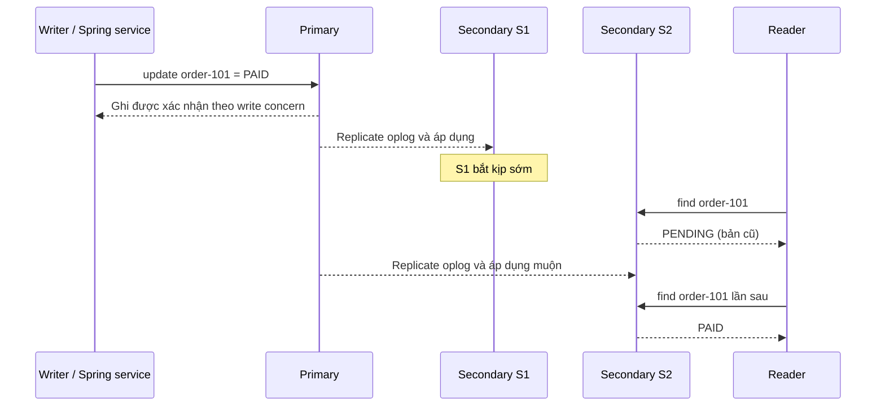
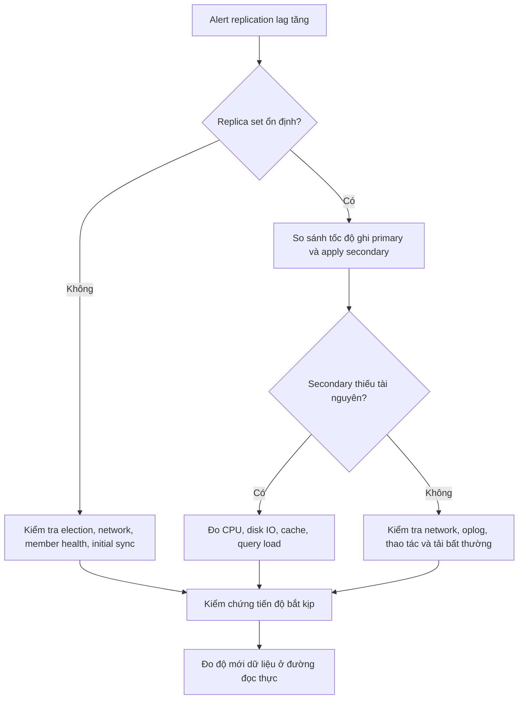

# Quan sát replication lag và ảnh hưởng của read preference trong Spring Data MongoDB

## 1. Vì sao replication lag liên quan trực tiếp đến kết quả truy vấn?

Trong một **replica set MongoDB**, node **primary** nhận các thao tác ghi. Các node **secondary** sao chép và áp dụng những thao tác đó từ oplog. Nhờ cơ chế replication, hệ thống có thể dự phòng khi node gặp sự cố và phân phối một số tải đọc sang secondary. Tuy nhiên, **dữ liệu trên secondary không nhất thiết đã cập nhật đến thao tác ghi mới nhất ở primary**.

Giả sử một ứng dụng Spring Data MongoDB quản lý trạng thái đơn hàng:

```json
{
  "_id": "order-101",
  "status": "PENDING",
  "amount": 1500000
}
```

Lúc 10:00:00, API cập nhật `status` thành `PAID` trên primary. Secondary S1 áp dụng thay đổi lúc 10:00:00.3, nhưng secondary S2 chỉ áp dụng lúc 10:00:08. Trong khoảng thời gian đó:

- Truy vấn đọc trên primary có thể thấy `PAID` nếu các điều kiện nhất quán khác được đáp ứng.
- Truy vấn đọc trên S1 hoặc S2 **có thể** thấy `PENDING`, tùy thời điểm, cách chọn node và mức read concern.
- Nếu ứng dụng hiển thị thông tin thanh toán dựa trên một secondary đang trễ, người dùng có thể thấy trạng thái cũ dù request cập nhật đã thành công.

**Replication lag** thường được hiểu là độ trễ giữa tiến độ sao chép/áp dụng thao tác ở secondary so với primary. Nó không đồng nghĩa với **network latency** (mất bao lâu để kết nối và trả một truy vấn), cũng không tự mô tả đầy đủ mức độ cũ của kết quả đọc từ góc nhìn một yêu cầu cụ thể.

Trong module **SPRING_DATA_MONGODB**, các quyết định dùng `MongoTemplate`, repository, index, aggregation và transaction đều cần cân nhắc nơi thực thi truy vấn. Một phép tìm theo ID thường nhanh nhưng có thể trả kết quả cũ nếu đi đến secondary đang lag. Một aggregation nặng trên secondary có thể giảm tải primary nhưng đồng thời phản ánh dữ liệu chậm hơn thực tế.

## 2. Dòng thời gian từ ghi đến đọc trên secondary



Lưu ý trong sơ đồ: thời điểm server xác nhận thao tác ghi phụ thuộc **write concern**. `w: 1` và `w: "majority"` khác nhau về mức xác nhận ghi; cả hai **không có nghĩa mọi secondary đã áp dụng** thao tác tại thời điểm response được trả về.

Các mốc vận hành có ý nghĩa khác nhau:

| Mốc | Mô tả | Ảnh hưởng đến truy vấn |
| --- | --- | --- |
| Primary nhận và thực hiện ghi | Dữ liệu được xử lý tại node nhận ghi | Read từ primary có khả năng quan sát tiến độ mới hơn |
| Oplog entry được truyền đến secondary | Secondary nhận được thông tin cần áp dụng | Chưa đủ để khẳng định một read thông thường đã thấy thay đổi |
| Secondary áp dụng oplog | Trạng thái dữ liệu của secondary tiến lên | Read trên node này có thể nhìn thấy trạng thái mới, tùy read concern và thời điểm |
| Ghi được xác nhận theo `majority` | Đáp ứng quy tắc xác nhận ghi của majority | Không đòi hỏi mọi secondary đã đuổi kịp |
| Read tại secondary hoàn tất | Kết quả phụ thuộc node, thời điểm, read concern và session | Có thể cũ hơn primary ngay khi latency của query rất thấp |

Trình tự chính xác phụ thuộc phiên bản MongoDB, topology, write/read concern và tài nguyên hệ thống. Khi xây dựng bài đo lag, phải tách rõ **độ trễ áp dụng oplog**, **độ trễ chọn node**, **độ trễ truy vấn** và **độ mới của kết quả**.

## 3. Đo replication lag bằng công cụ MongoDB

### 3.1. Quan sát trạng thái replica set

Trên một replica set, có thể dùng `rs.status()` hoặc lệnh tương ứng `replSetGetStatus` trong `mongosh`:

```javascript
const status = db.adminCommand({ replSetGetStatus: 1 });

status.members.forEach(member => {
  printjson({
    name: member.name,
    state: member.stateStr,
    optimeDate: member.optimeDate,
    health: member.health
  });
});
```

`members[].stateStr` cho biết trạng thái như `PRIMARY`, `SECONDARY` và các trạng thái khác. `optimeDate` thể hiện thời điểm oplog operation ứng với tiến độ thành viên đã báo cáo. Đây là điểm quan sát **tiến độ replication**, không nên coi như đồng hồ đo độ mới tuyệt đối của từng query.

Một cách tính gần đúng khoảng cách từ tiến độ secondary tới primary trong cùng mẫu trạng thái:

```javascript
const status = db.adminCommand({ replSetGetStatus: 1 });
const primary = status.members.find(member => member.stateStr === "PRIMARY");

if (!primary || !(primary.optimeDate instanceof Date)) {
  throw new Error("Không có mẫu optimeDate hợp lệ của PRIMARY");
}

for (const member of status.members) {
  if (member.stateStr !== "SECONDARY") continue;

  if (!(member.optimeDate instanceof Date)) {
    print(`${member.name}: chưa có optimeDate hợp lệ`);
    continue;
  }

  const lagSeconds =
    (primary.optimeDate.getTime() - member.optimeDate.getTime()) / 1000;

  printjson({
    member: member.name,
    lagSeconds,
    secondaryOptimeDate: member.optimeDate,
    primaryOptimeDate: primary.optimeDate
  });
}
```

Đây là **phép đo tương đối tại thời điểm lấy mẫu**, hữu ích cho học tập và kiểm tra sơ bộ. Thông tin từ các thành viên được trao đổi qua heartbeat và có độ trễ cập nhật; các trường có thể khác nhau giữa phiên bản MongoDB. Có thể xuất hiện số đo âm nhỏ hoặc dao động do cách thu thập và thời điểm lấy mẫu: không tự kết luận secondary đang đi trước primary mà phải kiểm tra mẫu và topology.

**Không tính lag đơn giản bằng `Date.now() - secondary.optimeDate`.** Nếu collection không có thao tác ghi trong một giờ, thời điểm oplog cuối cùng cũng có thể đã cách hiện tại một giờ trong khi secondary vẫn bắt kịp primary. So sánh tiến độ giữa các thành viên là phù hợp hơn.

### 3.2. Những gì cần đo ngoài một con số lag

| Tín hiệu | Vì sao cần theo dõi |
| --- | --- |
| Last applied/last durable optime của từng member | Phân biệt secondary chưa áp dụng hay chưa duy trì tiến độ theo cơ chế durability |
| Khoảng cách optime so với primary | Phát hiện secondary chậm hơn primary trong thời gian có ghi |
| Trạng thái thành viên và thay đổi primary | Lag có thể tăng trong bầu cử, resync, initial sync hoặc lỗi mạng |
| Oplog window / tuổi dữ liệu còn trong oplog | Secondary chậm quá lâu có nguy cơ không còn đủ lịch sử để đồng bộ tiếp |
| CPU, IO, disk queue, network, replication apply throughput | Tìm nguyên nhân thay vì chỉ tăng ngưỡng cảnh báo |
| p95/p99 read latency theo node và loại query | Phân biệt secondary xử lý chậm với secondary có dữ liệu cũ |
| Tần suất dữ liệu stale mà client thực sự quan sát | Kiểm tra tác động đến nghiệp vụ, không chỉ đo hệ thống |

Nếu triển khai MongoDB Atlas hoặc hệ thống monitoring chuyên dụng, có thể dùng metric *Replication Lag* và các metric replication/host tương ứng. Phải xác nhận **định nghĩa metric theo công cụ, phiên bản và cách lấy mẫu** trước khi so sánh số đo từ dashboard với script `optimeDate`. Một số chỉ số thể hiện khoảng cách applied, một số nhấn mạnh lịch sử/độ trễ sao chép hoặc thời gian quan sát.

Về phân quyền, lệnh theo dõi replica set cần quyền giám sát thích hợp, chẳng hạn vai trò `clusterMonitor` theo chính sách MongoDB đang dùng. Không đưa tài khoản root hay connection string chứa mật khẩu vào script thu thập metric.

## 4. Read preference quyết định ứng dụng có thể đọc từ đâu

**Read preference** là quy tắc MongoDB Driver sử dụng để chọn server cho thao tác đọc đủ điều kiện. Nếu không cấu hình, chế độ mặc định thường là `primary`. Các lựa chọn chính:

| Read preference | Phạm vi chọn node | Khi nào phù hợp | Điều cần nhớ |
| --- | --- | --- | --- |
| `primary` | Chỉ primary | Đọc dữ liệu nghiệp vụ cần mới, luồng ghi, kiểm tra trạng thái nhạy cảm | Primary có thể chịu tải đọc cao |
| `primaryPreferred` | Ưu tiên primary; có thể chuyển sang secondary nếu không có primary đủ điều kiện | Một số đường đọc cần ưu tiên primary nhưng chấp nhận fallback | Fallback có thể thấy dữ liệu cũ; không giúp duy trì khả năng ghi khi thiếu primary |
| `secondary` | Chỉ secondary đủ điều kiện | Báo cáo/analytics chấp nhận độ trễ; tách tải đọc khỏi primary | Có thể lỗi server selection nếu không có secondary phù hợp |
| `secondaryPreferred` | Ưu tiên secondary; fallback về primary khi không có secondary phù hợp | Danh sách, dashboard và đọc không yêu cầu tức thời | Không bảo đảm truy vấn luôn chạy trên secondary, cũng không bảo đảm dữ liệu mới |
| `nearest` | Chọn primary hoặc secondary phù hợp với tiêu chí độ trễ kết nối | Đọc cần latency mạng thấp, chấp nhận đặc tính nhất quán tương ứng | “Gần nhất” là dựa trên độ trễ mạng; **không phải dữ liệu mới nhất** |

`nearest` không có nghĩa MongoDB tìm node có replication lag thấp nhất. Driver dùng thời gian heartbeat/server selection và ngưỡng độ trễ cho phép (tham số như `localThresholdMS`) để lập danh sách node gần về mạng; sau đó lựa chọn trong nhóm phù hợp. Một secondary ở gần ứng dụng nhưng chậm áp dụng oplog vẫn có thể được chọn.

`secondaryPreferred` cũng không phải chính sách bảo đảm mọi truy vấn sang secondary: khi không có secondary khả dụng hoặc đáp ứng tag/staleness, driver có thể chọn primary. Vì vậy, khi kiểm thử phân tải và tính nhất quán cần **quan sát server thực tế đã nhận read**, thay vì chỉ nhìn URI hoặc annotation.

### 4.1. Tình huống so sánh

Giả sử cùng một thời điểm:

```text
Primary P       : order-101 = PAID,  optime 10:00:20
Secondary S1    : order-101 = PAID,  optime 10:00:19.5
Secondary S2    : order-101 = PENDING, optime 10:00:08

Thời gian kết nối từ ứng dụng:
  P  = 8 ms
  S1 = 20 ms
  S2 = 5 ms
```

Nếu truy vấn được route đến S2 vì S2 có latency mạng thấp, kết quả có thể là `PENDING` dù thời gian đọc chỉ vài mili giây. Với `secondaryPreferred`, ứng dụng có thể chọn một secondary đủ điều kiện theo quy tắc driver, không nhất thiết là S1 đang ít lag hơn. Để kiểm soát điều kiện chọn server, có thể bổ sung tag sets và giới hạn staleness; để đảm bảo đọc một cập nhật cụ thể, phải dùng chiến lược consistency phù hợp hơn.

## 5. `maxStalenessSeconds` và tag sets: giới hạn chọn node, không thay thế consistency

MongoDB hỗ trợ `maxStalenessSeconds` để yêu cầu driver loại khỏi tập ứng viên những secondary có **độ trễ ước tính** vượt ngưỡng. Giới hạn thực tế phụ thuộc heartbeat và quy tắc server selection; giá trị tối thiểu theo MongoDB Driver specifications thông thường là **90 giây**, đồng thời phải thỏa điều kiện liên quan heartbeat frequency.

Ví dụ URI minh họa:

```text
mongodb://mongo-1.example.test:27017,mongo-2.example.test:27017,mongo-3.example.test:27017/shop?replicaSet=rs0&readPreference=secondaryPreferred&maxStalenessSeconds=120
```

Ý nghĩa: ưu tiên secondary nhưng chỉ giữ trong tập chọn các secondary đáp ứng ngưỡng staleness mà driver ước tính. Khi không có secondary phù hợp, hành vi fallback theo `secondaryPreferred` có thể đưa read đến primary. Nếu dùng `secondary`, truy vấn có thể không chọn được node và hết thời gian server selection.

**Không dùng `maxStalenessSeconds=1` để đòi dữ liệu trễ dưới một giây.** Tham số này có giới hạn tối thiểu và bản chất là bộ lọc chọn server, không chứng minh dữ liệu một truy vấn cụ thể mới hơn một giây. Cần SLO về độ mới theo yêu cầu nghiệp vụ và kiểm thử thực tế, hoặc một cơ chế causal consistency/đọc primary tương ứng.

Tag sets cho phép giới hạn node theo nhãn cấu hình replica set, ví dụ `region=ap-southeast-1` hoặc `workload=analytics`. Nhãn phải được gán thực tế bằng cấu hình replica set; chỉ viết tag trong URI khi server không có nhãn tương ứng sẽ không khiến driver tự tạo nhãn.

Một số tình huống cần lưu ý:

- Secondary ở cùng khu vực có latency mạng thấp nhưng có thể lag cao hơn secondary ở khu vực khác.
- Dùng tag để đưa báo cáo về nhóm node phù hợp với workload, sau đó quan sát áp lực CPU/IO và lag.
- Secondary ẩn hoặc cấu hình đặc biệt có các giới hạn riêng về việc tham gia server selection; không mặc định mọi member đều là ứng viên đọc thông thường.
- Khi dùng fallback `primaryPreferred`/`secondaryPreferred`, kết quả có thể đổi node giữa các request mà ứng dụng không biết nếu không có telemetry.

## 6. Cấu hình Spring Data MongoDB: tách luồng đọc theo nghiệp vụ

### 6.1. Thiết lập mặc định bằng URI

Spring Boot có thể nhận connection string với read preference:

```yaml
spring:
  data:
    mongodb:
      uri: "mongodb://mongo-1.example.test:27017,mongo-2.example.test:27017,mongo-3.example.test:27017/shop?replicaSet=rs0&readPreference=primary"
```

Ví dụ dùng `primary` làm mặc định để những luồng chưa được đánh giá tính nhất quán không vô tình đi qua secondary. Các hostname chỉ là địa chỉ minh họa; cấu hình production cần TLS, xác thực và quản lý secret theo hạ tầng. Không ghi connection string thật chứa credential vào log hoặc tài liệu công khai.

Nếu cấu hình read preference ở cấp client thành `secondaryPreferred`, nhiều đường đọc qua repository hoặc `MongoTemplate` có thể chịu ảnh hưởng. Điều này cần được xem xét khi cùng ứng dụng vừa xử lý giao dịch/kiểm tra quyền, vừa chạy các truy vấn dashboard.

### 6.2. Chọn read preference ở một truy vấn với `MongoTemplate`

Với một đường đọc chấp nhận dữ liệu trễ, Spring Data MongoDB có thể chỉ định read preference trên `Query`:

```java
import com.mongodb.ReadPreference;
import java.util.List;
import org.springframework.data.mongodb.core.MongoTemplate;
import org.springframework.data.mongodb.core.query.Criteria;
import org.springframework.data.mongodb.core.query.Query;
import org.springframework.stereotype.Service;

@Service
public class CatalogReadService {
    private final MongoTemplate mongoTemplate;

    public CatalogReadService(MongoTemplate mongoTemplate) {
        this.mongoTemplate = mongoTemplate;
    }

    public List<ProductDocument> listVisible(String categoryId) {
        Query query = Query.query(
            Criteria.where("categoryId").is(categoryId)
                .and("visible").is(true)
        );
        query.withReadPreference(ReadPreference.secondaryPreferred());
        return mongoTemplate.find(query, ProductDocument.class);
    }
}
```

`ProductDocument` ở đây là entity `@Document` của ứng dụng, có các trường `categoryId` và `visible` phù hợp. Cách này giữ quy tắc đọc secondary ở phạm vi một truy vấn, giúp việc review luồng đọc dễ hơn. Cú pháp API nên được kiểm chứng với phiên bản Spring Data MongoDB đã khóa trong dự án.

Khi cần thao tác trực tiếp trên MongoDB Java Driver nhưng vẫn dùng kết nối do `MongoTemplate` quản lý:

```java
import com.mongodb.ReadPreference;
import com.mongodb.client.model.Filters;
import org.bson.Document;
import org.springframework.data.mongodb.core.MongoTemplate;

public Document findVisibleRaw(MongoTemplate template, String productId) {
    return template.getCollection("products")
        .withReadPreference(ReadPreference.secondaryPreferred())
        .find(Filters.and(
            Filters.eq("_id", productId),
            Filters.eq("visible", true)
        ))
        .first();
}
```

Ví dụ native driver làm việc với `Document` thô; nếu đọc bằng cách này, ứng dụng tự chịu trách nhiệm chuyển kiểu, áp dụng validation và quản lý mapping phù hợp. Một truy vấn cần đọc mới nhất có thể chọn `ReadPreference.primary()` thay vì dùng default secondary; việc chọn vẫn phải tương thích transaction đang hoạt động.

**Cần xác định mức độ nhất quán theo từng use case**, không mặc định mọi repository truy vấn đều phải cùng một read preference. Ví dụ báo cáo tổng quan có thể đọc secondary, còn kiểm tra trạng thái thanh toán ngay sau thao tác cập nhật hoặc quyết định ghi tiếp theo có thể cần primary cùng quy tắc read/write concern phù hợp.

## 7. Read preference khác read concern và write concern

Ba khái niệm giải quyết các câu hỏi khác nhau:

| Khái niệm | Trả lời câu hỏi | Ví dụ |
| --- | --- | --- |
| **Read preference** | Driver chọn node nào cho thao tác đọc? | `primary`, `secondaryPreferred` |
| **Read concern** | Dữ liệu đọc phải thỏa điều kiện hiển thị/commit nào? | `local`, `majority`, `snapshot`, `linearizable` theo điều kiện hỗ trợ |
| **Write concern** | Có bao nhiêu node/điều kiện durability cần xác nhận trước khi báo ghi thành công? | `w:1`, `w:"majority"` |

`readConcern: "majority"` giúp đọc dữ liệu đã được xác nhận theo majority theo ngữ nghĩa của MongoDB, nhưng **không buộc một secondary đang trễ phải trả phiên bản mới nhất tại primary** cho một truy vấn độc lập. Secondary có thể trả snapshot majority-committed cũ hơn.

Tương tự, một thao tác ghi `w:"majority"` được xác nhận không có nghĩa tất cả secondary đã áp dụng nó. Kết hợp `writeConcern: majority` và `readConcern: majority` là nền tảng quan trọng cho **causal consistency**, nhưng muốn một lần đọc cụ thể nhìn thấy lần ghi trước đó còn cần dùng session và trình tự hoạt động đúng.

Một quyết định truy vấn thực tế có thể là:

- Bảng điều khiển phân tích chấp nhận chậm vài giây: `secondaryPreferred` kèm giám sát lag và SLO về độ mới.
- Trang chi tiết vừa chỉnh sửa yêu cầu *read-your-writes*: đọc primary hoặc một **causally consistent session** thích hợp; cân nhắc timeout nếu secondary chưa bắt kịp.
- Quyết định cấp quyền, thay đổi số dư hoặc chuyển trạng thái thanh toán: không dựa đơn thuần vào một secondary có độ trễ không kiểm soát; xác định ranh giới transaction, concurrency và consistency trước khi chọn cách đọc.

## 8. Causal consistency: đọc được thao tác ghi trước đó qua session

**Causal consistency** giúp ràng buộc thứ tự nhân quả của các thao tác trong cùng session theo điều kiện MongoDB hỗ trợ. Trong trường hợp đọc sau một thao tác ghi, session có thể khiến thao tác đọc ở secondary **đợi** đến khi node đó đủ tiến độ, thay vì trả ngay bản quá cũ. Để có bảo đảm causal consistency cần dùng cấu hình phù hợp, đặc biệt là các thao tác write concern `majority` và read concern `majority` trong session, với các thao tác trong session được thực hiện tuần tự.

Ví dụ dùng MongoDB Java Driver với explicit session; trong dự án Spring, client có thể được quản lý bởi Spring Boot và `MongoTemplate` vẫn dùng cho các đường truy vấn khác:

```java
import com.mongodb.ClientSessionOptions;
import com.mongodb.ReadConcern;
import com.mongodb.ReadPreference;
import com.mongodb.WriteConcern;
import com.mongodb.client.MongoClient;
import com.mongodb.client.MongoCollection;
import com.mongodb.client.model.Filters;
import com.mongodb.client.model.Updates;
import org.bson.Document;

public final class OrderReadYourWrites {
    private final MongoClient mongoClient;

    public OrderReadYourWrites(MongoClient mongoClient) {
        this.mongoClient = mongoClient;
    }

    public Document payThenReadFromSecondary(String orderId) {
        MongoCollection<Document> orders = mongoClient
            .getDatabase("shop")
            .getCollection("orders")
            .withWriteConcern(WriteConcern.MAJORITY);

        try (var session = mongoClient.startSession(
                ClientSessionOptions.builder().causallyConsistent(true).build())) {

            orders.updateOne(
                session,
                Filters.eq("_id", orderId),
                Updates.set("status", "PAID")
            );

            return orders
                .withReadPreference(ReadPreference.secondary())
                .withReadConcern(ReadConcern.MAJORITY)
                .find(session, Filters.eq("_id", orderId))
                .first();
        }
    }
}
```

Mẫu này minh họa việc dùng cùng session và majority concerns. Khi chạy thực tế cần kiểm tra `matchedCount` của update, xử lý document không tồn tại, lỗi server selection và trường hợp secondary chưa đuổi kịp. `ReadPreference.secondary()` được dùng có chủ đích để test hành vi đọc ở secondary; nếu không có secondary phù hợp, lệnh có thể timeout hoặc thất bại. Không dùng code này như một API thanh toán production khi chưa có idempotency, kiểm soát tranh chấp, audit và kiểm thử đầy đủ.

**Lưu ý:** causal consistency không biến dữ liệu trên mọi secondary thành dữ liệu tức thời; nó thay đổi điều kiện **khi nào read được phép hoàn tất**. Nếu secondary lag quá lớn, độ trễ đọc tăng và lệnh có thể timeout. Các thao tác trên cùng một `ClientSession` không được chạy đồng thời tùy tiện.

Khi dùng MongoDB multi-document transaction, read preference cho các thao tác trong transaction phải tương thích hạn chế transaction của MongoDB; thông thường transaction cần thao tác trên primary. Đừng gắn đọc secondary lên một thao tác trong transaction rồi giả định server có thể thực thi như truy vấn ngoài transaction. `@Transactional(readOnly = true)` của Spring cũng không tự chuyển truy vấn sang secondary.

## 9. Read preference và tác động bảo mật, vận hành

Vì bài thuộc nhóm **Bảo mật và vận hành**, cần xem replication lag như một yếu tố có thể ảnh hưởng đến quyết định truy cập, không chỉ là vấn đề tốc độ.

Ví dụ: quyền truy cập một tài liệu được thu hồi trên primary, nhưng bản ghi phân quyền trên secondary vẫn có trạng thái cho phép. Nếu code xác thực quyền đọc từ secondary đang trễ trong khi dữ liệu nhạy cảm được cung cấp từ một nguồn khác, người dùng có thể tiếp tục được cấp quyền trong một khoảng thời gian ngoài mong muốn.

Các nguyên tắc thực tế:

1. Những thao tác **xác thực/ủy quyền có yêu cầu hiệu lực ngay** nên chọn nguồn đọc và cơ chế nhất quán đáp ứng yêu cầu đó; không coi `secondaryPreferred` là mặc định an toàn.
2. Với dữ liệu audit hoặc dashboard chỉ đọc, có thể chấp nhận lag theo SLO đã định nghĩa, nhưng phải ghi rõ rằng thời gian cập nhật quan sát được có thể chậm hơn sự kiện thực.
3. Khi một thao tác nghiệp vụ vừa thay đổi quyền/giới hạn rồi ngay lập tức ra quyết định dựa trên thay đổi đó, dùng cùng mô hình consistency hoặc transaction được thiết kế và thử nghiệm cho luồng đó.
4. Tách quyền truy cập database của service và quyền giám sát replica set; dashboard theo dõi lag không cần tài khoản được phép sửa dữ liệu nghiệp vụ.
5. Bật TLS, xác thực, quản lý secret và bảo vệ dữ liệu metric/log. Khi ghi nhật ký server selection, chỉ lưu thông tin node, loại truy vấn và correlation ID phù hợp; không log truy vấn chứa thông tin bí mật hoặc nguyên văn response.

Read preference không thay thế cơ chế RBAC/authorization trong ứng dụng. Một lựa chọn node có thể làm phát sinh *stale authorization decision* nếu hợp đồng dữ liệu không được thiết kế trước.

## 10. Chẩn đoán replication lag tăng cao

Khi biểu đồ lag tăng, cần đi từ triệu chứng đến nguyên nhân thay vì chỉ tăng `maxStalenessSeconds` hoặc tự động chuyển mọi read về primary.



| Triệu chứng | Giả thuyết cần kiểm tra | Hành động chẩn đoán |
| --- | --- | --- |
| Lag chỉ tăng ở một secondary | IO/CPU thấp, network không ổn định, query nặng trên node đó | So sánh metric host và tiến độ applied của từng member |
| Tất cả secondary đều tăng lag khi ghi lớn | Write throughput vượt tốc độ apply tổng thể | Theo dõi oplog rate, batch/bulk write, năng lực secondary |
| Lag cao khi chạy aggregation trên secondary | Đọc phân tích cạnh tranh tài nguyên với áp dụng oplog | Kiểm tra `explain()`, index, CPU/IO, giới hạn tải báo cáo |
| Secondary thường xuyên rơi khỏi trạng thái SECONDARY | Initial sync, resync, lỗi heartbeat hoặc cấu hình node | Kiểm tra member state và log server phù hợp |
| Không có lag trên biểu đồ nhưng ứng dụng vẫn thấy dữ liệu cũ | Cache, read concern, node chọn khác, đo lag sai thời điểm | Theo dõi cache key/TTL, session, địa chỉ node và revision dữ liệu |
| Truy vấn đọc chuyển sang primary đột ngột | Secondary không còn eligible theo tag/staleness hoặc bị lỗi | Quan sát server selection, topology, lỗi và tải primary |

Replication lag không phải lúc nào cũng bắt nguồn từ MongoDB riêng lẻ. Nếu ứng dụng gửi nhiều truy vấn vào secondary với index không phù hợp, node có thể chậm áp dụng oplog do cạnh tranh CPU, disk và memory. Trong trường hợp đó, giảm số query quét collection hoặc tạo index thích hợp có thể cải thiện cả latency đọc và khả năng secondary bắt kịp.

### 10.1. Lag, cache và aggregation

Nếu cache một kết quả aggregation lấy từ secondary, tổng độ cũ mà người dùng thấy có thể đến từ **cả replication lag lẫn tuổi của cache**. Ví dụ secondary trễ 6 giây, kết quả đọc từ đó được cache thêm 30 giây; một client có thể tiếp tục thấy bản dữ liệu được tạo trước hiện tại nhiều hơn mức lag ở một lần quan sát riêng lẻ.

Để điều khiển độ mới, xác định thời điểm dữ liệu nguồn và thời điểm entry được tính, so sánh với SLO nghiệp vụ. TTL 30 giây không chứng minh độ cũ tối đa luôn đúng 30 giây khi nguồn query đã lag trước khi vào cache. Với số liệu quan trọng, có thể gắn watermark/timestamp tiến độ xử lý hoặc đọc primary tùy yêu cầu.

## 11. Theo dõi truy vấn thực sự chạy trên node nào

Khi cấu hình URI có `secondaryPreferred`, việc quan sát chỉ số của replica set chưa chứng minh một request cụ thể đọc secondary. Nên bổ sung telemetry của MongoDB Java Driver như **command monitoring** hoặc server selection logging ở mức được cho phép. Tại `CommandStartedEvent`, driver có thông tin kết nối/server phục vụ command; có thể ghi nhận hostname, loại command, thời gian và correlation ID, tránh log body chứa dữ liệu khách hàng.

Đặc biệt phải phân biệt:

- **Read preference được yêu cầu:** cấu hình tại MongoClient, MongoDatabase/MongoCollection hoặc Query.
- **Server thực tế được chọn:** node mà driver gửi command đến, phụ thuộc trạng thái topology, latency, tag/staleness và các giới hạn vận hành.
- **Độ mới của dữ liệu trả về:** do tiến độ node, read concern, session và thời điểm truy vấn; địa chỉ node một mình chưa chứng minh bản ghi mới nhất.

Khi xử lý lỗi, ghi các yếu tố điều tra sau theo cách an toàn: request ID, tên chức năng, read preference, read concern, server address, read latency, mã lỗi, timeout, document version hoặc timestamp nghiệp vụ đã được kiểm duyệt. Không log URI chứa credential và không in toàn bộ document nhạy cảm.

## 12. Kiểm thử đọc cũ và server selection trên replica set thật

Một integration test chạy với MongoDB standalone không kiểm tra được read preference sang secondary. MongoDB Testcontainers **một node replica set** có thể hỗ trợ nhiều test transaction và repository, nhưng không mô phỏng được secondary lag thực sự. Để kiểm thử bài học này, cần môi trường có **ít nhất một primary và một secondary**, lý tưởng là replica set có nhiều node độc lập phù hợp với cấu hình thử nghiệm.

### 12.1. Kịch bản thử nghiệm cơ bản

1. Khởi tạo một replica set test, chuẩn bị collection `orders` và xác nhận tất cả member đang ở trạng thái mong muốn.
2. Ghi `order-101 = PENDING`, xác nhận các member có thể quan sát dữ liệu ban đầu và ghi lại optime.
3. Ghi `order-101 = PAID` trên primary với write concern đã chọn; ghi nhận thời điểm ack.
4. Thực hiện query cùng ID với `primary`, `secondary` và `secondaryPreferred`; ghi server nhận query và kết quả thực tế.
5. Tạo tải ghi hoặc độ trễ replication **trong môi trường test có kiểm soát**, đo optime gap trước/sau và ảnh hưởng đến khả năng đọc bản mới.
6. Thử `secondary` khi không còn secondary eligible: xác minh timeout/lỗi server selection; thử `secondaryPreferred` và quan sát fallback thực tế nếu đủ điều kiện.
7. Thử session causally consistent có majority concerns: khi đọc từ secondary, xác minh ứng dụng đợi được trạng thái đã ghi hoặc trả lỗi/timeout rõ ràng nếu không thể bắt kịp trong giới hạn.
8. Khôi phục trạng thái replica set, đối soát dữ liệu và bảo đảm bài test không để lại cấu hình gây lag.

**Không khẳng định đã chứng minh stale read chỉ vì secondary read trả giá trị mới.** Trên môi trường nhỏ, replication có thể hoàn thành rất nhanh; bài test cần điều kiện kiểm soát thực sự (network shaping/failpoint phù hợp bản thử nghiệm, hoặc điều kiện tạo lag đo được) và xác minh server thực tế đã được chọn.

### 12.2. Bảng test case

| Tình huống | Kỳ vọng cần kiểm chứng |
| --- | --- |
| `primary` read sau write đã được xác nhận | Không đọc nhầm một secondary trễ do routing |
| `secondary` read trong khi secondary còn lag | Có thể quan sát trạng thái cũ; có telemetry node và thời điểm |
| `secondaryPreferred` khi secondary healthy | Ưu tiên secondary đủ điều kiện, theo quy tắc driver |
| `secondaryPreferred` khi không có secondary phù hợp | Có thể fallback primary, theo cấu hình và topology |
| `secondary` khi mọi secondary không khả dụng | Server selection thất bại sau timeout cấu hình |
| `nearest` với secondary có latency mạng thấp nhưng lag cao | Việc chọn server không đồng nghĩa chọn dữ liệu mới |
| `maxStalenessSeconds` vượt ngưỡng ước tính | Secondary không phù hợp bị loại khỏi tập ứng viên theo quy tắc driver |
| `readConcern: majority` đọc secondary đang trễ | Không nhầm majority-committed với latest committed trên primary |
| Session causal đọc sau majority write | Giữ thứ tự nhân quả hoặc timeout, không trả bản trước write |
| Aggregation từ secondary trong lúc tải cao | Theo dõi latency và ảnh hưởng đến oplog apply/replication lag |
| Cache kết quả secondary | Quan sát độ cũ cộng dồn của nguồn dữ liệu và cache |

Để tránh test không ổn định do thời gian, đừng dùng một `Thread.sleep` cố định rồi giả định dữ liệu đã/ chưa replicate. Dùng polling có giới hạn, barrier hoặc điều kiện trạng thái của member; ghi lại timestamp/optime đo được và điều kiện kết thúc. Mọi thử nghiệm làm chậm replication phải có cleanup để khôi phục môi trường.

## 13. Đặt SLO và cảnh báo cho vận hành

Ngưỡng cảnh báo nên được thiết kế từ hậu quả nghiệp vụ, không sao chép máy móc một ngưỡng cho mọi hệ thống. Ví dụ:

| Đường đọc | Mức dữ liệu cũ cho phép (ví dụ) | Quyết định thiết kế |
| --- | --- | --- |
| Kiểm tra quyền có hiệu lực ngay | Rất thấp theo yêu cầu bảo mật | Ưu tiên consistency phù hợp; tránh secondary chưa kiểm soát lag |
| Trạng thái đơn hàng vừa cập nhật | Yêu cầu read-your-writes | Primary hoặc causal session thích hợp; test timeout |
| Trang danh mục công khai | Có thể vài giây | Cho phép secondary, giám sát staleness và cache |
| Dashboard báo cáo theo giờ | Có thể hàng chục giây hoặc hơn | Phân tải đọc, thể hiện timestamp dữ liệu cuối |

Các giá trị chỉ là **ví dụ minh họa**, không phải chuẩn SLA chung. Để đặt cảnh báo, kết hợp ít nhất ba tín hiệu: replication lag theo member, tỷ lệ lỗi/timeout server selection, và độ mới mà người dùng quan sát trên đường đọc quan trọng.

Nếu lag tăng hơn mục tiêu:

- Xác nhận primary/secondary đang ở trạng thái nào và số đo lag có phản ánh tải ghi gần đây không.
- Xác định truy vấn bị ảnh hưởng, read preference yêu cầu và node đã thực hiện.
- Kiểm tra tác động đến chức năng nhạy cảm (quyền, đơn hàng, số dư) trước khi chỉ đánh giá biểu đồ host.
- Nếu cần, điều chỉnh tuyến đọc về primary trong phạm vi chức năng bị ảnh hưởng và kiểm soát tải; xử lý nguyên nhân lag rồi mới khôi phục phân tải.
- Ghi lại diễn tiến và cập nhật test để tránh tái diễn sự cố tương tự.

## 14. Các sai lầm thường gặp

| Sai lầm | Hệ quả | Cách phòng tránh |
| --- | --- | --- |
| Coi `secondaryPreferred` là lựa chọn luôn đọc secondary | Không nhận ra truy vấn đã fallback primary hoặc tải primary tăng | Theo dõi server selection thực tế |
| Coi `nearest` là bản sao mới nhất | Chọn node gần mạng nhưng còn lag | Phân biệt network latency và replication progress |
| Dùng `Date.now() - optimeDate` làm replication lag | Báo lag cao giả khi lâu không có ghi | So sánh optime primary với secondary trong cùng mẫu |
| Dùng `readConcern: majority` và mặc định đã có latest read | Secondary có thể trả bản majority-committed cũ | Dùng causal session hoặc đọc primary theo yêu cầu |
| Đặt `maxStalenessSeconds` rất nhỏ để đảm bảo sub-second | Cấu hình không hợp lệ hoặc không đúng bản chất | Hiểu giới hạn tối thiểu và ngữ nghĩa bộ lọc chọn server |
| Chỉ test với MongoDB một node | Không kiểm tra được stale read trên secondary | Dùng nhiều member và điều khiển lag trong môi trường test |
| Đọc phân quyền mới thu hồi từ secondary không kiểm soát | Có thể cho phép truy cập dựa trên quyền cũ | Chọn consistency đáp ứng SLO bảo mật |
| Bỏ qua cache khi phân tích dữ liệu cũ | Cache giữ bản sao trễ hơn thời điểm query | Theo dõi tuổi cache và dữ liệu nguồn |
| Đổ mọi lag cho mạng | Bỏ qua CPU/IO hoặc aggregation nặng ở secondary | So sánh host metrics với oplog apply và query profile |
| Chạy script giám sát bằng tài khoản có quyền ghi toàn hệ thống | Tăng rủi ro vận hành | Dùng quyền monitoring tối thiểu và bảo vệ credential |

## 15. Bài thực hành tổng hợp

Xây dựng một API Spring Data MongoDB với collection `orders` gồm `_id`, `status`, `updatedAt` và `revision`. Triển khai ba đường đọc có mục đích khác nhau: endpoint hiển thị đơn hàng vừa thanh toán, endpoint liệt kê đơn hàng cho dashboard và endpoint aggregation thống kê số đơn theo trạng thái.

**Các bước thực hành:**

1. Chạy replica set thử nghiệm có primary và ít nhất một secondary; kiểm tra trạng thái member và tiến độ optime bằng `replSetGetStatus`.
2. Tạo API dùng repository/`MongoTemplate` cập nhật `status` với cơ chế kiểm soát tranh chấp ghi thích hợp; lưu thời điểm ghi được xác nhận.
3. Cho endpoint trạng thái vừa cập nhật đọc theo `primary` và một endpoint danh sách theo `secondaryPreferred`; ghi lại server đã thực hiện query, thời gian response và giá trị `revision` thấy được.
4. Tạo điều kiện secondary áp dụng chậm trong môi trường test; so sánh optime gap và giá trị trả về từ hai endpoint.
5. Thử `secondary`, `secondaryPreferred`, `nearest` và `maxStalenessSeconds` hợp lệ; ghi lại điều kiện fallback hoặc lỗi server selection.
6. Viết một trường hợp dùng session causal với `WriteConcern.MAJORITY`/`ReadConcern.MAJORITY`; kiểm chứng read sau write không trả lại bản trước thao tác ghi khi điều kiện được đáp ứng.
7. Cache kết quả một truy vấn dashboard trong thời gian ngắn, đo thêm tuổi cache để phân biệt hai nguồn dữ liệu cũ.
8. Thu thập biểu đồ replication lag, read latency, error rate, node selection và kết quả test; so sánh với SLO của từng endpoint.

**Tiêu chí hoàn thành:** giải thích được vì sao cùng một `_id` có thể trả giá trị khác nhau trên primary và secondary, đo được khoảng cách tiến độ replication, xác định node đang phục vụ từng read, biết khi nào `secondaryPreferred` có thể fallback, và chọn cấu hình read preference/read concern phù hợp cho một chức năng nghiệp vụ cụ thể. Không sử dụng kết quả đo trên một node đơn lẻ để kết luận về replication lag trong môi trường nhiều node.
