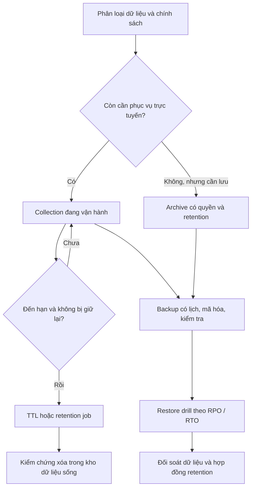
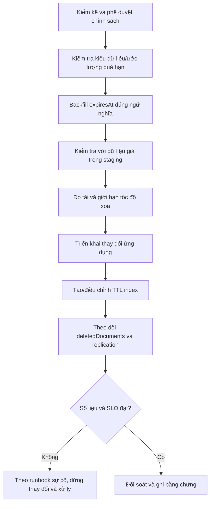

# Thời hạn giữ dữ liệu, TTL, sao lưu và diễn tập khôi phục

> **Chương:** Bảo mật và vận hành · **Module:** `SPRING_DATA_MONGODB`. Spring Data MongoDB giúp lưu, truy vấn, ánh xạ document và làm việc với repository, `MongoTemplate` hoặc reactive API. Nhưng vòng đời dữ liệu không kết thúc khi ứng dụng gọi `save()`: cần quy định dữ liệu được giữ bao lâu, MongoDB xóa dữ liệu hết hạn thế nào, bản sao lưu giữ những gì và liệu có khôi phục được dịch vụ khi xảy ra sự cố hay không. Bài này kết nối **data retention → TTL → backup → restore drill** thành một quy trình có thể kiểm chứng.

## 1. Mục tiêu: kiểm soát vòng đời dữ liệu, không chỉ cấu hình một index

Giả sử hệ thống có các collection:

- `loginSessions`: phiên đăng nhập tạm thời, cần hết hiệu lực sau thời hạn ngắn.
- `auditEvents`: sự kiện kiểm toán được giữ theo chính sách nội bộ và yêu cầu pháp lý.
- `orders`: đơn hàng phục vụ giao dịch, có dữ liệu cần lưu lâu hơn phiên đăng nhập.
- `exportJobs`: kết quả export tạm, có thể xóa sau khi khách hàng tải xuống hoặc quá hạn.
- `restoreEvidence`: bằng chứng kiểm tra backup và diễn tập khôi phục.

Nếu đặt chung TTL 30 ngày cho mọi collection, hệ thống có thể xóa đơn hàng còn cần đối soát hoặc sự kiện đang nằm trong diện bảo toàn chứng cứ. Ngược lại, nếu chỉ giữ mãi tất cả dữ liệu, chi phí lưu trữ, mức độ phơi lộ thông tin và khối lượng dữ liệu phải bảo vệ sẽ tăng.

**Một chính sách hoàn chỉnh cần trả lời:**

1. **Dữ liệu nào** cần giữ, theo chủ sở hữu nghiệp vụ và phân loại nhạy cảm?
2. **Mốc bắt đầu thời hạn** là khi tạo, khi hoàn thành, khi đóng tài khoản hay khi hết một nghĩa vụ?
3. **Khi hết hạn**, chỉ ngăn đọc, xóa khỏi hệ thống đang chạy, chuyển vào kho lưu trữ hay xóa toàn bộ bản sao?
4. **Backup** phải phục vụ mục tiêu khôi phục nào, được mã hóa và giữ riêng bao lâu?
5. Khi khôi phục dữ liệu cũ, làm thế nào tránh **phục hồi lại dữ liệu đã hết hạn hoặc đã bị yêu cầu xóa**?
6. Có bằng chứng thực tế rằng hệ thống đạt **RPO/RTO** hay chỉ có một job báo “backup successful”?

Bài học sử dụng ví dụ kỹ thuật, không đặt ra một thời hạn pháp lý mặc định. Thời hạn cụ thể phải xuất phát từ chính sách được duyệt, nghĩa vụ áp dụng cho sản phẩm và đặc điểm dữ liệu.

## 2. Phân biệt retention, TTL, archive và backup

| Khái niệm | Mục đích | Cơ chế thường gặp | Điều không tự bảo đảm |
|---|---|---|---|
| **Retention policy** | Quy tắc giữ/xóa dữ liệu theo loại và nghĩa vụ | Bảng chính sách + kiểm soát vận hành | Không tự thực thi nếu chưa có job/index |
| **TTL index** | Tự động xóa document đủ điều kiện hết hạn ở collection | TTL monitor của `mongod` | Không xóa tức thì; không xóa bản backup |
| **Archive** | Chuyển dữ liệu sang vùng lưu ít truy cập hơn | Export có kiểm chứng + catalog + chính sách truy cập | Không tương đương backup cho toàn hệ thống |
| **Backup** | Tạo điểm có thể khôi phục sau mất/hỏng dữ liệu | Snapshot, backup service, `mongodump` | Không có giá trị nếu chưa kiểm thử restore |
| **Point-in-time recovery (PITR)** | Khôi phục đến thời điểm phù hợp trong lịch sử | Snapshot cơ sở + oplog/chuỗi thay đổi được lưu liên tục bởi hệ thống backup | Không đồng nghĩa với `mongodump --oplog` một lần |
| **Restore drill** | Chứng minh khả năng phục hồi trong điều kiện giả định | Restore vào môi trường cô lập + kiểm tra ứng dụng và số liệu | Không đạt chỉ bằng kiểm tra sự tồn tại của tệp backup |



Đặc biệt, **TTL trên production không phải chính sách xóa backup**. Snapshot hoặc archive được tạo trước khi document hết hạn có thể vẫn giữ bản sao của document sau thời điểm dữ liệu sống đã bị xóa. Cần có chính sách giữ/xóa và kiểm soát truy cập riêng cho các bản sao này.

## 3. Lập bảng chính sách lưu giữ dữ liệu

Một bảng do nhóm sản phẩm, vận hành, an toàn thông tin và bên phụ trách dữ liệu thống nhất nên có:

| Nhóm dữ liệu | Mốc bắt đầu | Cơ chế đề xuất | Điều kiện ngoại lệ | Cách kiểm chứng |
|---|---|---|---|---|
| Phiên đăng nhập | `expiresAt` do server tính | TTL index theo hạn tuyệt đối | Tùy chính sách điều tra/sự cố | Tỷ lệ session quá hạn, kiểm thử truy cập |
| Tệp export tạm | `completedAt` hoặc `expiresAt` | TTL cho metadata + job xóa object storage | Export đang xử lý hoặc bị giữ theo yêu cầu | Metadata và object cùng biến mất |
| Log vận hành | Thời điểm phát sinh | Retention của log store; TTL nếu log lưu MongoDB | Điều tra đang được phê duyệt | Cấu hình retention + báo cáo xóa |
| Đơn hàng | Mốc nghiệp vụ quy định | Archive hoặc job theo điều kiện | Khiếu nại/đối soát/chứng cứ | Kết quả batch và đối soát |
| Bằng chứng diễn tập | Thời điểm drill | Kho riêng có thời hạn | Đợt kiểm toán đang mở | Manifest và lịch xóa |
| Bản backup | Thời điểm tạo + loại backup | Lifecycle policy của backup storage | Sự cố hoặc yêu cầu bảo toàn hợp lệ | Danh sách snapshot, tuổi, quyền truy cập |

Bảng trên thể hiện **cách lựa chọn công nghệ**, không chỉ định số ngày giữ cho từng loại dữ liệu.

### 3.1. Dùng `expiresAt` hay `createdAt`?

Hai cách có ngữ nghĩa khác nhau:

- `createdAt + expireAfterSeconds`: mọi document có cùng độ dài sống kể từ mốc tạo; phù hợp khi quy tắc cố định.
- `expiresAt + expireAfterSeconds: 0`: mỗi document có một hạn tuyệt đối riêng; phù hợp phiên đăng nhập ngắn/dài khác nhau hoặc gia hạn có chủ đích.

Ví dụ: phiên A có hạn 15 phút và phiên B có hạn 2 giờ thì `expiresAt` giúp thể hiện hạn riêng của từng phiên rõ ràng hơn. Ngược lại, nếu mọi sự kiện chỉ cần giữ đúng một khoảng từ `createdAt`, cấu hình TTL theo thời lượng có thể gọn hơn.

**Thời gian là dữ liệu nghiệp vụ:** xác định ai được cập nhật `expiresAt`, kiểm tra giá trị hợp lệ, đồng bộ thời gian trên hạ tầng, và tránh để client tùy ý đẩy hạn ra xa.

### 3.2. Khi dữ liệu phải được giữ lại

Nếu một phần document cần **legal hold** hoặc khóa bảo toàn vì điều tra, không gắn một TTL áp dụng vô điều kiện lên toàn bộ dữ liệu đó. Có thể:

- Tách collection không có TTL cho dữ liệu cần bảo toàn, với quyền truy cập và luồng giải phóng hold riêng.
- Thiết kế một **partial TTL index** chỉ áp dụng cho subset đủ điều kiện, sau khi xác minh filter, phiên bản MongoDB và các thay đổi state cần thiết.
- Dùng retention job kiểm tra điều kiện nghiệp vụ và audit trước khi xóa, với kiểm tra cạnh tranh trong mỗi lần thao tác.

Thiết kế phải bảo đảm rằng một thao tác cập nhật làm thay đổi trạng thái hold không bất ngờ khiến document đủ điều kiện xóa. Với dữ liệu có yêu cầu xóa chính xác ngay tại thời hạn hoặc yêu cầu tuân thủ phức tạp, TTL đơn thuần không đủ.

## 4. TTL index trong MongoDB vận hành ra sao?

TTL (*time to live*) là thuộc tính của một **single-field index** trên trường thời gian kiểu BSON Date (hoặc mảng chứa giá trị Date trong các trường hợp được hỗ trợ). MongoDB dùng một background TTL monitor để tìm và xóa các document đã hết hạn.

Ví dụ thời hạn tuyệt đối:

```javascript
use retention_lab

db.loginSessions.createIndex(
  { expiresAt: 1 },
  {
    name: "ttl_login_sessions_expires_v1",
    expireAfterSeconds: 0
  }
);
```

Với `expireAfterSeconds: 0`, document đủ điều kiện xóa khi `expiresAt` không còn nằm trong tương lai. Với `expireAfterSeconds: 86400` trên trường `createdAt`, document đủ điều kiện xóa sau **24 giờ** kể từ `createdAt`.

```text
createdAt ──────(retention = 24 giờ)──────> thời điểm đủ điều kiện xóa
expiresAt ────────────────────────────────> thời điểm đủ điều kiện xóa
                                               │
                                               v
                                      TTL monitor kiểm tra
                                               │
                                               v
                                         MongoDB xóa
```

**Điểm cần nhớ:** “đủ điều kiện xóa” khác “đã được xóa”. TTL monitor xử lý nền theo chu kỳ, thường kiểm tra khoảng **60 giây**, và có thể chậm hơn khi hệ thống đang chịu tải hoặc có lượng document quá hạn lớn. Không nên dùng TTL để cam kết một hành động bắt buộc xảy ra đúng đến mili-giây.

### 4.1. Giới hạn kỹ thuật quan trọng

- TTL thông thường là **single-field index**; compound index không có ngữ nghĩa TTL thông thường, ngay cả khi có cấu hình `expireAfterSeconds`.
- Không thể tạo TTL index trên `_id`.
- Giá trị thời gian cần là **BSON Date**; chuỗi như `"2026-12-01T00:00:00Z"` không tự được TTL monitor hiểu như Date.
- Field không có Date hoặc không tồn tại thường không được TTL xử lý theo ý định; kiểm soát schema/mapping để tránh lưu vô thời hạn.
- Nếu field là **mảng Date**, MongoDB có quy tắc dựa trên ngày sớm nhất trong mảng; cần thử trên dữ liệu thật trước khi dùng.
- Trên replica set, **primary** thực hiện TTL delete; secondary nhận các thao tác xóa qua replication.
- Index **hidden** vẫn được duy trì và TTL vẫn có hiệu lực: `hidden:true` chỉ loại index khỏi query planner, không vô hiệu hóa xóa.
- TTL delete là thao tác xóa thật, có thể gây I/O, tăng replication lag và tác động tới tải ghi.
- Time-series collections có cơ chế retention/TTL và giới hạn riêng; kiểm tra tài liệu theo phiên bản thay vì dùng nguyên mẫu collection thường.

### 4.2. TTL không thay thế việc kiểm tra hạn trong ứng dụng

Ví dụ session hết hạn lúc 12:00:00, TTL monitor có thể chưa xóa document lúc 12:00:20. Nếu chỉ kiểm tra “session còn document trong MongoDB” rồi cho phép truy cập, phiên đã hết hạn vẫn có thể được chấp nhận.

Ứng dụng cần kiểm tra **hạn logic** ngay khi xác thực:

```java
public boolean isSessionValid(Session session, Instant now) {
    return session != null
        && session.getExpiresAt() != null
        && session.getExpiresAt().isAfter(now)
        && !session.isRevoked();
}
```

Hoặc giới hạn điều kiện đọc trong MongoDB:

```javascript
db.loginSessions.findOne({
  _id: "session-test-001",
  expiresAt: { $gt: new Date() },
  revoked: false
});
```

Dùng thời gian tin cậy, đồng bộ đồng hồ và quy định rõ chênh lệch cho phép. TTL là **cơ chế dọn dữ liệu vật lý bất đồng bộ**, còn tính hợp lệ phiên phải được bảo vệ bởi luật nghiệp vụ tại thời điểm truy cập.

## 5. Thực hành TTL bằng `mongosh`

Chạy trên database thử nghiệm `retention_lab`, không dùng collection production.

### 5.1. Tạo dữ liệu thử có hạn riêng

```javascript
use retention_lab

const now = new Date();

db.loginSessions.insertMany([
  {
    _id: "session-test-expired",
    createdAt: new Date(now.getTime() - 3600_000),
    expiresAt: new Date(now.getTime() - 60_000),
    revoked: false
  },
  {
    _id: "session-test-valid",
    createdAt: now,
    expiresAt: new Date(now.getTime() + 3600_000),
    revoked: false
  }
]);

db.loginSessions.createIndex(
  { expiresAt: 1 },
  {
    name: "ttl_login_sessions_expires_v1",
    expireAfterSeconds: 0
  }
);
```

Kiểm tra metadata index:

```javascript
db.loginSessions.getIndexes();
```

Document `session-test-expired` đã đủ điều kiện TTL. Nó **có thể chưa biến mất ngay** sau khi tạo index. Nếu cần kiểm tra ứng dụng từ chối truy cập ngay, hãy query theo `expiresAt > now` hoặc kiểm tra hạn trong service, không chờ TTL monitor.

### 5.2. Kiểm chứng số liệu TTL

```javascript
// Quan sát cơ chế TTL ở mức server (yêu cầu quyền phù hợp):
db.serverStatus().metrics.ttl;

// Xem các session đã quá hạn còn tồn tại tại thời điểm đo:
db.loginSessions.countDocuments({
  expiresAt: { $lte: new Date() }
});
```

`metrics.ttl.deletedDocuments`, `passes` và `subPasses` (tùy phiên bản) giúp quan sát hoạt động xóa. Bộ đếm server là **tổng trên server**, không phản ánh riêng collection đang nghiên cứu; cần đối chiếu thêm số lượng document và tốc độ tăng bộ đếm.

Đọc `db.serverStatus()` có thể cần quyền nhất định. Trong managed service, sử dụng dashboard/metric được nhà cung cấp hỗ trợ nếu không có quyền thực thi command trực tiếp.

### 5.3. Thay đổi TTL duration khi đã có index

Không dùng `createIndex` để giả định một index có cùng key nhưng `expireAfterSeconds` mới sẽ tự thay đổi giá trị cũ. Với phiên bản MongoDB hỗ trợ, dùng `collMod` theo quy trình migration được kiểm soát:

```javascript
db.runCommand({
  collMod: "loginSessions",
  index: {
    name: "ttl_login_sessions_expires_v1",
    expireAfterSeconds: 0
  }
});
```

Mệnh lệnh trên đặt lại cùng giá trị để minh họa cú pháp. Nếu đổi một index khác từ giữ 30 ngày xuống 7 ngày, **rất nhiều document có thể trở nên quá hạn cùng lúc**. Trước khi đổi, thống kê lượng data sẽ bị xóa, dự đoán tải và triển khai theo runbook. Không coi việc ẩn TTL index là cách tạm ngừng xóa.

## 6. TTL trong Spring Data MongoDB

### 6.1. Ánh xạ `Instant` thành trường BSON Date

Ví dụ entity:

```java
import java.time.Instant;

import org.springframework.data.annotation.Id;
import org.springframework.data.mongodb.core.index.Indexed;
import org.springframework.data.mongodb.core.mapping.Document;

@Document("loginSessions")
public class Session {

    @Id
    private String id;

    private Instant createdAt;

    @Indexed(name = "ttl_login_sessions_expires_v1", expireAfter = "0s")
    private Instant expiresAt;

    private boolean revoked;

    // Constructor, getter, setter phù hợp với thiết kế ứng dụng.
}
```

`@Indexed(expireAfter = "0s")` mô tả TTL index, trong khi Spring Data hỗ trợ mapping Java time sang kiểu thời gian MongoDB phù hợp. Trước khi triển khai, xác minh **BSON thực tế** của `expiresAt` là Date, không phải String hoặc cấu trúc mapping tùy biến không được TTL hỗ trợ.

**Quan trọng:** Annotation là metadata, không chứng minh index đang tồn tại trên MongoDB. Spring Data MongoDB từ 3.0 không bật **tự tạo index mặc định**. Trên production, nên dùng migration job quản lý tập trung và so sánh index spec sau khi chạy, tránh để từng instance khởi động tự tạo/xóa index.

### 6.2. Tạo TTL index chủ động bằng `MongoTemplate`

Với `MongoTemplate`, tạo index bằng `IndexOperations` trong migration job được cấp quyền:

```java
import java.time.Duration;

import org.springframework.data.domain.Sort;
import org.springframework.data.mongodb.core.MongoTemplate;
import org.springframework.data.mongodb.core.index.Index;

public final class SessionTtlMigration {

    private final MongoTemplate mongoTemplate;

    public SessionTtlMigration(MongoTemplate mongoTemplate) {
        this.mongoTemplate = mongoTemplate;
    }

    public String createTtlIndex() {
        Index index = new Index()
            .on("expiresAt", Sort.Direction.ASC)
            .expire(Duration.ZERO)
            .named("ttl_login_sessions_expires_v1");

        return mongoTemplate.indexOps(Session.class)
            .ensureIndex(index);
    }
}
```

`ensureIndex` hỗ trợ tạo index đúng định nghĩa, nhưng không phải công cụ sửa mọi option của index đang tồn tại. Đổi TTL duration, key pattern, partial filter hoặc chuyển một non-TTL index sang TTL có thể đòi `collMod` hay chiến lược migration khác tùy phiên bản. Kiểm tra bằng `getIndexes()` trên server, không chỉ tin vào tên index trả về.

Một repository theo điều kiện hết hạn:

```java
import java.time.Instant;
import java.util.Optional;

import org.springframework.data.mongodb.repository.MongoRepository;

public interface SessionRepository extends MongoRepository<Session, String> {

    Optional<Session> findByIdAndExpiresAtAfterAndRevokedFalse(
        String id, Instant now
    );
}
```

Điều kiện repository giúp bỏ qua session hết hạn **trước khi TTL kịp xóa**. Nếu nghiệp vụ cần thu hồi tức thời khi người dùng đăng xuất, sử dụng `revoked` hoặc cơ chế vô hiệu hóa rõ ràng; TTL không thay thế revoke.

### 6.3. Điều kiện hết hạn và tác vụ dọn dẹp phức tạp

Không nên gắn TTL vô điều kiện khi điều kiện xóa phụ thuộc nhiều collection, external storage hoặc legal hold. Khi cần, triển khai **retention worker**:

1. Chọn một lô nhỏ document đủ điều kiện theo `expiresAt` và trạng thái được phép xóa.
2. Ghi manifest tối thiểu, không ghi dữ liệu nhạy cảm vào log.
3. Di chuyển/đối soát archive hoặc xử lý liên kết external storage nếu chính sách yêu cầu.
4. Xóa bằng điều kiện có kiểm tra lại trạng thái để tránh xóa document vừa được gia hạn hoặc bị hold.
5. Ghi lại số lượng, tiến độ và lỗi; giới hạn tốc độ và cho phép tiếp tục sau khi bị gián đoạn.

Ví dụ delete có guard:

```java
Query expired = Query.query(
    Criteria.where("_id").is(documentId)
        .and("expiresAt").lte(Instant.now())
        .and("legalHold").ne(true)
);

DeleteResult result = mongoTemplate.remove(expired, "exportJobs");
```

Với nhiều document, thiết kế batch và chính sách retry phù hợp. Bản thân `remove` nhiều document không phải một transaction cho toàn bộ batch; việc lưu trạng thái archive và xóa dữ liệu ở hai nơi cần kiểm soát nhất quán theo nghiệp vụ.

## 7. Chính sách retention và dữ liệu đã có từ trước

### 7.1. Backfill và data quality trước khi bật TTL

Trên collection cũ, `expiresAt` có thể thiếu hoặc sai kiểu:

```javascript
db.loginSessions.aggregate([
  {
    $group: {
      _id: { type: { $type: "$expiresAt" } },
      count: { $sum: 1 }
    }
  }
]);
```

Dữ liệu kiểu `string`, `null` hoặc thiếu field không mang cùng ngữ nghĩa TTL như Date. Trước khi thêm index, cần:

- Thống kê dữ liệu theo kiểu BSON, dải thời gian, các trường thiếu và outlier.
- Xác định mốc hết hạn cho document cũ; không tự gán mọi document thiếu hạn thành một thời điểm bất kỳ.
- Backfill theo batch, có checkpoint, rollback và giám sát write load.
- Đếm số lượng document **đã quá hạn** nếu bật TTL ngay lúc này.
- Thống nhất giữa product, data owner và vận hành về tác động xóa.

**Không bật TTL ngay trên tập dữ liệu hàng trăm triệu document đã quá hạn** chỉ vì lệnh `createIndex` chạy được. Xóa nền số lượng lớn sẽ phát sinh I/O/replication, có thể làm ảnh hưởng SLO. Cân nhắc xóa theo lô có kiểm soát trước và sau khi cấu hình TTL.

### 7.2. Thứ tự migration an toàn



Nếu thời hạn thay đổi từ dài sang ngắn, tác động không chỉ là build index mà còn **một lượng delete có thể xuất hiện ngay sau đó**. Kiểm tra giao diện khách hàng, tính nhất quán của các báo cáo, dữ liệu trích xuất và bản backup có thể cần chính sách riêng.

## 8. Backup cần giải quyết vấn đề khác TTL

TTL xóa data theo chính sách, còn backup phải cho phép khôi phục sau:

- Xóa nhầm document/collection do thao tác vận hành hoặc lỗi ứng dụng.
- Hỏng dữ liệu vì migration/backfill sai.
- Mất node hoặc hỏng volume; topology tự phục hồi có giới hạn.
- Sự cố hạ tầng hoặc thay đổi cấu hình nghiêm trọng.
- Xung đột giữa dữ liệu ở MongoDB và hệ thống ngoài như file storage, queue, search index.

**Replica set không phải backup.** Replication giúp duy trì khả dụng; một lệnh xóa nhầm hợp lệ từ primary thường được replicate sang secondary. Một TTL delete hợp lệ cũng được replicate. Việc có ba bản sao đang chạy không cung cấp lịch sử có thể chọn để khôi phục dữ liệu đã mất.

### 8.1. RPO và RTO

- **Recovery Point Objective (RPO):** mức mất dữ liệu chấp nhận được khi phục hồi, thường đo theo thời gian giữa điểm được khôi phục và thời điểm sự cố.
- **Recovery Time Objective (RTO):** thời gian tối đa chấp nhận được để đưa dịch vụ trở lại mức hoạt động đã xác định.

Ví dụ mục tiêu nội bộ: RPO **15 phút**, RTO **60 phút**. Điều này không tự đạt được bằng việc backup mỗi đêm. Nếu một backup được tạo lúc 00:00 rồi xảy ra sự cố lúc 17:00, có thể thiếu phần lớn thay đổi trong ngày trừ khi có cơ chế sao lưu thay đổi liên tục và khôi phục tương ứng.

Phải tính **thời gian phát hiện, lấy bản backup, khôi phục dữ liệu, dựng lại index/cấu hình, kiểm thử và chuyển traffic** vào RTO. Khôi phục thành công một database chưa đủ nếu ứng dụng cần 30 phút nữa để chạy lại hoặc xác minh dữ liệu.

### 8.2. Chọn phương án backup theo nhu cầu

| Phương án | Ưu điểm | Giới hạn/điều kiện |
|---|---|---|
| Backup tự động của dịch vụ quản lý | Lịch chạy, snapshot, chính sách lưu, PITR tùy gói/chế độ | Phải bật đúng tính năng, kiểm tra vùng lưu, quyền và khả năng restore |
| Snapshot filesystem/storage | Phù hợp dữ liệu lớn, phục hồi khối lượng lớn | Cần quy trình snapshot nhất quán với journal/data và topology |
| `mongodump` / `mongorestore` | Dễ dùng cho logical backup, lab hoặc tập nhỏ | Tốn tài nguyên; không tự hỗ trợ PITR tùy ý; sharded cluster cần thủ tục riêng |
| Snapshot + lưu liên tục oplog phù hợp | Có thể đạt RPO nhỏ và phục hồi theo thời điểm | Cần backup system lưu và đối chiếu chuỗi oplog đầy đủ |
| Export ở tầng ứng dụng | Hữu ích cho dữ liệu nghiệp vụ được chọn | Không thay thế toàn bộ metadata/index/transaction consistency |

MongoDB và nhà cung cấp có hướng dẫn riêng cho replica set, sharded cluster, managed service và version cụ thể. Nếu là sharded cluster, một bản sao lưu nhất quán đòi **phối hợp giữa shards/config server**, không phải chỉ dump một `mongos` rồi giả định tính nguyên tử liên shard đã được giữ nguyên.

### 8.3. Mã hóa, quyền và vòng đời của backup

Backup có thể chứa dữ liệu nhạy cảm đã bị xóa khỏi MongoDB live. Bởi vậy:

- Mã hóa khi truyền và khi lưu; quản lý KMS key và quy trình khôi phục khóa riêng.
- Tách quyền **tạo backup**, **đọc bản backup** và **phục hồi vào môi trường đích**.
- Không đặt URI có password vào shell history, CI log hay tên artifact; dùng secret store/tài khoản dịch vụ phù hợp.
- Đặt retention/expiration riêng cho snapshot, log lưu trữ và bản copy offsite.
- Xác minh backup được sao chép sang miền sự cố độc lập theo chính sách.
- Không lưu toàn bộ manifest dữ liệu nhạy cảm trong log hoặc ticket diễn tập.
- Lập quy trình xử lý yêu cầu xóa dữ liệu trong điều kiện backup bất biến/khó xóa từng document; kết quả restore phải tái áp dụng chính sách xóa hợp lệ.

## 9. Ví dụ `mongodump`, `mongorestore` và giới hạn PITR

### 9.1. Logical backup nhất quán cho **một replica set** thử nghiệm

Khi backup replica set vẫn có ghi dữ liệu, `mongodump --oplog` thu thập các oplog entry phát sinh trong **khoảng thời gian dump chạy** để phục vụ restore nhất quán tại thời điểm dump hoàn thành.

Ví dụ CLI cho replica set lab `rsLab`, dùng connection string không chứa credentials. Bảo đảm công cụ MongoDB Database Tools có sẵn và tài khoản được cấp quyền phù hợp:

```bash
mongodump \
  --uri="mongodb://127.0.0.1:27017/?replicaSet=rsLab" \
  --archive="./backup-lab-rs.archive.gz" \
  --gzip \
  --oplog
```

Các giới hạn cần nhớ:

1. `--oplog` dùng cho **full dump của replica set member**, không dùng cùng `--db`, `--collection`, `--query` hoặc các tùy chọn giới hạn dump được tài liệu quy định.
2. `--oplog` không hỗ trợ backup sharded cluster theo cách này; phải dùng quy trình backup sharded cluster chuyên biệt.
3. Một số thao tác đổi schema hoặc cấu hình như rename collection trong lúc dump có thể làm quá trình `--oplog` thất bại.
4. Oplog trong bản dump **chỉ bao phủ các thay đổi trong lúc dump chạy**, không phải kho lịch sử liên tục cho phép phục hồi tới bất kỳ giờ nào vài ngày sau.
5. Trên production, các thao tác backup lớn có thể gây tải; đo tài nguyên và có cửa sổ backup phù hợp.

### 9.2. Restore vào **MongoDB lab cô lập**

Tạo cluster MongoDB thử mới và sạch, tách khỏi mạng, credentials và application của production. Xác nhận phiên bản tương thích, quyền restore và dung lượng đĩa trước khi chạy:

```bash
mongorestore \
  --uri="mongodb://127.0.0.1:27018/" \
  --archive="./backup-lab-rs.archive.gz" \
  --gzip \
  --oplogReplay
```

`--oplogReplay` áp các thay đổi oplog trong giai đoạn dump để cho ra bản khôi phục nhất quán; nó **không** đồng nghĩa với PITR tùy chọn tới ngày giờ bất kỳ. Không chạy `--drop` hay restore toàn bộ vào production khi đang thực hành: `--drop` có thể xóa collection đích trước khi ghi lại.

Bản restore thành công ở mức lệnh chưa chứng minh ứng dụng chạy đúng. Phải kiểm tra dữ liệu, indexes, mapping, quyền, thời gian, seed/metadata có liên quan và luồng nghiệp vụ sau restore.

### 9.3. PITR thực sự cần điều gì?

Để phục hồi đến thời điểm `T` sau một thao tác xóa nhầm, hệ thống backup phải có:

1. **Base snapshot** nhất quán trước `T`.
2. **Chuỗi thay đổi liên tục** (ví dụ oplog được hệ thống backup thu thập và giữ đủ lâu) từ base snapshot tới `T`, không bị đứt đoạn.
3. Cơ chế chọn **restore timestamp**, kiểm soát thứ tự và tính nhất quán, đặc biệt trên sharded/transaction workloads.
4. Quy trình xác minh rằng target được khôi phục tới đúng mốc, không phát lại các thao tác hỏng/xóa nhầm sau `T`.

Oplog đang có trong replica set không thay thế được backup dài hạn: oplog là cửa sổ lịch sử có giới hạn và có thể bị ghi đè theo khối lượng thao tác. Các dịch vụ backup quản lý có thể cung cấp PITR, nhưng mức chi tiết và khoảng thời gian hỗ trợ phụ thuộc cấu hình cụ thể.

## 10. Restore drill: chứng minh khả năng khôi phục

Một **restore drill** là bài tập khôi phục dữ liệu vào môi trường an toàn có mục tiêu đo được và biên bản kết quả, không phải thao tác kiểm tra file tồn tại.

### 10.1. Chuẩn bị tình huống và điều kiện thực hiện

Ví dụ giả định: một migration làm hỏng trạng thái `orders` trong một khoảng thời gian. Mục tiêu diễn tập là lấy backup gần nhất phù hợp, khôi phục vào cluster thử, kiểm tra tính nhất quán và xác định có thể chuyển ứng dụng sang dữ liệu đó hay không.

Trước khi diễn tập, xác định:

| Thông tin | Ví dụ cần chốt |
|---|---|
| Sự cố giả định | Xóa nhầm/cập nhật nhầm collection nghiệp vụ |
| RPO mục tiêu | Do chủ dịch vụ phê duyệt, ví dụ 15 phút |
| RTO mục tiêu | Do chủ dịch vụ phê duyệt, ví dụ 60 phút |
| Điểm restore | Snapshot/PITR timestamp được ghi trong manifest |
| Môi trường đích | Cluster cô lập, không kết nối traffic production |
| Khối lượng | Toàn database hoặc subset đã mô tả; đủ đại diện |
| Bảo mật | Quyền đọc backup, key mã hóa, cô lập network và cleanup |
| Người phê duyệt | Chủ hệ thống và người chịu trách nhiệm dữ liệu |
| Tiêu chí đạt | Số liệu, truy vấn, index, ứng dụng, TTL, thời gian thực tế |

Với backup đã lưu dữ liệu cá nhân, môi trường diễn tập cần quyền truy cập và bảo vệ tương đương; có thể dùng backup với dữ liệu thử/đã được xử lý phù hợp khi mục đích chỉ kiểm tra công nghệ.

### 10.2. Runbook tám bước

1. **Chọn bản backup:** kiểm tra mốc, phiên bản MongoDB/Database Tools, topology, retention và tính toàn vẹn của artifact; ghi lại ID/manifest, không log secrets.
2. **Dựng môi trường đích:** tạo cluster sạch và cách ly; xác nhận networking, encryption keys, dung lượng, version/FCV và quyền.
3. **Kiểm soát tác vụ nền:** chưa mở application traffic, scheduled jobs, consumer và các job retention có thể xóa/ghi dữ liệu. Đặc biệt rà soát nguy cơ **TTL tự xóa document cũ** khi index được dựng lại.
4. **Restore theo phương án:** snapshot hoặc logical restore/PITR được hỗ trợ; ghi thời điểm bắt đầu, kết thúc, lỗi, số collections và thao tác.
5. **Xác minh dữ liệu:** đối chiếu counts, checksum/sample, các khóa nghiệp vụ, quan hệ giữa collection, index specs, schema và dữ liệu tại mốc phục hồi.
6. **Xác minh ứng dụng:** chạy smoke test repository/`MongoTemplate`/aggregation, transaction cần thiết và luồng nghiệp vụ, bằng dữ liệu thử hoặc môi trường giới hạn.
7. **Đo kết quả:** tính RPO thực tế theo điểm phục hồi, RTO theo định nghĩa đã chốt; kiểm tra tính đầy đủ của các hệ thống phụ thuộc như file storage/queue/search index.
8. **Báo cáo và dọn dẹp:** ghi pass/fail, lỗi và khuyến nghị; kiểm soát xóa cluster tạm/bản sao dữ liệu diễn tập theo chính sách.

### 10.3. Rủi ro riêng: TTL xóa ngay sau khi restore

Giả sử backup được tạo 14 ngày trước và chứa session có `expiresAt` trong tuần trước. Khi khôi phục vào MongoDB hiện tại **cùng TTL index**, những session đó có thể đã quá hạn và sẽ được TTL monitor xóa tiếp.

Nếu mục đích là **trích xuất chứng cứ hoặc kiểm tra snapshot đầy đủ**, cần có quy trình restore cô lập có kiểm soát TTL/index trước khi xác minh, theo khả năng của phiên bản và công cụ. Chỉ phục hồi rồi chờ vài phút có thể làm thay đổi dữ liệu đang kiểm tra.

Nếu mục đích là **đưa dịch vụ trở lại vận hành**, ngược lại, **không được phục hồi phiên đăng nhập hết hạn thành phiên hợp lệ**. API cần kiểm tra `expiresAt` ngay cả khi TTL monitor chưa chạy. Lựa chọn xử lý TTL phải phù hợp mục đích restore đã phê duyệt.

### 10.4. Đối soát dữ liệu thực tế sau restore

Ví dụ kiểm chứng trên database lab:

```javascript
use retention_lab

// Trạng thái index sau restore:
db.loginSessions.getIndexes();

// Số document phục hồi:
db.loginSessions.countDocuments({});

// Session đã hết hạn hiện còn trong database:
db.loginSessions.countDocuments({
  expiresAt: { $lte: new Date() }
});

// Truy vấn chỉ nhận session còn hợp lệ:
db.loginSessions.find({
  expiresAt: { $gt: new Date() },
  revoked: false
}).limit(10);
```

Bổ sung test cho `orders` và các collection nghiệp vụ khác: so khóa quan trọng, version/schema, index unique, trạng thái transaction, tổng tiền/đối soát hoặc tài liệu tham chiếu. Số lượng document trùng khớp **không đủ** để chứng minh nội dung khôi phục đúng nếu một số field bị cập nhật sai.

### 10.5. Mẫu báo cáo diễn tập

| Hạng mục | Bằng chứng | Trạng thái |
|---|---|---|
| ID và timestamp backup | Manifest, mốc UTC | PASS/FAIL |
| Tính toàn vẹn artifact | Checksum hoặc cơ chế verify của provider | PASS/FAIL |
| Dung lượng / thời gian restore | Log job đã làm sạch thông tin nhạy cảm | PASS/FAIL |
| Số collection và index spec | `listCollections`, `getIndexes` | PASS/FAIL |
| Dữ liệu nghiệp vụ | Counts, samples, kiểm tra bất biến | PASS/FAIL |
| TTL và hợp đồng retention | Kiểm tra `expiresAt`, retention worker, backup retention | PASS/FAIL |
| Smoke test ứng dụng | API/repository/query chính | PASS/FAIL |
| RPO thực tế | Thời điểm cuối cùng có thể khôi phục | Đo được |
| RTO thực tế | Tổng thời gian tới khi ứng dụng đạt mức hoạt động yêu cầu | Đo được |
| Cleanup và an toàn dữ liệu | Biên bản xóa cluster thử / artifacts tạm | PASS/FAIL |

## 11. Khả dụng, bảo mật và phục hồi: những điểm giao nhau

### 11.1. Backup không thể tùy tiện ghi đè dữ liệu hiện tại

Một sự cố xóa nhầm một tập đơn hàng không có nghĩa nên restore toàn bộ cluster lên bản backup cũ rồi bỏ mọi đơn mới hợp lệ. Phải chọn chiến lược **selective restore**, khôi phục vào môi trường tạm, trích xuất và đối soát những document cần thiết hoặc dựng lại một trạng thái nhất quán. Phương án này cần đánh giá khóa, transaction, dữ liệu phụ thuộc và xung đột version.

### 11.2. Thay đổi ngoại vi cũng cần khôi phục

Nếu MongoDB chỉ lưu metadata của file trong object storage, khôi phục MongoDB mà không có object tương ứng có thể tạo **tham chiếu mồ côi**. Nếu service phát Change Stream cho search index hay message consumer, việc restore về thời điểm cũ có thể làm **resume token** hoặc checkpoint đã lưu không còn phù hợp. Cần kế hoạch dựng lại projection/index phụ, xử lý trùng và phát lại theo mốc nghiệp vụ đáng tin cậy.

### 11.3. Khóa mã hóa là một phần của quy trình backup

Có bản snapshot nhưng không thể truy cập key giải mã cũng tương đương không có bản backup khả dụng. Với field-level encryption, KMS và credential rotation, backup/restore drill phải tính tới khả năng phục hồi key, key version, user roles và cấu hình ứng dụng cần thiết để đọc dữ liệu.

Tránh ghi key/credential vào tài liệu diễn tập. Ghi **vị trí quản lý key và người chịu trách nhiệm**, rồi kiểm tra thông qua cơ chế cấp quyền được phê duyệt.

### 11.4. Quản trị quyền và nhật ký thao tác

Role backup không nhất thiết có cùng quyền với role restore. Không cấp quyền phá hủy dữ liệu cho tài khoản ứng dụng chỉ để thử `mongorestore`. Khi diễn tập có thông tin nhạy cảm, giới hạn quyền truy cập, thời hạn tồn tại của cluster thử, nơi lưu log và người được phép truy xuất bản backup.

## 12. Phương pháp kiểm thử Spring Data MongoDB

Không nên viết unit test kỳ vọng TTL xóa một document **ngay sau đúng 60 giây**. TTL monitor chạy nền, thời điểm xóa phụ thuộc server và tải; phép thử như vậy dễ flaky.

Chia nhỏ bài kiểm tra:

| Tầng | Kiểm tra | Cách làm |
|---|---|---|
| Unit test | Tính đúng hạn, logic revoke, hợp đồng retention | Inject `Clock` và dùng thời điểm cố định |
| Integration test | Mapping BSON Date, spec của TTL index, query loại session hết hạn | MongoDB thật/Testcontainers |
| TTL behavior test | Document hết hạn cuối cùng bị xóa | Poll có giới hạn và timeout rộng, không dùng sleep cố định để chứng minh hạn |
| Restore drill | Backup/restore nhất quán, giữ index/schema, đạt RPO/RTO | Môi trường cô lập với runbook |

### 12.1. Unit test tính hạn bằng `Clock`

```java
import java.time.Clock;
import java.time.Duration;
import java.time.Instant;

public final class SessionExpiryPolicy {

    private final Clock clock;

    public SessionExpiryPolicy(Clock clock) {
        this.clock = clock;
    }

    public Instant expiresAt(Duration ttl) {
        if (ttl.isNegative() || ttl.isZero()) {
            throw new IllegalArgumentException("ttl must be positive");
        }
        return Instant.now(clock).plus(ttl);
    }

    public boolean isExpired(Instant expiry) {
        return !expiry.isAfter(Instant.now(clock));
    }
}
```

Test:

```java
import static org.junit.jupiter.api.Assertions.*;

import java.time.Clock;
import java.time.Duration;
import java.time.Instant;
import java.time.ZoneOffset;
import org.junit.jupiter.api.Test;

class SessionExpiryPolicyTest {

    @Test
    void expiryBoundaryIsExclusiveForValidSession() {
        Instant fixed = Instant.parse("2026-01-01T12:00:00Z");
        Clock clock = Clock.fixed(fixed, ZoneOffset.UTC);
        SessionExpiryPolicy policy = new SessionExpiryPolicy(clock);

        assertTrue(policy.isExpired(fixed));
        assertFalse(policy.isExpired(fixed.plusSeconds(1)));
        assertEquals(fixed.plusSeconds(300),
            policy.expiresAt(Duration.ofMinutes(5)));
    }
}
```

Test này chứng minh quy tắc ứng dụng mà không phụ thuộc việc TTL monitor chạy lúc nào.

### 12.2. Integration test kiểm tra index spec thay vì đoán

Với `MongoTemplate` trỏ đến MongoDB test, có thể tạo index qua code migration, sau đó dùng driver xem metadata:

```java
import static org.junit.jupiter.api.Assertions.*;

import java.util.ArrayList;
import java.util.List;

import org.bson.Document;
import org.junit.jupiter.api.Test;
import org.springframework.beans.factory.annotation.Autowired;
import org.springframework.boot.test.autoconfigure.data.mongo.DataMongoTest;
import org.springframework.data.mongodb.core.MongoTemplate;

@DataMongoTest
class SessionIndexIT {

    @Autowired
    MongoTemplate template;

    @Test
    void ttlIndexHasExpectedKeyAndDuration() {
        String coll = "session_ttl_lab";

        template.getCollection(coll).createIndex(
            new Document("expiresAt", 1),
            new com.mongodb.client.model.IndexOptions()
                .name("ttl_session_lab_v1")
                .expireAfter(0L, java.util.concurrent.TimeUnit.SECONDS)
        );

        List<Document> indexes = new ArrayList<>();
        template.getCollection(coll).listIndexes().into(indexes);

        Document ttl = indexes.stream()
            .filter(i -> "ttl_session_lab_v1".equals(i.getString("name")))
            .findFirst()
            .orElseThrow();

        assertEquals(1, ttl.get("key", Document.class).getInteger("expiresAt"));
        assertEquals(0L, ((Number) ttl.get("expireAfterSeconds")).longValue());
    }
}
```

Trong test suite thật, cần collection riêng cho mỗi test hoặc cleanup an toàn, và kiểm tra index đã có từ fixture trước khi tạo để tránh xung đột. Với một integration test TTL xóa thật, tạo document có Date quá hạn, dùng **polling có timeout** (chẳng hạn awaitility) và đọc lại collection; không buộc job chạy tại giây cố định.

### 12.3. Kiểm tra riêng backup và restore

Một bài test kết nối MongoDB không thể thay thế kiểm tra quyền truy cập backup storage, khả năng giải mã snapshot, tương thích phiên bản và thời gian restore thật. Vì vậy, restore drill phải là một hoạt động định kỳ được lưu bằng chứng, với người chịu trách nhiệm và mục tiêu đo rõ ràng.

## 13. Chẩn đoán sự cố thường gặp

| Triệu chứng | Nguyên nhân có thể | Cách xác minh / xử lý |
|---|---|---|
| Document quá hạn vẫn tồn tại | TTL monitor chưa chạy, tải nặng, sai BSON type | Kiểm tra `getIndexes`, dữ liệu Date, `metrics.ttl`, tài nguyên |
| Session hết hạn vẫn đăng nhập được | Chỉ tin document tồn tại, không kiểm tra `expiresAt` | Chặn ngay theo hạn logic và trạng thái revoke |
| Vừa tạo TTL thì lượng delete tăng mạnh | Dữ liệu cũ đã quá hạn nhiều | Lập lại kế hoạch backfill/dọn theo lô và giám sát |
| Ẩn TTL index nhưng document vẫn bị xóa | Hidden index vẫn thực thi TTL | Không dùng hidden làm công tắc dừng retention |
| TTL không xóa các bản ghi cũ | Field là string, thiếu Date hoặc mapping sai | Kiểm tra `$type`/BSON, sửa schema/backfill |
| Tăng TTL duration nhưng hành vi không đổi | Thay annotation mà không migration index thật | Kiểm tra index spec và dùng `collMod` đúng phiên bản |
| Có backup nhưng không restore được | Backup hỏng, thiếu key/role, sai version, thiếu disk | Restore drill với manifest, checksum và preflight |
| Khôi phục xong dữ liệu biến mất tiếp | TTL của backup có thời hạn đã qua | Tách mục đích trích xuất/khôi phục vận hành, quản lý TTL an toàn |
| RPO cam kết nhỏ nhưng chỉ backup hàng ngày | Không có log thay đổi liên tục | Thiết kế PITR hoặc điều chỉnh mục tiêu đã phê duyệt |
| Restore xong API vẫn lỗi | Thiếu index, key, external object, projection hoặc consumer state | Smoke test toàn luồng và đối soát các phụ thuộc |
| Tưởng có backup vì có replica set | Xóa nhầm/TTL được replicate | Dùng backup độc lập có điểm khôi phục |
| Khôi phục lộ dữ liệu nhạy cảm | Cluster thử/backup/log không phân quyền đúng | Cô lập, mã hóa, cleanup và truy cập tối thiểu |

## 14. Runbook vận hành tham khảo

### 14.1. Hàng ngày

- Theo dõi kết quả backup job, tuổi bản thành công gần nhất và các cảnh báo thất bại.
- Kiểm tra dung lượng storage, health replica set và lag; quan sát dấu hiệu TTL delete bất thường.
- Xác minh collection có retention áp dụng có index spec dự kiến và schema của field Date.
- Kiểm tra các job archive/xóa thủ công hoặc hệ thống phụ trợ có lỗi kéo dài.

### 14.2. Mỗi đợt thay đổi retention hoặc TTL

- Thu chính sách đã phê duyệt, owner và danh sách dữ liệu bị ảnh hưởng.
- Kiểm tra lượng document sẽ đủ điều kiện xóa theo chính sách mới.
- Backfill và thử nghiệm ở staging; đo hiệu năng xóa dưới tải.
- Chuẩn bị rollback có kiểm soát, xác định việc đã xóa không thể khôi phục trực tiếp bằng cách đổi TTL về cũ.
- Triển khai migration job, kiểm tra index spec và theo dõi mức xóa/replication.
- Ghi bằng chứng trước/sau và thông báo cho nhóm phụ thuộc.

### 14.3. Định kỳ diễn tập phục hồi

- Chọn một điểm backup thật theo kịch bản được duyệt và ghi thời gian bắt đầu.
- Restore vào cluster cô lập với đủ key, role, công cụ và tài nguyên.
- Kiểm tra ứng dụng, dữ liệu nghiệp vụ, TTL, các service phụ thuộc và kết quả RPO/RTO.
- Ghi lỗi có thể hành động được; cập nhật runbook, quyền và monitoring.
- Dọn môi trường thử và bảo vệ hoặc xóa bằng chứng chứa dữ liệu theo chính sách.

## 15. Câu hỏi tự kiểm tra

1. Vì sao `expireAfterSeconds: 0` trên `expiresAt` khác TTL 30 ngày trên `createdAt`?
2. Vì sao session còn tồn tại trong MongoDB sau hạn không được phép tiếp tục xác thực?
3. Hidden TTL index có ngăn MongoDB xóa document không?
4. Tại sao cần thống kê tài liệu đã quá hạn trước khi thêm TTL vào collection cũ?
5. Phân biệt đơn hàng cần archive và session nên TTL tự xóa theo tiêu chí nào?
6. Replica set ba node có thể thay thế backup khi ứng dụng xóa nhầm collection không?
7. `mongodump --oplog` bảo đảm điều gì và **không** bảo đảm điều gì về PITR?
8. Tại sao full dump `--oplog` không được kết hợp tùy ý với `--db` hoặc `--collection`?
9. Nếu restore backup cũ và bật TTL, điều gì có thể xảy ra với session đã hết hạn?
10. RPO 15 phút và RTO 60 phút yêu cầu những bước kiểm chứng cụ thể nào?
11. Vì sao việc restore MongoDB nhưng không restore object storage hoặc projection có thể làm ứng dụng sai?
12. Làm thế nào kiểm tra `@Indexed(expireAfter = "0s")` thực sự đã triển khai trên database?
13. Khi cần bảo toàn chứng cứ, tại sao TTL vô điều kiện có thể gây xung đột với chính sách nghiệp vụ?
14. Vì sao backup phải có vòng đời và kiểm soát quyền riêng với dữ liệu sống?
15. Những bằng chứng tối thiểu nào chứng minh một restore drill đã thành công?

## 16. Ghi nhớ

- **Retention** là quy tắc nghiệp vụ và trách nhiệm dữ liệu; TTL chỉ là một cơ chế thực thi cho những document đủ điều kiện.
- **TTL** sử dụng trường Date trong single-field index, xóa nền theo chu kỳ và có thể chậm; ứng dụng phải chặn dữ liệu hết hạn ngay theo logic.
- **Hidden TTL vẫn xóa**, và đổi thời hạn TTL có thể làm nhiều document cũ đủ điều kiện xóa ngay.
- **Backup khác replication và archive**; việc lưu một bản sao không chứng minh khả năng khôi phục.
- **PITR** cần base backup cùng chuỗi thay đổi liên tục; một `mongodump --oplog` không cho phép phục hồi tới mọi thời điểm tùy ý.
- **Restore drill** phải đo RPO/RTO thực tế, xác minh dữ liệu, index, khóa mã hóa, hệ thống phụ thuộc và retention sau khi phục hồi.
- **Bản backup có dữ liệu nhạy cảm** phải có chính sách mã hóa, quyền truy cập, thời hạn lưu và cách xử lý yêu cầu xóa riêng.

### Tài liệu tham khảo

- [MongoDB Manual — TTL Indexes](https://www.mongodb.com/docs/manual/core/index-ttl/)
- [MongoDB Manual — Expire Data from Collections by Setting TTL](https://www.mongodb.com/docs/manual/tutorial/expire-data/)
- [MongoDB Manual — Hidden Indexes](https://www.mongodb.com/docs/manual/core/index-hidden/)
- [MongoDB Manual — Backup Methods for Self-Managed Deployments](https://www.mongodb.com/docs/manual/core/backups/)
- [MongoDB Manual — Back Up and Restore with MongoDB Tools](https://www.mongodb.com/docs/manual/tutorial/backup-and-restore-tools/)
- [MongoDB Database Tools — mongodump](https://www.mongodb.com/docs/database-tools/mongodump/)
- [MongoDB Database Tools — mongorestore](https://www.mongodb.com/docs/database-tools/mongorestore/)
- [MongoDB Manual — Backup Sharded Clusters](https://www.mongodb.com/docs/manual/administration/backup-sharded-clusters/)
- [Spring Data MongoDB Reference — Index Management](https://docs.spring.io/spring-data/mongodb/reference/mongodb/mapping/mapping-index-management.html)
- [Spring Data MongoDB API — Indexed](https://docs.spring.io/spring-data/mongodb/docs/current/api/org/springframework/data/mongodb/core/index/Indexed.html)
- [Spring Data MongoDB API — Index](https://docs.spring.io/spring-data/mongodb/docs/current/api/org/springframework/data/mongodb/core/index/Index.html)
