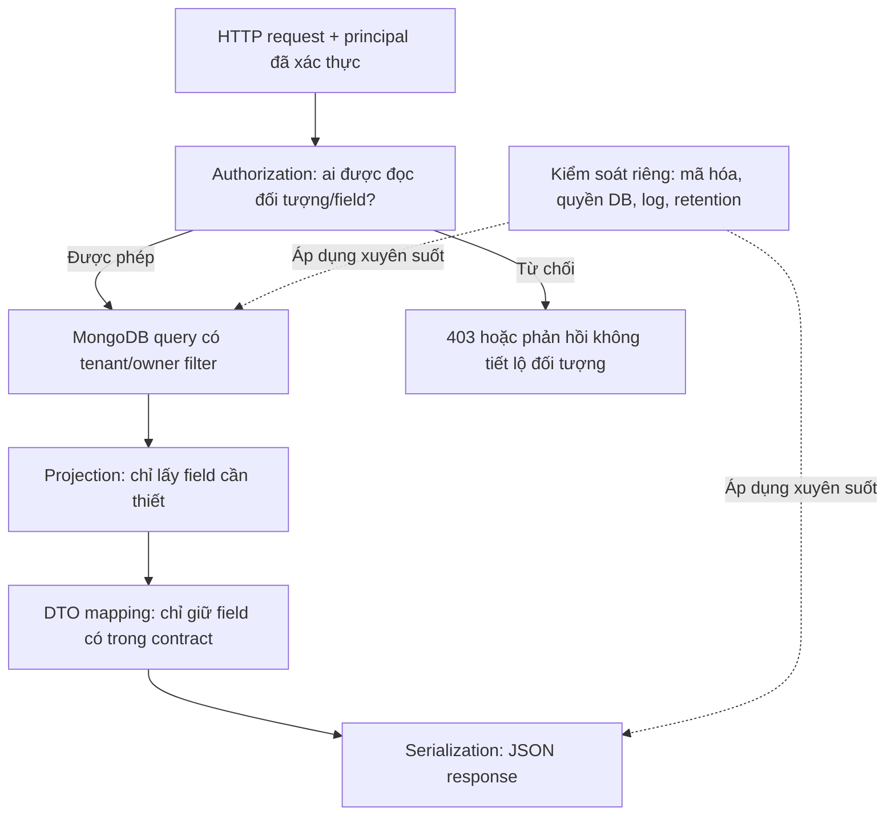

# DTO trả về, kiểm soát trường nội bộ và thông tin cá nhân

## Mục tiêu học tập

Trong ứng dụng sử dụng **Spring Data MongoDB**, document lưu trữ thường chứa nhiều thông tin hơn những gì một API được phép trả về. Một document khách hàng có thể gồm tên hiển thị, email, số điện thoại, tenant, trạng thái xác minh, dấu hiệu chống gian lận, ghi chú hỗ trợ và mật khẩu đã băm. Nếu controller trả trực tiếp entity hoặc BSON `Document`, thay đổi nhỏ ở cấu trúc dữ liệu có thể vô tình làm lộ trường nội bộ hoặc thông tin cá nhân (*personally identifiable information*, PII).

Bài học thuộc chương **Bảo mật và vận hành**, tập trung vào cách thiết kế hợp đồng phản hồi (*response contract*), áp dụng quyền truy cập theo đối tượng và theo trường, giảm lượng dữ liệu MongoDB cần đọc, và kiểm chứng rằng dữ liệu nhạy cảm không đi qua các kênh xuất dữ liệu ngoài ý muốn.

Sau bài này, bạn có thể:

- Phân loại trường lưu trong MongoDB theo mức độ được phép công bố và đối tượng được xem.
- Thiết kế **response DTO có danh sách trường cho phép** thay vì trả thẳng `@Document` hoặc `Map`.
- Phân biệt **authorization**, **projection khi query MongoDB**, **ánh xạ DTO** và **JSON serialization**.
- Áp dụng kiểm tra quyền ngay tại tầng service và lọc theo tenant/chủ sở hữu trong truy vấn.
- Kiểm soát dữ liệu cá nhân qua log, exception, aggregation, export, cache và các quy trình vận hành.
- Viết test xác minh không rò rỉ trường nội bộ, kể cả khi model lưu trữ được mở rộng.

## 1. Vì sao không nên trả thẳng document MongoDB?

Giả sử collection `customers` lưu hồ sơ:

```json
{
  "_id": "c-1042",
  "tenant_id": "tenant-a",
  "displayName": "Minh Anh",
  "email": "minhanh@example.test",
  "phone": "+84000000123",
  "password_hash": "$2b$12$...",
  "risk_score": 92,
  "internal_notes": ["Cần kiểm tra hồ sơ bổ sung"],
  "verification_status": "PENDING",
  "createdAt": "2026-11-01T10:00:00Z"
}
```

Thông tin phục vụ quản trị và vận hành được lưu **cùng một document** để nghiệp vụ xử lý tiện lợi. Nhưng endpoint hiển thị thẻ khách hàng cho một người dùng khác chỉ có thể cần:

```json
{
  "id": "c-1042",
  "displayName": "Minh Anh"
}
```

Nếu controller trả entity `CustomerDocument` trực tiếp, thư viện serialization như Jackson có thể biến các property được truy cập thành trường JSON. Ngay cả khi hiện tại đã dùng `@JsonIgnore` cho một số field, một developer thêm property mới trong tương lai vẫn có thể vô tình mở rộng response.

**Nguyên tắc:** kiểu dữ liệu lưu trữ và kiểu dữ liệu trả ra ngoài phải được xem như hai hợp đồng khác nhau. **DTO cho phép rõ từng trường** là lớp kiểm soát ổn định hơn so với việc cố nhớ loại trừ mọi trường nội bộ có thể phát sinh.

### 1.1. Phân loại theo mục đích sử dụng

| Trường lưu trữ | Nhóm thông tin | Quy tắc xuất ra gợi ý |
| --- | --- | --- |
| `_id` | Định danh đối tượng | Chỉ khi người gọi được phép biết đối tượng; không coi ID là bằng chứng phân quyền |
| `displayName` | Thông tin hồ sơ hiển thị | DTO công khai có thể chứa nếu nghiệp vụ cho phép |
| `email`, `phone` | Thông tin cá nhân | Chỉ endpoint/công việc được cấp quyền; cân nhắc hiển thị một phần |
| `tenant_id` | Metadata định tuyến/kiểm soát quyền | Thường giữ nội bộ; bắt buộc dùng để giới hạn truy vấn đa tenant |
| `password_hash`, khóa và token | Bí mật xác thực hoặc dữ liệu phục vụ xác thực | Không xuất trong API hồ sơ, export thông thường hoặc log |
| `risk_score`, `internal_notes` | Quy trình nội bộ | Không trả ở API khách hàng; chỉ dùng trong luồng vận hành có quyền riêng |
| `verification_status` | Trạng thái nghiệp vụ | Chọn DTO theo vai trò và mục đích, tránh lộ lý do điều tra nội bộ |

Bảng trên là **ví dụ thiết kế**, không tự định nghĩa phân loại pháp lý chung cho mọi tổ chức. Các trường được phép xuất phải tuân theo mục đích xử lý dữ liệu, chính sách bảo mật và yêu cầu pháp lý áp dụng với sản phẩm.

### 1.2. Những đường rò rỉ thường gặp

- Trả entity MongoDB bằng `ResponseEntity<CustomerDocument>` hoặc `List<CustomerDocument>`.
- Trả `org.bson.Document`, `Map<String,Object>` hoặc `AggregationResults<Document>` không lọc trường.
- Đưa entity vào `ResponseEntity.ok(...)` và trông chờ annotation serialization luôn đầy đủ.
- Ghi log `toString()` của entity/DTO, toàn bộ request/response body, truy vấn MongoDB kèm tham số hoặc nội dung exception.
- Tái sử dụng một DTO quá rộng cho endpoint thẻ công khai, trang cá nhân và trang quản trị.
- Cho client chọn tự do `fields=email,risk_score,internal_notes` mà không có danh sách trường được phép theo quyền.
- Trả lỗi kiểu “email đã tồn tại” hay “ID này thuộc tenant khác” khi điều đó làm lộ thông tin về đối tượng không được phép truy cập.

## 2. Bốn lớp kiểm soát có nhiệm vụ khác nhau



| Lớp | Giải quyết vấn đề | Không thay thế được |
| --- | --- | --- |
| **Authentication/authorization** | Ai được phép đọc khách hàng nào và xem nhóm field nào | Không tự loại field khỏi JSON nếu code trả sai model |
| **MongoDB projection** | Chỉ đưa field cần thiết từ database sang ứng dụng | Không chứng minh người gọi có quyền đọc field đó |
| **Response DTO** | Ổn định hợp đồng JSON, mặc định chỉ xuất các trường được khai báo | Không ngăn query đọc thừa dữ liệu nhạy cảm hoặc truy cập sai đối tượng |
| **Jackson serialization** | Biến DTO thành JSON, có thể thêm cấu hình ẩn field | Không thay cho kiểm tra quyền hoặc truy vấn có giới hạn |
| **Mã hóa, quyền database, vận hành** | Giảm hậu quả nếu mất quyền truy cập hoặc dữ liệu thất thoát ở các tầng khác | Không thay cho response DTO |

Một endpoint tốt dùng **nhiều lớp cùng lúc**. Nếu tầng query vô tình đọc cả document, mapping DTO vẫn giới hạn JSON. Nếu mapping DTO sai, bộ kiểm thử response contract phải phát hiện; nếu JSON đúng nhưng truy cập sai tenant, authorization vẫn phải chặn.

## 3. Tách entity lưu trữ và response DTO

Entity mô tả thông tin mà Spring Data MongoDB cần ánh xạ:

```java
import org.springframework.data.annotation.Id;
import org.springframework.data.mongodb.core.mapping.Document;
import org.springframework.data.mongodb.core.mapping.Field;

@Document("customers")
public class CustomerDocument {

    @Id
    private String id;

    @Field("tenant_id")
    private String tenantId;

    private String displayName;
    private String email;
    private String phone;

    @Field("password_hash")
    private String passwordHash;

    @Field("risk_score")
    private Integer riskScore;

    @Field("internal_notes")
    private List<String> internalNotes;

    @Field("verification_status")
    private String verificationStatus;

    // Constructor, getter/setter được lược bỏ.
}
```

Field `passwordHash` là **giá trị băm**, không phải mật khẩu gốc. Dù đã băm, đây vẫn là dữ liệu nhạy cảm: không được trả trong API hồ sơ. Tương tự, `tenantId` và `riskScore` là metadata nội bộ, không tự trở thành dữ liệu công khai chỉ vì chúng có getter.

Định nghĩa DTO riêng theo mục đích:

```java
// API thẻ/hồ sơ công khai, sau khi kiểm tra quyền xem.
public record CustomerCardResponse(
        String id,
        String displayName
) {}

// API thông tin của chính chủ tài khoản.
public record CustomerSelfResponse(
        String id,
        String displayName,
        String email,
        String phone
) {}

// Ví dụ quản trị cần trạng thái xác minh, không cần hash hay ghi chú.
public record CustomerOpsResponse(
        String id,
        String displayName,
        String verificationStatus
) {}
```

Ở đây `CustomerSelfResponse` chỉ nên dùng khi người gọi thực sự được quyền xem email và số điện thoại **nguyên giá trị**. Nếu use case chỉ cần gợi ý phương thức liên hệ, hãy tạo DTO khác có dữ liệu đã che bớt; không đưa PII vào DTO công khai rồi dựa vào frontend để ẩn.

### 3.1. Mapping cho phép từng field

```java
public final class CustomerResponseMapper {
    private CustomerResponseMapper() {}

    public static CustomerCardResponse toCard(CustomerDocument document) {
        return new CustomerCardResponse(
                document.getId(),
                document.getDisplayName()
        );
    }

    public static CustomerSelfResponse toSelf(CustomerDocument document) {
        return new CustomerSelfResponse(
                document.getId(),
                document.getDisplayName(),
                document.getEmail(),
                document.getPhone()
        );
    }

    public static CustomerOpsResponse toOps(CustomerDocument document) {
        return new CustomerOpsResponse(
                document.getId(),
                document.getDisplayName(),
                document.getVerificationStatus()
        );
    }
}
```

Mapper chỉ dùng trường cần thiết. Nếu entity sau này có `internalApiToken` hoặc `investigationReason`, DTO hiện hành không tự thêm chúng. Với MapStruct hoặc mapper tự động, cần cấu hình mapping có chủ đích và kiểm thử hợp đồng để không tự lộ field mới khi model mở rộng.

**Không dùng `BeanUtils.copyProperties(...)` hoặc ánh xạ reflection không kiểm soát trực tiếp từ entity sang kiểu response rộng** trong luồng yêu cầu bảo mật cao; việc trùng tên field không phải là tiêu chí đủ để xuất dữ liệu.

### 3.2. Vì sao `@JsonIgnore` là lớp phụ?

`@JsonIgnore` của Jackson có thể ngăn một property xuất hiện khi serialize một đối tượng nhất định. Nhưng nó **không quyết định quyền đọc MongoDB** và không bảo đảm mọi đường xuất dữ liệu đều đi qua Jackson (ví dụ CSV export, aggregation, log, event, cache).

Đừng nhầm với:

- `@Transient` của Spring Data: chủ yếu điều khiển một property có được lưu/đọc qua mapping persistence hay không, **không phải quy tắc phân quyền JSON**.
- `@Field`: ánh xạ tên field Java sang BSON, **không kiểm soát trường nào được trả cho API**.
- `@JsonProperty(access = WRITE_ONLY)`: điều khiển hành vi JSON ở boundary Jackson, hữu ích cho một số request model, **không bảo vệ dữ liệu khi truy cập qua MongoTemplate hay nguồn xuất khác**.
- `@Encrypted` trong Spring Data MongoDB: mô tả trường cho cơ chế mã hóa phía client khi driver được cấu hình phù hợp, **không tự ẩn field khỏi DTO/JSON sau khi giải mã**.

Có thể dùng annotation như lớp phòng vệ bổ sung, nhưng **hợp đồng đầu ra vẫn nên là DTO có danh sách trường được phép**.

## 4. Phân quyền ở tầng service trước khi mapping

Kẻ gọi API có thể sửa path, query string hoặc tenant header. Do đó, nhận `customerId` từ URL không có nghĩa người gọi được đọc khách hàng đó.

Một nguyên tắc vững: tenant và định danh người gọi được lấy từ **principal đã xác thực**; nếu hệ thống cho phép người dùng chọn tenant, phải kiểm tra quyền của principal với tenant đã chọn. Điều kiện truy vấn nên ràng buộc với tenant của đối tượng để tránh lẫn dữ liệu.

Ví dụ principal ứng dụng đã được giải quyết sau xác thực:

```java
public record RequestIdentity(
        String userId,
        String tenantId,
        String customerId
) {}
```

Service cho endpoint `GET /api/customers/me` không nhận ID của người khác từ request:

```java
@Service
public class CustomerProfileService {

    private final CustomerRepository repository;

    public CustomerProfileService(CustomerRepository repository) {
        this.repository = repository;
    }

    public CustomerSelfResponse getMyProfile(RequestIdentity identity) {
        CustomerDocument customer = repository
                .findByIdAndTenantId(
                        identity.customerId(),
                        identity.tenantId())
                .orElseThrow(() ->
                        new ResponseStatusException(HttpStatus.NOT_FOUND));

        return CustomerResponseMapper.toSelf(customer);
    }
}
```

Repository dùng Spring Data MongoDB:

```java
public interface CustomerRepository
        extends MongoRepository<CustomerDocument, String> {

    Optional<CustomerDocument> findByIdAndTenantId(
            String id,
            String tenantId);
}
```

Điều kiện `id + tenantId` giúp ngăn truy vấn trả khách hàng thuộc tenant khác. Trong ứng dụng thật, **authorization** còn phải xét quyền người gọi với đối tượng: `identity.customerId()` phải được gắn đáng tin cậy với principal hoặc qua chính sách cho phép được kiểm tra; chỉ biết tenant không mặc nhiên cho quyền đọc mọi PII trong tenant đó.

Nếu có endpoint `GET /api/customers/{id}/card`, service cần quyết định người gọi có quyền xem card của `id` hay không, rồi trả đúng `CustomerCardResponse`. Một endpoint ops nhạy cảm phải có phân quyền riêng, không dùng tham số `?role=admin` do client gửi để chuyển kiểu DTO.

### 4.1. Tại sao đôi khi nên trả 404?

Nếu đối tượng nằm ngoài phạm vi mà người gọi được phép biết, việc trả thông báo “khách hàng này thuộc tenant khác” có thể làm lộ sự tồn tại của đối tượng. Tùy chính sách API, trả `404` chung cho “không tìm thấy hoặc không được phép tiết lộ sự tồn tại” có thể thích hợp; `403` thường phù hợp khi đối tượng/quyền đã được biết và người gọi không có quyền thao tác. **Chọn một chính sách nhất quán**, không xuất tenant ID hay lý do nhạy cảm trong lỗi.

## 5. MongoDB projection: giảm dữ liệu đọc từ nguồn

DTO chặn dữ liệu rò ra JSON, nhưng entity được đọc đầy đủ vẫn đi qua database driver, bộ nhớ ứng dụng và code service. Khi chỉ cần tên hiển thị, hãy yêu cầu MongoDB chỉ trả các field cần.

### 5.1. Query bằng `MongoTemplate`

Ví dụ dùng `org.bson.Document` làm **kết quả trung gian tại tầng repository/service**, sau đó chuyển ngay sang DTO. Vì query trực tiếp với `Document.class`, ở đây dùng **tên BSON thực** `tenant_id`:

```java
public CustomerCardResponse getCard(
        String customerId,
        RequestIdentity identity) {

    authorizationService.requireCanViewCard(identity, customerId);

    Query query = Query.query(
            Criteria.where("_id").is(customerId)
                    .and("tenant_id").is(identity.tenantId()));

    query.fields()
            .include("_id")
            .include("displayName");

    Document row = mongoTemplate.findOne(
            query, Document.class, "customers");

    if (row == null) {
        throw new ResponseStatusException(HttpStatus.NOT_FOUND);
    }

    return new CustomerCardResponse(
            row.getString("_id"),
            row.getString("displayName"));
}
```

Đoạn code minh họa method trong service đã inject `mongoTemplate` và `authorizationService`; `_id` ở ví dụ lưu kiểu BSON string nên `getString("_id")` hợp lệ. Nếu hệ thống lưu `ObjectId`, cần chuyển định danh theo quy tắc mapping của chính hệ thống thay vì gọi `getString`.

Những điểm cần kiểm tra:

1. **Quyền:** `requireCanViewCard` là kiểm tra thực tế theo policy ứng dụng, không phải tên hàm mang tính trang trí.
2. **Bộ lọc:** `_id` và `tenant_id` phải cùng thuộc một truy vấn, tránh lộ dữ liệu chéo tenant.
3. **Projection:** phần trả về chỉ chứa `_id` và `displayName`; mặc định MongoDB có thể thêm `_id` nếu không chủ động loại bỏ.
4. **DTO:** không bao giờ trả thẳng `Document row` ra controller, dù query hiện tại chỉ có hai field.

Nếu truy vấn được tạo theo entity class thay vì `Document.class`, Spring Data có thể dùng metadata mapping từ property Java (ví dụ `tenantId`) để chuyển sang BSON. Nên nhất quán cách gọi tên field và kiểm thử projection thực tế, nhất là khi kết hợp `@Field`, aggregation và DTO read model.

### 5.2. Interface projection trong repository

Với một query thường xuyên chỉ cần trường hiển thị, dùng projection riêng:

```java
public interface CustomerCardView {
    String getId();
    String getDisplayName();
}

public interface CustomerRepository
        extends MongoRepository<CustomerDocument, String> {

    Optional<CustomerCardView> findProjectedByIdAndTenantId(
            String id, String tenantId);
}
```

Đây là **closed interface projection** khi getter trùng property entity. Spring Data có thể tối ưu phần field được chọn theo metadata projection. Service vẫn nên ánh xạ thành DTO phản hồi chính thức:

```java
CustomerCardView view = repository
        .findProjectedByIdAndTenantId(customerId, identity.tenantId())
        .orElseThrow(() ->
                new ResponseStatusException(HttpStatus.NOT_FOUND));

return new CustomerCardResponse(
        view.getId(),
        view.getDisplayName());
```

Như với `MongoTemplate`, method repository không tự quyết định người gọi có quyền xem `customerId`: kiểm tra authorization phải diễn ra trong service hoặc policy layer trước khi trả response. Kiểm thử với MongoDB thực để chắc chắn projection truy vấn chỉ lấy field dự kiến, vì **các dạng projection khác nhau có cách tối ưu khác nhau**.

### 5.3. Không `save` một entity đã load thiếu trường

Nếu load `CustomerDocument` với projection chỉ gồm `_id` và `displayName`, các property còn lại của entity có thể là `null` hoặc giá trị mặc định. Gọi `repository.save(projectedEntity)` sau đó có thể ghi đè dữ liệu vốn đang có hoặc tạo hành vi cập nhật không mong muốn.

Vì vậy:

- Dùng DTO/read model riêng cho luồng chỉ đọc.
- Với thay đổi một field, dùng update có điều kiện theo `_id` và tenant.
- Với entity đầy đủ để cập nhật, đọc đúng dữ liệu cần cho quy tắc nghiệp vụ và áp dụng cơ chế kiểm soát đồng thời phù hợp.

## 6. DTO đầu vào cũng cần whitelist: chống cập nhật field nội bộ

Response DTO bảo vệ **đường ra**; request DTO bảo vệ **đường vào**. Một lỗ hổng phổ biến là dùng entity làm `@RequestBody` rồi gọi `save`, cho phép kẻ gọi thử gửi JSON chứa `tenantId`, `riskScore` hoặc `verificationStatus`.

Ví dụ chỉ cho người dùng đổi tên hiển thị:

```java
public record UpdateDisplayNameRequest(
        @NotBlank
        @Size(max = 80)
        String displayName
) {}
```

Service cập nhật **đúng field được phép**, với điều kiện tenant và chủ sở hữu:

```java
public void updateOwnDisplayName(
        RequestIdentity identity,
        UpdateDisplayNameRequest request) {

    Query filter = Query.query(
            Criteria.where("_id").is(identity.customerId())
                    .and("tenantId").is(identity.tenantId()));

    Update changes = new Update()
            .set("displayName", request.displayName());

    UpdateResult result = mongoTemplate.updateFirst(
            filter, changes, CustomerDocument.class);

    if (result.getMatchedCount() == 0) {
        throw new ResponseStatusException(HttpStatus.NOT_FOUND);
    }
}
```

Ở đây `MongoTemplate.updateFirst(..., CustomerDocument.class)` sử dụng metadata mapping để chuyển `tenantId` thành `tenant_id`. Dữ liệu do người dùng gửi chỉ đi vào `displayName` đã định trước, không tự động trở thành lệnh `$set` tùy ý.

**Kiểm thử mass assignment:** gửi JSON có `"riskScore": 0` hoặc `"tenantId": "other-tenant"` và xác nhận không thể thay đổi những field này. Trong một số chính sách, nên cấu hình request validation từ chối cả field không được phép, để lỗi client được phát hiện rõ ràng; dù từ chối hay bỏ qua, tuyệt đối không map chúng vào entity.

## 7. Quy tắc ẩn, hiện và che bớt PII

Không phải trường nào chứa PII cũng cần trả nguyên giá trị. Thiết kế chính xác theo chức năng:

| Chức năng | Có thể cần | Không nên tự động trả |
| --- | --- | --- |
| Thẻ khách hàng cho người có quyền xem danh sách | Tên hiển thị, ID ứng dụng | Email, điện thoại, tenant metadata, ghi chú nội bộ |
| Trang “Tài khoản của tôi” | Email, số điện thoại nếu dùng để quản lý liên hệ | Hash mật khẩu, risk score, ghi chú điều tra |
| Xác nhận phương thức nhận OTP | Địa chỉ email/điện thoại **đã che một phần** | Đầy đủ số liên hệ nếu không cần |
| Công cụ hỗ trợ khách hàng | Trạng thái liên quan đến ca hỗ trợ, dữ liệu tối thiểu | Nội dung xác thực, token, hồ sơ nội bộ khác phạm vi |
| Báo cáo tổng hợp | Số lượng, tỷ lệ và số liệu đã tổng hợp | Raw document và trường PII không cần cho phép tính |

Ví dụ một DTO phục vụ màn hình xác nhận số điện thoại:

```java
public record ContactHintResponse(
        String maskedPhone
) {}
```

Giá trị được che phải được tạo **ở backend sau kiểm tra quyền**, theo chính sách về số ký tự được phép lộ. Ví dụ `***0123` vẫn là thông tin liên quan đến một người; đừng mặc nhiên coi dữ liệu đã che là hoàn toàn vô danh. Với tài khoản nhạy cảm, ngay cả việc xác nhận một số điện thoại có tồn tại hay không cũng có thể bị lạm dụng.

### 7.1. PII không chỉ xuất hiện trong field có tên `email`

Trong MongoDB, dữ liệu cá nhân có thể nằm ở:

- Nested object như `billingAddress`, `shippingAddress` và `contacts[]`.
- Array sự kiện chứa `actorName` hoặc `freeTextNote`.
- Field tùy biến trong `metadata` hoặc `attributes`.
- Dữ liệu đính kèm GridFS hoặc tham chiếu đến object storage.
- Kết quả `$lookup` / aggregation ghép nhiều collection.
- Timestamp, vị trí, thiết bị hoặc nhóm thuộc tính có khả năng nhận dạng khi kết hợp.

Vì vậy, rà soát **ngữ nghĩa dữ liệu** quan trọng hơn việc quét một danh sách tên field cố định. Nếu một API cho phép người dùng tự định nghĩa metadata, cần có schema, quy tắc kiểm duyệt, chính sách lưu trữ và hợp đồng xuất dữ liệu rõ ràng.

## 8. Aggregation, phân trang và dữ liệu tổng hợp

Aggregation của MongoDB có thể sinh document với cấu trúc khác entity gốc. Nếu trả `AggregationResults<Document>` hoặc `List<Map<String,Object>>` ra API, pipeline mới thêm `$lookup` hoặc field nội bộ có thể mở rộng JSON ngoài dự kiến.

Hãy chỉ giữ trường cần thiết ở cả pipeline và mapper:

```javascript
db.orders.aggregate([
  { $match: { tenant_id: "tenant-a", status: "PAID" } },
  { $group: { _id: "$customerId", orderCount: { $sum: 1 } } },
  {
    $project: {
      _id: 0,
      customerId: "$_id",
      orderCount: 1
    }
  },
  { $limit: 100 }
])
```

Trong ứng dụng, nhận kết quả dưới một kiểu `CustomerOrderCount` có các field `customerId` và `orderCount`, rồi chuyển thành DTO response. Điều kiện tenant cần lấy từ ngữ cảnh đã được xác thực; `"tenant-a"` trong ví dụ chỉ là dữ liệu minh họa, không phải giá trị cứng dùng trong production.

**Lưu ý:** dữ liệu đã tổng hợp vẫn có thể mang thông tin cá nhân hoặc tiết lộ thông tin về nhóm có rất ít thành viên. Nếu báo cáo cần công khai, phải đánh giá thêm điều kiện phân quyền, ngưỡng nhóm tối thiểu và khả năng suy ra cá nhân từ kết quả.

Với endpoint danh sách, cần:

- Giới hạn kích thước trang và chọn sort/index phù hợp để tránh tải quá nhiều dữ liệu.
- Trả DTO danh sách tối thiểu, không tái sử dụng DTO chi tiết.
- Không để bộ lọc/sort tùy ý từ client mở quyền xem các trường nhạy cảm.
- Kiểm tra trường đếm, thống kê và phân trang không vô tình cung cấp thông tin về tenant hay đối tượng bị cấm truy cập.

## 9. Vận hành: log, lỗi, trace, cache và export

Một API trả JSON đúng vẫn có thể để PII lọt qua hệ thống quan sát hoặc xử lý phụ trợ.

### 9.1. Ghi log và tracing

Không log `CustomerDocument`, `CustomerSelfResponse`, JSON request/response đầy đủ hoặc `toString()` của đối tượng chứa PII. Đặc biệt, Java `record` có `toString()` bao gồm giá trị các component; DTO không tự trở thành an toàn để ghi log.

Thay bằng log có trường tối thiểu cho vận hành:

```java
log.info("Customer profile requested: operation={}, actorId={}, traceId={}",
        "read-own-profile",
        identity.userId(),
        traceId);
```

Trong hệ thống có yêu cầu riêng tư cao, ngay cả `actorId` cũng nên được giới hạn quyền truy cập, thời hạn lưu và cách hiển thị theo policy. Cần kiểm tra cấu hình debug của MongoDB driver/command monitoring/APM vì nó có thể chứa tiêu chí truy vấn có PII, chẳng hạn email.

### 9.2. Thông báo lỗi

Tránh:

```text
Customer c-1042 in tenant-b has email minhanh@example.test
```

Nên trả thông báo công khai tối giản, ví dụ mã lỗi ổn định `CUSTOMER_NOT_FOUND`. Phần chi tiết kỹ thuật cần cho điều tra được ghi vào hệ thống log/bảo mật có kiểm soát, không hiển thị dữ liệu cá nhân cho người gọi trái quyền.

### 9.3. Cache và event

Phải phân biệt dữ liệu cache theo tenant, danh tính và **mức quyền xem**. Không dùng cache key chỉ có `customerId` nếu cùng ID có thể có phạm vi xem khác nhau hoặc thay đổi quyền truy cập. Cẩn trọng với cache DTO dành cho “self” được tái sử dụng ở endpoint công khai.

Nếu tạo domain event, message queue, webhook hoặc search index, định nghĩa **payload contract riêng**. Không tự serialize entity MongoDB vào event gửi ra ngoài. Mọi downstream consumer cần biết dữ liệu nào được phép dùng và retention tương ứng.

### 9.4. Export và công cụ quản trị

CSV, Excel, backup, job đối soát và công cụ hỗ trợ là các **kênh xuất dữ liệu độc lập**. Mỗi kênh cần chọn trường theo quyền/mục đích, ghi nhận hoạt động export cần kiểm toán, giới hạn người nhận, phạm vi truy vấn và thời gian lưu file. Nếu có CSV cho người dùng, phải xử lý dữ liệu đầu vào có thể bị spreadsheet diễn giải thành công thức khi mở file, theo quy tắc xuất CSV an toàn.

Quyền truy cập backup hoặc database không nên được đồng nhất với quyền được công bố PII cho người dùng cuối. Tách vai trò đọc dữ liệu vận hành, quản trị khóa mã hóa và xuất báo cáo.

## 10. Bảo vệ dữ liệu lưu: cần nhưng chưa đủ

Response DTO kiểm soát đường ra ở API. Với PII lưu trong MongoDB, cần đánh giá thêm:

1. **Phân quyền MongoDB:** tài khoản ứng dụng chỉ có quyền cần thiết với database/collection, không dùng tài khoản quản trị cho mọi truy vấn.
2. **TLS:** bảo vệ dữ liệu khi truyền giữa ứng dụng và MongoDB.
3. **Mã hóa at-rest / client-side encryption:** tùy mô hình bảo vệ, field nhạy cảm có thể dùng **Client-Side Field Level Encryption (CSFLE)** hoặc cơ chế khác. Nếu client đủ quyền tự giải mã, DTO vẫn phải loại trường không được phép trả ra.
4. **Minimization và retention:** tránh thu thập thêm PII không cần thiết; xác định thời hạn lưu, chính sách xóa, ẩn danh hoặc lưu trữ riêng cho dữ liệu cũ.
5. **Kiểm soát đặc quyền:** người dùng nội bộ có quyền hỗ trợ/đối soát cũng cần được phân quyền theo mục đích và ghi nhận hoạt động truy cập phù hợp.
6. **Backup, môi trường thử nghiệm:** không chép nguyên PII production sang test/staging khi không có cơ sở và biện pháp bảo vệ thích hợp.

Phân biệt **hash mật khẩu**, **mã hóa có thể giải mã** và **che dữ liệu trong response**: ba việc có mục đích khác nhau. Không dùng mã hóa thuận nghịch thay cho cơ chế lưu mật khẩu chuyên dụng; không xem che hiển thị trên frontend là đã loại PII khỏi dữ liệu truyền đi.

## 11. Kiểm thử: chứng minh không lộ trường nội bộ

Kiểm thử chỉ xác nhận API trả mã `200` là chưa đủ. Cần kiểm tra **toàn bộ contract JSON**, quyền truy cập, query fields và đường xuất phụ.

### 11.1. Kiểm thử DTO bằng serialization

Ví dụ dùng JUnit và Jackson để kiểm tra danh sách field của DTO công khai:

```java
@Test
void cardDtoContainsOnlyApprovedFields() {
    CustomerCardResponse dto =
            new CustomerCardResponse("c-1042", "Minh Anh");

    JsonNode json = new ObjectMapper().valueToTree(dto);

    Set<String> names = new HashSet<>();
    json.fieldNames().forEachRemaining(names::add);

    assertThat(names).containsExactlyInAnyOrder("id", "displayName");
    assertThat(json.has("email")).isFalse();
    assertThat(json.has("passwordHash")).isFalse();
    assertThat(json.has("riskScore")).isFalse();
    assertThat(json.has("internalNotes")).isFalse();
}
```

Test trên chỉ kiểm tra record. **Integration test endpoint thực** còn phải tạo document có giá trị PII và internal field, gọi API bằng các principal khác nhau, rồi kiểm tra JSON sau tất cả các lớp controller, mapper và serializer.

### 11.2. Ma trận kiểm thử phân quyền

| Tình huống | Kết quả mong đợi |
| --- | --- |
| Chủ tài khoản gọi `/me` | Chỉ nhận các field đã duyệt trong `CustomerSelfResponse` |
| Người không có quyền gọi ID của người khác | Bị từ chối hoặc không tiết lộ đối tượng, không trả PII |
| Người dùng tenant A truy cập ID thuộc tenant B | Không trả thông tin tenant B dù ID có tồn tại |
| Nhân viên hỗ trợ thiếu permission đặc biệt | Không thấy `risk_score` / `internal_notes` |
| Nhân viên có quyền xem trạng thái xác minh | Chỉ nhận field thuộc DTO ops được cho phép |
| Entity được thêm property mới `recoveryToken` | Response DTO cũ không tự xuất property mới |
| API cập nhật được gửi thêm `tenantId`, `riskScore` | Không thể sửa các field nội bộ |
| Aggregation thêm `$lookup` sang collection nhạy cảm | Response không tự mở rộng sang field mới |
| Bật debug/trace và chạy request có PII | Log/trace không ghi plaintext hoặc body ngoài policy |
| Xuất CSV/báo cáo hoặc event payload | Chỉ chứa field đúng hợp đồng của kênh xuất |

Với multi-tenant, test trên **cùng một ID ở tenant khác** (nếu thiết kế định danh cho phép) và một ID chỉ tồn tại ở tenant B sẽ phát hiện nhiều kiểu thiếu điều kiện tenant. Kiểm thử response phải xác nhận chính xác JSON: cả giá trị, tên key và **việc vắng mặt** của field cấm.

### 11.3. Kiểm thử projection ở tầng MongoDB

Một bộ test với MongoDB thực hoặc Testcontainers có thể:

1. Chèn document chứa `email`, `phone`, `password_hash`, `risk_score` và `internal_notes`.
2. Gọi truy vấn trả thẻ khách hàng.
3. Kiểm tra projection chỉ có `_id` và `displayName` (và các field khác nếu thật sự được phép cho query), đối chiếu bằng command monitoring có kiểm soát hoặc bằng test truy vấn đọc model.
4. Xác nhận truy vấn có điều kiện tenant, không đọc được document của tenant khác.
5. Xác nhận response DTO chỉ chứa các field cho phép.

**Projection là tối ưu và giảm bề mặt dữ liệu**, nhưng nếu query cần một số trường nội bộ để thực hiện authorization, có thể phải đọc chúng ở một bước xử lý tin cậy. Điều quyết định là không đưa các field đó qua response ngoài ý muốn.

### 11.4. Các test chống hồi quy

Sau khi thay đổi mapping `@Field`, nâng phiên bản Spring Data/Jackson, mở rộng entity, thay aggregation hoặc thêm endpoint export, nên chạy lại các trường hợp trên. Kiểm tra các đường xử lý ngoại lệ và logging vì rò rỉ thường xảy ra ngoài đường thành công chính.

## 12. Tình huống thực hành: thiết kế hai API hồ sơ

**Bài toán:** một nền tảng quản lý khách hàng có hai API:

- `GET /api/customers/{id}/card`: dành cho người có quyền xem danh sách khách hàng, chỉ hiển thị ID và tên.
- `GET /api/customers/me`: trả email/số điện thoại của chính tài khoản đã xác thực.

Collection `customers` còn lưu `tenant_id`, `risk_score`, `internal_notes` và `password_hash`.

**Cách triển khai đề xuất:**

1. Tạo `CustomerDocument` cho persistence và hai DTO độc lập `CustomerCardResponse`, `CustomerSelfResponse`.
2. Ở `/card`, dùng authorization kiểm tra quyền xem ID, query có tenant filter và projection giới hạn `_id`/`displayName`.
3. Ở `/me`, lấy `customerId` và `tenantId` từ principal đã xác thực, không cho client chỉ định đối tượng tùy ý.
4. Mapping rõ từng field vào DTO; không serialize entity/Document.
5. Các endpoint sửa hồ sơ nhận request DTO hẹp; không cho cập nhật `tenant_id`, `risk_score` hay `password_hash` qua generic save.
6. Viết test cross-tenant, test trường cấm, test khi entity thêm property mới và test log/response lỗi.
7. Đo lượng dữ liệu truy vấn và xác nhận projection đúng bằng integration test; khi cần tối ưu, bổ sung repository closed projection/DTO read model.

**Câu hỏi tự kiểm tra:**

1. Tại sao `@JsonIgnore` trên `passwordHash` không đủ bảo vệ tất cả kênh xuất dữ liệu?
2. MongoDB projection chỉ lấy `displayName` đã đủ để chứng minh người dùng được xem khách hàng đó chưa?
3. Nếu entity được thêm `recoveryToken`, điều gì bảo đảm DTO thẻ khách hàng không lộ trường mới?
4. Vì sao `@Transient`, `@Field` và `@Encrypted` không thể thay thế authorization ở API?
5. Một API trả đúng DTO nhưng log toàn bộ document được coi là đã bảo vệ PII chưa?
6. Khi dùng aggregation và `$lookup`, vì sao cần kiểm tra lại output contract?

## Ghi nhớ

- **Không trả thẳng `@Document` hoặc `org.bson.Document` qua API bên ngoài** khi document có trường nội bộ/PII.
- **DTO có danh sách trường cho phép** là hợp đồng response; mỗi nhóm quyền hoặc mục đích sử dụng nên có DTO đủ hẹp.
- **Phân quyền** quyết định ai được đọc đối tượng và trường nào; **projection** giảm dữ liệu chuyển từ MongoDB; **mapping DTO** và **serialization** giới hạn JSON cuối cùng.
- Với multi-tenant, truy vấn phải ràng buộc tenant từ ngữ cảnh đáng tin cậy, đồng thời kiểm tra quyền theo từng đối tượng.
- **Request DTO** và cập nhật có điều kiện giúp tránh mass assignment vào trường nội bộ.
- Kiểm soát cả **aggregation, log, exception, cache, event, export, backup**: response JSON không phải kênh duy nhất có thể lộ PII.
- **Mã hóa, quyền DB, TLS và retention** bổ sung cho kiểm soát đường ra; chúng không biến mọi field trong document thành dữ liệu được phép xuất.
- Chỉ kết luận bảo vệ tốt khi có **test hợp đồng JSON, test phân quyền, test projection và test chống hồi quy**.

Một ứng dụng Spring Data MongoDB có thể tận dụng `MongoTemplate`, repository, aggregation và reactive access cho nhiều nhu cầu nghiệp vụ, nhưng vẫn phải tách rõ **mô hình lưu trữ** và **hợp đồng dữ liệu được phép công bố**. Việc bảo vệ thông tin cá nhân bắt đầu từ lựa chọn field cụ thể cho từng use case và tiếp tục xuyên suốt tầng database, service, controller và vận hành.

