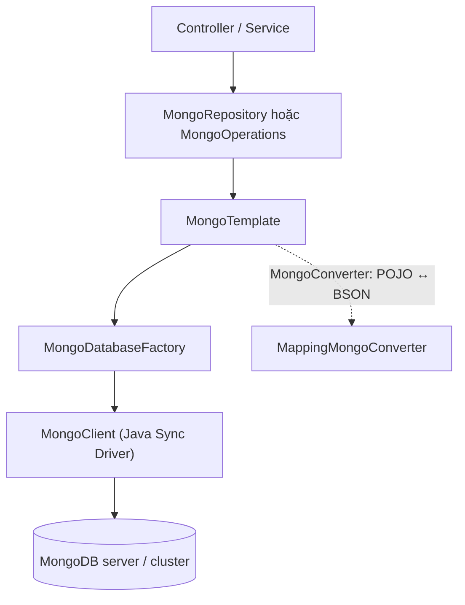
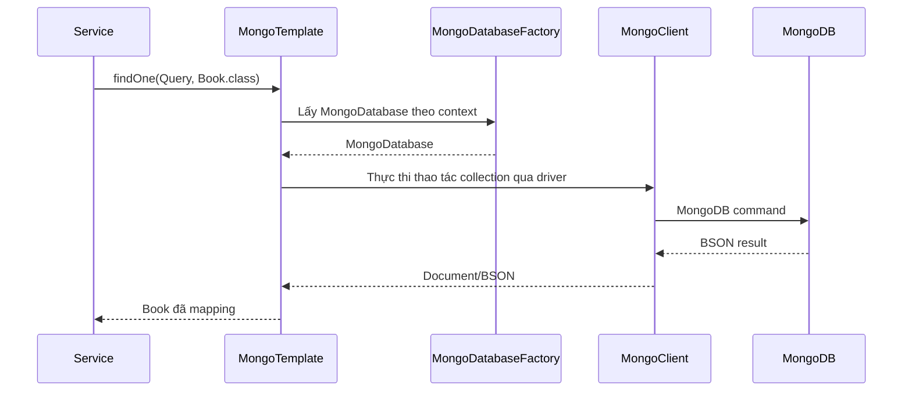

# Vai trò của MongoClient, MongoDatabaseFactory và MongoTemplate

## 1. Ba thành phần nằm ở đâu trong kiến trúc Spring Data MongoDB?

Khi ứng dụng Java làm việc với MongoDB, ta thường gặp ba tên gần nhau: `MongoClient`, `MongoDatabaseFactory` và `MongoTemplate`. Chúng có trách nhiệm khác nhau và tạo thành một chuỗi từ kết nối cấp thấp đến thao tác dữ liệu cấp cao.

- **`MongoClient`** thuộc **MongoDB Java Driver**. Nó là điểm vào để giao tiếp với MongoDB: quản lý cấu hình kết nối, lựa chọn server, connection pool, session và thực thi các lệnh của driver.
- **`MongoDatabaseFactory`** thuộc **Spring Data MongoDB**. Nó là lớp trừu tượng cung cấp `MongoDatabase` cho Spring Data theo cấu hình database và bối cảnh sử dụng, đồng thời tham gia tích hợp session/transaction và dịch ngoại lệ.
- **`MongoTemplate`** thuộc **Spring Data MongoDB**. Nó cung cấp API thao tác document theo đối tượng Java: mapping, query, update, aggregation, index, callback và các thao tác tiện ích.

Ba thành phần này đều phục vụ mục tiêu của **SPRING_DATA_MONGODB**: kết nối, ánh xạ document và thao tác MongoDB bằng template hoặc repository, sau đó mở rộng sang truy vấn nâng cao, aggregation, index, transaction, reactive access, kiểm thử và phân tích hiệu năng.



Đường đi trên là mô hình khái niệm. Repository được Spring Data triển khai dựa trên hạ tầng MongoDB operations; nhiều lớp hạ tầng khác, chẳng hạn mapping converter, cũng được Spring cấu hình và sử dụng. **Đừng hiểu sơ đồ là mỗi phương thức đều bắt buộc gọi trực tiếp qua đúng một chuỗi hàm cố định.**

### Bảng phân vai nhanh

| Câu hỏi | Thành phần chịu trách nhiệm chính |
| --- | --- |
| Kết nối tới URI, replica set, xác thực, TLS và pool được cấu hình ở đâu? | `MongoClient` / `MongoClientSettings` |
| Ứng dụng đang thao tác database nào? | `MongoDatabaseFactory` và cấu hình database |
| Java object được ánh xạ thành document, xây dựng `Query` và `Update` ở đâu? | `MongoTemplate` với `MongoConverter` |
| Muốn gọi `findByEmail` không cần tự viết truy vấn? | Spring Data repository |
| Muốn thao tác BSON trực tiếp mà không dùng mapping Spring Data? | API của MongoDB driver qua `MongoClient` |
| Muốn truy cập không chặn luồng trong pipeline Reactor? | Bộ thành phần **reactive** tương ứng |

## 2. MongoClient: kết nối và quản lý tài nguyên driver

### 2.1. `MongoClient` là gì?

Trong nhánh đồng bộ, kiểu client chính thức là:

```java
com.mongodb.client.MongoClient
```

MongoDB Java Sync Driver tạo client qua `com.mongodb.client.MongoClients`. Một client đại diện cho cấu hình kết nối tới deployment MongoDB và thường sở hữu connection pool; driver có thể tạo các kết nối mạng khi thực hiện lệnh và lựa chọn server dựa trên topology.

```java
import com.mongodb.client.MongoClient;
import com.mongodb.client.MongoClients;
import com.mongodb.client.MongoCollection;
import org.bson.Document;

try (MongoClient client = MongoClients.create(
        "mongodb://localhost:27017")) {

    MongoCollection<Document> books = client
        .getDatabase("catalog")
        .getCollection("books");

    Document book = books.find(
        new Document("isbn", "978-0000000001")
    ).first();
}
```

Đây là ví dụ **standalone sử dụng driver**: `getDatabase` trả đối tượng đại diện database; `getCollection` trả đối tượng collection, còn `find` làm việc với BSON `Document`. API driver không tự áp dụng annotation `@Document`, quy tắc tên trường và custom converter của Spring Data.

Trong ứng dụng Spring Boot chạy lâu dài, `MongoClient` nên được quản lý như **bean dùng chung**, thường một instance theo cấu hình kết nối. Không tạo và đóng client cho từng HTTP request: làm vậy gây lãng phí pool, handshake và quá trình khám phá topology, đồng thời làm việc quản lý vòng đời khó hơn. Khi client là bean do Spring sở hữu, Spring quản lý việc đóng tài nguyên khi application context kết thúc.

### 2.2. Các quyết định nằm tại tầng client

`MongoClientSettings` hoặc connection string điều khiển nhiều thiết lập quan trọng:

- URI, host, port và thông tin kết nối đến deployment.
- Credential, cơ chế xác thực và TLS; lưu secret ở môi trường/quản lý bí mật thay vì hard-code.
- Connection pool: quy mô, thời gian chờ lấy connection, vòng đời kết nối.
- Timeout và server selection: thời gian kết nối/chọn server/chờ phản hồi theo cấu hình driver.
- Read preference, write concern, retryable reads/writes và các tùy chọn phù hợp với topology.
- Quan sát command/connection pool bằng listener hoặc tích hợp metrics/tracing.

Ví dụ khai báo connection string cho môi trường phát triển:

```text
mongodb://localhost:27017/catalog?maxPoolSize=50&serverSelectionTimeoutMS=5000
```

Số `50` và `5000` chỉ minh họa; cần đo workload trước khi đặt trong production. Một pool lớn không sửa được truy vấn thiếu index, còn pool quá nhỏ có thể khiến request chờ connection.

**Lưu ý:** `MongoClient` là đối tượng dùng chung an toàn cho truy cập đồng thời theo thiết kế của driver. Ngược lại, đối tượng `ClientSession` được tạo cho một chuỗi thao tác cụ thể, không nên chia sẻ tùy tiện giữa những thread/request độc lập.

## 3. MongoDatabaseFactory: ranh giới giữa driver và Spring Data

### 3.1. Nhiệm vụ chính

`org.springframework.data.mongodb.MongoDatabaseFactory` là abstraction mà Spring Data MongoDB sử dụng để có một `MongoDatabase` phù hợp cho thao tác hiện tại.

Một triển khai phổ biến là `SimpleMongoClientDatabaseFactory`. Nó gắn client đã cấu hình với database mặc định:

```java
import com.mongodb.client.MongoClient;
import org.springframework.data.mongodb.MongoDatabaseFactory;
import org.springframework.data.mongodb.core.SimpleMongoClientDatabaseFactory;

MongoDatabaseFactory factory =
    new SimpleMongoClientDatabaseFactory(client, "catalog");
```

Ví dụ giả định biến `client` đã được tạo bởi driver và còn sống trong suốt thời gian sử dụng. Factory giúp phần code của Spring Data không cần biết logic khởi tạo MongoDB client ở từng service.

Trong kiến trúc Spring, factory có các vai trò nổi bật:

1. **Chọn database mặc định:** template dùng factory để lấy database tương ứng thay vì mỗi lần truy vấn tự truyền chuỗi tên database.
2. **Che giấu chi tiết driver:** các thành phần Spring Data làm việc với abstraction và cơ chế cấu hình chung.
3. **Hỗ trợ tích hợp session và transaction:** khi có transaction manager, các thao tác có thể tham gia session/bối cảnh transaction phù hợp.
4. **Cung cấp khả năng dịch ngoại lệ:** hỗ trợ biểu diễn lỗi driver qua hệ thống exception của Spring Data.
5. **Cho phép thay đổi hạ tầng:** phục vụ cấu hình nhiều database, custom factory hoặc chiến lược chọn database có kiểm soát.

**Factory không phải pool thứ hai** và không thay `MongoClient`. Pool/connection thực tế vẫn do driver quản lý. Factory cũng không có API truy vấn domain như `find(Query, Book.class)`; đó là trách nhiệm của template.

### 3.2. Phân biệt factory với `MongoDatabase`

`MongoDatabase` thuộc driver, biểu diễn một database cụ thể:

```java
MongoDatabase db = factory.getMongoDatabase();
```

`MongoDatabaseFactory` là nhà cung cấp database theo ngữ cảnh. Đối tượng `MongoDatabase` cho phép gọi API collection, command và các chức năng driver; nhưng muốn mapping theo `@Document` và dùng `Criteria` của Spring Data thì nên thao tác qua template.

### 3.3. Factory và session trong transaction

Đối với giao dịch nhiều document, Spring Data cần liên kết thao tác với session phù hợp. `MongoTransactionManager` dành cho nhánh đồng bộ phối hợp với `MongoDatabaseFactory` để tham gia session/transaction theo cơ chế quản lý transaction của Spring.

Điều này không có nghĩa **chỉ tạo factory là transaction tự hoạt động**. Cần transaction manager, ranh giới `@Transactional` hoặc `TransactionTemplate`, và MongoDB deployment hỗ trợ transaction. Các lệnh dùng driver trực tiếp không nên được giả định sẽ tự tham gia transaction chỉ vì có cùng client; phải truyền và sử dụng đúng session khi cần.

## 4. MongoTemplate: API dữ liệu cấp cao cho ứng dụng

### 4.1. Vì sao cần template?

`MongoTemplate` triển khai `MongoOperations`. Thay vì tự chuyển POJO thành BSON và thao tác bằng các document thô, ứng dụng có thể làm việc với đối tượng Java:

- `insert`, `save`, `find`, `findOne`, `findById`, `remove`.
- `updateFirst`, `updateMulti`, `findAndModify`, `upsert` và bulk operations.
- `Query`, `Criteria`, `Update`, sort, projection, phân trang.
- `Aggregation`, các phép tổng hợp, thống kê và truy vấn pipeline.
- `indexOps` để quản lý index; `execute` cho các thao tác trực tiếp ở mức collection khi cần.
- Phối hợp `MongoConverter`, entity callbacks, annotation mapping và exception translation.

Ví dụ entity:

```java
import java.math.BigDecimal;
import org.springframework.data.annotation.Id;
import org.springframework.data.mongodb.core.mapping.Document;

@Document(collection = "books")
public record Book(
    @Id String id,
    String isbn,
    String title,
    BigDecimal price,
    boolean available
) {}
```

`@Document` gắn type với collection `books`, `@Id` ánh xạ thuộc tính định danh với `_id` trong MongoDB. Converter của Spring Data còn xử lý nhiều kiểu Java khác nhau; nếu dữ liệu có định dạng BSON đặc thù, có thể cần custom conversions.

### 4.2. Truy vấn và cập nhật bằng `MongoTemplate`

```java
import java.math.BigDecimal;
import java.util.List;
import org.springframework.data.domain.Sort;
import org.springframework.data.mongodb.core.MongoTemplate;
import org.springframework.data.mongodb.core.query.Criteria;
import org.springframework.data.mongodb.core.query.Query;
import org.springframework.data.mongodb.core.query.Update;
import org.springframework.stereotype.Service;

@Service
public class BookCatalogService {

    private final MongoTemplate template;

    public BookCatalogService(MongoTemplate template) {
        this.template = template;
    }

    public List<Book> findAvailable(String titleKeyword) {
        Query query = Query.query(
            Criteria.where("available").is(true)
                .and("title").regex(titleKeyword, "i")
        );
        query.with(Sort.by(Sort.Direction.ASC, "title"));
        query.limit(50);
        return template.find(query, Book.class);
    }

    public boolean changePrice(String bookId, BigDecimal price) {
        Query query = Query.query(Criteria.where("_id").is(bookId));
        Update update = new Update().set("price", price);
        return template.updateFirst(query, update, Book.class)
            .getModifiedCount() > 0;
    }
}
```

Ví dụ trên cho thấy template biết collection từ `Book` và dùng converter để ánh xạ dữ liệu. Với một ô tìm kiếm nhận nội dung tùy ý, hãy xem xét giới hạn ký tự và escaping regex: tham số `titleKeyword` không nên được dùng như regex thô nếu nghiệp vụ chỉ muốn tìm chuỗi ký tự. Việc dùng regex không có prefix phù hợp còn có thể khiến query khó tận dụng index. Mã trên minh họa API template; khi xây dựng chức năng tìm kiếm thực tế, cần thiết kế index và quy tắc tìm kiếm riêng.

`getModifiedCount() == 0` không phân biệt được “không tìm thấy” với “giá trị đã bằng giá trị yêu cầu”. Nếu cần kết quả nghiệp vụ chính xác, xem xét `getMatchedCount()` cùng yêu cầu về optimistic locking hoặc cách biểu diễn kết quả update.

### 4.3. Aggregation và index qua template

```java
import org.springframework.data.mongodb.core.aggregation.Aggregation;
import org.springframework.data.mongodb.core.aggregation.AggregationResults;
import org.springframework.data.mongodb.core.index.Index;
import org.springframework.data.domain.Sort;

// Tạo index cho một pattern truy vấn xác định.
template.indexOps(Book.class)
    .ensureIndex(new Index().on("isbn", Sort.Direction.ASC).unique());

// Thống kê số đầu sách đang có thể bán.
Aggregation pipeline = Aggregation.newAggregation(
    Aggregation.match(Criteria.where("available").is(true)),
    Aggregation.count().as("total")
);

AggregationResults<org.bson.Document> result =
    template.aggregate(pipeline, Book.class, org.bson.Document.class);
```

`MongoTemplate` giúp viết pipeline trên đối tượng và mapping đã khai báo, nhưng **aggregation vẫn chạy tại MongoDB server**. Độ trễ và hiệu năng phụ thuộc dữ liệu, index, thứ tự stage và số document được xử lý. Index trong hệ thống thật nên được quản lý có kiểm soát qua migration/deployment; không tạo index tùy tiện vào mỗi request.

### 4.4. Template và repository có quan hệ ra sao?

Repository thường phù hợp với các thao tác CRUD và truy vấn tên phương thức:

```java
import java.util.Optional;
import org.springframework.data.mongodb.repository.MongoRepository;

public interface BookRepository
        extends MongoRepository<Book, String> {

    Optional<Book> findByIsbn(String isbn);
}
```

Repository sử dụng hạ tầng Spring Data MongoDB bên dưới, bao gồm mapping và operations/template. Khi nghiệp vụ cần truy vấn động phức tạp, bulk operation hoặc pipeline aggregation, có thể bổ sung `MongoTemplate` trong service/repository custom. Không cần chọn “chỉ repository” hoặc “chỉ template” cho toàn bộ ứng dụng.

## 5. Cấu hình trong Spring Boot: tự động và thủ công

### 5.1. Khi Spring Boot tự cấu hình

Với ứng dụng Spring Boot 3.x có starter đồng bộ và cấu hình URI:

```xml
<dependency>
    <groupId>org.springframework.boot</groupId>
    <artifactId>spring-boot-starter-data-mongodb</artifactId>
</dependency>
```

```yaml
spring:
  data:
    mongodb:
      uri: mongodb://localhost:27017/catalog
```

Spring Boot có thể tự cấu hình `MongoClient`, `MongoDatabaseFactory`, converter, `MongoTemplate` và các thành phần repository tương ứng theo classpath và điều kiện auto-configuration. Ứng dụng chỉ cần inject bean cần dùng:

```java
@Service
public class CatalogUseCase {
    private final MongoTemplate template;

    public CatalogUseCase(MongoTemplate template) {
        this.template = template;
    }
}
```

Ở các phiên bản Spring Boot khác, **tên property và điều kiện auto-configuration cần đối chiếu với phiên bản cụ thể đang dùng**. Ví dụ trên chủ đích dành cho cách cấu hình phổ biến của Boot 3.x. Khi đã cung cấp bean thủ công, cần xem auto-configuration nào sẽ nhường quyền và bean nào còn được tạo tự động.

### 5.2. Khi cần tự tạo các bean

Ví dụ trong một cấu hình chủ động kiểm soát cả ba tầng:

```java
import com.mongodb.client.MongoClient;
import com.mongodb.client.MongoClients;
import org.springframework.context.annotation.Bean;
import org.springframework.context.annotation.Configuration;
import org.springframework.core.env.Environment;
import org.springframework.data.mongodb.MongoDatabaseFactory;
import org.springframework.data.mongodb.core.MongoTemplate;
import org.springframework.data.mongodb.core.SimpleMongoClientDatabaseFactory;

@Configuration
public class MongoInfrastructureConfig {

    @Bean(destroyMethod = "close")
    public MongoClient mongoClient(Environment env) {
        String uri = env.getRequiredProperty("app.mongodb.uri");
        return MongoClients.create(uri);
    }

    @Bean
    public MongoDatabaseFactory mongoDatabaseFactory(
            MongoClient mongoClient) {
        return new SimpleMongoClientDatabaseFactory(
            mongoClient, "catalog"
        );
    }

    @Bean
    public MongoTemplate mongoTemplate(
            MongoDatabaseFactory mongoDatabaseFactory) {
        return new MongoTemplate(mongoDatabaseFactory);
    }
}
```

Thêm `app.mongodb.uri` vào cấu hình theo môi trường, chẳng hạn URI phát triển trên localhost; thông tin xác thực production được cấp qua biến môi trường hoặc secret manager.

**Vòng đời của bean:** client được tạo một lần; factory và template dùng client đó. Khi Spring đóng context, destroy method của client đóng connection pool. Nếu factory được tạo với client do nơi khác sở hữu, cần hiểu rõ trách nhiệm đóng client để tránh đóng sớm hoặc rò rỉ tài nguyên.

**Không ghép mù quáng hai cấu hình:** với Spring Boot đang auto-configure MongoDB, nếu thêm tất cả bean thủ công vào cùng app mà không xét điều kiện, có thể tạo nhiều client/template, xung đột bean hoặc repository trỏ nhầm database. Chỉ ghi đè các bean thực sự cần tùy biến và kiểm tra graph dependency.

## 6. Điều gì xảy ra khi một request gọi find?

Giả sử controller gọi `BookRepository.findByIsbn("978-0000000001")` hoặc service gọi `template.findOne(query, Book.class)`.



Sơ đồ giản lược các callback, converter, session và các lớp hạ tầng nội bộ. Nó minh họa sự phân chia trách nhiệm:

1. Service mô tả yêu cầu nghiệp vụ; repository hoặc template xây dựng thao tác tương ứng.
2. Factory cung cấp database phù hợp, trong đó transaction context có thể ảnh hưởng đến session.
3. Driver client điều phối thao tác tới MongoDB, quản lý kết nối và nhận BSON.
4. Mapping converter được template sử dụng để chuyển dữ liệu thành entity.
5. Exception từ các thao tác Spring Data thường được chuyển vào hệ thống `DataAccessException` để phần ứng dụng xử lý theo chính sách phù hợp.

Từ đây có thể chẩn đoán lỗi đúng tầng: sai URI/timeout/pool ở client; sai tên database ở factory; sai mapping hoặc query ở template; query chậm do index và execution plan ở server.

## 7. Transaction: vai trò phối hợp của factory và template

Một cập nhật trên **một document** có tính nguyên tử theo quy tắc MongoDB. Nếu service cập nhật hai document/collection và cần cả hai cùng thành công, transaction có thể cần thiết.

Với Spring Data MongoDB đồng bộ:

```java
import org.springframework.context.annotation.Bean;
import org.springframework.context.annotation.Configuration;
import org.springframework.data.mongodb.MongoDatabaseFactory;
import org.springframework.data.mongodb.MongoTransactionManager;

@Configuration
public class MongoTransactionConfig {

    @Bean
    public MongoTransactionManager transactionManager(
            MongoDatabaseFactory databaseFactory) {
        return new MongoTransactionManager(databaseFactory);
    }
}
```

Ví dụ service cập nhật tồn kho và tạo đơn đặt hàng:

```java
import com.mongodb.client.result.UpdateResult;
import org.springframework.data.mongodb.core.MongoTemplate;
import org.springframework.data.mongodb.core.query.Criteria;
import org.springframework.data.mongodb.core.query.Query;
import org.springframework.data.mongodb.core.query.Update;
import org.springframework.stereotype.Service;
import org.springframework.transaction.annotation.Transactional;

@Service
public class PurchaseService {

    private final MongoTemplate template;

    public PurchaseService(MongoTemplate template) {
        this.template = template;
    }

    @Transactional
    public void placeOrder(String productId, int quantity) {
        if (quantity <= 0) {
            throw new IllegalArgumentException("quantity must be > 0");
        }

        UpdateResult updated = template.updateFirst(
            Query.query(Criteria.where("_id").is(productId)
                .and("stock").gte(quantity)),
            new Update().inc("stock", -quantity),
            "products"
        );

        if (updated.getMatchedCount() == 0) {
            throw new IllegalStateException("Not enough stock");
        }

        template.insert(
            new org.bson.Document("productId", productId)
                .append("quantity", quantity),
            "orders"
        );
    }
}
```

Mã minh họa cơ chế; production cần mã định danh đơn, chống request gửi trùng, xử lý retry và ràng buộc nghiệp vụ đầy đủ. `@Transactional` chỉ được áp dụng khi gọi qua Spring proxy hoặc cơ chế transaction tương đương, với transaction manager phù hợp. MongoDB transaction đa document yêu cầu topology hỗ trợ, thông thường là replica set hoặc sharded cluster; không nên giả định standalone server hỗ trợ giống hệt. Transaction có chi phí: đừng dùng để bù cho mô hình document chưa hợp lý.

Factory giúp template lấy các thao tác gắn với session/bối cảnh transaction. Trái lại, tự lấy collection qua `MongoClient` rồi thao tác không kèm `ClientSession` thích hợp có thể khiến lệnh ở ngoài transaction.

## 8. Nhánh reactive có những thành phần tương ứng nào?

Spring Data MongoDB cung cấp một họ API riêng cho reactive. Tên class có thể gần giống nhưng kiểu client và cách lập trình khác hẳn:

| Tầng | Đồng bộ | Reactive |
| --- | --- | --- |
| MongoDB driver | `com.mongodb.client.MongoClient` | `com.mongodb.reactivestreams.client.MongoClient` |
| Tạo client | `com.mongodb.client.MongoClients` | `com.mongodb.reactivestreams.client.MongoClients` |
| Factory | `MongoDatabaseFactory` | `ReactiveMongoDatabaseFactory` |
| Triển khai factory | `SimpleMongoClientDatabaseFactory` | `SimpleReactiveMongoDatabaseFactory` |
| Template | `MongoTemplate` | `ReactiveMongoTemplate` |
| Repository | `MongoRepository` | `ReactiveMongoRepository` |
| Kiểu trả về thường gặp | `Book`, `List<Book>`, `Optional<Book>` | `Mono<Book>`, `Flux<Book>` |
| Transaction manager | `MongoTransactionManager` | `ReactiveMongoTransactionManager` |

Ví dụ wiring nhánh reactive bằng các kiểu đã import rõ ràng:

```java
import com.mongodb.reactivestreams.client.MongoClient;
import com.mongodb.reactivestreams.client.MongoClients;
import org.springframework.context.annotation.Bean;
import org.springframework.context.annotation.Configuration;
import org.springframework.data.mongodb.ReactiveMongoDatabaseFactory;
import org.springframework.data.mongodb.core.ReactiveMongoTemplate;
import org.springframework.data.mongodb.core.SimpleReactiveMongoDatabaseFactory;

@Configuration
public class ReactiveMongoInfrastructureConfig {

    @Bean(destroyMethod = "close")
    public MongoClient reactiveMongoClient() {
        return MongoClients.create("mongodb://localhost:27017");
    }

    @Bean
    public ReactiveMongoDatabaseFactory reactiveMongoDatabaseFactory(
            MongoClient reactiveMongoClient) {
        return new SimpleReactiveMongoDatabaseFactory(
            reactiveMongoClient, "catalog"
        );
    }

    @Bean
    public ReactiveMongoTemplate reactiveMongoTemplate(
            ReactiveMongoDatabaseFactory factory) {
        return new ReactiveMongoTemplate(factory);
    }
}
```

Trong Spring Boot, starter `spring-boot-starter-data-mongodb-reactive` có thể tự cấu hình các bean tương ứng, nên không nhất thiết phải khai báo như ví dụ. Không đặt đồng thời hai lớp cấu hình thủ công đồng bộ và reactive trong một ứng dụng nếu không có chủ đích quản lý cả hai hạ tầng.

Ví dụ sử dụng template reactive:

```java
import reactor.core.publisher.Flux;
import org.springframework.data.mongodb.core.ReactiveMongoTemplate;
import org.springframework.data.mongodb.core.query.Criteria;
import org.springframework.data.mongodb.core.query.Query;

public Flux<Book> availableBooks(ReactiveMongoTemplate template) {
    Query query = Query.query(Criteria.where("available").is(true));
    return template.find(query, Book.class);
}
```

Với reactive, thao tác trả `Publisher` được thực thi khi có subscriber; không gọi `block()` trong đường xử lý request non-blocking để chuyển sang kiểu đồng bộ. Transaction reactive sử dụng ngữ cảnh Reactor, không dựa đơn thuần vào ThreadLocal như nhánh đồng bộ. Reactive driver **không tự khiến một MongoDB query thiếu index trở nên nhanh hơn**.

## 9. Khi ứng dụng dùng nhiều database hoặc nhiều tenant

Giả sử hệ thống có database `catalog` và `reporting`. Hai template có thể dùng cùng một client nếu cùng deployment và chính sách truy cập phù hợp, nhưng chúng cần factory/database configuration rõ ràng:

```java
@Bean("catalogTemplate")
MongoTemplate catalogTemplate(MongoClient client) {
    return new MongoTemplate(
        new SimpleMongoClientDatabaseFactory(client, "catalog")
    );
}

@Bean("reportingTemplate")
MongoTemplate reportingTemplate(MongoClient client) {
    return new MongoTemplate(
        new SimpleMongoClientDatabaseFactory(client, "reporting")
    );
}
```

Đoạn mã minh họa hai template trong cùng lớp cấu hình có các import Spring và driver cần thiết. Khi inject, dùng `@Qualifier` hoặc tên bean để tránh nhập nhằng. Nếu repository của từng database có cấu hình riêng, cần ràng buộc package repository với đúng `mongoTemplateRef` thay vì để tất cả dùng template mặc định.

Với multi-tenancy, không nên dùng một biến toàn cục chứa “database hiện tại” rồi thay đổi theo request: các request có thể chạy đồng thời và lẫn dữ liệu của tenant. Hãy sử dụng cơ chế chọn tenant có kiểm soát và xác thực, tạo/cache tài nguyên theo chính sách kết nối thích hợp, và bảo đảm transaction/trace không đi nhầm tenant.

Tách database không mặc nhiên tách được quyền truy cập: credential và role trên MongoDB server phải được cấu hình theo mức cô lập dữ liệu mong muốn.

## 10. Lỗi cấu hình thường gặp và cách chẩn đoán

| Triệu chứng | Tầng nên xem đầu tiên | Kiểm tra cụ thể |
| --- | --- | --- |
| Không kết nối, server selection timeout | `MongoClient` / mạng / deployment | URI, DNS, TLS, auth, khả năng chọn primary, timeout, driver logs |
| Ứng dụng chạy nhưng dữ liệu xuất hiện sai database | `MongoDatabaseFactory` / URI | Tên database ở connection string, factory, template và bean repository |
| Mỗi request tăng mạnh số kết nối | Vòng đời `MongoClient` | Có tạo client trong controller/service thay vì bean dùng chung? |
| `MongoTemplate` không inject được | Spring context/auto-configuration | Starter, điều kiện tạo bean, trùng tên bean, cấu hình thủ công |
| Document đọc ra thiếu/sai trường | `MongoConverter` / mapping | `@Id`, tên field, kiểu BSON, custom conversions, schema cũ |
| Truy vấn chậm khi dữ liệu tăng | `Query` / MongoDB server | Filter, sort, projection, `explain("executionStats")`, index |
| Lỗi transaction hoặc thao tác nằm ngoài transaction | Factory, transaction manager, session | Replica set, `@Transactional`, đúng manager và client/session được dùng |
| Reactive API vẫn block request | Kiến trúc service | Có `block()` hoặc lời gọi driver/template đồng bộ trong pipeline? |
| Pool chờ lâu nhưng CPU database thấp | Driver pool / concurrency | Pool checkout wait, maxPoolSize, số request đồng thời, thời gian giữ connection |

### 10.1. Đừng đánh đồng lỗi kết nối với lỗi truy vấn

`MongoClient` có thể được khởi tạo thành công trước khi thao tác đầu tiên thực sự liên lạc với server; vì thế “bean đã tạo” không chứng minh MongoDB sẵn sàng. Cần readiness/health check phù hợp và xử lý lỗi runtime, thay vì chỉ kiểm tra constructor không ném exception.

### 10.2. Không tối ưu chỉ bằng đổi tầng API

Truy vấn qua `MongoTemplate` và qua repository có thể phát ra lệnh MongoDB tương đương. Một method repository chậm không nhất thiết nhanh hơn khi viết lại bằng template. So sánh **lệnh thực tế, index, kích thước result, network latency, pool wait và p95/p99** trước khi kết luận.

### 10.3. Quan sát đủ các tầng

- **Ứng dụng:** tracing theo request, thời gian ở service/repository, tỷ lệ lỗi, số request đồng thời.
- **Driver:** connection pool metrics, thời gian chờ connection, command monitoring, timeout, server selection.
- **Spring Data:** query mapping, entity callbacks, conversion errors và ngoại lệ `DataAccessException`.
- **MongoDB server:** slow queries, profiler có kiểm soát, `explain`, index usage, cache, CPU và tài nguyên I/O.

Khi bật log truy vấn hoặc tracing, tránh ghi credential và dữ liệu nhạy cảm của document vào log. Đối với nhiều tenant, kèm nhãn tenant ở mức an toàn để phân biệt các lỗi cấu hình mà không làm lộ nội dung dữ liệu.

## 11. Kiểm thử cấu hình và hành vi

### 11.1. Kiểm thử đơn vị

Service sử dụng `MongoOperations` hoặc repository interface có thể được kiểm thử bằng mock khi chỉ cần xác minh điều kiện truy vấn hay nhánh xử lý nghiệp vụ. Nhưng mock **không** chứng minh ánh xạ BSON, index, transaction hoặc tương thích MongoDB server.

### 11.2. Kiểm thử tích hợp

Sử dụng MongoDB thực (chẳng hạn qua Testcontainers) để xác minh:

1. `MongoTemplate` trỏ đúng database/collection và mapping `@Id` đúng kỳ vọng.
2. Custom converters, index, aggregation và xử lý lỗi hoạt động với dữ liệu BSON thực.
3. Repository và template sử dụng cùng cấu hình khi được dự kiến chia sẻ database.
4. Transaction thực sự commit/rollback khi môi trường chạy MongoDB với topology hỗ trợ.
5. Nhánh reactive tạo `Mono`/`Flux` đúng nội dung, tín hiệu lỗi và hoàn tất; có thể kiểm thử bằng `StepVerifier`.

Trong ứng dụng Spring Boot, `@DataMongoTest` là một cách tạo test slice tập trung vào MongoDB. Với Testcontainers, cần cấu hình kết nối test tới container tương ứng và bảo đảm database sạch giữa các ca. Khi test transaction, dùng cấu hình replica set phù hợp thay vì dựa vào một MongoDB standalone thuần túy.

### 11.3. Bài thử chẩn đoán cấu hình

Tạo hai môi trường: `catalog_dev` và `catalog_test`. Chạy cùng một repository và một `MongoTemplate` đã inject, rồi xác minh:

- Khi chạy profile dev, dữ liệu chỉ vào database dev.
- Khi chạy profile test, dữ liệu vào database test.
- Khi thay URI sai, lệnh đọc/ghi báo lỗi kết nối có thể quan sát và giải thích được.
- Khi thiếu index theo mẫu truy vấn, `explain` cho thấy khác biệt trước/sau khi tạo index.

Điều cần chứng minh không chỉ là “kết nối được” mà còn **đúng database, đúng mapping, đúng transaction và đúng điều kiện vận hành**.

## 12. Bài tập ứng dụng

Bạn xây dựng dịch vụ quản lý kho sách với MongoDB, có hai chức năng: tra cứu sách theo ISBN và thực hiện giao dịch đặt hàng làm giảm tồn kho.

1. Vẽ sơ đồ kết nối `Service → MongoTemplate → MongoDatabaseFactory → MongoClient → MongoDB`. Ghi rõ nơi diễn ra BSON mapping.
2. Cấu hình Spring Boot để kết nối database `catalog`. Xác nhận hệ thống chỉ có số lượng client/template bean dự kiến.
3. Viết entity `Book`, `BookRepository` và một truy vấn động tương đương qua `MongoTemplate`.
4. Bổ sung index unique cho ISBN; giải thích tại sao validation ở service không thay thế được unique index khi nhiều request đồng thời.
5. Tạo transaction qua `MongoTransactionManager` để giảm tồn kho và tạo đơn. Thử rollback khi insert đơn thất bại.
6. Mô tả cách chuyển phần đọc danh sách sách sang `ReactiveMongoTemplate` và thay đổi về kiểu kết quả, driver, factory và transaction context.
7. Khi latency tăng, kiểm tra lần lượt query plan, pool wait, timeout và tài nguyên MongoDB để xác định nút thắt.

**Tự kiểm tra:** Nếu đã có `MongoClient`, tại sao ứng dụng vẫn cần `MongoTemplate`? Factory có sở hữu một connection pool riêng không? Việc tạo `MongoTransactionManager` đã đủ cho mọi lệnh driver trực tiếp tham gia transaction chưa? Repository và template có thể tồn tại đồng thời trong một service không?

## Ghi nhớ

**`MongoClient` quản lý giao tiếp và tài nguyên kết nối ở tầng driver; `MongoDatabaseFactory` cung cấp database và hỗ trợ tích hợp ngữ cảnh Spring Data; `MongoTemplate` cung cấp API truy vấn, ánh xạ, cập nhật và aggregation theo đối tượng Java.** Repository được xây trên hạ tầng operations và phù hợp cho truy vấn khai báo. Dùng đúng vai trò từng tầng giúp cấu hình Spring Boot rõ ràng, chọn đồng bộ/reactive nhất quán, triển khai transaction đúng phạm vi, kiểm thử được mapping và truy ra nguyên nhân hiệu năng ở nơi thực sự phát sinh.
