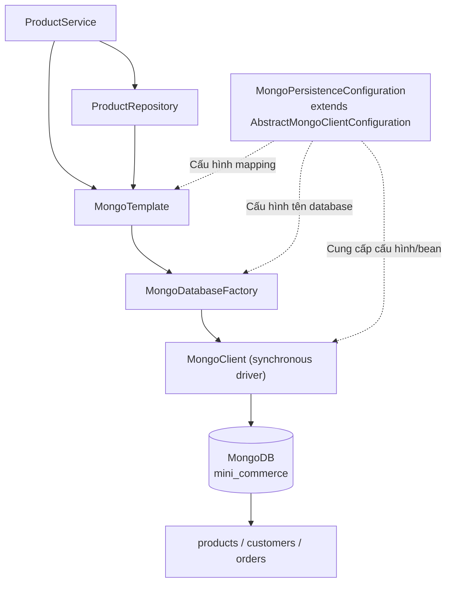

# Cấu hình thủ công bằng AbstractMongoClientConfiguration

## 1. Mục tiêu bài học

Trong **Spring Data MongoDB**, ứng dụng có thể dựa vào auto-configuration của Spring Boot để tạo `MongoClient`, `MongoDatabaseFactory` và `MongoTemplate`. Khi cần chủ động điều khiển cách khởi tạo client, tên database, phạm vi quét entity hoặc một số cấu hình mapping, chúng ta có thể kế thừa `AbstractMongoClientConfiguration` và khai báo cấu hình bằng Java.

Đây là chủ đề thuộc phần **Cấu hình và kiến trúc**. Ví dụ xuyên suốt dùng ứng dụng **Mini Commerce** với các collection `products`, `customers` và `orders`, qua đó chuẩn bị cho những bài về ánh xạ document, repository, MongoTemplate, query, aggregation, index, transaction, kiểm thử và chẩn đoán hiệu năng.

Học xong bài này, bạn có thể:

- Giải thích các bean cơ bản cần thiết để Spring Data MongoDB vận hành và trách nhiệm của `AbstractMongoClientConfiguration`.
- Cài đặt một lớp cấu hình thủ công hoàn chỉnh, dùng URI an toàn và chọn database nhất quán.
- Phân biệt `getDatabaseName()`, `mongoClient()`, `getMappingBasePackages()` và `autoIndexCreation()`.
- Sử dụng `MongoRepository` hoặc `MongoTemplate` trên chính kết nối đã tạo.
- Nhận biết trường hợp nên giữ auto-configuration của Spring Boot, khi nào cần cấu hình thủ công và những điểm khác biệt của Reactive MongoDB.
- Tự kiểm tra kết nối, mapping, index và các lỗi thường gặp mà không nhầm giữa “ứng dụng khởi động” với “database đã kết nối thành công”.

**Yêu cầu đầu vào:** Dự án Java/Spring Boot đã khai báo `spring-boot-starter-data-mongodb`, có MongoDB truy cập được, hiểu cơ bản về `@Configuration`, dependency injection và `@Document`. Các mã Java trong bài minh họa nhánh **đồng bộ (synchronous/imperative)**.

## 2. Vì sao và khi nào cấu hình thủ công?

Trong dự án nhỏ, cách đơn giản nhất thường là cấu hình một URI trong `application.yml` rồi để Spring Boot tự tạo các bean MongoDB. Ví dụ theo phiên bản Spring Boot, URI có thể được cấu hình bằng `spring.data.mongodb.uri` (Boot 3.x) hoặc `spring.mongodb.uri` (Boot 4.x).

Tuy nhiên, có những trường hợp cần kiểm soát rõ cấu hình:

| Yêu cầu | Auto-configuration mặc định | Cấu hình bằng `AbstractMongoClientConfiguration` |
| --- | --- | --- |
| Một database, URI đơn giản | Thường đủ | Không cần thiết |
| Muốn tự tạo `MongoClientSettings` | Có thể tùy biến qua customizer/thuộc tính của Boot | Chủ động tạo toàn bộ client |
| Xác định rõ database và package quét entity | Có giá trị mặc định theo cấu trúc ứng dụng | Ghi rõ qua phương thức override |
| Dạy/học cấu trúc bean MongoDB | Nhiều chi tiết được Boot che đi | Nhìn rõ trách nhiệm của từng lớp |
| Tạo nhiều MongoDB client/database | Cần cấu hình bean chuyên biệt | Lớp cấu hình đơn này chỉ là nền; nhiều client cần thiết kế factory/template/repository riêng |
| Dùng Reactive MongoDB | Boot có starter/configuration reactive tương ứng | **Không dùng** lớp cấu hình synchronous này để thay thế cấu hình reactive |

**Nguyên tắc:** Nếu cấu hình mặc định đáp ứng yêu cầu thì nên ưu tiên nó. Kế thừa `AbstractMongoClientConfiguration` khi cần sở hữu quyết định kiến trúc và chấp nhận trách nhiệm quản lý client, URI, package scanning, index và vòng đời tài nguyên. Trong một ứng dụng, tránh tạo hai tập bean cùng chức năng khi không có nhu cầu rõ ràng.

## 3. Kiến trúc các thành phần

Một request lấy sản phẩm theo SKU có thể đi qua repository hoặc MongoTemplate, nhưng cuối cùng đều sử dụng database factory và MongoDB driver:



Các thành phần quan trọng:

| Thành phần | Vai trò |
| --- | --- |
| `com.mongodb.client.MongoClient` | Client đồng bộ của MongoDB Java Driver; giữ các thiết lập kết nối, topology, TLS, pool |
| `MongoDatabaseFactory` | Trừu tượng tạo quyền truy cập database cho Spring Data theo client/tên database |
| `MongoTemplate` | API thao tác MongoDB đồng bộ: CRUD, `Query`, `Update`, aggregation, index… |
| `MappingMongoConverter` | Chuyển giữa object Java và document BSON, kết hợp mapping metadata |
| `MongoRepository` | Interface repository xây trên hạ tầng Spring Data MongoDB; thuận tiện cho CRUD và query method |
| `AbstractMongoClientConfiguration` | Lớp cấu hình nền cung cấp tích hợp mapping, template, factory và các điểm mở rộng; người học override phần phải lựa chọn |

**Không nhầm hai client** có tên gần giống nhau: `com.mongodb.client.MongoClient` là client **synchronous**; `com.mongodb.reactivestreams.client.MongoClient` là client **reactive**. Import nhầm loại thường dẫn tới lỗi override hoặc không tìm được bean.

## 4. Khai báo dependency

Với Maven, giả sử đã dùng Spring Boot parent hoặc BOM để quản lý phiên bản:

```xml
<dependencies>
    <dependency>
        <groupId>org.springframework.boot</groupId>
        <artifactId>spring-boot-starter-data-mongodb</artifactId>
    </dependency>
</dependencies>
```

Với Gradle Groovy DSL:

```groovy
dependencies {
    implementation 'org.springframework.boot:spring-boot-starter-data-mongodb'
}
```

Với Gradle Kotlin DSL:

```kotlin
dependencies {
    implementation("org.springframework.boot:spring-boot-starter-data-mongodb")
}
```

Chọn cách khai báo phù hợp với công cụ build hiện tại. Starter mang tới Spring Data MongoDB, synchronous driver và các thành phần mapping/repository. Khi dùng Spring Boot BOM, tránh tự đặt phiên bản riêng cho `spring-data-mongodb` hoặc `mongodb-driver-sync` nếu chưa kiểm chứng tính tương thích.

## 5. Cấu hình URI riêng cho lớp Java

Trong ví dụ này, ta chủ động sử dụng property ứng dụng **`app.mongodb.uri`**. Đây là **property tự định nghĩa**, được đọc bằng `@Value` trong lớp cấu hình; nó không phải khóa URI mặc định của Spring Boot. Cách chọn này giúp ví dụ Java minh bạch về nguồn cấu hình và không phụ thuộc tên property auto-configuration giữa các dòng Boot.

Trong `src/main/resources/application.yml`:

```yaml
app:
  mongodb:
    uri: "${MONGODB_URI:mongodb://localhost:27017/mini_commerce}"
```

Ý nghĩa:

- `MONGODB_URI` là biến môi trường dùng trong triển khai; nếu không có, ví dụ chạy local với `mongodb://localhost:27017/mini_commerce`.
- `mini_commerce` là database được yêu cầu trong bài.
- URI thực tế có thể là `mongodb://...` hoặc `mongodb+srv://...` tùy kiểu triển khai MongoDB.
- Phần tên database sau dấu `/` trong URI được dùng làm **nguồn sự thật duy nhất** cho `getDatabaseName()` ở ví dụ bên dưới.

**Không commit credentials vào source code hoặc YAML.** Trong production, cung cấp URI qua secret manager, biến môi trường hoặc hệ thống cấu hình an toàn. URI có thể chứa password, authSource, TLS và các thông số khác; đừng ghi nguyên URI nhạy cảm ra log hoặc ném vào thông báo lỗi cho client HTTP.

Nếu ứng dụng chạy trong Docker, `localhost` trong URI chỉ tới chính container ứng dụng; hãy dùng hostname/service name của MongoDB trong cùng network hoặc endpoint được định tuyến phù hợp.

## 6. Cấu hình hoàn chỉnh với AbstractMongoClientConfiguration

Giả sử dự án có các package:

```text
com.example.minicommerce
├── MiniCommerceApplication.java
├── config/
│   └── MongoPersistenceConfiguration.java
├── domain/
│   ├── Product.java
│   ├── Customer.java
│   └── Order.java
├── repository/
│   └── ProductRepository.java
└── service/
    └── ProductService.java
```

Tạo `MongoPersistenceConfiguration.java`:

```java
package com.example.minicommerce.config;

import java.util.Collection;
import java.util.List;

import com.mongodb.ConnectionString;
import com.mongodb.MongoClientSettings;
import com.mongodb.client.MongoClient;
import com.mongodb.client.MongoClients;

import org.springframework.beans.factory.annotation.Value;
import org.springframework.context.annotation.Configuration;
import org.springframework.data.mongodb.config.AbstractMongoClientConfiguration;
import org.springframework.data.mongodb.repository.config.EnableMongoRepositories;

@Configuration
@EnableMongoRepositories(
    basePackages = "com.example.minicommerce.repository"
)
public class MongoPersistenceConfiguration
        extends AbstractMongoClientConfiguration {

    private final ConnectionString connectionString;

    public MongoPersistenceConfiguration(
            @Value("${app.mongodb.uri}") String uri) {
        this.connectionString = new ConnectionString(uri);

        String database = connectionString.getDatabase();
        if (database == null || database.isBlank()) {
            throw new IllegalArgumentException(
                "app.mongodb.uri must contain a database name");
        }
    }

    @Override
    public MongoClient mongoClient() {
        MongoClientSettings settings = MongoClientSettings.builder()
            .applyConnectionString(connectionString)
            .applicationName("mini-commerce")
            .build();

        return MongoClients.create(settings);
    }

    @Override
    protected String getDatabaseName() {
        return connectionString.getDatabase();
    }

    @Override
    protected Collection<String> getMappingBasePackages() {
        return List.of("com.example.minicommerce.domain");
    }

    @Override
    protected boolean autoIndexCreation() {
        return false;
    }
}
```

### 6.1. Phân tích từng điểm mở rộng

**`mongoClient()` — Khởi tạo client đồng bộ.** Spring Data gọi bean client cấu hình để truy cập MongoDB. `MongoClients.create(settings)` tạo client dựa trên thiết lập từ URI, đồng thời đặt `applicationName` giúp nhận diện client trong thông tin quan sát. Client hỗ trợ connection pool, quản lý kết nối và nên được tạo một lần rồi tái sử dụng; **không tạo client mới cho mỗi request**.

**`getDatabaseName()` — Xác định database.** Lớp cấu hình cần biết database mà `MongoTemplate` làm việc. Ví dụ đọc database ngay từ URI thay vì viết cố định tên khác trong phương thức này. Điều kiện trong constructor từ chối URI không chứa database, tránh tình trạng ghi dữ liệu nhầm collection trong database không mong muốn.

**`getMappingBasePackages()` — Phạm vi tìm entity.** Trả về package chứa các class được đánh dấu `@Document` và metadata ánh xạ khác. Khai báo phạm vi rõ ràng hữu ích trong dự án lớn hoặc khi domain không nằm ngay dưới package ứng dụng. Nó không thay thế việc quét repository.

**`@EnableMongoRepositories` — Quét repository.** Annotation này chỉ đến package chứa các interface như `ProductRepository`. Nó khác với `getMappingBasePackages()`: một bên tìm **repository**, bên kia tìm **entity/mapping metadata**. Trong ứng dụng Boot đơn giản, repository có thể được tự phát hiện; ở đây dùng annotation chủ động để minh họa cấu hình thủ công.

**`autoIndexCreation()` — Quy tắc tạo index.** Ví dụ đặt `false` để không mặc nhiên tạo index khi startup. Đây là lựa chọn thận trọng khi có dữ liệu thực, vì unique index có thể thất bại nếu đã có document trùng, và việc tạo index cần được kiểm soát bằng migration/quy trình triển khai. Trong môi trường thực hành có thể chọn bật tạm để học, nhưng phải biết rõ index thực tế tồn tại hay chưa.

### 6.2. Bean được tạo ở đâu?

`AbstractMongoClientConfiguration` cung cấp các bean/cấu hình hạ tầng cho MongoDB synchronous; nó xây dựng `MongoDatabaseFactory`, mapping converter và `MongoTemplate` dựa trên client và tên database đã chọn. Vì vậy, với một kết nối và không có nhu cầu đặc biệt, **không cần khai báo thêm một `@Bean MongoTemplate` thủ công**. Tạo trùng bean hoặc tự tạo factory khác vô tình sẽ khiến ứng dụng khó xác định template đang dùng client/database nào.

Trong Spring Boot, các auto-configuration có điều kiện sẽ lùi lại khi đã có bean do ứng dụng tự cung cấp ở những điểm tương ứng. Tuy nhiên cần kiểm tra bean thực tế nếu ứng dụng có các `@Configuration` khác, phụ thuộc đồng bộ lẫn reactive, hoặc nhiều repository. Không suy ra ứng dụng “chỉ có một client” nếu classpath và cấu hình cho phép tạo nhiều loại client.

## 7. Sử dụng cấu hình bằng document và repository

Đầu tiên, tạo document tối giản tại `domain/Product.java`. Đây là phiên bản học tập; model đầy đủ có thể bổ sung giá (BigDecimal/Decimal128), danh mục, trạng thái bán và thời gian tạo.

```java
package com.example.minicommerce.domain;

import org.springframework.data.annotation.Id;
import org.springframework.data.mongodb.core.mapping.Document;

@Document(collection = "products")
public class Product {

    @Id
    private String id;

    private String sku;
    private String name;
    private int stock;

    public Product() {}

    public Product(String sku, String name, int stock) {
        this.sku = sku;
        this.name = name;
        this.stock = stock;
    }

    public String getId() { return id; }
    public void setId(String id) { this.id = id; }

    public String getSku() { return sku; }
    public void setSku(String sku) { this.sku = sku; }

    public String getName() { return name; }
    public void setName(String name) { this.name = name; }

    public int getStock() { return stock; }
    public void setStock(int stock) { this.stock = stock; }
}
```

Tiếp theo, định nghĩa repository ở đúng package `com.example.minicommerce.repository`:

```java
package com.example.minicommerce.repository;

import java.util.Optional;
import org.springframework.data.mongodb.repository.MongoRepository;
import com.example.minicommerce.domain.Product;

public interface ProductRepository
        extends MongoRepository<Product, String> {
    Optional<Product> findBySku(String sku);
}
```

Do `@EnableMongoRepositories` và `getMappingBasePackages()` đều trỏ tới các package trên, Spring có thể phát hiện repository và metadata của `Product`. Khi sử dụng repository, bạn không phải tự truyền URI hoặc database trong từng phương thức.

Service minh họa hai con đường đọc dữ liệu:

```java
package com.example.minicommerce.service;

import java.util.Optional;

import org.springframework.data.mongodb.core.MongoTemplate;
import org.springframework.data.mongodb.core.query.Criteria;
import org.springframework.data.mongodb.core.query.Query;
import org.springframework.stereotype.Service;

import com.example.minicommerce.domain.Product;
import com.example.minicommerce.repository.ProductRepository;

@Service
public class ProductService {

    private final ProductRepository repository;
    private final MongoTemplate mongoTemplate;

    public ProductService(
            ProductRepository repository,
            MongoTemplate mongoTemplate) {
        this.repository = repository;
        this.mongoTemplate = mongoTemplate;
    }

    public Optional<Product> findBySkuWithRepository(String sku) {
        return repository.findBySku(sku);
    }

    public Optional<Product> findBySkuWithTemplate(String sku) {
        Query query = Query.query(Criteria.where("sku").is(sku));
        return Optional.ofNullable(
            mongoTemplate.findOne(query, Product.class));
    }
}
```

Cả hai phương thức trả về cùng dữ liệu vì cùng sử dụng cấu hình MongoDB đã được tạo. Repository phù hợp với truy vấn đơn giản hoặc CRUD, còn `MongoTemplate` tạo điều kiện ghép `Criteria` động, projection, update có điều kiện và aggregation trong các bài sau.

## 8. Tùy chỉnh MongoClientSettings một cách có kiểm soát

Điểm mạnh của cấu hình thủ công là chủ động thiết lập client ở mức driver. Bên cạnh URI, ta có thể điều chỉnh pool, timeout, TLS, read preference, retry behavior hoặc application name. Chỉ điều chỉnh khi có yêu cầu thật và có số liệu quan sát, vì mặc định của driver và chính URI thường đã phù hợp.

Ví dụ tùy chỉnh connection pool và server-selection timeout **thay thế phần khởi tạo `settings` trong `mongoClient()`**:

```java
MongoClientSettings settings = MongoClientSettings.builder()
    .applyConnectionString(connectionString)
    .applyToConnectionPoolSettings(pool ->
        pool.maxSize(50))
    .applyToClusterSettings(cluster ->
        cluster.serverSelectionTimeout(5, TimeUnit.SECONDS))
    .applicationName("mini-commerce")
    .build();

return MongoClients.create(settings);
```

Đoạn trên yêu cầu import thêm `java.util.concurrent.TimeUnit`. Các giá trị `50` kết nối tối đa và `5` giây chỉ nhằm minh họa API, **không phải cấu hình tối ưu cho mọi hệ thống**.

| Thiết lập | Ý nghĩa | Hậu quả nếu đặt không hợp lý |
| --- | --- | --- |
| Connection pool size | Số kết nối được quản lý cho mỗi server bởi client | Quá nhỏ tạo hàng đợi; quá lớn gây áp lực lên MongoDB |
| Server selection timeout | Khoảng thời gian đợi tìm server có thể xử lý thao tác | Quá ngắn dễ lỗi khi cluster chuyển trạng thái; quá dài khiến request treo lâu |
| TLS và chứng chỉ | Bảo vệ kết nối và xác thực server | Sai truststore/cert có thể làm kết nối thất bại |
| Auth credentials / `authSource` | Xác thực đúng database và quyền truy cập | Sai quyền gây lỗi ngay lần query đầu |
| Read preference / write concern | Chọn nơi đọc, mức đảm bảo khi ghi | Cấu hình thiếu cân nhắc dẫn tới đọc dữ liệu trễ hoặc thay đổi bảo đảm ghi |
| Application name | Nhận diện ứng dụng trong thông tin MongoDB/driver | Giá trị thiếu nhất quán làm khó quan sát nhiều dịch vụ |

`ConnectionString` và `MongoClientSettings` cần được phối hợp nhất quán: nếu cùng một thiết lập xuất hiện cả trong URI và builder, thứ tự áp dụng có thể quyết định giá trị cuối cùng. Ví dụ trên gọi `applyConnectionString` trước, rồi đặt rõ pool/timeout. Trong production nên tài liệu hóa nguồn cấu hình và kiểm tra bằng metric/log an toàn.

## 9. Index, converter và transaction trong cấu hình

### 9.1. Quản lý index

Khi ánh xạ:

```java
@Document(collection = "products")
public class Product {
    @Id
    private String id;

    @Indexed(unique = true)
    private String sku;

    // Các trường khác...
}
```

`@Indexed(unique = true)` là khai báo metadata. Nếu `autoIndexCreation()` trả `false`, annotation **không tự đảm bảo** index đã tồn tại. Để giữ SKU duy nhất, tạo index bằng migration/script có kiểm soát, chẳng hạn trong `mongosh`:

```javascript
use mini_commerce
db.products.createIndex({ sku: 1 }, { unique: true })
db.products.getIndexes()
```

Trước khi tạo unique index trên collection đã có dữ liệu, cần xử lý các bản ghi SKU trùng. Nếu bật auto-index trong môi trường học, cần hiểu lỗi tạo index có thể làm startup thất bại hoặc khiến ràng buộc không được áp dụng như kỳ vọng. Đối với production, quản lý index như một thay đổi schema cần giám sát.

### 9.2. Converter và cách lưu kiểu dữ liệu

Spring Data MongoDB ánh xạ nhiều kiểu Java thông dụng như `String`, `Instant`, collection và các object nhúng. Nhưng với dữ liệu nghiệp vụ như **giá tiền**, cần xác định rõ định dạng BSON:

```java
@Field(targetType = FieldType.DECIMAL128)
private BigDecimal price;
```

Khi dùng ví dụ này, import `java.math.BigDecimal`, `org.springframework.data.mongodb.core.mapping.Field` và `FieldType`. Với các kiểu domain đặc thù, có thể cấu hình custom read/write converters trong hạ tầng mapping theo phiên bản Spring Data đang dùng. Không nên vội tạo converter khi annotation hoặc mapping mặc định đã đáp ứng yêu cầu; mỗi converter làm tăng trách nhiệm kiểm thử dữ liệu cũ và dữ liệu mới.

### 9.3. Transaction cần bean riêng và topology phù hợp

Nếu bài toán tạo `Order` đồng thời giảm `Product.stock` của nhiều document, transaction nhiều document có thể cần thiết để bảo đảm tất cả cùng thành công hoặc rollback. Ngoài cấu hình client/template, bạn có thể khai báo transaction manager đồng bộ:

```java
package com.example.minicommerce.config;

import org.springframework.context.annotation.Bean;
import org.springframework.context.annotation.Configuration;
import org.springframework.data.mongodb.MongoDatabaseFactory;
import org.springframework.data.mongodb.MongoTransactionManager;
import org.springframework.transaction.annotation.EnableTransactionManagement;

@Configuration
@EnableTransactionManagement
public class MongoTransactionConfiguration {

    @Bean
    public MongoTransactionManager transactionManager(
            MongoDatabaseFactory factory) {
        return new MongoTransactionManager(factory);
    }
}
```

Đây là **cấu hình bổ sung tùy chọn** cho bài transaction, không phải điều kiện để thực hiện CRUD thông thường. MongoDB phải chạy dưới dạng **replica set hoặc sharded cluster hỗ trợ transaction**; standalone thông thường không đủ. Cần kiểm tra rollback, write conflict, retry có giới hạn và idempotency. Cấu hình manager không tự giải quyết tranh chấp tồn kho; cập nhật có điều kiện vẫn quan trọng.

## 10. Khác biệt với reactive và trường hợp nhiều database

**`AbstractMongoClientConfiguration` dành cho synchronous MongoDB.** Nếu ứng dụng sử dụng `spring-boot-starter-data-mongodb-reactive`, các thành phần tương ứng là `ReactiveMongoTemplate`, `ReactiveMongoRepository` và reactive driver. Cấu hình nền cần tham khảo là `AbstractReactiveMongoConfiguration` (hoặc auto-configuration reactive của Boot), với kiểu MongoClient từ package `com.mongodb.reactivestreams.client`.

Không thay đổi code synchronous bằng cách đổi `MongoTemplate` thành `ReactiveMongoTemplate` mà giữ nguyên `mongoClient()`: API client, bean factory, repository và cơ chế trả kết quả khác nhau. Một luồng Reactor nên giữ các lời gọi I/O non-blocking, tránh dùng `block()` trong event loop.

Nếu có nhiều database:

- Mỗi client/database có thể cần `MongoDatabaseFactory` và `MongoTemplate` riêng, đặt tên bean rõ ràng.
- Gắn từng nhóm repository với template thích hợp bằng cấu hình `@EnableMongoRepositories(mongoTemplateRef = "...")` nếu cần.
- Xác định bean nào là mặc định bằng qualifier/`@Primary`, thay vì để autowiring chọn ngẫu nhiên.
- Quản lý transaction manager riêng theo hạ tầng sử dụng, không giả định transaction xuyên hai MongoDB client/database khác nhau tự động hoạt động.

Lớp cấu hình một database của bài này là nền tảng để hiểu cơ chế, không phải template sẵn cho kiến trúc đa cluster.

## 11. Kiểm chứng cấu hình thủ công

Một ứng dụng có thể khởi động dù driver chưa thực hiện truy vấn. Vì vậy cần kiểm tra **bean đã được tạo**, **database thực sự kết nối** và **mapping đúng**.

### Bước 1 — Kiểm tra URI và MongoDB

Dùng `mongosh` kết nối tới database `mini_commerce`, chạy:

```javascript
db.runCommand({ ping: 1 })
db.products.insertOne({
  sku: "LAP-001",
  name: "Ban phim co Mini",
  stock: 20
})
db.products.findOne({ sku: "LAP-001" })
```

Ví dụ insert chỉ nên chạy một lần trên môi trường thử nghiệm; nếu đã tạo unique index, ghi lại SKU này có thể bị từ chối. Sau khi có dữ liệu mẫu, có thể bỏ bước insert và chỉ query.

### Bước 2 — Kiểm tra truy vấn thực trong ứng dụng

Inject `ProductService` và gọi `findBySkuWithRepository("LAP-001")`, `findBySkuWithTemplate("LAP-001")`. Hai phương thức cần đọc cùng sản phẩm, với các trường `sku`, `name` và `stock` phù hợp.

Có thể dùng kiểm tra `ping` trong một integration test hoặc một thành phần chạy khi khởi động môi trường development:

```java
import org.bson.Document;
import org.springframework.data.mongodb.core.MongoTemplate;

// mongoTemplate được inject bởi Spring:
Document result = mongoTemplate.getDb()
    .runCommand(new Document("ping", 1));

// In hoặc assert trường "ok" trong test để xác nhận kết nối.
```

Không đặt health probe gọi database vô hạn hoặc log cả URI chứa mật khẩu. Trong production, sử dụng health indicator và observability phù hợp để giám sát trạng thái kết nối.

### Bước 3 — Kiểm tra đúng bean và database

Nếu xuất hiện hai `MongoTemplate` hoặc nhiều `MongoDatabaseFactory`, kiểm tra các class `@Configuration` khác và auto-configuration đã hoạt động. Khi chạy integration test với Testcontainers, nhớ truyền **`app.mongodb.uri`** vào environment/properties của test, vì đây là khóa tùy chỉnh, không phải khóa Boot mặc định.

Có thể kiểm tra rằng `mongoTemplate.getDb().getName()` trả về `mini_commerce` và `db.products.getIndexes()` chứa các index thực sự đã được tạo. Nếu test transaction, container MongoDB cũng phải dùng replica set phù hợp.

### Bước 4 — Kiểm tra dưới tải thực tế

Đối với truy vấn lịch sử đơn theo khách, dùng `explain("executionStats")` kiểm tra index `{ customerId: 1, placedAt: -1 }`; đối với cập nhật tồn kho, kiểm tra điều kiện `stock >= quantity` được thực thi nguyên tử. Việc cấu hình client đúng chỉ là điểm khởi đầu; hiệu năng còn phụ thuộc thiết kế document, query shape, index, pool, số lượng kết nối và workload.

## 12. Lỗi thường gặp và cách xử lý

| Triệu chứng | Nguyên nhân có thể | Cách kiểm tra/xử lý |
| --- | --- | --- |
| Không override được `mongoClient()` | Import nhầm reactive MongoClient hoặc dùng nhầm lớp cấu hình | Dùng `com.mongodb.client.MongoClient` và `AbstractMongoClientConfiguration` |
| Báo thiếu property `app.mongodb.uri` | Chưa khai báo YAML, profile sai hoặc tên biến môi trường sai | Kiểm tra effective configuration và giá trị được inject (không log bí mật) |
| Lỗi URI không có database | Đường dẫn URI không chứa tên database | Bổ sung `/mini_commerce` hoặc đổi chiến lược xác định database có chủ ý |
| `MongoTimeoutException` / server selection timeout | MongoDB không chạy, network/DNS/TLS/port không phù hợp | Kiểm tra endpoint, network, chứng chỉ và topology |
| `Authentication failed` | Sai credentials, `authSource` hoặc quyền | Xác minh user, database xác thực, URI encoding và quyền |
| `No qualifying bean of type MongoTemplate` | Starter/scan/config không được nạp hoặc cấu hình bị xung đột | Kiểm tra starter, `@Configuration`, package scan và bean definitions |
| `No qualifying bean ... ProductRepository` | Repository ngoài phạm vi `@EnableMongoRepositories` | Điều chỉnh package hoặc cấu hình repository scan |
| Truy vấn trả rỗng dù có dữ liệu | Đọc nhầm database/collection, kiểu ID/field không khớp | Kiểm tra `getDatabaseName()`, `@Document`, BSON thực tế |
| Dữ liệu trùng SKU dù có `@Indexed(unique = true)` | Index chưa được tạo vì `autoIndexCreation=false` | Kiểm tra `db.products.getIndexes()` và tạo index qua migration |
| Nhiều bean MongoClient/Template | Tự khai báo nhiều cấu hình cùng loại hoặc thêm cả sync/reactive | Xem bean names, qualifier, các cấu hình được import |
| `@Transactional` không commit/rollback như kỳ vọng | Thiếu manager phù hợp, tự gọi nội bộ không đi qua proxy, MongoDB standalone | Kiểm tra manager, boundary, proxy và topology replica set |
| Pool cạn, truy vấn chậm | Pool nhỏ so với tải hoặc query chậm/thiếu index | Đo latency, `explain`, connection pool metrics và điều chỉnh có căn cứ |

## 13. Checklist và bài tập thực hành

Sau khi hoàn thành bài, người học cần chứng minh được:

1. Dự án có starter **đồng bộ** và một lớp `MongoPersistenceConfiguration extends AbstractMongoClientConfiguration` hợp lệ.
2. Lớp cấu hình đọc URI từ `app.mongodb.uri`, suy ra đúng database `mini_commerce` và từ chối URI không chỉ định database.
3. `mongoClient()` trả về đúng `com.mongodb.client.MongoClient`; cả repository và `MongoTemplate` dùng cùng kết nối đó.
4. `getMappingBasePackages()` trỏ tới package entity, còn `@EnableMongoRepositories` trỏ tới package repository.
5. Có thể đọc sản phẩm `LAP-001` qua **cả repository lẫn MongoTemplate**.
6. Xác minh thực tế trạng thái index và hiểu vì sao `@Indexed` không tự tạo index khi `autoIndexCreation()` trả `false`.
7. Giải thích khi nào nên giữ auto-configuration của Boot, khi nào cấu hình thủ công có ích và vì sao mẫu này không thay thế cấu hình reactive.

**Bài tập mở rộng:** Bổ sung truy vấn danh sách các sản phẩm đang bán bằng `MongoTemplate`; tạo index phục vụ lọc và đo kết quả bằng `explain`. Sau đó triển khai cập nhật `Product.stock` với điều kiện còn đủ tồn, chuẩn bị cho bài tạo `Order` và multi-document transaction. Khi hoàn thành, người học sẽ có một cấu hình MongoDB rõ ràng, có thể kiểm chứng và đủ vững để tiến đến aggregation, transaction, reactive access, kiểm thử và phân tích hiệu năng.

## Tài liệu tham khảo

- [Spring Data MongoDB Reference](https://docs.spring.io/spring-data/mongodb/reference/) — Java configuration, MongoTemplate, object mapping, repositories và transaction.
- [Spring Data MongoDB API: AbstractMongoClientConfiguration](https://docs.spring.io/spring-data/mongodb/docs/current/api/org/springframework/data/mongodb/config/AbstractMongoClientConfiguration.html) — điểm mở rộng và bean cấu hình.
- [MongoDB Java Sync Driver Documentation](https://www.mongodb.com/docs/drivers/java/sync/current/) — URI, `MongoClientSettings`, connection pool và TLS.
