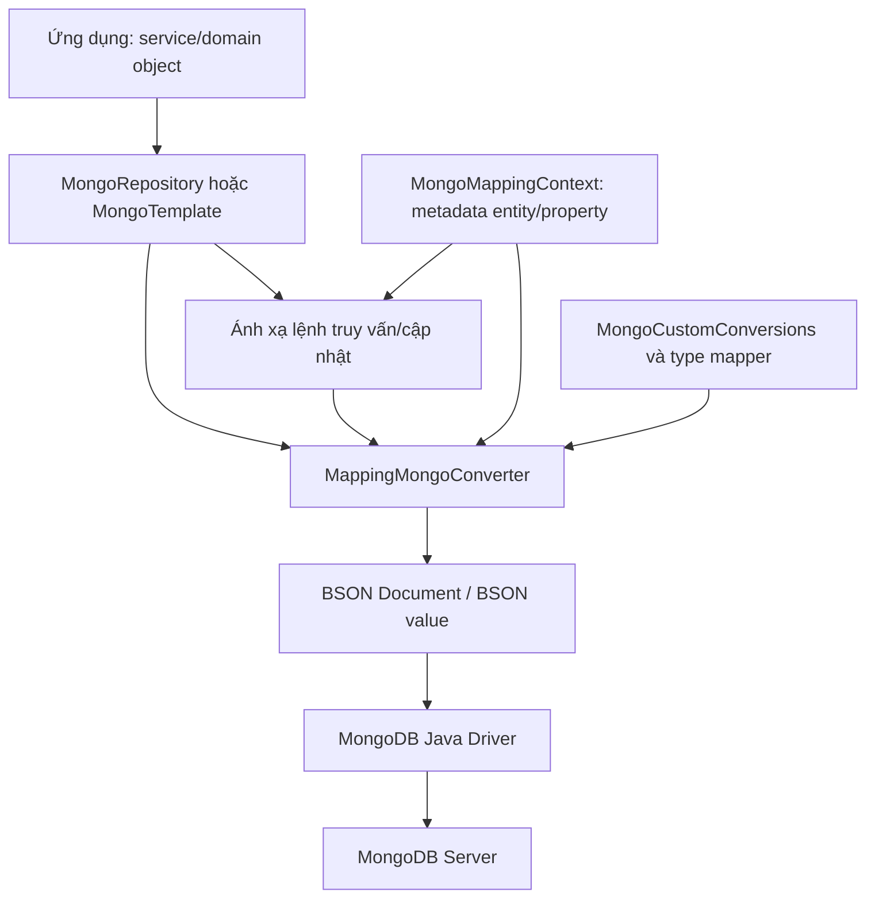

# MongoMappingContext, MappingMongoConverter và metadata ánh xạ

## 1. Bài toán và mục tiêu học tập

Một ứng dụng Java có thể định nghĩa đối tượng `PurchaseOrder` với thuộc tính `orderNo`, `shippingAddress.city` và `totalAmount`. Trong MongoDB, tài liệu thực tế có thể lưu các trường tương ứng dưới tên `order_no`, `shippingAddress.city_name` và `total_amount` với kiểu BSON `Decimal128`. Cơ chế nào giúp Spring Data MongoDB hiểu hai biểu diễn này là cùng một dữ liệu?

Trong module **SPRING_DATA_MONGODB**, mục tiêu là sử dụng Spring Data MongoDB để kết nối, ánh xạ document, thao tác bằng `MongoTemplate` hoặc repository, thiết kế truy vấn và aggregation, tối ưu index, kiểm thử cũng như chẩn đoán hiệu năng. Phần **Cấu hình và kiến trúc** giải thích lớp ánh xạ đứng giữa mô hình Java và MongoDB, tập trung vào ba khái niệm:

- **`MongoMappingContext`:** nhận diện và quản lý metadata của các entity, property và annotation ánh xạ.
- **`MappingMongoConverter`:** sử dụng metadata và các bộ chuyển đổi để ghi object Java thành BSON document, đọc BSON trở lại object.
- **Metadata ánh xạ:** thông tin về tên trường lưu trữ, ID, kiểu dữ liệu, kiểu con, cấu trúc lồng nhau, tham chiếu và các quy tắc chuyển đổi.

Sau bài này, bạn có thể giải thích đường đi của một lệnh lưu/đọc, kiểm tra tên trường vật lý, dùng `@Field` và các annotation liên quan, cấu hình custom conversion có kiểm soát, phân biệt ánh xạ entity với ánh xạ query, đồng thời phân tích những lỗi mapping thường gặp. Ví dụ dùng Java 17+ và phong cách Spring Data MongoDB hiện đại; API cụ thể nên được đối chiếu với phiên bản dependency thực tế khi tích hợp.

## 2. Vị trí trong kiến trúc Spring Data MongoDB

Khi ứng dụng gọi `repository.save(order)` hoặc `mongoTemplate.save(order)`, MongoDB driver không tự hiểu annotation `@Document`, `@Field` hay kiểu object lồng nhau của ứng dụng. Spring Data cung cấp lớp mapping để thực hiện việc này.



Sơ đồ là biểu diễn khái niệm. Trong triển khai, các thành phần chia sẻ metadata và hỗ trợ cả chiều đọc lẫn chiều ghi; một lệnh truy vấn không nhất thiết phải tuần tự đi qua tất cả các khối đúng như hình.

| Thành phần | Trách nhiệm chính | Không chịu trách nhiệm trực tiếp |
| --- | --- | --- |
| `MongoMappingContext` | Xây dựng/tra cứu metadata về persistent entity và property | Thực hiện kết nối mạng, chạy truy vấn MongoDB |
| `MappingMongoConverter` | Chuyển object Java ⇄ dữ liệu BSON theo metadata và conversion rules | Tự thiết kế index, tự xác thực mọi invariant nghiệp vụ |
| `MongoCustomConversions` | Đăng ký bộ chuyển đổi cho kiểu tùy biến hoặc biểu diễn đặc biệt | Đặt tên collection hay cấp quyền dữ liệu |
| `QueryMapper` / `UpdateMapper` | Chuyển tên property/giá trị trong query/update sang biểu diễn MongoDB | Tự chọn index tối ưu thay MongoDB query planner |
| `MongoTemplate` | Điều phối các operation, query, update, aggregation và converter | Thay thế quản lý kết nối bên dưới của driver |
| `MongoRepository` | API CRUD và truy vấn ở cấp repository | Bỏ qua hoàn toàn cơ chế mapping của template |
| MongoDB Java Driver | Mã hóa/giải mã BSON ở cấp driver, trao đổi với server | Tự diễn giải annotation Spring Data |

Một điểm quan trọng: **metadata không phải document dữ liệu**. Metadata mô tả cách biến một kiểu Java thành document MongoDB. Nó không phải schema validator nằm trong MongoDB server và cũng không phải một bộ bản ghi cần lưu vào collection.

## 3. MongoMappingContext: kho metadata về entity và property

### 3.1. Context biết những gì?

`MongoMappingContext` là implementation mapping context dành cho MongoDB, thuộc hệ thống mapping metadata chung của Spring Data. Khi một lớp domain được phát hiện và phân tích, context tạo ra các đối tượng metadata như:

- `MongoPersistentEntity<?>`: đại diện cho một kiểu entity được ánh xạ; cung cấp thông tin định danh, collection và danh sách property.
- `MongoPersistentProperty`: đại diện cho một thuộc tính; cung cấp tên property Java, tên trường BSON, type, annotation và những đặc điểm lưu trữ.
- Metadata constructor/parameter: hỗ trợ khởi tạo object khi đọc dữ liệu, kể cả trường hợp object bất biến hoặc Java `record`.
- Thông tin annotation đặc thù MongoDB: `@Document`, `@Field`, `@Id`/`@MongoId`, `@TypeAlias`, metadata index và tham chiếu.

Metadata được xây dựng và tái sử dụng trong vòng đời mapping context. Thay đổi annotation trong source code không tự cập nhật dữ liệu đã lưu trong MongoDB; thường cần triển khai phiên bản ứng dụng mới và xử lý migration dữ liệu nếu đổi cấu trúc thực tế.

### 3.2. Entity và document vật lý không đồng nhất hoàn toàn

Ví dụ Java:

```java
@Document(collection = "purchase_orders")
record PurchaseOrder(String orderNo, ShippingAddress shippingAddress) {}

record ShippingAddress(String city) {}
```

`PurchaseOrder` là một entity được ánh xạ tới collection `purchase_orders`. `ShippingAddress` là kiểu Java lồng nhau, thông thường được lưu thành **embedded document** trong cùng bản ghi, không tự động trở thành collection `shipping_address`. Mapping context vẫn cần hiểu các property của `ShippingAddress` để ánh xạ đường dẫn lồng nhau.

Việc phát hiện entity có thể diễn ra thông qua cấu hình, quét entity và/hoặc khi một kiểu được sử dụng lần đầu. Tập entity đã đăng ký có ý nghĩa đặc biệt đối với alias của kiểu đa hình và một số chức năng dựa trên metadata; đừng giả định mọi class có trên classpath sẽ tự xuất hiện trong context ngay lập tức.

### 3.3. Đọc metadata bằng mã

Trong ứng dụng Spring Boot đã cấu hình Spring Data MongoDB, có thể inject `MongoMappingContext` vào component để quan sát mapping. Ví dụ ở mục 4 sẽ định nghĩa `PurchaseOrder` đầy đủ:

```java
import org.springframework.data.mongodb.core.mapping.MongoMappingContext;
import org.springframework.data.mongodb.core.mapping.MongoPersistentEntity;
import org.springframework.data.mongodb.core.mapping.MongoPersistentProperty;

public class MappingInspector {
    private final MongoMappingContext context;

    public MappingInspector(MongoMappingContext context) {
        this.context = context;
    }

    public void inspect() {
        MongoPersistentEntity<?> entity =
            context.getRequiredPersistentEntity(PurchaseOrder.class);
        MongoPersistentProperty orderNo =
            entity.getRequiredPersistentProperty("orderNo");

        System.out.println(entity.getCollection());       // purchase_orders
        System.out.println(orderNo.getName());             // orderNo
        System.out.println(orderNo.getFieldName());        // order_no
    }
}
```

Ở đây, `getName()` là tên thuộc tính Java, còn `getFieldName()` là tên trường được mapping xuống MongoDB. Đây là một cách hữu ích để kiểm tra những lỗi do lẫn tên Java và tên BSON khi viết query hoặc index.

**Giới hạn:** Metadata cho biết *cách hệ thống dự kiến ánh xạ*. Nó không khẳng định mọi document tồn tại trong collection đều có các trường đúng như vậy. MongoDB cho phép document có cấu trúc khác nhau; cần kiểm tra dữ liệu và quy tắc validation riêng.

## 4. Ví dụ đầy đủ: cùng một entity ở Java và MongoDB

Chúng ta thiết kế một đơn mua hàng với ID dạng chuỗi, địa chỉ nhúng, nhiều dòng hàng và số tiền chính xác.

### 4.1. Domain model và annotation

```java
import java.math.BigDecimal;
import java.util.List;
import org.springframework.data.mongodb.core.mapping.Document;
import org.springframework.data.mongodb.core.mapping.Field;
import org.springframework.data.mongodb.core.mapping.FieldType;
import org.springframework.data.mongodb.core.mapping.MongoId;

@Document(collection = "purchase_orders")
public record PurchaseOrder(
    @MongoId(FieldType.STRING) String id,
    @Field("order_no") String orderNo,
    @Field(name = "total_amount", targetType = FieldType.DECIMAL128)
    BigDecimal totalAmount,
    ShippingAddress shippingAddress,
    List<OrderLine> items
) {}

record ShippingAddress(
    @Field("city_name") String city,
    String district
) {}

record OrderLine(String sku, int quantity) {}
```

Các annotation có mục đích riêng:

- `@Document(collection = "purchase_orders")` khai báo collection mặc định cho root entity.
- `@MongoId(FieldType.STRING)` chỉ định ID lưu dưới `_id` với biểu diễn BSON String; đặc biệt hữu ích khi mã nghiệp vụ cần giữ ID chuỗi.
- `@Field("order_no")` đổi tên trường lưu trữ, trong khi code Java vẫn dùng `orderNo`.
- `@Field(name = "total_amount", targetType = FieldType.DECIMAL128)` chỉ định tên vật lý và biểu diễn Decimal128 cho `BigDecimal`.
- `@Field("city_name")` nằm trong kiểu con; đường dẫn đầy đủ tương ứng là `shippingAddress.city_name`.
- `List<OrderLine>` ánh xạ sang mảng document lồng nhau.

Ví dụ dùng `record` để thể hiện việc đọc thông qua constructor. Mã thực tế có thể dùng class với constructor, getter/setter, hoặc chiến lược khởi tạo được Spring Data hỗ trợ. Trường ID dùng `@MongoId` để tránh phụ thuộc vào quy tắc chuyển `@Id String` sang ObjectId.

### 4.2. Tạo object và ghi ra BSON

```java
import java.math.BigDecimal;
import java.util.List;

PurchaseOrder order = new PurchaseOrder(
    "purchase-004",
    "PO-2026-004",
    new BigDecimal("350000"),
    new ShippingAddress("Hà Nội", "Hoàn Kiếm"),
    List.of(new OrderLine("BOOK-01", 2))
);
```

Khi chuyển qua `MappingMongoConverter` theo cấu hình mặc định thông dụng, document BSON có nội dung chính như sau:

```javascript
{
  "_id": "purchase-004",
  "order_no": "PO-2026-004",
  "total_amount": NumberDecimal("350000"),
  "shippingAddress": {
    "city_name": "Hà Nội",
    "district": "Hoàn Kiếm"
  },
  "items": [
    { "sku": "BOOK-01", "quantity": 2 }
  ],
  "_class": "com.example.PurchaseOrder"
}
```

`_class` là **ví dụ về type discriminator**, không phải một field bắt buộc do MongoDB server sinh ra. Tên package thực tế khác nhau giữa các ứng dụng; cấu hình type mapper hoặc type alias có thể thay đổi hoặc loại bỏ field này. Ý nghĩa và đánh đổi được giải thích ở mục 7.

### 4.3. Bảng chuyển tên/kiểu có thể kiểm tra

| Java property | BSON field/path | Chuyển đổi/ý nghĩa |
| --- | --- | --- |
| `id` | `_id` | Mongo ID, lưu dạng String theo `@MongoId(FieldType.STRING)` |
| `orderNo` | `order_no` | `@Field` đổi tên |
| `totalAmount` | `total_amount` | `BigDecimal` → BSON Decimal128 |
| `shippingAddress.city` | `shippingAddress.city_name` | Truy cập sâu vào document lồng nhau |
| `shippingAddress.district` | `shippingAddress.district` | Tên mặc định giữ nguyên |
| `items` | `items` | `List<OrderLine>` → BSON array of documents |

Đừng suy ra rằng một document có field `total_amount` sẽ luôn được đọc thành `BigDecimal` hợp lệ. Nếu dữ liệu cũ có chuỗi không hợp lệ hoặc kiểu không thể chuyển đổi theo cấu hình, ứng dụng vẫn có thể gặp lỗi khi đọc.

## 5. MappingMongoConverter: chuyển đổi theo cả hai chiều

### 5.1. Chiều ghi (write)

Khi một `PurchaseOrder` được lưu:

1. Converter xác định kiểu entity, đọc metadata từ mapping context.
2. Converter xác định từng property cần ghi và tên BSON tương ứng, xét annotation và quy tắc conversion.
3. Các giá trị đơn giản được chuyển thành kiểu BSON thích hợp; object con và collection được duyệt/ánh xạ theo cấu trúc.
4. Cơ chế type mapper có thể ghi discriminator để hỗ trợ đọc lại kiểu runtime.
5. Kết quả là BSON document mà driver có thể gửi đến MongoDB.

Đây là quá trình chuyển đổi, **không phải** việc MongoDB server hiểu trực tiếp class Java. Ví dụ, server chỉ thấy `"order_no"`, không biết ứng dụng có property tên `orderNo`.

### 5.2. Chiều đọc (read)

Khi đọc một bản ghi:

1. Driver đưa BSON document về ứng dụng.
2. Converter xác định kiểu đích, đôi khi dùng type discriminator nếu cấu trúc cần phân biệt subtype.
3. Metadata cho biết property Java nào nhận mỗi field BSON và cần converter nào.
4. Các embedded document, mảng và giá trị đặc biệt được chuyển về kiểu Java.
5. Cơ chế khởi tạo object tạo instance và điền giá trị theo constructor/property phù hợp.

Thiếu field, field `null`, sai tên vật lý, sai kiểu BSON, constructor thiếu dữ liệu bắt buộc và thiếu type alias đều có thể ảnh hưởng chiều đọc. Một lỗi đọc document không nhất thiết do query sai; nhiều khi query tìm đúng document nhưng converter không thể dựng lại entity.

### 5.3. Thử round trip mà chưa cần truy vấn database

Nếu ứng dụng đã có bean `MongoConverter`, có thể kiểm tra ánh xạ trực tiếp:

```java
import org.bson.Document;
import org.springframework.data.mongodb.core.convert.MongoConverter;

public class MappingRoundTrip {
    private final MongoConverter converter;

    public MappingRoundTrip(MongoConverter converter) {
        this.converter = converter;
    }

    public PurchaseOrder roundTrip(PurchaseOrder original) {
        Document bson = new Document();
        converter.write(original, bson);

        System.out.println(bson.get("order_no"));
        System.out.println(bson.get("total_amount").getClass().getSimpleName());

        return converter.read(PurchaseOrder.class, bson);
    }
}
```

Với `original` là object ở mục 4, `bson.get("order_no")` trả về mã đơn; trường tiền dự kiến ở dạng `org.bson.types.Decimal128`. Bước này giúp kiểm tra mapping riêng, nhưng **không thay thế** integration test với MongoDB vì chưa kiểm tra lưu thực, index, query planner hay kết nối mạng.

### 5.4. Không đồng nhất mapping với serialization JSON

Java object có thể được chuyển thành JSON bằng Jackson, nhưng Jackson nhìn thấy annotation và converter khác với Spring Data MongoDB. Cấu hình tên JSON API và tên field BSON có thể khác nhau:

```text
REST API JSON:    orderNo
Java property:    orderNo
MongoDB BSON:     order_no
```

Vì vậy, `@JsonProperty` thuộc phạm vi serialization API không tự đồng nghĩa với `@Field` của MongoDB. Khi dữ liệu API và lưu trữ có quy tắc khác nhau, có thể dùng DTO riêng và lớp mapping domain/application phù hợp.

## 6. Các annotation và metadata quan trọng

| Thành phần | Ảnh hưởng chính | Lưu ý |
| --- | --- | --- |
| `@Document` | Xác định entity và collection | Không tự tạo collection/index bằng việc được khai báo |
| `@Id` | Chỉ định property định danh | String ID có quy tắc chuyển ObjectId tùy giá trị |
| `@MongoId` | Kiểm soát cách ánh xạ Mongo ID | Dùng khi cần kiểu ID rõ ràng |
| `@Field` | Tên BSON, tùy chọn biểu diễn kiểu dữ liệu | Đổi annotation không tự migrate document cũ |
| `@Transient` | Không lưu/đọc property như thuộc tính persistent | Phù hợp dữ liệu tính toán hoặc tạm |
| `@TypeAlias` | Đặt discriminator ngắn cho kiểu | Cần chiến lược đăng ký/nhận diện kiểu khi đọc |
| `@Indexed` / `@CompoundIndex` | Mô tả metadata index mong muốn | Việc tạo index thực tế phụ thuộc cấu hình/chính sách triển khai |
| `@DBRef` / `@DocumentReference` | Mô tả tham chiếu document | Có thể cần thêm lần đọc, khác với embedded document |

### 6.1. Phân biệt ID String và ObjectId

MongoDB lưu `_id` với kiểu BSON cụ thể. Với `@Id String id`, Spring Data MongoDB có thể chuyển giá trị chuỗi hợp lệ thành BSON ObjectId theo quy tắc mapping ID. Điều này dễ gây ngạc nhiên nếu client khác truy vấn `_id` bằng String.

Hai cách biểu diễn cần phân biệt:

```javascript
// BSON ObjectId:
{ _id: ObjectId("656789abcdef0123456789ab") }

// BSON String:
{ _id: "656789abcdef0123456789ab" }
```

Các giá trị nhìn giống nhau nhưng có **kiểu BSON khác nhau** nên không được coi là cùng một ID. Nếu hệ thống đã chọn ID String, `@MongoId(FieldType.STRING)` giúp thể hiện ý định rõ ràng. Nếu chọn ObjectId, dùng property phù hợp và nhất quán trong document, tham chiếu, query và test.

### 6.2. @Field và ảnh hưởng đến đường dẫn lồng nhau

Một lời gọi của ứng dụng có thể dùng tên Java:

```java
Query query = Query.query(
    Criteria.where("orderNo").is("PO-2026-004")
        .and("shippingAddress.city").is("Hà Nội")
);

PurchaseOrder result =
    mongoTemplate.findOne(query, PurchaseOrder.class);
```

Với `PurchaseOrder` ở mục 4, ánh xạ query theo entity sẽ tương ứng với:

```javascript
db.purchase_orders.findOne({
  order_no: "PO-2026-004",
  "shippingAddress.city_name": "Hà Nội"
});
```

**Ý nghĩa:** Code dùng property path của domain, còn truy vấn BSON dùng field path trong collection. Không dùng lẫn hai hệ tên một cách tùy tiện; đặc biệt chú ý khi chuyển từ `MongoTemplate` sang thao tác driver trực tiếp hoặc tự xây BSON `Document`.

### 6.3. Metadata index không đồng nghĩa index tồn tại

Ví dụ:

```java
import org.springframework.data.mongodb.core.index.Indexed;

@Document("customers")
record Customer(
    @MongoId(FieldType.STRING) String id,
    @Indexed String email
) {}
```

`@Indexed` cung cấp thông tin cho quá trình phân tích/tạo index, nhưng không tự bảo đảm một collection production đã có index. Cần xác định có bật auto-index creation, sử dụng migration hay gọi `IndexOperations`. Trong nhiều cấu hình Spring Data MongoDB, **tự động tạo index không được bật mặc định**. Ở production, thường ưu tiên quy trình migration có kiểm soát, kiểm tra index đã tồn tại và quản lý thay đổi có version.

Nếu dữ liệu trùng lặp tồn tại, thêm unique index có thể thất bại. Metadata không thể sửa hộ dữ liệu thực tế.

## 7. Type information: _class, @TypeAlias và kiểu đa hình

### 7.1. Vì sao cần discriminator?

Với property khai báo bằng interface hoặc lớp cha, converter đôi khi cần biết **kiểu runtime cụ thể** để dựng lại object:

```java
interface PaymentMethod {}

@TypeAlias("card")
record CardPayment(String lastFourDigits) implements PaymentMethod {}

@TypeAlias("bank")
record BankTransfer(String bankCode) implements PaymentMethod {}

@Document("payments")
record Payment(
    @MongoId(FieldType.STRING) String id,
    PaymentMethod method
) {}
```

Một payment có thể chứa:

```javascript
{
  "_id": "payment-01",
  "method": {
    "lastFourDigits": "1234",
    "_class": "card"
  },
  "_class": "com.example.Payment"
}
```

Đây là document minh họa: khi type alias `card` được đăng ký/nhận diện, converter có thể xác định `CardPayment` lúc đọc property có kiểu `PaymentMethod`. Với ứng dụng dùng class ở package khác, tên đầy đủ của discriminator gốc cũng thay đổi.

### 7.2. Điều kiện để type alias hoạt động

`@TypeAlias` đặt tên ngắn cho kiểu dữ liệu. Khi đọc document mà chưa từng ghi kiểu đó trong vòng đời ứng dụng, mapping context cần **đã biết** class tương ứng, chẳng hạn qua cơ chế quét/đăng ký initial entity set phù hợp. Nếu context không nhận diện alias, việc dựng object có thể thất bại hoặc không ra đúng subtype.

Trong mô hình đa hình, kiểm tra cả tình huống **khởi động ứng dụng mới rồi đọc dữ liệu cũ**, không chỉ trường hợp ghi và đọc ngay trên cùng một instance.

### 7.3. Có nên tắt _class?

Có thể tùy biến type mapper, ví dụ cấu hình `DefaultMongoTypeMapper(null)` để loại bỏ field discriminator do converter ghi. Tuy nhiên, đây không phải tối ưu mặc định cho mọi ứng dụng:

- Property có kiểu interface/lớp cha có thể không đủ dữ liệu để xác định subtype khi đọc.
- Các document cũ và document mới có thể mang metadata khác nhau.
- Dữ liệu chia sẻ giữa nhiều phiên bản ứng dụng có thể gặp vấn đề tương thích.

Chỉ thay đổi cách ghi type information khi đã đánh giá các entity cần đa hình, có chiến lược migration và kiểm thử đọc dữ liệu cũ. Phần cốt lõi cần nắm là `_class` thuộc trách nhiệm **mapping layer**, không phải một trường hệ thống bắt buộc của MongoDB.

## 8. MongoCustomConversions: khi kiểu Java cần biểu diễn riêng

### 8.1. Trường hợp sử dụng

Spring Data MongoDB có các quy tắc chuyển đổi dựng sẵn cho nhiều kiểu thường gặp. Tuy nhiên, ứng dụng có thể có **value object** như `PhoneNumber`, `Money`, mã định danh riêng, hoặc kiểu cần biểu diễn BSON đặc biệt.

Mặc định một object domain không được coi là kiểu đơn giản có thể được nhúng thành document. Nếu bạn muốn lưu `PhoneNumber` dưới dạng một chuỗi E.164 thay vì object `{ value: "..." }`, có thể định nghĩa converter rõ ràng.

### 8.2. ReadingConverter và WritingConverter

```java
import org.springframework.core.convert.converter.Converter;
import org.springframework.data.convert.ReadingConverter;
import org.springframework.data.convert.WritingConverter;

record PhoneNumber(String value) {}

@WritingConverter
final class PhoneNumberWriteConverter
    implements Converter<PhoneNumber, String> {

    @Override
    public String convert(PhoneNumber source) {
        return source.value();
    }
}

@ReadingConverter
final class PhoneNumberReadConverter
    implements Converter<String, PhoneNumber> {

    @Override
    public PhoneNumber convert(String source) {
        return new PhoneNumber(source);
    }
}
```

Đăng ký với `MongoCustomConversions`:

```java
import java.util.List;
import org.springframework.context.annotation.Bean;
import org.springframework.context.annotation.Configuration;
import org.springframework.data.mongodb.core.convert.MongoCustomConversions;

@Configuration
class PhoneNumberConversionConfiguration {

    @Bean
    MongoCustomConversions mongoCustomConversions() {
        return new MongoCustomConversions(List.of(
            new PhoneNumberWriteConverter(),
            new PhoneNumberReadConverter()
        ));
    }
}
```

Trong ứng dụng dùng Spring Boot, bean conversion có thể được cấu hình tích hợp với converter do auto-configuration tạo ra. Khi thay đổi cơ chế cấu hình, cần kiểm tra xem các converters mặc định/chung của dự án vẫn được đăng ký phù hợp. Ví dụ ở đây chỉ minh họa **cặp converter hai chiều**.

**Vì sao dùng `@ReadingConverter` và `@WritingConverter`?** Các kiểu như `String` có thể được coi là simple type của store. Annotation làm rõ hướng chuyển đổi và tránh đăng ký mơ hồ. Các converter được đăng ký có phạm vi áp dụng theo chữ ký kiểu nguồn/đích; không nên viết converter toàn cục quá rộng gây biến đổi ngoài ý muốn.

### 8.3. Chọn @Field(targetType) hay custom converter?

| Nhu cầu | Lựa chọn thường phù hợp |
| --- | --- |
| Muốn đổi tên property lưu trữ | `@Field("stored_name")` |
| Muốn `BigDecimal` có BSON `Decimal128` | `@Field(targetType = FieldType.DECIMAL128)` |
| Value object cần biểu diễn khác theo quy tắc riêng | Custom `Converter` |
| Cần đổi định dạng dữ liệu API JSON | DTO/Jackson; đây là lớp khác |
| Chuyển đổi cấu trúc document đã lưu | Migration dữ liệu; converter không tự cập nhật mọi document cũ |

Converter tùy biến cần có test cho cả chiều đọc và ghi, nhất là với giá trị `null`, giá trị biên, dữ liệu đã tồn tại và khả năng thay đổi phiên bản class.

## 9. Cấu hình mapping trong ứng dụng

### 9.1. Ưu tiên cấu hình mặc định trước

Trong ứng dụng Spring Boot có Spring Data MongoDB và cấu hình kết nối hợp lệ, thông thường có thể inject `MongoTemplate`, `MongoConverter` và `MongoMappingContext` mà không phải tự tạo `MappingMongoConverter`.

```java
import org.springframework.stereotype.Service;
import org.springframework.data.mongodb.core.MongoTemplate;
import org.springframework.data.mongodb.core.convert.MongoConverter;
import org.springframework.data.mongodb.core.mapping.MongoMappingContext;

@Service
class MappingDiagnostics {
    MappingDiagnostics(
        MongoTemplate template,
        MongoConverter converter,
        MongoMappingContext context
    ) {
        // Các bean do cấu hình Spring Data cung cấp.
    }
}
```

Chỉ nên cấu hình converter thủ công khi có yêu cầu cụ thể: custom conversions, naming strategy toàn cục, type mapper, tham chiếu, hoặc nhu cầu kiểm soát mapping vượt quá annotation. Nếu thay bean tự động bằng bean tùy chỉnh mà quên gắn conversion rules hoặc các callback liên quan, hành vi đọc/ghi có thể thay đổi.

### 9.2. Ví dụ dựng MappingMongoConverter thủ công

Đoạn sau minh họa liên kết ba thành phần chính và một `DbRefResolver`:

```java
import org.springframework.context.annotation.Bean;
import org.springframework.context.annotation.Configuration;
import org.springframework.data.mongodb.MongoDatabaseFactory;
import org.springframework.data.mongodb.core.convert.DefaultDbRefResolver;
import org.springframework.data.mongodb.core.convert.MappingMongoConverter;
import org.springframework.data.mongodb.core.convert.MongoCustomConversions;
import org.springframework.data.mongodb.core.mapping.MongoMappingContext;

@Configuration
class ExplicitMongoConverterConfig {

    @Bean
    MappingMongoConverter mappingMongoConverter(
        MongoDatabaseFactory factory,
        MongoMappingContext mappingContext,
        MongoCustomConversions conversions
    ) {
        var resolver = new DefaultDbRefResolver(factory);
        var converter = new MappingMongoConverter(resolver, mappingContext);
        converter.setCustomConversions(conversions);
        converter.afterPropertiesSet();
        return converter;
    }
}
```

Đây là **ví dụ cấu hình nâng cao**, không phải yêu cầu bắt buộc để dùng Spring Data MongoDB. Khi dùng Spring Boot, phải đối chiếu cơ chế auto-configuration đang hoạt động và cân nhắc các tùy chọn khác đã được áp dụng trong dự án. Một ứng dụng chỉ cần đổi tên vài trường nên bắt đầu bằng `@Field` trước khi tự thay bean nền tảng.

### 9.3. Đổi cách đặt tên field trên toàn hệ thống

Mapping context có thể dùng một `FieldNamingStrategy` để xác định tên field mặc định. Ví dụ, dự án muốn chuyển `placedAt` sang `placed_at`. Nếu có quy ước tên áp dụng cho nhiều property, naming strategy giúp giảm annotation lặp lại.

Tuy nhiên, đổi naming strategy trên một hệ thống đã có dữ liệu có thể khiến code mới tìm `placed_at` trong khi document cũ vẫn chứa `placedAt`. Đây là thay đổi schema vật lý, cần kế hoạch migration hoặc tương thích ngược; chiến lược tên mới **không tự đổi field đã lưu**.

Trong các dự án nhỏ, áp dụng `@Field` tại property cụ thể thường dễ review hơn một thay đổi toàn cục có tác động rộng.

## 10. Metadata được dùng khi truy vấn và cập nhật như thế nào?

Converter chủ yếu giải quyết **giá trị**, còn query/update mapping giải quyết cả **tên đường dẫn** và một số biểu diễn giá trị.

### 10.1. Ánh xạ tên field trong truy vấn

```java
import org.springframework.data.mongodb.core.query.Criteria;
import org.springframework.data.mongodb.core.query.Query;

Query query = Query.query(
    Criteria.where("orderNo").is("PO-2026-004")
);
```

Khi thực thi query này cùng kiểu entity `PurchaseOrder.class` qua `MongoTemplate`, query mapper biết `orderNo` tương ứng `order_no`. Ngược lại, đoạn thao tác driver trực tiếp:

```javascript
db.purchase_orders.find({ orderNo: "PO-2026-004" }); // Không khớp field vật lý

db.purchase_orders.find({ order_no: "PO-2026-004" }); // Đúng theo document mẫu
```

Nếu dùng bộ lọc BSON thô thông qua driver, hãy dùng tên trường vật lý và kiểu BSON thực tế. Đừng cho rằng mọi `Document` hoặc Bson filter đều được Spring Data ánh xạ lại tự động.

### 10.2. Ánh xạ đường dẫn khi cập nhật

```java
import org.springframework.data.mongodb.core.query.Update;

Update update = new Update().set("shippingAddress.city", "Hải Phòng");
mongoTemplate.updateFirst(
    Query.query(Criteria.where("orderNo").is("PO-2026-004")),
    update,
    PurchaseOrder.class
);
```

Với model ở mục 4, MongoDB nhận thao tác về mặt ngữ nghĩa tương đương:

```javascript
db.purchase_orders.updateOne(
  { order_no: "PO-2026-004" },
  { $set: { "shippingAddress.city_name": "Hải Phòng" } }
);
```

Truy vấn và update phải được liên kết với **đúng kiểu domain** để mapping context biết đường dẫn property. Trong custom aggregation hoặc update pipeline phức tạp, cần xác minh tên field sau khi dịch, đặc biệt với expression thô và custom conversions.

### 10.3. Index và aggregation liên quan đến metadata nhưng khác nhiệm vụ

Metadata từ annotation có thể được sử dụng khi resolve định nghĩa index. `MongoTemplate.indexOps(...)` và các công cụ tạo index quyết định thao tác tạo/chỉnh index, còn MongoDB server quyết định kế hoạch thực thi truy vấn.

Với aggregation, framework có cơ chế mapping theo kiểu entity khi sử dụng API tương ứng, nhưng không phải mọi chuỗi field trong biểu thức tùy biến đều được đổi tên một cách hiển nhiên. Khi ghép pipeline thủ công, hãy xem BSON cuối cùng và kiểm thử trên dữ liệu thật.

**Phân biệt ba tầng:**

1. Metadata của Spring Data nói property Java được lưu thế nào.
2. Query/update/aggregation mapping tạo lệnh BSON phù hợp.
3. MongoDB server thực thi lệnh và chọn index; `explain("executionStats")` dùng để đánh giá hiệu năng.

## 11. Lifecycle callback, auditing và validation là những mảnh ghép riêng

Trong thực tế, các cơ chế sau thường xuất hiện cùng mapping nhưng làm công việc khác:

| Cơ chế | Ví dụ | Vai trò |
| --- | --- | --- |
| Mapping converter | `@Field("order_no")` | Chuyển tên và giá trị Java/BSON |
| Entity callback | `BeforeConvertCallback`, `BeforeSaveCallback` | Can thiệp tại một giai đoạn lưu/đọc được hỗ trợ |
| Auditing | `@CreatedDate`, `@LastModifiedDate` với auditing được bật | Duy trì metadata thời gian và người sửa theo quy tắc |
| Bean Validation / service validation | Số lượng phải dương, trạng thái hợp lệ | Kiểm tra ràng buộc dữ liệu và nghiệp vụ |
| MongoDB schema validation | Quy tắc `$jsonSchema` ở collection | Chặn document không hợp lệ tại tầng database |
| Repository / service | Chỉ xem đơn thuộc tenant hiện tại | Áp quyền truy cập, điều phối nghiệp vụ |

Không nên kỳ vọng `MappingMongoConverter` mặc định tự kiểm tra mọi giới hạn nghiệp vụ, ví dụ `quantity > 0` hoặc `orderNo` duy nhất. Unique index phục vụ ràng buộc dữ liệu ở server; validation và phân quyền cần được thiết kế riêng.

Các callback và auditing có thể không được kích hoạt trong mọi lệnh ghi trực tiếp bằng driver hoặc bulk/update operation. Nếu cập nhật dùng `MongoTemplate.updateFirst(...)`, hãy kiểm tra trường thời gian có được cập nhật theo kỳ vọng hay không và đặt giá trị trong `Update` khi cần.

## 12. Chẩn đoán lỗi ánh xạ theo từng lớp

Khi dữ liệu đọc ra `null`, sai kiểu hoặc bị đổi field ngoài ý muốn, đi theo trình tự từ domain đến BSON:

### 12.1. Kiểm tra metadata trước

```java
var entity = context.getRequiredPersistentEntity(PurchaseOrder.class);
var orderNo = entity.getRequiredPersistentProperty("orderNo");
System.out.println(orderNo.getFieldName()); // order_no

var addressEntity =
    context.getRequiredPersistentEntity(ShippingAddress.class);
var city = addressEntity.getRequiredPersistentProperty("city");
System.out.println(city.getFieldName());    // city_name
```

Việc metadata không như dự kiến cho thấy vấn đề ở annotation, naming strategy, type registration hoặc cấu hình mapping, trước khi xem đến query.

### 12.2. Kiểm tra BSON trước và sau conversion

Có thể dùng `MongoConverter.write()` để xem document dự kiến. Để xem document **thực sự lưu** trong collection, dùng mongosh hoặc driver trực tiếp:

```javascript
db.purchase_orders.findOne(
  { _id: "purchase-004" },
  { order_no: 1, total_amount: 1, shippingAddress: 1, _class: 1 }
);
```

Đừng in toàn bộ document chứa dữ liệu nhạy cảm ra log production. Nếu dùng log truy vấn để điều tra tên field, chỉ bật trong phạm vi an toàn và chú ý thông tin cá nhân cũng như thông tin xác thực.

### 12.3. Đánh giá từng triệu chứng

| Triệu chứng | Giả thuyết | Cách kiểm tra |
| --- | --- | --- |
| `orderNo` đọc ra `null` | Field BSON đang là `orderNo` thay vì `order_no`, hoặc dữ liệu thiếu | So sánh `getFieldName()` với document thật |
| `BigDecimal` đọc lỗi hoặc sai độ chính xác | Kiểu BSON khác kỳ vọng; custom converter mâu thuẫn | Xem kiểu thật (Decimal128/String/Double) và conversion rules |
| Query từ service không khớp, mongosh khớp | Lẫn tên Java và BSON; query không gắn đúng entity | Kiểm tra query mapper và filter được gửi |
| Không thể dựng subtype | Thiếu/không nhận diện `_class` hoặc alias | Kiểm tra type mapper, class được đăng ký, dữ liệu cũ |
| Ghi object được nhưng mất trường tạm | Property có `@Transient` hoặc không được ánh xạ | Xem metadata persistent properties |
| Index không tồn tại dù đã gắn `@Indexed` | Chưa chạy bước tạo index hoặc auto-index off | Kiểm tra `getIndexes()`, cấu hình và migration |
| Đọc nhiều reference chậm | Reference bị resolve qua truy vấn bổ sung | Đo số query, cân nhắc embedding/projection |
| Sau khi đổi `@Field` không đọc được dữ liệu cũ | Chưa migrate field vật lý | Lên kế hoạch đổi tên/backfill và tương thích ngược |

### 12.4. Không đồng nhất lỗi mapping với lỗi hiệu năng

Mapping đúng nhưng query vẫn có thể chậm vì thiếu index, lọc mảng không phù hợp, document lớn hoặc `N+1` khi giải tham chiếu. Khi đã xác nhận BSON và query đúng, dùng `explain("executionStats")`, thống kê số document/index key được duyệt và quan sát số lượng lần gọi database.

Tương tự, một index tốt không sửa được lỗi mapping sai tên field. Xác minh tính đúng đắn trước, sau đó đo hiệu năng trên workload đại diện.

## 13. Những lưu ý khi nâng cấp phiên bản và refactor domain

Mapping metadata liên hệ trực tiếp với package, class, tên property và annotation. Một thay đổi tưởng như thuần Java có thể ảnh hưởng đến dữ liệu lâu dài:

| Thay đổi | Tác động có thể có |
| --- | --- |
| Đổi `orderNo` thành `purchaseNumber` nhưng giữ `@Field("order_no")` | BSON có thể giữ nguyên; cần đổi tên query/repository method Java |
| Đổi `@Field("order_no")` thành `@Field("purchase_number")` | Dữ liệu cũ vẫn nằm ở `order_no`; cần migration hoặc đọc tương thích |
| Đổi class/package với discriminator mặc định | Document cũ có thể chứa tên class cũ trong `_class` |
| Thêm/bỏ `@TypeAlias` | Document mới/cũ có thể có discriminator khác nhau |
| Đổi kiểu `BigDecimal`/Decimal128 sang String | Có thể đổi biểu diễn dữ liệu; cần test conversion và migration |
| Chuyển embedded document thành reference | Thay ranh giới dữ liệu và số lần truy vấn, cần migration |

Khi nâng cấp Spring Boot, Spring Data hoặc MongoDB driver, cần kiểm thử việc đọc một tập document đã lưu ở phiên bản trước. Đừng chỉ kiểm tra dữ liệu mới do converter hiện tại vừa ghi; điều đó có thể bỏ sót lỗi tương thích với dữ liệu thật.

## 14. Thực hành có lời giải

Giả sử hệ thống đang có `PurchaseOrder` ở mục 4 và cần sửa một số quy tắc ánh xạ.

### Bài 1 — Suy ra document từ annotation

**Đề bài:** Java lưu:

```java
new PurchaseOrder(
    "purchase-005",
    "PO-2026-005",
    new BigDecimal("450000"),
    new ShippingAddress("Đà Nẵng", "Hải Châu"),
    List.of(new OrderLine("PEN-02", 3))
);
```

**Lời giải:** Các đường dẫn dữ liệu dự kiến sau conversion:

```text
_id                       = "purchase-005"             (BSON String)
order_no                  = "PO-2026-005"             (BSON String)
total_amount              = 450000                    (BSON Decimal128)
shippingAddress.city_name = "Đà Nẵng"
shippingAddress.district  = "Hải Châu"
items[0].sku              = "PEN-02"
items[0].quantity         = 3
```

Tùy cấu hình type mapper, document có thể có thêm `_class`. Không có annotation đổi tên cho `items` hay `district` nên hai trường này giữ tên property Java.

### Bài 2 — Viết query đúng theo hai tầng

**Đề bài:** Tìm đơn `PO-2026-005` giao đến Đà Nẵng. Hãy viết query bằng `MongoTemplate` và query tương đương bằng mongosh.

**Lời giải — Java:**

```java
var query = Query.query(
    Criteria.where("orderNo").is("PO-2026-005")
        .and("shippingAddress.city").is("Đà Nẵng")
);
var order = mongoTemplate.findOne(query, PurchaseOrder.class);
```

**Lời giải — mongosh:**

```javascript
db.purchase_orders.findOne({
  order_no: "PO-2026-005",
  "shippingAddress.city_name": "Đà Nẵng"
});
```

Java dùng tên **property domain** trong một truy vấn có type context; mongosh dùng tên **field vật lý**.

### Bài 3 — Phân tích lỗi khi đổi tên trường

**Đề bài:** Nhóm đổi `@Field("order_no")` thành `@Field("purchase_no")` nhưng không sửa dữ liệu đã có. Tại sao đơn cũ không được tìm thấy?

**Lời giải:** Query mapper mới sẽ gửi điều kiện trên `purchase_no`, trong khi bản ghi cũ vẫn chứa `order_no`. Annotation mới chỉ thay metadata ứng dụng; nó không tự sửa document. Cần chọn chiến lược migration, ví dụ cập nhật field cũ sang field mới có kiểm soát, kiểm tra index liên quan, và hỗ trợ giai đoạn chuyển tiếp nếu chạy nhiều phiên bản ứng dụng.

### Bài 4 — Chọn cách ánh xạ kiểu tiền

**Đề bài:** Giá tiền cần chính xác đến hai chữ số thập phân và ứng dụng dùng `BigDecimal`. Có cần viết custom converter toàn cục để lưu Decimal128?

**Lời giải:** Chưa cần. Với property cụ thể, có thể bắt đầu bằng `@Field(targetType = FieldType.DECIMAL128)`. Kiểm tra round trip Java ⇄ BSON Decimal128 và dữ liệu cũ. Custom converter phù hợp khi có quy tắc value object hoặc conversion đặc thù vượt quá lựa chọn target type thông thường.

## 15. Checklist khi review thiết kế mapping

| Câu hỏi review | Bằng chứng cần xem |
| --- | --- |
| Entity lưu vào collection nào? | `@Document`, metadata collection và dữ liệu mẫu |
| Tên property Java có khác tên BSON không? | `@Field`, naming strategy, kết quả `getFieldName()` |
| ID dùng String hay ObjectId? | `@Id`/`@MongoId`, dữ liệu BSON thật, truy vấn theo ID |
| Kiểu số tiền có chính xác không? | `BigDecimal`, `Decimal128`, round-trip test |
| Kiểu đa hình được đọc lại sau restart không? | `_class`/alias, entity registration, test dữ liệu cũ |
| Có custom converter nào ảnh hưởng rộng? | Danh sách `MongoCustomConversions`, test hai chiều |
| Query/update có dùng đúng tên field? | Query mapper, BSON gửi cho MongoDB |
| Index có thực sự tồn tại và được sử dụng? | `getIndexes()`, migration, `explain()` |
| Đổi schema có tương thích dữ liệu cũ không? | Kế hoạch migration/backfill và test nâng cấp |

### Ghi nhớ

1. `MongoMappingContext` **mô tả** cách ánh xạ các entity/property; nó không tự lưu dữ liệu.
2. `MappingMongoConverter` **thực hiện** đọc/ghi giữa object Java và BSON dựa trên metadata, conversion rules và type information.
3. Tên Java và tên BSON có thể khác nhau; `@Field` và naming strategy điều khiển mapping, còn query/update mapping dịch đường dẫn khi có đúng type context.
4. `@MongoId`, `@TypeAlias` và `@Field(targetType = ...)` ảnh hưởng sâu đến biểu diễn dữ liệu và khả năng đọc lại; phải hiểu trước khi thay đổi.
5. Metadata index, validation, auditing và transaction là các cơ chế khác nhau; không nên coi việc mapping thành công là bảo đảm dữ liệu đúng và truy vấn nhanh.
6. Cách kiểm tra tin cậy là đối chiếu **domain model → mapping metadata → BSON thực tế → query thực tế**, rồi đo hiệu năng bằng công cụ phù hợp.
