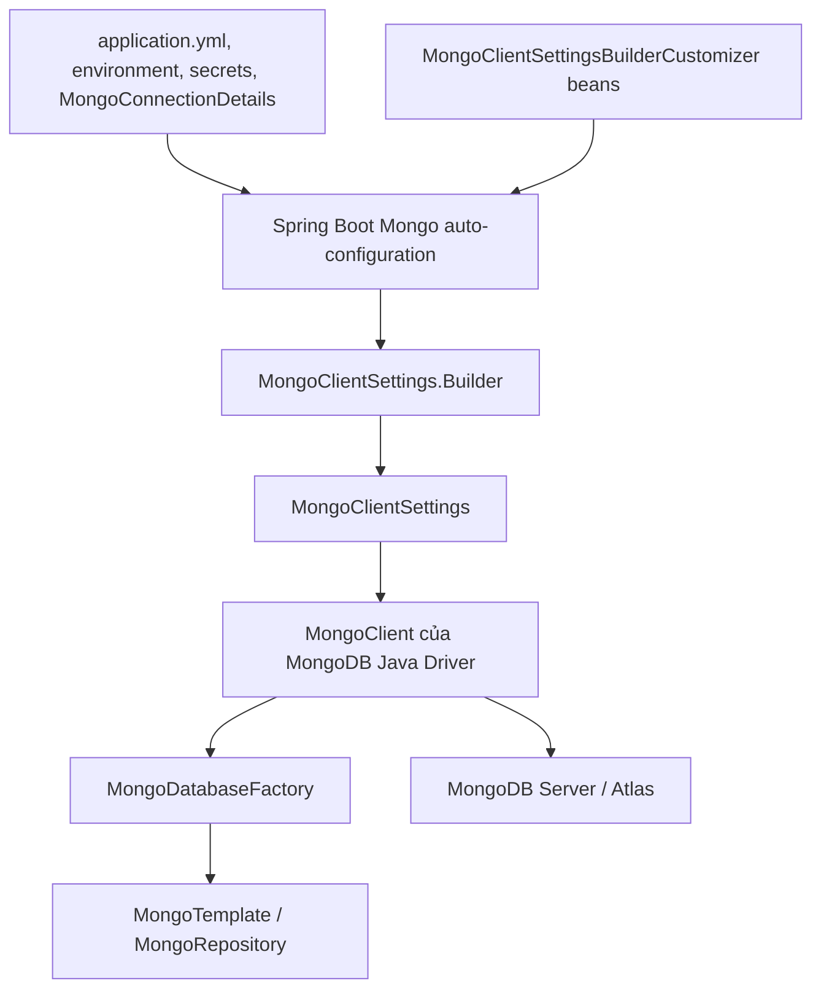
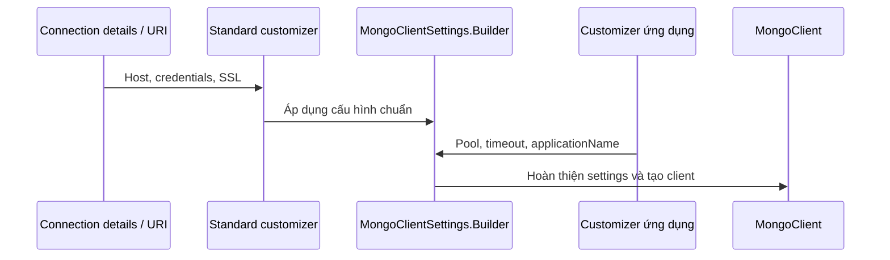

# MongoClientSettingsBuilderCustomizer và thiết lập driver

Trong ứng dụng **Spring Data MongoDB**, Spring Boot có thể tự cấu hình `MongoClient`, `MongoDatabaseFactory`, `MongoTemplate` và repository. Tuy nhiên, “kết nối tới MongoDB” mới là phần đầu của câu chuyện. MongoDB Java Driver còn quyết định cách tạo connection pool, chờ chọn server, áp dụng timeout, retry, TLS, read/write concern và ghi nhận sự kiện để chẩn đoán.

Bài này thuộc chương **Cấu hình và kiến trúc** của module `SPRING_DATA_MONGODB`. Bạn sẽ học cách dùng `MongoClientSettingsBuilderCustomizer` để tinh chỉnh driver trong hệ thống đã dùng Spring Boot, giữ tính nhất quán với cấu hình kết nối, và xác minh hành vi khi thao tác document qua `MongoTemplate` hoặc `MongoRepository`. Các kỹ thuật cũng liên quan đến aggregation, index, transaction, reactive access, kiểm thử và phân tích hiệu năng.

**Mục tiêu:** hiểu điểm mở rộng của Spring Boot, biết viết và kiểm tra một cấu hình driver có chủ đích. Các con số trong ví dụ minh họa cơ chế, không phải cấu hình mặc định tốt nhất cho mọi ứng dụng.

## 1. Mục tiêu học tập

Sau khi hoàn thành, bạn có thể:

1. Phân biệt `MongoClientSettings.Builder`, `MongoClientSettings`, `MongoClientSettingsBuilderCustomizer` và `MongoClient`.
2. Viết bean customizer cho **Spring Boot 3.5** hoặc **Spring Boot 4.x** với đúng import.
3. Cấu hình và đánh giá pool, timeout, server selection, application name, retry và read/write concern.
4. Phân biệt thông số trong connection string với Java customizer, giải quyết xung đột thứ tự áp dụng.
5. Giải thích điều gì thay đổi khi tự tạo bean `MongoClient` hoặc có nhiều client.
6. Kiểm thử cài đặt với unit test và integration test, quan sát metrics để điều chỉnh bằng số liệu.

## 2. Điểm mở rộng nằm ở đâu trong kiến trúc?



Sơ đồ mô tả luồng imperative. Với reactive, Spring Boot dùng reactive MongoDB client/factory và API tương ứng; cách đánh giá settings vẫn dựa trên driver và topology nhưng execution model khác.

| Thành phần | Trách nhiệm |
| --- | --- |
| `MongoClientSettings.Builder` | Tích lũy các thiết lập cho driver trước khi tạo đối tượng settings bất biến. |
| `MongoClientSettings` | Object giữ các cài đặt đã hoàn thiện: pool, socket, cluster, TLS, concern, listener... |
| `MongoClientSettingsBuilderCustomizer` | Functional interface của **Spring Boot**, có callback `customize(MongoClientSettings.Builder)` để bổ sung/cập nhật settings lúc khởi tạo. |
| `MongoClient` | Client do driver tạo; quản lý pool, topology, gửi lệnh đến MongoDB. Thường được dùng lại xuyên suốt vòng đời ứng dụng. |
| `MongoDatabaseFactory` | Cầu nối giữa MongoDB driver và Spring Data. |
| `MongoTemplate` / repository | API thao tác document, query, aggregation và CRUD; dùng client ở lớp dưới. |

### Vì sao dùng customizer?

Với dự án dùng `spring-boot-starter-data-mongodb`, cấu hình tự động đã quản lý việc ghép driver, URI, connection details và lifecycle. Đăng ký thêm customizer giúp thay đổi những thông số cần thiết **mà không phải tự xây `MongoClient`** và lặp lại toàn bộ cấu hình. Đây là hướng phù hợp khi bạn chỉ cần giới hạn pool, đặt timeout hoặc cung cấp application name.

Nếu ứng dụng cần **hai cluster độc lập**, nhiều client có credential khác nhau hoặc lifecycle đặc biệt, bạn có thể phải tự định nghĩa client/factory. Khi đó cần tự quản lý cấu hình tương ứng, connection pools và tích hợp metrics/transaction cho từng client.

## 3. Đúng import trong Spring Boot 3.5 và 4.x

Tên `MongoClientSettingsBuilderCustomizer` không đổi, nhưng package chuyển trong Spring Boot 4:

| Dòng Spring Boot | Import interface | Connection URI |
| --- | --- | --- |
| **3.5.x** | `org.springframework.boot.autoconfigure.mongo.MongoClientSettingsBuilderCustomizer` | `spring.data.mongodb.uri` |
| **4.0/4.1.x** | `org.springframework.boot.mongodb.autoconfigure.MongoClientSettingsBuilderCustomizer` | `spring.mongodb.uri` |

API MongoDB Driver dùng `com.mongodb.MongoClientSettings`; đừng nhầm interface customizer của **Spring Boot** với các class của driver. Khi copy mã từ tài liệu nhánh khác, lỗi thường gặp là import không tồn tại hoặc cấu hình URI không được nhận.

Ví dụ Maven (để Spring Boot BOM quản lý driver):

```xml
<dependencies>
    <dependency>
        <groupId>org.springframework.boot</groupId>
        <artifactId>spring-boot-starter-data-mongodb</artifactId>
    </dependency>
    <dependency>
        <groupId>org.springframework.boot</groupId>
        <artifactId>spring-boot-starter-test</artifactId>
        <scope>test</scope>
    </dependency>
</dependencies>
```

Không tự thêm version cho `mongodb-driver-sync`, `mongodb-driver-core` hoặc `bson` nếu chưa có lý do rõ ràng. BOM giúp các module driver đồng bộ. Đọc dependency tree để xem phiên bản cuối cùng được giải quyết.

## 4. Ví dụ hoàn chỉnh: tinh chỉnh MongoDB Java Driver

Giả sử ứng dụng `inventory-api` kết nối đến MongoDB local dùng cho bài học. Với **Spring Boot 4.x**, cấu hình cơ sở:

```yaml
# src/main/resources/application.yml
spring:
  application:
    name: inventory-api
  mongodb:
    uri: "mongodb://localhost:27017/inventory_lab"
```

Nếu dùng **Boot 3.5**, thay bằng:

```yaml
spring:
  data:
    mongodb:
      uri: "mongodb://localhost:27017/inventory_lab"
```

Trong môi trường có xác thực, đặt URI trong secret manager hoặc biến môi trường:

```yaml
spring:
  mongodb:
    uri: "${MONGODB_URI}"
```

### 4.1. Tạo bean MongoClientSettingsBuilderCustomizer

Ví dụ sau được viết cho **Spring Boot 4.x**:

```java
package dev.learning.inventory.config;

import java.util.concurrent.TimeUnit;

import org.springframework.boot.mongodb.autoconfigure.MongoClientSettingsBuilderCustomizer;
import org.springframework.context.annotation.Bean;
import org.springframework.context.annotation.Configuration;
import org.springframework.core.annotation.Order;

@Configuration(proxyBeanMethods = false)
public class MongoDriverConfiguration {

    @Bean
    @Order(100)
    MongoClientSettingsBuilderCustomizer mongoClientTuning() {
        return settings -> {
            // Hữu ích khi xem log và profiler phía MongoDB.
            settings.applicationName("inventory-api");

            // Pool được tạo theo từng server của topology.
            settings.applyToConnectionPoolSettings(pool -> pool
                    .maxSize(60)
                    .minSize(5)
                    .maxConnectionIdleTime(60, TimeUnit.SECONDS));

            // Chờ tìm server phù hợp trong cluster.
            settings.applyToClusterSettings(cluster ->
                    cluster.serverSelectionTimeout(5, TimeUnit.SECONDS));

            // Giới hạn lúc mở một TCP connection.
            settings.applyToSocketSettings(socket ->
                    socket.connectTimeout(3, TimeUnit.SECONDS));
        };
    }
}
```

**Điều xảy ra khi ứng dụng khởi động:**

1. Spring Boot thu thập các bean `MongoClientSettingsBuilderCustomizer`.
2. Boot áp dụng thông tin kết nối chuẩn và gọi từng callback theo thứ tự.
3. Builder được chuyển thành `MongoClientSettings` để tạo driver client.
4. `MongoTemplate` và repository dùng client vừa được cấu hình.

`@Order(100)` diễn tả ý định customizer ứng dụng chạy sau những customizer có thứ tự nhỏ hơn. Standard customizer của Boot triển khai `Ordered` và thường cung cấp URI/connection details. Nếu hai callback cùng thay một giá trị, callback chạy sau có thể quyết định giá trị cuối. Vì thế cần kiểm tra thứ tự nếu muốn **ghi đè** thiết lập từ URI.

### 4.2. Cùng ví dụ với Spring Boot 3.5

Đổi import:

```java
// Spring Boot 3.5.x:
import org.springframework.boot.autoconfigure.mongo.MongoClientSettingsBuilderCustomizer;
```

Những lời gọi builder như `applicationName`, `applyToConnectionPoolSettings` và `applyToSocketSettings` là API của Java Driver; hãy đối chiếu với đúng phiên bản driver do Spring Boot BOM kéo vào khi sử dụng API nâng cao.

### 4.3. Dùng tiếp MongoTemplate và repository

Customizer thuộc tầng **driver** và không yêu cầu thay đổi mã tầng repository:

```java
import org.springframework.data.mongodb.core.MongoTemplate;
import org.springframework.stereotype.Service;

@Service
public class InventoryDiagnostics {
    private final MongoTemplate template;

    public InventoryDiagnostics(MongoTemplate template) {
        this.template = template;
    }

    public boolean ping() {
        return template.executeCommand("{ ping: 1 }")
                .getDouble("ok") == 1.0;
    }
}
```

Khi client do Boot cấu hình đang được sử dụng, các query của repository, update của `MongoTemplate` và aggregation đều hoạt động qua cấu hình driver tương ứng.

## 5. URI, MongoConnectionDetails và thứ tự customizer

Spring Boot có thể lấy endpoint và credential từ `spring.mongodb.*` (Boot 4) hoặc `spring.data.mongodb.*` (Boot 3.5), nhưng cũng có thể dùng `MongoConnectionDetails` được cung cấp từ cơ chế khác, ví dụ service connection. Sau đó, `StandardMongoClientSettingsBuilderCustomizer` áp dụng connection string và những thiết lập chuẩn lên builder.



Các nguồn cấu hình thường gặp:

| Nguồn | Phù hợp với |
| --- | --- |
| **URI** | Host, port, replica set, username, authentication database, nhiều option như `maxPoolSize`. |
| **Application properties** | Cấu hình theo môi trường, tích hợp với Spring Boot và secret management. |
| **MongoConnectionDetails** | Cung cấp connection details qua service binding hoặc integration khác. |
| **Builder customizer** | Thiết lập driver bằng Java, policy nhất quán, listener hoặc option phức tạp. |
| **Bean MongoClientSettings** | Chủ động đưa vào settings ban đầu; phải hiểu thay đổi trong auto-configuration. |
| **Bean MongoClient tự tạo** | Kiểm soát toàn bộ client; tự chịu trách nhiệm về cấu hình và lifecycle. |

### Ví dụ cấu hình bị ghi đè

```yaml
spring:
  mongodb:
    uri: "mongodb://localhost:27017/inventory_lab?maxPoolSize=100"
```

Nếu customizer của bạn chạy **sau** lúc connection string được áp dụng và gọi `pool.maxSize(60)`, giá trị cuối của pool là 60. Nếu thứ tự đảo ngược, connection string có thể ghi đè thành 100. Để dễ vận hành, hãy chọn **một nguồn chuẩn** cho mỗi nhóm setting và tránh khai báo trùng ở nhiều tầng.

### Khi tự khai báo MongoClient

Ví dụ:

```java
@Bean
com.mongodb.client.MongoClient customClient() {
    return com.mongodb.client.MongoClients.create(
            "mongodb://localhost:27017/inventory_lab");
}
```

Đây là **cách tạo client thủ công minh họa**, không đặt đồng thời trong ứng dụng mẫu phía trên. Khi tự tạo bean `MongoClient`, Spring Boot thường không cần tạo client mặc định; callback customizer được dùng trong quy trình tạo client mặc định **không tự được gọi** khi bạn trực tiếp chạy `MongoClients.create(...)`. Bạn phải bảo đảm URI, settings, metrics, SSL và việc đóng client được xử lý đúng.

Tương tự, nếu tự tạo `MongoClientSettings` bean, hãy kiểm tra tài liệu nhánh Boot đang dùng: các property chuẩn có thể không được áp dụng theo cùng đường tự cấu hình ban đầu, dù builder customizer vẫn có thể tham gia khi Boot tạo client.

## 6. Connection pool: thông số và ảnh hưởng thật

Một `MongoClient` tạo pool kết nối cho **từng MongoDB server** mà nó tương tác. Driver còn mở connection phục vụ giám sát topology. Vì vậy, `maxSize(60)` có nghĩa là **giới hạn mỗi pool**, không phải tổng số socket tuyệt đối của toàn ứng dụng.

| API trong `ConnectionPoolSettings.Builder` | Ý nghĩa | Nếu cấu hình không phù hợp |
| --- | --- | --- |
| `maxSize(n)` | Trần số kết nối của pool đến một server | Quá nhỏ có thể gây chờ; quá lớn tăng socket và áp lực server. |
| `minSize(n)` | Mức connection tối thiểu cần duy trì | Quá cao gây nhiều connection nhàn rỗi. |
| `maxConnecting(n)` | Số connection đang được tạo đồng thời | Quá thấp làm warm-up chậm, quá cao tạo bão kết nối. |
| `maxConnectionIdleTime(t, unit)` | Tuổi nhàn rỗi tối đa | Quá thấp làm tăng chi phí mở kết nối; quá cao có thể va timeout mạng. |
| `maxConnectionLifeTime(t, unit)` | Tuổi thọ tối đa | Thời gian ngắn làm tăng reconnect. |
| `maxWaitTime(t, unit)` | Thời gian chờ lấy connection trong các phiên bản hỗ trợ | API/URI option có thể bị deprecated trong driver mới; cần xem cơ chế timeout cấp client đúng phiên bản. |

Ví dụ thay đổi một số thông số pool:

```java
settings.applyToConnectionPoolSettings(pool -> pool
        .maxSize(80)
        .minSize(5)
        .maxConnecting(4)
        .maxConnectionIdleTime(2, TimeUnit.MINUTES));
```

Không nên bắt đầu bằng tăng `maxSize` lên rất lớn. Pool cần được chọn dựa trên số request đồng thời, độ dài transaction, số instance ứng dụng, số server MongoDB và khả năng server thực tế.

### Ví dụ tính ngân sách kết nối

Giả sử có **4 instance ứng dụng**, mỗi instance dùng một `MongoClient`, và client có thể mở pool đến **3 server** trong replica set. Với `maxSize=60`, số kết nối tác vụ có thể đạt **4 × 3 × 60 = 720** khi mọi pool đều mở đến tối đa, chưa kể socket giám sát. Đây là **trần lý thuyết**, không phải lượng connection luôn mở.

Khi scale lên nhiều replica của ứng dụng, ngân sách connection tăng tương ứng. Quan sát cả giới hạn trên MongoDB cluster, proxy, firewall, số lượng connection đang dùng và mức chờ lấy connection.

## 7. Timeout: hiểu đúng giai đoạn bị chặn

MongoDB Driver có nhiều timeout; đặt tất cả cùng một số có thể khiến chẩn đoán khó hơn.

| Tình huống | API tương ứng | Giải thích |
| --- | --- | --- |
| **Chọn server** | `applyToClusterSettings(c -> c.serverSelectionTimeout(...))` | Chờ tìm node đáp ứng read preference và topology. |
| **Kết nối TCP** | `applyToSocketSettings(s -> s.connectTimeout(...))` | Chờ mở một TCP socket tới host. |
| **Đọc từ socket** | `applyToSocketSettings(s -> s.readTimeout(...))` | Chờ dữ liệu trên socket; quá thấp có thể cắt tác vụ hợp lệ. |
| **Chờ lấy connection pool** | `maxWaitTime` hoặc client-level timeout tùy dòng driver | Chờ connection khả dụng khi pool bị dùng hết. |
| **Giới hạn xử lý tại server** | `maxTimeMS` trên query/command hỗ trợ | Giới hạn thời gian chạy lệnh trên server; không tương đương tất cả timeout phía client. |

Ví dụ:

```java
settings.applyToClusterSettings(c ->
        c.serverSelectionTimeout(5, TimeUnit.SECONDS));
settings.applyToSocketSettings(s -> {
    s.connectTimeout(3, TimeUnit.SECONDS);
    s.readTimeout(20, TimeUnit.SECONDS);
});
```

Nếu `MongoTimeoutException` nói không tìm được primary, cần kiểm tra network, replica set, read preference và trạng thái cluster. Nếu pool đầy thì điều chỉnh timeout server selection có thể không giải quyết nguyên nhân. Với aggregation chậm, nên kiểm tra `explain`, index và độ phức tạp query trước khi tăng timeout.

## 8. Read preference, read concern, write concern và retry

Ngoài pool, builder có thể đặt policy dữ liệu cho client:

```java
import com.mongodb.ReadConcern;
import com.mongodb.ReadPreference;
import com.mongodb.WriteConcern;

// Nội dung bên trong lambda: settings -> { ... }
settings.readPreference(ReadPreference.primary());
settings.readConcern(ReadConcern.MAJORITY);
settings.writeConcern(WriteConcern.MAJORITY);
settings.retryReads(true);
settings.retryWrites(true);
```

| Tùy chọn | Tác dụng | Cân nhắc |
| --- | --- | --- |
| `ReadPreference.primary()` | Ưu tiên primary khi đọc | Phù hợp khi ứng dụng cần dữ liệu mới; có thể tăng tải primary. |
| `ReadPreference.secondaryPreferred()` | Cho phép ưu tiên secondary | Có thể đọc dữ liệu trễ do replication lag. |
| `ReadConcern.MAJORITY` | Yêu cầu mức read concern majority | Không tự biến nhiều truy vấn thành snapshot hoặc serializable transaction. |
| `WriteConcern.MAJORITY` | Xác nhận ghi theo quy tắc majority | Có thể tăng latency, nhưng có giá trị khi cần độ an toàn cao hơn qua failover. |
| `retryReads(true)` | Driver tự thử lại những lệnh đọc đủ điều kiện | Không chữa mọi lỗi mạng hoặc lỗi server. |
| `retryWrites(true)` | Driver tự thử lại những lệnh ghi đủ điều kiện | Không thay thế idempotency khi client HTTP gửi lại một yêu cầu nghiệp vụ. |

Không buộc toàn bộ ứng dụng dùng read/write concern giống nhau nếu mỗi luồng nghiệp vụ có yêu cầu khác nhau. Có thể thiết lập ở cấp collection/operation/session phù hợp.

**Cần nhớ:** driver retry chỉ hoạt động trong điều kiện được hỗ trợ. Giao dịch tiền, tạo đơn và đặt trước hàng hóa vẫn cần idempotency key, kiểm tra kết quả và chiến lược retry của nghiệp vụ.

### Customizer có tự bật transaction?

Không. Transaction nhiều document cần MongoDB deployment hỗ trợ (replica set hoặc sharded cluster phù hợp), transaction manager của Spring Data và ngữ cảnh transaction đúng. `MongoClientSettingsBuilderCustomizer` cấu hình driver chứ không tạo ra ranh giới `@Transactional`. Với reactive, cần reactive transaction manager và reactive context.

## 9. TLS, chứng chỉ và bảo vệ bí mật

Trong production, ưu tiên quản lý mật khẩu ngoài mã nguồn và TLS bằng cấu hình Spring Boot phù hợp. Ví dụ Boot 4:

```yaml
spring:
  mongodb:
    uri: "${MONGODB_URI}"
    ssl:
      enabled: true
```

Nếu dùng Spring Boot SSL bundle đã được định nghĩa trong dự án:

```yaml
spring:
  mongodb:
    uri: "${MONGODB_URI}"
    ssl:
      bundle: mongo-client
```

`mongo-client` là tên bundle do hệ thống cấu hình thực tế cung cấp; mẫu trên chưa đủ nếu bạn chưa đăng ký chứng chỉ và truststore cho bundle. Với Boot 3.5, đối chiếu property `spring.data.mongodb.ssl.*` theo đúng nhánh.

Driver cũng có API:

```java
settings.applyToSslSettings(ssl -> ssl.enabled(true));
```

Lệnh chỉ bật SSL/TLS; nó **không tự xử lý truststore, CA, hostname verification hoặc certificate phía client**. Không dùng `invalidHostNameAllowed(true)` để bỏ qua lỗi certificate trong môi trường thực. Nếu dùng `mongodb+srv://`, kiểm tra thêm DNS SRV/TXT và chính sách mạng/TLS của cluster.

Connection string có thể chứa credential; tránh in URI đầy đủ vào log. Với password có ký tự đặc biệt, encode đúng cú pháp URI.

## 10. Metrics và chẩn đoán hiệu năng MongoDB Driver

Khi sử dụng Spring Boot Actuator/Micrometer với auto-configured MongoDB client, Boot có thể gắn các listener và xuất metric cho command và connection pool.

| Metric | Diễn giải |
| --- | --- |
| `mongodb.driver.commands` | Thời gian và trạng thái các command được driver thực thi. |
| `mongodb.driver.pool.size` | Tổng số connection pool đang duy trì, gồm idle và in-use. |
| `mongodb.driver.pool.checkedout` | Số connection đang được mượn. |
| `mongodb.driver.pool.waitqueuesize` | Số request đang chờ connection trong pool. |

Ví dụ cách đọc số liệu:

- `checkedout` tăng sát mức pool size và wait queue lớn kéo dài: có thể là pool saturation hoặc lệnh giữ connection quá lâu.
- Pool rất ít connection được dùng nhưng mở nhiều: xem lại min pool và số replica ứng dụng.
- Command latency tăng trong khi pool ít phải chờ: kiểm tra index, query, server CPU, I/O và network.
- Mất metric sau khi tự tạo `MongoClient`: kiểm tra các listener có còn được gắn với client hay không.

Dùng `applicationName("inventory-api")` để nhận diện service trong server logs, profiler và các công cụ quan sát. Không tạo tên ngẫu nhiên theo từng request, vì điều đó làm tăng cardinality và khó tổng hợp.

Nếu cần thêm `CommandListener`, cân nhắc overhead và bảo vệ dữ liệu: log mọi command đầy đủ có thể làm lộ thông tin nhạy cảm.

## 11. Imperative và reactive: cấu hình đúng client đang dùng

| Nội dung | Imperative | Reactive |
| --- | --- | --- |
| Starter | `spring-boot-starter-data-mongodb` | `spring-boot-starter-data-mongodb-reactive` |
| Driver client | `com.mongodb.client.MongoClient` | `com.mongodb.reactivestreams.client.MongoClient` |
| Template | `MongoTemplate` | `ReactiveMongoTemplate` |
| Repository | `MongoRepository` | `ReactiveMongoRepository` |
| Transaction manager | `MongoTransactionManager` | `ReactiveMongoTransactionManager` |
| Kết quả | Giá trị/list đồng bộ | `Mono` / `Flux` |

Trong cấu hình tự động tương ứng, Spring Boot có thể áp dụng các builder customizer khi xây client. Nếu ứng dụng trộn starter imperative và reactive, hãy xác định client/factory nào thực sự được sử dụng, thứ tự cấu hình và metrics nào thuộc client nào.

Reactive API không tự làm code blocking trở thành non-blocking. Tránh gọi `MongoTemplate` blocking trực tiếp trên event loop khi xây dựng reactive pipeline.

## 12. Kiểm thử cấu hình

Nên tách hai mức: **kiểm tra builder** và **kiểm tra ứng dụng kết nối thật**.

### 12.1. Unit test không cần MongoDB

Vì customizer là callback lên builder, có thể kiểm tra giá trị của settings cuối cùng:

```java
package dev.learning.inventory.config;

import static org.junit.jupiter.api.Assertions.assertEquals;

import com.mongodb.MongoClientSettings;
import java.util.concurrent.TimeUnit;
import org.junit.jupiter.api.Test;

class MongoDriverConfigurationTest {

    @Test
    void appliesExpectedDriverSettings() {
        var customizer =
                new MongoDriverConfiguration().mongoClientTuning();

        var builder = MongoClientSettings.builder();
        customizer.customize(builder);
        var settings = builder.build();

        assertEquals("inventory-api", settings.getApplicationName());
        assertEquals(60, settings.getConnectionPoolSettings().getMaxSize());
        assertEquals(5, settings.getConnectionPoolSettings().getMinSize());
        assertEquals(5_000L,
                settings.getClusterSettings()
                        .getServerSelectionTimeout(TimeUnit.MILLISECONDS));
    }
}
```

Kiểm thử này chỉ chứng minh **một customizer** chạy đúng. Nó không chứng minh các customizer khác của Boot được gọi theo đúng thứ tự hay server có thể truy cập.

### 12.2. Integration test có MongoDB thật

```java
package dev.learning.inventory.config;

import static org.junit.jupiter.api.Assertions.assertEquals;

import org.bson.Document;
import org.junit.jupiter.api.Test;
import org.springframework.beans.factory.annotation.Autowired;
import org.springframework.boot.test.context.SpringBootTest;
import org.springframework.data.mongodb.core.MongoTemplate;

@SpringBootTest
class MongoConnectionIntegrationTest {

    @Autowired
    MongoTemplate mongoTemplate;

    @Test
    void pingsConfiguredServer() {
        Document result = mongoTemplate.executeCommand("{ ping: 1 }");
        assertEquals(1.0, result.getDouble("ok"));
    }
}
```

Test giả định ứng dụng có MongoDB test được cấu hình bằng URI riêng hoặc Testcontainers. `ping` cho biết client có thể trao đổi với server, **không chứng minh** pool size, TLS policy và retry đã được cấu hình như mong muốn. Để kiểm chứng pool, cần quan sát metrics và chạy thử tải có kiểm soát.

Khi test transaction, dùng replica set hoặc topology hỗ trợ transaction. Khi test query và aggregation, chạy trên server version tương ứng môi trường mục tiêu.

### 12.3. Kiểm tra xung đột thứ tự áp dụng

Thêm một test với hai customizer cùng thay `maxSize` rồi áp dụng theo thứ tự giả lập để hiểu hiệu ứng ghi đè. Sau đó kiểm tra integration bằng cách cấp URI có `maxPoolSize` và xác minh hành vi. Đối với kiểm thử đầy đủ, điều quan trọng là **giá trị client đang sử dụng**, không chỉ giá trị bean builder khi đứng một mình.

## 13. Lỗi thường gặp và cách điều tra

| Lỗi / triệu chứng | Nguyên nhân khả dĩ | Cách xử lý |
| --- | --- | --- |
| Không import được `MongoClientSettingsBuilderCustomizer` | Dùng package của nhánh Boot khác | Chọn import theo Boot 3.5 hoặc 4.x; kiểm tra BOM. |
| Customizer không có hiệu lực | Đã tự tạo bean `MongoClient` hoặc có customizer chạy sau | Kiểm tra auto-configuration, loại bean và `@Order`. |
| Connection pool chờ lâu | Quá nhiều concurrent operations, pool nhỏ, lệnh chậm | Đọc metrics pool/latency, cải thiện query và xác định mức pool phù hợp. |
| `MongoTimeoutException` khi chọn server | Sai topology/URI, DNS, network hoặc read preference | Kiểm tra server selection diagnostics và trạng thái replica set. |
| `MongoSocketOpenException` | Không mở được kết nối TCP | Kiểm tra host, port, firewall và connect timeout. |
| SSL handshake failure | Truststore, certificate hoặc hostname không hợp lệ | Cấu hình CA/truststore, SSL bundle và DNS đúng. |
| Authentication failed | Sai credential hoặc `authSource` | Xác thực user và database xác thực; không log password. |
| Đọc dữ liệu thứ cấp bị trễ | Read preference secondary và replication lag | Cân nhắc primary cho nghiệp vụ cần read-after-write. |
| Retry dẫn tới thao tác trùng ở cấp nghiệp vụ | Không có idempotency cho request ứng dụng | Thiết kế request ID, unique constraint và xử lý kết quả retry. |
| Actuator không có Mongo metrics | Client không qua đường instrumented hoặc thiếu dependencies | Kiểm tra Actuator/Micrometer và listener của client. |

Quy trình điều tra nên là: xác nhận version → xác nhận client bean được dùng → kiểm tra URI/connection details → kiểm tra customizer và thứ tự → `ping` → quan sát pool/command latency → thay đổi từng nhóm tham số và đo lại.

## 14. Bài tập thực hành

**Bài 1 — Pool phục vụ ứng dụng đặt hàng.** Tạo bean customizer với `applicationName("order-api")`, `maxSize(40)`, `minSize(2)`, `maxConnecting(3)`. Viết unit test xác nhận settings và giải thích vì sao hai instance có thể mở hơn 80 socket khi kết nối đến nhiều server.

**Bài 2 — Xung đột cấu hình.** URI có `maxPoolSize=100`, customizer gọi `maxSize(50)`. Mô tả các trường hợp thứ tự áp dụng và cách sửa để có một nguồn chân lý rõ ràng.

**Bài 3 — Timeout.** Phân biệt ba tình huống: không có primary, pool hết connection và aggregation chạy lâu. Chọn chỉ số/loại timeout cần xem trước khi đổi cấu hình.

**Bài 4 — Migration.** Chuyển Boot 3.5 sang Boot 4.x, sửa import của interface và property URI. Giải thích vì sao sau migration phải kiểm tra lại bean auto-configuration và integration test.

**Bài 5 — Đo hiệu năng.** Dùng tải thử tương đương sản xuất, chạy ba mức `maxSize` 20/40/80. Ghi p95 latency, pool checkedout, wait queue và command latency; chọn mức có bằng chứng tối ưu chứ không mặc định chọn số lớn nhất.

### Gợi ý tự đánh giá

- Pool là giới hạn **theo server** và mỗi `MongoClient` có thể sở hữu nhiều pool.
- Thứ tự callback quyết định khi nhiều customizer ghi cùng một trường.
- Server selection, TCP connect, checkout pool và thời gian chạy query là các giai đoạn riêng.
- Driver retry không thay thế idempotency của nghiệp vụ.
- Integration test cần MongoDB thật và phù hợp topology khi test transaction.

## 15. Checklist đưa cấu hình vào ứng dụng

- [ ] Dùng đúng nhánh Spring Boot, import customizer và các module MongoDB Driver do BOM quản lý.
- [ ] Ghi rõ URI, nguồn connection details và secret management.
- [ ] Xác định một nơi quản lý chính cho mỗi nhóm option.
- [ ] Ưu tiên `MongoClient` singleton do Spring Boot quản lý khi không có yêu cầu đặc biệt.
- [ ] Chỉ tăng pool/timeout dựa trên số liệu và điều kiện tải thực tế.
- [ ] Cấu hình TLS, CA, certificate và hostname verification an toàn.
- [ ] Chọn read/write concern, read preference và retry theo bất biến nghiệp vụ.
- [ ] Đo MongoDB command/pool metrics và rà soát listener khi tự tạo client.
- [ ] Unit test cài đặt builder, integration test ping/CRUD và kiểm thử transaction nếu có.
- [ ] Có hồ sơ cấu hình theo môi trường để review khi nâng cấp Boot/driver.

## 16. Nguồn tài liệu chính thức

1. [Spring Boot 4.1 — Working with NoSQL Technologies](https://docs.spring.io/spring-boot/4.1/reference/data/nosql.html): MongoDB auto-configuration và builder customizer.
2. [Spring Boot 4.1 — MongoClientSettingsBuilderCustomizer API](https://docs.spring.io/spring-boot/4.1/api/java/org/springframework/boot/mongodb/autoconfigure/MongoClientSettingsBuilderCustomizer.html).
3. [Spring Boot 3.5 — MongoClientSettingsBuilderCustomizer API](https://docs.spring.io/spring-boot/3.5/api/java/org/springframework/boot/autoconfigure/mongo/MongoClientSettingsBuilderCustomizer.html).
4. [Spring Boot 4.1 — StandardMongoClientSettingsBuilderCustomizer API](https://docs.spring.io/spring-boot/4.1/api/java/org/springframework/boot/mongodb/autoconfigure/StandardMongoClientSettingsBuilderCustomizer.html).
5. [MongoDB Java Sync Driver — Connection Pools](https://www.mongodb.com/docs/drivers/java/sync/current/connection/specify-connection-options/connection-pools/).
6. [MongoDB Java Sync Driver — Socket Settings](https://www.mongodb.com/docs/drivers/java/sync/current/connection/specify-connection-options/socket-settings/).
7. [MongoDB Java Sync Driver — Client-Level CRUD Settings](https://www.mongodb.com/docs/drivers/java/sync/current/connection/specify-connection-options/configure-crud/).
8. [Spring Boot 4.1 — MongoDB Metrics](https://docs.spring.io/spring-boot/4.1/reference/actuator/metrics.html).
9. [MongoDB Manual — Connection String Options](https://www.mongodb.com/docs/manual/reference/connection-string-options/).

**Tổng kết:** `MongoClientSettingsBuilderCustomizer` là điểm mở rộng thuận tiện khi Spring Boot quản lý MongoDB client. Thiết lập driver nên dựa trên yêu cầu nhất quán, bảo mật, hiệu năng và mức tải; kết quả phải được xác minh với ứng dụng và MongoDB Server thật.
