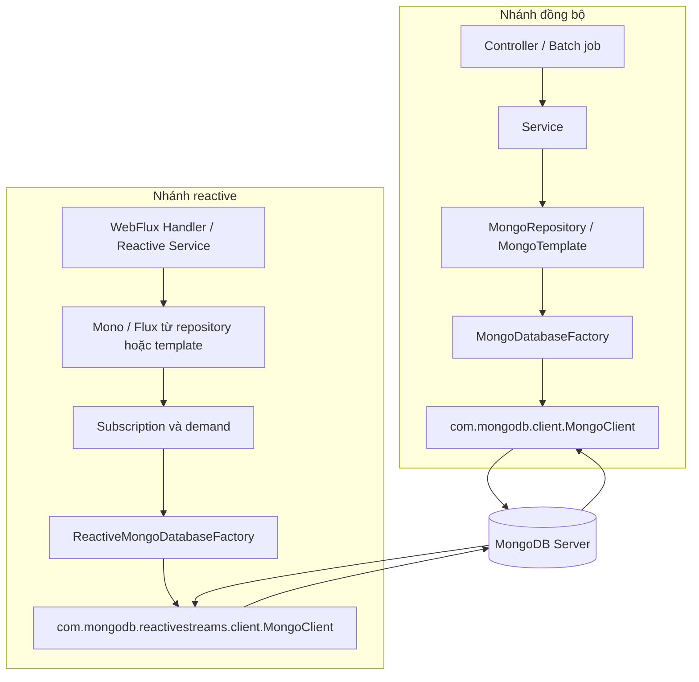
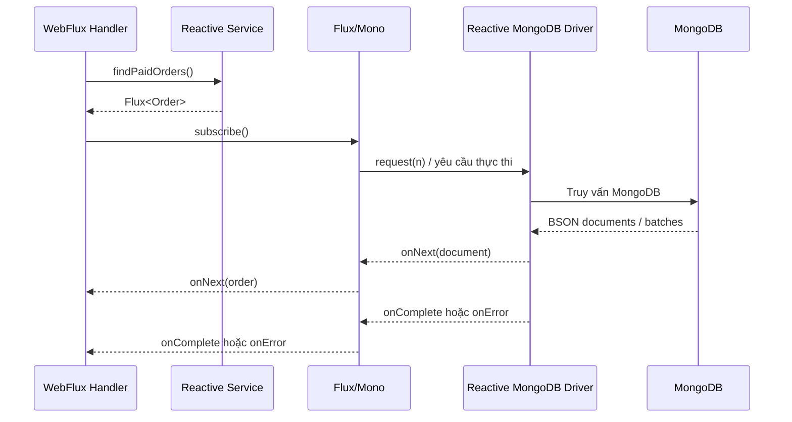

# Phân biệt MongoClient đồng bộ với reactive MongoClient

Trong Spring Data MongoDB, cả cách truy cập **đồng bộ (synchronous/blocking)** lẫn **reactive (non-blocking, Reactive Streams)** đều nói chuyện với cùng một MongoDB Server, cùng sử dụng collection, BSON document, index và aggregation. Điểm khác biệt nằm ở **API driver**, **cách thực thi I/O**, **kiểu kết quả**, **vòng đời của truy vấn** và **cách tích hợp với luồng xử lý request của ứng dụng Java**.

Tên `MongoClient` dễ gây nhầm lẫn vì hai driver đều định nghĩa một lớp/interface cùng tên. Tuy nhiên, chúng ở **hai package khác nhau**:

- Đồng bộ: `com.mongodb.client.MongoClient`, tạo bằng `com.mongodb.client.MongoClients.create(...)`.
- Reactive Streams: `com.mongodb.reactivestreams.client.MongoClient`, tạo bằng `com.mongodb.reactivestreams.client.MongoClients.create(...)`.

**Mục tiêu bài học:** nhận biết đúng loại client, đi theo luồng từ service đến MongoDB và kết quả trả về, cấu hình đúng với `MongoTemplate` hoặc `ReactiveMongoTemplate`, chọn mô hình phù hợp và tránh những lỗi như gọi `block()` trong WebFlux, dùng driver đồng bộ dưới vỏ bọc `Flux`, hoặc đóng client trước khi reactive publisher được subscribe.

## 1. Sự khác nhau trong một bảng

| Khía cạnh | MongoClient đồng bộ | Reactive MongoClient |
| --- | --- | --- |
| Kiểu Java | `com.mongodb.client.MongoClient` | `com.mongodb.reactivestreams.client.MongoClient` |
| Driver dependency | `mongodb-driver-sync` | `mongodb-driver-reactivestreams` |
| Cách gọi I/O | Phần đọc/ghi có thể **chặn thread gọi** cho đến khi nhận kết quả hoặc lỗi | Thao tác trả `Publisher<T>`, thực thi theo subscription và phát tín hiệu bất đồng bộ |
| Đọc nhiều document ở mức driver | `FindIterable<T>`, `MongoCursor<T>` | `FindPublisher<T>` (Reactive Streams) |
| Đọc một document qua Spring Data | Thường trả đối tượng, `Optional<T>` hoặc `null` tùy API | `Mono<T>` |
| Đọc nhiều document qua Spring Data | `List<T>`, `Stream<T>` hoặc kiểu đồng bộ tương ứng | `Flux<T>` |
| Spring Data operations | `MongoTemplate` / `MongoOperations` | `ReactiveMongoTemplate` / `ReactiveMongoOperations` |
| Repository | `MongoRepository<T, ID>` | `ReactiveMongoRepository<T, ID>` |
| Kết nối với web stack | Spring MVC, batch job, tác vụ đồng bộ | Spring WebFlux hoặc chuỗi reactive hoàn chỉnh |
| Xử lý lỗi | Exception tại thời điểm thao tác thực thi | Tín hiệu `onError` của publisher |
| Kiểm soát tốc độ tiêu thụ | Iterator, phân trang, cursor và xử lý đồng bộ | Reactive Streams `request(n)`, các toán tử Reactor |
| Transaction Spring Data | `MongoTransactionManager` | `ReactiveMongoTransactionManager` |

Reactive **không có nghĩa MongoDB tự chạy truy vấn nhanh hơn**. Lợi ích chính là tránh giữ một thread ứng dụng ở trạng thái chờ I/O trên chuỗi xử lý phù hợp, đặc biệt khi có nhiều thao tác đồng thời. Tốc độ truy vấn vẫn phụ thuộc index, kích thước dữ liệu, pipeline, mạng, connection pool, tài nguyên của server và thiết kế nghiệp vụ.

## 2. Kiến trúc hai đường truy cập



Sơ đồ chỉ thể hiện **luồng trách nhiệm**: trong thực tế, `MongoTemplate` dùng các thành phần mapping/conversion và factory để lấy database/collection qua driver; một factory không phải “cổng mạng” trung gian riêng. Nhánh reactive cũng có `ReactiveMongoTemplate` và các lớp ánh xạ tương ứng. Cả hai dùng MongoDB Java Driver và MongoDB Server nhưng chọn **API và cơ chế thực thi khác nhau**.

Trong ứng dụng có Spring Data MongoDB:

1. **Service** gọi repository hoặc template bằng đối tượng Java và điều kiện truy vấn.
2. **Spring Data** ánh xạ tên thuộc tính và giá trị sang cấu trúc document/BSON, qua metadata như `@Document`, `@Id`, `@Field`, converter và callback nếu có.
3. **Driver phù hợp** dùng kết nối, session, read preference và write concern để gửi yêu cầu tới MongoDB.
4. **Kết quả** trở lại ứng dụng dưới dạng giá trị đồng bộ hoặc tín hiệu `Mono`/`Flux`. Lỗi được truyền bằng exception hoặc tín hiệu `onError` tương ứng.

Không có quy tắc rằng mọi lời gọi Java phải tạo đúng một lệnh MongoDB: repository phân trang có thể cần truy vấn đếm, lazy reference có thể kích hoạt thêm truy vấn, cursor có thể lấy nhiều batch, và aggregation có thể có nhiều stage.

## 3. MongoClient đồng bộ: gọi và chờ kết quả

### 3.1. API ở mức MongoDB Java Driver

Ví dụ đọc tối đa 20 đơn hàng đã thanh toán bằng synchronous driver:

```java
import com.mongodb.client.MongoClient;
import com.mongodb.client.MongoCollection;
import com.mongodb.client.MongoClients;
import com.mongodb.client.MongoDatabase;
import com.mongodb.client.model.Filters;
import org.bson.Document;

import java.util.ArrayList;
import java.util.List;

class SyncOrderReader {
    private final MongoClient client;

    SyncOrderReader(MongoClient client) {
        this.client = client;
    }

    List<Document> findPaidOrders() {
        MongoDatabase db = client.getDatabase("shop");
        MongoCollection<Document> collection = db.getCollection("orders");

        return collection.find(Filters.eq("status", "PAID"))
                .limit(20)
                .into(new ArrayList<>());
    }
}
```

`find(...)` tạo `FindIterable<Document>`; khi iterable được **duyệt** hoặc vật hóa bằng `into(...)`, driver thực hiện I/O cần thiết và gọi có thể chặn thread hiện tại. Truy vấn có nhiều kết quả còn có thể lấy thêm batch qua cursor. Vì vậy, chính xác hơn khi nói “lệnh đọc đồng bộ có thể block trong quá trình lấy dữ liệu”, thay vì khẳng định `find()` luôn gửi yêu cầu mạng ngay lập tức.

Nếu muốn duyệt số lượng lớn và quản lý cursor:

```java
import com.mongodb.client.MongoCursor;

try (MongoCursor<Document> cursor = collection.find().iterator()) {
    while (cursor.hasNext()) {
        Document order = cursor.next();
        processOrder(order);
    }
}
```

Ví dụ cursor là đoạn độc lập trong phương thức đã có `collection` và `processOrder`; việc đóng `MongoCursor` giải phóng tài nguyên đúng thời điểm. Không nên luôn dùng `into(new ArrayList<>())` cho tập dữ liệu rất lớn vì nó giữ toàn bộ kết quả trong bộ nhớ.

### 3.2. Spring Data đồng bộ: MongoTemplate và repository

Một entity đơn giản:

```java
import org.springframework.data.annotation.Id;
import org.springframework.data.mongodb.core.mapping.Document;

@Document("orders")
class Order {
    @Id
    private String id;
    private String status;
    private long totalVnd;

    // Constructor, getter và setter có thể bổ sung theo nhu cầu.
}
```

Truy vấn qua `MongoTemplate`:

```java
import java.util.List;
import org.springframework.data.mongodb.core.MongoTemplate;
import org.springframework.data.mongodb.core.query.Criteria;
import org.springframework.data.mongodb.core.query.Query;

class SyncOrderService {
    private final MongoTemplate template;

    SyncOrderService(MongoTemplate template) {
        this.template = template;
    }

    List<Order> findPaidOrders() {
        Query query = Query.query(Criteria.where("status").is("PAID"));
        query.limit(20);
        return template.find(query, Order.class);
    }
}
```

Phương thức `findPaidOrders()` chỉ trả về khi quá trình đọc và ánh xạ số kết quả yêu cầu đã hoàn tất, hoặc ném exception nếu có lỗi. Với repository, khai báo kiểu đồng bộ:

```java
import java.util.List;
import org.springframework.data.mongodb.repository.MongoRepository;

interface OrderRepository extends MongoRepository<Order, String> {
    List<Order> findByStatus(String status);
}
```

Repository đơn giản hóa câu truy vấn, còn `MongoTemplate` thuận tiện khi cần `Query`, `Update`, aggregation hoặc các tùy chọn chi tiết. Cả hai vẫn truy cập bằng **synchronous MongoClient** được cấu hình cho nhánh đồng bộ.

## 4. Reactive MongoClient: tạo Publisher và thực thi khi được subscribe

### 4.1. API ở mức Reactive Streams Driver

Trong reactive driver, các thao tác `find()`, `insertOne()`, `aggregate()` có thể trả về `Publisher`. Với Reactor, có thể thích ứng publisher thành `Flux`/`Mono`:

```java
import com.mongodb.client.model.Filters;
import com.mongodb.reactivestreams.client.MongoClient;
import com.mongodb.reactivestreams.client.MongoCollection;
import org.bson.Document;
import reactor.core.publisher.Flux;

class ReactiveOrderReader {
    private final MongoClient client;

    ReactiveOrderReader(MongoClient client) {
        this.client = client;
    }

    Flux<Document> findPaidOrders() {
        MongoCollection<Document> collection =
                client.getDatabase("shop").getCollection("orders");

        return Flux.from(
                collection.find(Filters.eq("status", "PAID")).limit(20)
        );
    }
}
```

`findPaidOrders()` tạo chuỗi mô tả công việc; **thông thường truy vấn chưa được gửi tới server khi phương thức chỉ vừa trả `Flux`**. Khi thành phần phía trên subscribe, publisher bắt đầu thực hiện theo nhu cầu nhận dữ liệu. Trong WebFlux, framework subscribe vào publisher được trả từ handler/controller, nên service không cần gọi `subscribe()` thủ công.



Sơ đồ diễn tả mô hình tín hiệu ở mức logic, không khẳng định mỗi `request(n)` tương đương một lệnh MongoDB hay một chuyến mạng. Driver có thể nhận dữ liệu theo batch và áp dụng cơ chế điều tiết riêng. Nếu subscriber hủy subscription, tác vụ/cursor có thể được giải phóng theo cơ chế driver; thao tác đã thực thi trên server không nhất thiết bị đảo ngược.

### 4.2. Spring Data reactive: ReactiveMongoTemplate và repository

```java
import org.springframework.data.mongodb.core.ReactiveMongoTemplate;
import org.springframework.data.mongodb.core.query.Criteria;
import org.springframework.data.mongodb.core.query.Query;
import reactor.core.publisher.Flux;
import reactor.core.publisher.Mono;

class ReactiveOrderService {
    private final ReactiveMongoTemplate template;

    ReactiveOrderService(ReactiveMongoTemplate template) {
        this.template = template;
    }

    Flux<Order> findPaidOrders() {
        Query query = Query.query(Criteria.where("status").is("PAID"));
        query.limit(20);
        return template.find(query, Order.class);
    }

    Mono<Order> findById(String id) {
        return template.findById(id, Order.class);
    }
}
```

Repository tương ứng:

```java
import org.springframework.data.mongodb.repository.ReactiveMongoRepository;
import reactor.core.publisher.Flux;
import reactor.core.publisher.Mono;

interface ReactiveOrderRepository
        extends ReactiveMongoRepository<Order, String> {
    Flux<Order> findByStatus(String status);
    Mono<Order> findFirstByStatus(String status);
}
```

Cần phân biệt hai cấp API:

- **Reactive MongoDB Driver** trực tiếp tuân theo Reactive Streams và trả `Publisher<T>` hoặc subtype như `FindPublisher<T>`.
- **Spring Data Reactive MongoDB** cung cấp API thuận tiện trả `Mono<T>` cho 0–1 kết quả và `Flux<T>` cho 0–N kết quả; Reactor là thư viện điều phối publisher.

Nếu không có document khớp, `Mono<Order>` thường kết thúc **rỗng**, không phát `null`; `Flux<Order>` có thể hoàn tất mà không phát phần tử. Lỗi khi kết nối, thực thi truy vấn hoặc ánh xạ sẽ xuất hiện trong chuỗi reactive, thường qua `onError`, thay vì được ném đồng bộ ngay tại dòng tạo publisher.

## 5. Khác biệt ở thời điểm thực thi, thread và backpressure

### 5.1. Blocking và non-blocking I/O

Một lời gọi đồng bộ đang chờ MongoDB có thể giữ thread gọi trong thời gian chờ phản hồi. Điều này đơn giản để đọc và debug, nhưng cần ngân sách thread tương ứng khi số request đang chờ cao.

Trong reactive, phương thức trả publisher nhanh; I/O do reactive driver điều phối và subscriber nhận tín hiệu bất đồng bộ. Nhờ đó ứng dụng có thể xử lý nhiều tác vụ chờ I/O với ít thread ứng dụng hơn khi **cả chuỗi** truy cập tuân thủ mô hình non-blocking. Reactive vẫn sử dụng thread và connection pool, và cũng có thể bị quá tải.

Ví dụ so sánh hình thức sử dụng:

```java
// Đồng bộ: method trả trực tiếp kết quả đã lấy.
List<Order> orders = syncOrderService.findPaidOrders();
System.out.println("Đã đọc " + orders.size() + " đơn");
```

```java
// Reactive: method trả mô tả công việc.
Flux<Order> orders = reactiveOrderService.findPaidOrders();

// Tầng WebFlux/controller trả Flux hoặc kết hợp tiếp bằng các toán tử.
Flux<String> ids = orders.map(order -> order.getId());
```

`getId()` trong ví dụ yêu cầu entity `Order` có getter tương ứng; định nghĩa entity trước đó lược bỏ phần getter để tập trung vào truy cập dữ liệu. Đặc biệt, tạo `Flux` và gán vào biến **không đồng nghĩa** đã truy vấn server. Khi có nhiều subscriber, một publisher cold thường dẫn đến nhiều lần thực thi; không nên ngầm giả định truy vấn chỉ chạy một lần nếu chuỗi được subscribe lặp lại.

### 5.2. Backpressure làm được gì?

Reactive Streams cho phép subscriber biểu thị nhu cầu xử lý qua `request(n)`. Driver và Reactor có thể điều tiết tốc độ phát phần tử theo nhu cầu đó. Tuy nhiên, backpressure **không làm MongoDB thay đổi execution plan** và không thể biến một truy vấn thiếu index thành truy vấn tốt.

Với dữ liệu lớn, vẫn phải:

- Lọc bằng điều kiện đủ chọn lọc, chỉ lấy trường cần thiết và tạo index phù hợp.
- Phân trang hoặc giới hạn kết quả theo API; cân nhắc batch size cho cursor.
- Tránh `collectList()` trên `Flux` không giới hạn: thao tác này gom toàn bộ dữ liệu vào bộ nhớ trước khi hoàn tất.
- Giới hạn mức song song khi ghép nhiều truy vấn qua `flatMap` hoặc các toán tử tương tự.

### 5.3. `block()` và `subscribe()` trong service

Hai đoạn dưới đây dễ gây lỗi thiết kế:

```java
// Không phù hợp trong đường xử lý WebFlux non-blocking:
Order order = reactiveOrderRepository.findById(id).block();

// Không nên "fire and forget" trong service khi nghiệp vụ cần kết quả:
reactiveOrderRepository.save(order).subscribe();
```

`block()` chiếm thread đang gọi; trong thread non-blocking của Reactor/WebFlux, thao tác này có thể bị từ chối và làm mất lợi ích mô hình reactive. Gọi `subscribe()` tự phát khiến tầng trên khó quản lý lỗi, cancel, transaction context và thời điểm hoàn tất nghiệp vụ.

Cách tổ chức phù hợp:

```java
Mono<Order> loadAndCheck(String id) {
    return reactiveOrderRepository.findById(id)
        .switchIfEmpty(Mono.error(
            new IllegalArgumentException("Không tìm thấy đơn hàng")))
        .filter(order -> "PAID".equals(order.getStatus()));
}
```

Đoạn `loadAndCheck` là phương thức minh họa trong service đã inject repository, và entity cần có getter `getStatus()`. Trong ứng dụng thực tế, nên dùng lỗi nghiệp vụ thích hợp và quyết định rõ cách xử lý khi `filter` trả rỗng. Thông điệp chính là **kết hợp công việc bằng toán tử, rồi trả publisher cho tầng gọi**.

Trong giai đoạn chuyển đổi, có thể đưa thao tác blocking lên scheduler như `Schedulers.boundedElastic()` nếu thật sự cần bao bọc thư viện đồng bộ, nhưng cách này **vẫn dùng driver đồng bộ**, không biến I/O thành non-blocking. Nó là biện pháp tương thích có giới hạn, không thay thế native reactive driver khi thiết kế kiến trúc reactive.

## 6. Cấu hình Spring Boot và vòng đời MongoClient

### 6.1. Chọn starter tương ứng

Trong ứng dụng Spring Boot, thường bắt đầu từ dependency:

```text
Đồng bộ:
org.springframework.boot:spring-boot-starter-data-mongodb

Reactive:
org.springframework.boot:spring-boot-starter-data-mongodb-reactive
```

Starter đồng bộ thường thiết lập MongoDB synchronous driver, `MongoTemplate` và infrastructure repository đồng bộ. Starter reactive tương ứng cung cấp reactive driver, `ReactiveMongoTemplate` và infrastructure reactive repository. Tên thuộc tính cấu hình MongoDB có thể thay đổi theo phiên bản Spring Boot; hãy đối chiếu tài liệu phiên bản đang chạy, thay vì sao chép một tên thuộc tính từ dự án khác.

Khi ứng dụng cố ý dùng **cả hai** API trong cùng tiến trình, phải kiểm tra quy tắc auto-configuration và repository scan của đúng phiên bản framework để tránh bean bị trùng hoặc nhầm factory/client. Hai loại `MongoClient` là **hai kiểu Java khác nhau**, nên không thể truyền một đối tượng sync vào constructor cần reactive client hay ngược lại.

### 6.2. Ví dụ tạo client tường minh

Đoạn cấu hình sau chỉ minh họa sự khác nhau về kiểu client và vòng đời. Nếu đã dùng auto-configuration của Spring Boot, thường **không cần** tự khai báo lại bean; khi tùy biến hãy bảo đảm không tạo các MongoClient trùng ngoài dự kiến.

```java
import org.springframework.beans.factory.annotation.Value;
import org.springframework.context.annotation.Bean;
import org.springframework.context.annotation.Configuration;

@Configuration(proxyBeanMethods = false)
class MongoClientsConfiguration {

    @Bean(destroyMethod = "close")
    com.mongodb.client.MongoClient synchronousMongoClient(
            @Value("${app.mongodb.uri}") String uri) {
        return com.mongodb.client.MongoClients.create(uri);
    }

    @Bean(destroyMethod = "close")
    com.mongodb.reactivestreams.client.MongoClient reactiveMongoClient(
            @Value("${app.mongodb.uri}") String uri) {
        return com.mongodb.reactivestreams.client.MongoClients.create(uri);
    }
}
```

Giá trị cấu hình ví dụ có thể đưa từ biến môi trường vào một thuộc tính của ứng dụng:

```yaml
app:
  mongodb:
    uri: ${MONGODB_URI}
```

Spring sẽ resolve `MONGODB_URI` từ môi trường khi khai báo như trên. Không đưa mật khẩu MongoDB vào mã nguồn, log truy vấn hay tài liệu chia sẻ. Với production, cấu hình thêm TLS, xác thực, timeout, connection pool và monitoring theo hạ tầng thực tế.

Điểm quan trọng về tài nguyên:

1. **Dùng MongoClient lâu dài, chia sẻ qua dependency injection.** Không gọi `MongoClients.create(...)` trong mỗi request; làm vậy có thể tạo nhiều connection pool và tăng chi phí thiết lập kết nối.
2. **Đóng khi ứng dụng kết thúc.** `@Bean(destroyMethod = "close")` cho phép Spring đóng client có quản lý lifecycle.
3. **Hai client có tài nguyên riêng.** Ngay cả khi dùng chung một URI/database, synchronous và reactive client là hai instance với pool, số kết nối và metrics cần quan sát riêng; không giả định chúng dùng một connection pool.
4. **Không đóng client trước khi reactive work thực thi.** Trả một `Flux` từ trong `try-with-resources` vừa tạo vừa đóng reactive MongoClient sẽ khiến client có thể bị đóng trước lúc có subscription.

### 6.3. Ghép client với đúng template và repository

| Đường truy cập | Factory tương ứng | Template tương ứng | Repository |
| --- | --- | --- | --- |
| Đồng bộ | `MongoDatabaseFactory` / `SimpleMongoClientDatabaseFactory` | `MongoTemplate` | `MongoRepository` |
| Reactive | `ReactiveMongoDatabaseFactory` / `SimpleReactiveMongoDatabaseFactory` | `ReactiveMongoTemplate` | `ReactiveMongoRepository` |

Ví dụ cấu hình thủ công minh họa sự tương ứng (sử dụng các bean client đã khai báo ở trên):

```java
import org.springframework.context.annotation.Bean;
import org.springframework.context.annotation.Configuration;
import org.springframework.data.mongodb.core.MongoTemplate;
import org.springframework.data.mongodb.core.ReactiveMongoTemplate;
import org.springframework.data.mongodb.core.SimpleMongoClientDatabaseFactory;
import org.springframework.data.mongodb.core.SimpleReactiveMongoDatabaseFactory;

@Configuration(proxyBeanMethods = false)
class MongoTemplatesConfiguration {
    @Bean
    MongoTemplate mongoTemplate(com.mongodb.client.MongoClient client) {
        return new MongoTemplate(
            new SimpleMongoClientDatabaseFactory(client, "shop"));
    }

    @Bean
    ReactiveMongoTemplate reactiveMongoTemplate(
            com.mongodb.reactivestreams.client.MongoClient client) {
        return new ReactiveMongoTemplate(
            new SimpleReactiveMongoDatabaseFactory(client, "shop"));
    }
}
```

Đây là ví dụ **chủ động tự tạo các thành phần** để học sự khác biệt. Trong ứng dụng Spring Boot bình thường, auto-configuration đã có thể tạo template tương ứng; việc thêm cấu hình thủ công chỉ nên thực hiện khi thật sự cần chỉnh đường kết nối, database hoặc converter. Nếu ứng dụng có nhiều MongoClient cùng một kiểu, có thể cần `@Qualifier`, tên bean cụ thể và factory/repository configuration tương ứng.

## 7. Transaction, session và tính nhất quán

Cả hai driver có thể tham gia transaction MongoDB khi server và cấu hình hỗ trợ (replica set hoặc sharded cluster phù hợp). Tuy nhiên, **cách giữ transaction context khác nhau**.

### Đồng bộ

Với `MongoTransactionManager`, transaction Spring có thể gắn `ClientSession` với thread/context đồng bộ trong thời gian thực hiện:

```java
import org.springframework.transaction.annotation.Transactional;

@Transactional
public void moveOrderToArchive(String orderId) {
    // Các thao tác sync MongoTemplate/repository có tham gia transaction
    // nếu dùng đúng transaction manager và MongoDatabaseFactory.
}
```

### Reactive

`ReactiveMongoTransactionManager` kết hợp transaction context với **Reactor Context**; các thao tác cần cùng tham gia publisher chain và dùng đúng reactive factory:

```java
import reactor.core.publisher.Mono;
import org.springframework.transaction.annotation.Transactional;

@Transactional
public Mono<Void> archiveOrder(String orderId) {
    return reactiveTemplate.findById(orderId, Order.class)
        .flatMap(order -> reactiveTemplate.remove(order).then())
        .then();
}
```

Đoạn mã chỉ minh họa ranh giới phương thức reactive transactional; cần cấu hình transaction manager reactive và hạ tầng MongoDB phù hợp để có transaction thực sự. Không gọi `subscribe()` trong phương thức này rồi trả `Mono.empty()`: công việc được subscribe riêng sẽ thoát khỏi chuỗi transaction mong muốn.

**Không thể mặc định chia sẻ cùng session/transaction giữa hai MongoClient khác API.** Nếu trong một nghiệp vụ trộn thao tác synchronous với reactive, cần thiết kế ranh giới nhất quán rõ ràng; chỉ đặt cùng annotation `@Transactional` không làm hai driver tự cùng commit hoặc rollback.

## 8. Cập nhật, aggregation và index có khác không?

Các khái niệm MongoDB cốt lõi giống nhau ở cả hai đường:

| Công việc | Đồng bộ Spring Data | Reactive Spring Data |
| --- | --- | --- |
| Lưu entity | `mongoTemplate.save(order)` trả entity | `reactiveTemplate.save(order)` trả `Mono<Order>` |
| Tìm nhiều document | `mongoTemplate.find(query, Order.class)` trả `List<Order>` | `reactiveTemplate.find(query, Order.class)` trả `Flux<Order>` |
| Cập nhật có điều kiện | `updateFirst(...)` trả `UpdateResult` | `updateFirst(...)` trả `Mono<UpdateResult>` |
| Aggregation | `aggregate(...)` trả `AggregationResults<T>` | `aggregate(...)` trả `Flux<T>` |
| Index | Tạo và quản lý index trên MongoDB | Index giống nhau; API index operations ở dạng reactive |

Ví dụ cập nhật trạng thái một đơn hàng đồng bộ:

```java
import org.springframework.data.mongodb.core.query.Criteria;
import org.springframework.data.mongodb.core.query.Query;
import org.springframework.data.mongodb.core.query.Update;
import com.mongodb.client.result.UpdateResult;

Query byId = Query.query(Criteria.where("id").is(orderId));
Update change = new Update().set("status", "PAID");

UpdateResult syncResult =
        mongoTemplate.updateFirst(byId, change, Order.class);
long modified = syncResult.getModifiedCount();
```

Trên nhánh reactive, cùng `Query` và `Update` được sử dụng nhưng giá trị kết quả nằm trong một publisher:

```java
Mono<Long> modifiedCount = reactiveTemplate
        .updateFirst(byId, change, Order.class)
        .map(UpdateResult::getModifiedCount);
```

Khi tạo `modifiedCount`, lệnh chưa chắc được gửi ngay; khi được subscribe, `UpdateResult` sẽ có thể phát ra nếu thao tác thành công. `matchedCount` và `modifiedCount` có thể khác nhau vì MongoDB không tính một thao tác đặt lại giá trị cũ là thay đổi. Các kết quả xác nhận yêu cầu write concern phù hợp.

Không chọn reactive để né thiết kế index: `findByStatus("PAID")` vẫn cần xem xét index, selectivity, sort, explain và dữ liệu trả về dù thuộc đường truy cập nào. Tương tự, aggregation có stage `$match`, `$group`, `$lookup` vẫn có chi phí server như nhau khi pipeline và cấu hình tương đương.

## 9. Chọn mô hình nào cho từng ứng dụng?

| Bối cảnh | Ưu tiên ban đầu | Vì sao |
| --- | --- | --- |
| Ứng dụng Spring MVC theo luồng gọi đồng bộ | MongoClient + MongoTemplate/MongoRepository | Dễ tích hợp, dễ debug; framework đã có mô hình thread xử lý blocking |
| Batch job ETL, công cụ CLI, migration | Đồng bộ trong đa số trường hợp | Thứ tự xử lý, kiểm soát cursor và lỗi thường đơn giản |
| Spring WebFlux end-to-end non-blocking | Reactive MongoClient + ReactiveMongoTemplate/ReactiveMongoRepository | Không chặn event-loop khi chờ MongoDB và phối hợp được với publisher khác |
| Gateway/API có rất nhiều tác vụ I/O đồng thời | Cân nhắc reactive sau khi đo tải | Có thể giảm nhu cầu thread chờ, nhưng phải giữ cả chuỗi reactive |
| Ứng dụng nhỏ, thao tác DB đơn giản | Chọn theo stack hiện có | Reactive tăng yêu cầu quản lý lifecycle, subscription và debug |
| Hệ thống đang dùng sync, chỉ một dependency là blocking | Có thể giữ sync hoặc cô lập đoạn blocking có giới hạn | Đổi mọi API sang `Flux` chưa tạo được pipeline non-blocking thực sự |

Với Java hiện đại, virtual threads cũng là một phương án cải thiện khả năng xử lý đồng thời của tác vụ blocking, tùy stack và phiên bản đang sử dụng. Chúng **không biến synchronous driver thành reactive driver**; quyết định nên dựa trên profile tải, stack đang vận hành và mức độ phức tạp của code.

Một số chỉ số nên đo trước và sau khi đổi mô hình: throughput, độ trễ p50/p95/p99, số request đồng thời, thread đang chờ, mức dùng CPU/heap, kích thước connection pool, thời gian chờ lấy connection, thời gian thực thi server và số document/index key được quét. Không chỉ đo “thời gian tạo `Flux`” vì việc thực thi thực tế xảy ra muộn hơn.

## 10. Kiểm thử, log và xử lý lỗi

### 10.1. Test đồng bộ và reactive khác nhau ở cách chờ kết quả

Ví dụ test synchronous (đặt trong bài test có repository, dữ liệu và MongoDB dành cho test):

```java
List<Order> result = orderRepository.findByStatus("PAID");
assertThat(result).hasSize(2);
```

Với reactive, có thể dùng Reactor Test:

```java
import reactor.test.StepVerifier;

StepVerifier.create(reactiveOrderRepository.findByStatus("PAID"))
    .expectNextCount(2)
    .verifyComplete();
```

`StepVerifier` **subscribe và chờ tín hiệu**, nên bài test thực sự thực thi truy vấn, quan sát kết quả và việc hoàn tất. Nếu chỉ viết `Flux<Order> result = repository.findByStatus(...)` rồi kiểm tra `result != null`, test chưa xác minh MongoDB đã được gọi.

Để kiểm tra mapping, `_id`, unique index, transaction hoặc aggregation, dùng MongoDB thực trong môi trường kiểm thử có kiểm soát (ví dụ Testcontainers). Mock repository phù hợp cho logic service thuần, nhưng không chứng minh driver, mapping và server hoạt động đúng. Test transaction cần MongoDB topology hỗ trợ transaction; standalone MongoDB đơn giản có thể không đáp ứng yêu cầu đó.

### 10.2. Quan sát lệnh và latency

Quy trình chẩn đoán chung:

1. Xác định chính xác **loại client** và **template** đang được inject (kiểm tra package của `MongoClient`).
2. Với sync, đo thời gian gọi phương thức đã lấy xong kết quả; với reactive, đo **toàn bộ vòng đời subscription đến terminal signal**, không chỉ thời gian tạo publisher.
3. Dùng log có chọn lọc hoặc command monitoring của MongoDB driver để xem command thực tế, collection, duration và lỗi. Không đưa URI chứa mật khẩu, token hay dữ liệu khách hàng vào log.
4. Kiểm tra connection pool, network timeout, server selection, transaction/session và số lượng thao tác phát sinh từ repository/reference.
5. Dùng `explain("executionStats")` trên MongoDB để xem `winningPlan`, `totalDocsExamined`, `totalKeysExamined`, `nReturned`; xác minh index có thực sự được dùng.

Ví dụ trực tiếp trong MongoDB Shell:

```javascript
db.orders.find({status: "PAID"}).limit(20).explain("executionStats");
```

Với reactive, lỗi có thể xuất hiện **sau khi phương thức service trả publisher**, nên `try/catch` xung quanh thao tác tạo `Flux` thường không bắt được lỗi I/O xảy ra lúc subscribe. Thay vào đó, xử lý trên reactive chain:

```java
Flux<Order> orders = reactiveOrderRepository.findByStatus("PAID")
    .doOnError(error -> metrics.recordMongoFailure())
    .onErrorMap(error -> new OrderStorageException(
        "Không đọc được đơn hàng", error));
```

Ở đây `metrics` và `OrderStorageException` là thành phần minh họa cần được định nghĩa trong ứng dụng. `onErrorMap` biến đổi lỗi để tầng trên xử lý; nó không tự khôi phục truy vấn. Nếu dùng `retry`, phải xác định lỗi nào được phép thử lại và thao tác có **idempotent** hay không. Retry mù quáng đối với ghi có thể tạo bản ghi trùng hoặc lặp lại tác dụng không mong muốn.

## 11. Những lỗi kiến trúc thường gặp

1. **Nhầm hai class cùng tên:** import `com.mongodb.client.MongoClient` vào nơi cần reactive factory hoặc ngược lại. Kiểm tra package và dependency thay vì nhìn tên class đơn thuần.
2. **Bao sync driver bằng `Mono.just(...)`:** biểu thức bên trong `Mono.just(blockingCall())` được gọi ngay để lấy giá trị, nên blocking đã xảy ra trước khi tạo publisher. Cần dùng đúng reactive driver cho I/O non-blocking.
3. **Gọi `block()` trong WebFlux handler:** dễ làm chậm hoặc chặn event-loop; thiết kế service trả `Mono/Flux` xuyên suốt.
4. **Tạo client cho mỗi request:** mở nhiều pool, tốn kết nối và mất khả năng kiểm soát lifecycle. Tạo client dùng chung trong phạm vi ứng dụng.
5. **Trả Flux sau khi đóng client:** vì publisher lazy, client phải còn sống trong lúc truy vấn thực thi.
6. **Quên subscribe trong bài test:** test có thể “đạt” mà chưa gửi lệnh MongoDB. Dùng `StepVerifier` hoặc công cụ kiểm thử subscriber phù hợp.
7. **Subscribe thủ công để xử lý ghi:** công việc có thể chạy ngoài transaction context, lỗi bị thất lạc và request trả trước khi ghi hoàn tất.
8. **Tin rằng reactive tự tăng tốc query:** query thiếu index hay trả triệu document vẫn có thể chậm và tốn tài nguyên.
9. **Trộn transaction sync/reactive:** không mặc định dùng chung session dù cùng URI. Cần ranh giới transaction nhất quán với client và manager tương ứng.
10. **Cấu hình trùng MongoClient:** có thể làm tăng pool và khiến metrics khó đọc; kiểm tra auto-configuration và các bean tự khai báo khi dùng cả hai starter.

## 12. Bài tập tình huống và tự đánh giá

**Tình huống A — Chuyển MVC sang WebFlux.** Nhóm thay controller thành `Mono<Order>` nhưng service vẫn gọi `MongoTemplate.findById()` rồi dùng `Mono.just(order)`. Dòng xử lý có non-blocking I/O MongoDB chưa? **Chưa**: thao tác MongoDB đồng bộ đã chạy trước khi tạo `Mono`. Cần cân nhắc chuyển service sang `ReactiveMongoTemplate` hoặc cô lập đoạn blocking như một bước chuyển tiếp có kiểm soát.

**Tình huống B — Một `Flux` được subscribe hai lần.** Hai subscriber gọi `findByStatus` trên cùng publisher cold. Có đảm bảo chỉ một truy vấn chạy? **Không**: thông thường mỗi subscription có thể kích hoạt một lần truy vấn. Phải thiết kế hành vi chia sẻ/caching tường minh nếu cần và hiểu bộ nhớ, thời điểm phát dữ liệu.

**Tình huống C — Chuyển sang reactive để tăng tốc aggregation.** Query `$group` tốn 800 ms trên server. Chuyển `MongoTemplate` thành `ReactiveMongoTemplate` có chắc hạ xuống 100 ms? **Không**: cùng pipeline có thể vẫn tốn thời gian tương tự ở server. Cần đo và tối ưu pipeline, `$match`, index và khối lượng dữ liệu.

**Tình huống D — Reactive save không được subscribe.** `Mono<Order> result = reactiveOrderRepository.save(order)` được tạo rồi bỏ qua. Document có chắc đã lưu? **Không**: publisher thông thường lazy, cần subscription từ tầng sử dụng mới thực thi.

**Tình huống E — Transaction không rollback như kỳ vọng.** Service tạo transaction đồng bộ rồi gọi thêm reactive repository trong một publisher tự subscribe. Có thể giả định chung transaction? **Không**: hai driver có session/transaction context khác nhau; cần thiết kế lại ranh giới ghi và transaction manager.

**Tình huống F — Ứng dụng bật cả hai starter.** Số kết nối MongoDB tăng gấp đôi dù request không tăng. Kiểm tra gì? **Kiểm tra số lượng bean MongoClient của mỗi loại, cấu hình pool, auto-configuration và các client tạo thủ công**, đồng thời đo metrics theo từng client.

Khi cần phân biệt hai `MongoClient`, hãy hỏi ba câu theo thứ tự: **(1) class thuộc package nào, (2) phương thức trả dữ liệu ngay hay trả publisher chờ subscription, và (3) Spring Data đang dùng template/repository/transaction manager nào?** Trả lời đúng ba câu đó sẽ chỉ ra mô hình thực thi, điểm cần cấu hình và cách kiểm thử. Cả hai lựa chọn đều phù hợp trong phạm vi của mình; hiệu quả đến từ sự nhất quán giữa driver, framework, luồng xử lý và đặc điểm truy vấn MongoDB.
