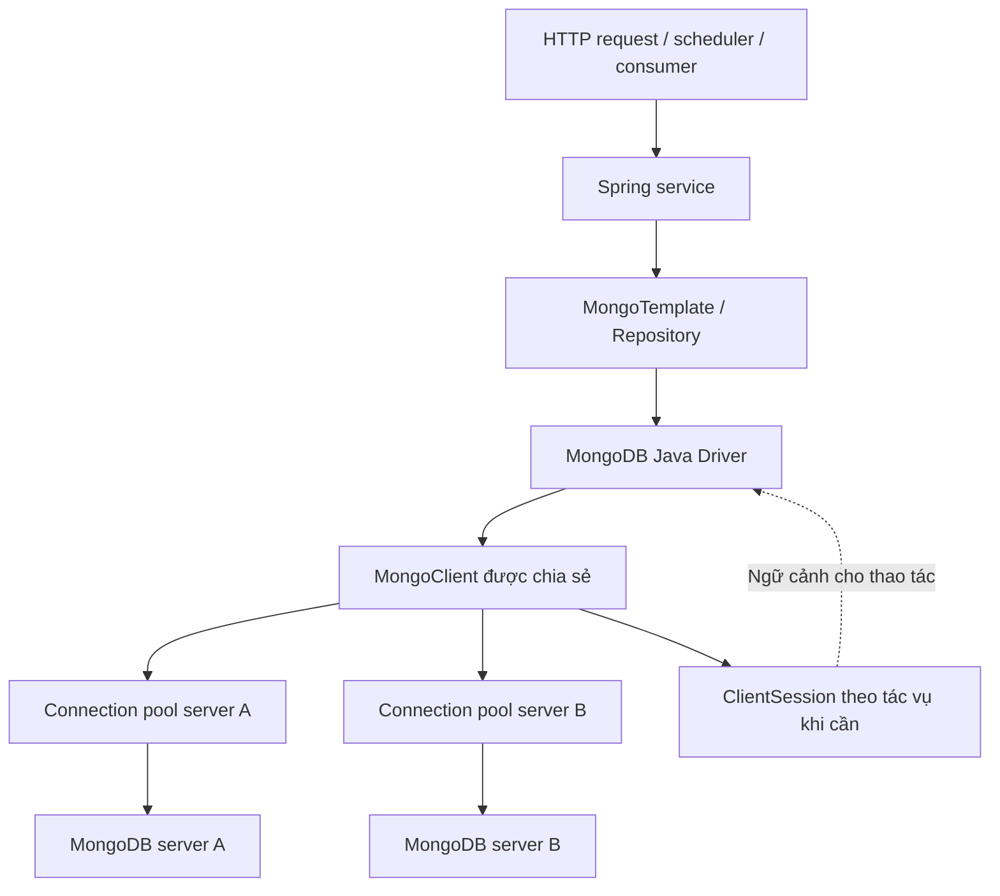
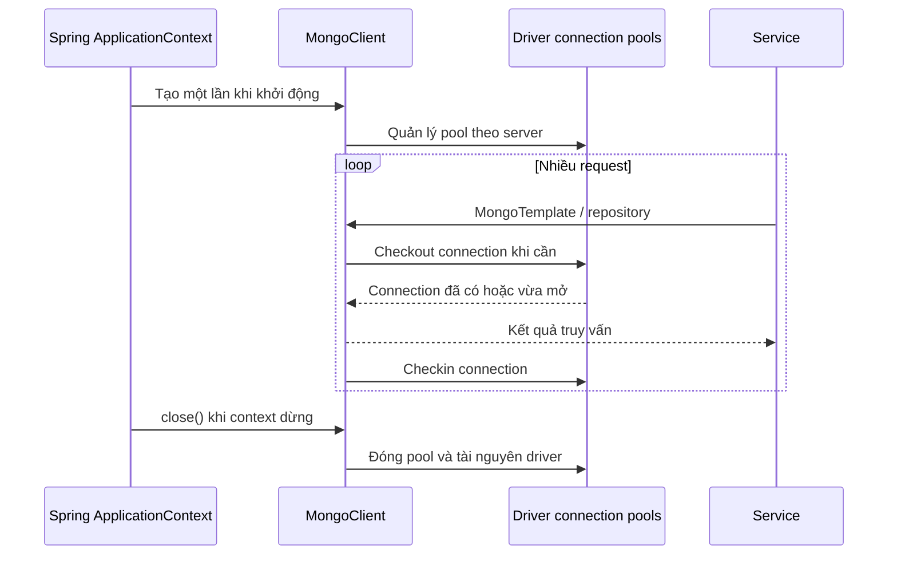
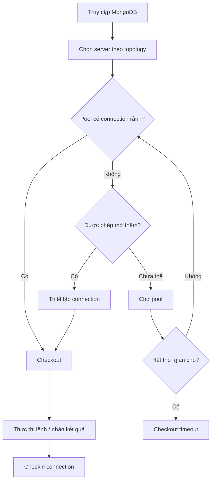

# Quản lý vòng đời client, connection pool và session trong Spring Data MongoDB

## 1. Vì sao phải quản lý ba lớp tài nguyên này?

Trong ứng dụng **Spring Data MongoDB**, `MongoClient` là điểm vào của MongoDB Java Driver: nó quản lý thông tin cluster, xác thực, lựa chọn server và các connection pool để gửi lệnh tới MongoDB. `MongoTemplate` và repository xây dựng trên driver, cung cấp cách ánh xạ document, CRUD, aggregation, truy vấn và transaction bằng API Spring. Một ứng dụng có nhiều request đồng thời nhưng thường **không cần tạo một `MongoClient` mới cho mỗi request**.

Nếu mỗi lần gọi API lại tạo client, pool bị phân mảnh, socket và luồng quản lý tăng, việc thiết lập kết nối lặp lại gây tốn thời gian. Nếu đóng client khi service khác còn dùng, các thao tác tiếp theo có thể thất bại. Nếu giữ session hoặc transaction quá lâu, ứng dụng và MongoDB có thể chịu thêm chi phí tài nguyên và xung đột dữ liệu.

Bài học thuộc chương **Cấu hình và kiến trúc** này tập trung vào ba phạm vi:

- **Client lifecycle:** ai tạo và sở hữu `MongoClient`, khi nào khởi tạo, chia sẻ, đóng và trường hợp cần nhiều client.
- **Connection pool:** cách driver thiết lập, mượn (`checkout`), tái sử dụng và giới hạn socket đến MongoDB; tính tổng lượng kết nối khi mở rộng ứng dụng.
- **Session:** phạm vi ngữ cảnh logic của một chuỗi thao tác, nhất là causal consistency và transaction, cách bắt đầu/đóng session và tích hợp với Spring.

Các nguyên tắc áp dụng cho `MongoTemplate`, `MongoRepository` và hạ tầng reactive. Tên property, mặc định của pool và API cụ thể phụ thuộc phiên bản MongoDB Driver, Spring Data và Spring Boot; thông số số học trong bài là **giá trị thí nghiệm**.

## 2. Sơ đồ kiến trúc và khái niệm



| Thành phần | Ý nghĩa | Vòng đời hợp lý | Có chia sẻ giữa request không? |
|---|---|---|---|
| `com.mongodb.client.MongoClient` | Client của Java Driver đồng bộ, quản lý topology và pools | Thường theo vòng đời Spring `ApplicationContext` | **Có**; thiết kế để dùng đồng thời |
| `com.mongodb.reactivestreams.client.MongoClient` | Client reactive của Java Driver | Thường theo vòng đời Spring `ApplicationContext` | **Có**; dùng chung reactive pipelines |
| `MongoTemplate` / `ReactiveMongoTemplate` | API truy cập database trên client/factory | Spring bean dùng lại, thường singleton | **Có** với cấu hình thông thường |
| Connection | Kết nối socket vật lý do driver quản lý | Checkout/checkin qua pool, được tái sử dụng | Ứng dụng không tự giữ socket giữa request |
| `ClientSession` | Ngữ cảnh phiên logic, có thể gắn với transaction | Theo một đơn vị công việc | **Không** dùng đồng thời trên nhiều luồng |
| Transaction | Phạm vi nguyên tử nhiều thao tác theo khả năng MongoDB | Bắt đầu và hoàn tất nhanh, rõ ràng | Không chạy song song nhiều lệnh trên cùng session/transaction |

**Session không đồng nghĩa với một socket riêng.** `ClientSession` giữ ngữ cảnh logic; driver quyết định khi nào checkout connection. Với một số topology hoặc transaction, connection/server có thể bị giữ (`pin`) trong phạm vi cần thiết. Vì thế không suy số socket từ số session.

**Pool không phải hàng đợi chung duy nhất cho cả cluster.** Java Driver thông thường duy trì pool theo server phù hợp trong topology. Replica set, sharding, read preference và số instance ứng dụng ảnh hưởng tổng connection; kết nối dùng để giám sát topology cũng có thể nằm ngoài giới hạn connection ứng dụng của pool.

## 3. Vòng đời MongoClient trong Spring

### 3.1. Chia sẻ client được quản lý qua Spring DI

Với Spring Boot có starter MongoDB và auto-configuration, Spring thường tạo bean `MongoClient`, `MongoDatabaseFactory` và `MongoTemplate`. Service chỉ inject những đối tượng cần dùng; không tự tạo client mỗi lần:

```java
import org.bson.Document;
import org.springframework.data.mongodb.core.MongoTemplate;
import org.springframework.stereotype.Service;

@Service
public class MongoHealthProbe {
    private final MongoTemplate template;

    public MongoHealthProbe(MongoTemplate template) {
        this.template = template;
    }

    public boolean isAvailable() {
        Document result = template.executeCommand(new Document("ping", 1));
        return ((Number) result.get("ok")).doubleValue() == 1.0;
    }
}
```

Lệnh `ping` hữu ích để kiểm tra kết nối trong thí nghiệm; production nên cân nhắc health indicator có sẵn của Spring Boot Actuator và tần suất health check phù hợp.

Luồng vòng đời điển hình:



Tránh tạo client lặp lại trong request handler:

```java
// Anti-pattern đối với web service gọi nhiều lần:
public void saveOne(String uri, Document data) {
    try (com.mongodb.client.MongoClient client =
            com.mongodb.client.MongoClients.create(uri)) {
        client.getDatabase("shop").getCollection("events").insertOne(data);
    }
}
```

`try-with-resources` trong ví dụ trên đóng client đúng cách khi phương thức kết thúc, nhưng **vòng đời quá ngắn** với web service. Mẫu này chỉ thích hợp cho CLI/script có tác vụ đơn lẻ thực sự sở hữu client.

### 3.2. Tạo bean client thủ công khi cần

Nếu cần thay auto-configuration, khai báo client là bean do Spring sở hữu:

```java
import com.mongodb.client.MongoClient;
import com.mongodb.client.MongoClients;
import org.springframework.beans.factory.annotation.Value;
import org.springframework.context.annotation.Bean;
import org.springframework.context.annotation.Configuration;

@Configuration
public class MongoClientConfig {
    @Bean(destroyMethod = "close")
    MongoClient mongoClient(@Value("${app.mongodb.uri}") String uri) {
        return MongoClients.create(uri);
    }
}
```

```yaml
# application.yml dành cho ví dụ tự tạo bean
app:
  mongodb:
    uri: ${MONGODB_URI}
```

Spring gọi phương thức đóng khi giải phóng bean theo lifecycle của context. Khi tự khai báo `MongoClient`, cần kiểm tra điều kiện auto-configuration/back-off của phiên bản Boot để **không vô tình tạo client thứ hai** cùng kết nối đến một cluster.

Với các nhu cầu đơn giản như URI, pool size và timeout, ưu tiên cấu hình qua connection string và auto-configuration. Không cần tạo bean thủ công chỉ để đặt `maxPoolSize`.

### 3.3. Trường hợp nhiều MongoClient

Nhiều client hợp lý khi ứng dụng truy cập **nhiều cluster** hoặc các nhóm tài khoản/xác thực khác nhau. Mỗi client có pools và chi phí tài nguyên riêng; cần đặt tên bean, định tuyến `MongoTemplate`/`MongoDatabaseFactory` tới đúng client và giải phóng từng client khi context dừng.

Nếu nhiều tenant dùng cùng cluster và credential, có thể chia sẻ client, sau đó truy cập database/collection phù hợp với chính sách phân quyền của ứng dụng. Tránh mặc định một client cho mỗi tenant nếu không có lý do tách kết nối; tổng số socket sẽ tăng theo số tenant và pod. Nếu tenant có cluster hoặc credential độc lập, tách client có thể cần thiết.

### 3.4. Dừng ứng dụng đúng thứ tự

Khi shutdown, ứng dụng cần ngừng nhận request mới, cho các tác vụ đang chạy hoàn tất trong giới hạn graceful shutdown rồi đóng `MongoClient` thông qua chủ sở hữu. Không gọi `mongoClient.close()` trong controller/service khi client là bean được chia sẻ. Client đóng khi request còn hoạt động có thể làm thao tác đang chạy lỗi; client không được đóng sau khi ứng dụng không dùng có thể giữ socket và các tài nguyên quản lý topology.

## 4. Connection pool checkout/checkin và timeout

### 4.1. Đường đi của một lệnh MongoDB



Các bước trên mô tả tổng quát driver đồng bộ. Driver còn có công việc riêng về theo dõi topology, connection health, retry, load balancing và transaction. Đối với ứng dụng reactive, quá trình checkout vẫn tồn tại nhưng cách chờ và xử lý bất đồng bộ khác với việc chặn thread của driver đồng bộ.

### 4.2. Những cấu hình quan trọng

| Tham số | Tác dụng | Rủi ro nếu chỉnh sai |
|---|---|---|
| `maxPoolSize` | Giới hạn connection tối đa của một pool (thường theo server) | Quá nhỏ: hàng đợi dài; quá lớn: database chịu nhiều lệnh/socket đồng thời |
| `minPoolSize` | Lượng connection tối thiểu mà pool cố duy trì | Đặt lớn trên nhiều pod tạo nhiều idle socket |
| `maxConnecting` | Giới hạn việc thiết lập kết nối **mới** đồng thời trong pool | Quá nhỏ có thể tăng thời gian warm-up khi tải đột ngột |
| `waitQueueTimeoutMS` | Thời gian chờ checkout connection từ pool | Quá ngắn có thể gây lỗi peak; quá dài làm request treo chờ |
| `maxIdleTimeMS` | Giới hạn thời gian connection ở trạng thái rảnh trước khi bị loại | Quá ngắn tăng churn tạo lại connection |
| `maxLifeTimeMS` | Giới hạn thời gian sống connection | Quá ngắn có thể khiến pool phải tạo kết nối lại liên tục |
| `serverSelectionTimeoutMS` | Giới hạn chờ tìm server thích hợp | Cần xét failover, topology, read/write preference |
| `connectTimeoutMS` | Giới hạn thiết lập kết nối mạng | Không phải timeout chờ pool |
| `socketTimeoutMS` | Giới hạn thời gian chờ network I/O của thao tác | Cần xét truy vấn chậm, response lớn, timeout tổng |

**Phân biệt timeout:** `serverSelectionTimeoutMS` liên quan đến tìm node, `waitQueueTimeoutMS` liên quan đến mượn connection, `connectTimeoutMS` liên quan đến mở TCP/TLS và `socketTimeoutMS` liên quan đến trao đổi dữ liệu. Một request có thể trải qua nhiều giai đoạn, thậm chí retry; không coi chúng là một deadline tổng duy nhất. Với hệ thống có SLA thời gian phản hồi, đặt deadline ở tầng request và cấu hình timeout driver nhất quán.

Default khác nhau theo phiên bản driver và deployment. Trong các phiên bản Java Driver phổ biến, `maxPoolSize` có thể mặc định 100, `minPoolSize` 0, nhưng nên **kiểm tra driver cụ thể** thay vì phụ thuộc vào con số bất biến.

### 4.3. Đặt pool trong URI

Ví dụ cấu hình URI với Spring Boot 3.x:

```yaml
spring:
  data:
    mongodb:
      uri: ${MONGODB_URI}
```

Giá trị minh họa cho biến môi trường:

```text
mongodb://app_user:<ENCODED_PASSWORD>@127.0.0.1:27017/shop?authSource=shop&maxPoolSize=60&minPoolSize=5&maxConnecting=3&waitQueueTimeoutMS=2000&maxIdleTimeMS=60000&serverSelectionTimeoutMS=5000&connectTimeoutMS=10000&socketTimeoutMS=30000
```

`maxPoolSize=60` giới hạn pool đến một server; `minPoolSize=5` giữ một số kết nối dự phòng; `waitQueueTimeoutMS=2000` chờ checkout tối đa khoảng hai giây. Đây **không phải cấu hình production khuyến nghị mặc định**. Hãy đo thực tế trước khi thay đổi.

Mật khẩu có ký tự đặc biệt phải URL-encode theo quy tắc connection string. Đừng commit credential hoặc in URI chứa mật khẩu ra log. Với Atlas, thường dùng URI `mongodb+srv://...` và giữ cấu hình TLS của cluster.

### 4.4. Tùy chỉnh bằng MongoClientSettings khi có yêu cầu đặc biệt

Ví dụ Java Driver đồng bộ với bean riêng; chỉ chọn **một** trong hai cách tạo bean ở mục 3.2 và mục này:

```java
import com.mongodb.ConnectionString;
import com.mongodb.MongoClientSettings;
import com.mongodb.client.MongoClient;
import com.mongodb.client.MongoClients;
import java.util.concurrent.TimeUnit;
import org.springframework.beans.factory.annotation.Value;
import org.springframework.context.annotation.Bean;
import org.springframework.context.annotation.Configuration;

@Configuration
public class TunedMongoClientConfig {
    @Bean(destroyMethod = "close")
    MongoClient mongoClient(@Value("${app.mongodb.uri}") String uri) {
        MongoClientSettings settings = MongoClientSettings.builder()
            .applyConnectionString(new ConnectionString(uri))
            .applyToConnectionPoolSettings(pool -> pool
                .maxSize(60)
                .minSize(5)
                .maxConnecting(3)
                .maxWaitTime(2, TimeUnit.SECONDS)
                .maxConnectionIdleTime(60, TimeUnit.SECONDS))
            .build();

        return MongoClients.create(settings);
    }
}
```

Spring Boot cũng cung cấp khả năng tùy biến MongoClient builder qua cơ chế customizer ở các phiên bản tương ứng, giúp giữ auto-configuration khi chỉ cần sửa vài thuộc tính. Kiểm tra tên class và thứ tự ưu tiên giữa URI và builder theo phiên bản Boot/driver đang sử dụng.

### 4.5. Tính số connection ở quy mô nhiều pod

Giả sử có 6 pod ứng dụng; mỗi pod có 1 client; trong một topology nhất định, client duy trì pool đến 3 server; mỗi pool `maxPoolSize=80`. Số connection ứng dụng có thể đạt giới hạn lý thuyết:

```text
6 pod × 1 client/pod × 3 server × 80 connection/pool
= 1.440 pooled connections
```

**Đó là mức trần minh họa, không phải số socket chắc chắn đang mở.** Topology, read preference, nhu cầu thao tác, `minPoolSize` và socket giám sát làm số thực tế khác nhau. Đánh giá năng lực cluster phải xét tổng connection từ tất cả ứng dụng, kể cả service khác.

Theo định luật Little trong điều kiện tải ổn định:

```text
Concurrency trung bình ≈ thao tác MongoDB/giây × thời gian giữ connection (giây)
Ví dụ: 200 thao tác/giây × 0,05 giây ≈ 10 thao tác đồng thời
```

Giá trị trung bình không đại diện cho peak, P95/P99 hay transaction dài. Phải đo thời gian checkout, thời gian lệnh và sức chứa server. Tăng pool size không giúp một query thiếu index chạy nhanh hơn.

## 5. ClientSession là ngữ cảnh logic, không phải connection

### 5.1. Khi nào mở session tường minh?

Driver có thể tự quản lý logical sessions cho những thao tác phù hợp nếu server hỗ trợ. Với CRUD đơn giản qua `MongoTemplate`/repository, ứng dụng **thường không cần gọi `startSession()`**. Session tường minh cần khi muốn:

- Duy trì ngữ cảnh của chuỗi thao tác có yêu cầu causal consistency, kèm read/write concern và điều kiện server phù hợp.
- Chạy multi-document transaction trên replica set hoặc sharded cluster được hỗ trợ.
- Truyền một session cụ thể vào nhiều thao tác driver trong cùng một đơn vị công việc.

`ClientSession` mang trạng thái, **không thiết kế để dùng đồng thời từ nhiều thread**. Không lưu session vào singleton bean, biến static hoặc giữ nó xuyên nhiều request độc lập. Hãy mở session trong một phạm vi rõ ràng, hoàn tất thao tác rồi đóng.

### 5.2. Ví dụ dùng Java Driver trực tiếp

```java
import com.mongodb.ClientSessionOptions;
import com.mongodb.client.ClientSession;
import com.mongodb.client.MongoClient;
import org.bson.Document;

public class CustomerReader {
    private final MongoClient client;

    public CustomerReader(MongoClient client) {
        this.client = client;
    }

    public Document findCustomer(String customerId) {
        try (ClientSession session = client.startSession(
                ClientSessionOptions.builder()
                    .causallyConsistent(true)
                    .build())) {
            return client.getDatabase("shop")
                .getCollection("customers")
                .find(session, new Document("_id", customerId))
                .first();
        }
    }
}
```

Đây là ví dụ về cách **truyền session vào lệnh và đóng đúng scope**, không có nghĩa một lệnh đọc đơn lẻ luôn cần causal consistency. Tính nhất quán nhân quả đòi hỏi các thao tác liên quan dùng đúng session và cấu hình concern/phạm vi deployment tương thích.

### 5.3. Session khác transaction

Session có thể tồn tại mà **chưa bắt đầu transaction**. Multi-document transaction cần deployment phù hợp: **replica set hoặc sharded cluster**, không chạy như mong muốn trên MongoDB standalone. Transaction có thể tiêu tốn tài nguyên, kéo dài snapshot/lock và dễ xảy ra xung đột nếu giữ quá lâu.

Ví dụ Java Driver dùng `withTransaction` cho thao tác giảm hàng tồn kho và tạo đơn hàng:

```java
import com.mongodb.client.ClientSession;
import com.mongodb.client.MongoClient;
import com.mongodb.client.MongoCollection;
import com.mongodb.client.MongoDatabase;
import com.mongodb.client.result.UpdateResult;
import org.bson.Document;
import static com.mongodb.client.model.Filters.and;
import static com.mongodb.client.model.Filters.eq;
import static com.mongodb.client.model.Filters.gte;
import static com.mongodb.client.model.Updates.inc;

public class OrderWriter {
    private final MongoClient client;
    public OrderWriter(MongoClient client) { this.client = client; }

    public void placeOrder(String orderId, String productId, int quantity) {
        if (quantity <= 0) throw new IllegalArgumentException("quantity");
        MongoDatabase db = client.getDatabase("shop");
        MongoCollection<Document> orders = db.getCollection("orders");
        MongoCollection<Document> inventory = db.getCollection("inventory");

        try (ClientSession session = client.startSession()) {
            session.withTransaction(() -> {
                UpdateResult result = inventory.updateOne(
                    session,
                    and(eq("_id", productId), gte("available", quantity)),
                    inc("available", -quantity)
                );
                if (result.getModifiedCount() != 1) {
                    throw new IllegalStateException("Không đủ hàng");
                }
                orders.insertOne(session, new Document("_id", orderId)
                    .append("productId", productId)
                    .append("quantity", quantity));
                return null;
            });
        }
    }
}
```

Nếu không đủ hàng, callback ném lỗi, transaction bị abort. Ví dụ chưa xử lý trùng order ID/idempotency toàn bộ request. `withTransaction` có thể **gọi lại callback** khi có một số lỗi giao dịch tạm thời; không gửi email, thu tiền hay thực hiện side effect ngoài database từ trong callback trừ khi thiết kế an toàn với retry. Không chạy parallel operations trên cùng một session/transaction.

## 6. Session và transaction do Spring quản lý

### 6.1. Sử dụng MongoTransactionManager

Trong ứng dụng Spring Data MongoDB đồng bộ, `MongoTransactionManager` tích hợp MongoDB transaction vào cơ chế `@Transactional` của Spring. Khi transaction bắt đầu, manager tạo và gắn session vào ngữ cảnh đang xử lý để các thao tác `MongoTemplate`/repository phù hợp tham gia cùng transaction.

```java
import org.springframework.context.annotation.Bean;
import org.springframework.context.annotation.Configuration;
import org.springframework.data.mongodb.MongoDatabaseFactory;
import org.springframework.data.mongodb.MongoTransactionManager;

@Configuration
public class MongoTransactionConfig {
    @Bean
    MongoTransactionManager mongoTransactionManager(MongoDatabaseFactory factory) {
        return new MongoTransactionManager(factory);
    }
}
```

Ví dụ service với điều kiện tồn kho:

```java
import com.mongodb.client.result.UpdateResult;
import org.bson.Document;
import org.springframework.data.mongodb.core.MongoTemplate;
import org.springframework.data.mongodb.core.query.Criteria;
import org.springframework.data.mongodb.core.query.Query;
import org.springframework.data.mongodb.core.query.Update;
import org.springframework.stereotype.Service;
import org.springframework.transaction.annotation.Transactional;

@Service
public class CheckoutService {
    private final MongoTemplate template;

    public CheckoutService(MongoTemplate template) {
        this.template = template;
    }

    @Transactional
    public void checkout(String orderId, String productId, int quantity) {
        if (quantity <= 0) {
            throw new IllegalArgumentException("quantity phải lớn hơn 0");
        }

        Query inStock = Query.query(Criteria.where("_id").is(productId)
            .and("available").gte(quantity));
        UpdateResult changed = template.updateFirst(
            inStock, new Update().inc("available", -quantity), "inventory");

        if (changed.getModifiedCount() != 1) {
            throw new IllegalStateException("Không đủ hàng");
        }
        template.insert(new Document("_id", orderId)
                .append("productId", productId)
                .append("quantity", quantity),
            "orders");
    }
}
```

Khi phương thức kết thúc thành công, Spring transaction manager commit; nếu exception runtime phát sinh, Spring thường rollback theo quy tắc mặc định của `@Transactional`. Nếu hai thao tác phải cùng thành công, chúng cần dùng **cùng factory/client** trong transaction, và MongoDB phải hỗ trợ giao dịch.

Những điều kiện cần kiểm tra trong thực tế:

- **Proxy:** `@Transactional` thường chỉ có hiệu lực khi method được gọi qua Spring proxy; gọi `this.checkout(...)` từ cùng object không đi qua interception theo cấu hình proxy thông thường.
- **Chọn đúng manager:** nếu ứng dụng có cả JDBC/JPA và MongoDB transaction manager, cần chỉ định manager tương ứng thay vì kỳ vọng Spring tự chọn đúng cho mọi method.
- **Giới hạn luồng:** transaction đồng bộ gắn với ngữ cảnh của thread; không chạy công việc trên executor/`CompletableFuture` rồi mong nó tự tham gia cùng transaction.
- **Không tự tạo session khác:** một `ClientSession` mở trực tiếp không tự động nhận biết transaction Spring đang quản lý.
- **Phạm vi transaction:** MongoDB transaction không tự bao trùm HTTP request tới hệ thống ngoài, gửi email, Kafka hoặc một database khác. Bài toán nhất quán xuyên hệ thống thường cần outbox/idempotency hay cơ chế phối hợp phù hợp.
- **Thời lượng:** tránh tác vụ lâu hoặc tương tác mạng không cần thiết bên trong transaction; kiểm tra index, giới hạn transaction và chính sách retry.

### 6.2. Thao tác với session mà không dùng transaction

Spring Data có cơ chế `withSession(...)` cho các trường hợp cần dùng `ClientSession` tường minh với `MongoTemplate`. Cần bảo đảm **mọi thao tác phụ thuộc ngữ cảnh phiên được thực thi trong phạm vi session tương ứng** và session đóng sau khi hoàn tất, kể cả khi có lỗi.

Trong ứng dụng có transaction manager, ưu tiên dùng `@Transactional` hoặc API giao dịch của Spring cho nghiệp vụ nhiều bước. Cố gắng trộn session tự quản lý với session do Spring tạo có thể khiến những lệnh tưởng cùng transaction thực tế lại dùng hai session khác nhau.

### 6.3. ReactiveMongoTransactionManager và Reactor Context

Reactive Java Driver cung cấp `com.mongodb.reactivestreams.client.MongoClient`; Spring Data cung cấp `ReactiveMongoTemplate` và repository reactive. Đây là client/pool dành cho reactive driver, không phải lấy client đồng bộ rồi dùng `subscribeOn` để tạo reactive database.

Ví dụ transaction manager reactive:

```java
import org.springframework.context.annotation.Bean;
import org.springframework.context.annotation.Configuration;
import org.springframework.data.mongodb.ReactiveMongoDatabaseFactory;
import org.springframework.data.mongodb.ReactiveMongoTransactionManager;

@Configuration
public class ReactiveMongoTransactionConfig {
    @Bean
    ReactiveMongoTransactionManager reactiveMongoTransactionManager(
            ReactiveMongoDatabaseFactory factory) {
        return new ReactiveMongoTransactionManager(factory);
    }
}
```

Với `Mono` và `Flux`, transaction thường được gắn với **Reactor Context** tại thời điểm subscription. Không tự `subscribe()` trong service rồi thoát khỏi pipeline, cũng không dùng `block()` trong xử lý reactive để ép thành synchronous. Với pipeline phức tạp, có thể sử dụng `TransactionalOperator` để diễn đạt phạm vi transaction tường minh. Không chạy nhiều thao tác song song trong cùng một session/transaction reactive; nối các bước có thứ tự bằng các operator thích hợp như `flatMap` và `then`, kiểm soát concurrency và retry.

Khi cùng ứng dụng cấu hình cả starter sync và reactive, xem xét kỹ xem có vô tình khởi tạo **hai loại client với hai tập pool riêng** không. Hai client có thể hợp lý nếu ứng dụng thật sự dùng cả hai mô hình; phải tính tài nguyên và quản lý lifecycle riêng biệt.

## 7. Khả năng chịu lỗi, timeout và shutdown

### 7.1. Tách đúng nơi phát sinh timeout

| Vấn đề | Dấu hiệu liên quan | Điều cần kiểm tra |
|---|---|---|
| Không chọn được server | `serverSelectionTimeoutMS`, lỗi chọn primary/secondary | Topology, replica set, DNS, network, read preference |
| Chờ pool quá lâu | Checkout timeout; có thể gặp `MongoWaitQueueTimeoutException` | Checked-out connections, pool size, concurrent operations, transaction dài |
| Không mở được TCP/TLS | `connectTimeoutMS`, handshake hoặc kết nối bị từ chối | Host/port, firewall, TLS, server connection limits |
| Truy vấn chạy lâu hoặc đứt socket | `socketTimeoutMS`, command latency, network read | `explain("executionStats")`, index, kích thước kết quả, tải MongoDB |

Đừng xử lý pool checkout timeout bằng cách chỉ tăng `socketTimeoutMS`: đó là hai giai đoạn khác nhau. Tăng `maxPoolSize` có thể giúp khi pool thiếu connection và server còn năng lực xử lý; nếu lệnh MongoDB đang chậm do thiếu index, tăng pool có thể khiến database càng quá tải.

Retry còn ảnh hưởng latency và tính đúng đắn nghiệp vụ. Với transaction, cần hiểu khả năng retry toàn bộ callback và kết quả commit không chắc chắn; thiết kế tính idempotent từ tầng API, tránh side effect không thể lặp lại. Không log nguyên văn URI chứa credential khi điều tra lỗi.

### 7.2. Graceful shutdown

Một chu trình shutdown hợp lý cho ứng dụng web:

1. Ngừng nhận request mới bằng graceful shutdown của server hoặc orchestrator.
2. Cho request, pipeline và transaction đang chạy hoàn tất trong thời gian giới hạn.
3. Để Spring đóng bean `MongoClient`; nếu có client tạo bên ngoài Spring thì chủ sở hữu đó đóng bằng `close()` hoặc `try-with-resources`.
4. Quan sát lỗi shutdown, connection còn tồn đọng và thời gian đóng tài nguyên trong môi trường kiểm thử.

Không gọi `close()` thủ công ngay sau một lệnh `MongoTemplate` khi client thuộc context. Ngược lại, nếu ứng dụng tạm tạo client cho CLI, hãy giải phóng client ở cuối CLI.

## 8. Quan sát pool và session bằng metrics

### 8.1. Theo dõi tín hiệu ở cả ứng dụng và MongoDB

| Nhóm | Chỉ số hữu ích | Câu hỏi cần trả lời |
|---|---|---|
| Connection pool | Tổng/available/checked-out connections, số tạo/đóng, pool clear | Pool có đang bão hòa hay tăng socket liên tục? |
| Checkout | Thời gian chờ checkout, failed checkout, timeout | Request chậm vì chờ connection hay vì database? |
| Command | P50/P95/P99 latency, số lỗi, slow query, số request | Command nào chiếm phần lớn thời gian giữ connection? |
| Server | Connections current/available, CPU, memory, I/O, replication lag | Cluster đã đạt giới hạn chưa? |
| Transaction | Thời gian, abort/retry, số đang chạy, xung đột | Transaction có quá dài hoặc quá nhiều không? |
| Ứng dụng | In-flight requests, worker thread/queue, endpoint latency | Concurrency ứng dụng có tương ứng với tải MongoDB? |

MongoDB Java Driver hỗ trợ sự kiện `ConnectionPoolListener`, gồm các sự kiện checkout/checkin, thất bại checkout, tạo/đóng connection và thay đổi pool. Có thể tích hợp với Micrometer/Actuator hoặc observability stack tương ứng với phiên bản framework. Listener cho metrics phải xử lý nhanh, tránh blocking và tránh gắn giá trị có credential/PII làm metric label.

Thông tin MongoDB server/Atlas về số connection chỉ là một phần của bức tranh: pool ở client có thể bị chờ dù server chưa đạt giới hạn connection, do concurrency, connection establishment, topology hoặc thời gian giữ connection.

### 8.2. Quy trình xử lý sự cố bão hòa

Giả sử ứng dụng có `maxPoolSize=40` và một số request gặp checkout timeout:

1. Kiểm tra metric checkout và số connection đang được dùng để xác nhận pool có đạt giới hạn không.
2. Kiểm tra truy vấn, aggregation, thiếu index, xử lý quá nhiều document và transaction lâu; tối ưu nguyên nhân kéo dài thời gian dùng connection.
3. Kiểm tra ứng dụng có tạo client trong từng request, lập nhiều client cho cùng cluster hoặc scale thêm pod gần đây không.
4. So sánh mức connection, CPU, I/O và giới hạn tài nguyên của MongoDB với concurrency thực tế.
5. Thử kiểm soát số request đồng thời, điều chỉnh `maxPoolSize` và `waitQueueTimeoutMS` trên tải đo được; so sánh throughput, P95/P99 và tỉ lệ lỗi.

Nếu pool chưa bão hòa, tiếp tục điều tra server selection, DNS, TLS, thiết lập connection mới (`maxConnecting`) và network. Không quy tất cả `MongoTimeoutException` về pool.

## 9. Những lỗi kiến trúc thường gặp

| Sai lầm | Hậu quả | Cách khắc phục |
|---|---|---|
| Gọi `MongoClients.create(...)` ở mỗi request | Pool phân mảnh, tăng socket và latency khởi tạo | Inject singleton client/template do Spring quản lý |
| Gọi `client.close()` từ một service dùng client của Spring | Các service/request khác có thể thất bại | Chỉ đóng bởi chủ sở hữu, theo lifecycle |
| Tạo client cho mỗi tenant cùng cluster/credential | Tổng socket nhân theo tenant và pod | Cân nhắc chia sẻ client và chính sách phân quyền |
| Chọn `maxPoolSize` theo số request HTTP tối đa | HTTP request không phải lúc nào cũng giữ connection MongoDB | Đo concurrency của thao tác MongoDB và checkout latency |
| Đặt `minPoolSize` quá lớn trên mọi pod | Nhiều idle sockets, tăng tải khi startup/scale | Dùng min phù hợp và tính tổng theo số pod |
| Giữ `ClientSession` trong singleton bean | Lẫn trạng thái giữa tác vụ, không an toàn khi chạy đồng thời | Session theo từng đơn vị công việc và đóng đúng phạm vi |
| Dùng transaction cho CRUD một document bất kỳ | Overhead và khả năng xung đột không cần thiết | Tận dụng tính nguyên tử của thao tác ghi trên một document |
| Chạy transaction trên MongoDB standalone | Không đáp ứng điều kiện multi-document transaction | Dùng replica set hoặc sharded cluster hỗ trợ |
| Gọi `this.transactionalMethod()` trong cùng bean | Bỏ qua cơ chế proxy `@Transactional` thường gặp | Gọi qua bean được Spring quản lý hoặc dùng template/operator |
| Gọi `block()` trong luồng reactive | Chặn luồng xử lý, có thể gây nghẽn | Dùng reactive pipeline và transaction manager tương ứng |
| Chạy parallel MongoDB operations trong cùng session/transaction | Không được bảo đảm an toàn và có thể gây lỗi | Thực hiện các bước tuần tự trong session |
| Chỉ tăng pool khi ứng dụng chậm | Có thể đẩy thêm tải lên MongoDB đang quá tải | Phân tích truy vấn, index, timeout, transaction và capacity |

## 10. Kiểm thử tài nguyên và transaction

### 10.1. Xác minh vòng đời

Trên môi trường integration test có MongoDB:

- Khởi động Spring context, xác minh `MongoTemplate` và repository đọc/ghi thành công.
- Gọi nhiều lần từ service và kiểm tra cấu hình bảo đảm không tạo `MongoClient` mới mỗi lần; quan sát số connection theo thời gian nếu có metrics.
- Dừng context và xác minh client do Spring sở hữu được giải phóng.
- Nếu có hai client/factory, kiểm tra từng template dùng đúng database và credential.

Không cần tạo test mô phỏng từng chi tiết nội bộ của driver; trọng tâm là cách ứng dụng sở hữu tài nguyên và sử dụng đúng dependency.

### 10.2. Xác minh pool dưới tải

1. Chuẩn bị dữ liệu và truy vấn giống workload sẽ dùng.
2. Tăng concurrency từng mức, quan sát throughput, P95/P99, checkout wait, error rate, query latency và số socket.
3. Thử pool nhỏ có kiểm soát để nhận diện checkout wait, sau đó điều chỉnh.
4. So sánh tăng pool với tối ưu index/query để thấy ảnh hưởng khác nhau.
5. Thử lại sau khi scale thêm pod, vì tổng số connection không chỉ phụ thuộc một process.

### 10.3. Xác minh session/transaction

Trên **replica set** trong môi trường test (không dùng standalone để kết luận logic transaction):

```text
Given: inventory.available = 5
When : checkout quantity = 3
Then : inventory.available = 2 và order được tạo

Given: inventory.available = 1
When : checkout quantity = 3
Then : transaction abort; available vẫn là 1; order chưa được tạo
```

Kiểm tra lỗi transaction tạm thời, callback có thể được retry, yêu cầu idempotency khi tạo order và cách xử lý ngoại lệ. Tránh chạy cùng session trên nhiều thread; mỗi test xác định rõ transaction manager/client/factory đang sử dụng.

## 11. Bài thực hành tổng hợp

**Bối cảnh:** dịch vụ đặt hàng có hai collection `orders` và `inventory`, dùng Spring Data MongoDB, chạy nhiều instance.

1. Khởi tạo ứng dụng Spring Boot với `spring.data.mongodb.uri` qua biến môi trường. Để Spring tự quản lý client/template.
2. Chọn cấu hình để thí nghiệm: `maxPoolSize=20`, `minPoolSize=2`, `waitQueueTimeoutMS=1000`; ghi lại version driver và topology.
3. Gọi CRUD từ nhiều request mà không tự mở `ClientSession`; kiểm tra cùng bean/template được dùng lại.
4. Thu thập checkout latency, command latency và số connection trong giai đoạn tăng tải. Điều chỉnh pool theo phép đo.
5. Đổi MongoDB sang replica set test, khai báo `MongoTransactionManager`, thực hiện `@Transactional` khi giảm tồn kho và tạo đơn hàng.
6. Kiểm tra rollback khi số lượng tồn kho không đủ, sau đó thử lỗi tạo order trùng khóa.
7. Nếu ứng dụng dùng reactive stack, thực hành với `ReactiveMongoTransactionManager` và pipeline tuần tự, không ghép hai loại client mà không kiểm soát.
8. Dừng ứng dụng qua graceful shutdown; xác nhận không có logic service đóng client giữa chừng.

**Đạt yêu cầu** khi giải thích được mỗi client sở hữu pool nào, phát hiện được sự khác nhau giữa timeout chọn server/chờ pool/thao tác socket, đóng session đúng scope, và kiểm chứng được transaction trên topology hỗ trợ.

## 12. Bảng ghi nhớ

| Câu hỏi | Trả lời |
|---|---|
| Mỗi request cần `MongoClient` riêng? | Không, client được thiết kế để chia sẻ giữa nhiều thao tác. |
| Ai đóng `MongoClient` do Spring quản lý? | Chủ sở hữu bean/`ApplicationContext` khi shutdown. |
| `maxPoolSize=100` nghĩa là toàn ứng dụng chỉ có 100 socket? | Không, giới hạn thường theo pool/server/client, còn topology và các socket quản lý khác. |
| Session có phải một network connection? | Không, session là ngữ cảnh logic. |
| CRUD một document có cần transaction? | Thông thường không; mỗi thao tác ghi đơn document có tính nguyên tử ở mức document. |
| Multi-document transaction cần gì? | Replica set/sharded cluster hỗ trợ cùng transaction/session đúng phạm vi. |
| Reactive transaction dùng ThreadLocal như imperative? | Không, reactive transaction dựa vào Reactor Context. |
| Bị checkout timeout thì tăng pool ngay? | Cần đo query latency, transaction, tài nguyên server và checkout trước. |

Quản lý đúng **vòng đời MongoClient**, **connection pool** và **session/transaction** giúp các thao tác repository, `MongoTemplate`, aggregation và truy cập reactive có hành vi dễ dự đoán, ổn định khi lưu lượng và số instance tăng.
