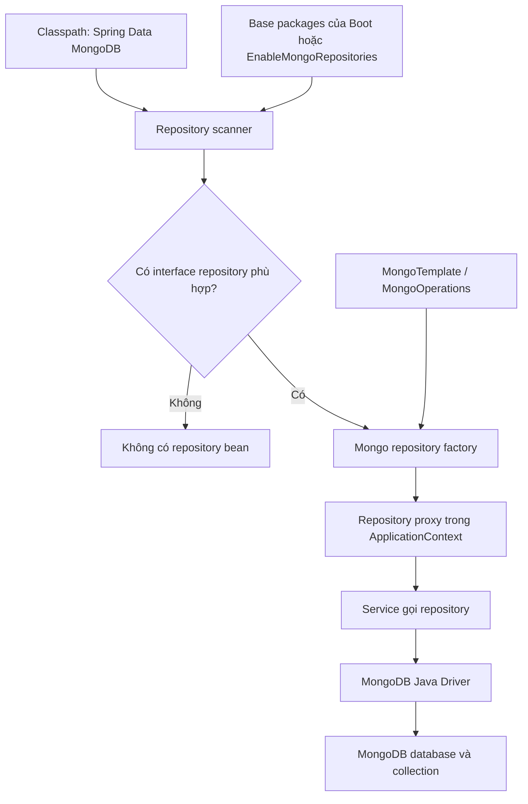
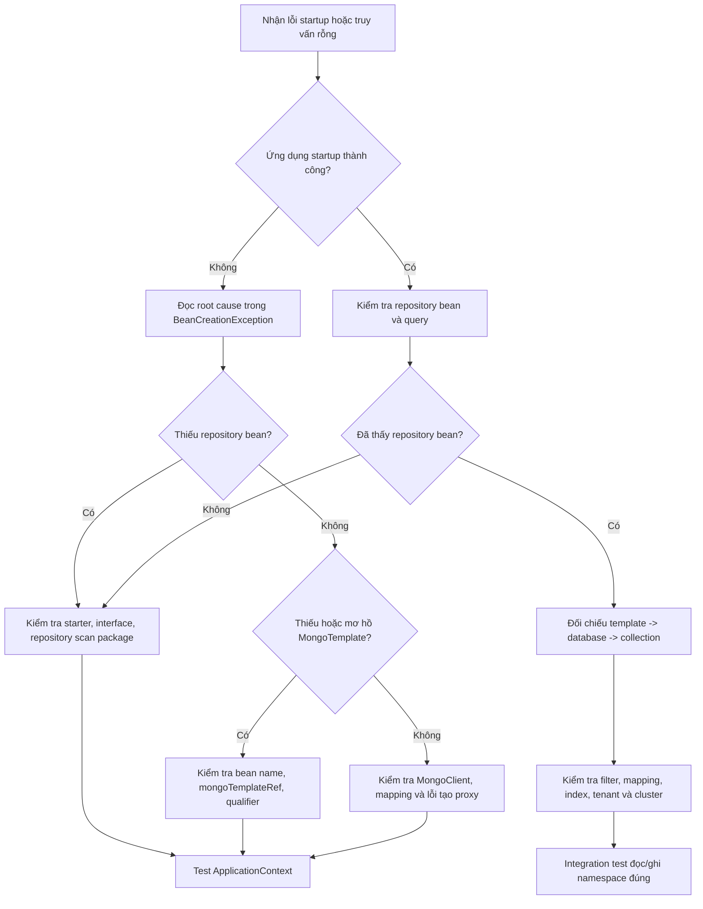

# Không tìm thấy repository, nhầm template hoặc quét sai package

> **Chương:** Lỗi và chẩn đoán · **Module:** `SPRING_DATA_MONGODB`. Spring Data MongoDB giúp ứng dụng truy cập MongoDB qua repository, `MongoTemplate` và reactive API. Khi ứng dụng báo thiếu bean repository, khi một repository trả về tập rỗng dù dữ liệu có tồn tại, hoặc khi nhiều MongoDB database cùng được cấu hình, lỗi có thể nằm ở **phạm vi quét package**, **cách đăng ký repository factory** hoặc **template mà repository sử dụng**. Bài này hướng dẫn khoanh vùng lỗi theo triệu chứng và xây dựng cấu hình có thể kiểm chứng.

## 1. Định nghĩa đúng bài toán trước khi sửa cấu hình

Câu “không tìm thấy repository” có thể mô tả những tình huống khác nhau:

1. **Repository chưa được Spring tạo thành bean.** Khi một service inject `OrderRepository`, ứng dụng gặp `NoSuchBeanDefinitionException` hoặc `UnsatisfiedDependencyException`. Nguyên nhân có thể là package nằm ngoài phạm vi quét, thiếu starter hoặc cấu hình repository không đúng.
2. **Repository đã được tạo nhưng phụ thuộc template không tồn tại.** Ví dụ `@EnableMongoRepositories(mongoTemplateRef = "ordersMongoTemplate")` nhưng context chỉ có bean `mongoTemplate`. Ứng dụng không khởi tạo repository factory được.
3. **Repository đã chạy nhưng truy vấn nhầm database/collection.** `findAll()` trả danh sách rỗng, trong khi kiểm tra bằng `mongosh` thấy dữ liệu ở database khác. Đây thường là lỗi **template binding** hoặc URI/database, không phải lỗi quét repository.
4. **Có nhiều repository/template cùng loại, Spring không biết chọn cái nào.** `NoUniqueBeanDefinitionException` xuất hiện ở điểm inject `MongoOperations`, hoặc các lần quét chồng chéo cố đăng ký cùng một repository bean.
5. **Lẫn imperative và reactive.** Code inject `ReactiveMongoRepository` nhưng chỉ cấu hình `MongoTemplate`/sync driver, hoặc quét reactive package bằng `@EnableMongoRepositories`.

Không nên khắc phục tất cả bằng cách thêm `@ComponentScan("com")` hoặc đặt `@Primary` tùy ý. Trước hết cần xác định **bean nào không có**, **bean nào bị chọn nhầm**, và **thực tế dữ liệu nằm ở đâu**.

### Bảng định hướng nhanh

| Triệu chứng | Vị trí cần kiểm tra trước | Tín hiệu phân biệt |
|---|---|---|
| `No qualifying bean of type '...OrderRepository'` | Package của repository, cấu hình `@EnableMongoRepositories`, dependencies | Không có bean repository trong context |
| Log `Found 0 MongoDB repository interfaces` | Các base package đang được scan, interface repository | Tìm được 0 interface *trong phạm vi đang quét* |
| `Cannot resolve reference to bean 'mongoTemplate'` | Tên bean, `mongoTemplateRef`, điều kiện auto-configuration | Repository factory tồn tại nhưng phụ thuộc template sai |
| `NoUniqueBeanDefinitionException` đối với `MongoTemplate`/`MongoOperations` | Nhiều template bean và điểm inject | Có nhiều candidate cùng kiểu |
| Trả `[]` thay vì dữ liệu đã thấy trong shell | Database/collection, tên field, URI, tenant filter | Repository chạy bình thường nhưng truy vấn sai nơi/điều kiện |
| `BeanDefinitionOverrideException` hoặc bean name conflict | Hai cấu hình scan cùng repository package | Trùng repository bean definition |
| `ReactiveMongoRepository` không có bean | Reactive starter, reactive scan, `ReactiveMongoTemplate` | Hai hệ API chưa được kết nối đúng |

Những log trên là **mẫu triệu chứng**, không phải thông báo nguyên văn cho tất cả phiên bản Spring Boot/Spring Data.

## 2. Mô hình bên trong: từ interface đến câu lệnh MongoDB

Một repository interface không tự trở thành đối tượng triển khai chỉ nhờ JVM nạp class. Spring Data phải **phát hiện interface**, xây dựng repository factory, tạo proxy, gắn `MongoOperations` phù hợp rồi đăng ký bean vào `ApplicationContext`.



Có ba ranh giới:

- **Component scan**: tìm `@Component`, `@Service`, `@Configuration` và các stereotype tương ứng.
- **Repository scan**: do cơ chế Spring Data repository configuration tìm interface mở rộng `Repository` (ví dụ `MongoRepository`), với base package và loại store xác định.
- **MongoDB mapping**: `@Document`, `@Field`, `@Id` và converter quy định tên collection, field và cách chuyển dữ liệu BSON.

Ba ranh giới có thể có phạm vi package khác nhau. `@Document` không biến entity thành `@Component`. `@ComponentScan` không phải một thay thế chắc chắn cho `@EnableMongoRepositories` khi cần cấu hình repository tường minh.

### 2.1. Cấu trúc dự án khuyến nghị

Ví dụ một ứng dụng đơn database:

```text
src/main/java/
└── com/example/shop/
    ├── ShopApplication.java               // @SpringBootApplication
    ├── order/
    │   ├── model/Order.java                // @Document
    │   ├── repository/OrderRepository.java // MongoRepository
    │   └── service/OrderService.java       // @Service
    └── config/
        └── ...                             // @Configuration
```

Nếu `ShopApplication` nằm ở package `com.example.shop`, cấu hình auto package mặc định của Spring Boot thường phù hợp với các package con `com.example.shop.order`.

Một cấu trúc dễ gặp lỗi:

```text
com/example/bootstrap/ShopApplication.java
com/example/order/repository/OrderRepository.java
com/example/order/model/Order.java
```

Ở đây, `com.example.order` nằm ngoài package con của `com.example.bootstrap`. Không thể mặc định rằng Spring Boot tự quét repository ở mọi package có chung tiền tố `com.example`.

**Lựa chọn đơn giản:** đặt main application tại package gốc chung của các module cần quét, ví dụ `com.example` hoặc `com.example.shop`. Nếu kiến trúc buộc giữ main ở một nhánh khác, cấu hình quét repository tường minh bằng marker class/interface thuộc package mong muốn.

## 3. Trường hợp A: repository thực sự không được đăng ký

### 3.1. Kiểm tra interface có đúng kiểu Spring Data không

Một repository MongoDB điển hình:

```java
package com.example.shop.order.repository;

import java.util.List;
import org.springframework.data.mongodb.repository.MongoRepository;
import com.example.shop.order.model.Order;

public interface OrderRepository extends MongoRepository<Order, String> {

    List<Order> findByTenantId(String tenantId);
}
```

Entity tương ứng:

```java
package com.example.shop.order.model;

import org.springframework.data.annotation.Id;
import org.springframework.data.mongodb.core.mapping.Document;

@Document(collection = "orders")
public class Order {

    @Id
    private String id;

    private String tenantId;

    protected Order() { }

    public Order(String id, String tenantId) {
        this.id = id;
        this.tenantId = tenantId;
    }

    public String getId() { return id; }
    public String getTenantId() { return tenantId; }
}
```

Service inject qua constructor:

```java
package com.example.shop.order.service;

import org.springframework.stereotype.Service;
import com.example.shop.order.repository.OrderRepository;

@Service
public class OrderService {

    private final OrderRepository orders;

    public OrderService(OrderRepository orders) {
        this.orders = orders;
    }

    public long countByTenant(String tenantId) {
        return orders.findByTenantId(tenantId).size();
    }
}
```

**Những điểm cần xác minh:**

- `OrderRepository` là interface mở rộng `MongoRepository<Order, String>` hoặc một interface `Repository` hợp lệ. Chỉ gắn `@Repository` lên một interface tùy ý không tự sinh implementation cho nó.
- `Order` là class domain có ánh xạ phù hợp và kiểu `@Id` tương thích với kiểu ID của repository.
- Package chứa repository nằm trong **repository scan**, còn `OrderService` nằm trong **component scan**.
- Đã có `spring-boot-starter-data-mongodb` và các dependency cần thiết trong runtime classpath, không chỉ trong `testImplementation` hoặc một module khác.

Một dependency Gradle tối thiểu cho imperative MongoDB:

```groovy
dependencies {
    implementation 'org.springframework.boot:spring-boot-starter-data-mongodb'
}
```

Trong Spring Boot, dependency version nên do BOM quản lý. Không thêm đồng thời các version driver/Spring Data không tương thích rồi cố sửa hậu quả bằng annotation.

### 3.2. Đặt application ở package gốc hợp lý

```java
package com.example.shop;

import org.springframework.boot.SpringApplication;
import org.springframework.boot.autoconfigure.SpringBootApplication;

@SpringBootApplication
public class ShopApplication {

    public static void main(String[] args) {
        SpringApplication.run(ShopApplication.class, args);
    }
}
```

Spring Boot dựa trên package của class cấu hình ứng dụng để thiết lập các auto-configuration packages. Các repository MongoDB trong cùng cây package thường được tìm khi repository auto-configuration đang được bật và không bị cấu hình tường minh khác ghi đè.

Nếu không thể di chuyển main class, cấu hình rõ:

```java
package com.example.bootstrap;

import org.springframework.boot.autoconfigure.SpringBootApplication;
import org.springframework.boot.SpringApplication;
import org.springframework.data.mongodb.repository.config.EnableMongoRepositories;
import com.example.shop.order.repository.OrderRepository;

@SpringBootApplication(scanBasePackages = "com.example.shop")
@EnableMongoRepositories(basePackageClasses = OrderRepository.class)
public class ShopApplication {

    public static void main(String[] args) {
        SpringApplication.run(ShopApplication.class, args);
    }
}
```

Ở đây:

- `scanBasePackages` giúp component scan tìm `OrderService`, `@Configuration` ... trong `com.example.shop`.
- `basePackageClasses = OrderRepository.class` chỉ định repository scan bắt đầu từ package chứa interface này.
- Mã phải bảo đảm tất cả configuration khác vẫn được Spring import/scan đúng cách.

**Lưu ý:** `@SpringBootApplication(scanBasePackages=...)` điều chỉnh component scan; không nên suy ra nó tự điều chỉnh mọi phạm vi repository/`@EntityScan` của Spring Boot. Khi repository không nằm trong auto-configuration packages, khai báo `@EnableMongoRepositories` rõ ràng là dễ kiểm soát hơn.

### 3.3. Dùng class marker thay vì chuỗi package

Trong dự án nhiều module, có thể định nghĩa một marker class hoặc dùng trực tiếp interface repository:

```java
@EnableMongoRepositories(
    basePackageClasses = OrderRepository.class
)
```

Lợi ích là refactor package của `OrderRepository` được IDE/compiler theo dõi; hạn chế lỗi đánh máy trong chuỗi `"com.example.shop.order.repository"`.

Với cấu hình dùng chuỗi, phải ghi đầy đủ package chứa repository:

```java
@EnableMongoRepositories(
    basePackages = "com.example.shop.order.repository"
)
```

Đừng cấu hình quá rộng để quét toàn bộ repository của nhiều database: nếu một cấu hình `@EnableMongoRepositories` quét nhầm package của database khác, một proxy có thể được tạo với `MongoTemplate` không mong muốn.

### 3.4. Đừng gắn `@NoRepositoryBean` lên repository cuối cùng

`@NoRepositoryBean` dành cho **base repository interface** không muốn Spring tạo proxy trực tiếp:

```java
import org.springframework.data.repository.NoRepositoryBean;
import org.springframework.data.mongodb.repository.MongoRepository;

@NoRepositoryBean
public interface BaseMongoRepository<T, ID>
        extends MongoRepository<T, ID> {
}
```

Repository cụ thể:

```java
public interface OrderRepository
        extends BaseMongoRepository<Order, String> {
}
```

Nếu vô tình gắn `@NoRepositoryBean` lên `OrderRepository`, Spring Data sẽ không tạo repository bean cho interface đó. Đây là lý do cần đọc annotation và phân cấp interface, không chỉ nhìn thấy `extends MongoRepository` là kết luận chắc chắn đã được đăng ký.

### 3.5. Có nhiều Spring Data store trên classpath

Khi ứng dụng chứa MongoDB cùng Spring Data JPA, Redis hoặc module repository khác, Spring Data có thể dùng **strict repository configuration mode** để xác định repository thuộc store nào. Một interface chỉ mở rộng `CrudRepository` cùng entity không có thông tin store rõ ràng có thể bị loại hoặc gán sai kỳ vọng.

Khuyến nghị:

- MongoDB interface mở rộng `MongoRepository` và domain dùng `@Document` khi phù hợp.
- JPA interface mở rộng `JpaRepository`, dùng entity JPA riêng.
- Chỉ định `@EnableMongoRepositories`/`@EnableJpaRepositories` trên đúng các package riêng nếu có nhiều store.
- Tránh một domain class vừa mang annotation store MongoDB vừa mang annotation store khác trừ khi thiết kế đã giải quyết rõ cách phân loại.

Thông báo “Found 0 MongoDB repository interfaces” không tự chứng minh MongoDB đã mất kết nối; nó nói về **kết quả quét interface**, không phải ping server.

## 4. Kiểm tra ứng dụng đã tạo bean nào

### 4.1. Đọc startup log theo đúng phạm vi

Có thể bật logging **repository configuration** trong môi trường phát triển/test:

```yaml
logging:
  level:
    org.springframework.data.repository.config: DEBUG
    org.springframework.boot.autoconfigure: INFO
    org.mongodb.driver.protocol.command: WARN
```

Hãy tìm những dòng tương tự:

```text
Bootstrapping Spring Data MongoDB repositories ...
Finished Spring Data repository scanning ... Found 0 MongoDB repository interfaces.
```

Phải so log với **base package được scan** và các điều kiện cấu hình thực tế. Nếu nhiều store cùng tồn tại, có thể xuất hiện nhiều thông báo quét từ các module khác nhau. Không đánh đồng “Found 0” của một vùng package với việc toàn ứng dụng không có repository.

Không bật driver command `DEBUG/TRACE` chỉ để xem repository scanner: các lệnh MongoDB có thể chứa filter/update với tham số nhạy cảm. Đây là lỗi cấu hình bean, trước hết cần log của Spring Data repository configuration.

### 4.2. Xem `ApplicationContext` trong test

Ví dụ dùng một integration test với Spring Boot test context:

```java
import static org.assertj.core.api.Assertions.assertThat;

import org.junit.jupiter.api.Test;
import org.springframework.beans.factory.annotation.Autowired;
import org.springframework.boot.test.context.SpringBootTest;
import org.springframework.context.ApplicationContext;
import com.example.shop.order.repository.OrderRepository;

@SpringBootTest
class RepositoryRegistrationIT {

    @Autowired
    ApplicationContext context;

    @Test
    void mongoRepositoryBeanIsRegistered() {
        assertThat(context.getBeansOfType(OrderRepository.class))
            .hasSize(1);
    }
}
```

Nếu test fail vì không load được context, xem **root cause** trong stacktrace: thiếu repository bean khác với việc có bean nhưng tạo không thành công do thiếu `MongoTemplate` hoặc lỗi kết nối. Test này chỉ chứng minh bean được đăng ký, chưa chứng minh repository trỏ đúng database.

Có thể dùng `ApplicationContext` để liệt kê tên bean của một kiểu repository trong môi trường kiểm thử, nhưng không cần dump toàn bộ environment hoặc connection URI có secrets vào log.

## 5. Trường hợp B: repository đã phát hiện nhưng không tìm thấy `MongoTemplate`

Mặc định, `@EnableMongoRepositories` dùng tên tham chiếu template là `mongoTemplate` (trong các cấu hình thông thường). Nếu đã tự tạo template với tên `ordersMongoTemplate` mà repository scan vẫn tìm `mongoTemplate`, việc tạo proxy có thể thất bại.

Ví dụ cấu hình chưa nhất quán:

```java
@Configuration
@EnableMongoRepositories(
    basePackageClasses = OrderRepository.class
)
class OrderRepoConfig {

    @Bean("ordersMongoTemplate")
    MongoTemplate ordersMongoTemplate(MongoClient client) {
        return new MongoTemplate(client, "orders_db");
    }
}
```

Trong cấu hình này, repository scan vẫn tham chiếu `mongoTemplate` mặc định, trong khi bean tự tạo có tên `ordersMongoTemplate`. Tùy bối cảnh auto-configuration, một bean `mongoTemplate` có thể không được tạo, hoặc nó có thể trỏ đến database khác.

Cách khai báo rõ ràng:

```java
@Configuration
@EnableMongoRepositories(
    basePackageClasses = OrderRepository.class,
    mongoTemplateRef = "ordersMongoTemplate"
)
class OrderRepoConfig {

    @Bean("ordersMongoTemplate")
    MongoTemplate ordersMongoTemplate(MongoClient client) {
        return new MongoTemplate(client, "orders_db");
    }
}
```

Tên `mongoTemplateRef` là **bean name**, phân biệt chữ hoa/chữ thường, không phải tên database. Trong cấu hình trên:

- `OrderRepository` được phát hiện từ package của `OrderRepository.class`.
- Repository factory tham chiếu bean `ordersMongoTemplate`.
- Template chọn database `orders_db` qua constructor.
- Collection cuối cùng được xác định từ `@Document`/metadata hoặc tham số collection của thao tác.

Nếu dùng cả một template khác tên `mongoTemplate`, phải kiểm tra repository nào sẽ sử dụng nó. Chỉ đổi biến Java `ordersMongoTemplate` thành tên khác mà không đổi `@Bean(name=...)`/`mongoTemplateRef` có thể làm runtime khác điều mong đợi.

### 5.1. Khác nhau giữa template bean và MongoDB database

Ba địa chỉ phải cùng đúng:

```text
OrderRepository
    │  mongoTemplateRef="ordersMongoTemplate"
    ▼
Bean name: ordersMongoTemplate
    │  MongoTemplate(client, "orders_db")
    ▼
Database: orders_db
    │  @Document(collection="orders")
    ▼
Collection: orders
```

Một template được cấu hình để dùng database `orders_db` **không** có nghĩa mọi truy vấn sẽ tự vào collection `orders`. Domain mapping hoặc tên collection tường minh vẫn quyết định namespace.

### 5.2. Không dùng `@Primary` thay cho `mongoTemplateRef`

Khi có hai `MongoTemplate`, `@Primary` giải quyết phần lớn **autowiring theo type** ở một số injection point. Nhưng `@EnableMongoRepositories(mongoTemplateRef = "...")` đã chọn template **theo tên bean**. Vì vậy:

- Với repository: chỉ định `mongoTemplateRef` chính xác.
- Với service inject template: dùng `@Qualifier` hoặc đặt `@Primary` có chủ đích khi thực sự có một mặc định.
- Với migration job hay admin tool: inject template theo tên để tránh ghi nhầm database.

Không đặt `@Primary` lên mọi template; nếu hai bean cùng primary, lỗi mơ hồ có thể vẫn tồn tại.

## 6. Trường hợp C: nhiều database, cùng cluster nhưng khác template

Một ứng dụng có đơn hàng ở database `orders_db` và hóa đơn ở `billing_db`. Dùng **cùng một sync `MongoClient`** để kết nối tới MongoDB cluster, nhưng tạo **hai `MongoTemplate`** cố định theo database.

### 6.1. Tách các package

```text
com.example.shop/
├── ShopApplication.java
├── config/
│   ├── MultiMongoTemplateConfig.java
│   ├── OrderRepositoryConfig.java
│   └── BillingRepositoryConfig.java
├── orders/
│   ├── model/Order.java
│   └── repository/OrderRepository.java
└── billing/
    ├── model/Invoice.java
    └── repository/InvoiceRepository.java
```

Hai repository ở **hai package không chồng lấn**. Các lớp `@Configuration` nằm dưới package gốc của ứng dụng để Spring component scan tìm được.

Entity `Invoice` minh họa:

```java
package com.example.shop.billing.model;

import org.springframework.data.annotation.Id;
import org.springframework.data.mongodb.core.mapping.Document;

@Document("invoices")
public class Invoice {

    @Id
    private String id;

    private String invoiceNo;

    // Constructor, getter và setter theo thiết kế ứng dụng.
}
```

Repository:

```java
package com.example.shop.billing.repository;

import org.springframework.data.mongodb.repository.MongoRepository;
import com.example.shop.billing.model.Invoice;

public interface InvoiceRepository extends MongoRepository<Invoice, String> {
}
```

### 6.2. Cấu hình hai template bằng tên rõ ràng

```java
package com.example.shop.config;

import com.mongodb.client.MongoClient;
import org.springframework.context.annotation.Bean;
import org.springframework.context.annotation.Configuration;
import org.springframework.data.mongodb.core.MongoTemplate;

@Configuration(proxyBeanMethods = false)
public class MultiMongoTemplateConfig {

    @Bean("ordersMongoTemplate")
    MongoTemplate ordersMongoTemplate(MongoClient client) {
        return new MongoTemplate(client, "orders_db");
    }

    @Bean("billingMongoTemplate")
    MongoTemplate billingMongoTemplate(MongoClient client) {
        return new MongoTemplate(client, "billing_db");
    }
}
```

Trong ví dụ, `MongoClient` được auto-configuration của Spring Boot cung cấp qua dependency/config MongoDB URI, và cả hai template chia sẻ cluster nhưng chọn database khác nhau. Khi endpoint/credentials hoặc converter riêng cho từng database, cần cấu hình `MongoClient`, `MongoDatabaseFactory` và mapping/converter đúng phạm vi thay vì sao chép ví dụ này.

Khi tự tạo nhiều template, đừng mặc định Boot vẫn tạo thêm bean mặc định tên `mongoTemplate`. Auto-configuration có điều kiện và có thể dừng tạo bean khi đã có `MongoOperations` tùy phiên bản/config.

### 6.3. Ánh xạ repository vào đúng template

```java
package com.example.shop.config;

import com.example.shop.orders.repository.OrderRepository;
import org.springframework.context.annotation.Configuration;
import org.springframework.data.mongodb.repository.config.EnableMongoRepositories;

@Configuration(proxyBeanMethods = false)
@EnableMongoRepositories(
    basePackageClasses = OrderRepository.class,
    mongoTemplateRef = "ordersMongoTemplate"
)
public class OrderRepositoryConfig {
}
```

```java
package com.example.shop.config;

import com.example.shop.billing.repository.InvoiceRepository;
import org.springframework.context.annotation.Configuration;
import org.springframework.data.mongodb.repository.config.EnableMongoRepositories;

@Configuration(proxyBeanMethods = false)
@EnableMongoRepositories(
    basePackageClasses = InvoiceRepository.class,
    mongoTemplateRef = "billingMongoTemplate"
)
public class BillingRepositoryConfig {
}
```

Kết quả mong muốn:

| Repository | Package scan | Template bean | Database | Collection |
|---|---|---|---|---|
| `OrderRepository` | `...orders.repository` | `ordersMongoTemplate` | `orders_db` | `orders` |
| `InvoiceRepository` | `...billing.repository` | `billingMongoTemplate` | `billing_db` | `invoices` |

Cấu hình hai `@EnableMongoRepositories` không được quét chéo cùng một interface. Nếu cả hai cùng quét `com.example.shop`, có thể phát sinh bean name conflict hoặc một repository gắn template không đúng. Giới hạn scan ở package chứa từng nhóm repository.

### 6.4. Inject template tại service/migration job

```java
package com.example.shop.orders.service;

import org.springframework.beans.factory.annotation.Qualifier;
import org.springframework.data.mongodb.core.MongoTemplate;
import org.springframework.stereotype.Service;

@Service
public final class OrderMaintenanceService {

    private final MongoTemplate ordersTemplate;

    public OrderMaintenanceService(
            @Qualifier("ordersMongoTemplate") MongoTemplate ordersTemplate) {
        this.ordersTemplate = ordersTemplate;
    }

    public String configuredDatabase() {
        return ordersTemplate.getDb().getName();
    }
}
```

`getDb().getName()` giúp xác minh database đang chọn. Trong production, không mở API công khai chỉ để hiển thị tên database; dùng test hoặc diagnostic có quyền kiểm soát.

Nếu ứng dụng sử dụng `MongoTemplate` thông qua repository, việc inject `@Qualifier` ở service khác **không thay đổi** template mà repository factory đang dùng. Điều đó phải được chỉ định qua `mongoTemplateRef`.

## 7. Repository chạy nhưng đọc nhầm database/collection

Một lỗi khó phát hiện hơn lỗi startup:

```java
long count = orderRepository.count(); // kết quả 0
```

Trong khi:

```javascript
use orders_db
db.orders.countDocuments({}); // nhiều document
```

Không nên lập tức kết luận repository scan sai, vì repository **đã tồn tại và gọi được**. Hãy xác minh lần lượt:

1. `OrderRepository` đang sử dụng template bean nào qua cấu hình repository factory?
2. `MongoTemplate.getDb().getName()` của bean đó là database nào?
3. `mongoTemplate.getCollectionName(Order.class)` trả tên collection nào?
4. Filter/tham số của truy vấn có đúng mapping BSON `@Field`, tenant hoặc soft-delete không?
5. Cả ứng dụng và `mongosh` có kết nối **cùng cluster/environment** không?
6. Có khác biệt auth/role, read preference hoặc dữ liệu replication lag hay không?

Ví dụ diagnostic với template đã inject đúng tên:

```java
String database = ordersTemplate.getDb().getName();
String collection = ordersTemplate.getCollectionName(Order.class);

if (!"orders_db".equals(database) || !"orders".equals(collection)) {
    throw new IllegalStateException("Wrong MongoDB namespace");
}
```

Đừng log nguyên connection string vì có thể chứa credentials. Khi cần đối chiếu cluster, dùng metadata môi trường đã kiểm soát hoặc tên logical endpoint không chứa secrets.

### 7.1. Nhầm `@Document` và tên collection mặc định

Không khai báo `@Document(collection = "orders")` có thể làm Spring Data dùng quy tắc đặt tên collection mặc định dựa trên class `Order`, và kết quả khác tên collection đang có.

Cấu hình rõ:

```java
@Document(collection = "orders")
public class Order {
    @Id
    private String id;
    // ...
}
```

Nếu code gọi `mongoTemplate.find(query, Order.class, "orders_v2")`, tên collection **tường minh của lệnh** được dùng cho thao tác đó. Repository của `Order` vẫn có thể truy vấn collection ánh xạ khác. Vì vậy, so sánh API repository và template cùng query shape phải xét cả cách chọn collection.

### 7.2. Nhầm tên field Java và BSON

```java
@Document("orders")
public class Order {

    @Id
    private String id;

    @Field("tenant_id")
    private String tenantId;
}
```

Repository method:

```java
List<Order> findByTenantId(String tenantId);
```

Spring Data dùng mapping context để chuyển property `tenantId` sang field BSON `tenant_id`. Nếu kiểm tra bằng `mongosh` nhưng lại dùng `{ tenantId: "t-1" }` thay vì `{ tenant_id: "t-1" }`, kết quả có thể rỗng dù repository hoạt động đúng. Ngược lại, khi viết raw `Document`/native driver query, tên field cần đúng schema thực tế.

### 7.3. Lỗi multi-tenant là một nhóm riêng

Nếu database được chọn theo tenant ở runtime, một repository gắn cố định vào `MongoTemplate` không tự thay database sau mỗi request. Chỉ thêm `TenantContext` vào service không làm `MongoRepository` dùng namespace khác.

Cần thiết kế riêng giải pháp tenant routing với `MongoDatabaseFactory`/template factory thích hợp, context propagation và test cách ly tenant; không biến nhiều bean cố định hoặc `@Primary` thành hệ thống routing động. Khi dùng reactive, context theo thread truyền thống có thể không đúng qua scheduling; phải thiết kế theo reactive context.

## 8. Phân biệt MongoDB imperative và reactive

Spring Data có hai bộ API:

| Imperative | Reactive | Lưu ý |
|---|---|---|
| `MongoRepository<T, ID>` | `ReactiveMongoRepository<T, ID>` | Kiểu trả về khác nhau |
| `MongoTemplate` / `MongoOperations` | `ReactiveMongoTemplate` / `ReactiveMongoOperations` | Hai loại template khác nhau |
| Sync MongoDB Java Driver | Reactive Streams MongoDB Java Driver | Cần dependency/client phù hợp |
| `@EnableMongoRepositories` | `@EnableReactiveMongoRepositories` | Scanner/factory riêng |
| `mongoTemplateRef` | `reactiveMongoTemplateRef` | Tên tham chiếu không hoán đổi |

Ví dụ reactive repository:

```java
package com.example.shop.events.repository;

import org.springframework.data.mongodb.repository.ReactiveMongoRepository;
import reactor.core.publisher.Flux;
import com.example.shop.events.model.Event;

public interface EventRepository
        extends ReactiveMongoRepository<Event, String> {

    Flux<Event> findByTenantId(String tenantId);
}
```

Entity `Event` ánh xạ collection `events`. Một cấu hình reactive độc lập:

```java
package com.example.shop.config;

import com.mongodb.reactivestreams.client.MongoClient;
import com.example.shop.events.repository.EventRepository;
import org.springframework.context.annotation.Bean;
import org.springframework.context.annotation.Configuration;
import org.springframework.data.mongodb.core.ReactiveMongoTemplate;
import org.springframework.data.mongodb.repository.config.EnableReactiveMongoRepositories;

@Configuration(proxyBeanMethods = false)
@EnableReactiveMongoRepositories(
    basePackageClasses = EventRepository.class,
    reactiveMongoTemplateRef = "eventsReactiveTemplate"
)
public class EventReactiveMongoConfig {

    @Bean("eventsReactiveTemplate")
    ReactiveMongoTemplate eventsReactiveTemplate(MongoClient reactiveClient) {
        return new ReactiveMongoTemplate(reactiveClient, "events_db");
    }
}
```

Ví dụ giả định có bean **reactive MongoClient** được cấu hình và runtime dùng reactive MongoDB driver cùng Spring Data MongoDB reactive starter. Nếu ứng dụng đồng thời có sync và reactive client, hai kiểu Java class `MongoClient` là **khác package**; không inject lẫn nhau.

Dependency khái niệm:

```groovy
dependencies {
    implementation 'org.springframework.boot:spring-boot-starter-data-mongodb-reactive'
}
```

Chỉ thêm reactive starter không tự sửa một `@EnableMongoRepositories` đã quét nhầm package. Với cả hai loại repository trong cùng dự án, tách package và đặt cấu hình quét tương ứng cho từng loại, tránh một base package chung khiến factory nhận diện sai interface.

## 9. Xử lý cấu hình trùng và bean ambiguity

### 9.1. Trùng repository scan

Cấu hình có vấn đề:

```java
@Configuration
@EnableMongoRepositories(basePackages = "com.example.shop")
class AllMongoRepositoriesConfig { }

@Configuration
@EnableMongoRepositories(
    basePackages = "com.example.shop.orders.repository"
)
class OrderRepositoriesConfig { }
```

Hai scanner có thể cùng tìm `OrderRepository`. Trong cấu hình không cho override bean, việc khởi tạo có thể thất bại với lỗi bean definition conflict. Nếu override được phép, nguy cơ chọn cấu hình không mong muốn càng khó nhận ra.

**Sửa tận gốc:** mỗi nhóm repository có **một** cấu hình scan sở hữu package đó; không mở scan toàn ứng dụng một cách vô tình. Trong ứng dụng một database đơn giản, ưu tiên Boot repository auto-configuration và chỉ khai báo tường minh khi thật sự cần.

### 9.2. Nhiều template được inject theo type

```java
@Service
class MaintenanceService {

    MaintenanceService(MongoTemplate template) {
        // Có 2 MongoTemplate bean: ordersMongoTemplate và billingMongoTemplate.
    }
}
```

Nếu không có `@Qualifier` hoặc bean mặc định rõ, Spring có thể báo không xác định được candidate. Hãy inject bean theo tên:

```java
MaintenanceService(
    @Qualifier("ordersMongoTemplate") MongoTemplate template
) {
    this.template = template;
}
```

Một `@Primary` hợp lý có thể tạo mặc định cho injection theo type, nhưng trong các tác vụ migration hoặc xử lý dữ liệu nhạy cảm, `@Qualifier` tường minh giúp tránh sửa nhầm collection/database.

### 9.3. Có template nhưng thiếu client/factory

Một `MongoTemplate` cần sync `MongoClient` hoặc `MongoDatabaseFactory` hợp lệ. Nếu tạo bean thủ công nhưng không có client, lỗi xảy ra **khi tạo template**, trước khi repository sử dụng được nó. Kiểm tra:

- Dependency starter/driver có mặt ở runtime.
- Đã cấu hình `spring.data.mongodb.uri` hoặc các thuộc tính kết nối theo phiên bản Boot.
- Không vô tình exclude `MongoAutoConfiguration`, `MongoDataAutoConfiguration` hoặc cấu hình liên quan.
- Nếu tạo `@Bean MongoClient` thủ công, nó trỏ tới endpoint mong muốn và có scope/lifecycle hợp lý.
- Nếu có nhiều client, template nào phụ thuộc client nào; tên bean và qualifier có khớp không.

Không log toàn bộ MongoDB connection URI để debug, vì URI có thể chứa password. Dùng môi trường test hoặc metadata đã làm sạch khi so cấu hình.

## 10. Khoanh vùng bằng thứ tự kiểm tra có thể lặp lại

Một runbook gọn là **bắt đầu từ exception gốc**, rồi đi theo dependency thực sự đang thiếu.



### Bước 1. Đọc exception theo chuỗi “caused by”

Ví dụ:

```text
UnsatisfiedDependencyException: Error creating bean 'orderService'
  caused by NoSuchBeanDefinitionException:
  No qualifying bean of type '...OrderRepository' available
```

Kết luận ban đầu: service được tạo, nhưng `OrderRepository` chưa có bean phù hợp. Điều tra repository scan; chưa cần tối ưu index hay đổi URI.

Ví dụ khác:

```text
BeanCreationException: Error creating bean 'orderRepository'
  Cannot resolve reference to bean 'ordersMongoTemplate'
```

Kết luận ban đầu: repository đã được cấu hình để tạo, nhưng **thiếu template theo tên**. Kiểm tra `@Bean("ordersMongoTemplate")`, việc `@Configuration` có được component scan/import không và `mongoTemplateRef`.

Một lỗi khác:

```text
NoUniqueBeanDefinitionException:
  expected single matching bean but found 2:
  ordersMongoTemplate,billingMongoTemplate
```

Kết luận ban đầu: một injection point đang dùng type mà không chỉ định instance. Kiểm tra constructor hoặc factory bean gây lỗi, không đổi thứ tự init ngẫu nhiên.

### Bước 2. Xác định package và module đang chạy

- Main class được khởi động thực tế nằm trong package nào?
- Repository có thuộc source set/module nằm trên **runtime classpath** không?
- `@EnableMongoRepositories` nào đang hoạt động, package nào được nó scan?
- Có import component configuration ở package ngoài cây scan không?
- Có vừa tách module, đổi package hoặc đổi tên repository interface không?
- Dự án có cả `MongoRepository` và `ReactiveMongoRepository` hay nhiều store không?

Đừng suy ra từ cấu trúc thư mục trên ổ đĩa; runtime Java quét theo **package khai báo trong source** và classpath.

### Bước 3. Xác minh tên và kiểu bean

Trên một test ApplicationContext, phân biệt:

- Bean kiểu `OrderRepository` có được đăng ký không?
- Có bao nhiêu `MongoOperations` và chúng tên gì?
- Có bao nhiêu `ReactiveMongoOperations` và chúng tên gì?
- Bean repository factory đang tham chiếu template name nào trong `@EnableMongoRepositories`?
- Service dùng `@Qualifier` nào, có viết đúng case không?

Không nên chỉ dùng `context.containsBean("orderRepository")` như bằng chứng duy nhất: tên repository bean có thể được tùy biến. Ưu tiên `context.getBeansOfType(OrderRepository.class)` trong test; còn template thì kiểm tra **bean name** theo cấu hình.

### Bước 4. Xác minh namespace thực tế

Nếu app đã chạy, kiểm tra theo thứ tự:

```text
MongoDB endpoint / cluster
    → Database (MongoTemplate.getDb().getName())
    → Collection (MongoTemplate.getCollectionName(Entity.class))
    → Field mapping (@Field)
    → Filter / projection / sort
    → Kết quả BSON thực
```

Bước này giúp phân biệt “repository không có bean” với “repository có nhưng đọc sai nơi”. Cần kiểm tra cùng môi trường: local, staging và production có thể sử dụng cùng tên database/collection nhưng dữ liệu hoàn toàn khác nhau.

## 11. Integration test chứng minh repository gắn đúng database

Unit test chỉ mock `OrderRepository` không thể chứng minh Spring Data đã scan đúng package hoặc chọn đúng template. Với cấu hình nhiều database, cần một integration test chạy Spring context và MongoDB thật (ví dụ Testcontainers hoặc cluster test cô lập).

### 11.1. Test bean wiring và database name

Giả định đã có cấu hình ở mục 6 và kết nối test tới MongoDB cluster dành riêng cho test:

```java
import static org.assertj.core.api.Assertions.assertThat;

import org.junit.jupiter.api.Test;
import org.springframework.beans.factory.annotation.Autowired;
import org.springframework.beans.factory.annotation.Qualifier;
import org.springframework.boot.test.context.SpringBootTest;
import org.springframework.context.ApplicationContext;
import org.springframework.data.mongodb.core.MongoTemplate;

import com.example.shop.orders.repository.OrderRepository;
import com.example.shop.billing.repository.InvoiceRepository;

@SpringBootTest
class MultiMongoWiringIT {

    @Autowired
    ApplicationContext context;

    @Autowired
    OrderRepository orderRepository;

    @Autowired
    InvoiceRepository invoiceRepository;

    @Autowired
    @Qualifier("ordersMongoTemplate")
    MongoTemplate ordersTemplate;

    @Autowired
    @Qualifier("billingMongoTemplate")
    MongoTemplate billingTemplate;

    @Test
    void repositoriesAndTemplatesAreWiredToExpectedNamespaces() {
        assertThat(context.getBeansOfType(OrderRepository.class)).hasSize(1);
        assertThat(context.getBeansOfType(InvoiceRepository.class)).hasSize(1);

        assertThat(ordersTemplate.getDb().getName()).isEqualTo("orders_db");
        assertThat(billingTemplate.getDb().getName()).isEqualTo("billing_db");

        assertThat(ordersTemplate.getCollectionName(Order.class))
            .isEqualTo("orders");
        assertThat(billingTemplate.getCollectionName(Invoice.class))
            .isEqualTo("invoices");
    }
}
```

**Giới hạn:** test trên xác minh repository bean và template được đăng ký, cùng tên database/collection của các template được inject. Nó **chưa chứng minh** `OrderRepository` thực sự dùng `ordersMongoTemplate`, vì một cấu hình repo sai vẫn có thể tạo đủ các bean. Cần thêm test round-trip qua repository.

### 11.2. Test round-trip vào đúng database

Sử dụng dữ liệu test riêng và mã định danh ngẫu nhiên; code dưới đây thêm vào `MultiMongoWiringIT`. `Order` cần constructor nhận `(id, tenantId)` như mục 3:

```java
import java.util.UUID;

import org.springframework.data.mongodb.core.query.Criteria;
import org.springframework.data.mongodb.core.query.Query;

@Test
void orderRepositoryWritesToOrdersDatabaseOnly() {
    String id = "test-" + UUID.randomUUID();
    Order order = new Order(id, "tenant-test");

    try {
        orderRepository.save(order);

        assertThat(
            ordersTemplate.findById(id, Order.class)
        ).isNotNull();

        assertThat(
            billingTemplate.findById(id, Order.class)
        ).isNull();
    } finally {
        // Chỉ dọn document có ID thuộc test vừa tạo.
        ordersTemplate.remove(
            Query.query(Criteria.where("_id").is(id)),
            Order.class
        );
    }
}
```

Lệnh đọc bằng `billingTemplate` cố tình yêu cầu `Order.class`, nên trỏ tới collection `orders` **nhưng trong database `billing_db`**. Như vậy nếu repository lưu nhầm database, test phát hiện. Test không dùng `dropDatabase()`/`dropCollection()` và phải chạy với URI test cô lập, tránh kết nối production.

Nếu cùng một database có sẵn document với ID thử giống nhau, việc dùng UUID khiến xung đột rất khó xảy ra, nhưng vẫn cần cấu hình môi trường test đúng. Có thể bổ sung test tương tự cho `InvoiceRepository` và thư viện cho reactive access.

### 11.3. Vì sao `@DataMongoTest` có thể không tái hiện lỗi full application?

`@DataMongoTest` là **test slice** để tập trung tầng MongoDB, thường không nạp toàn bộ component và configuration của ứng dụng. Một cấu hình `@EnableMongoRepositories` hoặc nhiều template tùy biến nằm ngoài test slice có thể không được load như lúc chạy `@SpringBootTest`.

Vì vậy:

- Dùng `@SpringBootTest` cho bài test **wiring thực tế của toàn ứng dụng**.
- Dùng `@DataMongoTest` để kiểm thử repository query/mapping trong phạm vi được cấu hình rõ.
- Nếu cần đưa configuration cụ thể vào slice, dùng `@Import` trong test và kiểm tra ảnh hưởng của test context.
- Dùng Testcontainers/MongoDB test riêng để tránh phụ thuộc môi trường máy lập trình và không ghi dữ liệu thật.

Khi test fail lúc startup, phân tích root cause thay vì thêm `@MockBean` cho repository để “cho test qua”. Mock repository sẽ che mất đúng lỗi wiring cần phát hiện.

## 12. Checklist các nguyên nhân thường gặp

| Nguyên nhân | Dấu hiệu | Cách khắc phục có kiểm chứng |
|---|---|---|
| Main class ở package không bao trùm repository | Không có repository bean | Chuyển main lên root hoặc dùng `@EnableMongoRepositories(basePackageClasses=...)` |
| Thiếu MongoDB starter ở runtime | Repository factory không được tạo | Sửa dependency và module build, kiểm tra runtime classpath |
| Interface không mở rộng kiểu Repository hợp lệ | Scanner bỏ qua interface | Mở rộng `MongoRepository` hoặc `Repository` theo cách Spring Data hỗ trợ |
| Repository cụ thể bị `@NoRepositoryBean` | Bean không xuất hiện | Chỉ dùng annotation cho base interface trừu tượng |
| Có nhiều Spring Data store | Strict mode, scan không như dự kiến | Phân package theo store, dùng repository interface store-specific |
| Hai `@EnableMongoRepositories` quét cùng package | Bean name conflict, có thể chọn sai template | Quy định một owner cho mỗi repository package |
| `mongoTemplateRef` sai tên | `BeanCreationException`, template không tìm thấy | Đối chiếu chính xác `@Bean(name=...)` với ref |
| Có nhiều `MongoTemplate` inject theo type | `NoUniqueBeanDefinitionException` | Dùng `@Qualifier` ở injection point |
| Đặt `@Primary` rồi nghĩ repository tự đổi template | Repository vẫn trỏ tên cũ | Cấu hình `mongoTemplateRef` trên repository scanner |
| Template trỏ sai database | Repository chạy nhưng kết quả rỗng | Assert `getDb().getName()` và round-trip database test |
| Entity chọn sai collection | Query vào collection khác | Dùng `@Document(collection=...)` và assert `getCollectionName()` |
| `@Field` ánh xạ khác BSON thực | Query sai field hoặc kết quả rỗng | So property vs field, kiểm tra query thực tế |
| Cấu hình reactive và sync lẫn nhau | Không có reactive repository/template hợp lệ | Tách scanner, client, template và starter tương ứng |
| Test slice không nạp config thật | Test khác behavior khi chạy app | Dùng `@SpringBootTest` cho wiring, hoặc import cấu hình rõ |
| Chỉ kiểm tra bean mà không round-trip | Lỗi sai database bị bỏ sót | Test lưu bằng repository rồi đọc bằng template của database dự kiến |

## 13. Cách sửa an toàn trong hệ thống đang chạy

Đối với sự cố **khởi tạo ứng dụng**, ưu tiên sửa cấu hình và test ApplicationContext:

1. Ghi lại stacktrace gốc đã loại bỏ secrets.
2. Xác định repository package và cấu hình scanner đang active.
3. Đối chiếu tên template bean với `mongoTemplateRef`; tránh thay đổi nhiều cấu hình cùng lúc.
4. Thêm test bean wiring và namespace; chạy với môi trường test trước khi phát hành.
5. Phát hành theo quy trình ứng dụng, theo dõi startup failure và thao tác MongoDB.

Đối với trường hợp **đã ghi nhầm database**:

1. Ngăn các write mới từ luồng cấu hình sai (ví dụ feature flag, ngừng job liên quan) theo runbook.
2. Xác định phạm vi document đã ghi sai, thời điểm và khóa nghiệp vụ liên quan.
3. Đối soát dữ liệu với hệ thống gốc/backup; tránh tự động copy hoặc xóa hàng loạt.
4. Sửa wiring và test đúng database ở staging/test.
5. Lập migration/rollback riêng cho dữ liệu đã ghi sai, có kiểm soát xung đột và tính nguyên tử cần thiết.

Đổi `mongoTemplateRef` chỉ sửa **đường truy cập trong code mới**, không tự di chuyển document đã ghi vào database cũ. Với dữ liệu giao dịch, cần thận trọng về collection/index, idempotency, Change Streams, transaction và job nền phụ thuộc vào namespace.

## 14. Bài thực hành và câu hỏi tự kiểm tra

### Bài thực hành A — cố ý quét sai package

1. Đặt `ShopApplication` tại `com.example.bootstrap` và `OrderRepository` tại `com.example.shop.order.repository`.
2. Dùng repository auto-configuration mặc định; quan sát Spring context/log có phát hiện interface hay không.
3. Bổ sung `@EnableMongoRepositories(basePackageClasses = OrderRepository.class)` cùng component scan cần thiết.
4. Chạy test `getBeansOfType(OrderRepository.class)` và xác minh bean được tạo một lần.

**Mục tiêu:** phân biệt component scan và repository scan.

### Bài thực hành B — hai MongoTemplate cùng MongoClient

1. Tạo `ordersMongoTemplate` cho `orders_db` và `billingMongoTemplate` cho `billing_db` trên MongoDB test.
2. Tạo repository config riêng cho từng package và tham chiếu đúng template.
3. Kiểm tra tên bean, tên database/collection rồi chạy round-trip `OrderRepository.save()`.
4. Cố ý đổi `mongoTemplateRef` của order repository sang billing template trong môi trường test và quan sát assertion fail.
5. Khôi phục mapping đúng và xác minh test PASS.

**Mục tiêu:** chứng minh lỗi “repository chạy được” vẫn có thể là lỗi dữ liệu nếu trỏ sai template.

### Bài thực hành C — lẫn sync/reactive

1. Tạo một `MongoRepository` và một `ReactiveMongoRepository` ở hai package riêng.
2. Dùng `@EnableMongoRepositories` cho sync và `@EnableReactiveMongoRepositories` cho reactive.
3. Kiểm tra cả hai template/client type khác nhau và cấu hình `mongoTemplateRef`/`reactiveMongoTemplateRef` tương ứng.
4. Thử chỉ bật một scanner trong môi trường test rồi đọc log/exception để hiểu vì sao repository còn lại không có bean.

**Mục tiêu:** tránh coi interface reactive là một MongoRepository imperative bình thường.

### Câu hỏi tự kiểm tra

1. Vì sao `NoSuchBeanDefinitionException: OrderRepository` khác với `Cannot resolve reference to bean 'ordersMongoTemplate'`?
2. `@ComponentScan` và `@EnableMongoRepositories` quét những đối tượng nào?
3. Một main class ở `com.example.bootstrap` có chắc scan repository ở `com.example.shop.order` không?
4. Vì sao nên dùng `basePackageClasses` thay cho chuỗi package trong dự án thường xuyên refactor?
5. `@NoRepositoryBean` nên gắn lên base interface hay repository cuối cùng?
6. Khi có cả JPA và MongoDB, vì sao một interface chỉ mở rộng `CrudRepository` có thể khó được phân loại?
7. `mongoTemplateRef` tham chiếu tên database hay tên bean?
8. Vì sao `@Primary` không thay thế hoàn toàn `mongoTemplateRef`?
9. Nếu repository đã chạy nhưng `findAll()` rỗng, bạn cần xác minh những namespace nào?
10. Vì sao một test thấy `OrderRepository` bean tồn tại chưa chứng minh repository trỏ đúng database?
11. Khác nhau giữa `MongoTemplate` và `ReactiveMongoTemplate` trong cấu hình Spring Data repository?
12. Vì sao không nên sửa lỗi repository scan bằng cách mock repository trong `@SpringBootTest`?
13. Nếu đã ghi nhầm database, thay đổi cấu hình code có tự chuyển dữ liệu cũ đi không?
14. Bạn sẽ xử lý thế nào khi hai `@EnableMongoRepositories` cùng quét một package?
15. Khi chẩn đoán bằng log, vì sao không bật MongoDB driver command DEBUG chỉ để xem lỗi bean scanning?

## 15. Ghi nhớ

- **Thiếu repository bean:** kiểm tra dependency, interface, package và **repository scanner**; phân biệt với lỗi template thiếu hoặc mơ hồ.
- **Sai template:** `mongoTemplateRef`/`reactiveMongoTemplateRef` là **tên bean**; tên database được chọn trong template/factory, collection được chọn qua mapping.
- **Nhiều database:** tách repository package, template bean và scanner theo đúng ranh giới; `@Primary` không phải cơ chế định tuyến repository.
- **Sync khác reactive:** scanner, repository interface, template và MongoClient tương ứng không hoán đổi cho nhau.
- **Wiring test có giới hạn:** test context cho biết bean tồn tại; **round-trip qua repository và kiểm tra database đích** mới chứng minh dữ liệu đi đúng nơi.
- **Chẩn đoán:** bắt đầu từ root cause và startup log, giữ sạch credentials, kiểm tra bằng integration test trước khi đổi cấu hình production.

### Tài liệu tham khảo

- [Spring Data MongoDB — MongoDB Repositories](https://docs.spring.io/spring-data/mongodb/reference/mongodb/repositories/repositories.html)
- [Spring Data MongoDB — Java Configuration for MongoDB](https://docs.spring.io/spring-data/mongodb/reference/mongodb/configuration.html)
- [Spring Data MongoDB — Reactive Repositories](https://docs.spring.io/spring-data/mongodb/reference/mongodb/repositories/repositories.html)
- [Spring Data Commons — Working with Spring Data Repositories](https://docs.spring.io/spring-data/commons/reference/repositories.html)
- [Spring Data Commons — Repository Definition](https://docs.spring.io/spring-data/commons/reference/repositories/definition.html)
- [Spring Data MongoDB API — EnableMongoRepositories](https://docs.spring.io/spring-data/mongodb/docs/current/api/org/springframework/data/mongodb/repository/config/EnableMongoRepositories.html)
- [Spring Data MongoDB API — EnableReactiveMongoRepositories](https://docs.spring.io/spring-data/mongodb/docs/current/api/org/springframework/data/mongodb/repository/config/EnableReactiveMongoRepositories.html)
- [Spring Boot — Using the @SpringBootApplication Annotation](https://docs.spring.io/spring-boot/reference/using/using-the-springbootapplication-annotation.html)
- [Spring Boot — MongoDB](https://docs.spring.io/spring-boot/reference/data/nosql.html#data.nosql.mongodb)
