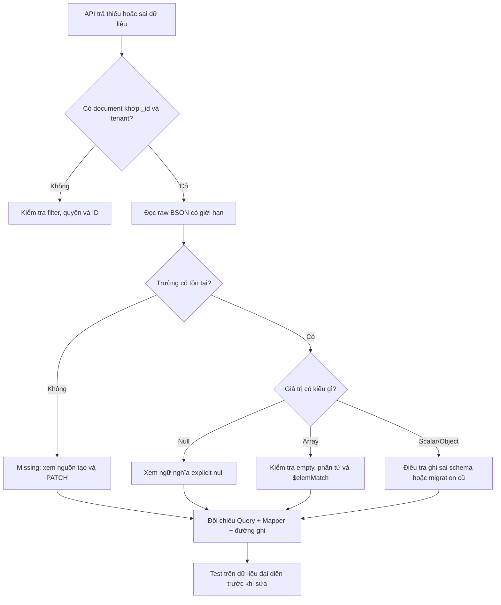

# Document null, trường thiếu hoặc array không khớp dự kiến

## 1. Bài toán chẩn đoán trong Spring Data MongoDB

Khi xây dựng ứng dụng bằng **Spring Data MongoDB**, chúng ta có thể truy vấn tài liệu bằng `MongoTemplate` hoặc `MongoRepository`, ánh xạ BSON thành entity Java, dùng `Criteria` để tìm dữ liệu và thực hiện các thao tác cập nhật. Cùng một thông báo nghiệp vụ như “không có dữ liệu” có thể bắt nguồn từ nhiều nguyên nhân khác nhau:

- Không có **document** nào thỏa điều kiện truy vấn.
- Document có tồn tại nhưng **thiếu một trường**.
- Trường tồn tại nhưng chứa giá trị BSON **`null`**.
- Trường là **mảng rỗng `[]`**, khác với `null` và trường thiếu.
- Ứng dụng kỳ vọng một `List`/array nhưng dữ liệu cũ lại lưu **chuỗi, object hoặc kiểu BSON khác**.
- Truy vấn mảng khớp phần tử ngoài ý muốn, hoặc mapping Java làm mất thông tin về hình dạng BSON.

Những trường hợp này cần cách xử lý khác nhau. Nếu gộp tất cả thành “null”, API có thể trả sai dữ liệu, thao tác `$push` có thể thất bại, một aggregation dùng `$size` có thể báo lỗi hoặc một đợt migration có thể ghi đè thông tin hợp lệ.

**Mục tiêu:** quan sát và phân loại đúng trạng thái dữ liệu; sửa câu truy vấn hoặc logic ánh xạ cho đúng; chỉ chuẩn hóa dữ liệu sau khi đã xác định ý nghĩa nghiệp vụ của từng trạng thái.

## 2. Phân biệt document vắng mặt và trạng thái của một trường

### Document không tồn tại

```java
Order order = mongoTemplate.findOne(query, Order.class);

if (order == null) {
    // Không tìm thấy document thỏa query.
}
```

`MongoTemplate.findOne(...)` có thể trả `null` nếu không có document khớp. `MongoTemplate.find(...)` trả danh sách rỗng khi không có kết quả; `MongoRepository.findById(id)` trả `Optional.empty()`. Chúng mô tả **kết quả tìm kiếm**, không cho biết bên trong một document có trường nào bị thiếu.

### Một trường trong document có thể có nhiều hình dạng

Giả sử tên trường là `tags`:

| BSON trong document | Tình trạng | Ý nghĩa có thể dùng trong nghiệp vụ |
| --- | --- | --- |
| Không có khóa `tags` | Missing | Chưa ghi nhận; dữ liệu cũ; thao tác PATCH không đụng đến trường |
| `"tags": null` | Explicit null | Đã ghi null; có thể biểu diễn “chưa xác định” hoặc “xóa giá trị” |
| `"tags": []` | Empty array | Đã xác nhận danh sách rỗng |
| `"tags": ["urgent"]` | Valid nonempty array | Có ít nhất một nhãn |
| `"tags": "urgent"` | Scalar string | Sai schema nếu ứng dụng yêu cầu mảng; có thể là dữ liệu cũ |
| `"tags": { "name": "urgent" }` | Object | Sai kiểu nếu schema yêu cầu array |
| `"tags": ["urgent", null]` | Array mixed values | Là mảng nhưng phần tử có thể không hợp lệ |

Không mặc định coi missing, `null` và `[]` là tương đương. Với yêu cầu PATCH, chẳng hạn, API có thể quy ước “không gửi `tags`” là giữ nguyên, gửi `null` là xóa thông tin, còn gửi `[]` là thiết lập danh sách rỗng.

## 3. Bộ dữ liệu tái hiện lỗi

Dùng một collection thử nghiệm riêng để dễ quan sát, tránh ảnh hưởng dữ liệu thực:

```javascript
db.order_shape_samples.insertMany([
  {
    _id: "missing",
    tenantId: "tenant-a",
    status: "NEW"
    // Không có tags và lines.
  },
  {
    _id: "null",
    tenantId: "tenant-a",
    status: "NEW",
    tags: null,
    lines: null
  },
  {
    _id: "empty",
    tenantId: "tenant-a",
    status: "NEW",
    tags: [],
    lines: []
  },
  {
    _id: "array",
    tenantId: "tenant-a",
    status: "PAID",
    tags: ["urgent", "fragile"],
    lines: [
      { sku: "S1", qty: 1 },
      { sku: "S2", qty: 5 }
    ]
  },
  {
    _id: "scalar",
    tenantId: "tenant-a",
    status: "NEW",
    tags: "fragile",
    lines: { sku: "S1", qty: 5 }
  },
  {
    _id: "mixed",
    tenantId: "tenant-a",
    status: "NEW",
    tags: ["urgent", null],
    lines: [
      { sku: "S1", qty: 2 },
      { sku: "S2", qty: 1 }
    ]
  },
  {
    _id: "another-tenant",
    tenantId: "tenant-b",
    tags: ["fragile"],
    lines: []
  }
]);
```

Các ví dụ sau chủ yếu lọc `tenantId: "tenant-a"` để tránh trộn dữ liệu của tenant khác. `_id` dùng chuỗi để có thể đọc kết quả dễ dàng; `String` cũng là loại ID được Spring Data MongoDB hỗ trợ. Khi chạy lại đoạn dữ liệu mẫu, dùng database/collection thử nghiệm mới hoặc xóa dữ liệu mẫu theo kế hoạch vì `insertMany` sẽ báo trùng `_id` nếu chạy hai lần.

## 4. Bộ câu lệnh phân biệt missing, null và array

### 4.1. `{ tags: null }` không chỉ khớp null

```javascript
db.order_shape_samples.find(
  { tenantId: "tenant-a", tags: null },
  { _id: 1, tags: 1 }
);
```

Trong MongoDB, phép so sánh `{ tags: null }` có thể khớp document **thiếu `tags`**, document có `tags: null` và cả array có phần tử `null` theo ngữ nghĩa so khớp giá trị trong mảng. Với bộ dữ liệu trên, đừng diễn giải kết quả này là danh sách “chỉ chứa explicit null”.

| Điều kiện | Ý nghĩa cần nhớ |
| --- | --- |
| `{ tags: null }` | Tìm null hoặc missing; array chứa phần tử null cũng là trường hợp cần chú ý |
| `{ tags: { $exists: false } }` | Trường `tags` không tồn tại |
| `{ tags: { $exists: true } }` | Trường tồn tại, **kể cả có giá trị null** |
| `{ tags: { $type: "array" } }` | Trường có kiểu BSON array |
| `{ tags: { $size: 0 } }` | Trường là array rỗng |
| `{ tags: "fragile" }` | Có thể khớp chuỗi scalar hoặc một mảng chứa phần tử đó |

### 4.2. Tìm trường thiếu

```javascript
db.order_shape_samples.find(
  { tenantId: "tenant-a", tags: { $exists: false } },
  { _id: 1 }
);
// Kỳ vọng trong dữ liệu mẫu: _id = "missing".
```

`$exists: false` kiểm tra **không có khóa** tương ứng, không phải “giá trị bằng null”. Với đường dẫn lồng nhau, dấu chấm như `profile.contact.email` dùng để kiểm tra sự tồn tại của đường dẫn; khi một thành phần cha không tồn tại thì đường dẫn con cũng không tồn tại.

### 4.3. Tìm explicit BSON null chính xác

Đối với **trường scalar**, `{ tags: { $type: "null" } }` có thể tìm giá trị BSON null. Tuy nhiên, toán tử truy vấn `$type` khi gặp array có thể kiểm tra cả **kiểu của phần tử**, vì vậy mảng chứa `null` là một tình huống cần xem xét.

Nếu cần xác định **kiểu của chính toàn bộ giá trị tại đường dẫn** thay vì các phần tử trong mảng, có thể sử dụng aggregation expression `$type` bên trong `$expr`:

```javascript
db.order_shape_samples.find(
  {
    tenantId: "tenant-a",
    $expr: {
      $eq: [{ $type: "$tags" }, "null"]
    }
  },
  { _id: 1, tags: 1 }
);
// Kỳ vọng: chỉ _id = "null".
```

Trong aggregation expression, `$type` trả `"missing"` cho trường thiếu, `"null"` cho BSON null và `"array"` cho một giá trị array. Biểu thức `$expr` phục vụ chẩn đoán chính xác nhưng không nhất thiết sử dụng index hiệu quả như predicate đơn giản; hãy xem `explain()` trước khi dùng trên tập dữ liệu lớn.

### 4.4. Phân biệt array rỗng với array có phần tử

```javascript
// Chỉ array rỗng.
db.order_shape_samples.find({
  tenantId: "tenant-a",
  tags: { $size: 0 }
});

// Mọi giá trị tags có kiểu array, gồm [] và array không rỗng.
db.order_shape_samples.find({
  tenantId: "tenant-a",
  tags: { $type: "array" }
});
```

`$size: 0` không khớp null, trường thiếu, chuỗi scalar hoặc object; nó yêu cầu mảng có đúng 0 phần tử. Toán tử `$size` trong truy vấn thông thường không sử dụng index để trả lời trực tiếp điều kiện về số phần tử, nên cân nhắc lưu riêng `tagCount` nếu workload cần lọc theo độ dài mảng với tần suất lớn; trường đếm đó phải được giữ nhất quán ở mọi đường ghi.

### 4.5. Truy xuất kiểu BSON để phân tích phân bố dữ liệu

```javascript
db.order_shape_samples.aggregate([
  { $match: { tenantId: "tenant-a" } },
  {
    $project: {
      tagsType: { $type: "$tags" },
      linesType: { $type: "$lines" },
      tagsCount: {
        $cond: [
          { $isArray: "$tags" },
          { $size: "$tags" },
          null
        ]
      }
    }
  }
]);
```

Đây là bước chẩn đoán hữu ích khi không biết dữ liệu bị lệch schema từ bao giờ. Với dữ liệu mẫu, `tagsType` lần lượt có thể là `"missing"`, `"null"`, `"array"` hoặc `"string"`. `tagsCount` chỉ tính kích thước khi giá trị thật sự là array; các giá trị khác nhận `null` để tránh phép `$size` gây lỗi.

## 5. Truy vấn array: vì sao kết quả “đúng cú pháp nhưng sai ý”

### 5.1. Tìm scalar có thể khớp cả mảng

```javascript
db.order_shape_samples.find({
  tenantId: "tenant-a",
  tags: "fragile"
});
```

Truy vấn này có thể khớp cả:

- `_id: "array"` vì `tags` là `["urgent", "fragile"]`.
- `_id: "scalar"` vì `tags` là chuỗi `"fragile"`.

Đây là cách MongoDB xử lý phép so sánh với phần tử trong mảng, không nhất thiết là lỗi. Nhưng nếu API chỉ chấp nhận `tags` dạng array, kết quả `"scalar"` là dữ liệu sai schema bị lọt vào.

Muốn yêu cầu **một mảng chứa phần tử** có giá trị nhất định, sử dụng `$elemMatch`:

```javascript
db.order_shape_samples.find({
  tenantId: "tenant-a",
  tags: { $elemMatch: { $eq: "fragile" } }
});
// Kỳ vọng: _id = "array", không khớp scalar "fragile".
```

Với array scalar, `$elemMatch` thường không cần thiết chỉ để tìm giá trị, nhưng nó hữu ích khi cần loại dữ liệu có kiểu scalar.

### 5.2. So khớp toàn bộ array, tìm một giá trị, tìm mọi giá trị

| Truy vấn | Kết quả mong muốn |
| --- | --- |
| `{ tags: ["urgent", "fragile"] }` | Array bằng chính xác hai phần tử đó và đúng thứ tự |
| `{ tags: "urgent" }` | Array chứa `"urgent"` hoặc trường scalar bằng `"urgent"` |
| `{ tags: { $all: ["urgent", "fragile"] } }` | Array chứa cả hai giá trị, không yêu cầu đúng thứ tự |
| `{ tags: { $size: 2 } }` | Array có đúng hai phần tử, không kiểm tra nội dung |
| `{ tags: { $elemMatch: { $eq: "urgent" } } }` | Một array có phần tử bằng `"urgent"` |

`$all` không thay thế cho `$elemMatch` trong mọi trường hợp. Với array object, `$elemMatch` còn xác nhận **nhiều điều kiện nằm trên cùng một phần tử**.

### 5.3. Dot notation có thể khớp các phần tử khác nhau

Giả sử `lines` là mảng chi tiết đơn hàng:

```javascript
db.order_shape_samples.find({
  tenantId: "tenant-a",
  "lines.sku": "S1",
  "lines.qty": { $gte: 5 }
});
```

Document `_id: "array"` vẫn khớp: phần tử thứ nhất có `sku = "S1"` với `qty = 1`, phần tử thứ hai có `qty = 5` với `sku = "S2"`. Hai điều kiện có thể được đáp ứng bởi **hai phần tử khác nhau**.

Hơn nữa, document `_id: "scalar"` có `lines` là **object**, không phải array, cũng có thể khớp đường dẫn `"lines.sku"` và `"lines.qty"`. Nếu nghiệp vụ chỉ cho phép một dòng hàng thỏa đồng thời điều kiện, hãy viết:

```javascript
db.order_shape_samples.find({
  tenantId: "tenant-a",
  lines: {
    $elemMatch: {
      sku: "S1",
      qty: { $gte: 5 }
    }
  }
});
```

Với dữ liệu mẫu, truy vấn `$elemMatch` trên không khớp `"array"`, `"mixed"` hoặc `"scalar"`:

- `"array"` có S1/1 và S2/5, không có cùng phần tử S1 và qty ≥ 5.
- `"mixed"` có S1/2 và S2/1, không thỏa.
- `"scalar"` có object S1/5 nhưng `$elemMatch` yêu cầu **array**.

Nếu thật sự muốn minh họa kết quả đúng, có thể thêm vào collection thử nghiệm một document hợp lệ có `lines: [{ sku: "S1", qty: 5 }]`. Bài học quan trọng là đổi từ hai predicate dạng dot sang `$elemMatch` làm thay đổi ngữ nghĩa, không đơn thuần là thay đổi hiệu năng.

## 6. Viết chẩn đoán bằng Spring Data MongoDB

### 6.1. `Criteria` cho missing và null

```java
import org.springframework.data.mongodb.core.query.Criteria;
import org.springframework.data.mongodb.core.query.Query;

Query missingTags = Query.query(
        Criteria.where("tenantId").is(tenantId)
                .and("tags").exists(false)
);

Query nullOrMissingTags = Query.query(
        Criteria.where("tenantId").is(tenantId)
                .and("tags").is(null)
);
```

Hai query này không tương đương. `.exists(false)` chỉ tìm trường thiếu; `.is(null)` có ngữ nghĩa MongoDB tương ứng với equality null, có thể khớp cả missing và một số array chứa null. Với yêu cầu phân biệt **giá trị null chính xác**, dùng `$expr` như đã minh họa hoặc truy xuất raw BSON rồi kiểm tra kiểu.

### 6.2. Query có `$type` / `$elemMatch`

`BasicQuery` nhận JSON query, hữu ích khi cần biểu thức MongoDB cụ thể:

```java
import java.util.List;
import org.bson.Document;
import org.springframework.data.mongodb.core.MongoTemplate;
import org.springframework.data.mongodb.core.query.BasicQuery;
import org.springframework.data.mongodb.core.query.Criteria;
import org.springframework.data.mongodb.core.query.Query;

// Chỉ tài liệu có tags thuộc BSON array.
Query arrayOnly = new BasicQuery(
        "{ 'tenantId': 'tenant-a', 'tags': { '$type': 'array' } }"
);

List<Document> rawArrays = mongoTemplate.find(
        arrayOnly, Document.class, "order_shape_samples"
);

// Cùng một phần tử lines phải có sku S1 và qty >= 5.
Query sameElement = Query.query(
        Criteria.where("tenantId").is(tenantId)
                .and("lines")
                .elemMatch(
                        Criteria.where("sku").is("S1")
                                .and("qty").gte(5)
                )
);
```

Trong đó `mongoTemplate` là `MongoTemplate` đã được inject và `tenantId` là tenant đã xác thực. `BasicQuery` trong ví dụ đầu dùng literal cho dữ liệu thử nghiệm; khi viết API thật, dùng tham số được binding qua `Criteria`/repository để tránh tự ghép chuỗi truy vấn từ input.

Một điểm cần chú ý: `mongoTemplate.find(query, Document.class, "order_shape_samples")` trả **raw BSON Document**, thuận tiện quan sát cấu trúc thực. Nếu truy vấn thành entity domain, kết quả còn đi qua `MappingMongoConverter` và có thể che đi sự khác biệt giữa trường thiếu với trường có `null`.

### 6.3. Repository query cho array object

```java
import java.util.List;
import org.springframework.data.mongodb.repository.MongoRepository;
import org.springframework.data.mongodb.repository.Query;

interface OrderRepository extends MongoRepository<Order, String> {

    @Query("{ 'tenantId': ?0, 'lines': { '$elemMatch': " +
           "{ 'sku': ?1, 'qty': { '$gte': ?2 } } } }")
    List<Order> findOrdersWithLine(
            String tenantId, String sku, int minimumQuantity);
}
```

Query này chỉ nên đọc tài liệu phù hợp với schema của entity `Order`; nếu collection còn dữ liệu có `lines` là object hoặc string, hãy thực hiện truy vấn/raw BSON để định lượng các trường hợp lệch schema trước khi ánh xạ toàn bộ document.

## 7. Ánh xạ Java: vì sao hai trạng thái BSON có thể cùng thành `null`

Giả sử entity được khai báo:

```java
import java.util.List;
import org.springframework.data.annotation.Id;
import org.springframework.data.mongodb.core.mapping.Document;

@Document(collection = "order_shape_samples")
class Order {
    @Id
    String id;

    String tenantId;
    String status;
    List<String> tags;
    List<LineItem> lines;
}

record LineItem(String sku, Integer qty) {}
```

Với mapping mặc định, trường Java `List<String> tags` thường không lưu dấu vết “trường BSON không tồn tại” hay “BSON null”; sau ánh xạ, thuộc tính có thể là `null` trong cả hai trường hợp. Giá trị thực tế còn phụ thuộc constructor, cách khởi tạo thuộc tính, custom converter và cấu hình mapping của entity. **Không dựa vào kết quả Java đơn thuần để kết luận MongoDB có khóa đó hay không.**

Nếu ứng dụng cần phân biệt hai trạng thái, đọc raw BSON:

```java
import org.bson.Document;

Document bson = mongoTemplate.getCollection("order_shape_samples")
        .find(new Document("_id", orderId))
        .first();

if (bson == null) {
    // Document không tồn tại.
} else if (!bson.containsKey("tags")) {
    // Có document nhưng thiếu trường tags.
} else if (bson.get("tags") == null) {
    // Trường tags tồn tại và có giá trị BSON null.
} else if (bson.get("tags") instanceof List<?> values) {
    // Có array: tiếp tục xét empty/nonempty và kiểu từng phần tử.
    int elementCount = values.size();
} else {
    // Có trường tags nhưng sai kiểu kỳ vọng: string, object, number...
}
```

Đoạn trên dùng **Java 17+** và `org.bson.Document`; `orderId` là giá trị ID đã được xác định trong ngữ cảnh ứng dụng. `Document.get("tags") == null` **một mình** chưa đủ phân biệt missing với explicit null; phải kết hợp `containsKey(...)`.

### 7.1. Constructor, record và kiểu nguyên thủy

- `record Order(String id, List<String> tags)` vẫn có thể nhận `null` nếu không kiểm tra tham số. Nếu constructor dùng `Objects.requireNonNull(tags)`, lỗi có thể xuất hiện ngay lúc materialize entity.
- Trường nguyên thủy như `int qty` không thể biểu diễn `null`; dùng `Integer` nếu muốn phát hiện dữ liệu thiếu/nullable. Tuy nhiên bản thân `Integer` cũng không phân biệt missing với explicit null.
- Một `List` được khởi tạo sẵn bằng `new ArrayList<>()` hoặc `List.of()` không phải cam kết rằng Spring Data sẽ biến mọi missing/null thành empty list. Mapping, constructor và setter quyết định trạng thái sau đọc.
- Với class dùng `@Field("stored_name")` hoặc custom conversion, tên trường BSON có thể khác tên thuộc tính Java. Chẩn đoán bằng raw BSON phải dùng **tên được lưu** thật.

Nếu mong muốn hệ thống luôn có array, hãy thiết lập invariant ở tầng tạo dữ liệu và dùng schema validation, thay vì hy vọng một getter Java tự sửa mọi document cũ.

### 7.2. Array sai kiểu có thể gây lỗi conversion

Document như:

```json
{
  "_id": "scalar",
  "tags": "fragile",
  "lines": { "sku": "S1", "qty": 5 }
}
```

không phù hợp với `List<String> tags` và `List<LineItem> lines`. Tùy converter và kiểu thực tế, lúc đọc có thể phát sinh lỗi ánh xạ/chuyển đổi hoặc nhận kết quả không như thiết kế. Loại exception cụ thể phụ thuộc phiên bản Spring Data, converter và constructor: không nên bắt cứng một exception được suy đoán từ thông báo log.

Cách chẩn đoán thường tốt hơn là đọc raw BSON với `Document.class`/MongoDB Java Driver để xem giá trị đang lưu **trước khi** tìm lỗi ở entity, DTO hoặc mapper HTTP.

## 8. Aggregation: `$size`, `$unwind` và phép toán trên array

### 8.1. `$size` trong aggregation cần đầu vào đúng kiểu array

Lệnh sau không an toàn với dữ liệu hỗn hợp:

```javascript
db.order_shape_samples.aggregate([
  { $project: { tagCount: { $size: "$tags" } } }
]);
```

Aggregation expression `$size` yêu cầu toán hạng giải ra một array. Nếu `tags` missing, null hoặc scalar, pipeline có thể báo lỗi; kết quả không đơn giản là số 0.

Thay bằng kiểm tra kiểu trước:

```javascript
db.order_shape_samples.aggregate([
  { $match: { tenantId: "tenant-a" } },
  {
    $project: {
      tagCount: {
        $cond: [
          { $isArray: "$tags" },
          { $size: "$tags" },
          null
        ]
      }
    }
  }
]);
```

Ví dụ này trả `null` khi không có mảng để phân biệt với một mảng rỗng có `tagCount = 0`. Nếu nghiệp vụ quy định missing/null tương đương với danh sách rỗng, thay nhánh cuối thành `0`; cần ghi rõ quyết định đó trong hợp đồng API.

### 8.2. `$ifNull` không giúp giữ nguyên phân biệt missing và null

`$ifNull` có thể cung cấp giá trị dự phòng cho null/missing:

```javascript
{ $project: { safeTags: { $ifNull: ["$tags", []] } } }
```

Nhưng biểu thức này **không sửa giá trị scalar sai kiểu** như `"fragile"`; và nó chủ động gộp missing với null. Nếu mục tiêu là xử lý an toàn mọi dữ liệu không phải array, dùng `$isArray` với `$cond`:

```javascript
{
  $project: {
    safeTags: {
      $cond: [{ $isArray: "$tags" }, "$tags", []]
    }
  }
}
```

### 8.3. `$unwind` có thể làm biến mất document

```javascript
db.order_shape_samples.aggregate([
  { $match: { tenantId: "tenant-a" } },
  { $unwind: "$lines" }
]);
```

Mặc định, `$unwind` không đưa document có `lines` missing, null hoặc empty array sang stage tiếp theo. Vì vậy số đơn hàng sau `$unwind` có thể nhỏ hơn số đơn hàng trước đó; đồng thời một document có nhiều phần tử được tách thành nhiều dòng.

Nếu cần giữ document khi field thiếu/null/empty:

```javascript
db.order_shape_samples.aggregate([
  { $match: { tenantId: "tenant-a" } },
  {
    $unwind: {
      path: "$lines",
      preserveNullAndEmptyArrays: true
    }
  }
]);
```

Khi có `preserveNullAndEmptyArrays: true`, phải kiểm tra shape của output trước khi `$group`/`$sum`: document được giữ lại không đồng nghĩa có một dòng hàng hợp lệ. Với scalar không phải null, `$unwind` có thể coi giá trị như một phần tử; do đó nếu luôn yêu cầu array, hãy kiểm tra kiểu đầu vào rõ ràng.

## 9. Các lệnh ghi thường làm lộ lỗi kiểu array

### 9.1. `$push` và `$addToSet`

```java
import org.springframework.data.mongodb.core.query.Criteria;
import org.springframework.data.mongodb.core.query.Query;
import org.springframework.data.mongodb.core.query.Update;

Query byIdAndTenant = Query.query(
        Criteria.where("_id").is(orderId)
                .and("tenantId").is(authenticatedTenantId)
);

mongoTemplate.updateFirst(
        byIdAndTenant,
        new Update().push("tags", "urgent"),
        Order.class
);
```

Nếu trường `tags` **không tồn tại**, MongoDB có thể tạo mảng mới với phần tử được `$push` thêm vào. Nếu `tags` đang là `null` hoặc chuỗi scalar, `$push` có thể thất bại vì đích không phải array. `$addToSet` cũng đòi trường đích có thể được xử lý như mảng; nó tránh thêm phần tử đã tồn tại theo ngữ nghĩa so sánh MongoDB nhưng không tự chữa scalar thành array.

Đừng biến mọi lỗi `$push` thành thao tác `$set: { tags: [] }` trên production: cách đó có thể **làm mất dữ liệu sai schema nhưng vẫn có giá trị**. Hãy thống kê các document lệch kiểu và chọn chính sách migration phù hợp trước.

### 9.2. `$set` có thể tạo ra sai schema

```javascript
// Cách ghi có thể khiến mã ứng dụng chờ List<String> bị lỗi:
db.order_shape_samples.updateOne(
  { _id: "array", tenantId: "tenant-a" },
  { $set: { tags: "fragile" } }
);
```

`$set` thay giá trị bất kể schema kỳ vọng của entity (trừ khi có validation/constraint khác). Ngay cả khi tất cả code entity đang dùng `List<String>`, một script, bulk update hoặc MongoDB Driver vẫn có thể ghi chuỗi scalar vào trường đó.

Với HTTP PATCH, nên định nghĩa rõ contract:

| Input PATCH | Hành vi nếu chọn chính sách “giữ phân biệt” |
| --- | --- |
| Không có thuộc tính `tags` | Không cập nhật trường |
| `"tags": null` | Xóa giá trị hoặc đặt explicit null theo yêu cầu |
| `"tags": []` | Ghi mảng rỗng |
| `"tags": ["urgent"]` | Ghi mảng có một phần tử |
| `"tags": "urgent"` | Từ chối input sai kiểu với thông báo validation rõ ràng |

Khi DTO chuyển cả “không gửi” và “gửi null” thành cùng một field Java `null`, controller có thể vô tình làm mất thông tin PATCH. Muốn giữ ba trạng thái, hãy dùng kiểu đầu vào/logic parse có khả năng phân biệt sự hiện diện của thuộc tính, chẳng hạn `JsonNode.has("tags")` đi kèm kiểm tra `isNull()` và `isArray()`; đừng dùng getter nullable duy nhất để đoán.

## 10. Điều tra dữ liệu trước khi sửa

### 10.1. Đếm từng nhóm theo tenant

```javascript
const scope = { tenantId: "tenant-a" };

print("missing:", db.order_shape_samples.countDocuments({
  ...scope, tags: { $exists: false }
}));

print("explicit null:", db.order_shape_samples.countDocuments({
  ...scope,
  $expr: { $eq: [{ $type: "$tags" }, "null"] }
}));

print("arrays:", db.order_shape_samples.countDocuments({
  ...scope, tags: { $type: "array" }
}));

print("empty arrays:", db.order_shape_samples.countDocuments({
  ...scope, tags: { $size: 0 }
}));

print("scalar string:", db.order_shape_samples.countDocuments({
  ...scope,
  $expr: { $eq: [{ $type: "$tags" }, "string"] }
}));
```

Đoạn này dùng cú pháp JavaScript của `mongosh`. Với `$expr`, chúng ta kiểm tra kiểu của **giá trị trường toàn phần**, nên array chứa chuỗi không bị nhầm thành trường scalar string. Khi làm việc với nhiều kiểu lệch schema, dùng aggregation nhóm theo `$type` để có bức tranh tổng quát.

### 10.2. Tạo báo cáo phân bố kiểu

```javascript
db.order_shape_samples.aggregate([
  { $match: { tenantId: "tenant-a" } },
  {
    $group: {
      _id: { $type: "$tags" },
      count: { $sum: 1 },
      examples: { $push: "$_id" }
    }
  },
  { $sort: { count: -1 } }
]);
```

`examples` ở đây chỉ phù hợp collection thử nghiệm nhỏ. Trên dữ liệu production, không `$push` hàng triệu ID vào một document tổng hợp; chỉ lấy mẫu có giới hạn hoặc chạy hai bước: đếm theo nhóm rồi truy vấn số lượng ID nhỏ đại diện.

### 10.3. Dùng `explain()` đúng chỗ

```javascript
db.order_shape_samples
  .find({
    tenantId: "tenant-a",
    tags: { $exists: false }
  })
  .explain("executionStats");
```

Kiểm tra `totalDocsExamined`, `totalKeysExamined`, index được chọn và số dòng trả về. Các điều kiện như `$expr` hoặc `$size` không nhất thiết được phục vụ hiệu quả chỉ bằng index; scan lớn trên collection production có thể tốn tài nguyên. Với đường truy vấn thường xuyên, cân nhắc bổ sung trường được chuẩn hóa và index thích hợp **sau khi** xác định rõ hợp đồng schema.

## 11. Chiến lược khắc phục và migration dữ liệu

### 11.1. Sửa logic truy vấn khi dữ liệu hợp lệ nhưng semantics sai

Nếu MongoDB lưu đúng array object nhưng query dạng dot nhận kết quả ngoài ý muốn, chuyển sang `$elemMatch`. Nếu yêu cầu chỉ lấy mảng, thêm điều kiện type hoặc `$elemMatch`. Nếu cần tách missing khỏi null, dùng `$exists` hoặc kiểm tra kiểu chính xác. Không cần chạy migration khi lỗi xuất phát từ cách truy vấn.

### 11.2. Chuẩn hóa dữ liệu cũ có chủ đích

Giả sử nghiệp vụ quy định **trường `tags` thiếu** tương đương danh sách rỗng, có thể backfill:

```javascript
db.order_shape_samples.updateMany(
  {
    tenantId: "tenant-a",
    tags: { $exists: false }
  },
  { $set: { tags: [] } }
);
```

Đây là ví dụ cho **trường missing**, không tự động xử lý explicit null hay scalar string. Nếu nghiệp vụ yêu cầu chuyển `tags: null` thành `[]`, hãy lọc riêng nhóm đó bằng tiêu chí đúng kiểu. Tránh `updateMany({ tags: null }, ...)` nếu chưa nhận ra truy vấn sẽ bao gồm missing và các trường hợp array chứa null.

Với `tags: "fragile"`, có thể cần chuyển thành `["fragile"]`, đánh dấu dữ liệu lỗi để xử lý thủ công, hoặc từ chối dữ liệu; lựa chọn phụ thuộc ý nghĩa lịch sử của trường. Không tùy tiện đặt mọi trường sai kiểu về `[]`.

Trước khi chạy migration lớn:

1. Thống kê số lượng/kiểu dữ liệu theo tenant và phiên bản schema.
2. Xác định quy tắc chuyển đổi cho **từng nhóm** và phương án hoàn nguyên.
3. Thử trên tập dữ liệu đại diện; so sánh số lượng document trước/sau.
4. Chạy theo batch có kiểm soát và ghi nhận số document bị tác động.
5. Xác minh lại bằng raw BSON, API đọc/ghi và truy vấn nghiệp vụ sau migration.

### 11.3. Chặn dữ liệu sai hình dạng từ những đường ghi mới

MongoDB hỗ trợ schema validation bằng `$jsonSchema`. Ví dụ giới hạn `tags` phải là array các string khi trường này xuất hiện:

```javascript
db.runCommand({
  collMod: "order_shape_samples",
  validator: {
    $jsonSchema: {
      bsonType: "object",
      properties: {
        tags: {
          bsonType: "array",
          items: { bsonType: "string" }
        }
      }
    }
  },
  validationLevel: "strict",
  validationAction: "warn"
});
```

Cấu hình `warn` phù hợp để khảo sát dữ liệu hoặc thử chính sách trước khi bật chế độ từ chối. Khi đã kiểm tra tác động lên luồng ghi, có thể cân nhắc `validationAction: "error"` để từ chối write vi phạm. Đây là thao tác thay đổi cấu hình database, nên thử trong môi trường riêng và triển khai theo quy trình quản lý schema.

Trong ví dụ, `tags` **không nằm trong danh sách `required`** nên trường missing vẫn được chấp nhận. Muốn bắt buộc phải có `tags`, thêm `required: ["tags"]` ở schema cấp document; explicit null vẫn không thỏa `bsonType: "array"`. Một schema validator mới không tự sửa tất cả document cũ; dữ liệu sai schema đã lưu cần được xử lý riêng.

Ở tầng Java, nên kiểm tra DTO đầu vào, chuyển đổi thống nhất khi nhận thông điệp hoặc chạy migration, và viết test cho các đường ghi sử dụng `MongoTemplate`, repository, bulk operations lẫn MongoDB Java Driver.

## 12. Kiểm thử lỗi hình dạng dữ liệu

### 12.1. Ma trận test nên có

| Dữ liệu đầu vào | Hành vi đọc | Hành vi tìm kiếm | Hành vi cập nhật cần kiểm tra |
| --- | --- | --- | --- |
| Document không tồn tại | `findOne == null` / `Optional.empty` | Không trả kết quả | Không khớp ID; không tạo document nếu không có upsert |
| Trường thiếu | Raw BSON `containsKey == false` | `$exists: false` khớp | `$push` vào trường missing có thể tạo array |
| Trường null | Raw BSON có key và value null | Equality null có thể khớp | `$push`/`$addToSet` có thể báo lỗi |
| Array rỗng | `List` rỗng nếu mapping phù hợp | `$size: 0` khớp | Thêm phần tử phải được kiểm tra |
| Array không rỗng | Đọc đúng phần tử | Membership/`$elemMatch` | `$push`/`$pull` thay đúng phần tử |
| Scalar sai kiểu | Có nguy cơ lỗi mapping hoặc sai business logic | Equality scalar có thể khớp | Array update thường không phù hợp |
| Array có phần tử null | List hợp lệ về container nhưng chứa phần tử lỗi | `{ tags: null }` có thể khớp | Cần quy tắc xử lý phần tử null |

### 12.2. Integration test với raw BSON

Đoạn sau là ví dụ **JUnit 5 + `@DataMongoTest`**. Test phải được cấu hình kết nối đến **MongoDB thử nghiệm riêng** (có thể dùng Testcontainers); không trỏ tới database chung của ứng dụng:

```java
import static org.junit.jupiter.api.Assertions.*;

import java.util.List;

import org.bson.Document;
import org.junit.jupiter.api.AfterEach;
import org.junit.jupiter.api.Test;
import org.springframework.beans.factory.annotation.Autowired;
import org.springframework.boot.test.autoconfigure.data.mongo.DataMongoTest;
import org.springframework.data.mongodb.core.MongoTemplate;
import org.springframework.data.mongodb.core.query.BasicQuery;

@DataMongoTest
class OrderShapeIntegrationTest {

    private static final String COLLECTION = "order_shape_contract_test";

    @Autowired
    MongoTemplate template;

    @AfterEach
    void removeTestData() {
        template.dropCollection(COLLECTION);
    }

    @Test
    void rawBsonDistinguishesMissingNullAndEmptyArray() {
        template.getCollection(COLLECTION).insertMany(List.of(
                new Document("_id", "missing"),
                new Document("_id", "null").append("tags", null),
                new Document("_id", "empty").append("tags", List.of())
        ));

        Document missing = template.getCollection(COLLECTION)
                .find(new Document("_id", "missing")).first();
        Document explicitNull = template.getCollection(COLLECTION)
                .find(new Document("_id", "null")).first();
        Document empty = template.getCollection(COLLECTION)
                .find(new Document("_id", "empty")).first();

        assertNotNull(missing);
        assertNotNull(explicitNull);
        assertNotNull(empty);
        assertFalse(missing.containsKey("tags"));
        assertTrue(explicitNull.containsKey("tags"));
        assertNull(explicitNull.get("tags"));
        assertEquals(List.of(), empty.get("tags"));
    }

    @Test
    void elemMatchRequiresArrayInsteadOfScalar() {
        template.getCollection(COLLECTION).insertMany(List.of(
                new Document("_id", "scalar")
                        .append("tags", "fragile"),
                new Document("_id", "array")
                        .append("tags", List.of("fragile"))
        ));

        long broadMatch = template.getCollection(COLLECTION)
                .countDocuments(new Document("tags", "fragile"));

        long arrayMatch = template.getCollection(COLLECTION)
                .countDocuments(
                        new Document("tags",
                                new Document("$elemMatch",
                                        new Document("$eq", "fragile")))
                );

        assertEquals(2L, broadMatch);
        assertEquals(1L, arrayMatch);
    }
}
```

Đây là các test **có ý nghĩa** vì đối chiếu trực tiếp hai query có hành vi khác nhau và kiểm tra raw BSON thay vì suy đoán từ entity. Với project dùng Spring Boot/Testcontainers đời khác, import và cấu hình test slice có thể thay đổi. Có thể thay `@DataMongoTest` bằng test cấu hình đầy đủ nếu cần kiểm thử cả validation ở HTTP layer.

Nếu muốn kiểm tra thêm lỗi khi cập nhật array sai kiểu, thêm một test trên database thử nghiệm, gọi `$push` vào `tags: "fragile"` rồi kiểm tra exception và dữ liệu còn nguyên sau khi lệnh thất bại. Đừng phụ thuộc vào chuỗi thông báo lỗi cố định giữa các phiên bản MongoDB.

## 13. Quy trình chẩn đoán từng bước khi production trả sai dữ liệu



Khi gặp một lỗi thực tế:

1. Ghi nhận **ID tài liệu, tenant, đường truy vấn và loại lỗi** theo quy định bảo mật; không log nguyên document chứa dữ liệu nhạy cảm.
2. Chạy query trực tiếp trong database thử nghiệm hoặc trên mẫu dữ liệu cho phép, ưu tiên dùng `_id` và tenant để giảm phạm vi.
3. Đọc raw BSON và đánh dấu rõ **missing/null/empty array/array có phần tử/sai kiểu**.
4. So sánh câu truy vấn MongoDB với `Criteria`/repository thực tế, đặc biệt các điều kiện `null`, dot notation và `$elemMatch`.
5. Kiểm tra domain mapping, constructor, custom conversion và tên field trong BSON; không mặc định Java null đồng nghĩa BSON null.
6. Tìm nguồn ghi: `save`, `updateFirst`, `$set`, `$push`, bulk write, migration script, ứng dụng khác hoặc MongoDB Driver.
7. Quyết định sửa query, sửa code ghi, bổ sung validation hay migration. Viết regression test cho trạng thái dữ liệu gây lỗi.

Nếu bật DEBUG log cho `MongoTemplate`, chỉ dùng trong môi trường/khung thời gian phù hợp vì câu truy vấn có thể chứa thông tin nhạy cảm. Nên ghi nhận query shape và thống kê hơn là log tùy tiện toàn bộ filter hoặc document người dùng.

## 14. Câu hỏi thường gặp

**`findOne(...) == null` có nghĩa là trường `tags` đang null?** Không. Điều đó nghĩa là không có document khớp query. Nếu có document nhưng thiếu trường, entity vẫn có thể được trả về với một thuộc tính Java null.

**`Criteria.where("tags").is(null)` có chỉ tìm BSON null?** Không. Equality null trong MongoDB cũng tìm trường thiếu; array chứa null là tình huống cần chú ý. Dùng `$exists` và kiểm tra kiểu khi cần phân biệt.

**Có thể phân biệt missing với null sau khi đã map thành entity không?** Không phải luôn luôn. Một field nullable trong Java không tự lưu “trường có tồn tại trong BSON hay không”. Dùng raw BSON hoặc mô hình dữ liệu chuyên biệt nếu sự phân biệt này là một phần của nghiệp vụ.

**Vì sao `tags: "fragile"` vẫn khớp một document chứa `tags: ["fragile"]`?** Vì equality trên trường array có thể so khớp từng phần tử. Nếu muốn chỉ khớp array, dùng `$elemMatch` hoặc kiểm tra kiểu array.

**Vì sao `$size` báo lỗi trong aggregation?** Vì aggregation expression `$size` yêu cầu đầu vào là array. Hãy dùng `$isArray` và `$cond` để xử lý null/missing/sai kiểu. Toán tử truy vấn `{ tags: { $size: 0 } }` lại dùng để **lọc** array có đúng số phần tử.

**Mảng rỗng có tương đương trường không tồn tại không?** Không ở cấp BSON và trong nhiều query. Có thể quy định chúng tương đương ở nghiệp vụ, nhưng cần thực thi thống nhất trong API, migration và validation.

**Nên chọn `$elemMatch` hay dot notation cho array object?** Khi nhiều điều kiện phải cùng đúng trên **một phần tử**, dùng `$elemMatch`. Dot notation có thể tìm điều kiện trên các phần tử khác nhau và cũng có thể khớp nested object không phải array.

**Sửa bằng cách chuyển mọi null/scalar thành `[]` được không?** Chỉ khi có bằng chứng nghiệp vụ rằng dữ liệu cũ không cần bảo toàn. Với scalar chứa thông tin thật, ép sang mảng rỗng sẽ làm mất dữ liệu; nên phân loại và migration có quy tắc riêng.

## Bài tập vận dụng

**Bài 1 — Phân loại:** Với bảy document mẫu, viết bốn truy vấn để tìm: (a) trường thiếu; (b) explicit null; (c) array rỗng; (d) scalar string. Tự đối chiếu với `$type` aggregation để tránh nhầm array chứa null/chuỗi.

**Bài 2 — Truy vấn mảng:** So sánh số document khớp giữa điều kiện `"lines.sku": "S1"` kết hợp `"lines.qty": { $gte: 5 }` và điều kiện `lines: { $elemMatch: { sku: "S1", qty: { $gte: 5 } } }`. Giải thích vì sao kết quả khác nhau.

**Bài 3 — Chẩn đoán cập nhật:** Tạo một document có `tags: null`, thử `$push` trong database test, ghi nhận loại lỗi và raw BSON sau thao tác. Sửa dữ liệu theo chính sách được định nghĩa rõ, chạy lại phép thêm phần tử và xác minh mảng có cấu trúc đúng.

**Bài 4 — Regression test:** Dùng `@DataMongoTest` với MongoDB riêng để đảm bảo code đọc có thể phân biệt missing, null, empty array và scalar sai kiểu. Bổ sung test cho mapping entity nếu ứng dụng dùng converter tùy chỉnh.

## Tài liệu tham khảo

- [MongoDB Manual — Query for Null or Missing Fields](https://www.mongodb.com/docs/manual/tutorial/query-for-null-fields/)
- [MongoDB Manual — `$exists`](https://www.mongodb.com/docs/manual/reference/operator/query/exists/)
- [MongoDB Manual — `$type` Query Operator](https://www.mongodb.com/docs/manual/reference/operator/query/type/)
- [MongoDB Manual — `$elemMatch`](https://www.mongodb.com/docs/manual/reference/operator/query/elemMatch/)
- [MongoDB Manual — Query an Array](https://www.mongodb.com/docs/manual/tutorial/query-arrays/)
- [MongoDB Manual — `$size` Aggregation Expression](https://www.mongodb.com/docs/manual/reference/operator/aggregation/size/)
- [MongoDB Manual — `$unwind`](https://www.mongodb.com/docs/manual/reference/operator/aggregation/unwind/)
- [MongoDB Manual — JSON Schema Validation](https://www.mongodb.com/docs/manual/core/schema-validation/specify-json-schema/)
- [Spring Data MongoDB — Querying Documents](https://docs.spring.io/spring-data/mongodb/reference/mongodb/template-query-operations.html)
- [Spring Data MongoDB — Object Mapping](https://docs.spring.io/spring-data/mongodb/reference/mongodb/mapping/mapping.html)
