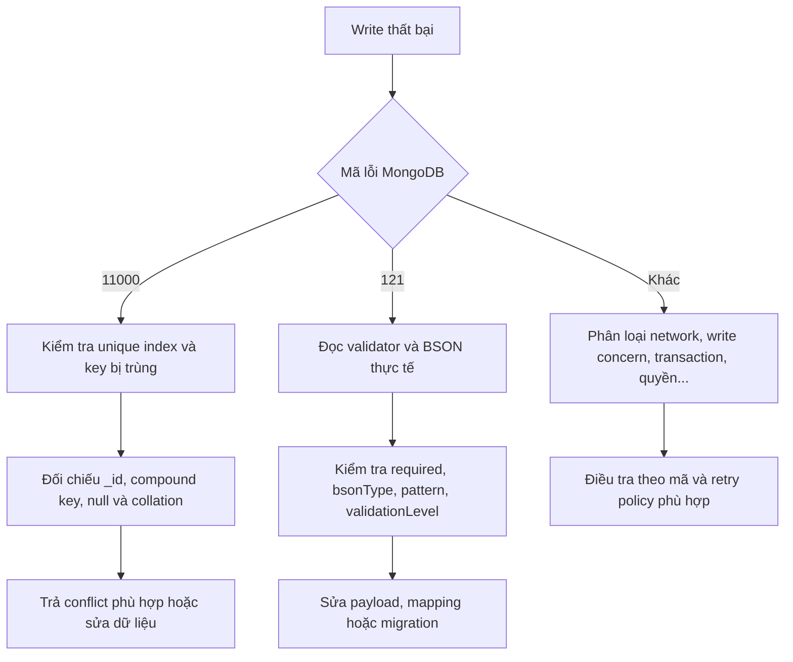

# DuplicateKeyException, unique index và lỗi schema validation

## 1. Hai nhóm lỗi dễ nhầm trong Spring Data MongoDB

Ứng dụng dùng **Spring Data MongoDB** thường ghi dữ liệu bằng `MongoRepository`, `MongoTemplate` hoặc `ReactiveMongoTemplate`. Khi lệnh `insert`, `save`, `update`, `upsert` hoặc `bulkWrite` thất bại, nguyên nhân có thể nằm ở quy tắc **duy nhất giữa các document** hoặc **hình dạng của từng document**.

Giả sử một hệ thống nhiều tenant lưu khách hàng trong collection `customers`:

```javascript
{
  _id: ObjectId("..."),
  tenantId: "tenant-a",
  email: "an@example.test",
  displayName: "An",
  createdAt: ISODate("2026-11-20T00:00:00Z")
}
```

Yêu cầu: trong **cùng tenant**, mỗi `email` chỉ xuất hiện một lần; `tenantId` và `email` bắt buộc là chuỗi, `displayName` phải có nội dung. Đây là **hai ràng buộc riêng**:

- **Unique index** bảo đảm không có hai document cùng cặp `(tenantId, email)` trong phạm vi index. Xung đột thường sinh lỗi MongoDB **`E11000 duplicate key`**, được Spring Data dịch thành **`DuplicateKeyException`** trên các đường thao tác có exception translation.
- **Schema validation** bằng `$jsonSchema` kiểm tra kiểu dữ liệu, trường bắt buộc, biểu thức chính quy và các điều kiện trên **một document**. Document vi phạm validator khi ghi thường nhận MongoDB **`DocumentValidationFailure`, mã lỗi `121`**. Exception Java bên ngoài phụ thuộc đường gọi, loại thao tác và cơ chế dịch lỗi.

| Tiêu chí | Duplicate key | Schema validation |
| --- | --- | --- |
| Mã lỗi MongoDB thường gặp | `11000` (`E11000`) | `121` (`DocumentValidationFailure`) |
| Ràng buộc từ đâu? | Unique index, gồm unique index của `_id` | Collection validator, thường là `$jsonSchema` |
| So sánh với document khác? | Có, trên khóa nằm trong index | Thông thường kiểm tra từng document |
| Dễ phát sinh ở lệnh nào? | Insert, update khóa index, upsert, bulk write, tạo unique index trên dữ liệu trùng | Insert, update/replace vi phạm validator, bulk write |
| Hành động xử lý | Xác định index/khóa gây xung đột và yêu cầu nghiệp vụ; có thể trả HTTP `409` | Xem rule vi phạm và dữ liệu BSON thực tế; có thể trả `400` hoặc `422` tùy hợp đồng API |
| Retry cùng payload có ích không? | Không, nếu ràng buộc và dữ liệu không thay đổi | Không, nếu document vẫn không hợp lệ |

**Không kết luận mọi lỗi ghi là duplicate key.** Ví dụ lỗi mất kết nối, timeout, write concern, quyền truy cập hoặc xung đột transaction có nguyên nhân và cách khôi phục khác. Phải xem chuỗi exception và mã lỗi gốc trước khi quyết định trả HTTP status hoặc retry.

## 2. Dựng collection mẫu có cả hai ràng buộc

Trong `mongosh`, tạo collection với validator và unique index. Ví dụ này dùng trực tiếp lệnh MongoDB để nhìn rõ quy tắc do **server** thực thi, không phụ thuộc annotation Java:

```javascript
db.createCollection("customers", {
  validator: {
    $jsonSchema: {
      bsonType: "object",
      required: ["tenantId", "email", "displayName"],
      properties: {
        tenantId: {
          bsonType: "string",
          minLength: 1
        },
        email: {
          bsonType: "string",
          pattern: "^[^@ ]+@[^@ ]+[.][^@ ]+$"
        },
        displayName: {
          bsonType: "string",
          minLength: 1
        },
        createdAt: {
          bsonType: "date"
        }
      }
    }
  },
  validationLevel: "strict",
  validationAction: "error"
});

db.customers.createIndex(
  { tenantId: 1, email: 1 },
  { unique: true, name: "ux_customers_tenant_email" }
);
```

`$jsonSchema` ở đây dùng từ khóa `bsonType` để kiểm tra **kiểu BSON thực sự lưu trong MongoDB**. Regex email chỉ nhằm minh họa validation, **không phải** bộ kiểm tra địa chỉ email đầy đủ theo mọi chuẩn. Trong ứng dụng, nên kiểm tra dữ liệu đầu vào ở DTO/service và vẫn để MongoDB bảo vệ ràng buộc lưu trữ.

Thử một document hợp lệ:

```javascript
db.customers.insertOne({
  tenantId: "tenant-a",
  email: "an@example.test",
  displayName: "An",
  createdAt: new Date()
});
```

Sau đó thử hai lỗi **độc lập**:

```javascript
// Lỗi 11000: cùng cặp (tenantId, email) đã tồn tại.
db.customers.insertOne({
  tenantId: "tenant-a",
  email: "an@example.test",
  displayName: "An khác"
});

// Lỗi 121: email có kiểu number, không thỏa $jsonSchema.
db.customers.insertOne({
  tenantId: "tenant-a",
  email: 12345,
  displayName: "Khách nhập sai kiểu"
});
```

Ngược lại, cùng email nhưng **khác tenant** là hợp lệ theo compound unique index vừa tạo:

```javascript
db.customers.insertOne({
  tenantId: "tenant-b",
  email: "an@example.test",
  displayName: "An ở tenant khác"
});
```

Không chạy ví dụ trên database đang có collection nghiệp vụ cùng tên: lệnh tạo collection và index được thiết kế cho **database thử nghiệm riêng**.

## 3. Hiểu chính xác `DuplicateKeyException` và unique index

### 3.1. Unique index là cơ chế bảo vệ đồng thời ở database

Không nên chỉ dùng logic kiểu:

```java
// Đoạn mã minh họa race condition, không phải giải pháp bảo đảm uniqueness.
if (!repository.existsByTenantIdAndEmail(tenantId, email)) {
    repository.save(customer);
}
```

Giữa bước `existsBy...` và `save`, một request khác vẫn có thể thêm cùng khóa. Hai request đều đọc thấy “chưa có”, sau đó một request thành công và request kia nhận duplicate key. **Unique index mới là cơ chế cuối cùng bảo đảm tính duy nhất** dưới thao tác ghi đồng thời.

Cách xử lý đúng là để database thực thi unique constraint, bắt lỗi tại thao tác ghi thực tế và chuyển thành thông báo nghiệp vụ thích hợp. Nếu phải chạy trong transaction, cần xem cả lỗi ở ranh giới thao tác hoặc commit, không chỉ lúc tạo entity.

### 3.2. Trường `_id`, compound key, null và missing

- MongoDB mặc định tạo unique index cho `_id`. `E11000` có thể đến từ `_id_` thay vì index email.
- **Single-field unique index** thông thường chỉ cho phép **một document** có giá trị `null` hoặc thiếu field đang được index; MongoDB lập khóa index dạng null cho trường hợp đó.
- **Compound unique index** xem **cả tổ hợp khóa**. Hai document có cùng `tenantId` và cùng `email` bị trùng; nếu `email` thiếu hoặc null thì việc trùng phụ thuộc toàn bộ tổ hợp, không phải cứ thiếu email là luôn bị từ chối.
- Với **unique multikey index** trên array, ràng buộc duy nhất áp dụng giữa các **document**; các giá trị trùng bên trong cùng một document không nhất thiết tạo duplicate-key error. Cần kiểm tra thiết kế schema nếu đưa mảng vào khóa index.
- Unique index mặc định phân biệt chữ hoa/chữ thường theo collation mặc định. `An@Example.test` và `an@example.test` có thể được xem là hai khóa khác nhau nếu không có chuẩn hóa hoặc collation phù hợp.

Không suy rằng việc thêm `@NotNull` hoặc `@Email` trong Java tự giải quyết được những tình huống trên: annotation kiểm tra ở lớp ứng dụng không thay thế unique index.

### 3.3. Partial unique index và case-insensitive uniqueness

Nếu chỉ tài khoản **đang hoạt động** phải có email duy nhất, cân nhắc **partial unique index**:

```javascript
// Một phương án THAY THẾ unique index toàn bộ collection ở mục 2.
db.customers.createIndex(
  { tenantId: 1, email: 1 },
  {
    unique: true,
    name: "ux_active_customer_email",
    partialFilterExpression: { active: true }
  }
);
```

Chỉ những document khớp `active: true` mới tham gia ràng buộc. Nếu update một document từ `active: false` thành `active: true` khiến cặp khóa trùng, thao tác update có thể nhận `E11000`. **Không tạo đồng thời** index này với unique index toàn bộ collection trong mục 2 rồi mong rằng partial index sẽ cho phép email trùng ở khách hàng không hoạt động: index toàn bộ vẫn áp dụng.

Với yêu cầu so sánh không phân biệt hoa thường, có thể chuẩn hóa email theo quy tắc nghiệp vụ (ví dụ lưu `normalizedEmail`) rồi tạo unique index trên field đã chuẩn hóa; hoặc thiết kế index có **collation**:

```javascript
// Phương án khác trên một collection phù hợp.
db.customers.createIndex(
  { tenantId: 1, email: 1 },
  {
    unique: true,
    name: "ux_customer_email_case_insensitive",
    collation: { locale: "en", strength: 2 }
  }
);
```

Index với collation có quy tắc so sánh riêng; truy vấn muốn dùng index hiệu quả thường cũng phải dùng collation phù hợp khi collection không đặt collation đó làm mặc định. Việc tạo nhiều index cùng key pattern nhưng khác tùy chọn phụ thuộc quy tắc đặt tên/index tương thích của server; phải coi đây là **các phương án thiết kế**, không phải ba lệnh để chạy liên tiếp trên collection mẫu.

### 3.4. Vì sao tạo unique index cũng có thể thất bại?

Nếu dữ liệu đang tồn tại đã vi phạm uniqueness, lệnh `createIndex({ ... }, { unique: true })` không thể tạo ràng buộc mới thành công. Trước migration, tìm các cặp trùng:

```javascript
db.customers.aggregate([
  {
    $group: {
      _id: { tenantId: "$tenantId", email: "$email" },
      count: { $sum: 1 }
    }
  },
  { $match: { count: { $gt: 1 } } },
  { $sort: { count: -1 } },
  { $limit: 50 }
]);
```

Pipeline này dùng để **khảo sát**. Với dữ liệu lớn, `$group` có thể tốn tài nguyên; chạy có kế hoạch, dùng filter phù hợp và đừng xóa tự động document trùng khi chưa có quy tắc hợp nhất dữ liệu.

Với **sharded collection**, unique index còn chịu những giới hạn liên quan đến shard key. Trước khi triển khai yêu cầu uniqueness toàn cluster, cần kiểm tra phiên bản MongoDB, kiểu sharding và quy tắc index cho shard key; không coi việc tạo index trên một môi trường đơn node là bằng chứng nó hợp lệ trên cluster production.

## 4. Schema validation hoạt động ra sao?

### 4.1. Validation tại database khác validation đầu vào API

`@Valid`, `@NotBlank`, `@Email` hoặc validator trong service giúp trả thông báo sớm và dễ hiểu, nhưng các client khác có thể ghi trực tiếp vào MongoDB, bỏ qua logic controller. `$jsonSchema` của collection được thực thi tại database đối với các thao tác ghi thuộc phạm vi validation.

| Nơi đặt quy tắc | Ví dụ | Giới hạn |
| --- | --- | --- |
| DTO/API | `@Email`, `@NotBlank` | Chỉ áp dụng khi đi qua đường validate được cấu hình |
| Entity/mapping Spring Data | `@Field`, converter, callback | Ánh xạ và vòng đời ứng dụng; không đồng nghĩa BSON lúc ghi chắc chắn thỏa schema |
| MongoDB `$jsonSchema` | `required`, `bsonType`, `minLength`, `pattern` | Kiểm tra mỗi document khi ghi; không bảo đảm uniqueness xuyên nhiều document |
| MongoDB unique index | `{ tenantId: 1, email: 1 }` | Bảo đảm uniqueness giữa document; không kiểm tra định dạng email |

Một field Java kiểu `String` vẫn có thể thành BSON khác mong đợi nếu có custom converter hoặc nguồn ghi khác. Để chẩn đoán, so **BSON thực tế** với `bsonType` trong validator thay vì chỉ nhìn khai báo class.

### 4.2. `validationLevel` và `validationAction`

MongoDB hỗ trợ các chính sách validation khi tạo/sửa collection:

| Tùy chọn | Ý nghĩa |
| --- | --- |
| `validationLevel: "strict"` | Kiểm tra mọi insert/update thuộc diện validation. |
| `validationLevel: "moderate"` | Kiểm tra insert và các update của document hiện tại đã hợp lệ; có thể bỏ qua kiểm tra cập nhật trên document vốn không hợp lệ, hữu ích trong giai đoạn migration dữ liệu cũ. |
| `validationLevel: "off"` | Không áp dụng các rule của validator khi ghi. |
| `validationAction: "error"` | Từ chối ghi khi document vi phạm validator, trả lỗi (thường mã `121`). |
| `validationAction: "warn"` | Cho phép ghi nhưng ghi cảnh báo validation vào log của server; không dùng để bảo đảm chất lượng dữ liệu. |

Một số phiên bản MongoDB mới hỗ trợ thêm hành động như `errorAndLog`; không giả định mọi bản server đều có tùy chọn này. Khả năng dùng `bypassDocumentValidation` cũng phụ thuộc quyền và lệnh; đây là cơ chế quản trị đặc biệt, **không phải giải pháp khắc phục payload sai**.

Thay đổi validator bằng `collMod` áp dụng cho những lần ghi tiếp theo theo chính sách mới; **không tự sửa hoặc quét lại tất cả document cũ**. Nếu chọn `moderate`, cần kế hoạch sửa các bản ghi cũ không hợp lệ để tiến tới `strict`.

### 4.3. Lỗi `121` thường chứa những thông tin nào?

Ngoài mã lỗi `121` và thông báo `Document failed validation`, server có thể trả `errInfo`/`details` tùy phiên bản và thao tác. Thông tin này có thể cho biết:

- `operatorName` hoặc quy tắc như `required`, `bsonType`, `pattern` nào không thỏa.
- Trường BSON nào có giá trị hoặc kiểu không hợp lệ.
- Cấu trúc lồng nhau khi validator có nhiều rule.

Chi tiết lỗi đôi khi chứa **giá trị dữ liệu thật**. Không trả nguyên `errInfo`, `keyValue` hoặc toàn bộ document vào response API hoặc log tập trung; chỉ ghi mã, namespace, request/correlation ID và trường đã lọc thông tin nhạy cảm.

Ví dụ kiểm tra rule thực đang cài:

```javascript
const info = db.getCollectionInfos({ name: "customers" })[0];
printjson(info.options.validator);
printjson({
  validationLevel: info.options.validationLevel,
  validationAction: info.options.validationAction
});

// Danh sách index để xác định unique constraint đang thực thi.
db.customers.getIndexes();
```

Không lấy annotation trong mã nguồn làm “nguồn sự thật” của validator và index: database có thể được tạo bởi migration khác, đã thay đổi bằng `collMod`, hoặc cấu hình auto-index không chạy.

## 5. Đường đi của exception từ MongoDB Driver vào Spring

### 5.1. Các lớp exception liên quan

Khi thực thi qua `MongoTemplate` hoặc repository, Spring Data có thể áp dụng **exception translation** từ driver sang hệ phân cấp `org.springframework.dao.DataAccessException`.

```text
MongoDB server
  ├── code 11000: duplicate key
  │     └── MongoWriteException / MongoBulkWriteException / lỗi lệnh tương ứng
  │            └── Spring Data: thường là DuplicateKeyException
  └── code 121: document failed validation
        └── MongoWriteException / MongoBulkWriteException / lỗi tương ứng
               └── Spring Data: DataAccessException, subtype tùy đường gọi và phiên bản
```

`DuplicateKeyException` kế thừa `DataIntegrityViolationException`, vốn kế thừa `NonTransientDataAccessException`. Bởi vậy nếu muốn bắt và xử lý duplicate key riêng, cần xét **catch cụ thể trước catch tổng quát**. Đừng chỉ bắt `RuntimeException` rồi dựa trên chuỗi `getMessage()`.

Một số trường hợp thực thi **trực tiếp MongoDB Java Driver** không đi qua translator của Spring Data, nên nhận `MongoWriteException`/`MongoBulkWriteException`. Một số lỗi tạo index là lỗi command, không có cùng dạng như lỗi insert. Với bulk write, có thể có **nhiều write error**, mỗi lỗi gắn với một chỉ số operation; hãy kiểm tra danh sách `getWriteErrors()` và chính sách `ordered`/`unordered`.

### 5.2. Phân loại theo mã lỗi gốc, không parse message

Ví dụ utility Java 17 để nhận diện mã lỗi trong cause chain, kể cả bulk write:

```java
import com.mongodb.MongoException;
import com.mongodb.MongoBulkWriteException;
import com.mongodb.MongoWriteException;

public final class MongoFailureCodes {

    private MongoFailureCodes() {}

    public static boolean contains(Throwable failure, int code) {
        for (Throwable current = failure;
             current != null;
             current = current.getCause()) {

            if (current instanceof MongoWriteException write
                    && write.getError().getCode() == code) {
                return true;
            }

            if (current instanceof MongoBulkWriteException bulk
                    && bulk.getWriteErrors().stream()
                           .anyMatch(error -> error.getCode() == code)) {
                return true;
            }

            if (current instanceof MongoException mongo
                    && mongo.getCode() == code) {
                return true;
            }
        }
        return false;
    }
}
```

Cách này giúp nhận diện `121` trong cả một số exception đã được Spring translate. Nó không bảo đảm bao phủ mọi wrapper tự định nghĩa hoặc mọi kết quả lỗi khi bulk write trả về theo giao thức khác; kiểm tra loại exception thực tế trong môi trường triển khai.

### 5.3. Xử lý nghiệp vụ bằng `MongoTemplate`

Ví dụ service tạo khách hàng (giả sử entity `Customer`, request đã được validate trước ở API):

```java
import org.springframework.dao.DataAccessException;
import org.springframework.dao.DuplicateKeyException;
import org.springframework.data.mongodb.core.MongoTemplate;

public class CustomerService {

    private final MongoTemplate mongoTemplate;

    public CustomerService(MongoTemplate mongoTemplate) {
        this.mongoTemplate = mongoTemplate;
    }

    public Customer register(Customer customer) {
        try {
            return mongoTemplate.insert(customer);
        } catch (DuplicateKeyException duplicate) {
            // Chỉ ánh xạ thành "email đã tồn tại" khi biết lỗi
            // phát sinh từ unique index (tenantId, email) của thao tác này.
            throw new CustomerAlreadyExistsException(
                "Khách hàng đã tồn tại trong tenant", duplicate);
        } catch (DataAccessException failure) {
            if (MongoFailureCodes.contains(failure, 121)) {
                throw new InvalidCustomerDocumentException(
                    "Document không thỏa schema MongoDB", failure);
            }
            throw failure;
        }
    }
}
```

`CustomerAlreadyExistsException` và `InvalidCustomerDocumentException` là **exception nghiệp vụ tự định nghĩa**, ví dụ có constructor nhận `(String message, Throwable cause)`; chúng không phải class có sẵn của Spring.

Nếu collection có **nhiều unique index**, việc bắt mọi `DuplicateKeyException` rồi thông báo “email đã tồn tại” có thể gây hiểu nhầm, vì nguyên nhân có thể là `_id_` hoặc một unique index khác. Khi đó cần nhận diện đúng index bằng thông tin lỗi có kiểm soát hoặc xây dựng các thao tác ghi tách biệt với thông báo chung như “bản ghi trùng ràng buộc duy nhất”. Tránh phụ thuộc duy nhất vào câu chữ lỗi vì định dạng server có thể thay đổi.

Nếu dùng `repository.save(entity)`, nhớ rằng Spring Data có thể **insert hoặc replace/upsert tùy trạng thái ID và chiến lược xác định entity mới**. Lỗi trùng khóa không chỉ đến từ gọi `insert()`; việc thay đổi một trường có unique index trong `update` cũng có thể lỗi.

### 5.4. Giao diện HTTP: thông báo có ích nhưng không lộ khóa

Trên Spring Framework 6 / Spring Boot 3, có thể xử lý exception nghiệp vụ bằng `ProblemDetail`:

```java
import org.springframework.http.HttpStatus;
import org.springframework.http.ProblemDetail;
import org.springframework.http.ResponseEntity;
import org.springframework.web.bind.annotation.ExceptionHandler;
import org.springframework.web.bind.annotation.RestControllerAdvice;

@RestControllerAdvice
class CustomerErrorHandler {

    @ExceptionHandler(CustomerAlreadyExistsException.class)
    ResponseEntity<ProblemDetail> duplicate(
            CustomerAlreadyExistsException failure) {
        ProblemDetail body = ProblemDetail.forStatusAndDetail(
            HttpStatus.CONFLICT,
            "Khách hàng đã tồn tại trong phạm vi tenant.");
        body.setTitle("Ràng buộc duy nhất bị vi phạm");
        return ResponseEntity.status(HttpStatus.CONFLICT).body(body);
    }

    @ExceptionHandler(InvalidCustomerDocumentException.class)
    ResponseEntity<ProblemDetail> invalid(
            InvalidCustomerDocumentException failure) {
        ProblemDetail body = ProblemDetail.forStatusAndDetail(
            HttpStatus.UNPROCESSABLE_ENTITY,
            "Dữ liệu không đáp ứng quy tắc lưu trữ.");
        body.setTitle("Dữ liệu không hợp lệ");
        return ResponseEntity.status(HttpStatus.UNPROCESSABLE_ENTITY)
            .body(body);
    }
}
```

Không hiển thị raw driver message trong body: lỗi duplicate key có thể chứa tên index và `keyValue`; lỗi schema có thể tiết lộ trường và giá trị nhạy cảm. Với public API, `409 Conflict` thường hợp lý cho unique constraint; `400` hoặc `422` cho dữ liệu sai tùy hợp đồng API. Lỗi hạ tầng hoặc lỗi cấu hình database không nên tự động biến thành lỗi 4xx cho người dùng.

### 5.5. Reactive access và bulk write

Trong reactive repository/template, lỗi chỉ xuất hiện khi publisher được **subscribe** và thao tác ghi thực thi:

```java
Mono<Customer> result = reactiveMongoTemplate.insert(customer)
    .onErrorMap(
        org.springframework.dao.DuplicateKeyException.class,
        duplicate -> new CustomerAlreadyExistsException(
            "Khách hàng đã tồn tại trong tenant", duplicate)
    );
```

Đoạn này minh họa mapping exception; cần import `reactor.core.publisher.Mono` và có bean `reactiveMongoTemplate`. Không dùng `try/catch` quanh dòng **tạo `Mono`** để thay thế việc xử lý lỗi được phát khi subscribe.

Với `insertMany` hoặc `BulkOperations`, đặc biệt chế độ **unordered**, có thể một số lệnh đã thành công dù một phần tử gặp `11000` hoặc `121`. Phải đối chiếu kết quả bulk, danh sách lỗi và idempotency của batch trước khi retry toàn bộ, tránh tạo thêm document ngoài ý muốn.

## 6. Annotation Spring Data, tạo index và migration schema

### 6.1. `@CompoundIndex` mô tả index, nhưng database phải có index thật

```java
import org.springframework.data.annotation.Id;
import org.springframework.data.mongodb.core.index.CompoundIndex;
import org.springframework.data.mongodb.core.mapping.Document;

@Document("customers")
@CompoundIndex(
    name = "ux_customers_tenant_email",
    def = "{ 'tenantId': 1, 'email': 1 }",
    unique = true
)
public class Customer {
    @Id
    private String id;
    private String tenantId;
    private String email;
    private String displayName;

    // Constructor, getter và setter theo quy ước dự án.
}
```

Spring Data MongoDB **không tự tạo index từ annotation theo mặc định** ở nhiều phiên bản hiện đại (từ Spring Data MongoDB 3.0, auto-index creation bị tắt mặc định). Trong ứng dụng Spring Boot, việc đặt cấu hình bật auto-index cho môi trường phù hợp hoặc dùng `MongoTemplate.indexOps(...)` là một lựa chọn, nhưng ở production nên quản lý index bằng migration và xác nhận nó đã được tạo thành công.

Ví dụ khởi tạo index trong một bước migration có kiểm soát:

```java
import org.springframework.data.domain.Sort;
import org.springframework.data.mongodb.core.MongoTemplate;
import org.springframework.data.mongodb.core.index.Index;

void ensureCustomerIndex(MongoTemplate template) {
    template.indexOps("customers").ensureIndex(
        new Index()
            .on("tenantId", Sort.Direction.ASC)
            .on("email", Sort.Direction.ASC)
            .unique()
            .named("ux_customers_tenant_email")
    );
}
```

Đoạn này **không tự xử lý trùng dữ liệu hiện có**. Nếu collection chứa cặp khóa trùng hoặc tồn tại index cùng tên nhưng khác đặc tả, migration có thể lỗi; cần điều tra, sửa dữ liệu và triển khai theo kế hoạch. Đừng bắt lỗi tạo index rồi bỏ qua, vì khi đó yêu cầu uniqueness có thể không được bảo đảm.

### 6.2. JSON Schema và annotation entity không tự đồng bộ

Việc khai báo `@Document`, `@Field`, Java field type hay Bean Validation không tự thiết lập collection validator `$jsonSchema` trên MongoDB. Spring Data có API hỗ trợ dựng JSON Schema từ metadata và truyền vào tùy chọn tạo collection, nhưng phải chủ động chạy bước tạo hoặc migration. Khi collection đã tồn tại, sửa entity **không tự thay validator cũ**.

Một quy trình triển khai nên có thứ tự:

1. Xác định quy tắc uniqueness và schema, bao gồm trường cũ thiếu/null, kiểu BSON của dữ liệu lịch sử và yêu cầu phân biệt hoa thường.
2. Kiểm tra dữ liệu trước migration; tìm document không hợp lệ và các nhóm trùng khóa.
3. Sửa dữ liệu theo quy tắc nghiệp vụ, có kế hoạch backup và audit.
4. Tạo hoặc thay đổi unique index / validator; thất bại phải chặn triển khai hoặc có quyết định xử lý tường minh.
5. Kiểm tra lại `getIndexes()` và `getCollectionInfos()` trên **đúng cluster/database/collection**.
6. Kiểm thử cả yêu cầu chấp nhận document hợp lệ lẫn từ chối document vi phạm.

## 7. Quy trình chẩn đoán một lỗi ghi thực tế

Giả sử production báo “không thể tạo khách hàng”, nhưng endpoint chỉ trả HTTP 500. Điều tra theo thứ tự:

### Bước 1: Thu thập ngữ cảnh an toàn

Ghi request/correlation ID, tên operation (`insert`, `update`, `upsert`, bulk), namespace, thời điểm, bản triển khai, mã lỗi server và loại exception Spring/driver. Không ghi plaintext email, định danh nhạy cảm, connection URI có mật khẩu hoặc toàn bộ document vào log.

### Bước 2: Xác minh ràng buộc đang tồn tại

```javascript
db.customers.getIndexes();

const info = db.getCollectionInfos({ name: "customers" })[0];
printjson(info.options.validator);
printjson(info.options.validationLevel);
printjson(info.options.validationAction);
```

Đối chiếu index name, key pattern, `unique`, `partialFilterExpression`, `collation` và validator với migration dự kiến. Nếu thiếu index, đừng tuyên bố database đã bảo đảm uniqueness chỉ vì source Java có annotation.

### Bước 3: Phân nhánh theo mã lỗi



### Bước 4: Tái hiện với dữ liệu tối thiểu

Trong test database có cùng index/validator, tạo một document hợp lệ, thêm lần thứ hai cùng unique key để kiểm tra `11000`; tạo document sai `bsonType` để kiểm tra `121`. Khi cần kiểm tra lỗi update, tạo document hợp lệ trước rồi thay đổi trường unique hoặc trường bị schema ràng buộc.

### Bước 5: Xác nhận sau khi sửa

Không chỉ kiểm tra API trả thành công. Đọc lại document bằng `MongoTemplate`, kiểm tra index/validator thực tế và chạy lại bộ test concurrency/bulk write nếu chúng từng kích hoạt lỗi. Nếu sửa logic chuẩn hóa email, cũng cần quyết định xử lý những dữ liệu cũ có nhiều cách viết hoa/thường.

## 8. Integration test cho unique index và validation

Trong thử nghiệm, nên kiểm tra **MongoDB thật** bằng Testcontainers vì mocking repository không kiểm tra được engine unique index hoặc `$jsonSchema`. Đoạn dưới dùng `@DataMongoTest` (Spring Boot 3), Testcontainers MongoDB và collection có tên riêng cho từng test.

```java
import java.util.List;
import java.util.UUID;

import org.bson.Document;
import org.junit.jupiter.api.AfterEach;
import org.junit.jupiter.api.BeforeEach;
import org.junit.jupiter.api.Test;
import org.springframework.beans.factory.annotation.Autowired;
import org.springframework.boot.test.autoconfigure.data.mongo.DataMongoTest;
import org.springframework.data.domain.Sort;
import org.springframework.data.mongodb.core.MongoTemplate;
import org.springframework.data.mongodb.core.index.Index;
import org.springframework.test.context.DynamicPropertyRegistry;
import org.springframework.test.context.DynamicPropertySource;
import org.testcontainers.containers.MongoDBContainer;
import org.testcontainers.junit.jupiter.Container;
import org.testcontainers.junit.jupiter.Testcontainers;
import org.testcontainers.utility.DockerImageName;

import static org.assertj.core.api.Assertions.assertThat;
import static org.assertj.core.api.Assertions.assertThatThrownBy;
import static org.assertj.core.api.Assertions.catchThrowable;

@DataMongoTest
@Testcontainers
class CustomerConstraintsIT {

    @Container
    static final MongoDBContainer mongo =
        new MongoDBContainer(DockerImageName.parse("mongo:7.0"));

    @DynamicPropertySource
    static void mongoProperties(DynamicPropertyRegistry registry) {
        registry.add("spring.data.mongodb.uri", mongo::getReplicaSetUrl);
    }

    @Autowired
    MongoTemplate template;

    // JUnit Jupiter tạo instance mới cho mỗi test theo cấu hình mặc định.
    private final String collection =
        "customers_it_" + UUID.randomUUID().toString().replace("-", "");

    @BeforeEach
    void createConstrainedCollection() {
        Document fields = new Document("tenantId",
            new Document("bsonType", "string"))
            .append("email", new Document("bsonType", "string"));

        Document jsonSchema = new Document("bsonType", "object")
            .append("required", List.of("tenantId", "email"))
            .append("properties", fields);

        template.getDb().runCommand(
            new Document("create", collection)
                .append("validator",
                    new Document("$jsonSchema", jsonSchema))
                .append("validationAction", "error")
                .append("validationLevel", "strict")
        );

        template.indexOps(collection).ensureIndex(
            new Index()
                .on("tenantId", Sort.Direction.ASC)
                .on("email", Sort.Direction.ASC)
                .unique()
        );
    }

    private Document customer(String tenantId, Object email) {
        return new Document("tenantId", tenantId)
            .append("email", email);
    }

    @Test
    void sameEmailInSameTenantFails() {
        template.insert(customer("tenant-a", "a@example.test"), collection);

        assertThatThrownBy(() ->
            template.insert(customer("tenant-a", "a@example.test"), collection)
        ).isInstanceOf(
            org.springframework.dao.DuplicateKeyException.class
        );

        // Với tenant khác, cặp khóa khác nên hợp lệ.
        template.insert(customer("tenant-b", "a@example.test"), collection);
    }

    @Test
    void wrongBsonTypeFailsSchemaValidation() {
        Throwable failure = catchThrowable(() ->
            template.insert(customer("tenant-a", 12345), collection)
        );

        assertThat(failure).isNotNull();
        assertThat(MongoFailureCodes.contains(failure, 121)).isTrue();
    }

    @AfterEach
    void removeOwnedCollection() {
        template.dropCollection(collection);
    }
}
```

`MongoFailureCodes` là utility từ mục 5.2; cần đưa vào test source hoặc dùng helper tương đương. Ví dụ yêu cầu Docker và dependency Testcontainers MongoDB/JUnit Jupiter tương thích Spring Boot đang chạy; tên class/package module có thể khác theo phiên bản Testcontainers. Khi dùng Spring context cache, cần quản lý vòng đời container nhất quán giữa các lớp test để không tái sử dụng context trỏ đến container đã dừng.

Collection dùng UUID riêng nên việc `dropCollection` trong `@AfterEach` chỉ xóa collection **do test đó tạo**. Không làm tương tự trên collection chung của suite hay môi trường production. Nếu một test phụ thuộc vào việc index/validator được triển khai bằng migration, hãy chạy migration thật trong fixture thay vì tạo ràng buộc khác trong test rồi coi đó là bằng chứng migration production hoạt động.

### 8.1. Test concurrency và upsert

Kịch bản bổ sung có giá trị:

- Hai request đồng thời thêm cùng `(tenantId, email)`; kết quả mong đợi là **chỉ một document** thuộc unique key đó tồn tại, request còn lại nhận lỗi phù hợp.
- Update đổi email thành email đã tồn tại phải bị chặn, không chỉ insert.
- `upsert` khi nhiều worker đua nhau tạo cùng khóa phải được thiết kế idempotent; unique index vẫn có thể sinh `E11000` nếu hai thao tác tranh chấp.
- Với bulk write `ordered=false`, đánh giá thành công từng phần; không retry toàn batch nếu không có chiến lược idempotency.
- Đổi collation hoặc partial filter cần test giá trị phân biệt hoa/thường, document ngoài filter và document vừa chuyển vào filter.

Các test chỉ nên assert **hành vi bảo đảm** (số document, dữ liệu không vi phạm, loại lỗi) thay vì giả định một thread cụ thể nhất định thắng race.

## 9. Lỗi thường gặp và cách sửa

| Hiện tượng | Nguyên nhân có thể | Cách chẩn đoán |
| --- | --- | --- |
| `DuplicateKeyException` dù đã gọi `existsBy...` | Hai request cùng check trước insert | Giữ unique index làm nguồn bảo đảm và xử lý lỗi race |
| `E11000` nhưng email không trùng | Trùng `_id` hoặc unique index khác | Kiểm tra `keyPattern`/tên index và danh sách `getIndexes()` |
| Tạo unique index thất bại khi deploy | Dữ liệu cũ đã trùng hoặc index spec xung đột | Tìm duplicate trước migration, đối chiếu index hiện có |
| Hai email khác chữ hoa vẫn được insert | Collation phân biệt hoa thường | Chuẩn hóa field hoặc chọn unique index/collation phù hợp |
| Nhiều document thiếu email gây duplicate | Unique index xử lý null/missing như giá trị có thể trùng | Dùng validator required hoặc partial unique index đúng nghiệp vụ |
| `@CompoundIndex(unique=true)` nhưng vẫn insert trùng | Index chưa được tạo ở database thực | Xem `getIndexes()`, cấu hình auto-index và migration |
| `@Valid` pass nhưng ghi bị code `121` | DTO/entity không trùng BSON schema; custom converter hoặc client khác | So BSON thực tế với `$jsonSchema` và validator hiện hành |
| Sửa validator nhưng dữ liệu cũ còn sai | `collMod` không tự làm sạch dữ liệu cũ | Migration sửa dữ liệu trước khi bật `strict` |
| Bulk write ném lỗi mà một số document vẫn có | Lệnh unordered hoặc batch thành công từng phần | Đọc write errors và IDs thành công trước khi retry |
| API log lộ email hoặc dữ liệu nhạy cảm | Ghi raw `keyValue`/`errInfo` hoặc document | Chỉ log mã lỗi, tên operation, correlation ID và thông tin đã lọc |
| Lỗi transaction bị xử lý như duplicate | Chỉ parse chuỗi message | Phân nhánh theo code/label, chính sách retry phù hợp |

## 10. Bài tập vận dụng

Bạn đang viết API tạo tài khoản cho tenant. Mỗi document có `tenantId`, `email`, `displayName`, `active` và `createdAt`. Yêu cầu: email không phân biệt chữ hoa/chữ thường trong cùng tenant; tài khoản ngừng hoạt động có thể được giữ để audit; các field bắt buộc phải đúng kiểu BSON.

1. Viết một `$jsonSchema` yêu cầu `tenantId`, `email` và `displayName` là chuỗi; `createdAt` có kiểu `date`, `active` có kiểu `bool`. Thảo luận có cần đưa tất cả vào `required` không.
2. Chọn **unique index toàn bộ** hay **partial unique index cho `active: true`**. Điều gì xảy ra khi một tài khoản `active: false` được bật lại và email trùng?
3. Thiết kế cách chuẩn hóa email hoặc collation để `A@Example.test` và `a@example.test` không bị đăng ký thành hai tài khoản hoạt động trong cùng tenant.
4. Viết test tạo hai document cùng tenant/email và xác nhận lỗi `11000` hoặc `DuplicateKeyException`; thêm một document có `email` dạng số và xác nhận lỗi `121`.
5. Mô tả race condition của `existsByTenantIdAndEmail` rồi `save`. Nếu hai request chạy đồng thời, kết quả nào được unique index bảo đảm?
6. Giải thích vì sao `@Indexed(unique=true)` hoặc `@CompoundIndex(unique=true)` chưa chắc đã bảo vệ production database khi chưa chạy migration hoặc auto-index creation.
7. Thiết kế response HTTP cho xung đột unique và document sai schema; chỉ ra những chi tiết nào không nên gửi ra client.
8. Viết checklist deploy thêm unique index trên collection đã có 5 triệu document và dữ liệu cũ có thể trùng. Cách đo lường/rà soát trước khi tạo index là gì?

**Gợi ý:** `$jsonSchema` và unique index giải quyết hai lớp ràng buộc khác nhau. Kiểm tra hợp lệ ở API giúp phản hồi tốt, còn database mới là nơi bảo đảm tính duy nhất dưới concurrency. Khi điều tra, dựa vào mã lỗi server, index thật và validator thật; không dùng chuỗi thông báo lỗi như một hợp đồng ổn định.

## Tài liệu tham khảo

- [MongoDB Manual — Unique Indexes](https://www.mongodb.com/docs/manual/core/index-unique/)
- [MongoDB Manual — Partial Indexes](https://www.mongodb.com/docs/manual/core/index-partial/)
- [MongoDB Manual — Case-Insensitive Indexes](https://www.mongodb.com/docs/manual/core/index-case-insensitive/)
- [MongoDB Manual — Schema Validation](https://www.mongodb.com/docs/manual/core/schema-validation/)
- [MongoDB Manual — Specify Validation Level for Existing Documents](https://www.mongodb.com/docs/manual/core/schema-validation/specify-validation-level/)
- [MongoDB Manual — Specify Validation Action](https://www.mongodb.com/docs/manual/core/schema-validation/specify-validation-action/)
- [MongoDB Manual — Troubleshoot Document Validation](https://www.mongodb.com/docs/manual/core/schema-validation/handle-invalid-documents/)
- [Spring Data MongoDB — Index Creation](https://docs.spring.io/spring-data/mongodb/reference/mongodb/mapping/mapping-index-management.html)
- [Spring Data MongoDB — Exception Translation](https://docs.spring.io/spring-data/mongodb/reference/mongodb/mongo-exception.html)
- [Spring Framework — DataAccessException Hierarchy](https://docs.spring.io/spring-framework/reference/data-access/dao.html)
