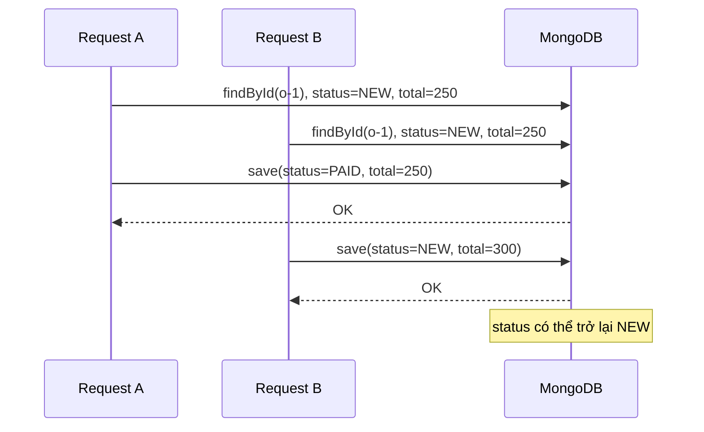
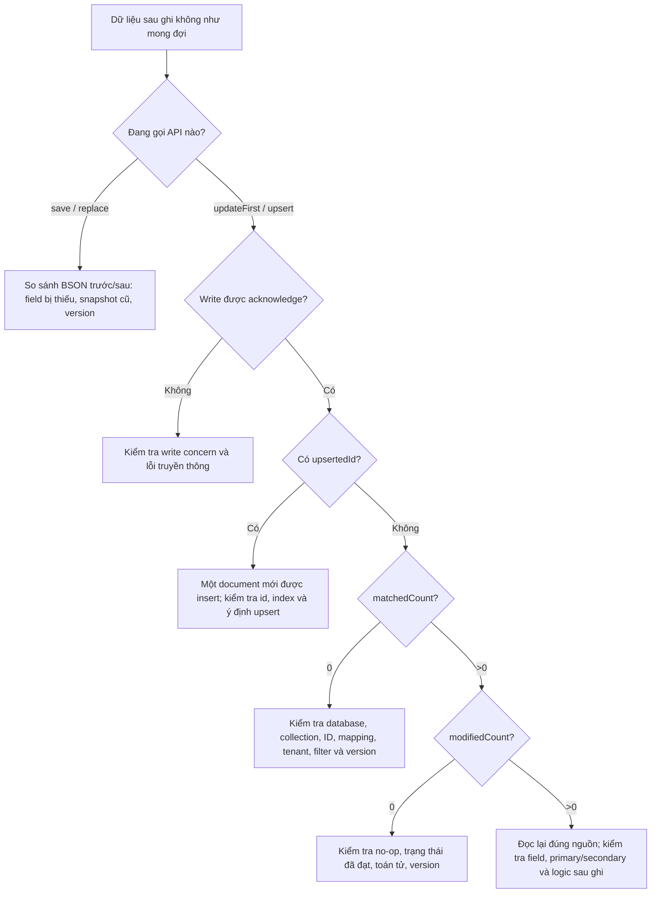

# Save ghi đè dữ liệu, update không khớp hoặc modifiedCount bằng 0

> **Chương:** Lỗi và chẩn đoán  
> **Phạm vi:** Spring Data MongoDB — phân tích `MongoTemplate`, repository, ánh xạ document, kết quả ghi và hành vi cạnh tranh trong MongoDB.  
> **Mục tiêu:** Phân biệt bản ghi bị thay thế ngoài ý muốn, bộ lọc không tìm thấy document và update khớp nhưng không làm đổi dữ liệu.

## 1. Ba triệu chứng có vẻ giống nhau nhưng nguyên nhân khác nhau

Một API cập nhật đơn hàng có thể trả HTTP 200, không ném exception, nhưng dữ liệu trên MongoDB không giống kỳ vọng. Nguyên nhân thường nằm ở **loại lệnh ghi**, **filter truy vấn** hoặc **cách diễn giải kết quả ghi**.

| Triệu chứng | Điều có thể đã xảy ra | Cần kiểm tra trước |
| --- | --- | --- |
| Gọi `save` xong, field cũ biến mất | Entity được chuyển thành document thay thế; field không nằm trong bản ghi mới không còn được giữ | Document trước/sau, field nào có trong POJO, mapping null, callback |
| `updateFirst` trả `matchedCount = 0` | Không document nào thỏa **toàn bộ** điều kiện tại thời điểm update | Database, collection, `_id`, kiểu BSON, tên field, tenant, trạng thái, version |
| `matchedCount = 1`, `modifiedCount = 0` | Document được tìm thấy nhưng dữ liệu sau update không đổi; hoặc lệnh update không gây thay đổi hữu hiệu | Giá trị hiện tại, toán tử `$set`/`$unset`/`$addToSet`, điều kiện update |
| `matchedCount = 0` nhưng có `upsertedId` | Lệnh có `upsert: true`, không có bản ghi khớp nên MongoDB tạo document mới | Xác định upsert có phải hành vi mong muốn |
| `save` ném `OptimisticLockingFailureException` | Thao tác trên entity có `@Version` thấy version không còn khớp hoặc document đã mất | Version lúc đọc, version hiện tại, write concern |

**Không nên kết luận “MongoDB bỏ qua lệnh ghi” chỉ dựa vào `modifiedCount == 0`.** Cần xét đồng thời `matchedCount`, `upsertedId`, `acknowledged` và dữ liệu thực tế sau ghi.

## 2. Hiểu chính xác `save`, `insert`, `updateFirst` và `upsert`

Spring Data MongoDB cung cấp nhiều API ghi với ngữ nghĩa khác nhau:

| API | Cách chọn document | Nếu không tồn tại | Kiểu thay đổi |
| --- | --- | --- | --- |
| `MongoTemplate.insert(entity)` / `repository.insert(entity)` nếu có | Tạo bản ghi mới | Insert | Ghi document mới; ID trùng bị lỗi duplicate key |
| `MongoTemplate.save(entity)` | Theo identity/ID của entity và metadata phù hợp | Có thể insert | Ghi/replace biểu diễn đầy đủ của entity, không phải patch từng field |
| `MongoRepository.save(entity)` | Theo ID và cơ chế kiểm tra “new entity” của repository | Insert hoặc lưu entity hiện có | Không tự merge các field chưa được nạp |
| `MongoTemplate.updateFirst(query, update, Entity.class)` | Document đầu tiên khớp query | Không làm gì, không tự insert | Áp dụng các toán tử như `$set`, `$inc`, `$unset` |
| `MongoTemplate.updateMulti(...)` | Mọi document khớp | Không làm gì | Update các bản ghi khớp |
| `MongoTemplate.upsert(...)` | Document khớp query | Insert document mới từ filter/update | Update một bản ghi hoặc insert nếu thiếu |
| `MongoTemplate.findAndModify(...)` | Một document khớp query | Không làm gì nếu không bật upsert | Update và trả document trước hoặc sau, theo options |

`MongoRepository.save` có logic nhận diện entity mới (ví dụ từ ID hoặc `@Version`), nên đường đi cụ thể có thể là insert hoặc lưu entity hiện có. **Điều quan trọng đối với dữ liệu cũ là `save` không phải lệnh `$set` riêng những field có trong request DTO.**

### 2.1. Vì sao `save` có thể làm mất field?

Giả sử trong MongoDB có:

```javascript
db.orders.insertOne({
  _id: "o-1",
  order_status: "NEW",
  total_amount: 250,
  external_marker: "imported-from-legacy"
})
```

Ứng dụng chỉ tạo entity chứa ID và status:

```java
Order partial = new Order();
partial.id = "o-1";
partial.status = "PAID";
// totalAmount vẫn là null; entity không có externalMarker.
template.save(partial);
```

Trên đường lưu hiện có, Spring Data chuyển entity thành một BSON document và thực hiện lưu/thay thế. Những field trước đây tồn tại trong document nhưng không có trong biểu diễn entity mới, như `external_marker`, **có thể bị mất**. Theo chính sách mapping mặc định, property null như `totalAmount` thường không được ghi, vì vậy cũng có thể biến mất. Các field hạ tầng như `_id` và `_class` có hành vi riêng theo mapping.

Đây là hệ quả của **replace document**, không phải lỗi mạng hay “MongoDB tự xóa”. Nếu dữ liệu đang được tạo từ một DTO chỉ có vài field, hãy thực hiện **partial update** bằng `Update.set` thay vì chuyển DTO thành entity thiếu thông tin rồi gọi `save`.

### 2.2. Khai báo model mẫu cho các ví dụ

```java
package example.orders;

import org.springframework.data.annotation.Id;
import org.springframework.data.mongodb.core.mapping.Document;
import org.springframework.data.mongodb.core.mapping.Field;

@Document("orders")
public class Order {
    @Id
    public String id;

    @Field("order_status")
    public String status;

    @Field("total_amount")
    public Integer totalAmount;

    public Order() {}

    public Order(String id, String status, Integer totalAmount) {
        this.id = id;
        this.status = status;
        this.totalAmount = totalAmount;
    }
}
```

Với entity này, property Java `status` ánh xạ sang BSON `order_status`. Chọn ID `"o-1"` để dễ đọc ví dụ; hãy nhớ Spring Data có quy tắc chuyển `String` ID dạng chuỗi hex 24 ký tự thành BSON `ObjectId` khi dùng `@Id`.

## 3. Cách cập nhật một vài field mà không thay thế toàn bộ document

Ví dụ yêu cầu nghiệp vụ: chỉ đổi trạng thái đơn hàng từ `NEW` sang `PAID`, giữ lại số tiền và các metadata khác:

```java
import com.mongodb.client.result.UpdateResult;
import org.springframework.data.mongodb.core.MongoTemplate;
import org.springframework.data.mongodb.core.query.Criteria;
import org.springframework.data.mongodb.core.query.Query;
import org.springframework.data.mongodb.core.query.Update;

public class OrderWriter {
    private final MongoTemplate template;

    public OrderWriter(MongoTemplate template) {
        this.template = template;
    }

    public UpdateResult markPaid(String id) {
        Query query = Query.query(
            Criteria.where("id").is(id).and("status").is("NEW")
        );
        Update change = new Update().set("status", "PAID");
        return template.updateFirst(query, change, Order.class);
    }
}
```

Spring Data ánh xạ `id` thành `_id` và `status` thành `order_status` khi dùng overload có `Order.class`. Về ý nghĩa, MongoDB thực hiện lệnh tương đương:

```javascript
db.orders.updateOne(
  { _id: "o-1", order_status: "NEW" },
  { $set: { order_status: "PAID" } }
)
```

Lệnh chỉ sửa `order_status`. Những field khác như `total_amount`, `external_marker` vẫn còn. Bộ lọc cũng là một phép **compare-and-set theo trạng thái**: nếu đơn đã là `PAID` hoặc `CANCELLED`, không bản ghi nào khớp.

### 3.1. Khi nào dùng `save` vẫn hợp lý?

`save` phù hợp khi ứng dụng thực sự sở hữu **toàn bộ biểu diễn document** và có ý định ghi lại toàn bộ entity đã được đọc, chỉnh sửa. Ví dụ workflow đọc `Order` đầy đủ từ MongoDB, cập nhật giá trị rồi lưu. Tuy nhiên, nếu có hai tác vụ đồng thời cùng đọc một bản ghi rồi lưu, tác vụ lưu sau có thể **ghi đè thay đổi của tác vụ trước** khi không có kiểm soát concurrency.

Với PATCH API, thay đổi một số field từ request, hoặc document chứa field do dịch vụ khác quản lý, ưu tiên `Update.set`/`unset` rõ ràng. Nếu cần ngữ nghĩa thay thế toàn bộ, dùng `save` hoặc API replace có chủ đích và kiểm thử field nào sẽ bị loại bỏ.

## 4. Đọc đúng `UpdateResult`: matched, modified và upserted

`MongoTemplate.updateFirst` trả `com.mongodb.client.result.UpdateResult`. Với write được **acknowledge**, các giá trị cần đọc gồm:

```java
UpdateResult result = template.updateFirst(query, change, Order.class);

if (!result.wasAcknowledged()) {
    throw new IllegalStateException("MongoDB write was not acknowledged");
}

long matched = result.getMatchedCount();
long modified = result.getModifiedCount();
org.bson.BsonValue upsertedId = result.getUpsertedId();
```

`matchedCount` đo **bao nhiêu document thỏa filter**, còn `modifiedCount` đo **bao nhiêu document thực sự thay đổi**. Với `updateFirst`, chúng thường thuộc tập {0, 1}. `getUpsertedId()` khác null khi có insert do upsert; `updateFirst` thông thường không upsert nên giá trị này không có.

| Kết quả sau lệnh được acknowledge | Diễn giải thường gặp | Hành động |
| --- | --- | --- |
| `matched=0, modified=0, upsertedId=null` | Không có document khớp | Kiểm tra filter, ID, collection, trạng thái/version |
| `matched=1, modified=0, upsertedId=null` | Document khớp nhưng update không thay đổi dữ liệu | Xem giá trị hiện tại và toán tử |
| `matched=1, modified=1, upsertedId=null` | Một document khớp và đã thay đổi | Xác minh giá trị nghiệp vụ nếu cần |
| `matched=0, modified=0, upsertedId≠null` | Upsert đã tạo document mới | Kiểm tra ý định upsert và unique index |
| `wasAcknowledged()=false` | Không có xác nhận write từ server | Không suy luận trạng thái ghi từ các count |

Trước khi gọi getter count, hãy kiểm tra `wasAcknowledged()`; với write không được acknowledge, driver có thể không cung cấp các count và getter có thể ném exception. Nếu đang dùng WriteConcern không phản hồi, đừng mô tả “modifiedCount = 0” như một kết quả đáng tin cậy.

### 4.1. Ví dụ `matched=1` nhưng `modified=0`

```javascript
db.orders.insertOne({ _id: "o-2", order_status: "PAID" })

db.orders.updateOne(
  { _id: "o-2" },
  { $set: { order_status: "PAID" } }
)
// Dự kiến: matchedCount = 1, modifiedCount = 0
```

Server thấy giá trị mới **giống hệt** giá trị đã lưu. Đây là thao tác idempotent thành công về mặt trạng thái cuối cùng: đơn hàng vẫn là `PAID`. Các trường hợp `modified=0` khác:

- `$unset` một field vốn đã không tồn tại.
- `$addToSet` một phần tử đã có trong mảng.
- `$pull` một phần tử không xuất hiện trong mảng.
- `$inc` với giá trị 0 hoặc một phép cập nhật không làm giá trị BSON thay đổi.
- Update pipeline tính ra giá trị mới bằng giá trị hiện tại.

Một kết quả `modified=0` không chứng minh API bị lỗi. Ngược lại, cũng không chứng minh thao tác nghiệp vụ thành công: phải xét **filter** và **trạng thái mong muốn**. Nếu yêu cầu là “chuyển từ NEW sang PAID duy nhất một lần”, query thêm điều kiện trạng thái `NEW` như mục 3 sẽ cho `matched=0` khi đã PAID; nghiệp vụ cần quyết định trả “đã xử lý”, conflict hay kiểm tra lại.

### 4.2. Khi `@Version` đang bật

Nếu entity có `@Version`, một số API update của Spring Data MongoDB **tự tăng version** khi field version không được khai báo trong `Update`. Vì version đổi, `modifiedCount` có thể là 1 ngay cả khi giá trị nghiệp vụ được `$set` về đúng giá trị cũ. Do đó:

- `modifiedCount = 1` có thể bao gồm thay đổi **metadata version**.
- `modifiedCount = 0` phải được diễn giải trong bối cảnh các toán tử thực tế và mapping.
- Với concurrency control, dùng hành vi `@Version`/compare-and-set rõ ràng; không thay thế bằng kiểm tra modified count.

## 5. `matchedCount = 0`: tìm đúng điều kiện không khớp

Khi lệnh update không khớp, nên chẩn đoán có thứ tự để không bỏ qua nguyên nhân:

### 5.1. Đúng database và collection?

`MongoTemplate` có thể kết nối tới database khác môi trường bạn đang mở bằng `mongosh`. `@Document("orders")`, tên collection truyền tường minh và cấu hình multi-tenant/multi-database đều ảnh hưởng nơi lệnh ghi được gửi.

```javascript
// Trong mongosh, đã kết nối đúng môi trường:
db.getName()
db.getCollectionNames()
db.orders.findOne({ _id: "o-1" })
```

Nếu dùng nhiều `MongoTemplate`, hãy xác nhận **template được inject thực tế**, MongoDB URI/database của nó và collection sau mapping. Không dựa vào tên class Java để suy ra tên collection đang dùng.

### 5.2. ID có đúng **kiểu BSON** không?

MongoDB phân biệt:

```javascript
{ _id: "507f1f77bcf86cd799439011" }   // String
{ _id: ObjectId("507f1f77bcf86cd799439011") } // ObjectId
```

Hai giá trị nhìn giống nhau khi log nhưng **không bằng nhau**. Với `@Id String id`, Spring Data có quy tắc chuyển sang ObjectId nếu chuỗi có dạng hợp lệ; `@MongoId(FieldType.STRING)` có thể được dùng khi thiết kế yêu cầu lưu ID thực sự là BSON String.

```java
// Ví dụ chọn lưu String ID, kiểm tra lại migration cho dữ liệu cũ:
import org.springframework.data.mongodb.core.mapping.FieldType;
import org.springframework.data.mongodb.core.mapping.MongoId;

@MongoId(FieldType.STRING)
String id;
```

Không đổi annotation ID để “chữa” một update không khớp khi chưa kiểm tra dữ liệu đang có. Thay đổi kiểu `_id` có thể ảnh hưởng tất cả truy vấn và reference, đòi hỏi migration.

### 5.3. Property Java có khớp tên BSON?

```java
@Field("order_status")
String status;
```

Với `template.updateFirst(query, update, Order.class)`, câu:

```java
Criteria.where("status").is("NEW")
```

được ánh xạ thành `order_status`. Nhưng khi gọi overload chỉ có **collectionName** thay vì entity class, Spring Data thiếu thông tin mapping cụ thể của `Order`; cùng literal `"status"` có thể được gửi xuống như field `status`, dẫn tới `matchedCount=0`.

Để giảm rủi ro, chọn overload có entity class khi truy vấn theo property Java, và xác minh raw BSON. Các custom converters, `@Field`, `@Id`, nested paths cũng ảnh hưởng tên/kiểu field cuối cùng.

### 5.4. Có điều kiện bổ sung ngoài ID không?

Query dạng:

```java
Query query = Query.query(
    Criteria.where("id").is("o-1")
        .and("status").is("NEW")
        .and("tenantId").is("tenant-a")
);
```

chỉ khớp khi **tất cả** điều kiện đều đúng. Các tình huống cần kiểm tra:

- Đơn hàng đã được cập nhật `NEW → PAID` bởi một request khác.
- `tenantId` hoặc soft-delete filter không khớp.
- Property null/missing khác kỳ vọng (ví dụ `is(null)` còn khớp field thiếu).
- Chuỗi khác chữ hoa/chữ thường hoặc whitespace; collation không được cấu hình như lúc đọc.
- Kiểu BSON khác nhau, chẳng hạn số lưu dạng string hoặc ngày UTC được so với thời điểm sai múi giờ.
- Truy vấn trên array hoặc nested document có quy tắc match khác giả định.
- Một callback, auditing hoặc converter đã đổi field trước khi ghi.

Đừng vội bỏ điều kiện `tenantId` hoặc phiên bản chỉ để “làm cho update chạy”; chúng có thể là điều kiện bảo vệ dữ liệu. Hãy xác định nguyên nhân sai và sửa ở điểm tạo filter hoặc dữ liệu đầu vào.

### 5.5. Xác định điều kiện nào làm mất match

Trong môi trường test, dùng các lệnh đọc thu hẹp dần:

```javascript
db.orders.findOne({ _id: "o-1" })
db.orders.findOne({ _id: "o-1", order_status: "NEW" })
db.orders.findOne({
  _id: "o-1",
  order_status: "NEW",
  tenant_id: "tenant-a"
})
```

Với production, chỉ đọc những field đủ để chẩn đoán, tránh log PII hoặc xuất toàn bộ document nhạy cảm. Nếu có phân vùng tenant, query chẩn đoán phải tôn trọng kiểm soát truy cập.

## 6. Khi `save` ghi đè thay đổi của request khác

### 6.1. Lost update

Hai luồng cùng thao tác trên document `o-1`:



Không có kiểm soát concurrency, bản `save` cuối có thể thay thế document bằng snapshot cũ và làm mất cập nhật `PAID`. Đây là lỗi **lost update**: mỗi request tự thấy dữ liệu hợp lệ tại lúc đọc, nhưng kết hợp lại làm mất thay đổi.

### 6.2. Bảo vệ bằng `@Version`

Spring Data MongoDB hỗ trợ optimistic locking:

```java
import org.springframework.data.annotation.Id;
import org.springframework.data.annotation.Version;
import org.springframework.data.mongodb.core.mapping.Document;

@Document("versioned_orders")
class VersionedOrder {
    @Id public String id;
    public String status;
    public Integer totalAmount;
    @Version public Long version;

    public VersionedOrder() {}
}
```

Khi đọc document ở version `0`, hai request đều có snapshot version `0`. Request A `save` thành công sẽ làm version tăng; request B cố lưu snapshot cũ có thể ném `OptimisticLockingFailureException`. Nhờ vậy ứng dụng có cơ hội trả conflict hoặc đọc lại dữ liệu rồi áp dụng lại thao tác một cách an toàn.

```java
VersionedOrder first = template.findById("v-1", VersionedOrder.class);
VersionedOrder stale = template.findById("v-1", VersionedOrder.class);

first.status = "PAID";
template.save(first);

stale.totalAmount = 300;
// Kỳ vọng OptimisticLockingFailureException khi write được acknowledge:
template.save(stale);
```

Đoạn mã trên giả định đã insert `VersionedOrder` có ID `v-1` trước đó. Lỗi được Spring Data báo khi phiên bản không khớp; **WriteConcern phải được acknowledge** để nhận diện xung đột đúng cách. Không xử lý conflict bằng retry vô điều kiện cùng snapshot cũ, vì có thể tạo cập nhật sai nghiệp vụ.

### 6.3. Compare-and-set bằng filter nếu không dùng `@Version`

Với thay đổi một field, có thể dùng query chứa trạng thái kỳ vọng:

```java
UpdateResult result = template.updateFirst(
    Query.query(Criteria.where("id").is(id).and("status").is("NEW")),
    new Update().set("status", "PAID"),
    Order.class
);

if (result.getMatchedCount() == 0) {
    // Không có document hoặc trạng thái không còn là NEW.
    // Kiểm tra theo nghiệp vụ: 404, 409, hoặc idempotent response.
}
```

Điều kiện match và phép update được MongoDB thực thi nguyên tử **trên một document**, giúp tránh race giữa “kiểm tra trạng thái” và “ghi trạng thái”. Khác với `save` toàn entity, cách này giữ nguyên những field không được sửa. Với nhiều document hoặc nhiều collection, nếu cần tính nguyên tử ở cấp rộng hơn thì phải thiết kế transaction và topology phù hợp.

## 7. Upsert bị dùng nhầm và dữ liệu mới ngoài ý muốn

`updateFirst` mặc định **không tạo document mới** nếu không match. Ngược lại, `upsert` sẽ insert khi không tìm được document:

```java
UpdateResult result = template.upsert(
    Query.query(Criteria.where("id").is("o-new")),
    new Update()
        .set("status", "NEW")
        .set("totalAmount", 250),
    Order.class
);

if (!result.wasAcknowledged()) {
    throw new IllegalStateException("Write was not acknowledged");
}
// Nếu trước đó chưa có document:
// matchedCount = 0, modifiedCount = 0, upsertedId != null.
```

Các điều kiện equality trong query và trường trong update có thể tham gia xây dựng document mới; kết quả cụ thể tùy filter/toán tử. **Upsert không phải “thử update rồi báo không tồn tại”**: nó thực sự có thể chèn thêm dữ liệu.

Nếu nhiều request cùng upsert một khóa nghiệp vụ chưa có, cần unique index phù hợp để chống tạo trùng, chẳng hạn khóa `(tenant_id, external_order_id)`. Không coi điều kiện query không có index unique là cơ chế đảm bảo duy nhất dưới cạnh tranh. Nếu nghiệp vụ yêu cầu phân biệt “đã update” và “vừa insert”, dùng `getUpsertedId()` và kiểm tra kết quả sau write.

## 8. Quan sát lệnh MongoDB thực sự được gửi đi

Một lỗi rất phổ biến là nhìn mã nguồn Java rồi kết luận MongoDB nhận đúng bộ lọc. Trong Spring Data, tên property, kiểu ID và giá trị update có thể được chuyển đổi bởi `QueryMapper`, `MappingMongoConverter` hoặc callback.

Để quan sát, cân nhắc:

1. **Ghi nhận context kỹ thuật:** tên database, collection, operation, request/correlation ID, ứng dụng build version, tenant (nếu được phép), số count và thời gian xử lý. Không ghi mật khẩu, credentials, token, PII hoặc document đầy đủ.
2. **Bật logging ở mức phù hợp trong test/staging:** logger Spring Data và MongoDB Java Driver giúp xác minh query/update mà client gửi đi. Chỉ bật mức chi tiết phù hợp trong production; log command có thể chứa dữ liệu nhạy cảm.
3. **Dùng `CommandListener` của Java driver khi cần quan sát có cấu trúc:** listener nhận sự kiện command started/succeeded/failed, nhưng phải xử lý redaction và kiểm soát thông tin được lưu.
4. **Đọc raw document:** `template.getCollection("orders").find(...)` hoặc `mongosh` cùng môi trường để đối chiếu tên/kiểu BSON.
5. **Xem query plan khi nghi vấn performance/định tuyến:** `explain("executionStats")` cho filter phù hợp để kiểm tra index và số document scan. Explain của write mô phỏng lệnh, **không thực hiện ghi**.

Ví dụ trong `mongosh`:

```javascript
use sales
db.orders.findOne({ _id: "o-1" })

db.orders.find({
  _id: "o-1",
  order_status: "NEW"
}).explain("executionStats")
```

`explain` có giá trị khi filter tìm được document nhưng update bị chậm hoặc query quét nhiều dữ liệu. Nó không tự cho biết vì sao một request đã ghi sai: cần kết hợp với kết quả update, BSON thật và trace request.

### 8.1. Đảm bảo đúng trạng thái đọc sau ghi

Khi ứng dụng dùng replica set, đọc ngay từ secondary có thể thấy dữ liệu cũ do độ trễ replication; điều đó có thể tạo cảm giác update không chạy. Xác định read preference, read concern, write concern và nguồn kết nối của thao tác kiểm tra. Nếu cần xác nhận thay đổi vừa ghi trong một luồng, đọc lại từ primary với mức nhất quán phù hợp.

Với `ReactiveMongoTemplate`, update trả `Mono<UpdateResult>`: publisher chưa được subscribe thì thao tác có thể **chưa thực thi**. Test reactive nên dùng `StepVerifier` hoặc đăng ký subscription phù hợp, rồi mới đánh giá count và dữ liệu sau ghi.

## 9. Ví dụ integration test tái hiện ba nhóm lỗi

Với Spring Boot 3.x, JUnit Jupiter, AssertJ và Testcontainers 1.x, `@DataMongoTest` cùng MongoDB test instance giúp xác minh hành vi thật của driver và mapping. Các ví dụ dùng model `Order` ở mục 2, và container/database chỉ dành cho test.

```java
package example.orders;

import static org.assertj.core.api.Assertions.assertThat;
import static com.mongodb.client.model.Filters.eq;

import com.mongodb.client.result.UpdateResult;
import org.bson.Document;
import org.junit.jupiter.api.BeforeEach;
import org.junit.jupiter.api.Test;
import org.springframework.beans.factory.annotation.Autowired;
import org.springframework.boot.test.autoconfigure.data.mongo.DataMongoTest;
import org.springframework.boot.testcontainers.service.connection.ServiceConnection;
import org.springframework.data.mongodb.core.MongoTemplate;
import org.springframework.data.mongodb.core.query.Criteria;
import org.springframework.data.mongodb.core.query.Query;
import org.springframework.data.mongodb.core.query.Update;
import org.testcontainers.containers.MongoDBContainer;
import org.testcontainers.junit.jupiter.Container;
import org.testcontainers.junit.jupiter.Testcontainers;
import org.testcontainers.utility.DockerImageName;

@DataMongoTest
@Testcontainers
class OrderWriteDiagnosticsTest {

    @Container
    @ServiceConnection
    static final MongoDBContainer mongo =
        new MongoDBContainer(DockerImageName.parse("mongo:7.0"));

    @Autowired MongoTemplate template;

    @BeforeEach
    void reset() {
        template.dropCollection(Order.class);
    }

    @Test
    void saveReplacesAndCanRemoveFieldsNotInEntity() {
        template.getCollection("orders").insertOne(
            new Document("_id", "o-1")
                .append("order_status", "NEW")
                .append("total_amount", 250)
                .append("external_marker", "legacy")
        );

        Order partial = new Order("o-1", "PAID", null);
        template.save(partial);

        Document raw = template.getCollection("orders")
            .find(eq("_id", "o-1")).first();
        assertThat(raw).isNotNull();
        assertThat(raw.getString("order_status")).isEqualTo("PAID");
        assertThat(raw.containsKey("external_marker")).isFalse();
        assertThat(raw.containsKey("total_amount")).isFalse();
    }

    @Test
    void updateFirstWithWrongStateMatchesNothing() {
        template.insert(new Order("o-2", "PAID", 250));

        UpdateResult result = template.updateFirst(
            Query.query(
                Criteria.where("id").is("o-2")
                    .and("status").is("NEW")
            ),
            new Update().set("status", "CANCELLED"),
            Order.class
        );

        assertThat(result.wasAcknowledged()).isTrue();
        assertThat(result.getMatchedCount()).isZero();
        assertThat(result.getModifiedCount()).isZero();
        assertThat(template.findById("o-2", Order.class).status)
            .isEqualTo("PAID");
    }

    @Test
    void updateFirstCanMatchWithoutChangingValues() {
        template.insert(new Order("o-3", "PAID", 250));

        UpdateResult result = template.updateFirst(
            Query.query(Criteria.where("id").is("o-3")),
            new Update().set("status", "PAID"),
            Order.class
        );

        assertThat(result.wasAcknowledged()).isTrue();
        assertThat(result.getMatchedCount()).isEqualTo(1);
        assertThat(result.getModifiedCount()).isZero();
    }

    @Test
    void updateSetPreservesUnrelatedFields() {
        template.getCollection("orders").insertOne(
            new Document("_id", "o-4")
                .append("order_status", "NEW")
                .append("total_amount", 250)
                .append("external_marker", "legacy")
        );

        UpdateResult result = template.updateFirst(
            Query.query(Criteria.where("id").is("o-4")),
            new Update().set("status", "PAID"),
            Order.class
        );

        assertThat(result.getMatchedCount()).isEqualTo(1);
        assertThat(result.getModifiedCount()).isEqualTo(1);

        Document raw = template.getCollection("orders")
            .find(eq("_id", "o-4")).first();
        assertThat(raw.getString("order_status")).isEqualTo("PAID");
        assertThat(raw.getInteger("total_amount")).isEqualTo(250);
        assertThat(raw.getString("external_marker")).isEqualTo("legacy");
    }
}
```

`@ServiceConnection` cần Spring Boot 3.1+ và `spring-boot-testcontainers`; các version mới có thể dùng package Testcontainers khác. Không chạy bộ fixture này trên database dùng chung. Ngoài bốn test trên, hãy thêm test optimistic locking `@Version` với hai snapshot, test upsert và test nhiều request cạnh tranh nếu dự án thực sự phụ thuộc vào những hành vi đó.

## 10. Cây quyết định chẩn đoán



Tùy API, exception cũng là một nhánh độc lập: duplicate key, lỗi xác thực, write concern timeout, lỗi mapping hoặc optimistic locking cần được ghi nhận và xử lý riêng. Không nuốt exception rồi trả một giá trị đếm mặc định bằng 0.

## 11. Bảng xử lý nhanh các tình huống thực tế

| Hiện tượng | Nguyên nhân khả dĩ | Cách kiểm tra hoặc sửa |
| --- | --- | --- |
| PATCH mất metadata của document | Chuyển DTO thiếu field thành entity rồi gọi `save` | Chuyển sang `Update.set` từng field hoặc load đầy đủ và kiểm soát version |
| `save` trên ID cũ tạo thêm record | Sai kiểu `_id`, nhầm collection, ID không còn tồn tại | Kiểm tra raw `_id`, database, mapping ID và tình huống insert/upsert |
| `updateFirst` không ném lỗi dù không đổi dữ liệu | API cho phép no match | Kiểm tra `UpdateResult` và quy định kết quả nghiệp vụ |
| `matched=0` dù query Java trông đúng | `@Field`, `@Id`, converter hoặc dùng overload collectionName | Quan sát BSON filter thực tế; dùng overload có entity class |
| `matched=0` ở request chạy lại | Trạng thái đã đổi, condition compare-and-set không còn đúng | Phân biệt idempotent replay với conflict |
| `matched=1, modified=0` | `$set` đúng giá trị cũ, `$unset` field thiếu, `$addToSet` trùng | Đọc giá trị hiện tại; quyết định xem no-op có hợp lệ |
| `modified=1` nhưng business field không đổi | `@Version` hoặc auditing làm thay đổi metadata | So sánh toàn BSON và đường xử lý cập nhật |
| Gọi upsert thấy nhiều record cùng external ID | Thiếu unique index và race condition | Tạo unique index theo business key; xử lý duplicate-key retry có kiểm soát |
| `save` làm mất thay đổi của request khác | Lost update khi lưu snapshot cũ | `@Version`, compare-and-set, cập nhật toán tử |
| Không thấy dữ liệu vừa update qua API đọc | Đọc secondary còn lag hoặc cache phía ứng dụng | Kiểm tra read preference, cache, primary và consistency |
| Update trên document reactive không chạy | Chưa subscribe publisher | Kiểm thử bằng `StepVerifier` hoặc consumer thật |
| Upsert có `matched=0` khiến hiểu nhầm thất bại | Lệnh đã insert document mới | Kiểm tra `upsertedId` và dữ liệu tạo |

## 12. Quy tắc thiết kế API an toàn

1. **Chọn operation theo ý định:** tạo mới → `insert`; thay toàn bộ → `save`/replace có chủ đích; sửa vài field → `$set`/`unset`; tạo nếu thiếu → `upsert`.
2. **Kiểm soát điều kiện:** ID, tenant và expected state/version phải được thiết kế cùng logic nghiệp vụ. Không nới filter tùy tiện để làm mất `matched=0`.
3. **Phân biệt không tìm thấy với no-op:** `matched=0` có thể là 404/409; `matched=1, modified=0` có thể là kết quả idempotent hợp lệ. Quyết định HTTP status theo ngữ cảnh, không quy đổi máy móc count thành success/failure.
4. **Bảo vệ concurrency:** dùng `@Version` hoặc compare-and-set khi nhiều request có thể cập nhật cùng document. Không giải quyết lost update bằng retry mù quáng.
5. **Đặt uniqueness ở database khi cần:** unique index giúp tránh race khi upsert bằng khóa nghiệp vụ; xác minh index thực tế tồn tại.
6. **Ghi số liệu đủ chẩn đoán:** operation, namespace, matched/modified/upserted, correlation ID, latency và loại lỗi. Không log bí mật hoặc toàn bộ dữ liệu khách hàng.
7. **Test với MongoDB thật:** các mock repository không mô phỏng chính xác replace semantics, BSON ID mapping, concurrency hoặc `UpdateResult`.

### Bài tập tự kiểm tra

1. Thêm `external_marker` vào raw BSON, gọi `save` với entity chỉ có ID/status, quan sát field bị loại. Sau đó thay bằng `updateFirst` và xác minh field được giữ.
2. Chạy cùng một `$set` hai lần theo filter chỉ có ID. Ghi lại `matchedCount` và `modifiedCount` ở lần đầu và lần hai.
3. Thêm điều kiện trạng thái cũ vào filter; lặp lại update và giải thích vì sao lần thứ hai có thể cho `matchedCount=0`.
4. Cho hai request đọc cùng một version, cập nhật rồi `save` xen kẽ. Bật `@Version`, xác minh request lưu snapshot cũ bị chặn.
5. Tạo unique index theo `tenant_id` + `external_order_id`, mô phỏng hai request upsert cùng khóa và kiểm tra kết quả theo thiết kế.

## 13. Ghi nhớ

- `save` có thể ghi/thay thế **toàn bộ document** và làm mất field không có trong entity mới; không dùng như PATCH mặc định.
- `matchedCount = 0` nghĩa là **filter không khớp**; trước hết kiểm tra namespace, ID BSON, field mapping, tenant và điều kiện trạng thái/version.
- `matchedCount = 1` và `modifiedCount = 0` thường là **no-op**, không mặc định là lỗi. Nếu có `@Version`, modified count có thể phản ánh việc tăng version.
- `upsertedId` cho biết lệnh upsert vừa tạo document; phân biệt insert do upsert với update thành công.
- `@Version` và cập nhật có filter trạng thái giúp tránh lost update; integration test với MongoDB thật giúp xác minh chính xác ngữ nghĩa ghi.

## Tài liệu tham khảo

- [Spring Data MongoDB — Saving, Updating, and Removing Documents](https://docs.spring.io/spring-data/mongodb/reference/mongodb/template-crud-operations.html): `save`, `updateFirst`, `upsert`, `findAndModify` và optimistic locking.
- [Spring Data MongoDB — MongoTemplate API](https://docs.spring.io/spring-data/mongodb/docs/current/api/org/springframework/data/mongodb/core/MongoTemplate.html): chữ ký method, `UpdateResult` và các overload hỗ trợ mapping.
- [Spring Data MongoDB — Object Mapping](https://docs.spring.io/spring-data/mongodb/reference/mongodb/mapping/mapping.html): `@Id`, `@Field`, chuyển kiểu BSON và lifecycle mapping.
- [MongoDB — Update a Document (updateOne)](https://www.mongodb.com/docs/manual/reference/method/db.collection.updateone/): matched/modified, acknowledged và upsert.
- [MongoDB — Replace Documents (Java Driver)](https://www.mongodb.com/docs/drivers/java/sync/current/crud/replace-documents/): replace bỏ những field không nằm trong replacement document.
- [MongoDB — Replace One](https://www.mongodb.com/docs/manual/reference/method/db.collection.replaceone/): replace, `_id` và upsert.
- [MongoDB — Java Driver Monitoring](https://www.mongodb.com/docs/drivers/java/sync/current/logging-monitoring/monitoring/): command events và `CommandListener`.
- [MongoDB — Explain Command](https://www.mongodb.com/docs/manual/reference/command/explain/): query plan, executionStats và explain đối với update.
