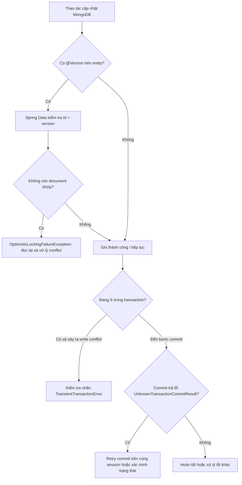
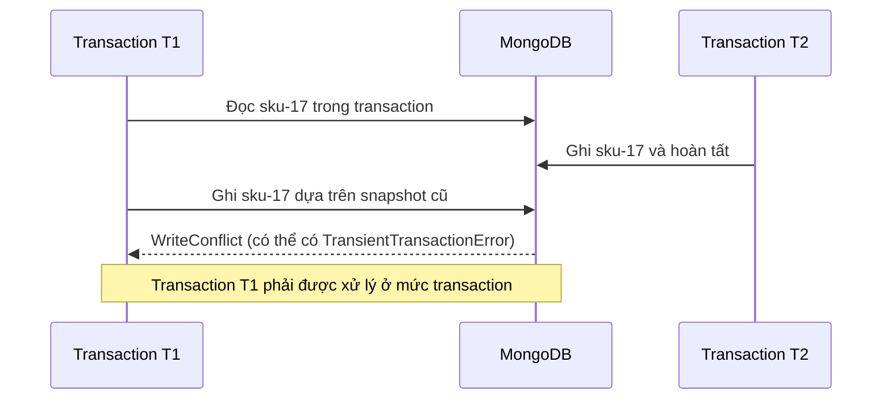
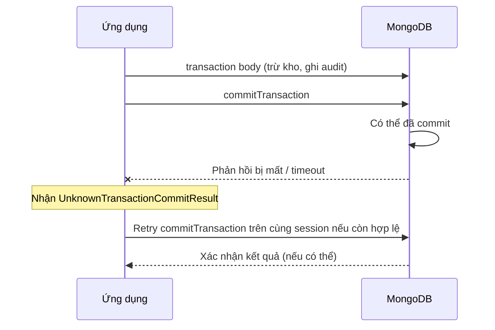

# Optimistic locking, write conflict và kết quả commit chưa xác định

## Mục tiêu

Trong chương **Lỗi và chẩn đoán** của **SPRING_DATA_MONGODB**, ta sử dụng Spring Data MongoDB để kết nối, ánh xạ document và thao tác dữ liệu qua `MongoTemplate` hoặc repository. Khi ứng dụng có nhiều request cập nhật cùng document, hoặc khi dùng transaction nhiều document, các lỗi có thể xuất hiện dù câu lệnh MongoDB và phần mapping đều đúng.

Sau bài học, bạn có thể:

- Giải thích **optimistic locking** với `@Version`, nhận biết `OptimisticLockingFailureException` và thiết kế xử lý xung đột hợp lý.
- Phân biệt việc `save()` bị từ chối vì version cũ với **write conflict** xảy ra trong quá trình thực thi transaction.
- Đọc các nhãn lỗi `TransientTransactionError` và `UnknownTransactionCommitResult` đúng ngữ cảnh.
- Chọn phạm vi retry phù hợp: đọc lại và cập nhật document, chạy lại **toàn bộ transaction**, hoặc retry **chính thao tác commit trong cùng session**.
- Ngăn ghi trùng bằng idempotency key, xác minh trạng thái sau lỗi commit chưa rõ và thiết lập kiểm thử, log, metric phục vụ điều tra.

> **Quy tắc trung tâm:** Một lỗi chỉ nên được retry ở **đúng ranh giới an toàn**. `OptimisticLockingFailureException`, `WriteConflict` và `UnknownTransactionCommitResult` đại diện cho ba vấn đề khác nhau; không được áp dụng một vòng `retry()` chung cho mọi thao tác ghi.

## 1. Ba hiện tượng và cách phân biệt

Giả sử có hai luồng xử lý muốn trừ số lượng hàng trong collection `inventory`:

| Hiện tượng | Điểm phát hiện | Dấu hiệu thường thấy | Ý nghĩa |
| --- | --- | --- | --- |
| **Optimistic locking** | Tầng Spring Data kiểm tra field `@Version` khi lưu/xóa entity | `OptimisticLockingFailureException`, số document khớp phiên bản mong đợi bằng 0 | Entity trong bộ nhớ đã cũ so với bản ghi hiện hành |
| **Write conflict** | MongoDB khi hai thao tác ghi/transaction tranh chấp tài nguyên hoặc cùng document | Server error `WriteConflict` (thường code `112`), đôi khi kèm `TransientTransactionError` | Giao dịch hoặc thao tác hiện tại không thể tiếp tục theo trạng thái đã đọc/ghi |
| **Unknown transaction commit result** | Lệnh `commitTransaction` đã được gửi nhưng client không xác định kết quả chắc chắn | Nhãn lỗi `UnknownTransactionCommitResult` trên lỗi liên quan commit | Transaction **có thể đã commit hoặc chưa**; lỗi phản hồi không chứng minh rollback |

Hai tình huống đầu nói đến **xung đột khi thực hiện thay đổi**, còn tình huống cuối nói đến **khả năng xác nhận kết quả commit**.



Sơ đồ mô tả **quyết định ứng dụng**, không phải mọi nhánh nội bộ của MongoDB. Trong thực tế, lỗi network, timeout, write concern, validation và duplicate key cũng có thể xảy ra; cần phân loại theo mã/nhãn lỗi và vị trí phát sinh, không đoán chỉ từ thông điệp.

## 2. Optimistic locking bằng `@Version`

### Cơ chế so khớp version

Optimistic locking giả định phần lớn thao tác cập nhật **ít tranh chấp**. Thay vì giữ một khóa dài hạn từ lúc đọc đến lúc lưu, Spring Data đính kèm phiên bản của document vào điều kiện ghi.

Ví dụ document hiện tại:

```json
{
  "_id": "sku-17",
  "available": 10,
  "version": 0
}
```

Hai request A và B cùng đọc version `0`:

| Thời điểm | Request A | Request B | Dữ liệu lưu |
| --- | --- | --- | --- |
| T1 | Đọc `available=10, version=0` | Đọc `available=10, version=0` | `10 / 0` |
| T2 | Đổi available thành `8` và `save()` | Đợi | `8 / 1` |
| T3 | — | Đổi available thành `7` trên bản cũ và `save()` | Vẫn `8 / 1`; B nhận lỗi optimistic locking |

Về bản chất, cập nhật được bảo vệ bởi điều kiện tương đương:

```javascript
db.inventory.updateOne(
  { _id: "sku-17", version: 0 },
  { $set: { available: 8 }, $inc: { version: 1 } }
);
```

Đây là **minh họa phép so khớp**. `MongoTemplate.save()` có thể sử dụng lệnh ghi/mapping khác tùy API và phiên bản; điều quan trọng là **id + version** cùng được xét và version tăng sau ghi thành công.

### Khai báo entity Spring Data MongoDB

```java
import org.springframework.data.annotation.Id;
import org.springframework.data.annotation.Version;
import org.springframework.data.mongodb.core.mapping.Document;

@Document("inventory")
public class InventoryItem {

    @Id
    private String id;

    private long available;

    @Version
    private Long version;

    protected InventoryItem() {}

    public InventoryItem(String id, long available) {
        this.id = id;
        this.available = available;
    }

    public String getId() { return id; }
    public long getAvailable() { return available; }
    public Long getVersion() { return version; }

    public void setAvailable(long available) {
        this.available = available;
    }
}
```

Với kiểu `Long` (wrapper), tài liệu được insert lần đầu thường có version `0`, rồi được tăng thành `1`, `2`, ... khi được lưu đúng cách. Field version phải được Spring Data mapping và thao tác ghi phải thuộc các API hỗ trợ version; không có nghĩa mọi lệnh MongoDB bên ngoài ứng dụng đều tự tăng version.

Ví dụ sử dụng `MongoTemplate` để tái hiện xung đột **mà không cần tạo hai thread**:

```java
import java.util.Objects;
import org.springframework.dao.OptimisticLockingFailureException;
import org.springframework.data.mongodb.core.MongoTemplate;

InventoryItem saved = template.insert(new InventoryItem("sku-17", 10));

InventoryItem snapshotA = Objects.requireNonNull(
    template.findById(saved.getId(), InventoryItem.class));
InventoryItem snapshotB = Objects.requireNonNull(
    template.findById(saved.getId(), InventoryItem.class));

snapshotA.setAvailable(8);
template.save(snapshotA); // version 0 -> 1

snapshotB.setAvailable(7);
try {
    template.save(snapshotB); // snapshot B vẫn giữ version 0
    throw new AssertionError("Expected stale version error");
} catch (OptimisticLockingFailureException expected) {
    // Không ghi đè lên kết quả của request A.
}
```

**Điều kiện bắt buộc:** Kết quả ghi phải được server xác nhận (`WriteConcern.ACKNOWLEDGED` hoặc chính sách mạnh hơn). Nếu cấu hình `UNACKNOWLEDGED`, ứng dụng có thể không quan sát được việc update không khớp version và bỏ lỡ ngoại lệ.

### Repository và delete

Một repository `MongoRepository<InventoryItem, String>` cũng áp dụng cơ chế version cho những thao tác có hỗ trợ:

```java
import org.springframework.data.mongodb.repository.MongoRepository;

public interface InventoryRepository
        extends MongoRepository<InventoryItem, String> {
}
```

- `repository.save(entity)` có thể phát `OptimisticLockingFailureException` khi entity có version cũ.
- `repository.delete(entity)` đối với entity có `@Version` kiểm tra version và có thể phát lỗi khi version đã thay đổi.
- `repository.deleteById(id)` không dùng version của một entity đã đọc trước đó để bảo vệ khỏi ghi/xóa đồng thời.
- `template.remove(entity)` có thể xét version, còn `template.remove(query, InventoryItem.class)` thực hiện theo query truyền vào. Nếu cần CAS delete, tự viết điều kiện `_id + version` và kiểm tra `deletedCount`.

Không nên giả định `updateFirst`, `updateMulti`, bulk update hoặc lệnh MongoDB thuần đều có **cùng semantics** với `save(entity)`. Hãy đọc hợp đồng API: với thao tác update theo query, nếu cần bảo vệ version, viết điều kiện version **tường minh**, theo dõi matched count và đảm bảo version được tăng đúng một lần. Spring Data có thể tự tăng version cho một số update nếu Update chưa chỉ rõ version; tránh tăng trùng.

## 3. Atomic compare-and-set (CAS) và kiểm tra kết quả ghi

Đối với bài toán trừ kho, một thao tác update **trực tiếp** với điều kiện `available >= quantity` có thể tránh chu trình đọc–ghi có độ trễ dài. Khi muốn kết hợp kiểm soát version, làm như sau:

```java
import com.mongodb.client.result.UpdateResult;
import org.springframework.data.mongodb.core.MongoTemplate;
import org.springframework.data.mongodb.core.query.Criteria;
import org.springframework.data.mongodb.core.query.Query;
import org.springframework.data.mongodb.core.query.Update;

public boolean reserveIfVersionMatches(
        MongoTemplate template,
        String id,
        long expectedVersion,
        long quantity) {

    if (quantity <= 0) {
        throw new IllegalArgumentException("quantity must be positive");
    }

    Query query = Query.query(
        Criteria.where("_id").is(id)
            .and("version").is(expectedVersion)
            .and("available").gte(quantity));

    Update update = new Update()
        .inc("available", -quantity)
        .inc("version", 1);

    UpdateResult result = template.updateFirst(
        query, update, InventoryItem.class);

    return result.getMatchedCount() == 1;
}
```

Trong ví dụ này, `inc("version", 1)` được khai báo **một lần duy nhất** trong `Update`; khi đã chỉ rõ thao tác với field version, Spring Data không cần tự bổ sung bước tăng version. Điều kiện `available >= quantity` bảo vệ số lượng không âm, còn điều kiện `version == expectedVersion` bảo vệ khỏi một phiên bản bị thay đổi.

Giá trị `false` chỉ nói rằng **không có document khớp toàn bộ predicate**. Nó có thể do id sai, version cũ, hoặc hết hàng. Không được gán tất cả về một lỗi 409 mà không kiểm tra thêm; hãy đọc lại document để phân loại:

```java
InventoryItem current = template.findById(id, InventoryItem.class);

if (current == null) {
    // Không tìm thấy SKU.
} else if (current.getAvailable() < quantity) {
    // Hết hàng.
} else {
    // Version không khớp hoặc có thay đổi đồng thời: đánh giá retry.
}
```

Việc đọc lại là ảnh chụp ở thời điểm mới, không bảo đảm dữ liệu sẽ đứng yên sau đó. Predicate cập nhật nguyên tử vẫn là nơi thực thi ràng buộc.

**Khi nào chọn giải pháp nào?**

| Cách ghi | Ưu điểm | Rủi ro/giới hạn |
| --- | --- | --- |
| `findById → sửa entity → save()` với `@Version` | Dễ viết logic nghiệp vụ trên model, tự phát hiện stale version | Có thể bị xung đột trong khoảng thời gian đọc–lưu |
| `updateFirst` với `$inc` và predicate đủ chặt | Một lần ghi atomic trên một document, kiểm soát điều kiện kho | Phải tự phân biệt matched count và chú ý version |
| Multi-document transaction | Bảo đảm atomicity cho nhiều document khi commit thành công | Có write conflict, retry transaction và chi phí session/commit |
| Không dùng `@Version` cũng không có predicate | Code đơn giản | Có thể bị **lost update** khi nhiều request ghi giá trị tính từ snapshot cũ |

## 4. Retry optimistic locking thế nào cho đúng?

Không retry thao tác `save(snapshotCũ)` lặp đi lặp lại: version của snapshot vẫn sai. Cần **đọc lại giá trị mới nhất và tính lại quyết định nghiệp vụ**.

Ví dụ chỉ dùng khi thao tác giảm tồn kho là đơn vị nghiệp vụ **được phép thử lại**, và request chưa được thực thi thành công trước đó:

```java
import java.util.Objects;
import org.springframework.dao.OptimisticLockingFailureException;
import org.springframework.data.mongodb.core.MongoTemplate;

public InventoryItem reserveWithBoundedRetry(
        MongoTemplate template, String id, long quantity) {

    if (quantity <= 0) {
        throw new IllegalArgumentException("quantity must be positive");
    }

    final int maxAttempts = 3;

    for (int attempt = 1; attempt <= maxAttempts; attempt++) {
        InventoryItem current = Objects.requireNonNull(
            template.findById(id, InventoryItem.class),
            "No inventory item: " + id);

        if (current.getAvailable() < quantity) {
            throw new IllegalStateException("Not enough stock");
        }

        current.setAvailable(current.getAvailable() - quantity);

        try {
            return template.save(current);
        } catch (OptimisticLockingFailureException stale) {
            if (attempt == maxAttempts) {
                throw stale;
            }
            // Nên thêm backoff + jitter có giới hạn ở tầng retry thích hợp.
            // Vòng tiếp theo sẽ đọc lại dữ liệu và tính lại số lượng.
        }
    }

    throw new IllegalStateException("Unreachable");
}
```

**Chú ý idempotency:** Nếu client gọi lại **toàn bộ request** sau timeout, vòng retry này có thể trừ kho lần nữa nếu lần đầu đã thành công nhưng response bị mất. Với thao tác có tác dụng một lần (đặt hàng, chuyển tiền, xuất kho), cần `operationId`/idempotency key lưu bền vững và ràng buộc unique, chứ không chỉ rely vào `@Version`.

Một dịch vụ REST có thể trả **HTTP 409 Conflict** khi không thể tự hòa giải stale version hoặc trả phiên bản hiện tại cho client; đây là lựa chọn hợp đồng API, không phải quy tắc bắt buộc của MongoDB.

Với `ReactiveMongoTemplate`, lỗi optimistic locking xuất hiện trong luồng `Mono` khi subscribe:

```java
import reactor.core.publisher.Mono;
import org.springframework.dao.OptimisticLockingFailureException;

Mono<InventoryItem> saveWithOptimisticGuard =
    reactiveTemplate.findById("sku-17", InventoryItem.class)
        .switchIfEmpty(Mono.error(new IllegalStateException("SKU not found")))
        .flatMap(item -> {
            item.setAvailable(item.getAvailable() - 1);
            return reactiveTemplate.save(item);
        })
        .onErrorMap(
            OptimisticLockingFailureException.class,
            ex -> new IllegalStateException("Stale inventory version", ex));
```

Đây là ví dụ **ánh xạ lỗi**, không phải retry. Nếu nghiệp vụ cho phép thử lại, dùng `Mono.defer(() -> ...)` để mỗi lần subscribe/retry **đọc lại**, kèm `Retry.backoff(maxRetries, duration)` được giới hạn và bộ lọc chỉ chấp nhận lỗi phù hợp. Không gọi `retryWhen` trên một publisher không idempotent mà không thiết kế ranh giới side effect.

## 5. Write conflict trong multi-document transaction

### Khi nào xảy ra?

Một MongoDB transaction hoạt động trên snapshot dữ liệu và giữ các ràng buộc isolation. Nếu transaction T1 đọc document `sku-17`, còn thao tác T2 sửa chính document đó trước khi T1 cố ghi, T1 có thể gặp **`WriteConflict`**. Xung đột cũng có thể do hai transaction cạnh tranh ghi cùng tài nguyên.



Đây là lý do một transaction có thể thất bại **ngay cả khi entity không dùng `@Version`**. Ngược lại, `@Version` có thể bảo vệ document khỏi lost update **mà không cần** transaction nhiều document.

Code lỗi thường gặp là `112` (`WriteConflict`), nhưng **mã lỗi đơn lẻ không đủ** để suy ra cách retry. Cần xem liệu thao tác có nằm trong transaction, error label đi kèm, thời điểm lỗi và trạng thái session. `NoSuchTransaction` có thể là hệ quả của transaction đã abort; không mặc định “khởi tạo transaction mới và chạy lại” cho mọi nhãn/mã lỗi.

### Cấu hình Spring Data MongoDB transaction

MongoDB transaction yêu cầu replica set hoặc sharded cluster phù hợp. Trong Spring, `MongoTransactionManager` tích hợp `@Transactional` với session của `MongoTemplate`:

```java
import org.springframework.context.annotation.Bean;
import org.springframework.context.annotation.Configuration;
import org.springframework.data.mongodb.MongoDatabaseFactory;
import org.springframework.data.mongodb.MongoTransactionManager;

@Configuration
class MongoTxConfig {

    @Bean
    MongoTransactionManager mongoTransactionManager(
            MongoDatabaseFactory factory) {
        return new MongoTransactionManager(factory);
    }
}
```

Ví dụ chuyển tồn kho giữa hai vị trí, cần cùng lúc trừ một document, tăng document khác và ghi một audit record. `InventoryItem` ở mục 2 có `id`, `available`; ví dụ dưới sử dụng `operationId` làm `_id` của `TransferRecord` để bảo vệ việc lặp lại cùng một nghiệp vụ:

```java
import com.mongodb.client.result.UpdateResult;
import org.springframework.data.annotation.Id;
import org.springframework.data.mongodb.core.mapping.Document;
import org.springframework.data.mongodb.core.MongoTemplate;
import org.springframework.data.mongodb.core.query.Criteria;
import org.springframework.data.mongodb.core.query.Query;
import org.springframework.data.mongodb.core.query.Update;
import org.springframework.stereotype.Service;
import org.springframework.transaction.annotation.Transactional;

@Document("inventory_transfers")
record TransferRecord(
    @Id String id, String source, String target, long quantity) {}

@Service
class TransferService {
    private final MongoTemplate template;

    TransferService(MongoTemplate template) {
        this.template = template;
    }

    @Transactional
    public void transfer(
            String source, String target, long quantity, String operationId) {

        if (quantity <= 0 || source.equals(target)) {
            throw new IllegalArgumentException("Invalid transfer");
        }

        // Sau khi rollback/timeout, operationId giúp kiểm tra đã ghi hay chưa.
        if (template.exists(
                Query.query(Criteria.where("_id").is(operationId)),
                TransferRecord.class)) {
            return;
        }

        UpdateResult debit = template.updateFirst(
            Query.query(Criteria.where("_id").is(source)
                .and("available").gte(quantity)),
            new Update().inc("available", -quantity),
            InventoryItem.class);

        if (debit.getMatchedCount() != 1) {
            throw new IllegalStateException("Source missing or insufficient");
        }

        UpdateResult credit = template.updateFirst(
            Query.query(Criteria.where("_id").is(target)),
            new Update().inc("available", quantity),
            InventoryItem.class);

        if (credit.getMatchedCount() != 1) {
            throw new IllegalStateException("Target not found");
        }

        // operationId lưu cùng transaction để kiểm tra retry API.
        template.insert(
            new TransferRecord(operationId, source, target, quantity));
    }
}
```

Đây là ví dụ nghiệp vụ **có điều kiện tiên quyết**: hai document tồn kho và hai collection đã tồn tại; ID nguồn/đích hợp lệ; transaction manager được cấu hình đúng; tài khoản có quyền đọc/ghi. `@Transactional` phải được kích hoạt qua Spring proxy, ví dụ được gọi từ bean khác, không phải qua self-invocation.

Hai thao tác `updateFirst` không tự đưa `@Version` của entity đã đọc vào điều kiện vì không có entity snapshot; khi update theo query, Spring Data có thể tự tăng field version cho entity được mapping nếu Update không khai báo version. Xử lý điều kiện `available` và `matchedCount` ở trên nhằm bảo vệ quy tắc nghiệp vụ. Nếu transaction xảy ra write conflict, **toàn bộ transaction phải được xử lý theo kết quả lỗi**, không retry riêng dòng debit hoặc credit trong cùng transaction đã thất bại.

**Ranh giới transaction và tác dụng phụ:** Không gửi email, gọi cổng thanh toán hay publish event ngoài MongoDB bên trong một callback có thể được chạy lại. Nếu cần phát sự kiện, có thể ghi **outbox record** vào MongoDB cùng transaction, rồi worker độc lập phát ra và đánh dấu idempotent. Một transaction commit thành công không tự đảm bảo hệ thống ngoài đã nhận event chính xác một lần.

## 6. Hai nhãn lỗi cần hiểu chính xác

MongoDB driver cung cấp **error labels** bên cạnh tên exception hoặc `code`; có thể truy cập qua `MongoException.hasErrorLabel(String)` nếu còn giữ được nguyên nhân driver.

| Nhãn / trường hợp | Khi nào thường gặp | Phạm vi có thể retry | Không nên làm |
| --- | --- | --- | --- |
| `TransientTransactionError` | Lỗi tạm thời trong quá trình thực thi một transaction, ví dụ write conflict hoặc chuyển primary | **Toàn bộ transaction** từ đầu, trên session/transaction mới thích hợp | Chỉ retry một statement trong transaction đã abort |
| `UnknownTransactionCommitResult` | Lệnh commit thất bại hoặc mất phản hồi, client chưa xác định transaction đã commit hay chưa | **Chính lệnh commit của transaction đó** trên cùng session khi còn hợp lệ | Chạy lại toàn bộ body ngay, vì có thể nhân đôi side effect |
| `OptimisticLockingFailureException` | Entity/version không còn khớp khi ghi | Đọc lại và tính lại hành động, nếu nghiệp vụ cho phép | `save` lại cùng snapshot stale không giới hạn |
| `DuplicateKeyException` | Trùng unique key hoặc `_id` | Thường cần xử lý xung đột nghiệp vụ/đối soát idempotency | Mặc định coi là transient |
| `WriteConcernError` hoặc timeout | Không thỏa mức xác nhận ghi/không nhận được response đúng hạn | Phụ thuộc thao tác có thể đã thực hiện và retryable-write support | Tự kết luận “chắc chắn chưa ghi” |

**Phân biệt error label với retryable writes:** `retryWrites=true` không làm các statement ghi **bên trong** transaction được retry độc lập. Commit có cơ chế retry riêng trong driver. Khi dùng **convenient transaction API** của Java driver (`ClientSession.withTransaction`), callback API đã tích hợp các vòng retry thích hợp cho hai nhãn trên; **core API** yêu cầu người dùng tự xử lý. Với `MongoTransactionManager` của Spring, không giả định nó có đúng bộ retry callback như Java driver; tài liệu Spring lưu ý có thể cần chính sách Spring Retry và điều chỉnh việc retry commit.

### Nhận biết error label qua exception chain

Tầng Spring có thể chuyển `MongoException` thành `DataAccessException` hoặc gói lỗi commit trong `TransactionSystemException`. Trong phần chẩn đoán, tìm nguyên nhân driver trong chuỗi `getCause()` thay vì chỉ kiểm tra class của exception ngoài cùng:

```java
import com.mongodb.MongoException;

static boolean containsMongoErrorLabel(
        Throwable error, String wantedLabel) {

    for (Throwable current = error;
         current != null;
         current = current.getCause()) {

        if (current instanceof MongoException mongo
                && mongo.hasErrorLabel(wantedLabel)) {
            return true;
        }
    }
    return false;
}
```

Đây là **hàm chẩn đoán**, không phải cỗ máy retry an toàn. Nếu lớp exception/driver mất nhãn trong quá trình chuyển đổi, không thể suy ra kết quả transaction chỉ từ `false`. Với unknown commit, trạng thái có thể **vẫn chưa được giải quyết** dù không đọc thấy nhãn.

## 7. UnknownTransactionCommitResult: vì sao không chạy lại body ngay?

Giả sử transaction đã ghi hai document (trừ kho và tạo audit) rồi client gọi `commitTransaction`. MongoDB có thể đã commit bền vững, nhưng network bị gián đoạn **trước khi phản hồi đến ứng dụng**:



Nếu ứng dụng lúc này **tạo một transaction mới và chạy lại các cập nhật**, trường hợp commit đầu tiên thực tế đã thành công sẽ gây **ghi hai lần**. Đó là rủi ro nghiệp vụ nghiêm trọng, nhất là chuyển tiền, tạo hóa đơn, trừ tồn kho.

Nguyên tắc:

1. Với **core API** còn giữ `ClientSession` và transaction gốc, khi `commitTransaction` trả `UnknownTransactionCommitResult`, retry **chính commit** theo hướng dẫn driver, có giới hạn tổng thời gian/chính sách timeout. Driver có cơ chế retry ở mức lệnh commit; application retry phải hiểu vòng retry đã được driver thực hiện.
2. Nếu dùng **Java driver `withTransaction`**, thuận theo callback API của driver để xử lý `TransientTransactionError` và `UnknownTransactionCommitResult` tự động. Callback **có thể chạy lại**, nên phải tránh side effect bên ngoài và tuân thủ idempotency.
3. Nếu dùng **Spring `@Transactional`**, cơ chế kết thúc transaction do `MongoTransactionManager` điều phối. Một retry ở service method từ bên ngoài có thể tạo **transaction mới**, không tương đương với retry `commitTransaction` của transaction gốc. Muốn sửa chính sách retry commit phải đặt ở tầng quản lý transaction phù hợp, hoặc chọn API driver/spring abstraction có hợp đồng retry rõ ràng.
4. Nếu đã mất session hoặc vẫn chưa xác định được kết quả, trả trạng thái kiểu **`PENDING` / `UNKNOWN`**, giữ `operationId` và chạy bước đối soát; không báo “thất bại và chưa có dữ liệu” khi bằng chứng chưa đủ.

### Java driver callback API tự quản retry transaction

Khi cần API kiểm soát session trực tiếp, Java driver cung cấp `withTransaction`. Ví dụ thao tác với collection `inventory_transfers` và `inventory` đã được tạo trước, không sử dụng `MongoTemplate` bên trong callback:

```java
import com.mongodb.TransactionOptions;
import com.mongodb.WriteConcern;
import com.mongodb.client.ClientSession;
import com.mongodb.client.MongoClient;
import com.mongodb.client.MongoCollection;
import org.bson.Document;

import static com.mongodb.client.model.Filters.eq;
import static com.mongodb.client.model.Updates.inc;

// mongoClient là MongoClient dùng chung của ứng dụng.
MongoCollection<Document> inventory = mongoClient
    .getDatabase("warehouse").getCollection("inventory");
MongoCollection<Document> transfers = mongoClient
    .getDatabase("warehouse").getCollection("inventory_transfers");

TransactionOptions options = TransactionOptions.builder()
    .writeConcern(WriteConcern.MAJORITY)
    .build();

try (ClientSession session = mongoClient.startSession()) {
    session.withTransaction(() -> {
        // Các lệnh trong callback PHẢI truyền session này.
        inventory.updateOne(
            session, eq("_id", "warehouse-a"), inc("available", -2));

        inventory.updateOne(
            session, eq("_id", "warehouse-b"), inc("available", 2));

        transfers.insertOne(session,
            new Document("_id", "transfer-001")
                .append("quantity", 2));

        // Callback chỉ làm I/O MongoDB; không gửi email/thanh toán.
        return null;
    }, options);
}
```

**Ví dụ này trình bày cơ chế retry**, chưa phải nghiệp vụ chuyển kho hoàn chỉnh: để triển khai thật phải kiểm tra `matchedCount`, `available >= quantity`, sự tồn tại document đích và tính duy nhất của `operationId`; không để giá trị âm hoặc bỏ qua document không tồn tại. `withTransaction` có thể thực thi callback nhiều hơn một lần và retry commit khi phù hợp; mỗi lệnh driver phải nhận cùng session. Java driver không hỗ trợ chạy các operation song song trong **cùng một transaction**.

### Nếu phải tự retry lệnh commit

Mã giả dưới đây diễn tả **đúng ranh giới retry** cho một transaction hiện hành bằng core API:

```text
session.startTransaction()
try:
    thực hiện các write CÓ truyền session

    lặp với giới hạn thời gian:
        try:
            session.commitTransaction()
            return COMMITTED
        catch error:
            if error có nhãn UnknownTransactionCommitResult:
                tiếp tục retry CHÍNH commit trên session hiện tại
            else:
                chuyển sang xử lý lỗi khác dựa trên trạng thái thực tế
                không tự coi dữ liệu đã rollback

    return UNKNOWN; ghi log operationId và chuyển đối soát
catch lỗi ở giai đoạn thực thi body:
    nếu transaction vẫn đang hoạt động thì abort phù hợp
    nếu có TransientTransactionError và nghiệp vụ an toàn:
        chạy lại TOÀN BỘ transaction trong một lần thử mới
    ngược lại trả lỗi
finally:
    đóng session theo lifecycle của driver
```

Không dùng mã giả trên như một hàm production nguyên xi: khi retry hết thời gian, session có thể không còn hợp lệ, driver/manager có thể đã retry và trường hợp commit/abort không rõ cần trạng thái nghiệp vụ riêng.

## 8. Idempotency và xác minh sau commit chưa rõ

**Idempotency** nghĩa là xử lý lại cùng một yêu cầu không tạo tác dụng nghiệp vụ thêm lần nữa. `@Version` không tự đáp ứng điều đó: một client có thể gửi lại yêu cầu hoàn toàn mới sau khi request cũ đã commit.

Trong ví dụ chuyển kho, `TransferRecord` có `@Id String id` nhận `operationId` từ request. Khi mọi thay đổi và record này nằm **trong cùng một transaction**, có thể dùng một document duy nhất làm dấu hiệu giao dịch nghiệp vụ đã commit.

Ví dụ sau nhận diện operation sau một lần commit báo không xác định:

```java
import org.springframework.data.mongodb.core.query.Criteria;
import org.springframework.data.mongodb.core.query.Query;

TransferRecord committed = template.findOne(
    Query.query(Criteria.where("_id").is(operationId)),
    TransferRecord.class);

if (committed != null) {
    // Đã tìm thấy record bền vững ứng với operationId.
    // Kiểm tra source, target, quantity khớp yêu cầu gốc.
} else {
    // Chưa quan sát thấy record KHÔNG luôn chứng minh transaction thất bại.
    // Có thể còn độ trễ, failover hoặc đường đọc chưa phù hợp.
    // Giữ PENDING và đối soát/kiểm tra lại theo quy trình.
}
```

Muốn kết luận theo record này, cần đảm bảo **mọi writer dùng cùng quy ước**, transaction gồm cả record lẫn tác động nghiệp vụ và việc đọc xác minh sử dụng topology/read concern phù hợp. Nếu operation có tác dụng ở cổng thanh toán hoặc broker ngoài MongoDB, còn phải đối soát hệ thống đó.

| Trạng thái sau lỗi commit | Bằng chứng | Hành động |
| --- | --- | --- |
| **COMMITTED** | Retry commit được xác nhận hoặc có record nghiệp vụ duy nhất và số liệu phù hợp | Trả kết quả idempotent cho request |
| **ABORTED / không ghi** | Có bằng chứng xác định transaction không commit | Có thể khởi tạo lại nghiệp vụ theo chính sách |
| **UNKNOWN** | Commit phản hồi không rõ, chưa có bằng chứng tin cậy | Giữ yêu cầu ở trạng thái đang đối soát; không chạy lại body mù quáng |
| **CONFLICT** | Record cùng `operationId` nhưng payload khác | Trả lỗi idempotency key bị tái sử dụng sai; điều tra |

**Tránh thiết kế “check rồi insert” mà không có unique key:** Hai request có thể cùng thấy chưa có `operationId`. Unique `_id` hoặc unique index và xử lý duplicate key là lớp bảo vệ cuối cùng; khi duplicate phát sinh sau lỗi ambiguous, cần đọc lại record để nhận diện nghiệp vụ đã hoàn tất hay key bị dùng cho request khác.

## 9. Chiến lược retry và phản hồi API

Không có một giá trị số lần retry tối ưu cho mọi dịch vụ. Ngưỡng cần dựa vào ngân sách latency, contention, SLA, khả năng phục hồi của replica set và đặc tính nghiệp vụ. Cách tiếp cận thường dùng:

- Với optimistic locking: **số lần hữu hạn**, đọc lại snapshot và tính lại nghiệp vụ; backoff ngắn có jitter khi tranh chấp cao.
- Với `TransientTransactionError`: retry **toàn bộ transaction** ở ranh giới bên ngoài sau khi attempt cũ đã kết thúc/abort, dùng backoff và deadline.
- Với `UnknownTransactionCommitResult`: ưu tiên cơ chế retry **commit của cùng transaction** qua driver hoặc manager hỗ trợ. Khi không thể xác định, duy trì trạng thái `UNKNOWN` và đối soát theo idempotency key.
- Với `DuplicateKeyException`: đánh giá dữ liệu đã ghi và ràng buộc unique; không retry tự động vì cùng payload có thể tiếp tục trùng.
- Với lỗi validation/schema: sửa dữ liệu, DTO, mapping hay validator; retry nguyên payload thường không có ích.
- Với timeout/network **ngoài transaction**: xem xét retryable writes và khả năng đã ghi; sử dụng operationId, upsert theo key hoặc các thao tác idempotent.

Ví dụ kết quả HTTP:

| Tình huống | Phản hồi có thể dùng | Điều cần bảo đảm |
| --- | --- | --- |
| Stale version khi sửa profile | `409 Conflict` với version hiện tại | Client biết phải tải lại/sửa lại |
| Hết hàng do điều kiện `available >= quantity` không khớp | `409 Conflict` hoặc trạng thái nghiệp vụ đặc thù | Không được trừ âm |
| Transaction lỗi tạm thời nhưng đã retry thành công | `200/201` theo hợp đồng API | Không có tác dụng ngoài MongoDB bị thực hiện trùng |
| Commit chưa rõ và chưa đối soát được | `202 Accepted` với `operationId`/trạng thái `PENDING` nếu API hỗ trợ | Không tuyên bố `500` đồng nghĩa chưa ghi; cho phép tra cứu kết quả |
| Cùng idempotency key nhưng payload khác | `409 Conflict` | Không chạy lại thao tác khác dưới cùng key |

Các mã HTTP chỉ là **gợi ý thiết kế hợp đồng**; ở môi trường sản xuất phải thống nhất retry, trạng thái và truy vấn theo `operationId` giữa client, API và hệ thống xử lý nền.

## 10. Chẩn đoán từ log và chỉ số vận hành

Khi một thao tác ghi thất bại, lưu những chi tiết có thể dùng để khoanh vùng mà không ghi dữ liệu nhạy cảm:

| Trường log/metric | Mục đích |
| --- | --- |
| `operationId`, correlation/request ID | Nối yêu cầu HTTP, transaction và audit |
| Collection, loại thao tác, phiên bản ứng dụng | Phân biệt lỗi do mapping hay schema thay đổi |
| `_id` nghiệp vụ đã ẩn/mã hóa theo quy định | Nhận diện nhóm document bị tranh chấp |
| `expectedVersion` / `actualVersion` sau readback | Phân tích optimistic locking |
| Driver error class, error code, `codeName`, **error labels** | Xác định phạm vi retry phù hợp |
| Transaction stage: `body` hay `commit` | Phân biệt transient transaction với unknown commit |
| Số attempt, backoff, total latency, deadline | Phát hiện retry storm |
| Write concern, read concern, replica set topology/failover | Đối chiếu khả năng xác nhận ghi và tính nhất quán |
| `matchedCount`, `modifiedCount`, `deletedCount` | Tìm predicate không khớp hoặc xóa/cập nhật 0 document |

Metric gợi ý: số lần `optimistic_lock_conflict`, số lần `write_conflict`, `transaction_retry`, `unknown_commit`, `reconciliation_pending`, tỷ lệ retry thành công, p95/p99 transaction latency và số lượng operationId tồn đọng.

**Khi thấy write conflict tăng:** kiểm tra có nhiều request cùng ghi một document “nóng” (ví dụ một bản ghi tổng tồn kho cho cả kho), transaction quá dài, đọc/ghi nhiều collection không cần thiết, job backfill và các cập nhật chạy song song. Có thể chia tải, làm transaction ngắn, chuyển một số cập nhật sang `$inc` atomic và thiết kế schema giảm cạnh tranh.

**Khi thấy unknown commit tăng:** kiểm tra sự kiện chuyển primary, network timeout, write concern, tải cụm, timeout của client và lịch sử deploy. Không ghi full URI chứa mật khẩu hoặc document nhạy cảm vào log.

### Ma trận điều tra nhanh

| Dấu hiệu | Cần kiểm tra đầu tiên | Việc nên tránh |
| --- | --- | --- |
| `OptimisticLockingFailureException` ngay khi save | Version của entity, thao tác nào vừa sửa document, write concern | Tắt `@Version` để lỗi “biến mất” |
| `WriteConflict` trong transaction | Error label, document nóng, tuổi transaction, số writer | Retry một statement trong transaction đã lỗi |
| `UnknownTransactionCommitResult` ở commit | Session gốc, retry commit có còn khả thi, operationId, audit record | Chạy lại body trước khi xác minh |
| `DuplicateKeyException` sau timeout | Request có cùng operationId không, payload có giống không | Coi duplicate chắc chắn là lỗi nội bộ và bỏ qua trạng thái đã commit |
| `matchedCount = 0` ở CAS | ID, version, điều kiện số dư/tồn kho, race | Mặc định tăng số retry không giới hạn |
| Lỗi chỉ xảy ra khi chạy nhiều instance | Concurrency, cache entity, transaction duration, retry amplification | Bỏ qua vì “máy local chạy tốt” |

## 11. Kiểm thử các tình huống xung đột

### Test optimistic locking xác định bằng hai snapshot

Với JUnit 5 và MongoDB test riêng, phép thử này dùng hai lần đọc của cùng document, nên không phụ thuộc timing của thread:

```java
import java.util.UUID;
import org.junit.jupiter.api.Test;
import org.springframework.dao.OptimisticLockingFailureException;

import static org.junit.jupiter.api.Assertions.*;

@Test
void staleSaveMustFail() {
    String id = "sku-" + UUID.randomUUID();
    template.insert(new InventoryItem(id, 10));

    InventoryItem first = template.findById(id, InventoryItem.class);
    InventoryItem second = template.findById(id, InventoryItem.class);
    assertNotNull(first);
    assertNotNull(second);
    assertEquals(first.getVersion(), second.getVersion());

    first.setAvailable(8);
    template.save(first);

    second.setAvailable(7);
    assertThrows(OptimisticLockingFailureException.class,
        () -> template.save(second));

    InventoryItem persisted = template.findById(id, InventoryItem.class);
    assertNotNull(persisted);
    assertEquals(8, persisted.getAvailable());
    assertEquals(1L, persisted.getVersion());
}
```

Test này xác minh **bảo vệ lost update**. Cũng cần test trường hợp `save` một entity mới, cập nhật thành công, và `delete(entity)` với version cũ. Chỉ chạy trên database thử nghiệm vì test tạo document.

### Test write conflict và nhãn transaction

Để kiểm tra contention thật, dùng MongoDB **replica set** (có thể chạy bằng Testcontainers) với hai session và hai transaction cố cập nhật **cùng document**. Thay vì `Thread.sleep`, dùng `CountDownLatch` hoặc barrier để sắp xếp kịch bản:

1. Tạo trước collection/document và đảm bảo transaction support.
2. T1 bắt đầu, đọc `sku-17`, chờ tại barrier.
3. T2 ghi cùng `sku-17` và commit.
4. Cho T1 tiếp tục cập nhật, ghi lại exception, error labels và trạng thái transaction.
5. Xác minh dữ liệu cuối cùng không bị ghi đè sai. Nếu có `TransientTransactionError`, thực hiện retry **toàn bộ** T1 ở một transaction mới.
6. Đảm bảo đóng mọi `ClientSession`; kiểm thử concurrency cần timeout cứng để không treo CI.

Một số lịch tương tranh có thể dẫn đến chờ hoặc lỗi khác trước khi tạo được `WriteConflict`. Vì vậy, test phải điều khiển thứ tự bằng tín hiệu, xác minh thực tế mã/nhãn trả về, và tránh khẳng định “mỗi lần đều phải nhận code 112” nếu hạ tầng khác nhau.

### Test kết quả commit chưa rõ

Muốn kiểm chứng `UnknownTransactionCommitResult` một cách đáng tin cậy, cần môi trường **kiểm thử biệt lập** có khả năng **fault injection** như lỗi mạng hoặc failpoint được hỗ trợ:

1. Gán operationId duy nhất; mọi thao tác và record xác nhận đều nằm cùng transaction.
2. Chủ động tạo lỗi ở giai đoạn `commitTransaction`, không phải trước khi write.
3. Quan sát retry commit của driver/manager, bộ đếm attempt và exception label.
4. Nếu commit không được xác nhận, kiểm tra endpoint trạng thái theo operationId; chứng minh dữ liệu không bị áp dụng hai lần.
5. Lặp lại kịch bản “commit đã thành công nhưng phản hồi mất” và “commit chưa hoàn tất” để xác minh đường xử lý `UNKNOWN`.

Không chạy failpoint hoặc can thiệp network vào production. Không dùng một `MongoException` giả chỉ có cùng message để kết luận toàn bộ retry của driver đã hoạt động; cần tách **unit test chính sách phân loại** với **integration test session/transaction thực**.

## 12. Bài thực hành tổng hợp

Xây ứng dụng Spring Boot sử dụng `spring-boot-starter-data-mongodb`, MongoDB replica set thử nghiệm, `MongoTemplate` và tùy chọn repository/reactive template:

1. Tạo collection `inventory` với `InventoryItem` có `@Version Long version`. Chèn `sku-17` với `available=10`.
2. Tạo hai snapshot, save snapshot thứ nhất và cố save snapshot thứ hai. Ghi nhận exception, version trước/sau và xác minh document không bị ghi đè.
3. Viết phương thức CAS trừ kho bằng `updateFirst` với `_id`, `version`, `available >= quantity`. So sánh `matchedCount` và kết quả `@Version`.
4. Viết một phiên bản retry optimistic locking có số lần hữu hạn, mỗi attempt **đọc lại dữ liệu**; thử khi hai request tranh chấp.
5. Cấu hình `MongoTransactionManager`, triển khai transfer từ kho A sang B trong một transaction. Tạo document audit có `operationId` duy nhất.
6. Điều khiển hai transaction tranh chấp trên một SKU, thu error code/label. Giải thích vì sao không retry từng statement trong transaction đã thất bại.
7. Xây luồng xử lý kết quả `UnknownTransactionCommitResult`: ưu tiên retry commit trên session gốc; khi hết điều kiện retry, trả `PENDING` và tra cứu audit bằng operationId.
8. Dùng integration test/fault injection để xác minh một operationId không tạo hai lần trừ kho ngay cả khi response bị mất và client gửi lại.
9. Lập dashboard đơn giản theo nhóm lỗi và thời gian retry; đối chiếu hiện tượng khi tăng số writer cùng cập nhật một document nóng.

**Tiêu chí hoàn thành:** Bạn giải thích được tại sao `@Version` phát hiện snapshot cũ, vì sao write conflict cần xử lý ở transaction boundary, vì sao commit chưa rõ không được xem là abort, và chứng minh ứng dụng có cơ chế idempotency khi retry.

## Tài liệu tham khảo chính thức

- [Spring Data MongoDB — Optimistic Locking](https://docs.spring.io/spring-data/mongodb/reference/mongodb/template-crud-operations.html#mongo-template.optimistic-locking)
- [Spring Data MongoDB — Sessions & Transactions](https://docs.spring.io/spring-data/mongodb/reference/mongodb/client-session-transactions.html)
- [Spring Data MongoDB — `MongoTransactionManager` API](https://docs.spring.io/spring-data/mongodb/docs/current/api/org/springframework/data/mongodb/MongoTransactionManager.html)
- [MongoDB — Handle Transactions with Drivers API](https://www.mongodb.com/docs/manual/core/transactions-in-applications/)
- [MongoDB — Transactions](https://www.mongodb.com/docs/manual/core/transactions/)
- [MongoDB — Transaction Error Codes](https://www.mongodb.com/docs/manual/reference/error-codes/)
- [MongoDB Java Sync Driver — Transactions](https://www.mongodb.com/docs/drivers/java/sync/current/crud/transactions/)
- [MongoDB — Retryable Writes](https://www.mongodb.com/docs/manual/core/retryable-writes/)
