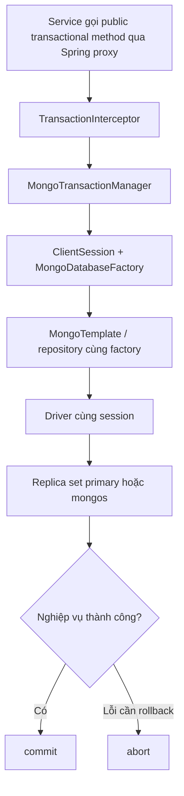
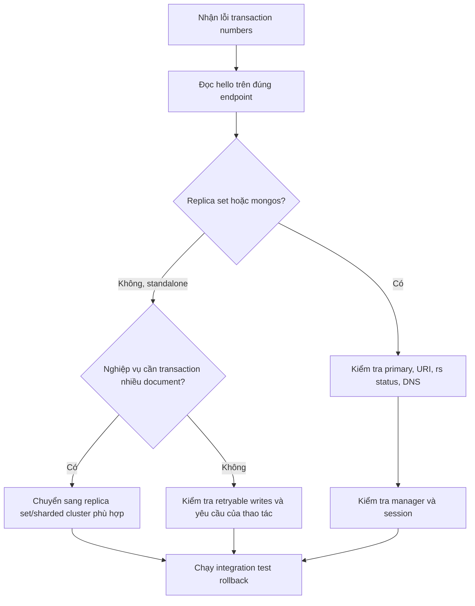

# Transaction không hoạt động trên topology hoặc cấu hình hiện tại

> **Chương:** Lỗi và chẩn đoán · **Module:** `SPRING_DATA_MONGODB`. Spring Data MongoDB hỗ trợ thao tác dữ liệu bằng `MongoTemplate`, repository và API reactive, trong đó các cập nhật **một document** đã có tính nguyên tử ở phía MongoDB. Khi cần nhiều thao tác đọc/ghi cùng commit hoặc rollback, ứng dụng phải sử dụng **multi-document transaction** trên topology MongoDB phù hợp, với transaction manager và session đúng. Bài này giúp phân biệt lỗi ở **MongoDB server/topology**, lỗi **kết nối/driver**, lỗi **wiring Spring Data**, và lỗi **ranh giới giao dịch trong code**.

## 1. Bài toán và triệu chứng thường gặp

Một nghiệp vụ đặt hàng cần thực hiện hai thay đổi:

1. Giảm `available` trong document `stock` của mặt hàng.
2. Tạo document mới trong collection `orders`.

Nếu bước 1 thành công rồi bước 2 thất bại, tồn kho đã bị trừ nhưng không có đơn hàng. Gọi hai lệnh liên tiếp không tự biến chúng thành một giao dịch.

```text
Không có multi-document transaction:

stock.available = 5
     │
     ├── update stock: available = 4  (đã commit)
     │
     ├── insert order: lỗi duplicate key
     │
     └── kết quả: stock = 4, order không được tạo
```

Mục tiêu khi dùng transaction là:

```text
start transaction
    ├── update stock
    ├── insert order
    ├── nếu bất kỳ bước nào lỗi → abort tất cả thay đổi trong transaction
    └── nếu hợp lệ → commit tất cả thay đổi
```

Tuy nhiên, khi chạy code `@Transactional` trên MongoDB standalone hoặc gắn sai transaction manager, người học có thể gặp:

- `Transaction numbers are only allowed on a replica set member or mongos`.
- `No qualifying bean of type 'PlatformTransactionManager'` hoặc không tìm được bean manager đã khai báo.
- Dữ liệu bước đầu vẫn tồn tại sau khi phương thức `@Transactional` ném lỗi.
- `NoSuchTransaction`, `WriteConflict`, `TransientTransactionError` khi transaction đang chạy.
- Một repository sử dụng database/client khác với `MongoTemplate` được dùng trong transaction.
- Code reactive trả `Mono` nhưng thao tác không được subscribe hoặc tạo subscription tách khỏi transaction.

**Không phải mọi triệu chứng đều chứng minh transaction của MongoDB bị lỗi.** Trước khi thay đổi URI hoặc thêm `retryWrites=false`, cần xác định lệnh đang chạy trên topology nào và các thao tác có cùng session/transaction hay không.

## 2. Hiểu đúng các phạm vi nguyên tử

| Phạm vi | MongoDB bảo đảm/điều kiện | Ví dụ |
|---|---|---|
| Một thao tác trên **một document** | Ghi nguyên tử ở cấp document, kể cả cập nhật nhiều field trong document đó | `$inc` với guard `available: {$gte:1}` |
| Nhiều thao tác trên **nhiều document** | Cần transaction phù hợp nếu muốn commit/rollback cùng nhau | Trừ tồn kho và tạo đơn hàng |
| `updateMany` trên nhiều document | Mỗi document được cập nhật nguyên tử; toàn bộ `updateMany` **không** mặc nhiên là một transaction | Đánh dấu nhiều order |
| Nhiều database/collection trong cùng MongoDB deployment | Có thể nằm trong transaction với điều kiện topology, session và các hạn chế lệnh được thỏa | Ghi `orders` và `payments` |
| MongoDB + HTTP API bên ngoài / message broker | Không có distributed transaction tự động chỉ nhờ MongoDB transaction | Ghi MongoDB rồi gọi cổng thanh toán |

Một transaction MongoDB không thay thế thiết kế idempotency, concurrency guard hay quy trình bù trừ khi nghiệp vụ còn phụ thuộc hệ thống ngoài MongoDB.

### 2.1. Transaction cần thiết khi nào?

Nếu bất biến có thể chứa trong một document, ưu tiên thao tác nguyên tử đơn giản:

```javascript
db.stock.updateOne(
  { _id: "SKU-1", available: { $gte: 1 } },
  { $inc: { available: -1 } }
);
```

Lệnh trên chống hai request cùng trừ một đơn vị cuối cùng bằng điều kiện cập nhật tại server. Chỉ khi cần đồng bộ thêm một hoặc nhiều document khác, transaction mới trở thành lựa chọn cần đánh giá, vì nó tăng công việc phối hợp, khóa/contension và nguy cơ retry.

## 3. Topology nào hỗ trợ multi-document transaction?

| Kiểu triển khai MongoDB | Hỗ trợ multi-document transaction? | Điều kiện/lưu ý |
|---|---|---|
| **Standalone `mongod`** | **Không** | Không có replica set protocol; không thể bật transaction bằng annotation Spring |
| **Replica set** | **Có** từ MongoDB 4.0 | Replica set đã khởi tạo, primary khả dụng, kết nối nhận diện đúng topology |
| **Sharded cluster** qua `mongos` | **Có** từ MongoDB 4.2 | Cluster/shards đáp ứng yêu cầu phiên bản và tính năng; transaction liên shard có thêm chi phí |
| Replica set một node cho local/CI | **Có** | Vẫn phải chạy `--replSet` và `rs.initiate()` thành công; khác standalone |
| Replica set chưa khởi tạo | **Chưa sẵn sàng** | `mongod --replSet` mới chỉ khai báo chế độ, chưa đủ để transaction chạy |
| MongoDB service quản lý | **Tùy topology/cấu hình và khả năng dịch vụ** | Xác minh deployment thực tế và endpoint, không suy từ tên sản phẩm |

Với các deployment cũ, còn phải kiểm tra yêu cầu **feature compatibility version (FCV)** và phiên bản driver/Spring Data. Dù server hỗ trợ transaction, một cluster đang nâng cấp/chưa hoàn tất cấu hình vẫn có thể không đáp ứng tính năng tương ứng.

**Replica set không đồng nghĩa nhiều máy:** một replica set một node dùng được cho bài lab transaction. Production cần thiết kế high availability, bảo mật và khả năng chịu lỗi riêng; không dùng replica set một node làm bằng chứng ứng dụng đã chịu được failover thật.

### 3.1. Kiểm tra topology bằng `mongosh`

Kết nối đến đúng endpoint mà ứng dụng đang dùng, với tài khoản có quyền thích hợp:

```javascript
const hello = db.adminCommand({ hello: 1 });

printjson({
  setName: hello.setName,
  isWritablePrimary: hello.isWritablePrimary,
  msg: hello.msg,
  logicalSessionTimeoutMinutes: hello.logicalSessionTimeoutMinutes
});
```

Cách diễn giải thường gặp:

- `hello.setName` có giá trị: đang nói chuyện với thành viên **replica set**.
- `hello.msg === "isdbgrid"`: endpoint là **`mongos`** của sharded cluster.
- Không có `setName` và cũng không có `msg: "isdbgrid"`: cần nghi ngờ đang nối tới **standalone** (xác minh thêm từ cấu hình triển khai).
- `isWritablePrimary` giúp nhận diện primary trên một member; trên kết nối ứng dụng qua replica set, driver phải khám phá và chọn node thích hợp cho các thao tác ghi.
- `logicalSessionTimeoutMinutes` hữu ích khi chẩn đoán session, nhưng **chỉ riêng trường này không chứng minh transaction được hỗ trợ**.

Nếu có replica set và đủ quyền:

```javascript
rs.status();
rs.conf();
```

Không chạy `rs.status()` rồi xem lỗi trên `mongos` là bằng chứng cluster không hỗ trợ transaction: lệnh đó dành cho replica set. Trên managed service, dùng dashboard/trạng thái cluster do nhà cung cấp hỗ trợ nếu tài khoản không có quyền xem cấu hình.

### 3.2. Nhầm endpoint trong connection string

Ví dụ URI kết nối replica set:

```text
mongodb://db1.example.internal:27017,db2.example.internal:27017,db3.example.internal:27017/shop?replicaSet=rs0
```

Tên host là ví dụ giả. Server phải quảng bá các member có hostname mà **ứng dụng thực sự kết nối được**; không dùng `localhost` trong replica set config nếu ứng dụng nằm trong một container hoặc host khác không nhìn thấy loopback đó.

Một số lỗi thường gặp:

1. Kết nối nhầm một standalone MongoDB local thay vì replica set test.
2. `mongod` có `--replSet rs0` nhưng chưa `rs.initiate()`.
3. Trong Docker, `rs.conf()` quảng bá tên host mà JVM ngoài container không resolve/kết nối được.
4. URI chỉ đến một secondary không thể chọn primary hoặc driver bị ép cấu hình không phù hợp.
5. Ứng dụng chỉ đọc được MongoDB trong môi trường staging nhưng transaction thực tế đang chạy ở endpoint khác.

Trong kết nối đến **sharded cluster**, ứng dụng phải đi qua `mongos` hoặc endpoint SRV/cluster thích hợp theo thiết kế, không ghép trực tiếp một shard member rồi kỳ vọng transaction liên shard hoạt động như cluster router.

### 3.3. Vì sao `retryWrites=false` không sửa được transaction trên standalone?

Thông báo:

```text
Transaction numbers are only allowed on a replica set member or mongos
```

có thể xuất hiện cả khi ứng dụng **không chủ động mở multi-document transaction**, vì retryable writes của driver cũng sử dụng session/transaction number trên wire protocol ở những ngữ cảnh nhất định.

Đặt `retryWrites=false` có thể giúp **một số thao tác ghi thông thường** kết nối tới standalone trong môi trường thử nghiệm. Nhưng nó **không làm standalone hỗ trợ multi-document transaction**. Nếu ứng dụng yêu cầu rollback nhiều document, cách sửa là chạy replica set/sharded cluster hỗ trợ, không phải tắt retryable writes rồi bỏ qua tính nguyên tử.

## 4. Tạo replica set một node cho môi trường lab

Ví dụ minh họa với Docker hoặc một máy thử nghiệm, không phải chỉ dẫn triển khai bảo mật production:

```bash
mongod --dbpath /data/db --replSet rs0 --bind_ip_all
```

Sau khi `mongod` chạy và có thể truy cập, khởi tạo từ `mongosh` trên môi trường lab:

```javascript
rs.initiate({
  _id: "rs0",
  members: [
    { _id: 0, host: "mongo:27017" }
  ]
});
```

`mongo:27017` trong ví dụ là hostname có thể resolve **trong Docker network**; nếu ứng dụng chạy ngoài network đó, phải chọn hostname/port quảng bá có thể truy cập từ nơi ứng dụng chạy. Kiểm tra đến khi member ở trạng thái primary rồi mới chạy transaction.

```javascript
db.adminCommand({ hello: 1 });
rs.status();
```

Kết nối ứng dụng trong cùng network:

```text
mongodb://mongo:27017/shop?replicaSet=rs0
```

Khi xác thực được bật trên replica set production, còn có yêu cầu cấu hình xác thực giữa các member (`keyFile`/cluster authentication), TLS, quyền user và secret management. Không sao chép lệnh lab `--bind_ip_all` thành cấu hình production không được bảo vệ.

**Testcontainers:** nếu dự án dùng Testcontainers 1.x, `MongoDBContainer` có thể tạo replica set một node và cung cấp URI từ `getReplicaSetUrl()`. Đây thường là cách ít phụ thuộc DNS/port thủ công hơn trong CI.

## 5. Spring Data MongoDB cần những thành phần nào?

Ba điều kiện độc lập:

1. **MongoDB deployment** hỗ trợ transaction và driver kết nối tới đúng cluster.
2. Có **MongoTransactionManager** hoặc **ReactiveMongoTransactionManager** phù hợp với API đang dùng.
3. Các thao tác cần bao phủ phải chạy trong **đúng transaction boundary**, sử dụng session mà transaction manager đã gắn với template/client.



Chỉ có `@Transactional` trong code **không tạo ra session có hiệu lực** nếu không có transaction manager đúng, proxy không được áp dụng hoặc các thao tác đi qua một client/factory khác.

### 5.1. Cấu hình imperative `MongoTransactionManager`

Đối với repository mở rộng `MongoRepository` và `MongoTemplate`:

```java
import org.springframework.context.annotation.Bean;
import org.springframework.context.annotation.Configuration;
import org.springframework.data.mongodb.MongoDatabaseFactory;
import org.springframework.data.mongodb.MongoTransactionManager;

@Configuration(proxyBeanMethods = false)
public class MongoTransactionConfig {

    @Bean("mongoTransactionManager")
    MongoTransactionManager mongoTransactionManager(
            MongoDatabaseFactory databaseFactory) {
        return new MongoTransactionManager(databaseFactory);
    }
}
```

Khi có Spring transaction infrastructure (Spring Boot/Spring Framework) và ứng dụng được cấu hình bật annotation-driven transactions, `@Transactional` sẽ được transaction interceptor xử lý. Nếu sử dụng Java config thuần mà chưa bật transaction management, bổ sung `@EnableTransactionManagement` thích hợp. Không giả định Spring Data MongoDB tự tạo manager trong mọi dự án và mọi phiên bản.

**Quan trọng:** manager phải dùng **cùng `MongoDatabaseFactory`** với `MongoTemplate`/repository được kỳ vọng tham gia. Khi có nhiều template/database/client, cần cấu hình từng manager rõ ràng và xác định ranh giới transaction; một manager không tự “bao trùm” mọi `MongoTemplate` trong `ApplicationContext`.

### 5.2. Đặt transaction ở lớp service

```java
import com.mongodb.client.result.UpdateResult;
import org.bson.Document;
import org.springframework.stereotype.Service;
import org.springframework.transaction.annotation.Transactional;
import org.springframework.data.mongodb.core.MongoTemplate;
import org.springframework.data.mongodb.core.query.Criteria;
import org.springframework.data.mongodb.core.query.Query;
import org.springframework.data.mongodb.core.query.Update;

@Service
public class OrderPlacementService {

    private final MongoTemplate mongoTemplate;

    public OrderPlacementService(MongoTemplate mongoTemplate) {
        this.mongoTemplate = mongoTemplate;
    }

    @Transactional(transactionManager = "mongoTransactionManager")
    public void placeOrder(
            String orderId, String sku, int quantity,
            boolean simulateFailureAfterReserve) {

        if (quantity <= 0) {
            throw new IllegalArgumentException("quantity must be positive");
        }

        Query stockGuard = Query.query(
            Criteria.where("_id").is(sku)
                .and("available").gte(quantity)
        );

        UpdateResult reserved = mongoTemplate.updateFirst(
            stockGuard,
            new Update().inc("available", -quantity),
            "stock"
        );

        if (reserved.getModifiedCount() != 1L) {
            throw new IllegalStateException("Insufficient stock");
        }

        mongoTemplate.insert(
            new Document("_id", orderId)
                .append("sku", sku)
                .append("quantity", quantity)
                .append("state", "NEW"),
            "orders"
        );

        if (simulateFailureAfterReserve) {
            throw new IllegalStateException("Simulated failure");
        }
    }
}
```

Ở đây:

- Lệnh giảm stock có guard `available >= quantity`, bảo đảm không trừ quá số còn lại khi các request cạnh tranh.
- Lệnh tạo `orders` được thực hiện **bên trong cùng phương thức public** được gọi qua Spring proxy.
- Khi ném `RuntimeException` sau hai lệnh, mặc định Spring đánh dấu transaction rollback (nếu transaction thực sự đã được mở).
- Nếu mã thử bị cấu hình **không có transaction**, document stock vẫn bị trừ và order đã insert có thể còn tồn tại sau exception.

Phải tạo collection và các index cần thiết **trước** khi thực hiện bài kiểm thử transaction trên topology phù hợp. Không để workflow nghiệp vụ dựa vào việc MongoDB/Spring Data tự tạo collection lần đầu *bên trong* transaction, vì các thao tác tạo namespace/index có những hạn chế theo topology/phiên bản.

### 5.3. Những giới hạn của `@Transactional`

| Tình huống | Vì sao transaction có thể không bao phủ code? | Cách sửa |
|---|---|---|
| Gọi `this.placeOrder(...)` trong cùng bean | Self-invocation bỏ qua Spring proxy trong cơ chế proxy mặc định | Đưa method sang service được inject, hoặc thiết kế boundary tường minh |
| Tạo service bằng `new OrderPlacementService(...)` | Object không do Spring quản lý | Inject bean từ context |
| Method không qua proxy phù hợp | Annotation-driven interceptor không chạy | Dùng public method gọi từ bean khác, kiểm tra mode/proxy config |
| Exception bị bắt rồi nuốt | Interceptor nhìn thấy kết thúc bình thường | Throw lỗi phù hợp hoặc đánh dấu rollback theo thiết kế |
| Checked exception không cấu hình rollback | Mặc định rollback với `RuntimeException` và `Error` | Sử dụng `rollbackFor = ...` khi nghiệp vụ yêu cầu |
| Dùng `MongoTemplate` khác factory | Không cùng session/transaction manager | Đồng bộ template/manager/factory hoặc tách quy trình |
| Gửi việc sang `@Async` hoặc thread khác | Thread-bound transaction context không tự chuyển sang thread mới | Không coi task mới là cùng transaction; thiết kế boundary khác |
| Thực hiện HTTP call ngoài MongoDB | MongoDB transaction không quản lý bên ngoài | Dùng outbox, idempotency, saga hoặc bù trừ |

Đừng hiểu `@Transactional(readOnly = true)` là cách “vô hiệu hóa” transaction cho một truy vấn: trên MongoDB, transaction chỉ đọc vẫn có chi phí/session và các tùy chọn read concern tùy manager; chọn rõ nhu cầu thay vì thêm annotation cho mọi method đọc.

## 6. Phân biệt Transaction Manager, MongoTemplate và Session

### 6.1. Spring transaction context trong imperative

`MongoTransactionManager` lấy `ClientSession` từ `MongoDatabaseFactory`, bắt đầu transaction và gắn session vào ngữ cảnh Spring cho các thao tác `MongoTemplate` tham gia. Khi kết thúc boundary, Spring commit/abort.

Vì thế đoạn sau có thể **không cùng giao dịch**, dù nằm trong một method được đánh dấu `@Transactional`:

```java
// templateA dùng MongoDatabaseFactory A, transaction manager cũng dùng A
templateA.updateFirst(...);

// templateB dùng MongoDatabaseFactory B hoặc client khác
templateB.insert(...);
```

Một session MongoDB gắn với một `MongoClient`/deployment cụ thể; không được coi là bộ điều phối transaction chung cho các kết nối hay các hệ thống bên ngoài.

Khi ứng dụng có `ordersMongoTemplate` và `billingMongoTemplate`, xác minh cấu hình `@Qualifier`, `mongoTemplateRef` và transaction manager. Không dựa vào `@Primary` để tự động “chuyển” session sang template ở database khác.

### 6.2. Nếu muốn quản lý session trực tiếp bằng MongoDB Java Driver

Một ví dụ driver sync, giả định `MongoClient` đã kết nối tới replica set:

```java
import com.mongodb.ReadConcern;
import com.mongodb.ReadPreference;
import com.mongodb.TransactionOptions;
import com.mongodb.WriteConcern;
import com.mongodb.client.ClientSession;
import com.mongodb.client.MongoClient;
import com.mongodb.client.MongoCollection;
import com.mongodb.client.MongoDatabase;
import com.mongodb.client.result.UpdateResult;
import com.mongodb.client.model.Filters;
import com.mongodb.client.model.Updates;
import org.bson.Document;

public final class DriverTransactionExample {

    public static void placeOrder(
            MongoClient client, String orderId, String sku, int quantity) {

        MongoDatabase database = client.getDatabase("shop");
        MongoCollection<Document> stock = database.getCollection("stock");
        MongoCollection<Document> orders = database.getCollection("orders");

        TransactionOptions options = TransactionOptions.builder()
            .readPreference(ReadPreference.primary())
            .readConcern(ReadConcern.SNAPSHOT)
            .writeConcern(WriteConcern.MAJORITY)
            .build();

        try (ClientSession session = client.startSession()) {
            session.withTransaction(() -> {
                UpdateResult result = stock.updateOne(
                    session,
                    Filters.and(
                        Filters.eq("_id", sku),
                        Filters.gte("available", quantity)
                    ),
                    Updates.inc("available", -quantity)
                );

                if (result.getModifiedCount() != 1L) {
                    throw new IllegalStateException("Insufficient stock");
                }

                orders.insertOne(
                    session,
                    new Document("_id", orderId)
                        .append("sku", sku)
                        .append("quantity", quantity)
                );

                return null;
            }, options);
        }
    }
}
```

Các lời gọi `updateOne(session, ...)` và `insertOne(session, ...)` truyền **cùng `ClientSession`**. Nếu vô tình gọi overload không nhận `session`, thao tác đó có thể chạy ngoài transaction. API `withTransaction` của driver hỗ trợ retry có điều kiện theo nhãn lỗi, vì vậy callback phải chịu được khả năng được chạy lại; không gửi email, gọi cổng thanh toán hoặc tạo side effect ngoài MongoDB trong callback mà không có thiết kế idempotency.

Khi dùng Spring, ưu tiên `MongoTransactionManager` để tránh phối hợp thủ công hai cơ chế giao dịch không thống nhất. Ví dụ driver minh họa bản chất của session, không phải hướng dẫn trộn `withTransaction` bên trong `@Transactional`.

### 6.3. Read concern, write concern và read preference

Các tuỳ chọn transaction quyết định ngữ nghĩa vận hành:

- **Read preference:** transaction cần dùng cấu hình phù hợp với việc chọn primary và topology; không cố chuyển các thao tác ghi trong transaction sang secondary.
- **Read concern:** `snapshot` có thể cung cấp góc nhìn dữ liệu nhất quán theo snapshot trong điều kiện được MongoDB hỗ trợ; không mặc định rằng mọi giao dịch đều dùng snapshot khi chưa xem cấu hình.
- **Write concern:** commit với `majority` thường được cân nhắc khi cần độ bền mạnh hơn trước failover; chi phí và ngữ nghĩa phụ thuộc topology.
- **Timeout/lifetime:** transaction mở quá lâu có thể bị server abort và tạo contention. Giới hạn mặc định và thông số cụ thể phụ thuộc phiên bản/server.

Không thay đổi read/write concern tùy ý chỉ để làm một test “xanh”. Hãy định nghĩa mục tiêu nhất quán và độ bền dữ liệu, sau đó cấu hình transaction options và kiểm thử trên topology tương đương production.

## 7. Transaction reactive: phải giữ cùng subscription và Reactor context

Reactive MongoDB dùng:

- `ReactiveMongoRepository` hoặc `ReactiveMongoTemplate`;
- `ReactiveMongoTransactionManager`;
- `@Transactional` trên phương thức **trả về reactive publisher**, hoặc `TransactionalOperator`;
- Reactive MongoDB driver và context propagation phù hợp.

### 7.1. Cấu hình manager

```java
import org.springframework.context.annotation.Bean;
import org.springframework.context.annotation.Configuration;
import org.springframework.data.mongodb.ReactiveMongoDatabaseFactory;
import org.springframework.data.mongodb.ReactiveMongoTransactionManager;

@Configuration(proxyBeanMethods = false)
public class ReactiveMongoTransactionConfig {

    @Bean("reactiveMongoTransactionManager")
    ReactiveMongoTransactionManager reactiveMongoTransactionManager(
            ReactiveMongoDatabaseFactory databaseFactory) {
        return new ReactiveMongoTransactionManager(databaseFactory);
    }
}
```

Một `MongoTransactionManager` imperative không thể thay thế `ReactiveMongoTransactionManager` cho publisher reactive. Với ứng dụng chứa cả hai stack, chọn manager theo tên hoặc qualifier rõ ràng; đừng mặc định một `@Transactional` mơ hồ sẽ được bind đúng.

### 7.2. Đảm bảo hai thao tác ở cùng reactive chain

```java
import com.mongodb.client.result.UpdateResult;
import org.bson.Document;
import org.springframework.stereotype.Service;
import org.springframework.transaction.annotation.Transactional;
import org.springframework.data.mongodb.core.ReactiveMongoTemplate;
import org.springframework.data.mongodb.core.query.Criteria;
import org.springframework.data.mongodb.core.query.Query;
import org.springframework.data.mongodb.core.query.Update;
import reactor.core.publisher.Mono;

@Service
public class ReactiveOrderPlacementService {

    private final ReactiveMongoTemplate template;

    public ReactiveOrderPlacementService(ReactiveMongoTemplate template) {
        this.template = template;
    }

    @Transactional(transactionManager = "reactiveMongoTransactionManager")
    public Mono<Void> placeOrder(
            String orderId, String sku, int quantity) {

        if (quantity <= 0) {
            return Mono.error(
                new IllegalArgumentException("quantity must be positive")
            );
        }

        Query guard = Query.query(
            Criteria.where("_id").is(sku)
                .and("available").gte(quantity)
        );

        return template.updateFirst(
                guard,
                new Update().inc("available", -quantity),
                "stock"
            )
            .flatMap(result -> {
                if (result.getModifiedCount() != 1L) {
                    return Mono.error(
                        new IllegalStateException("Insufficient stock")
                    );
                }
                return template.insert(
                    new Document("_id", orderId)
                        .append("sku", sku)
                        .append("quantity", quantity),
                    "orders"
                );
            })
            .then();
    }
}
```

Khi được gọi qua Spring transactional proxy và được subscribe, pipeline chạy với session/context do reactive manager điều phối. Nếu `insert` phát lỗi, transaction có thể được abort theo điều kiện lỗi và cấu hình.

**Các bẫy phổ biến:**

- Gọi `template.insert(...).subscribe()` bên trong `flatMap` rồi trả `Mono.empty()`: đã tạo **subscription riêng**, có thể thoát khỏi transaction context và không được await.
- Gọi `block()` giữa một chuỗi reactive: chặn thread và có thể phá vỡ mô hình non-blocking; không dùng để “ép” transaction hoạt động.
- Dùng `ThreadLocal` hoặc MDC thông thường làm cơ chế duy nhất để truyền session: reactive transaction sử dụng **Reactor context**, không mặc định theo thread gốc.
- Chạy `Flux.merge` hoặc `flatMap` song song các thao tác MongoDB trên cùng transaction/session: giao dịch của MongoDB driver không thiết kế để tùy tiện thực thi song song trên một session; ưu tiên chuỗi tuần tự (`concatMap` khi cần) và kiểm thử kỹ.
- Trả một `Mono` nhưng không ai subscribe: không có thao tác cơ sở dữ liệu thực sự xảy ra.

### 7.3. `TransactionalOperator` cho ranh giới tường minh

Khi cần transaction programmatic trong reactive:

```java
import org.springframework.transaction.reactive.TransactionalOperator;
import reactor.core.publisher.Mono;

Mono<Void> work = /* một reactive chain MongoDB, không subscribe nội bộ */;

Mono<Void> transactionalWork = work.as(transactionalOperator::transactional);
```

`transactionalOperator` cần được tạo từ đúng `ReactiveTransactionManager`, chẳng hạn qua cấu hình Spring. Chỉ khi subscriber subscribe vào `transactionalWork`, ranh giới transaction mới có hiệu lực. Không bọc một publisher đã tự subscribe trước đó rồi kỳ vọng thao tác ngoài chain được rollback.

## 8. Phân tích lỗi topology và session thường gặp

| Dấu hiệu/log | Lớp nguyên nhân có thể | Cách khoanh vùng |
|---|---|---|
| `Transaction numbers are only allowed on a replica set member or mongos` | Standalone hoặc retryable write trên topology không hỗ trợ | Kiểm tra `hello`; phân biệt retryable write với transaction thực |
| `This MongoDB deployment does not support retryable writes` | Retryable writes và khả năng deployment không phù hợp | Kiểm tra topology/driver; không coi tắt retryWrites là hỗ trợ transaction |
| `not primary`, `node is recovering`, server selection timeout | Không chọn được primary hoặc replica set đang bầu lại/chưa khỏe | `hello`, `rs.status()`, URI, DNS, network, driver discovery |
| `NoSuchTransaction` | Transaction đã abort/hết hạn, sai session/transaction number, hoặc lỗi trước đó | Xem lỗi đầu tiên, thời gian và session lifecycle |
| `TransientTransactionError` | Lỗi tạm thời có thể cần retry **toàn bộ transaction** | Đọc error labels của driver; giới hạn retry và bảo vệ side effects |
| `UnknownTransactionCommitResult` | Kết quả commit chưa rõ | Dùng chiến lược retry commit phù hợp, không tái tạo side effect tùy tiện |
| `WriteConflict` | Ghi cạnh tranh trên cùng dữ liệu | Transaction retry hợp lệ, guard/idempotency, giảm contention |
| `TransactionExceededLifetimeLimitSeconds` hoặc transaction bị hủy | Transaction quá lâu/áp lực tài nguyên | Rút ngắn giao dịch, giảm số thao tác, xem server metrics |
| `Operation not supported in a transaction` | DDL, lệnh cụ thể hoặc ràng buộc topology/phiên bản | Tạo collection/index trước transaction và kiểm tra tài liệu cho lệnh đó |
| `Cannot use a session that has ended` | Session đã đóng hoặc dùng sau khi thoát scope | Giữ session trong vòng đời transaction |
| `No qualifying bean of type 'TransactionManager'` | Thiếu/cấu hình sai Spring manager | Xác nhận bean manager, tên qualifier và transaction AOP |

**Lỗi đầu tiên là quan trọng nhất.** Một exception `NoSuchTransaction` có thể là hậu quả của `WriteConflict` đã làm server abort trước đó. Nếu chỉ nhìn exception cuối cùng trong log, có thể chẩn đoán nhầm thành lỗi cấu hình server.

### 8.1. Lỗi `Transaction numbers are only allowed...`: runbook



Bước kiểm tra thực tế:

1. Ghi lại server version, driver, Spring Data/Spring Boot version, **không log URI có credential**.
2. Dùng `hello` trên cùng endpoint với ứng dụng để xác định topology; nếu cần, xem cấu hình server và trạng thái replica set.
3. Kiểm tra có bật `retryWrites`, có `@Transactional`, driver `ClientSession` hoặc `withTransaction` không.
4. Nếu là standalone, giải quyết **đúng yêu cầu nghiệp vụ**: multi-document transaction cần replica set/sharded cluster, retryable write thường là vấn đề riêng.
5. Nếu là replica set, xác minh URI có `replicaSet` phù hợp, member advertisement/DNS, primary khỏe và app được phép kết nối.
6. Chạy kiểm thử rollback hai document với MongoDB test có topology tương đương.

### 8.2. Khi transaction bị abort nhưng code vẫn chạy tiếp

MongoDB có thể đánh dấu transaction đã abort sau một lỗi ghi. Nếu ứng dụng catch exception rồi tiếp tục gọi nhiều lệnh trong cùng session, các lỗi tiếp theo thường che mất nguyên nhân gốc.

Trong Spring service:

```java
@Transactional(transactionManager = "mongoTransactionManager")
public void unsafeWorkflow() {
    try {
        orderRepository.save(order);
    } catch (RuntimeException ex) {
        // Sai: nuốt lỗi rồi tiếp tục như thể giao dịch vẫn hợp lệ.
    }
    stockRepository.save(stock);
}
```

**Cách xử lý:** xác định exception nào là kết quả nghiệp vụ có thể giải quyết tại chỗ và exception nào cần **abort/retry toàn bộ transaction**. Không chỉ ném lại lỗi để sửa một triệu chứng: cần tránh side effect bên ngoài và đảm bảo request có thể chạy lại an toàn.

## 9. Những lỗi cấu hình Spring khó phát hiện

### 9.1. Có `@Transactional` nhưng không có manager phù hợp

Nếu ứng dụng mới thêm annotation mà không tạo `MongoTransactionManager`, kết quả tùy transaction AOP/config:

- Có thể ném lỗi không tìm thấy transaction manager khi gọi method.
- Có thể không tạo transactional proxy như mong đợi, dẫn tới các thao tác được chạy độc lập.
- Nếu có **JPA transaction manager** trong ứng dụng, `@Transactional` không chỉ tên có thể chọn manager của store khác, trong khi `MongoTemplate` không tham gia.

**Khắc phục:** đăng ký manager MongoDB và chỉ rõ `@Transactional(transactionManager="mongoTransactionManager")` trên boundary cần MongoDB transaction; kiểm tra manager thực sự dùng cùng database factory.

### 9.2. Method tự gọi trong cùng bean

```java
@Service
class OrderService {

    public void outer() {
        inner(); // self invocation: không đi qua transactional proxy
    }

    @Transactional(transactionManager = "mongoTransactionManager")
    public void inner() {
        // các thao tác MongoDB
    }
}
```

Đây là vấn đề cơ chế Spring AOP proxy mặc định. Đặt transaction boundary ở public method được gọi **từ bean khác qua proxy**, hoặc tách một service giao dịch riêng. Không khắc phục bằng cách thêm annotation lên private helper rồi mong interceptor tự chạy.

### 9.3. Exception bị chuyển thành giá trị kết quả thành công

```java
@Transactional(transactionManager = "mongoTransactionManager")
public Result place() {
    try {
        doWrites();
        return Result.ok();
    } catch (Exception ex) {
        return Result.failed(); // Spring thấy return bình thường.
    }
}
```

Nếu không đánh dấu rollback, transaction có thể commit các thay đổi trước lỗi. Với lỗi nghiệp vụ, nên throw một exception phù hợp, hoặc đánh dấu transaction rollback-only theo một chính sách rõ ràng. Unit test kiểu “method trả failed” **không đủ**: phải đọc database sau lời gọi và xác minh rollback.

### 9.4. Thiếu cấu hình transaction khi dùng nhiều MongoDB database

Nếu ứng dụng định nghĩa nhiều `MongoTemplate`/`MongoDatabaseFactory`, mỗi transaction manager có phạm vi của mình. Không giả định một annotation quản lý đồng thời các transaction của những MongoClient khác nhau. Với các database nằm trên cùng một deployment nhưng sử dụng hai client/factory riêng, phải kiểm tra khả năng và cách truyền session, hoặc thiết kế một boundary rõ ràng với cùng client/factory nếu cần transaction xuyên collection/database.

### 9.5. DDL và tạo index trong transaction

`MongoTemplate.insert` có thể kích hoạt thao tác tạo collection nếu chưa tồn tại, tùy mapping và version. Một số DDL được MongoDB hỗ trợ trong transaction từ những phiên bản nhất định, nhưng có nhiều điều kiện về topology, sharding và loại command.

Trong nghiệp vụ thông thường, nên **tạo collection và index ở migration/setup stage trước**, sau đó chỉ thực hiện các DML cần transaction bên trong boundary. Không cố thêm `createIndex` vào workflow đặt hàng để chạy mọi thứ “một lần cho tiện”.

## 10. Kiểm thử integration: chứng minh commit/rollback thật

Một unit test dùng Mockito xác nhận `mongoTemplate.updateFirst` và `insert` được gọi **không** chứng minh transaction thực sự rollback trên MongoDB. Cần test với MongoDB replica set chạy thật, chẳng hạn Testcontainers MongoDB container.

### 10.1. Phụ thuộc minh họa

Mã dưới đây theo Spring Boot 3.x, JUnit 5 và **Testcontainers 1.x**. Tên artifact/package MongoDB module ở Testcontainers 2.x có thể khác; chọn theo BOM và phiên bản thực của dự án.

```groovy
dependencies {
    implementation 'org.springframework.boot:spring-boot-starter-data-mongodb'

    testImplementation 'org.springframework.boot:spring-boot-starter-test'
    testImplementation 'org.testcontainers:junit-jupiter'
    testImplementation 'org.testcontainers:mongodb'
}
```

Bài test giả định `OrderPlacementService` và `MongoTransactionConfig` trong mục 5 được Spring Boot scan hoặc import, database/collection được khởi tạo trước lệnh transactional.

### 10.2. Khởi tạo MongoDB replica set trong Testcontainers

```java
import static org.assertj.core.api.Assertions.*;

import org.bson.Document;
import org.junit.jupiter.api.BeforeEach;
import org.junit.jupiter.api.Test;
import org.springframework.beans.factory.annotation.Autowired;
import org.springframework.boot.test.context.SpringBootTest;
import org.springframework.data.mongodb.core.MongoTemplate;
import org.springframework.test.context.DynamicPropertyRegistry;
import org.springframework.test.context.DynamicPropertySource;
import org.testcontainers.containers.MongoDBContainer;
import org.testcontainers.junit.jupiter.Container;
import org.testcontainers.junit.jupiter.Testcontainers;
import org.testcontainers.utility.DockerImageName;

@SpringBootTest
@Testcontainers
class OrderPlacementTransactionIT {

    @Container
    static final MongoDBContainer MONGO = new MongoDBContainer(
        DockerImageName.parse("mongo:7.0")
    );

    @DynamicPropertySource
    static void mongodbProperties(DynamicPropertyRegistry registry) {
        registry.add("spring.data.mongodb.uri", MONGO::getReplicaSetUrl);
    }

    @Autowired
    MongoTemplate template;

    @Autowired
    OrderPlacementService orderPlacement;

    @BeforeEach
    void prepareCollections() {
        template.dropCollection("orders");
        template.dropCollection("stock");

        // Tạo collection trước transaction.
        template.createCollection("orders");
        template.createCollection("stock");

        template.insert(
            new Document("_id", "SKU-1").append("available", 5),
            "stock"
        );
    }

    @Test
    void shouldCommitBothWrites() {
        orderPlacement.placeOrder(
            "O-100", "SKU-1", 2, false
        );

        Document stock = template.findById(
            "SKU-1", Document.class, "stock"
        );
        Document order = template.findById(
            "O-100", Document.class, "orders"
        );

        assertThat(stock).isNotNull();
        assertThat(stock.getInteger("available")).isEqualTo(3);
        assertThat(order).isNotNull();
        assertThat(order.getString("sku")).isEqualTo("SKU-1");
    }

    @Test
    void shouldRollbackBothWritesWhenBusinessFails() {
        assertThatThrownBy(
            () -> orderPlacement.placeOrder(
                "O-FAIL", "SKU-1", 2, true
            )
        ).isInstanceOf(IllegalStateException.class);

        Document stock = template.findById(
            "SKU-1", Document.class, "stock"
        );
        Document order = template.findById(
            "O-FAIL", Document.class, "orders"
        );

        assertThat(stock).isNotNull();
        assertThat(stock.getInteger("available")).isEqualTo(5);
        assertThat(order).isNull();
    }
}
```

**Điều kiện chạy:** Docker có sẵn, MongoDB container khởi tạo replica set thành công và connection URI do `getReplicaSetUrl` cung cấp phù hợp network của test runner. Nếu test chạy trên standalone, kết quả mong muốn là phát hiện topology không đúng, không phải “bỏ qua” phép kiểm tra rollback.

**Không đặt `@Transactional` trên chính test method** khi mục tiêu là quan sát kết quả commit/rollback của service: transaction của test framework có thể làm sai phạm vi quan sát. Mỗi test dùng collection riêng hoặc fixture được reset tuần tự, không chạy song song nhiều test cùng drop collection.

### 10.3. Cách đọc một test rollback thất bại

| Quan sát sau exception | Khả năng cần điều tra |
|---|---|
| Stock còn 5, không có order | Rollback hoạt động đúng theo case thử |
| Stock còn 3, vẫn có order | Transaction boundary không hiệu lực hoặc các lệnh ở ngoài session |
| Stock còn 3, không có order | Ít nhất lệnh update ngoài transaction, hoặc không cùng manager/factory |
| Exception xuất hiện trước update | Có thể lỗi topology/startTransaction/manager; đọc root cause |
| Test commit chạy qua nhưng rollback fail | Không chứng minh transaction bằng “happy path”; kiểm tra proxy và manager |
| Test bằng Testcontainers qua, production fail | Khác topology, URI, FCV, role, collection/index hoặc cấu hình phiên bản |

Thử thêm ca **insert trùng `_id`** trong transaction: đảm bảo lệnh cập nhật stock trước đó cũng bị rollback. Điều này kiểm tra rollback từ lỗi MongoDB thật thay vì chỉ exception mô phỏng.

## 11. Test phản chứng: có manager nhưng sai template

Khi ứng dụng có nhiều MongoDB database, test thêm một kịch bản cố ý:

1. Tạo `ordersMongoTemplate` và `stockMongoTemplate` gắn vào hai factory/client khác nhau.
2. Chỉ định transaction manager của một factory, đặt `@Transactional` trên service.
3. Thực hiện update qua một template, insert qua template khác, rồi ném exception.
4. Đọc lại cả hai database để chứng minh phần thao tác ngoài session của manager có thể không rollback.

Chỉ thực hiện trên **database test riêng**. Kết quả cụ thể phụ thuộc topology và cách factory/client được cấu hình; mục tiêu là test xác nhận **tất cả lệnh nghiệp vụ cùng một transaction boundary** trước khi đưa cấu hình nhiều database vào production.

Một check hữu ích ở test context:

```java
@Autowired
ApplicationContext context;

@Test
void mongoTransactionManagerExists() {
    assertThat(
        context.getBeansOfType(
            org.springframework.data.mongodb.MongoTransactionManager.class
        )
    ).hasSize(1);
}
```

Test trên chỉ kiểm tra sự tồn tại của bean. Nó **không thay thế** phép kiểm tra rollback hai document, vì manager có thể tồn tại nhưng dùng sai `MongoDatabaseFactory` hoặc annotation không được intercept.

## 12. Xử lý retry và transaction không chắc đã commit

### 12.1. Phân biệt lỗi tạm thời với lỗi nghiệp vụ

Có những nhãn lỗi từ MongoDB driver:

- `TransientTransactionError`: lỗi tạm thời có thể cần **chạy lại toàn bộ transaction**.
- `UnknownTransactionCommitResult`: kết quả của `commitTransaction` chưa rõ; thường cần **retry commit** theo quy tắc driver, không mặc định chạy lại toàn bộ thao tác ngay lập tức.

Không áp một vòng `retry()` vô hạn lên bất kỳ exception nào. Mã lỗi và error label thay đổi theo tình huống; hãy dựa vào **MongoDB transaction retry specification** hoặc API tiện ích như `ClientSession.withTransaction` khi phù hợp.

Một service có thể chạy thành công hai lệnh ghi nhưng client mất kết nối đúng lúc commit. Nếu không biết commit đã thành công hay chưa, việc gửi lại nghiệp vụ “trừ kho và tạo đơn” mù quáng có thể tạo lỗi trùng hoặc side effect không dự kiến. Sử dụng **idempotency key**, unique constraint theo request/order ID và chính sách đọc đối soát trước retry khi cần.

### 12.2. Không giữ transaction mở lâu

Transaction kéo dài có thể làm tăng áp lực WiredTiger cache, contention và dễ abort vì timeout/lifetime limit. Không nên:

- Chạy truy vấn report dài hàng phút trong cùng transaction ghi đơn hàng.
- Gọi API bên ngoài, chờ người dùng hoặc `Thread.sleep` trong transaction.
- Tạo index/collection trong cùng flow đặt hàng.
- Chạy hàng nghìn thao tác không giới hạn theo một transaction để “đảm bảo tất cả”.
- Giữ một session sống qua nhiều request hoặc nhiều thread.

Giới hạn giao dịch ở các bước MongoDB thật sự cần nguyên tử, chuẩn bị dữ liệu đầu vào trước, ghi ra event/outbox sau khi commit theo thiết kế để phối hợp với hệ thống khác.

### 12.3. Ghi log có ích mà không lộ dữ liệu

Khi chẩn đoán, ghi:

- Loại exception, mã lỗi MongoDB và **error labels** nếu có;
- Thời gian thực thi, số lần retry, outcome commit/abort;
- Tên operation nghiệp vụ đã được chuẩn hóa, transaction manager được dùng;
- Topology loại replica set/sharded/standalone và version ở mức metadata.

Không log connection URI chứa password, raw `Query`/`Update`/BSON command, session secrets, personal data hoặc toàn bộ payload chỉ để debug. Khi phân tích transaction bị abort, **giữ lại lỗi đầu tiên** với dữ liệu đã tối giản.

## 13. Quy trình chẩn đoán từ dấu hiệu đến kết luận

### 13.1. Trường hợp 1: local chạy standalone, CI dùng replica set

**Dấu hiệu:** test transaction chạy trong CI nhưng máy local ném `Transaction numbers are only allowed...`.

**Cách xác minh:** chạy `hello` trên URI của mỗi môi trường; xem `setName`/`msg`. Nếu local standalone, chuyển local MongoDB sang replica set một node hoặc dùng Testcontainers, sau đó chạy lại test rollback.

**Điều không nên làm:** tắt `retryWrites` rồi tuyên bố transaction hoạt động.

### 13.2. Trường hợp 2: có replica set nhưng method `@Transactional` không rollback

**Dấu hiệu:** query ở cả hai collection hoạt động nhưng sau exception stock vẫn giảm.

**Cách xác minh:** kiểm tra manager bean; transaction AOP/proxy; method được gọi từ bean khác; `MongoTemplate` dùng đúng factory; không có subscription/async thread tách khỏi transaction. Chạy lại integration test rollback hai document.

**Điều không nên làm:** chỉ đổi `writeConcern` hoặc thêm `@Transactional` vào mọi repository method mà không kiểm tra boundary.

### 13.3. Trường hợp 3: reactive pipeline không ghi dữ liệu

**Dấu hiệu:** phương thức trả `Mono<Void>`, test gọi method nhưng MongoDB không thay đổi.

**Cách xác minh:** publisher có được subscribe trong test (`StepVerifier`) hoặc ở HTTP boundary không? Có `subscribe()` lồng nhau, `block()` hoặc chuyển scheduler không kiểm soát không? `ReactiveMongoTransactionManager` có gắn đúng factory không?

**Điều không nên làm:** ép gọi `subscribe()` ngay trong service rồi trả `Mono.empty()`, vì làm mất quản lý lỗi và ngữ cảnh giao dịch.

### 13.4. Trường hợp 4: failover làm tăng transaction failures

**Dấu hiệu:** dưới lúc primary bầu lại, xuất hiện `not primary`, `WriteConflict` hoặc `TransientTransactionError`; bình thường không gặp.

**Cách xác minh:** đối chiếu thời điểm bầu primary, driver server selection, retry labels, commit result, transaction duration và retry policy. Đưa vào kiểm thử lỗi tạm thời với môi trường staging có replica set phù hợp.

**Điều không nên làm:** tăng timeout vô hạn hoặc chạy lại nghiệp vụ với side effect bên ngoài chưa idempotent.

## 14. Checklist kiểm tra nhanh

- [ ] Xác định rõ nghiệp vụ có thực sự cần multi-document transaction hay chỉ cần atomic update một document.
- [ ] Chạy `hello` trên endpoint ứng dụng dùng: replica set đã init hoặc `mongos`, không phải standalone.
- [ ] Kiểm tra MongoDB version, FCV, primary, DNS/advertised hosts và trạng thái cluster.
- [ ] Xác nhận Spring Data starter/driver đúng stack: imperative hoặc reactive.
- [ ] Đăng ký transaction manager phù hợp và xác nhận `@Transactional` chọn đúng manager.
- [ ] Đảm bảo method được gọi qua Spring proxy; không self-invocation hoặc new service thủ công.
- [ ] Đảm bảo mọi MongoDB operation thuộc cùng transaction dùng template/factory/client và session tương thích.
- [ ] Với reactive, giữ thao tác trong một publisher được subscribe, không subscribe lồng nhau và không song song trên cùng session.
- [ ] Tạo collection/index trước transaction; kiểm tra command có được phép chạy trong transaction ở version/topology đó không.
- [ ] Xử lý lỗi RuntimeException/rollbackFor, không nuốt lỗi rồi commit dữ liệu dở.
- [ ] Có retry policy đúng theo error labels và idempotency key cho nghiệp vụ có thể được chạy lại.
- [ ] Chạy integration test **commit và rollback** trên MongoDB replica set; kiểm tra dữ liệu ở hai collection sau sự cố.
- [ ] Theo dõi transaction duration, abort, commit ambiguity, connection pool và cluster health.
- [ ] Không đưa URI, dữ liệu giao dịch, session hoặc raw query chứa dữ liệu nhạy cảm vào log chung.

## 15. Câu hỏi tự kiểm tra

1. Vì sao `updateOne` trên một document có tính nguyên tử nhưng hai lệnh `updateOne` ở hai document khác nhau không tự tạo thành transaction?
2. Standalone MongoDB và replica set một node khác nhau thế nào đối với multi-document transaction?
3. Tại sao `Transaction numbers are only allowed on a replica set member or mongos` đôi khi xuất hiện ngay cả khi code không có `@Transactional`?
4. Khi lệnh `hello` không có `setName`, bạn cần kiểm tra thêm điều gì trước khi kết luận topology không hỗ trợ transaction?
5. Spring `@Transactional` cần những bean/cơ chế nào để thật sự mở MongoDB transaction?
6. Vì sao `this.placeOrder()` gọi từ cùng bean có thể làm transaction interceptor không chạy?
7. `@Primary` của một `MongoTemplate` có tự bảo đảm mọi repository trong transaction dùng đúng session không?
8. Khi nào cần `ReactiveMongoTransactionManager` thay cho `MongoTransactionManager`?
9. Vì sao gọi `subscribe()` bên trong `flatMap` có thể làm một thao tác thoát khỏi reactive transaction?
10. Nếu exception bị catch và method trả về bình thường, điều gì có thể xảy ra với transaction?
11. Tại sao cần test rollback đọc cả `stock` và `orders`, thay vì chỉ kiểm tra exception được ném ra?
12. Phân biệt `TransientTransactionError` với `UnknownTransactionCommitResult` về cách retry.
13. Vì sao `retryWrites=false` không thể bật transaction trên standalone?
14. Nếu cần trừ kho và gọi cổng thanh toán HTTP, MongoDB transaction có rollback được thanh toán bên ngoài không?
15. Vì sao nên tạo index và collection trước khi transaction nghiệp vụ chạy?

## 16. Ghi nhớ

- **Topology:** MongoDB multi-document transaction cần **replica set** hoặc **sharded cluster** đủ điều kiện; standalone không hỗ trợ.
- **Spring Data:** `MongoTransactionManager` cho `MongoTemplate`/`MongoRepository`, `ReactiveMongoTransactionManager` cho stack reactive; bean phải gắn đúng factory/client.
- **Boundary:** `@Transactional` cần được intercept bởi Spring proxy; tất cả thao tác phải tham gia cùng session/context và manager.
- **Rollback:** một test service ném lỗi chưa đủ; cần integration test kiểm tra dữ liệu thực tế ở **tất cả document liên quan**.
- **Retry:** error labels giúp phân biệt retry toàn giao dịch và retry commit; bất kỳ nghiệp vụ có thể thực hiện lại cần idempotency.
- **Vận hành:** transaction nên ngắn, collection/index chuẩn bị trước, quan sát topology và bảo vệ log khỏi dữ liệu nhạy cảm.

### Tài liệu tham khảo

- [MongoDB Manual — Transactions](https://www.mongodb.com/docs/manual/core/transactions/)
- [MongoDB Manual — Production Considerations for Transactions](https://www.mongodb.com/docs/manual/core/transactions-production-consideration/)
- [MongoDB Manual — Transactions and Retryable Writes](https://www.mongodb.com/docs/manual/core/retryable-writes/)
- [MongoDB Manual — Atomicity and Transactions](https://www.mongodb.com/docs/manual/core/write-operations-atomicity/)
- [MongoDB Manual — Replica Set Configuration](https://www.mongodb.com/docs/manual/tutorial/deploy-replica-set/)
- [MongoDB Manual — hello command](https://www.mongodb.com/docs/manual/reference/command/hello/)
- [MongoDB Java Driver — Transactions](https://www.mongodb.com/docs/drivers/java/sync/current/crud/transactions/)
- [Spring Data MongoDB Reference — Transactions](https://docs.spring.io/spring-data/mongodb/reference/mongodb/client-session-transactions.html)
- [Spring Data MongoDB API — MongoTransactionManager](https://docs.spring.io/spring-data/mongodb/docs/current/api/org/springframework/data/mongodb/MongoTransactionManager.html)
- [Spring Data MongoDB API — ReactiveMongoTransactionManager](https://docs.spring.io/spring-data/mongodb/docs/current/api/org/springframework/data/mongodb/ReactiveMongoTransactionManager.html)
- [Spring Framework — Declarative Transaction Management](https://docs.spring.io/spring-framework/reference/data-access/transaction/declarative.html)
- [Testcontainers — MongoDB](https://java.testcontainers.org/modules/databases/mongodb/)
