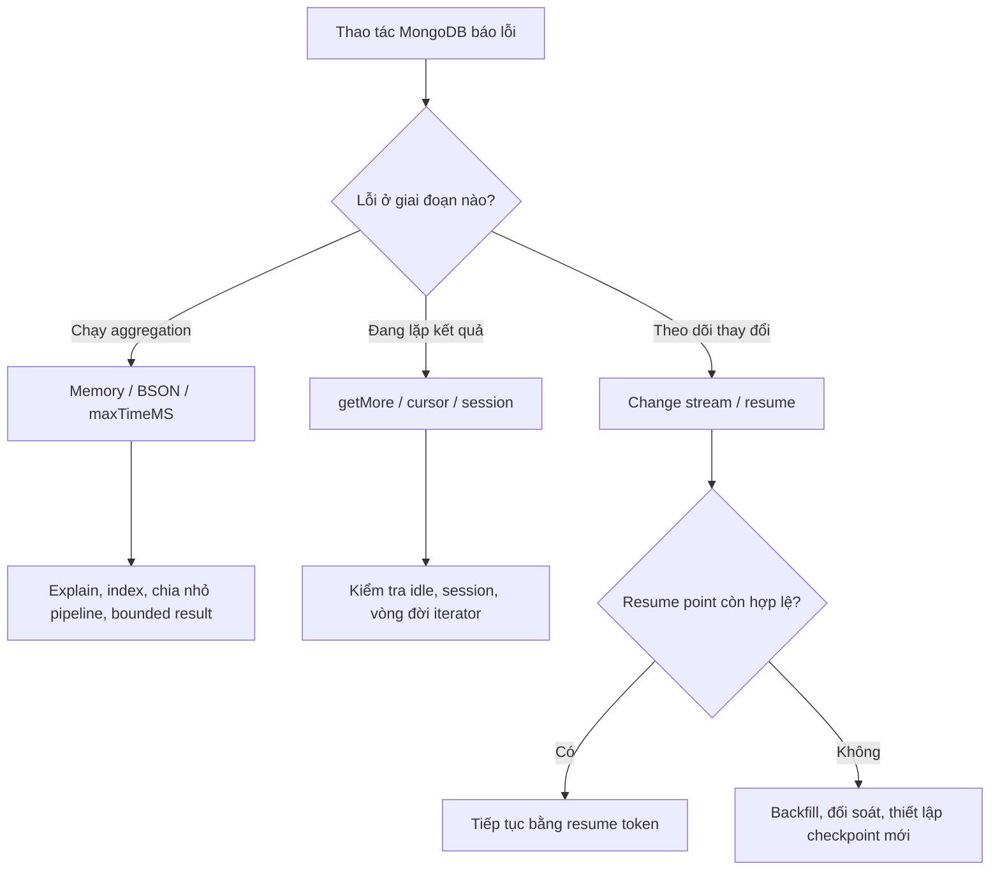
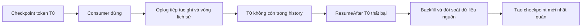

# Aggregation quá giới hạn, cursor hết hạn hoặc change stream không resume được

## Mục tiêu học tập

Trong **Spring Data MongoDB**, ba nhóm lỗi dễ bị gọi chung là “truy vấn đang chạy bị ngắt” nhưng thực chất xảy ra ở các thời điểm khác nhau:

- **Aggregation quá giới hạn:** một stage cần quá nhiều bộ nhớ, tạo document BSON quá lớn, chạy quá thời gian cho phép hoặc xử lý khối lượng dữ liệu vượt tài nguyên dự kiến.
- **Cursor hết hạn hoặc không còn hợp lệ:** server đã đóng cursor, phiên làm việc không còn hợp lệ hoặc ứng dụng sử dụng cursor sau khi đã đóng, dù truy vấn ban đầu có thể thành công.
- **Change stream không resume được:** luồng theo dõi thay đổi mất điểm tiếp tục hợp lệ, thường do lịch sử oplog không còn đủ, resume token không phù hợp hoặc xảy ra sự kiện invalidate.

Mục tiêu của bài là chẩn đoán đúng lỗi, chọn biện pháp khắc phục dựa trên bằng chứng, rồi xác nhận thao tác với **`MongoTemplate`, repository, aggregation, Java Driver hoặc reactive change stream** hoạt động đúng.

Sau bài học, bạn có thể:

1. Phân biệt lỗi giới hạn bộ nhớ aggregation, giới hạn **16 MiB BSON document**, lỗi timeout và lỗi cursor.
2. Dùng `explain("executionStats")`, `allowDiskUse`, index, `$match` và `$project` để tối ưu pipeline mà vẫn giữ kết quả đúng.
3. Quản lý vòng đời `MongoCursor`/`CloseableIterator`, session, batch size và thời gian xử lý dữ liệu.
4. Lưu và dùng **resume token** của change stream; xác định khi nào chỉ nên retry và khi nào cần **backfill/reconciliation**.
5. Xây dựng phép kiểm thử tái hiện lỗi bằng dữ liệu và tải gần với môi trường thực, không làm mất sự kiện khi khôi phục.

> Lưu ý phiên bản: giới hạn, cờ `allowDiskUseByDefault`, thao tác spill ra disk, cách driver tự resume và tên exception có thể thay đổi theo phiên bản MongoDB/Java Driver/Spring Data MongoDB. Luôn đối chiếu lỗi thực tế với phiên bản deployment; các ví dụ bên dưới nêu hành vi chung và những ngoại lệ quan trọng.

## 1. Nhận diện đúng lớp lỗi

Hãy đọc **exception gốc, error code, command, namespace, thời điểm xảy ra và trạng thái xử lý của ứng dụng** trước khi sửa cấu hình.

| Triệu chứng | Điểm thất bại thường gặp | Kiểm tra ưu tiên |
| --- | --- | --- |
| `Sort exceeded memory limit` hoặc `$group` cần quá nhiều RAM | Stage aggregation chặn luồng và giữ trạng thái lớn | Pipeline order, index, `allowDiskUse`, kích thước nhóm |
| `BSONObjectTooLarge` hoặc BSON document > 16 MiB | Một document đầu vào/đầu ra không hợp lệ về kích thước | `$group`, `$push`, `$lookup`, `$facet`, mô hình array |
| `ExceededTimeLimit`, thường code 50 | `maxTimeMS` hoặc giới hạn thực thi liên quan | Chi phí query, index, deadline và tải server |
| `CursorNotFound`, thường code 43 | Server không còn giữ ID cursor khi gọi `getMore` | Idle timeout, session, close, restart/failover |
| `MongoCursor` đã đóng tại client | Mã ứng dụng đọc sau khi đã `close()` | Phạm vi `try-with-resources`, xử lý bất đồng bộ |
| Change stream báo `ChangeStreamHistoryLost`, thường code 286 | Resume point đã ra khỏi oplog/change stream history | Độ trễ consumer, oplog window, checkpoint gần nhất |
| Resume token sai hoặc pipeline làm mất `_id` của change event | Resume không hợp lệ ở đúng stream | Token BSON, watch scope, pipeline, version |
| Change stream bị invalidate | Collection/database bị drop/rename hoặc sự kiện làm vô hiệu luồng | Khả năng dùng `startAfter`, tái thiết lập nguồn |

**Một lỗi `MongoTimeoutException` không đủ để kết luận cursor đã hết hạn.** Timeout khi tìm server, timeout thực thi command và cursor bị server đóng là những lỗi khác nhau. Cần đọc cả chuỗi `cause` và thông tin driver.



## 2. Aggregation: phân biệt giới hạn RAM, BSON và thời gian

Aggregation gồm nhiều stage và mỗi stage sử dụng tài nguyên khác nhau. Các stage có thể stream từng document như `$match`, nhưng các stage như `$sort` hoặc `$group` thường phải giữ trạng thái đáng kể trước khi sinh kết quả.

### 2.1. Giới hạn bộ nhớ của stage

Một số stage có ngưỡng sử dụng RAM khoảng **100 MB** trước khi phải spill ra disk hoặc phát lỗi, tùy loại stage và phiên bản. Các stage đáng kiểm tra gồm `$sort`, `$group`, `$setWindowFields` và một số dạng aggregation khác.

Cấu hình `allowDiskUse: true` cho phép **những stage hỗ trợ** dùng file tạm trên disk khi vượt ngưỡng nhớ. Với MongoDB 6.0 trở lên, tham số server `allowDiskUseByDefault` có thể ảnh hưởng hành vi mặc định; option ở command có thể ghi đè. **Không phải mọi stage đều được spill**.

Đặc biệt:

- `$facet` có giới hạn kích thước kết quả trung gian khoảng **100 MB** và không thể khắc phục bằng `allowDiskUse` nếu stage vượt giới hạn này.
- Document **đầu ra cuối cùng** của aggregation vẫn phải tuân theo giới hạn BSON **16 MiB**, kể cả khi stage trung gian có thể spill.
- `$graphLookup` có các giới hạn bộ nhớ và hành vi riêng; cần xác minh trên phiên bản server đang dùng thay vì cho rằng `allowDiskUse` luôn giải quyết được.
- File tạm sử dụng I/O và dung lượng disk; spill quá mức có thể khiến truy vấn chậm, gây áp lực lên cùng server.

**Kết luận kỹ thuật:** `allowDiskUse` là công cụ xử lý một nhóm tình huống vượt RAM của stage; nó không phải chế độ “bỏ mọi giới hạn”.

### 2.2. Ví dụ pipeline tạo nhóm lớn

Giả sử collection `orders` lưu hàng triệu đơn hàng, mỗi document có `customerId` và `total`. Pipeline tổng hợp doanh thu theo khách hàng:

```javascript
db.orders.aggregate([
  { $match: { status: "PAID" } },
  {
    $group: {
      _id: "$customerId",
      orderCount: { $sum: 1 },
      revenue: { $sum: "$total" }
    }
  },
  { $sort: { revenue: -1 } },
  { $limit: 50 }
], {
  allowDiskUse: true,
  maxTimeMS: 30000
})
```

`$group` cần giữ accumulator cho các nhóm; `$sort` theo giá trị đã tổng hợp có thể cần xử lý toàn bộ nhóm trước khi lấy top 50. `$limit` cuối cùng không có nghĩa server chỉ đọc 50 document nguồn.

Nếu khách hàng rất nhiều, index, giới hạn phạm vi thời gian và kiến trúc lưu dữ liệu có ảnh hưởng lớn. Thêm `allowDiskUse` có thể cho pipeline chạy tiếp khi bộ nhớ không đủ, nhưng phải **đo latency và disk I/O**.

### 2.3. Tối ưu thứ tự stage có ý nghĩa

Những thay đổi nên cân nhắc, nhưng luôn kiểm tra tính đúng của kết quả:

1. Đặt `$match` có thể dùng index ở đầu pipeline để giảm document vào những stage tốn RAM.
2. Chỉ lấy những field cần thiết ở giai đoạn thích hợp; optimizer MongoDB có thể tự đẩy projection, song vẫn nên xem kế hoạch thực thi.
3. Tận dụng index cho thứ tự `$sort` nếu sort có thể thực hiện trước stage biến đổi và index phù hợp.
4. Giới hạn miền dữ liệu theo thời gian, tenant hoặc trạng thái **khi nghiệp vụ cho phép**.
5. Nếu cần thống kê trên tập cực lớn và truy cập thường xuyên, cân nhắc tính trước theo kỳ (*materialized read model*) hoặc chia thành các batch có khả năng đối soát.

**Không dời `$limit` lên trước `$group` chỉ để giảm tải**, vì điều đó đổi kết quả tổng hợp: bạn đang thống kê 50 đơn đầu tiên thay vì mọi đơn đủ điều kiện.

### 2.4. Dùng `explain` để tìm nguyên nhân

```javascript
db.orders.explain("executionStats").aggregate([
  { $match: { status: "PAID" } },
  {
    $group: {
      _id: "$customerId",
      revenue: { $sum: "$total" }
    }
  },
  { $sort: { revenue: -1 } },
  { $limit: 50 }
], { allowDiskUse: true })
```

Khi xem kế hoạch thực thi:

- `totalDocsExamined`, `totalKeysExamined` và `nReturned` cho biết mức độ quét/khớp dữ liệu.
- Các stage `COLLSCAN`, `IXSCAN`, `SORT` hoặc thông tin liên quan giúp nhận diện cách MongoDB truy cập dữ liệu.
- Tùy phiên bản, `explain`/profiler có thể nêu `usedDisk`, số lần spill hay các metric RAM; không giả định mọi metric đều có sẵn trên mọi bản MongoDB.
- `executionTimeMillis` là số đo phía server trong điều kiện thực thi đó; cần đo thêm độ trễ qua network, mapping Java và serialization API.

Trước khi thêm index, kiểm tra kích thước index, tần suất ghi, phân bố tenant và khả năng dùng index của pipeline thực tế. Index dư thừa làm chậm ghi và chiếm cache.

## 3. Document đầu ra vượt 16 MiB và array phình to

Một document BSON có kích thước tối đa **16 MiB**. Thao tác `$push` trong `$group` hoặc `$lookup` với số lượng phần tử không giới hạn có thể tạo ra **một kết quả khổng lồ** dù document gốc nhỏ.

Ví dụ thiết kế nguy hiểm:

```javascript
db.orders.aggregate([
  {
    $group: {
      _id: "$customerId",
      allOrders: { $push: "$$ROOT" }
    }
  }
])
```

Nếu một khách hàng có hàng chục nghìn đơn, document `{ _id, allOrders: [...] }` có thể vượt 16 MiB. Tăng `allowDiskUse` hoặc `batchSize` **không làm document này hợp lệ**.

Có thể thay bằng:

- **Trả mỗi đơn hàng thành một document riêng** và phân trang theo `customerId`; không gom mọi đơn thành một mảng.
- Chỉ tổng hợp số đếm/doanh thu thay vì mang cả `$$ROOT`.
- Nếu cần ví dụ gần nhất, dùng collection lịch sử và truy vấn giới hạn theo cursor; hoặc dùng cơ chế top/bottom-N phù hợp phiên bản khi yêu cầu thật sự chỉ cần một tập hữu hạn.
- Với báo cáo nhiều nhóm, stream từng kết quả nhóm nhỏ thay vì tạo một document chứa toàn bộ hệ thống.
- Xem lại thiết kế `$facet` và các nhánh pipeline có thể tích lũy array lớn.

Ví dụ chỉ thống kê:

```javascript
db.orders.aggregate([
  { $match: { status: "PAID" } },
  {
    $group: {
      _id: "$customerId",
      orderCount: { $sum: 1 },
      revenue: { $sum: "$total" }
    }
  }
], { allowDiskUse: true })
```

**Bộ nhớ của stage** và **kích thước document kết quả** là hai giới hạn riêng. Phân tách lỗi này là bước quan trọng nhất khi một pipeline vẫn thất bại sau khi bật spill.

### 3.1. `$facet` có thêm ràng buộc

`$facet` thường chạy nhiều subpipeline để tạo một document kết quả chứa các array từ từng nhánh. Một báo cáo gộp toàn bộ dữ liệu `details` vào một nhánh `$facet` có thể vượt giới hạn bộ nhớ của stage hoặc 16 MiB của document cuối, cho dù phía ngoài bật `allowDiskUse`.

Đối với giao diện có cả tổng số và dữ liệu theo trang, cân nhắc truy vấn riêng cho count và danh sách trang khi pipeline `$facet` có nguy cơ tạo tài liệu trung gian quá lớn. Phép đánh đổi là thêm request đến database và cần thống nhất yêu cầu tính nhất quán giữa các lần đọc.

## 4. Aggregation trong `MongoTemplate`

Spring Data MongoDB cung cấp `Aggregation`, `AggregationOptions` và các phép biến đổi stage để giảm viết raw BSON. Một pipeline tương đương:

```java
AggregationOptions options = AggregationOptions.builder()
        .allowDiskUse(true)
        .build();

Aggregation aggregation = Aggregation.newAggregation(
        Aggregation.match(Criteria.where("status").is("PAID")),
        Aggregation.group("customerId")
                .count().as("orderCount")
                .sum("total").as("revenue"),
        Aggregation.sort(Sort.Direction.DESC, "revenue"),
        Aggregation.limit(50)
).withOptions(options);

AggregationResults<CustomerRevenue> results =
        mongoTemplate.aggregate(
                aggregation, "orders", CustomerRevenue.class);
```

`CustomerRevenue` là DTO/read model có field map từ `_id` nhóm, `orderCount` và `revenue` tương ứng; với tên field `_id`, cần cấu hình mapping/annotation phù hợp.

Một số điểm cần nhớ:

- `AggregationResults` phục vụ truy xuất kết quả aggregation; với tập kết quả lớn, không nên mặc định đưa toàn bộ kết quả vào bộ nhớ ứng dụng.
- Không phải mọi cách gọi aggregation đều sử dụng cùng template hoặc cùng database trong ứng dụng multi-tenant; cần kiểm tra bean `MongoTemplate` và namespace thực tế.
- `allowDiskUse` không thay thế index, giới hạn phạm vi dữ liệu và kiểm soát kích thước kết quả.
- Với API phản hồi người dùng, vẫn cần DTO/serialization có giới hạn và timeout thích hợp.

### 4.1. Khi cần đọc kết quả lớn theo cursor

Có thể sử dụng trực tiếp MongoDB Java Driver để kiểm soát vòng đời `MongoCursor`:

```java
MongoCollection<Document> orders =
        mongoClient.getDatabase("app").getCollection("orders");

List<Bson> pipeline = List.of(
        Aggregates.match(Filters.eq("status", "PAID")),
        Aggregates.group("$customerId",
                Accumulators.sum("orderCount", 1),
                Accumulators.sum("revenue", "$total"))
);

AggregateIterable<Document> iterable = orders.aggregate(pipeline)
        .allowDiskUse(true)
        .batchSize(200);

try (MongoCursor<Document> cursor = iterable.iterator()) {
    while (cursor.hasNext()) {
        Document row = cursor.next();
        processRevenueRow(row);
    }
}
```

Đoạn code cần import các API Java Driver như `com.mongodb.client.model.Aggregates`, `Accumulators`, `Filters` và `org.bson.conversions.Bson`. `processRevenueRow` đại diện cho xử lý từng kết quả.

**`batchSize(200)` kiểm soát số kết quả trong mỗi batch gửi qua cursor**, giúp hạn chế bộ nhớ ứng dụng/mạng; nó **không giảm bộ nhớ mà stage `$group` hoặc `$sort` cần dùng phía server**. Một batch cũng chịu giới hạn kích thước message/response của MongoDB.

Nếu xử lý một kết quả mất nhiều phút, bạn vẫn có thể gặp vấn đề cursor/session dù batch size nhỏ. Đó là một lớp lỗi khác, được xử lý tiếp theo.

## 5. Cursor hết hạn: vòng đời phía server và client

Khi một lệnh `find` hoặc `aggregate` trả về nhiều kết quả, driver thường nhận batch đầu và một **cursor ID** để gọi `getMore` cho các batch tiếp theo. Cursor không nhất thiết tồn tại mãi.

### 5.1. Vì sao cursor biến mất?

Các nguyên nhân phổ biến:

1. **Idle timeout:** server có thể đóng cursor không hoạt động sau khoảng **10 phút** theo mặc định (phụ thuộc `cursorTimeoutMillis` và chính sách server).
2. **Session timeout:** session không hoạt động có thể hết hạn theo `logicalSessionTimeoutMinutes`, thường là **30 phút** trong nhiều cấu hình; việc này có thể giết cursor kể cả khi bật `noCursorTimeout`.
3. **Client đóng cursor:** code đã gọi `close()`, hoặc đã ra khỏi khối `try-with-resources`.
4. **Cursor đọc hết kết quả:** server đã đóng cursor sau khi hết dữ liệu; đây là kết thúc bình thường, không phải lỗi.
5. **Server restart, failover hoặc lỗi mạng:** cursor có thể bị mất khi connection/node thay đổi.
6. **Command bị kill hoặc thay đổi topology:** một số tình huống vận hành khiến cursor hiện có không còn hợp lệ.

Trong log, lỗi `CursorNotFound` (thường code `43`) cho biết server không còn cursor ID cần đọc, nhưng **không nêu duy nhất nguyên nhân**. Cần xem thời gian idle, session, server events và cách code xử lý iterator.

### 5.2. Ví dụ xử lý sai: giữ cursor khi làm công việc lâu

```java
MongoCursor<Document> cursor = collection.find().iterator();

while (cursor.hasNext()) {
    Document item = cursor.next();
    callSlowExternalService(item); // Có thể mất nhiều phút mỗi item.
}
// Không close() nếu có exception; cursor có thể idle lâu.
```

Nếu driver tải cả batch, ứng dụng xử lý rất chậm rồi mới gọi `getMore`, cursor có thể bị server đóng khi đang chờ. Đoạn code còn thiếu cleanup khi có lỗi.

Dùng `try-with-resources` là điều kiện tối thiểu:

```java
try (MongoCursor<Document> cursor =
         collection.find(Filters.eq("status", "PENDING"))
                   .batchSize(100)
                   .iterator()) {

    while (cursor.hasNext()) {
        Document item = cursor.next();
        processQuickly(item);
    }
}
```

Tuy nhiên, `try-with-resources` **chỉ bảo đảm giải phóng tài nguyên**. Nếu `processQuickly` thực tế mất quá lâu, nó không tự giữ cursor và session sống.

### 5.3. Thiết kế robust: đọc theo trang và checkpoint

Nếu mỗi bản ghi phải gửi email, gọi API bên ngoài hoặc xử lý dài, thường nên **tách đọc và xử lý**:

- Đọc một trang hữu hạn, đóng cursor, lưu công việc vào queue hoặc xử lý một batch nhỏ.
- Ghi checkpoint/cursor theo thứ tự ổn định để đọc trang tiếp.
- Dùng **keyset pagination** thay vì giữ một server cursor mở hàng giờ.
- Thiết kế idempotency để xử lý an toàn nếu batch trước được chạy lại.

Ví dụ danh sách đơn hàng theo `_id` tăng dần:

```java
Query query = Query.query(
        Criteria.where("status").is("PENDING")
                .and("_id").gt(lastProcessedId));

query.with(Sort.by(Sort.Direction.ASC, "_id"))
     .limit(200);

List<Order> page =
        mongoTemplate.find(query, Order.class);

// Xử lý từng bản ghi có checkpoint/idempotency phù hợp.
// Sau khi hoàn tất batch mới ghi lastProcessedId từ phần tử cuối.
```

Trong ví dụ, `lastProcessedId` phải có cùng **kiểu BSON** với `_id` thực tế (ví dụ `ObjectId` thay vì chuỗi). Query cần index hỗ trợ filter/sort. Nếu trạng thái `PENDING` thay đổi khi đang phân trang, cách đọc này **không đảm bảo snapshot bất biến**; các yêu cầu chính xác cao cần thiết kế rõ ngữ nghĩa và điểm kiểm tra.

### 5.4. `noCursorTimeout` không phải giải pháp chung

`noCursorTimeout()` của Java Driver có thể ngăn **cơ chế idle cursor timeout thông thường**, nhưng:

- Session có thể hết hạn khi không hoạt động.
- Server restart/failover vẫn có thể làm cursor biến mất.
- Cursor dài hạn chiếm tài nguyên server; phải có cơ chế đóng khi hoàn tất/hủy.
- Một ứng dụng làm việc lâu nên dùng các batch hữu hạn và checkpoint, thay vì giữ cursor mở không giới hạn.

MongoDB hỗ trợ cơ chế quản lý/refresh session trong một số kịch bản cursor chạy rất lâu, nhưng đó là thao tác vận hành nâng cao; cần kiểm tra phiên bản và chính sách timeout cụ thể. Không áp dụng `noCursorTimeout` để che dấu thiết kế consumer đang xử lý batch quá chậm.

## 6. Stream từ `MongoTemplate` và Reactive MongoDB

Spring Data MongoDB có thể trả kết quả dạng streaming thay vì luôn materialize mọi document. Với API đồng bộ, một ví dụ dùng `MongoTemplate.stream` và đóng iterator:

```java
Query q = Query.query(
        Criteria.where("status").is("PENDING"));

try (CloseableIterator<Order> iterator =
             mongoTemplate.stream(q, Order.class)) {
    while (iterator.hasNext()) {
        Order order = iterator.next();
        processQuickly(order);
    }
}
```

`CloseableIterator` cần được đóng để driver giải phóng tài nguyên. Không trả iterator mở ngoài phạm vi mà người gọi không chịu trách nhiệm đóng, không chuyển nó sang executor khác rồi đóng sớm.

Với **`ReactiveMongoTemplate`**, một `Flux` có khả năng áp dụng backpressure và hủy subscription, nhưng:

- Subscription mới thực sự kích hoạt truy vấn MongoDB.
- Khi consumer xử lý mỗi event chậm, cần kiểm soát concurrency và độ dài queue.
- `cancel()`/kết thúc subscription phải giải phóng tài nguyên thuộc pipeline.
- Reactive không loại bỏ server cursor timeout, index kém hoặc stage aggregation giữ nhiều bộ nhớ.
- Không gọi `block()` trên WebFlux event loop để chờ cursor.

Nếu stream kết quả là tác vụ dài hạn, vẫn cần chiến lược phân trang, retry/checkpoint hoặc change stream tùy nguồn dữ liệu; chỉ chuyển sync sang reactive không làm phép đọc trở thành bất tử.

## 7. Change stream: bản chất, resume token và oplog

**Change stream** theo dõi thay đổi dữ liệu trong replica set hoặc sharded cluster được hỗ trợ. MongoDB cung cấp sự kiện gồm operation type, namespace, thời điểm và một **resume token** dùng để bắt đầu lại từ vị trí đã biết.

Ví dụ sự kiện (rút gọn):

```json
{
  "_id": { "_data": "TOKEN_BSON_EXTJSON_MINH_HOA" },
  "operationType": "insert",
  "ns": { "db": "app", "coll": "orders" },
  "documentKey": { "_id": "ORD-1042" }
}
```

`_id` của **change event** là resume token, khác với `documentKey._id` của document nghiệp vụ. Token là **BSON object do server cấp**, không phải timestamp tự dựng và không nên dùng như một giá trị tuần tự để so sánh thủ công.

Luồng thay đổi có thể bị gián đoạn do mạng, primary election hoặc ứng dụng restart. Driver hiện đại có thể tự cố gắng resume một số lỗi tạm thời; **không nên tự giả định có retry vô hạn** hoặc mọi lỗi đều có thể resume.

### 7.1. Điều kiện để tiếp tục được

Việc resume còn phụ thuộc vào:

- **History còn trong oplog**: resume token phải có thể định vị trong lịch sử MongoDB còn giữ; consumer gián đoạn quá lâu có thể mất điểm resume.
- **Token hợp lệ**: checkpoint phải lưu BSON đầy đủ, đúng nội dung nhận từ MongoDB, không tự cắt chuỗi `_data`.
- **Scope và pipeline tương thích**: watch ở collection/database/deployment và pipeline áp dụng phải phù hợp; pipeline không được làm mất hoặc thay đổi `_id` của change event.
- **Trạng thái collection/deployment**: drop/rename/invalidate và các thay đổi topology có thể chặn `resumeAfter` theo ngữ nghĩa của MongoDB.
- **Quyền truy cập**: consumer vẫn cần quyền phù hợp để theo dõi thay đổi; lỗi permission không được khắc phục bằng resume token.

Một lỗi như **`ChangeStreamHistoryLost`** (thường code `286`) nghĩa là server không còn đủ lịch sử để tiếp tục từ token. Trong trường hợp đó, retry chính token cũ không thể tái tạo những event đã bị xóa khỏi oplog.

### 7.2. `resumeAfter`, `startAfter` và `startAtOperationTime`

| Cơ chế | Khi dùng | Giới hạn cần nhớ |
| --- | --- | --- |
| `resumeAfter(token)` | Tiếp tục change stream sau event đã checkpoint | Không dùng để tiếp tục **sau event invalidate** |
| `startAfter(token)` | Bắt đầu luồng mới sau token, kể cả một số tình huống invalidate được hỗ trợ | Cần token còn hợp lệ trong lịch sử; không giải quyết history lost |
| `startAtOperationTime(timestamp)` | Khởi động stream từ một thời điểm thao tác được hỗ trợ khi chưa có token | Chỉ lấy được lịch sử còn lại; không thay thế checkpoint chính xác |

Khi collection bị drop/rename hoặc watch scope thay đổi, cần đánh giá xem dữ liệu nguồn còn tồn tại hay đã được tạo lại. **`startAfter` không phải công cụ phục hồi dữ liệu đã mất**; nó chỉ thay đổi điểm bắt đầu của stream trong giới hạn mà server hỗ trợ.

## 8. Dùng Java Driver để checkpoint change stream

Ví dụ client theo dõi collection `app.orders`. Đoạn code mô tả phần lõi của một worker xử lý dài hạn; `loadCheckpoint`, `handleIdempotently` và `saveCheckpoint` là các hàm nghiệp vụ cần được triển khai trong ứng dụng.

```java
MongoCollection<Document> orders =
        mongoClient.getDatabase("app").getCollection("orders");

BsonDocument lastToken = loadCheckpoint();

ChangeStreamIterable<Document> changes = orders.watch()
        .fullDocument(FullDocument.UPDATE_LOOKUP);

if (lastToken != null) {
    changes = changes.resumeAfter(lastToken);
}

try (MongoCursor<ChangeStreamDocument<Document>> cursor =
         changes.iterator()) {

    while (cursor.hasNext()) {
        ChangeStreamDocument<Document> event = cursor.next();

        // Xử lý idempotent theo event/document key và chính sách nghiệp vụ.
        handleIdempotently(event);

        BsonDocument token = event.getResumeToken();
        if (token != null) {
            // Chỉ ghi checkpoint sau khi xử lý event đã thành công.
            saveCheckpoint(token);
        }
    }
}
```

Các API thuộc Java Driver gồm `ChangeStreamIterable`, `ChangeStreamDocument`, `FullDocument`, `MongoCursor` và `BsonDocument`. Cần có deployment hỗ trợ change streams và quyền cần thiết.

**Nguyên tắc checkpoint quan trọng:**

1. Nếu ghi token **trước khi** hoàn tất side effect, crash ở giữa có thể khiến hệ thống **bỏ sót event** khi restart.
2. Nếu xử lý xong nhưng crash **trước khi** ghi checkpoint, sau restart event có thể được nhận **lại**. Vì vậy handler nên idempotent hoặc có cơ chế khử trùng lặp.
3. Nếu cả side effect lẫn checkpoint được lưu trong cùng hệ thống giao dịch với điều kiện phù hợp, có thể thiết kế atomicity theo ứng dụng; không mặc định điều này đúng khi gọi API ngoài hay nhiều database.
4. Token cần được lưu **nguyên vẹn theo định dạng BSON hỗ trợ**, cùng namespace và metadata cần thiết để khôi phục. Đừng tự giải mã `_data` hoặc tạo token từ `clusterTime`.
5. Khi dùng client watch nhiều tenant, checkpoint phải được phân vùng theo **tenant + watch scope + pipeline/version** thích hợp để không resume nhầm dữ liệu.

Driver có thể tự resume một số lỗi mạng trong thời gian sống của stream, nhưng sau khi **process restart** cần checkpoint bền vững của ứng dụng. Nếu một event xử lý nhiều bước, xem xét ghi nhận trạng thái từng bước để khôi phục không làm trùng nghiệp vụ.

### 8.1. Không làm mất `_id` của change event trong pipeline

Ví dụ sai:

```javascript
db.orders.watch([
  { $project: { operationType: 1, documentKey: 1, _id: 0 } }
])
```

Change stream cần resume token trong `_id`; pipeline làm mất hoặc sửa `_id` có thể khiến stream thất bại. Hãy lọc `$match` theo `operationType` hoặc các field được hỗ trợ mà vẫn giữ nguyên token. Các stage được phép trong change stream pipeline cũng có giới hạn theo MongoDB version.

## 9. Vì sao change stream không resume được?

### 9.1. Oplog window nhỏ hơn thời gian consumer bị gián đoạn

Giả sử hệ thống giữ lịch sử oplog hiệu dụng trong một khoảng thời gian nhất định; nếu consumer dừng lâu hơn khả năng lưu giữ và có nhiều ghi mới, token cũ có thể bị mất khỏi lịch sử.



Để chẩn đoán, so sánh thời gian checkpoint cuối, độ trễ consumer, tốc độ ghi và khả năng giữ oplog của deployment. `rs.printReplicationInfo()` trong `mongosh` có thể hỗ trợ quan sát thông tin oplog trên cấu hình phù hợp, nhưng cần quyền và môi trường thích hợp. **Không suy ra một oplog window cố định từ dung lượng cấu hình** vì lưu lượng ghi làm thời gian giữ thực tế thay đổi.

### 9.2. Token không tương thích hoặc bị hỏng

Các lỗi thường gặp:

- Lưu token thành chuỗi đã bị cắt hoặc mất BSON type khi serialize qua JSON tùy ý.
- Gán token của tenant/collection này cho change stream của collection khác.
- Thay đổi pipeline, watch scope hoặc triển khai làm điểm resume không còn được hỗ trợ.
- Dùng token cũ sau sự kiện invalidate; `resumeAfter` không áp dụng để vượt qua invalidate.
- Thay đổi phiên bản driver/server, quyền truy cập hoặc topology mà không kiểm tra hành vi resume thực tế.

Cách sửa đầu tiên là kiểm tra checkpoint/metadata và lỗi cụ thể, không phải lập tức xóa checkpoint rồi bắt đầu “từ bây giờ”. Làm vậy có thể bỏ qua toàn bộ thay đổi xảy ra khi consumer dừng.

### 9.3. Lỗi quyền, mạng và invalidate khác history lost

| Nhóm sự cố | Cách phản ứng phù hợp |
| --- | --- |
| Gián đoạn mạng, primary election tạm thời | Để driver xử lý lỗi resumable được hỗ trợ; retry có giới hạn và quan sát lag |
| Lỗi permission hoặc auth | Sửa quyền/credentials, tránh retry không giới hạn |
| Pipeline thay đổi `_id` token hoặc sai syntax | Sửa cấu hình và test lại từ checkpoint hợp lệ |
| `ChangeStreamHistoryLost` | Xây lại trạng thái từ nguồn dữ liệu đáng tin cậy và đối soát gap |
| Invalidate do drop/rename | Xem trạng thái collection mới, cân nhắc `startAfter` khi phù hợp và xác nhận nghiệp vụ |
| Consumer không theo kịp tốc độ ghi | Tối ưu xử lý, phân phối tải có kiểm soát, theo dõi lag và retention |

## 10. Khi mất lịch sử: backfill và reconciliation có kiểm soát

Khi server không thể resume từ token, một cách làm thiếu an toàn là bỏ token, tạo stream mới tại thời điểm hiện tại và tiếp tục xử lý như chưa có gián đoạn. Nếu đã xảy ra thay đổi trong khoảng ngừng, hệ thống sẽ **mất sự kiện nghiệp vụ**.

Một quy trình khôi phục phù hợp tùy hệ thống:

1. **Tạm đánh dấu trạng thái consumer là chưa đồng bộ** và ghi nhận checkpoint cuối cùng cùng lỗi thực tế.
2. **Xác định nguồn sự thật**: collection MongoDB, bảng read model, event log độc lập hay outbox lưu bền vững.
3. **Lấy snapshot/backfill** các dữ liệu cần thiết để tái dựng trạng thái; xác định cách đồng bộ với những thay đổi xảy ra trong quá trình backfill.
4. **Tạo điểm tiếp tục mới hợp lệ** bằng cơ chế được triển khai cho version MongoDB, đồng thời chống race giữa snapshot và stream mới.
5. **Đối soát** số lượng, trạng thái và key nghiệp vụ; đảm bảo không mất hoặc xử lý trùng sự kiện.
6. Chỉ sau khi bằng chứng đối soát đạt yêu cầu mới cập nhật consumer thành đồng bộ.

Ví dụ với read model `orders_summary` được xây từ `orders`: khi mất resume token, có thể phải quét lại các đơn hàng đang tồn tại để tái dựng summary. Tuy nhiên, snapshot trạng thái cuối **không khôi phục được đầy đủ các chuyển trạng thái trung gian đã xảy ra** nếu nguồn dữ liệu chỉ giữ giá trị hiện tại. Nếu hệ thống bắt buộc xử lý từng sự kiện lịch sử, cần một **event log/outbox có retention phù hợp** ngay từ thiết kế.

### 10.1. Tại sao cần phối hợp snapshot với stream mới?

Nếu vừa quét snapshot vừa tiếp nhận change stream, một document có thể thay đổi giữa hai bước. Nếu không có cơ chế xác định điểm cắt và deduplication, có thể xảy ra:

- Bản ghi được backfill và event cập nhật cùng tác động lên read model hai lần.
- Document được tạo/xóa trong lúc quét không xuất hiện đúng ở kết quả cuối.
- Token checkpoint được đánh dấu vượt qua event chưa xử lý.

Thiết kế cụ thể phụ thuộc consistency model: có thể cần transaction/read concern phù hợp, snapshot, outbox, version của document hoặc thuật toán hòa giải trạng thái. Không có một cách gọi `startAtOperationTime` đơn lẻ nào tự bảo đảm mọi use case đạt exactly-once.

## 11. Reactive change stream trong Spring Data MongoDB

`ReactiveMongoTemplate` và reactive repository thường được dùng khi ứng dụng xử lý dữ liệu không chặn thread. Change stream reactive hoạt động theo `Flux`; tenant, collection, authentication và resume token vẫn cần quản lý như với Java Driver đồng bộ.

Luồng xử lý khái niệm:

```text
watch collection (reactive)
  -> nhận ChangeStreamEvent
  -> thực hiện nghiệp vụ idempotent
  -> lưu checkpoint token sau khi nghiệp vụ thành công
  -> theo dõi lag / retry có giới hạn với lỗi resumable
  -> lỗi non-resumable: cảnh báo và chuyển sang quy trình backfill
```

Những nguyên tắc cần giữ:

- **Chỉ khi có subscription** thì request đến MongoDB mới thực thi.
- Không gọi `subscribe()` tùy tiện trong controller để tạo một consumer khó quản lý vòng đời; cấu hình worker/service chuyên trách có lifecycle rõ.
- Không coi `retryWhen(...)` là giải pháp tổng quát: nó có thể tạo subscription mới nhiều lần nhưng vẫn dùng một resume token **đã mất lịch sử**.
- Cẩn trọng với `flatMap` xử lý event song song: nếu checkpoint token của event **sau** được lưu trước khi event **trước** hoàn tất, consumer có thể bỏ sót dữ liệu khi restart.
- Nếu cần concurrency, hãy thiết kế sequence/partition checkpoint theo thứ tự xác nhận được hoặc dùng consumer theo thứ tự khi tính đúng là ưu tiên.
- Cấu hình backpressure và giám sát processing lag. Backpressure không làm oplog ngừng tiến lên, nên consumer chậm lâu vẫn có nguy cơ history lost.

## 12. Giám sát và log có ý nghĩa

Ba nhóm lỗi cần **metric khác nhau**, tránh chỉ theo dõi một chỉ số “MongoDB request failed”.

| Nhóm | Metric/log nên theo dõi |
| --- | --- |
| Aggregation | Query shape, thời gian chạy, documents examined/returned, usedDisk/spills nếu có, kích thước BSON đầu ra, timeout |
| Cursor | Thời gian giữa các lần `getMore`, batch size, batch processing time, số cursor còn mở, lỗi CursorNotFound |
| Change stream | Thời gian event mới nhất, thời gian checkpoint thành công, khoảng lag, số lần resume, lỗi non-resumable, thời gian backfill |
| Chung | Trace ID, database/collection (đã chuẩn hóa), tenant đã xác thực khi phù hợp, server version, driver version, error code |

Không ghi nguyên pipeline nếu chứa PII, filter nhạy cảm hay nội dung document. Không đưa resume token đầy đủ vào log công khai vì nó có thể là dữ liệu nội bộ, tạo nhiễu và làm lộ metadata vận hành. Ghi hash/ID checkpoint hoặc độ dài/phiên bản nếu có nhu cầu quan sát.

Thời gian xử lý sự kiện cần được tính từ **thời điểm event phát sinh** và thời điểm hoàn tất của consumer nếu có thể. Chỉ giám sát “connection vẫn còn mở” không phát hiện consumer âm thầm đứng hoặc chậm đến mức sắp mất oplog window.

## 13. Quy trình chẩn đoán thống nhất

Khi một hệ thống Spring Data MongoDB có lỗi trong `aggregate`, `stream` hay `watch`, thực hiện theo thứ tự:

1. Xác định **thao tác nào lỗi**: `aggregate` ngay khi chạy, `getMore` sau khi nhận vài batch, hay `watch/resumeAfter` khi mở lại stream.
2. Ghi nhận exception gốc, error code, command, namespace, thời điểm, driver/server version và trạng thái last checkpoint.
3. **Nếu aggregation:** kiểm tra pipeline, `explain`, stage `$sort`/`$group`/`$facet`, 100 MB memory/spill, 16 MiB BSON và `maxTimeMS`. Kiểm tra index trước khi chỉ tăng tài nguyên.
4. **Nếu cursor:** xem thời gian không gọi `getMore`, session timeout, cơ chế đóng iterator, restart/failover và áp lực processing từng batch.
5. **Nếu change stream:** kiểm tra resume token nguyên vẹn, watch scope/pipeline, dấu hiệu invalidate, oplog window và consumer lag.
6. Chọn sửa theo nguyên nhân: giảm dữ liệu, tối ưu index, đổi model kết quả, chia batch, quản lý iterator, retry có giới hạn hoặc chạy backfill.
7. Kiểm thử với dữ liệu có kích thước, tốc độ ghi và thời gian gián đoạn đại diện cho production; kiểm tra lại tính đúng nghiệp vụ.
8. Theo dõi tỷ lệ lỗi và latency/lag sau triển khai để phát hiện trường hợp tải cực trị.

### Tình huống A — `allowDiskUse` bật nhưng vẫn lỗi 16 MiB

```text
Command: aggregate orders
Pipeline: $group by customerId, allOrders: { $push: "$$ROOT" }
Option: allowDiskUse = true
Error: BSON document too large
```

Đây là lỗi **kích thước một document kết quả**, không phải đơn thuần thiếu RAM cho `$group`. Cần tránh array tổng hợp vô giới hạn, trả dữ liệu theo trang hoặc chuyển sang các tổng hợp hữu hạn.

### Tình huống B — Cursor lỗi sau thời gian dài xử lý batch

```text
Cursor batch fetched: 100 documents
Business processing: 15 minutes
Next getMore: CursorNotFound
```

Một khả năng là cursor/session hết hạn khi không được sử dụng; kiểm tra timestamps và server log. Thiết kế tốt hơn là đóng cursor sau batch ngắn, chuyển xử lý sang queue và dùng checkpoint theo thứ tự ổn định.

### Tình huống C — Consumer restart sau nhiều giờ

```text
Last resume token: T0
Consumer stopped: long downtime
Restart: ChangeStreamHistoryLost
```

Đây là trường hợp cần xác định **gap trong dữ liệu**. Không xóa token và tuyên bố tiếp tục bình thường. Phải đối soát/backfill từ nguồn sự thật và khởi tạo điểm resume mới nhất quán.

### Tình huống D — Change event đã xử lý nhưng chưa lưu token

```text
Consumer xử lý event E thành công
Process crash trước khi persist checkpoint E
Restart từ token trước E
```

Event E có thể được nhận lại. Handler cần idempotent hoặc dedup; đây là ví dụ vì sao **at-least-once + xử lý idempotent** thường thực tế hơn kỳ vọng exactly-once xuyên hệ thống.

## 14. Bài tập thực hành

### Bài 1: Tìm giới hạn aggregation

Tạo bộ dữ liệu gồm nhiều `orders` thuộc ít và nhiều `customerId`. Thử pipeline thống kê số đơn/doanh thu theo khách, đo `executionStats` rồi thay đổi phạm vi lọc. Sau đó cố tình dùng `$group + $push: "$$ROOT"` trên tập đủ lớn trong môi trường thử nghiệm để quan sát khác biệt giữa thiếu RAM stage và document kết quả quá lớn.

Yêu cầu: viết kế hoạch khắc phục có giải thích **tại sao `allowDiskUse` không chữa lỗi 16 MiB** và tại sao giới hạn đầu vào không được làm sai kết quả báo cáo.

### Bài 2: Cursor hết hạn

Tạo worker đọc nhiều bản ghi qua `MongoCursor`, mô phỏng xử lý chậm trong môi trường thử nghiệm và ghi timestamp trước/sau `getMore`. So sánh cách giữ cursor mở với cách phân trang theo `_id` có checkpoint. Đảm bảo iterator được đóng cả khi handler ném exception.

Yêu cầu: mô tả tradeoff giữa consistency, throughput và khả năng restart; phân biệt session timeout với idle cursor timeout.

### Bài 3: Change stream bị gián đoạn

Trong replica set kiểm thử, tạo change stream và lưu resume token. Dừng consumer, tạo thêm các cập nhật, khởi động lại và kiểm tra resume thành công khi token còn hợp lệ. Tái hiện tình huống lịch sử bị mất **chỉ trong môi trường thử nghiệm** với cấu hình oplog và tải thích hợp.

Yêu cầu: thiết kế checkpoint sau side effect, một handler idempotent và quy trình backfill khi không còn token hợp lệ. Kiểm tra hệ thống không tuyên bố đã đồng bộ khi có khoảng dữ liệu chưa được đối soát.

### Câu hỏi tự kiểm tra

1. Vì sao tăng `batchSize` hoặc bật `allowDiskUse` không giúp document BSON vượt 16 MiB?
2. Tại sao `$limit` cuối pipeline không luôn làm `$group` xử lý ít dữ liệu?
3. `CursorNotFound` code 43 có chứng minh driver bị lỗi không, hay có thể do idle/session?
4. `noCursorTimeout` có bảo đảm cursor sống qua session timeout và failover không?
5. `resumeAfter` và `startAfter` khác nhau thế nào khi stream nhận sự kiện invalidate?
6. Nếu resume token cũ ra khỏi oplog, retry liên tục token đó có khôi phục được dữ liệu không?
7. Vì sao phải ghi checkpoint **sau** xử lý và cần idempotency khi restart?
8. Reactive change stream có loại bỏ nguy cơ consumer bị tụt xa hơn oplog window không?

## Ghi nhớ

- **Aggregation vượt RAM**, **document BSON >16 MiB**, **cursor biến mất** và **change stream không resume** là những lỗi khác nhau cần hướng xử lý riêng.
- `allowDiskUse` cho phép spill ở stage được hỗ trợ; nó không nới giới hạn BSON hoặc mọi giới hạn của `$facet`.
- Kiểm tra **`$match`, `$group`, `$sort`, index, `explain` và mô hình dữ liệu** trước khi tăng cấu hình tài nguyên.
- Cursor cần được đóng đúng phạm vi; với xử lý lâu, dùng **batch hữu hạn + checkpoint** thay vì giữ server cursor mở quá lâu.
- `noCursorTimeout` không vô hiệu hóa session timeout hoặc các sự cố server.
- Change stream có thể resume khi **token còn hợp lệ, history còn và stream tương thích**; `ChangeStreamHistoryLost` đòi hỏi **backfill/đối soát**, không chỉ retry.
- Lưu checkpoint bền vững sau xử lý thành công và thiết kế **idempotency/deduplication** để chịu được event được gửi lại.
- Quan sát **latency, batch processing time, cursor lifetime và consumer lag** để ngăn lỗi tái diễn.

Trong module **Spring Data MongoDB**, chẩn đoán chính xác các giới hạn của aggregation, vòng đời cursor và khả năng resume change stream giúp tối ưu truy vấn, giảm mất dữ liệu và vận hành luồng đồng bộ/reactive ổn định theo yêu cầu nghiệp vụ.

