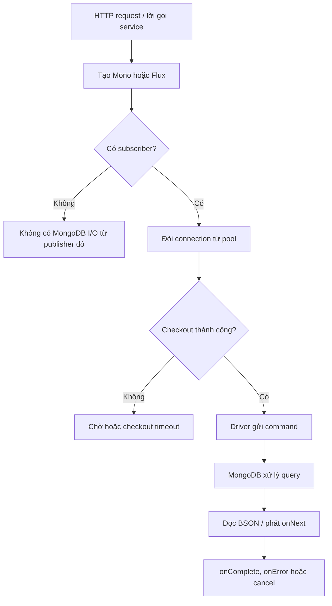
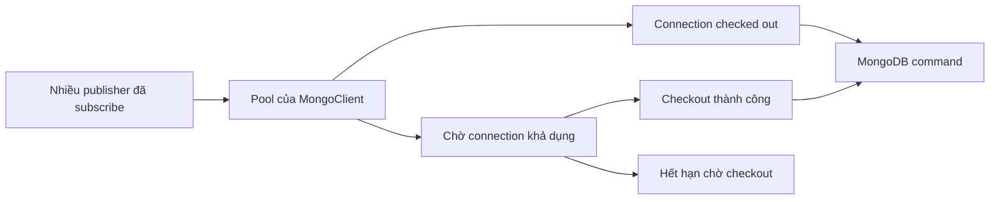

# Chuỗi reactive không chạy, cạn pool hoặc truy vấn quá thời gian

Trong ứng dụng **Spring Data MongoDB**, một endpoint dùng `ReactiveMongoTemplate` hoặc `ReactiveMongoRepository` có thể không ghi dữ liệu dù phương thức service được gọi, chậm bất thường khi có nhiều request đồng thời, hoặc báo timeout dù câu lệnh tìm kiếm trông rất đơn giản. Ba biểu hiện này có thể xuất phát từ các nguyên nhân **khác nhau**: không có subscription, thiếu kết nối khả dụng trong connection pool, hoặc truy vấn thực thi/chờ tài nguyên quá lâu.

Bài thuộc chương **Lỗi và chẩn đoán** của module `SPRING_DATA_MONGODB`. Nội dung tập trung vào cách xác định vị trí tắc nghẽn khi thao tác MongoDB qua publisher Reactor, phân biệt lỗi do ứng dụng và driver với lỗi phía MongoDB server, đo đạc thay vì đoán, thiết kế timeout đúng tầng và xây dựng kiểm thử có thể tái hiện.

> **Phạm vi ví dụ:** Java 17+, Spring Boot 3.x, Spring Data MongoDB Reactive, Project Reactor, MongoDB Java Reactive Streams Driver và Micrometer. Tên package/API hay thuộc tính tự động cấu hình có thể thay đổi giữa các nhánh phiên bản. Đoạn cấu hình minh họa dưới đây chủ yếu dành cho Spring Boot 3.x; kiểm tra lại thư viện dự án trước khi áp dụng.

## 1. Xác định triệu chứng trước khi sửa

| Triệu chứng | Nghi ngờ đầu tiên | Tín hiệu cần kiểm tra |
| --- | --- | --- |
| Gọi `save(...)` nhưng không có document | Không có subscriber; publisher không được trả về/ghép vào chuỗi | `doOnSubscribe`, `StepVerifier`, log command |
| Test publisher không có kết quả | Publisher chưa được subscribe, `Mono.empty()` hoặc luồng bị hủy | `doOnNext`, `doOnComplete`, `doFinally` |
| Ít tải chạy tốt, nhiều tải timeout | Hết kết nối khả dụng; request xếp hàng chờ checkout | Pool checked-out, checkout started/failed, wait time |
| Báo lỗi chọn server | Không tìm được server phù hợp, DNS/TLS/network/replica set | Driver topology log, server selection timeout |
| Có command gửi MongoDB nhưng chậm | Filter/sort/aggregation tốn tài nguyên, index chưa phù hợp | Command duration, `explain("executionStats")` |
| `timeout(Duration)` của Reactor | Publisher chưa phát tín hiệu đúng hạn | Stack trace `TimeoutException`, thời gian thực tế, cancellation |
| MongoDB trả lỗi vượt `maxTimeMS` | Operation phía server vượt giới hạn thời gian được đặt | MongoDB error code/name, slow query, explain |
| Request bị treo dù MongoDB nhanh | Block event-loop, lock, downstream service, encode response | Thread dump, event-loop metrics, tracing end-to-end |

Không mặc định mọi “Mongo timeout” là do thiếu index; cũng không mặc định cứ thêm `subscribe()` thì reactive pipeline đã đúng. Cần dựng lại **đường đi từ request đến subscriber, pool, command và kết quả**.

## 2. Từ publisher đến MongoDB: khi nào câu lệnh thực sự chạy?

Trong Reactor, `Mono` và `Flux` thường là **cold publisher**: tạo publisher chủ yếu là mô tả công việc. Các thao tác MongoDB reactive thường được kích hoạt khi có **subscription**.

Ví dụ các đoạn code phía dưới dùng một entity và repository tối giản (các import khác được thêm trực tiếp ở từng đoạn):

```java
package example.orders;

import java.time.Instant;
import org.springframework.data.annotation.Id;
import org.springframework.data.mongodb.core.mapping.Document;
import org.springframework.data.mongodb.repository.ReactiveMongoRepository;
import reactor.core.publisher.Flux;

@Document(collection = "orders")
public record Order(
        @Id String id,
        String tenantId,
        String customerId,
        Instant createdAt,
        String status
) {}

interface OrderRepository extends ReactiveMongoRepository<Order, String> {
    Flux<Order> findByCustomerId(String customerId);
}
```

ID như `o-101` trong ví dụ thuộc dạng chuỗi không chuyển sang ObjectId; với ID được biểu diễn bằng 24 ký tự hex, cần xác định rõ kiểu BSON và quy tắc chuyển đổi ID của Spring Data trước khi áp dụng truy vấn. Ở các đoạn mã rút gọn, biến `repository` là bean `OrderRepository` đã được inject.



### 2.1. Anti-pattern: gọi `save` nhưng bỏ publisher

```java
// SAI: tạo publisher rồi bỏ đi, thao tác lưu có thể chưa được thực thi.
public Mono<Order> createWrong(Order order) {
    repository.save(order);
    return Mono.just(order);
}
```

Mã đúng phải **trả publisher chứa thao tác lưu** hoặc ghép nó vào luồng sẽ được subscriber tiêu thụ:

```java
public Mono<Order> create(Order order) {
    return repository.save(order);
}

// Khi thao tác chỉ quan tâm đến hoàn tất:
public Mono<Void> createAndComplete(Order order) {
    return repository.save(order).then();
}
```

Trong Spring WebFlux, khi handler/controller trả `Mono` hoặc `Flux`, framework có thể subscribe và chuyển kết quả thành HTTP response. Trong test, `StepVerifier` hay một subscriber khác mới kích hoạt publisher; chỉ gọi phương thức service rồi bỏ kết quả là chưa kiểm chứng MongoDB I/O.

### 2.2. Anti-pattern: `subscribe()` thủ công trong service

```java
// SAI với request thông thường: tách thao tác khỏi lifecycle caller.
public Mono<String> createWrong(Order order) {
    repository.save(order).subscribe();
    return Mono.just("accepted");
}
```

Cách trên dễ trả “thành công” trước khi MongoDB ghi xong. Lỗi phát sinh sau đó có thể không quay về caller; cancellation, tracing, Reactor Context và transaction boundary cũng dễ bị tách rời. Trong luồng request, ưu tiên **composition**, không tự `subscribe()`:

```java
public Mono<String> createAndAcknowledge(Order order) {
    return repository.save(order)
            .map(saved -> "created:" + saved.id());
}
```

Chỉ tự subscribe tại **ranh giới chủ động** đã thiết kế rõ (ví dụ một message consumer hoặc tiến trình nền do ứng dụng quản lý), cùng chính sách xử lý lỗi, quản lý vòng đời và shutdown. Không biến `subscribe()` thành biện pháp chữa mọi lỗi “reactive không chạy”.

### 2.3. Phân biệt `map` và `flatMap`

Khi callback trả một publisher khác, dùng `flatMap` để ghép subscription:

```java
// SAI: Mono<Mono<Order>> thay vì Mono<Order>.
Mono<Mono<Order>> nested = findSourceOrder(id)
        .map(order -> repository.save(order));

// ĐÚNG: publisher save được ghép vào pipeline.
Mono<Order> flattened = findSourceOrder(id)
        .flatMap(repository::save);
```

Không có gì sai ở kiểu `Mono<Mono<T>>` trong mọi hoàn cảnh, nhưng nếu mục đích là thực thi inner publisher thì phải flatten hoặc có subscriber tương ứng. Tương tự, `doOnNext` dành cho **side effect đồng bộ phục vụ quan sát**, không nên dùng để gọi repository trả publisher rồi bỏ nó.

### 2.4. Không nhầm `Mono.empty()` với lỗi

`repository.findById(id)` có thể trả `Mono.empty()` nếu không có bản ghi. Publisher có subscription và kết thúc bình thường nhưng không có `onNext`. Trong case cần trả 404, chuyển thành lỗi nghiệp vụ rõ ràng:

```java
public Mono<Order> requireOrder(String id) {
    return repository.findById(id)
            .switchIfEmpty(Mono.error(
                    new java.util.NoSuchElementException(
                            "Order not found")));
}
```

Đừng nhận xét “truy vấn không chạy” chỉ vì `doOnNext` không in gì; dùng `doOnSubscribe`, `doOnSuccess`/`doOnComplete` và command monitoring để biết điều gì thực sự xảy ra.

## 3. Chẩn đoán subscription, backpressure và cancellation

Các hook Reactor có thể giúp xác định publisher đã được subscribe, phát dữ liệu, lỗi, hoàn tất hay bị hủy:

```java
import reactor.core.publisher.Flux;
import reactor.core.publisher.SignalType;

Flux<Order> observed = repository.findByCustomerId(customerId)
        .doOnSubscribe(s -> log.debug("orders subscribed"))
        .doOnNext(order -> log.debug("order emitted"))
        .doOnError(error -> log.warn(
                "orders failed: {}", error.getClass().getSimpleName()))
        .doFinally(signal -> log.debug("orders terminal: {}", signal));
```

Đây là đoạn code quan sát trong ngữ cảnh đã có `log`, `repository` và `customerId`. Không log toàn bộ document, access token, URI chứa mật khẩu hoặc dữ liệu cá nhân. Trong sản xuất, gắn trace ID và loại lỗi đã phân loại với metric thay vì tạo log cho từng item nếu luồng lớn.

Một số nguyên nhân tinh vi khác:

- **Không có subscription:** Không thấy `doOnSubscribe`; kiểm tra ai tiêu thụ publisher và có bị bỏ kết quả trước khi trả cho WebFlux hay không.
- **Có subscription, không có item:** `Mono.empty()` hoặc filter loại hết document; kiểm tra `doOnComplete` và query thực.
- **Luồng bị hủy:** HTTP client ngắt kết nối, `take(n)`, `timeout(...)` hoặc downstream cancel; `doFinally(SignalType.CANCEL)` giúp nhận diện.
- **Không có demand phù hợp:** Một subscriber thủ công có thể chưa gọi `request(n)`; với WebFlux, Reactor và Reactor Test thường có cơ chế request thích hợp.
- **Chạy lại nhiều lần:** Publisher cold có thể phát sinh nhiều MongoDB operation nếu bị subscribe lặp; `retryWhen` và một số composition cũng làm số lần gọi tăng.
- **Ghép luồng sai:** `zip` với publisher hoàn tất rỗng có thể kết thúc mà không phát kết quả; đặc biệt chú ý `Mono<Void>` khi ghép bằng `zipWith`, thay bằng `then(...)` nếu yêu cầu là thứ tự hoàn tất.

### 3.1. Tránh block event-loop

Trong ứng dụng WebFlux, gọi `block()`, `Thread.sleep(...)` hoặc I/O blocking ngay trong callback chạy trên event-loop có thể khiến hàng loạt request bị treo, dù MongoDB driver là reactive.

```java
// KHÔNG thực hiện bên trong handler WebFlux:
Order order = repository.findById(id).block();
```

Nếu có thư viện blocking bắt buộc, cô lập đúng phần blocking trên scheduler phù hợp (chẳng hạn `Schedulers.boundedElastic()`) và đo tải của scheduler đó; ưu tiên thay bằng API non-blocking khi khả thi. Không dùng `publishOn(boundedElastic())` bừa bãi để che lỗi cấu trúc hoặc giả định nó sẽ tăng số connection MongoDB.

## 4. Connection pool của reactive driver: vì sao có thể cạn?

Reactive không đồng nghĩa với **số kết nối vô hạn**. MongoDB Java Reactive Streams Driver sử dụng connection pool. Khi nhiều operation đồng thời cần kết nối hơn số connection hiện có, operation có thể phải đợi cho đến khi connection được trả về. Checkout chờ quá thời hạn cấu hình có thể thất bại, dù MongoDB server chưa xử lý query nào cho operation đó.



**Những thứ phải phân biệt:**

| Thuật ngữ | Ý nghĩa |
| --- | --- |
| Pool max size | Giới hạn số kết nối được pool duy trì tới mỗi server được quản lý |
| Checked-out connections | Kết nối đang được các operation sử dụng |
| Wait queue / checkout wait | Các operation đang chờ lấy connection |
| Connection checkout timeout | Quá thời gian chờ connection khả dụng |
| Server selection timeout | Driver không tìm được server phù hợp trong topology đúng hạn |
| Connect timeout | Thiết lập kết nối TCP tới server quá thời hạn |
| Socket/read timeout | Hoạt động mạng quá thời gian I/O (tùy cách driver/phương thức sử dụng) |

Không suy “pool của cluster có tối đa 20 connection” chỉ từ `maxPoolSize=20`: pool được quản lý cho từng server trong topology, và nhiều process/application instance còn tạo các pool riêng. Số lượng kết nối thực tế còn phụ thuộc heartbeats, monitoring, routing và cấu hình driver.

### 4.1. Các nguyên nhân thường gây áp lực pool

1. Một request fan-out nhiều query song song qua `flatMap` mà không giới hạn concurrency.
2. Nhiều request đồng thời, mỗi request giữ connection trong thời gian server thực thi command chậm.
3. Cursor dài, nhiều đợt `getMore`, xử lý hoặc cancellation không đúng khiến công việc kéo dài.
4. Connection pool quá nhỏ so với workload, hoặc số instance tăng khiến tải tổng trên MongoDB cao.
5. Trạng thái mạng/topology bất ổn khiến tạo connection mới chậm hay lỗi.
6. Tự khởi tạo quá nhiều `MongoClient` thay vì dùng lifecycle bean được quản lý, dẫn đến nhiều pool không cần thiết.

**Không vội tăng max pool size.** Tăng pool có thể chuyển điểm tắc nghẽn từ client sang MongoDB server, làm tăng concurrency, CPU, I/O và số connection toàn cluster. Trước tiên tìm operation đang giữ connection lâu, query thiếu index, N+1, fan-out không giới hạn và retry quá mức.

## 5. Đo pool và cấu hình giới hạn có chủ đích

MongoDB Java Driver cung cấp **connection pool monitoring (CMAP)**, gồm sự kiện checkout bắt đầu, checkout thành công, checkout thất bại, tạo/đóng connection và thay đổi pool. Thu thập các metric ở mức ít nhãn, không dùng ID/URI người dùng làm tag.

Trong Spring Boot 3.x, ví dụ dưới đây dùng `MongoClientSettingsBuilderCustomizer` để giới hạn pool cho client mà Spring Boot **tự động cấu hình**:

```java
package example.diagnostics;

import java.util.concurrent.TimeUnit;
import org.springframework.boot.autoconfigure.mongo.MongoClientSettingsBuilderCustomizer;
import org.springframework.context.annotation.Bean;
import org.springframework.context.annotation.Configuration;

@Configuration
public class MongoPoolConfiguration {
    @Bean
    MongoClientSettingsBuilderCustomizer poolLimits() {
        return settings -> settings.applyToConnectionPoolSettings(pool ->
                pool.maxSize(20)
                    .maxWaitTime(500, TimeUnit.MILLISECONDS));
    }
}
```

**Các số 20 và 500 ms chỉ để minh họa**, không phải cấu hình được khuyên dùng chung. Tham số `maxWaitTime` của connection pool liên quan tới chờ checkout, khác với thời gian server thực thi truy vấn. Nếu ứng dụng tự tạo reactive `MongoClient` bean, phải áp dụng giới hạn vào **client đó**; customizer Boot có thể không ảnh hưởng bean tự viết.

### 5.1. Thu thập pool event để biết điểm nghẽn

Có thể gắn `ConnectionPoolListener` vào `ConnectionPoolSettings`. Ví dụ đếm số lần checkout thất bại:

```java
import com.mongodb.event.ConnectionCheckOutFailedEvent;
import com.mongodb.event.ConnectionPoolListener;
import io.micrometer.core.instrument.MeterRegistry;

// Trong @Configuration, khi registry là MeterRegistry đã được inject:
MongoClientSettingsBuilderCustomizer poolMetrics(MeterRegistry registry) {
    return settings -> settings.applyToConnectionPoolSettings(pool ->
            pool.addConnectionPoolListener(new ConnectionPoolListener() {
                @Override
                public void connectionCheckOutFailed(
                        ConnectionCheckOutFailedEvent event) {
                    registry.counter(
                            "app.mongo.pool.checkout.failed",
                            "reason", event.getReason().name())
                            .increment();
                }
            }));
}
```

Ví dụ chỉ minh họa phần listener, không phải đầy đủ class/config và metric. Trong ứng dụng thật nên kết hợp sự kiện checkout bắt đầu/thành công để **đo thời gian chờ**, sự kiện created/closed để theo dõi kích thước pool, và command monitoring để phân biệt query chậm với checkout chậm. Có thể dùng telemetry driver/APM có sẵn thay vì tự tạo metric trùng lặp. Tag `reason` có tập giá trị hữu hạn, khác với request ID.

Nếu driver báo lỗi timeout, đọc **cause chain** và loại exception. Một lỗi `MongoTimeoutException` có thể liên quan server selection hoặc connection checkout tùy nội dung, phiên bản và vị trí phát sinh; tên lớp đơn thuần chưa đủ xác định nguyên nhân.

### 5.2. Giới hạn fan-out thay vì phóng to pool

Ví dụ khi cần gọi MongoDB để lấy nhiều đơn hàng theo danh sách ID:

```java
import reactor.core.publisher.Flux;

Flux<Order> orders = Flux.fromIterable(orderIds)
        .flatMap(repository::findById, 8);
```

Tham số concurrency `8` giới hạn số inner publisher được subscribe đồng thời trong đoạn này. Nó **không phải** giới hạn số connection MongoDB toàn ứng dụng; số request song song vẫn có thể làm tổng concurrency lớn. Nếu có thể đổi N query thành một truy vấn `$in` có index phù hợp và giới hạn số ID, hãy cân nhắc nhưng phải đo kích thước kết quả và tải server trước/sau.

## 6. Bốn thời hạn khác nhau: đừng dùng một timeout cho mọi thứ

Giới hạn thời gian có thể được đặt ở nhiều tầng:

| Tầng | Cơ chế | Khi hết hạn | Giới hạn |
| --- | --- | --- | --- |
| Reactor publisher | `timeout(Duration)` | Phát lỗi timeout và hủy subscription upstream | Không đảm bảo operation phía server dừng tức thì |
| MongoDB server command | `maxTimeMS` / `Query.maxTime(...)` | Server có thể ngắt operation vượt giới hạn | Tùy loại command/stage; không bao gồm toàn bộ HTTP và pool wait |
| Driver chọn server | Server selection timeout | Không tìm được server phù hợp | Không giải quyết query chậm sau khi chọn được server |
| Connection pool | Checkout wait timeout | Chờ connection quá lâu | Không làm command server nhanh hơn |
| Kết nối mạng | Connect/socket/read timeout | Lỗi mạng khi kết nối hoặc đọc/ghi | Không thay thế server-side query limit |
| HTTP gateway/client | Request deadline | Client ngừng đợi hoặc request bị cancel | Không đồng nghĩa mọi backend work đã bị thu hồi |

Đặc biệt, `Mono.timeout(...)` giới hạn **thời gian chờ tín hiệu của publisher**. Nếu dùng với `Flux`, timeout có thể là khoảng chờ **giữa các tín hiệu** chứ không nhất thiết giới hạn thời gian hoàn tất toàn bộ stream. Muốn đặt deadline cho toàn tác vụ, cần thiết kế rõ mốc bắt đầu, kiểu publisher và tín hiệu được đo.

### 6.1. Ví dụ giới hạn server và ứng dụng

```java
package example.orders;

import java.time.Duration;
import java.util.List;
import java.util.concurrent.TimeoutException;
import org.springframework.data.domain.Sort;
import org.springframework.data.mongodb.core.ReactiveMongoTemplate;
import org.springframework.data.mongodb.core.query.Criteria;
import org.springframework.data.mongodb.core.query.Query;
import reactor.core.publisher.Mono;

public class ReactiveOrderSearch {
    private final ReactiveMongoTemplate template;

    public ReactiveOrderSearch(ReactiveMongoTemplate template) {
        this.template = template;
    }

    public Mono<List<Order>> findRecent(String customerId) {
        Query query = Query.query(Criteria.where("customerId").is(customerId))
                .with(Sort.by(Sort.Direction.DESC, "createdAt"))
                .limit(50);
        query.maxTime(Duration.ofMillis(800));

        return template.find(query, Order.class)
                .collectList()
                .timeout(Duration.ofSeconds(2))
                .onErrorMap(TimeoutException.class, ex ->
                        new IllegalStateException(
                                "Order search exceeded application timeout",
                                ex));
    }
}
```

Trong ví dụ:

- `query.maxTime(...)` yêu cầu MongoDB giới hạn thời gian thực thi command phù hợp; nó **không** bao phủ toàn bộ phần chờ pool, tạo kết nối hoặc ánh xạ kết quả. Giới hạn này được server thực thi theo điểm có thể kiểm tra ngắt; không cần bằng chính xác 800 ms.
- `collectList().timeout(...)` giới hạn việc thu thập kết quả ở tầng Reactor. Timeout này có thể kích hoạt ngay cả khi câu lệnh trên server không vượt `maxTimeMS`, ví dụ do chờ checkout hoặc network.
- `onErrorMap(TimeoutException.class, ...)` chỉ ánh xạ timeout được Reactor phát dưới dạng `TimeoutException`; lỗi driver/server có thể có exception khác và phải được phân loại riêng.
- Mẫu dùng `Mono<List<Order>>` để ví dụ dễ đo hoàn tất. Với stream lớn, không nên gom tất cả vào `collectList()` vì có thể tăng heap; ưu tiên phân trang/stream có giới hạn và backpressure phù hợp.

Để đặt deadline toàn request, tính thêm thời gian chờ các dịch vụ khác, gateway, retry và phần serialization. **Không gán timeout quá ngắn cho mọi query** rồi mặc định coi các yêu cầu hợp lệ là lỗi.

### 6.2. Retry có thể làm tình trạng nặng hơn

`retry(3)` hoặc `retryWhen(...)` có thể **resubscribe** và gửi lại command MongoDB. Nếu lỗi xuất phát từ pool overload, retry đồng loạt có thể tăng đột biến số lệnh, kéo dài timeout và làm nghẽn thêm.

Chỉ retry lỗi **tạm thời và có thể retry**, giới hạn số lần, dùng backoff/jitter và tôn trọng deadline toàn request. Không retry mù các thao tác ghi **không idempotent**; kiểm tra retryable writes của driver, idempotency key và kết quả commit có thể chưa rõ khi mất phản hồi.

## 7. Khi MongoDB truy vấn thật sự chậm

Nếu telemetry cho thấy command đã được gửi và server mất nhiều thời gian, chuyển sang phân tích query plan; nếu chưa có command thì tiếp tục điều tra subscription, connection pool hoặc server selection.

Với một truy vấn tìm các đơn hàng gần đây:

```javascript
db.orders.find(
  { customerId: "c-001", status: "PAID" },
  { _id: 1, customerId: 1, status: 1, createdAt: 1 }
).sort({ createdAt: -1 }).limit(50)
 .explain("executionStats")
```

Các chỉ số cần xem:

| Chỉ số | Diễn giải |
| --- | --- |
| `nReturned` | Số document trả bởi phép giải thích truy vấn |
| `totalDocsExamined` | Số lượt kiểm tra document phía server |
| `totalKeysExamined` | Số entry index được xét |
| `winningPlan` | Có `COLLSCAN`, `IXSCAN`, `FETCH`, `SORT` hay không |
| `executionTimeMillis` | Thời gian server báo trong giải thích truy vấn; không phải HTTP latency |

Một index đáng **đánh giá trên workload thực**, nếu query thường lọc theo customer/status rồi sắp xếp createdAt, là:

```javascript
db.orders.createIndex({ customerId: 1, status: 1, createdAt: -1 })
```

Index không phải cách chữa mọi timeout. Nếu truy vấn trả quá nhiều document, projection thiếu, regex không chọn lọc, aggregation dùng `$lookup`/`$group` tốn bộ nhớ, hoặc hệ thống có áp lực ghi lớn, cần phân tích riêng. Index cũng tiêu tốn dung lượng và tăng chi phí ghi. Kiểm tra dữ liệu đại diện, collation, selectivity, kế hoạch thực thi trước khi thêm.

### 7.1. Đừng nhầm thời gian server với thời gian client

`explain("executionStats")` chạy ở server và có overhead/hành vi khác truy vấn thật; kết quả chỉ giúp hiểu lượng công việc và query plan. Nếu HTTP p95 3 giây nhưng command latency chỉ 30 ms và phần lớn thời gian là chờ checkout, thêm index có thể không giải quyết nguyên nhân chính. Ngược lại, nếu checkout nhanh nhưng `docsExamined` tăng rất mạnh ở query chậm, tối ưu filter/index/projection hợp lý hơn.

## 8. Kết nối, topology và lỗi không phải do pool

Khi nhận lỗi “Timed out while waiting for a server that matches...”, đừng đọc nó như câu “cạn maxPoolSize”. Đây thường là một vấn đề **server selection**. Có thể do:

- Host/port sai, DNS chưa phân giải hoặc firewall chặn.
- TLS/certificate chưa đúng hoặc credentials không hợp lệ (auth thường có lỗi đặc trưng riêng).
- Replica set chưa bầu primary hoặc driver không nhìn thấy member phù hợp.
- Read preference yêu cầu một loại server chưa sẵn sàng.
- URI được cấp từ container/service nhưng hostname quảng bá trong replica set không truy cập được từ ứng dụng.
- Số server khả dụng thay đổi khi mạng/cluster đang lỗi.

Các nhóm timeout nên được phân tách trong dashboard:

```text
HTTP latency (end-to-end)
  ├─ App / Reactor subscription and scheduling
  ├─ Server selection / DNS / connect
  ├─ Pool checkout wait
  ├─ Driver command time, including network round-trip
  │    └─ Server query execution
  └─ BSON mapping / business logic / response
```

Quan sát **cause chain**, thông điệp driver, telemetry topology và pool theo cùng trace/time window. Tránh suy luận dựa trên một chuỗi “timeout” không có ngữ cảnh.

## 9. Mẫu service reactive có kiểm soát

Ví dụ service tìm kiếm có validate đầu vào, projection, giới hạn số bản ghi, giữ publisher non-blocking và không đánh mất lỗi:

```java
package example.orders;

import java.time.Duration;
import java.util.List;
import org.springframework.data.domain.Sort;
import org.springframework.data.mongodb.core.ReactiveMongoTemplate;
import org.springframework.data.mongodb.core.query.Criteria;
import org.springframework.data.mongodb.core.query.Query;
import reactor.core.publisher.Mono;

public class OrderQueryService {
    private final ReactiveMongoTemplate template;

    public OrderQueryService(ReactiveMongoTemplate template) {
        this.template = template;
    }

    public Mono<List<Order>> recentOrders(
            String authenticatedTenantId, String customerId) {
        if (authenticatedTenantId == null
                || authenticatedTenantId.isBlank()
                || customerId == null
                || customerId.isBlank()) {
            return Mono.error(new IllegalArgumentException(
                    "Missing search criteria"));
        }

        Query query = Query.query(new Criteria().andOperator(
                        Criteria.where("tenantId").is(authenticatedTenantId),
                        Criteria.where("customerId").is(customerId)))
                .with(Sort.by(Sort.Direction.DESC, "createdAt"))
                .limit(50);
        query.maxTime(Duration.ofMillis(800));
        query.fields().include("_id")
                .include("tenantId")
                .include("customerId")
                .include("createdAt")
                .include("status");

        return template.find(query, Order.class)
                .collectList()
                .timeout(Duration.ofSeconds(2));
    }
}
```

Ở ví dụ này, `Order` là entity tương ứng các field đã nêu, có mapping Spring Data MongoDB phù hợp; đoạn mã minh họa phần tìm kiếm. Để tránh vô tình overwrite field trong tác vụ ghi, không lấy entity chỉ được projection một phần rồi gọi `save(...)` nếu điều đó làm mất các field không được tải.

Tùy nghiệp vụ, có thể trả `Flux<Order>` trực tiếp để tránh lưu cả trang trong bộ nhớ. Khi đó phải đặt timeout theo hợp đồng stream, giới hạn tốc độ đọc, hiểu backpressure và quản lý trường hợp client hủy request.

Với môi trường nhiều tenant, tenant ID phải đến từ authentication/trust boundary, không nhận trực tiếp từ query parameter người dùng. Xây dựng `Criteria` từ field và operator đã được allowlist để không tạo NoSQL injection.

## 10. Kiểm thử từng giả thuyết

### 10.1. Test xác minh có subscription

Trong unit test, có thể minh họa đặc tính cold publisher bằng `Mono.defer(...)`:

```java
import java.util.concurrent.atomic.AtomicInteger;
import reactor.core.publisher.Mono;
import reactor.test.StepVerifier;

AtomicInteger invoked = new AtomicInteger();
Mono<String> pipeline = Mono.defer(() -> {
    invoked.incrementAndGet();
    return Mono.just("saved");
});

// Chỉ tạo publisher không làm invoked tăng.
assertThat(invoked.get()).isZero();

StepVerifier.create(pipeline)
        .expectNext("saved")
        .verifyComplete();

assertThat(invoked.get()).isEqualTo(1);
```

Đoạn này dùng AssertJ; không thực sự gọi MongoDB. Muốn kiểm tra repository và BSON, dùng MongoDB test service hoặc Testcontainers cùng `@DataMongoTest`/cấu hình reactive phù hợp, seed dữ liệu và dùng `StepVerifier.create(repository.save(...)).expectNextMatches(...).verifyComplete()`.

### 10.2. Test timeout Reactor không cần chờ database thật

```java
import java.time.Duration;
import java.util.concurrent.TimeoutException;
import reactor.core.publisher.Mono;
import reactor.test.StepVerifier;

StepVerifier.create(
        Mono.<String>never().timeout(Duration.ofMillis(50)))
        .expectError(TimeoutException.class)
        .verify(Duration.ofSeconds(1));
```

Test này chứng minh timeout ở **tầng Reactor**, không chứng minh MongoDB server đã ngắt command hoặc connection pool bị đầy. Trong test chạy MongoDB thật, có thể đặt deadline hợp lý rồi xác nhận loại lỗi và cancellation; tránh cố tình làm quá tải hệ thống production để tái hiện.

### 10.3. Kiểm thử pool và query riêng biệt

Để tái hiện checkout wait trong **môi trường test**:

1. Dùng một MongoDB test instance và cấu hình pool nhỏ chỉ cho test.
2. Tạo workload đồng thời với concurrency có giới hạn, lưu số subscription và command.
3. Thu pool checkout events, số connection checked-out, thời gian chờ và lỗi checkout.
4. Giảm concurrency hoặc tối ưu query rồi lặp lại cùng kịch bản; không chỉ tăng max pool size.

Để tái hiện query quá chậm:

1. Seed dữ liệu đại diện vào collection test.
2. Đo một truy vấn được lọc/sort trước khi có index phù hợp, ghi `explain("executionStats")`.
3. Thêm index ứng viên, chạy lại trong cùng điều kiện tải.
4. Đối chiếu thời gian command, `docsExamined`, `keysExamined`, pool wait và HTTP p95/p99.

Tránh dựa vào thời gian tuyệt đối trong test unit vì máy CI có tải biến động. Trong integration test, ưu tiên kiểm tra **tín hiệu nhân quả** (pool checkout failure, số document quét, timeout tier) và dùng benchmark chuyên biệt để đánh giá số liệu hiệu năng.

## 11. Checklist xử lý sự cố trên hệ thống

| Bước | Câu hỏi | Bằng chứng cần có |
| --- | --- | --- |
| 1 | Publisher có được subscribe? | `doOnSubscribe`, StepVerifier/tracing |
| 2 | Có `onNext`, `onComplete`, `onError` hay `cancel`? | `doFinally` và logs được giới hạn |
| 3 | Có command MongoDB được gửi? | CommandListener/APM, command count |
| 4 | Trước command có chờ pool lâu? | CMAP checkout, wait time, checked-out |
| 5 | Driver có chọn được server? | Topology events, server selection cause |
| 6 | Command phía server tốn tài nguyên? | `explain`, slow query, index, aggregation |
| 7 | Tầng nào phát timeout? | Reactor vs driver/pool vs MongoDB maxTimeMS |
| 8 | Retry và concurrency có làm sự cố lan rộng? | Retry count, fan-out, request rate |
| 9 | Có block event-loop? | Thread dump, blocking calls, event-loop metrics |
| 10 | Thay đổi có thực sự cải thiện? | Cùng dataset/tải, p95/p99, pool wait, command duration |

Giữ log theo trace ID, loại command và tên operation nghiệp vụ; tránh ghi toàn bộ payload BSON, username/password và connection URI trong sản xuất. Nếu lỗi xuất hiện sau thay đổi cấu hình, kiểm tra pool/timeout thực tế được áp dụng trên **MongoClient đang được sử dụng**, không chỉ xem các giá trị trong file YAML.

### Các hiểu nhầm cần tránh

| Hiểu nhầm | Thực tế |
| --- | --- |
| Reactive không cần subscribe | Publisher cold không tự thực hiện MongoDB I/O |
| Thêm `subscribe()` trong service luôn sửa được lỗi | Dễ tách tác vụ khỏi request, error handling và transaction |
| Một dòng `Mono.empty()` chứng minh query không chạy | Query có thể đã chạy và không tìm được document |
| `Mono.timeout` làm MongoDB ngừng ngay lập tức | Timeout Reactor gửi cancel upstream, server có thể còn xử lý |
| Lỗi timeout luôn do index | Còn pool wait, server selection, connect, network và event-loop |
| Tăng `maxPoolSize` luôn tăng throughput | Có thể làm server quá tải; tối ưu query/concurrency trước |
| Có `maxTimeMS` là toàn request luôn dưới ngưỡng | Không bao phủ các tầng chờ trước/sau server |
| `Flux` luôn ít tốn bộ nhớ | `collectList()` hoặc thiếu backpressure có thể tích lũy nhiều dữ liệu |
| Retry mọi lỗi là an toàn | Có thể lặp thao tác ghi và khuếch đại nghẽn pool |
| Lệnh explain nhanh là HTTP chắc chắn nhanh | Không gồm checkout, network, BSON mapping và logic khác |

## 12. Bài tập thực hành

**Bài 1 — Publisher chưa chạy.** Viết một service gọi `repository.save(order)` rồi bỏ publisher. Dùng `StepVerifier` hoặc một fake repository quan sát subscription để chứng minh không có write. Sửa service bằng `return repository.save(order)` hoặc composition phù hợp; không dùng `subscribe()` thủ công.

**Bài 2 — Empty, error và cancel.** Với `findById(...)`, kiểm thử ba trường hợp: tìm thấy, không tìm thấy (empty) và bị hủy qua `take`/timeout. Ghi nhận sự khác biệt của `doOnNext`, `doOnError` và `doFinally`.

**Bài 3 — Pool checkout.** Dùng MongoDB Testcontainers hoặc MongoDB service test và pool nhỏ. Chạy workload đồng thời có giới hạn, thu checkout-failed metrics và command duration. Đề xuất ít nhất hai cách giảm áp lực pool mà không tăng `maxPoolSize`.

**Bài 4 — Phân biệt timeout.** Chạy `Mono.never().timeout(...)` để quan sát lỗi Reactor. Với query thật ở MongoDB test, đặt `Query.maxTime(...)` và timeout ở publisher; so sánh loại lỗi, thời gian xảy ra và giới hạn của từng phép đo.

**Bài 5 — Query plan và retry.** Seed collection đủ lớn, chạy truy vấn có filter/sort trước và sau khi thêm index thích hợp; ghi `nReturned`, `totalDocsExamined`, `totalKeysExamined` và p95. Thử bật retry có giới hạn trên lỗi tạm thời trong môi trường test để quan sát số lần subscribe/command; phân tích rủi ro khi retry thao tác ghi.

**Tiêu chí hoàn thành:** Người học phân biệt được publisher chưa subscribe với publisher empty/cancel; giải thích pool checkout và các tầng timeout; dùng telemetry CMAP, command events và `explain("executionStats")` để khoanh vùng; thiết kế pipeline reactive không block/không subscribe thủ công; và chứng minh phương án khắc phục bằng phép thử có thể lặp lại.
